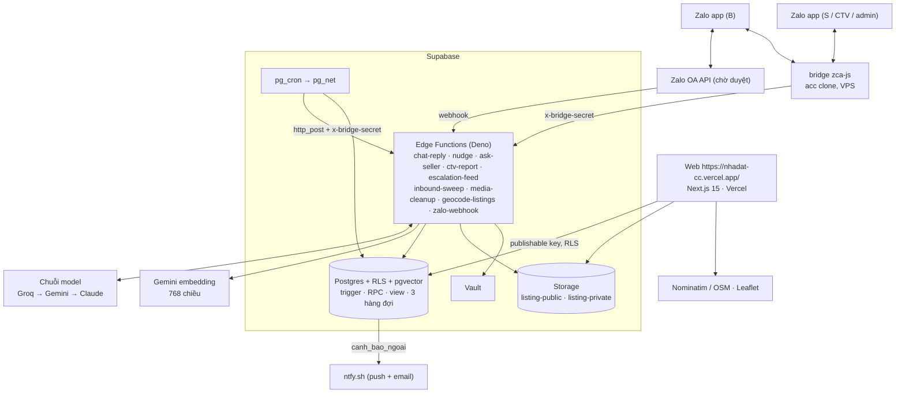
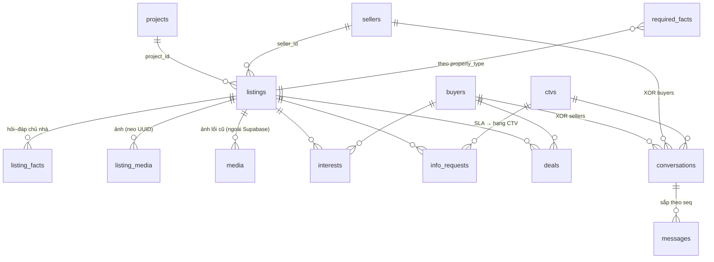
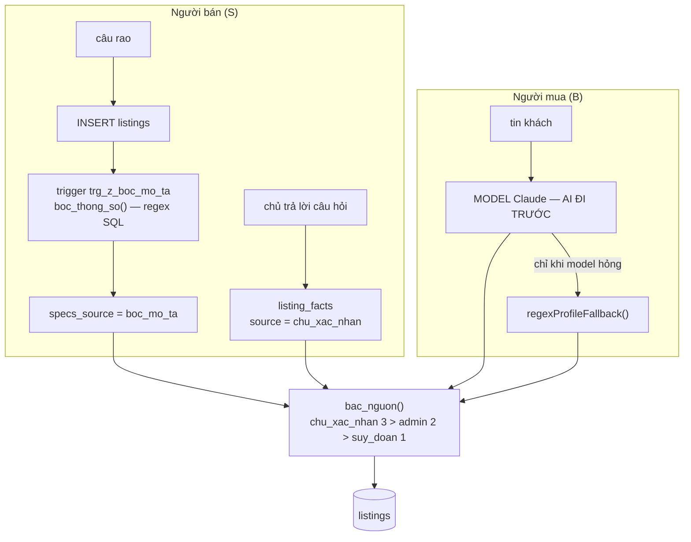

# 07 — Software Requirements Specification

**Hệ thống**: nhadat.cc · **Phiên bản**: v2.0 · **Ngày**: 2026-09-04
**Cơ sở**: `02-requirements.md`, `03-user-flows.md`, `04-information-architecture.md`,
code ở HEAD và DB thật project `nhadat-cc` (`tbcdpupiarkuxtntmosl`).

Tài liệu này tả **hệ thống như đang chạy**. Nguồn của mọi khẳng định là code
trong repo và DB thật (`[nguồn: DB 04/09/2026]` ghi một lần ở đầu mỗi mục lớn).
Mục thiết kế chưa dựng chỉ còn một dòng "Không dựng — thay bằng …" để giữ ID
cho `08-traceability.md`.

---

## 1. Giới thiệu

### 1.1 Mục đích
Đặc tả phần mềm đang vận hành để nghiệm thu (`§7`), kiểm thử (`docs/10`) và
mở rộng mà không lệch khỏi yêu cầu ở `02-requirements.md`.

### 1.2 Phạm vi hệ thống

| Mã | Phân hệ | Đường thật |
|---|---|---|
| `WEB` | Website công khai | Next.js ở root repo: `/`, `/[tag]`, `/mua-ban`, `/cho-thue`, `/nha-dat/[code]`, `/du-an/[slug]`, `/ban-do`, `/moi-gioi`, `/thong-ke`, `/ds/[token]`, `/raoban`, `/tai-khoan`, `/yeu-thich`, `/tinh-lai-vay` |
| `BOT` | B Side | Edge function `chat-reply` (bộ não), `zalo-webhook` (OA) + bridge `zca-js` (acc clone, máy local), `nudge`, `inbound-sweep` |
| `SEL` | S Side | Cùng `chat-reply` (nhánh bán, FR-159), `ask-seller` (hỏi nhỏ giọt), `/quan-ly` + `/dang-nhap` cho NMG |
| `ADM` | Admin | `/admin` (Next, JWT admin qua RLS), `escalation-feed` + `ctv-report` (việc cho CTV/admin), cảnh báo ntfy |

### 1.3 Tài liệu tham chiếu
`docs/00`…`docs/06`, `docs/09-open-issues.md`, `docs/10-ke-hoach-kiem-thu.md`, `bot/README.md`.

---

## 2. Kiến trúc tổng thể



### SRS-2.1 — Tech stack

`[nguồn: package.json, bot/README.md, DB 04/09/2026; soát lại theo mã nguồn 30/09/2026]`

| Lớp | Công nghệ |
|---|---|
| Web | Next.js 15 (App Router) + TypeScript + Tailwind 4, Bun, deploy Vercel project `nhadat-cc` từ root repo |
| Auth | Supabase Auth: Google OAuth + magic link email (NMG, admin, tài khoản B tự nguyện); không Zalo SSO |
| DB | Supabase Postgres, RLS trên mọi bảng, trigger + RPC `security definer`, 3 hàng đợi bằng bảng (`inbound_ledger`, `reminders`, `media_cleanup_queue`); `pgvector` cho tìm theo nghĩa (vector 768 chiều ở `listings`, `projects`, `wards`, `phuong_cu`, `quan_cu`, `duong`) |
| Serverless | Supabase Edge Functions (Deno), 9 function (`§4`) |
| Lịch / HTTP nội bộ | `pg_cron` (`SRS-5.3`; số job đếm lại trong DB, bản 04/09 ghi 12) + `pg_net` (`net.http_post`) |
| Bí mật | Supabase Vault (`ANTHROPIC_API_KEY`, `GROQ_API_KEY`, `GEMINI_API_KEY`, `GEMINI_API_KEY_2`, `BRIDGE_SECRET`), đọc qua `get_secret()` chỉ cho `service_role` |
| Kho file | Supabase Storage: `listing-public` (ảnh, công khai), `listing-private` (sổ đỏ/giấy tờ, signed URL) |
| AI | Chuỗi dự phòng 3 nguồn (`_shared/claude.ts`, `_shared/groq.ts`): Groq (mặc định `qwen/qwen3.8-27b`, đổi bằng secret `GROQ_MODEL`) → Gemini (cổng giọng OpenAI, mặc định `gemini-3.8-flash`) → Anthropic Claude Haiku 4.5 (SDK, structured output zod v4); thứ tự đổi bằng secret `MODEL_TRUOC`, không cần deploy; lượt có ảnh đi thẳng Claude. Prompt sửa được ở bảng `bot_prompts` (FR-138) |
| Tìm theo nghĩa | Gemini `gemini-embedding-001` (768 chiều) — câu tìm nhúng lúc chat (`_shared/ai/nhung.ts`, 429 thì thử khoá 2, SRS-5.1g), tài liệu nhúng bằng cron `nhung_tick` / `nhung_dia_danh_tick`; công tắc `app_config.tim_theo_nghia` |
| Chat | Zalo qua bridge `zca-js` (acc clone, chạy trên VPS từ 04/09 — `bot/bridge-zca/VPS.md`); Zalo OA API qua `zalo-webhook` chờ OA duyệt |
| Cảnh báo | ntfy.sh (`canh_bao_ngoai`), chuyển tiếp email khi có tài khoản ntfy (`SRS-5.5`) |
| Bản đồ | Leaflet + OSM tile; geocode Nominatim (`geocode-listings`); tiện ích quanh tin qua Overpass |
| Quan trắc | `bot_errors` / `bot_health` / `bot_usage` + `/admin` (FR-152, FR-169); không Logstash/ES, Slack, SMTP, fingerprint |

### SRS-2.2 — Đường giao tiếp S↔B

`[nguồn: DB 04/09/2026, chat-reply v48]` Một đường duy nhất, bằng bảng + trigger, không HTTP giữa hai "side":

1. Khách hỏi về căn → `chat-reply` chèn `info_requests(source='buyer_ask')`; trigger `route_info_request` giao CTV ít việc
   nhất (không có CTV → admin), `sla_due_at` = +`ctv_sla_phut()` (120 phút) (FR-140, FR-173).
2. Trigger `notify_info_request_escalation` sinh MỘT `reminders(kind='escalation')` cho người được giao kèm mẫu
   "`#mã: câu trả lời`"; bridge kéo qua `escalation-feed`.
3. Người nội bộ / chủ nhà nhắn "`#mã: …`" → `chat-reply` (`nguoi_noi_bo`) ghi `ghi_fact_listing` + đóng câu `answered`;
   trigger `info_request_bao_lai_khach` hẹn `followup` cho khách, `nudge` gửi (FR-140 c).
4. Quá SLA → `info_request_sla_tick()` nhắc admin + `[QUESTION]`; quá 48 h → `info_request_timeout_tick()` báo thật cho khách kèm căn khác (FR-110).

Vòng nhỏ giọt với chủ nhà (`source='seller_flow'`) đi cùng bảng, gọi `ask-seller` qua `ask_seller_drip()` (FR-129/144). Không có kênh Slack (OPEN-03 đóng).

---

## 3. Mô hình dữ liệu

`[nguồn: information_schema + pg_constraint + pg_policies, DB 04/09/2026]`
Khối: `cột:kiểu`, `!` = NOT NULL, `=` = default, `→` = FK. PK `uuid` trừ khi ghi khác. Enum thật:
`listing_deal(ban, cho_thue)`, `property_type(nha_pho, nha_cap4, chung_cu, dat, biet_thu, phong_tro, mat_bang, toa_nha, dat_nong_nghiep, dat_kinh_doanh, kho_xuong, chua_ro)` (4 loại sau thêm `20260909i`),
`seller_type(ccrb, nmg, unknown)`, `request_status(pending, answered, expired)`, `msg_sender(buyer, seller, bot, ctv, system, human)`,
`unit_status(con_ban, giu_cho, da_coc, da_ban)`.

### SRS-3.0 · Bản đồ 46 bảng và đường bóc tách

`[nguồn: pg_class + pg_description, DB 06/09/2026]`

Ba tháng sau mở lại repo, thứ mất trước tiên là *cái nào thuộc về cái nào*. Mục
này là bản đồ đó. Nó KHÔNG đẻ nguồn sự thật thứ hai: chú thích tương ứng đã nằm
trong chính DB (`comment on table/column`, migration `20260906b`), hiện ra ngay
dưới tên bảng trong Supabase Table Editor. Đây là bản in ra giấy của thứ đó.

**Năm nhóm, đủ 46 bảng** (`van_kich` thêm 06/10/2026, `20261006b`, SRS-5.1zzn; `du_an_tai_lieu`, `du_an_can` thêm 05/10/2026, `20261006a`, SRS-5.1zzj; `nhung_viec_dia_danh`, `phuong_cu`, `quan_cu` thêm 30/09/2026, `20260930a`; `nhung_viec`, `nhung_viec_du_an` thêm 23/09/2026, FR-216; `duong` thêm 21/09/2026, FR-212; soát lại 18/09/2026 theo `obj_description` thật trên DB — bản trước ghi 32, thiếu `project_facts` `tien_ich` `mau_cau` `boc_tach_bong` `bridge_dang_nhap` và xếp `required_facts` sai nhóm). Tiền tố `[NHÓM]` nằm ngay đầu chú thích mỗi bảng, nên
Table Editor vẫn xếp A→Z mà mắt vẫn gom được theo việc.

| Nhóm | Bảng |
|---|---|
| `[RỔ HÀNG]` (15) | `listings` `media` `listing_media` `listing_facts` `media_cleanup_queue` `projects` `project_facts` (FR-195) `listing_views` `wards` (FR-209) `tien_ich` (FR-204, chú thích `20260918a`) `duong` (FR-212, `20260921b`) `phuong_cu` `quan_cu` (`20260930a`) `du_an_tai_lieu` `du_an_can` (`20261006a`, SRS-5.1zzj) |
| `[NGƯỜI & HỘI THOẠI]` (10) | `buyers` `sellers` `conversations` `messages` `interests` `info_requests` `viewings` `deals` `reminders` `ratings_log` |
| `[BOT & HÀNG ĐỢI]` (14) | `inbound_events` `inbound_ledger` `bot_errors` `bot_health` `bot_usage` `chat_quota` `bot_prompts` `required_facts` `mau_cau` (FR-180) `boc_tach_bong` (FR-208) `nhung_viec` `nhung_viec_du_an` (FR-216) `nhung_viec_dia_danh` (`20260930a`) `van_kich` (`20261006b`, SRS-5.1zzn) |
| `[CTV]` (2) | `ctvs` `ctv_daily_reports` |
| `[HỆ THỐNG]` (5) | `admins` `app_config` `curated_lists` `property_events` `bridge_dang_nhap` (FR-201, `20260911b`) |

**Quan hệ chính** — chỉ khoá ngoại thật, không vẽ luồng chạy:



Ba chỗ hay hiểu nhầm, nói thẳng ở đây:

- **Không có bảng `buyer_preferences`.** Nhu cầu khách nằm ở cột
  `buyers.preferences` (jsonb).
- **Không có, và không cần, bảng `<loai>_specs` cho từng loại BĐS.** Chỗ rổ
  hàng đã chia theo loại là `required_facts` — 38 câu hỏi × 7 loại, khoá
  `(property_type, fact_key)`. Định nghĩa thông số phía mã nguồn là `SPEC_COLS`
  trong `bot/supabase/functions/_shared/thong_so.ts` (FR-172).
- **`media` và `listing_media` là hai đời khác nhau.** `media` (1005 dòng) trỏ
  file NGOÀI Supabase — đường dẫn dựng theo `listings.legacy_sst`, tức ảnh nằm
  trong kho ảnh gốc trên máy local, không nằm trong Storage. `listing_media`
  (FR-165) mới là ảnh trong Storage, neo `listings.id`. **Từ 07/09/2026 lối mới
  đã có dữ liệu thật**: `listing_media` 1005 dòng, `listing_photos_v` 945,
  **171/173 tin có ảnh** (hai tin `BDS-Q5-0113`/`BDS-Q5-0124` trống vì thư mục
  nguồn rỗng). Trước hôm đó `storage.objects` = 0 và web phục vụ ảnh giữ chỗ cho
  mọi tin — mốc này để lần sau thấy web vỡ ảnh thì biết soi `listing_media`
  trước. `media` giữ nguyên làm sổ đối chiếu, chưa xoá.

**Đường bóc tách — hai nhánh chạy NGƯỢC nhau.** Đây là hình trạng thật, không
phải hình mong muốn:



Nhánh S đúng thứ tự *tiền định trước, model sau* — **đã đổi từ 21/09/2026**: chế độ `boc_tach_ai = chinh` đảo tầng, AI
đọc trước và qua kiểm bằng chứng, luật chỉ đỡ khi model hỏng (FR-208 f; phạm vi AI ⟂ code ở SRS-5.1d). Nhánh B thì ngược: mỗi tin
khách là một lượt gọi model, kể cả câu regex bóc được ("dưới 6 tỷ", "3 phòng
ngủ"); regex chỉ chạy khi model chết (`chat-reply/index.ts:65`, gọi ở `:2266`).
Đảo lại nhánh B là việc còn treo, chưa làm.

**Ranh giới bóc tách ⟂ AI có máy canh.** `bot/tests/ranh-gioi.mjs` (nằm trong
`bun run test:bot`, nên chạy ở CI mỗi PR) chặn hai chiều: mã bóc tách tiền định
không được import SDK Anthropic / `claude.ts` / gọi RPC; tầng AI không được ghi
bảng nghiệp vụ, chỉ ba RPC đã khai tên (`get_secret`, `log_loi`, `cong_token`).
Bài có ca âm nên luật hỏng thì bài đỏ, không im.

**Đọc rổ hàng bằng mắt người:** view `ro_hang_ban` (20 cột thay cho 56, giá quy
ra tỷ, nhãn tiếng Việt, cột `canh_bao` chỉ đích danh trường nào là máy đoán).
`security_invoker = on`, `anon` bị revoke.

**Nhìn như Excel:** schema `so` (`20260907c`) tách riêng khỏi `public` để Table
Editor / Schema Visualizer không lẫn 38 bảng + 19 view ruột bot (đếm trên DB 18/09/2026). Hai view:
`so.ro_hang` — 9 cột đầu đúng thứ tự sheet Excel gốc Q5 (trong `masterDB/`) (stt · bán
hay thuê · vị trí · diện tích · giá · mô tả · SĐT · người bán), cột thêm xếp
sau, cả bán lẫn cho thuê; `so.nguoi_ban` — mỗi người bán một dòng, đếm tin;
`so.hoi_thoai` (`20260907g`) — log chat đọc được: lúc · ai · nội dung · phía bán/mua,
lọc theo `hoi_thoai` để đọc trọn một cuộc (nguồn `messages`, không SĐT).
PostgREST không phơi schema này, `anon`/`authenticated` bị revoke,
`security_invoker = on`. Khác Excel: cột SĐT là SĐT **người bán đã ký** (60/173
tin), DB không giữ SĐT theo tin (FR-104). `xuat_schema()` chỉ quét `public` nên
`so` không nằm trong `schema.sql`; dựng lại phải chạy thêm hai file migration
(`20260907c`, rồi `20260907f` — ô đọc một dòng: mô tả gộp xuống dòng thành
` · `, vị trí bỏ đuôi `, Quận 5, Hồ Chí Minh`, diện tích dấu phẩy thập phân)
[giả định BA: chấp nhận vì view không mang dữ liệu].

### SRS-3.1 · `listings`

```text
id:uuid!  code:text! unique ('BDS-Q5-0001', trigger listings_fill_code)  legacy_sst:int
seller_id:uuid→sellers  deal:listing_deal!=ban  status:text!=cho_thong_tin
district:text!='Quận 5'  ward:text  street:text  location_raw:text  lat,lng:numeric
property_type:property_type=chua_ro  project_id:uuid→projects  unit_code:text  unit_status:unit_status
area_m2,legal_area_m2,built_area_m2:numeric  frontage_m,length_m,rear_width_m:numeric
floors:int  floors_text:text  floor:int  bedrooms:int  bathrooms:int  direction:text
access_type:text  alley_width_m,distance_to_street_m:numeric
legal_status:text  has_completion:bool  planning_status:text
has_elevator,car_in_house,corner_lot,negotiable:bool  furnishing:text  year_built:int
price_raw:text  price_vnd:bigint  price_per_m2_vnd:bigint(generated)  rent_income_vnd:bigint
description:text  source:text!=import_excel  source_url,cc_link:text
property_type_source,price_source,ward_source:text!=suy_doan  specs_source:text
last_confirmed_at,last_interest_at:timestamptz  created_at,updated_at:timestamptz!
nhan:text[]!='{}' (FR-211, chỉ mục GIN, khoá theo từ điển `_shared/extraction/nhan.ts`; ghi qua RPC `them_nhan_tin`)
```
Bản đồ ánh xạ đầy đủ 67 cột (nghĩa, khách nói ví dụ, ghi từ đâu, fact liên quan, lọc ở đâu) + fact → cột + ma trận 12 loại BĐS:
`docs/anh-xa-du-lieu-listings.xlsx` (ảnh chụp 18/09/2026 từ `information_schema` + trigger + `required_facts` + 10 tin bắn thật; đổi schema thì phải làm lại).

- CHECK `status ∈ {cho_thong_tin, dang_ban, dang_quan_tam, da_chot, an}` (FR-139); `access_type ∈ {mat_tien, hem_xe_tai, hem_xe_hoi, hem_xe_may, hem}`;
  `legal_status ∈ {so_hong_rieng, so_hong_chung, so_hong, hdmb, giay_tay}`; `furnishing ∈ {full, co_ban, khong}`; `bedrooms 1..20`;
  `*_source ∈ {suy_doan, chu_xac_nhan, admin}`; `specs_source ∈ {boc_mo_ta, admin, chu_xac_nhan}` (FR-164/172).
- Trigger BEFORE (theo tên): `listings_chuan_hoa_cot` → `fill_code` → `fill_property_type` (FR-150) → `set_price_vnd` (FR-154) →
  `trg_y_boc_thong_so` (FR-172) → `trg_z_normalize_status` → `trg_zz_dang_tin` (tự lên kệ khi đủ giá + m2 + phường, FR-144).
  AFTER: `listing_insert_drip` (FR-129), `bao_tin_moi_khop` (FR-64), `bao_can_da_chot` (FR-108), `trg_pe_listings` (FR-70).
- Index lọc: `(deal, price_vnd)`, `(deal, status, access_type)`, `(deal, status, floors)`, `(district, status)`; unique partial `(project_id, unit_code)`.
- Policy: `anon_read_listings` chỉ `dang_ban | dang_quan_tam | da_chot`; `listings_own_read/insert` (NMG tin của mình); `listings_admin_read/update`.
- Luật: `area_m2` là diện tích chính (chung cư = tim tường), `legal_area_m2` là công nhận — hai cột khác nhau; `description` giữ nguyên văn
  câu rao, không trigger nào sửa (FR-91/153). Bậc nguồn `chu_xac_nhan` > `admin` > `suy_doan`/`boc_mo_ta`; fact chỉ ghi vào cột khi bậc ≥ bậc
  đang giữ, cùng bậc thì mới nhất thắng (FR-163 a, FR-164 a).

### SRS-3.2 · `property_events` — FR-70, FR-73

```text
id:bigserial  listing_id:uuid!→listings cascade  event_type:text!  buyer_id:uuid→buyers set null  at:timestamptz!=now()  meta:jsonb
```
- CHECK `event_type ∈ {view, asked, interest, photos, viewing, deal, match_sent, status}`; index `(listing_id, at desc)`, `(at desc)`; policy `property_events_admin_read`.
- Chỉ trigger `trg_property_event()` ghi (`ghi_su_kien_bds`, không bao giờ ném): `listing_views` → `view`, `info_requests` `buyer_ask` → `asked`,
  `interests` → `interest`, `viewings` → `viewing`, `deals` → `deal`, `reminders` match sent → `match_sent`, `listings` đổi `status` → `status`. `photos` chưa có nguồn sinh.
- `hot_score` (FR-73) = view `bds_hot` tính lúc đọc (số sự kiện 60 ngày), không có cột/job.

### SRS-3.3 · `buyers`

```text
id:uuid!  zalo_user_id:text unique  auth_user_id:uuid unique→auth.users  name:text  phone:text
preferences:jsonb='{}'  last_contact_at:timestamptz  notes:text  created_at:timestamptz!
```
- `preferences` = hồ sơ nhu cầu tích luỹ (`deal` từ ngắn `ban|thue`, `area`, `budget`, `alley`, `bedrooms`, `photo_offset`, `hoi_vai`…), ghi qua `merge_buyer_prefs()` (FR-130).
- `phone` chỉ khi B tự cung cấp ở luồng đặt lịch (NFR-07); `/admin` không SELECT cột này. Policy `buyers_self_read/insert/update`, `buyers_admin_read`.
- Không có `connection_status`/`fingerprint_ids`: vết giữ chân ở `reminders.kind = reengage` (FR-63); fingerprint không dựng (OPEN-14).

### SRS-3.4 · `sellers`

```text
id:uuid!  zalo_user_id:text unique  auth_user_id:uuid unique→auth.users  phone:text unique  phone_proxy:text  name:text
seller_type:seller_type!=unknown  rating_sum:int!=0  rating_count:int!=0  active_listing_id:uuid→listings set null  created_at:timestamptz!
```
- `seller_type` quyết định phí (CCRB 1 %, NMG 0,5 %, FR-101); hồ sơ mở từ chat (`mo_ho_so_nguoi_ban`, FR-159) mang nhãn ngay
  (có BĐS = `ccrb`, tự xưng môi giới = `nmg`), không ghi đè nhãn đã có; `unknown` chỉ còn ở hồ sơ tạo tay.
- `active_listing_id` = căn bot đang hỏi (FR-157), trigger `info_request_set_active_listing` giữ. `rating_*` chỉ do `ghi_danh_gia()` ghi (FR-65).
- Policy `sellers_self_read/insert`, `sellers_admin_read/update`. Không có `fee_rate`, `email`, `contract_status`.

### SRS-3.5 · `conversations`, `messages` — FR-71, FR-72, FR-131, FR-141

```text
conversations  id:uuid!  buyer_id:uuid→buyers  seller_id:uuid→sellers  ctv_id:uuid→ctvs  channel:text!=zalo_oa  started_at:timestamptz!
               last_message_at:timestamptz  needs_human:bool!=false  needs_human_at,human_touch_at,human_escalated_at:timestamptz
messages       id:uuid!  conversation_id:uuid!→conversations  sender:msg_sender!  body:text!  zalo_msg_id:text unique  seq:bigint! unique  created_at:timestamptz!
```
- CHECK `conversations_mot_vai` (`buyer_id` XOR `seller_id`); unique partial `(buyer_id)`, `(seller_id)` — **một hội thoại/khách, không bao giờ đóng** (FR-131).
  "Cuộc trò chuyện" 30 phút của FR-72 tính lúc đọc ở view `hoi_thoai_phien`.
- Trigger: `assign_ctv_round_robin` (BEFORE INSERT, chia CTV); `conversations_email_upset` (`needs_human` false→true → `[UPSET]`);
  `messages_bump_last_message` giữ `last_message_at = greatest(cũ, mới)` — ứng dụng không ghi tay (FR-171 h).
- `seq` là thứ tự tất định cho gửi/replay (FR-162). Policy chỉ `*_admin_read`; bot ghi bằng `service_role`.

### SRS-3.6 · `info_requests` — FR-40…FR-44, FR-76, FR-110, FR-140, FR-173

```text
id:uuid!  listing_id:uuid!→listings cascade  buyer_id:uuid→buyers  question:text!  answer:text  status:request_status!=pending
source:text!=seller_flow  assignee:text  ctv_id:uuid→ctvs  sla_due_at,sla_missed_at,reminded_at,answered_at:timestamptz  created_at:timestamptz!
```
- CHECK `assignee ∈ {seller, ctv, admin}`; `source ∈ {seller_flow, buyer_ask}` (theo code); index partial `(sla_due_at) where pending and sla_missed_at is null`.
- Trigger: `route_info_request` (BEFORE, giao việc + SLA), `notify_info_request_escalation` (bỏ qua `xac_nhan_lich`/`con_ban`),
  `info_request_bao_lai_khach` (`answered` → followup; `xac_nhan_lich` → `viewings.status='confirmed'`), `info_request_set_active_listing`, `trg_pe_info_requests`.
- `question` với `seller_flow` là `fact_key` của `required_facts`; với `buyer_ask` là chữ tự do. FR-44: câu trả lời vào cột qua `listing_facts_sync_cols` (SRS-3.14). Policy `info_requests_admin_read`.

### SRS-3.7 · `viewings` — FR-50…FR-57, FR-65

```text
id:uuid!  listing_id:uuid→listings  listing_code:text  buyer_id:uuid→buyers  guide:text  slot:timestamptz  time_text:text  phone:text
status:text!=proposed  buyer_rating:int  note:text  source:text=bot  created_at:timestamptz!
```
- CHECK `status ∈ {proposed, pending, confirmed, done, cancelled}`; `buyer_rating 1..5`; `viewings_can_neo` (`listing_id` hoặc `listing_code`).
- INSERT → `viewings_bao_ctv_va_email`: nhắc CTV của hội thoại (hoặc admin) ngay, mở câu `xac_nhan_lich` (`buyer_ask`), `email_admin('VIEWING')` (FR-52/57/81).
- Nhắc trước giờ xem = `reminders.kind='viewing'` kèm link bản đồ khi có toạ độ (FR-54); `viewing` sent → `feedback` +4 h (FR-56); `buyer_rating` do `ghi_danh_gia()` ghi.
- `phone` chỉ điền khi B đồng ý ở bước này (NFR-07). Policy `viewings_admin_read`.

### SRS-3.8 · `interests`, `listing_facts`, `deals` — FR-108, FR-112, FR-140, FR-153

```text
interests      buyer_id:uuid!→buyers cascade  listing_id:uuid!→listings cascade  created_at:timestamptz!   (PK cặp)
listing_facts  id:uuid!  listing_id:uuid!→listings cascade  question:text!  answer:text!  source:text!=seller_zalo  created_at:timestamptz!
deals          id:uuid!  listing_id:uuid!→listings  buyer_id:uuid→buyers  ctv_id:uuid→ctvs  price_vnd:bigint  fee_pct:numeric  closed_at  created_at
               unique nulls not distinct (listing_id, buyer_id)
```
- `interests`: `mark_listing_interest(codes, buyer_id)` ghi cho mọi căn khách nhắc/bot gợi/xin hình/nhờ hỏi chủ; tin sang `da_chot` → mỗi khách
  trong `interests` nhận `reminders.kind='sold'` kèm căn thay thế (FR-108).
- `listing_facts`: kho hỏi-đáp tích luỹ, `answer` giữ nguyên văn; ghi duy nhất qua `ghi_fact_listing()`; trigger `listing_facts_sync_cols` đổ vào cột
  theo luật bậc (SRS-3.14). Policy anon đọc trừ `hinh_anh`/`dia_chi_chi_tiet`, chỉ tin lên kệ.
- `deals`: căn cứ phí (`fee_pct` null khi chốt lúc `unknown`, OPEN-28); `deals_chan_xoa_da_chot` cấm xoá deal đã chốt.
- Bất biến ẩn danh (FR-104/105): view/policy công khai không bao giờ trả `phone`, `zalo_user_id`, số nhà; trong hội thoại bot khai mọi thứ đã lưu
  về căn trừ liên hệ người bán (OPEN-36); bong bóng gửi người mua qua `locLienHe()`.

### SRS-3.8a · Hai luật chữ nghĩa bắt buộc

`[nguồn: chat-reply v48]`
- **`deal` có hai bảng từ vựng**: cột `listings.deal` = `ban | cho_thue`; JSON `buyers.preferences` và schema model = `ban | thue`. Mọi chỗ chạm cột phải qua `dealCol()` (FR-163).
- **Không đặt `\b` cạnh chữ tiếng Việt có dấu** — `\w` của JS chỉ là ASCII. Tự dựng biên (`(^|[^a-zà-ỹ])…(?![a-zà-ỹ])`) hoặc khớp trên bản bỏ dấu `boDau()` (FR-161).

### SRS-3.8b · Bảng phụ trợ

```text
curated_lists        id:uuid!  token:text! unique =24 hex  buyer_id:uuid→buyers set null  listing_ids:uuid[]! (1..60)  title  created_at
                     expires_at:=now()+30 ngày                                    -- FR-100; RLS, không policy; đọc/tạo qua RPC (SRS-4.3)
listing_media        id:uuid!  listing_id:uuid!→listings cascade  bucket:text!  storage_path:text!  media_type:text!  mime_type:text!
                     sort_order:int!=0  is_cover:bool!=false  created_at         -- FR-165
                     CHECK bucket ∈ {listing-public, listing-private}; media_type ∈ {mat_tien, trong_nha, hem, so_do, giay_to, khac};
                     so_do/giay_to ⇒ bucket riêng; is_cover ⇒ bucket công khai; storage_path bắt đầu '<listing_id>/'; unique (bucket, storage_path);
                     unique partial một bìa/tin; trigger listing_media_giu_bia, listing_media_xep_hang_don (→ media_cleanup_queue)
media_cleanup_queue  id:uuid!  bucket,storage_path:text!  trang_thai:text!=cho ∈ {cho, dang_lam, xong, loi, chet}  attempts:int!=0  last_error
                     next_retry_at  created_at  updated_at                          -- FR-165 e, FR-166 g
inbound_events       event_id:text! PK (= zalo_msg_id)  zalo_user_id  payload:jsonb  delivery_count:int!=1  first_seen_at  last_seen_at  -- FR-162
inbound_ledger       zalo_msg_id:text! PK  status:text!=received ∈ {received, processing, completed, failed, dead}  attempts:int!=1  reply:jsonb
                     detail  sent_at  send_error  sent_bubbles:int!=0  next_retry_at  locked_by  started_at  finished_at  -- FR-162, FR-166
reminders            id:uuid!  kind:text! ∈ {promise, reengage, viewing, followup, escalation, report, match, feedback, sold, rating}
                     buyer_id  seller_id  ctv_id  listing_id  viewing_id (FK cascade)  due_at:timestamptz!  note:text
                     status:text!=pending ∈ {pending, sent, cancelled, dead}  sent_at  locked_at  locked_by  attempts:int!=0  next_retry_at  last_error
                     unique partial: (buyer_id, listing_id) match; (buyer_id, listing_id) sold; (viewing_id) feedback; (buyer_id) reengage pending
                     -- FR-32/60…64/108/110/133/166 f; policy reminders_admin_read/update
ratings_log          buyer_id,listing_id (PK)  stars:int! 1..5  note  at        -- FR-65, idempotent cho ghi_danh_gia
ctvs                 id:uuid!  name:text!  zalo_user_id unique  phone  active:bool!=true  last_assigned_at  created_at   -- FR-136/173
ctv_daily_reports    id  report_date:date!  ctv_id→ctvs  body:text!  scores:jsonb  sent_to  created_at; unique (report_date, ctv_id)  -- FR-137
required_facts       property_type:property_type!  fact_key:text!  priority:int!=1  nhom:text!=chuyen_mon (co_ban|chuyen_mon|phu|sau_dang; priority 1–9/10–19/20+/30+ — sau_dang hỏi bù SAU khi lên kệ, 20260909i)  (PK cặp)   -- FR-153/177
listing_views        auth_user_id:uuid!→auth.users  listing_id:uuid!→listings  viewed_at; policy views_own_all   -- FR-126
admins               email:text! PK  zalo_user_id  zalo_phone; policy admins_self_read
app_config           key PK  value!  ghi_chu  (admin_email, ntfy_topic, functions_base_url, storage_public_base_url, publishable_key)
bot_prompts          key PK  content!  updated_at (trigger touch)   -- FR-138
wards                ten:text! PK (tên MỚI không tiền tố, khoá tra Nominatim)  loai! ∈ {phuong, xa, dac_khu}  ten_day_du!  quan_cu! ("Quận 9" — chuỗi bocQuan/mã tin)
                     don_vi_2025:text[]!  tinh_cu! ∈ {TP.HCM, Bình Dương, Bà Rịa – Vũng Tàu}  don_vi_cu  lat,lng:numeric(9,6)  ma_hanh_chinh  nguon!  ghi_chu  created_at
                     -- FR-209 / FR-174 đợt 2 (20260915a): 168 dòng, nguồn NQ 1685 + Wikipedia; RLS bật, revoke anon/authenticated, chỉ service_role; xuat_schema() KHÔNG xuất dữ liệu → dựng lại chạy thêm migration
                     nhung:vector(768)  nhung_md5  nhung_luc   -- 20260930a: vector nghĩa (Gemini) của van_ban_dia_danh('wards', ten); cron nhung-dia-danh-tick
duong                id:uuid PK  ten:text! (có dấu, không tiền tố "Đường")  ten_khong_dau:text (generated: bo_dau(ten), index)  tinh! ∈ {TP.HCM, Tây Ninh, Đồng Nai} (tỉnh MỚI)
                     tinh_cu ∈ {TP.HCM, Bình Dương, Bà Rịa – Vũng Tàu}  phuong:text!='' (wards.ten_day_du)  quan_cu  nguon!  created_at; unique (ten, tinh, phuong)
                     -- FR-212 (20260921b): từ điển tên đường từ OSM/Overpass theo phường mới; RPC tim_duong(ten, quan, toi_da) khớp đúng/gần (fuzzystrmatch); chỉ service_role; dữ liệu nạp bằng scripts/nap-duong.mjs
                     loai ∈ {duong, so, hem}  so_hem ('137', '137/28')  duong_me  lat,lng (tâm OSM)  nhung:vector(768) (không nhúng hẻm)  nhung_md5  nhung_luc   -- 20260930a: giữ đường số + hẻm có toạ độ (nap-duong.mjs out center)
phuong_cu            id PK  ten! ('Phường 12', 'Phường Thảo Điền')  loai ∈ {phuong, xa, thi_tran}  quan_cu!  phuong_moi!→wards.ten  toan_bo!  lat,lng (tâm phường mới)  nhung  -- 20260930a: 487 dòng tách từ wards.don_vi_cu; unique (ten, quan_cu, phuong_moi)
quan_cu              ten PK ('Quận Gò Vấp')  lat,lng (trung bình tâm phường mới)  so_phuong_moi  nhung  -- 20260930a: quận / huyện / TP cũ trước 07/2025
media                bảng cũ đường OneDrive, còn policy anon đọc ảnh approved, không còn nguồn ghi — dọn cùng OPEN-18
```
- Không dựng: `tags`/`property_tags` (tag là hằng `lib/tags.ts`, 64 tag, FR-12; OPEN-06), `saved_criteria` (FR-64 đọc `buyers.preferences`),
  `escalations` (bốn loại đi `email_admin()`; vết việc ở `reminders`/`viewings`/`info_requests`), `photos` (thay bởi `listing_media`).

### SRS-3.9 · Bảo mật dữ liệu

`[nguồn: pg_policies, pg_class.relacl, storage.policies, DB 04/09/2026]` Anon key là khoá **công khai** (trong bundle JS và bridge) nên RLS + GRANT là bức tường duy nhất:

1. Vai `anon` chỉ SELECT; `authenticated` ghi có policy gác (`buyers`, `sellers`, `listings` nháp, `listing_views`, `listing_media` tin của mình); không ai có TRUNCATE (FR-167).
2. Bảng chỉ cho bot (`conversations`, `messages`, `info_requests`, `viewings`, `deals`, `interests`, `ctvs`, `ctv_daily_reports`, `bot_prompts`, `required_facts`,
   `curated_lists`, `inbound_*`, `media_cleanup_queue`, `ratings_log`, `app_config`) bật RLS, chỉ policy đọc cho admin hoặc không policy — anon 0 dòng; cảnh báo `rls_enabled_no_policy` là kỳ vọng.
3. Hàm là nội bộ trừ khi chứng minh ngược lại: EXECUTE mặc định chỉ `service_role`/`postgres`; ngoại lệ cố ý là hàm thuần `immutable` (`bo_dau`, `boc_thong_so`,
   `khu_khop`, `bac_nguon`, `seller_rank`, `chuan_hoa_*`…), `log_loi` (web Next chạy bằng publishable key), `doc_danh_sach` (anon), và cho `authenticated`:
   `admin_dang_tin`, `tao_danh_sach`, `la_admin`, `tin_cua_toi`, `thu_muc_dau_uuid`, `parse_vnd`, `guess_property_type`. Mọi hàm ghim `search_path`.
4. View công khai phải là **SECURITY DEFINER tự chứa** (`agents_public`, `listing_photos_v`), chỉ lộ cột không định danh, chỉ tin đã lên kệ; view không dùng cho anon
   để `security_invoker` và revoke (`public_listings`, `public_media`, `listing_missing_facts`, `job_suc_khoe`, `media_mo_coi_*`). View admin (`ctv_ranks`, `nmg_hoat_dong`,
   `bds_hot`, `hoi_thoai_*`, `khach_can_nguoi_that`, `bot_do_tre`) gác `auth.role() = 'service_role'` hoặc email trong `admins` (FR-167 c).
5. Vault không chạm anon: `get_secret()` chỉ `postgres`/`service_role`.
6. Storage: `listing-private` không có route public; đọc duy nhất bằng signed URL 900 s do admin ký ở `/admin` (`storage_admin_private_all`, NFR-06). Bucket công khai:
   `storage_admin_public_all`; người bán chỉ INSERT/DELETE đường dẫn có thư mục đầu = UUID tin của mình (`tin_cua_toi(thu_muc_dau_uuid(name))`, FR-96).
   `listing_media` công khai chỉ đọc được khi TIN đã lên kệ (`listing_media_doc_cong_khai`, FR-167 c).
7. Cổng edge function: 8 function (trừ `zalo-webhook`) qua nếu `Authorization` là service key hoặc header `x-bridge-secret` khớp `BRIDGE_SECRET`; chưa đặt secret thì
   fail-open nhưng ghi `bot_errors` nguồn `<function> CONG MO`; bí mật đọc qua `secretOf()` (env trước, Vault sau). Mọi hàm SQL gọi `net.http_post` tới function
   phải mang `x-bridge-secret`, trừ `canh_bao_ngoai` (FR-151 b, FR-167 b).
8. `zalo-webhook` `verify_jwt=false`; chữ ký `X-ZEvent-Signature` chỉ kiểm khi có `ZALO_APP_SECRET` (chưa có → ghi `KHONG VERIFY`, OPEN-33).

Hồi quy: TS-SEC-01…10, TS-SEC2 (`docs/10`) sau mọi migration đụng RLS/GRANT.

### SRS-3.10 · `projects` — FR-113…FR-117

```text
id:uuid!  name:text!  slug:text unique  developer  district  ward  province  location_raw  lat,lng:numeric  legal_status  amenities:jsonb
floor_plans:jsonb  images:jsonb  specs:jsonb  unit_types:jsonb  description  price_min,price_max:bigint  priority:int!=100  is_partner:bool!=false
handover_date:date  handover:text  status_text  source  source_url  created_at  updated_at
```
- `listings.project_id/unit_code/floor/direction/unit_status` nối căn với dự án; unique partial `(project_id, unit_code)`. Policy `anon_read_projects` (true); `match_projects(text)` tìm dự án khách nhắc.
- Luật thừa hưởng (FR-115/116): câu tầng dự án trả từ `projects`, không sinh `info_requests`; "căn X còn không" đọc `unit_status`; `last_confirmed_at` > 7 ngày hoặc null → "để em xác nhận lại chủ".

### SRS-3.11 · Tài khoản, admin và view quan trắc hội thoại — FR-124…FR-128, FR-71/74/76/77/78/80

- `sellers.auth_user_id`, `buyers.auth_user_id` nối Supabase Auth (Google OAuth + magic link). CCRB không cần tài khoản.
- `admins(email)`: mọi policy `*_admin_read/update` kiểm `exists (select 1 from admins where email = auth.jwt()->>'email')`. Thêm admin = insert email.
  Sáu bảng buyer side (`info_requests`, `viewings`, `buyers`, `conversations`, `messages`, `ctvs`) chỉ mở SELECT cho admin; ghi vẫn thuộc bot/trigger.
- `agents_public` (definer, tự chứa): `id, name, seller_type, rating_sum, rating_count, listing_count, closed_count, rank` — không bao giờ `phone`/`zalo_user_id` (FR-125).
- `listing_views` (own-only) là nền "tin đã xem"; `TrackView` chỉ chạy khi có phiên đăng nhập.
- View admin: `hoi_thoai_thong_ke` (30 ngày theo ngày VN, FR-71), `khach_can_nguoi_that` (FR-77), `hoi_thoai_phien` (FR-72), `bds_hot` (FR-73), `bot_do_tre` (p50/p95, NFR-01). `/admin` đọc bằng JWT admin, có CSV.
- Kỷ luật cột: DB quyết "ai đọc", web quyết "đọc cột nào" — `app/admin/page.tsx` không SELECT `buyers.phone`/`ctvs.phone` (NFR-07).

### SRS-3.12 · Bảng vận hành và hàm RPC — FR-146, FR-151, FR-152, FR-159, FR-166…FR-173

```text
bot_usage   day:date! PK (giờ VN)  model_calls:int!=0  capped_at  in_tokens,out_tokens,cache_write_tokens,cache_read_tokens:bigint!=0  -- FR-151 a, FR-169
bot_usage_model  day:date! model:text! PK(day,model)  calls:int!=0  in_tokens,out_tokens,cache_write_tokens,cache_read_tokens:bigint!=0  -- SRS-5.1zv/zw: chữ-máy + lượt theo model, /admin quy ra đô đúng giá từng model
bot_errors  id:bigserial  at:timestamptz!  source:text!  status_code:int  detail:text; index (at desc), (source, at desc)      -- FR-152
bot_health  who:text! PK  at:timestamptz!  last_id:bigint!=0                                                                    -- FR-152
```
Cả ba: RLS, policy `*_admin_read`, ghi chỉ `service_role`. `bot_errors` là sổ duy nhất còn lại khi log function (1 ngày, bậc Free) trôi — mọi `catch` phải nối `ghiLoi()`/`log_loi()` (FR-152 d).

`[nguồn: pg_proc + proacl, DB 04/09/2026]` Quyền: **SR** = chỉ `service_role`/`postgres`; **trig** = hàm trigger; **thuần** = ai cũng gọi được; **auth** = thêm `authenticated`; **anon** = mở cho web.

| Hàm / view | Việc | Quyền |
|---|---|---|
| `ensure_buyer_conversation` / `ensure_seller_conversation` | Mở/lấy hồ sơ + hội thoại duy nhất (advisory lock), trả kèm `ctv_id`, `human_touch_at` | SR |
| `mo_ho_so_nguoi_ban(zalo, seller_type)` / `nguoi_noi_bo(zalo)` | Mở `sellers` idempotent kèm nhãn, không ghi đè nhãn (FR-159) / tra CTV-admin (FR-173 d) | SR |
| `merge_buyer_prefs` / `ghi_fact_listing` / `mark_listing_interest` / `tao_followup` / `ghi_danh_gia` | Hồ sơ nhu cầu (FR-130) / cửa ghi fact duy nhất / `interests` + `dang_quan_tam` (FR-108/139) / followup +150' một lần/24 h (FR-32) / sao → `viewings` + `sellers.rating_*`, idempotent (FR-65) | SR |
| `can_cung_khu(buyer, listing, limit)` / `khu_khop` | 2–3 căn cùng phường/quận, giá 0,7–1,15×, trừ căn đã gửi (FR-62/108/110) | SR / thuần |
| `bao_tin_moi_khop` / `bao_can_da_chot` + trigger | Tin vừa `dang_ban` → `reminders.match` cho khách khớp, van 1/khách/24 h (FR-64) / tin `da_chot` → `reminders.sold` (FR-108) | SR / trig |
| `reminders_hen_hoi_cam_nhan` / `messages_bump_last_message` | `viewing` sent → `feedback` +4 h (FR-56) / giữ `last_message_at` (FR-171 h) | trig |
| `route_info_request` / `notify_info_request_escalation` / `info_request_bao_lai_khach` | Giao việc + SLA / nhắc người được giao / báo lại khách, lật lịch `confirmed` (FR-140, FR-173, FR-52) | trig |
| `viewings_bao_ctv_va_email` / `conversations_email_upset` / `reminders_email_voice` | `[VIEWING]` + nhắc CTV + câu `xac_nhan_lich` / `[UPSET]` / `[VOICE]` (FR-52/57/77/79/81) | trig |
| `email_admin(loai, uid, body, listing)` / `canh_bao_ngoai(title, text, priority, p_email)` | Ghép `[LOẠI] <uid>` → ntfy; `admin_email` rỗng → không gửi (FR-81) / `net.http_post` tới ntfy.sh, không qua bridge (FR-152 e) | SR |
| `info_request_sla_tick` / `info_request_timeout_tick` / `stale_listing_tick` | Quá 120' → admin + `[QUESTION]` (FR-173 c) / 24 h nhắc, 48 h `expired` + followup căn khác (FR-110) / tin im 30 ngày → hỏi `con_ban`, ≤ 5 tin/ngày (FR-103) | SR (cron) |
| `seller_drip_tick` / `ask_seller_drip` / `trg_listing_drip` | Gọi `ask-seller` hỏi nhỏ giọt, mang `x-bridge-secret` (FR-129/144) | SR / trig |
| `nudge_tick` / `ctv_report_tick` / `media_cleanup_tick` / `inbound_sweep_tick` | Gọi edge function tương ứng; chỉ gọi HTTP khi có việc (FR-166 d, FR-171 c) | SR (cron) |
| `bot_health_tick` / `beat(who)` / `bo_dem_nhac_treo(gio)` | Quét `net._http_response` không 2xx → `bot_errors`, nhịp tim bridge, gộp báo 1 tin/giờ, dọn sổ 30 ngày (FR-152, NFR-18) / nhịp tim / đếm nhắc treo | SR |
| `log_loi(source, detail, code)` / `bat_het_tien_api()` | Cửa ghi lỗi, van 20 dòng/nguồn/giờ, 200/giờ (FR-171 b) / dấu hiệu hết tiền AI → `HET TIEN API`, ghi thẳng, hãm 6 h (FR-168) | anon / trig |
| `bump_model_quota(limit)` / `cong_token(..., p_model)` | Trần lượt gọi model/ngày; cộng số chữ vào `bot_usage` (theo ngày) và `bot_usage_model` (theo ngày × model, SRS-5.1zv) (FR-151 a, FR-169) | SR |
| `claim_inbound` / `bao_hong_inbound` / `viec_inbound_bo_roi` / `ghi_su_kien_inbound` | Sổ idempotency tin đến: giành job atomic, 8 lần → `dead`, tìm việc bỏ rơi 24 h (FR-162, FR-166) | SR |
| `nhan_viec_nhac` / `bao_hong_nhac` / `nha_viec_nhac(id, worker)` | Hàng đợi nhắc: thuê 5' `skip locked`; hỏng → lùi dần, 5 lần `dead`; chưa thử → trả lại nguyên vẹn (FR-166 f) | SR |
| `nhan_viec_don_media` / `chon_viec_don_chet` / `lan_thu_ke(attempts)` | Hàng đợi dọn file `attempts < 6`; khoảng chờ nhân đôi, trần 1 h, nhiễu ±20 % (FR-165 e, FR-166) | SR |
| `boc_thong_so(text, type)` / `boc_ten_duong` / `ap_thong_so(listing, j, bac, de)` / `listings_boc_thong_so` | Bóc thông số (trên `bo_dau`) → cột theo luật bậc (FR-172) | thuần / thuần / SR / trig |
| `listing_facts_sync_cols` / `listings_fill_code` / `next_listing_code` | Fact → cột (SRS-3.14) / cấp mã tin chỉ trong trigger (FR-158, FR-167) | trig / trig / SR |
| `listings_set_price_vnd` / `parse_vnd` / `chuan_hoa_gia_raw` / `chuan_hoa_lai_gia` | Giá chữ → số (FR-154) | trig / auth / thuần / SR |
| `listings_fill_property_type` / `guess_property_type` / `guess_property_type_answer` | Loại BĐS từ mô tả; không đoán ra thì `chua_ro` (FR-150) | trig / auth / SR |
| `listings_quyet_dinh_dang_tin` / `listing_du_dang_tin` / `listings_try_publish` / `listings_autopublish` | Tự lên kệ khi đủ giá + m2 + phường (FR-144); tin từ chat (`can_chu_duyet`) còn cần `diem_tin ≥ 70` + `chu_duyet_at` (FR-177 d) | trig / thuần / SR |
| `diem_tin` / `seller_hoi_bu_tick` / `seller_drip_tick` / `ghi_boc_tach` / `trg_fact_vao_boc_tach` / `trg_vi_tri_vao_cot` | FR-177 f–h (`20260909a`): điểm 8 mục (ảnh 4/7/10 theo số tấm), hỏi bù 5 phút sau khi gật rồi nhịp 30 phút tới khi hết câu hoặc `listings.chu_noi_du_at`; `listings.boc_tach` jsonb gom mọi thứ bóc được (bỏ null); `listings.gap`; fact `vi_tri` → `location_raw` | SR / cron / trig |
| `mau_cau` / `ngu_canh_tin` / `mau_cau_fewshot` / `so.mau_cau` | FR-180 (`20260909c`): mẫu câu chuẩn anh/sếp sửa tay từ câu bot thật; bot dán 12 mẫu mới nhất/phía vào system prompt; xuất JSONL để fine-tune (`scripts/xuat-mau-cau.mjs`, `train/`) | bảng / SR / view |
| `diem_tin(listings)` / `diem_tin(uuid)` | Điểm đầy đủ tin 0–100, 7 tiêu chí 15/20/15/10/10/20/10, tiền định từ cột + fact → `{diem, chi_tiet, thieu[], co_anh}` (FR-177 d) | SR |
| `admin_xoa_khach(zalo)` / `admin_xoa_het_khach_va_ro_hang('XOA HET')` / `don_du_lieu_thu()` | Xoá một khách (`/admin/tin-nhan`) / XOÁ HÀNG LOẠT khách + rổ hàng để test lại, đòi đúng chữ, dấu `bot_health(xoa_het)` (FR-210, nút tab CRM) / dọn người thử 21:00 (FR-197) | auth (`la_admin()` trong thân) |
| `admin_dang_tin(jsonb)` / `tao_danh_sach` / `doc_danh_sach(token)` | Cửa đăng tin admin (FR-156/174) / danh sách riêng (FR-100) | auth / auth / anon |
| `la_admin` / `tin_cua_toi(listing)` / `thu_muc_dau_uuid(name)` / `get_secret` / `cau_hinh(key)` | Gác policy storage + `listing_media` (FR-96) / Vault / `app_config` | auth / SR |
| `seller_rank` / `bac_nguon` / `ctv_sla_phut` / `bo_dau` / `chuan_hoa_phuong` / `cat_truoc_phu_dinh` / `match_projects` | Hàm thuần dùng chung | thuần (`match_projects` SR) |
| `tim_duong(ten, quan, toi_da)` | FR-212 (`20260921b`): tra từ điển `duong` — khớp đúng + khớp gần (Levenshtein ≤ toi_da trên chữ bỏ dấu, `fuzzystrmatch`), mỗi tên một dòng gom phường/quận/tỉnh, ưu tiên quận trùng | SR |
| `tim_dia_danh_theo_nghia(vec, loai[], lat, lng, n)` / `tim_phuong_theo_nghia(vec, n)` | `20260930a`: địa danh (phường mới / cũ, quận cũ, đường, đường số, dự án) gần NGHĨA nhất với vector câu khách, trừ điểm theo khoảng cách tới điểm neo (1 km = −0,01, tối đa −0,2). Kết quả là ỨNG VIÊN (SRS-5.1a) | SR |
| `dia_danh_gan(lat, lng, bán kính, loai[], n)` / `duong_gan_duong(ten, phuong, bán kính, n)` / `phuong_giao_hai_duong(d1, d2, bán kính)` / `tim_hem(cap_hem[], duong_me, phuong)` / `khoang_cach_m(...)` | `20260930a`: VỊ TRÍ — địa danh quanh một điểm; đường nào gần đường nào; phường có cả hai con đường gần nhau; hẻm theo số (hẻm nhỏ nhất trước) + đường mẹ; haversine (không PostGIS). `tim_duong` bỏ hàng hẻm khỏi khớp tên | SR / thuần |
| `nhung_dia_danh_tick()` / `van_ban_dia_danh(bang, khoa)` | `20260930a`: cron `nhung-dia-danh-tick` 2 phút nhúng quận cũ → phường mới → phường cũ → đường (không hẻm) SAU hàng chờ tin rao + dự án, chung công tắc `tim_theo_nghia` và mốc tạm dừng Gemini | cron / SR |
| view `ctv_ranks`, `nmg_hoat_dong`, `seller_ranks`, `job_suc_khoe`, `listing_missing_facts`, `media_mo_coi_db/storage` | Hạng CTV (FR-173 e); NMG hoạt động (I5); hạng người rao (FR-155); ba hàng đợi (FR-166); câu còn thiếu (FR-153); file mồ côi (FR-165) | admin/SR; `seller_ranks` invoker; còn lại SR |

Cửa `mark_sent` của `chat-reply` (`POST {mark_sent, sent_bubbles, done}`) ghi `inbound_ledger.sent_bubbles/sent_at` cho bridge (chỉ có publishable key + bí mật cổng) để cờ chống gửi đúp đúng ở kênh đang chạy thật (FR-162).

### SRS-3.13 · Tầng cache của web — NFR-17, FR-171 j

`[nguồn: app/**/page.tsx]`

| Nhóm | Route | Cách |
|---|---|---|
| Tĩnh/ISR | `/`, `/ban-do` (300 s); `/moi-gioi`, `/thong-ke`, `sitemap` (3600 s) | `export const revalidate` |
| Động có tham số đường dẫn | `/nha-dat/[code]` (300 s), `/[tag]`, `/du-an/[slug]` (3600 s) | `revalidate` **bắt buộc kèm** `generateStaticParams()` — thiếu là route thành `ƒ`, mỗi lượt xem một lambda |
| Đọc `searchParams` | `/mua-ban`, `/cho-thue` | ISR không với tới → truy vấn bọc `unstable_cache` (300 s) khoá theo bộ lọc; không `revalidate` |
| Bí mật | `/ds/[token]`, `/admin`, `/quan-ly` | động (`ƒ`) có chủ ý |

- Luật: trang tin phải là `●`/`○` trong bảng route sau `bun run build`; thấy `ƒ` là hỏng (TS-CACHE).
- Trong một lần dựng: `getListing` bọc `React.cache`; danh sách đọc `CARD_COLS`, bản đồ `MAP_COLS`, không `select("*")`; `/admin` gom truy vấn vào một `Promise.all`.

### SRS-3.14 · Bộ câu hỏi theo loại, bậc nguồn, hạng người rao, cửa đăng tin admin — FR-153…FR-156, FR-164, FR-172

Đặc tính riêng theo loại không nằm ở cột riêng mà ở cặp `required_facts × listing_facts`:
`listing_missing_facts = required_facts ⋈ property_type − listing_facts − {fact_key mà cột tương ứng đã có}` (FR-172 d; ánh xạ `ket_cau↔floors`,
`do_rong_hem/do_rong_duong↔alley_width_m|mat_tien`, `phap_ly↔legal_status`, `huong↔direction`, `so_phong_ngu↔bedrooms`, `tang↔floor`, `dien_tich*↔area_m2`,
`nam_xay↔year_built`, `noi_that↔furnishing`, `mat_tien↔frontage_m`, `quy_hoach↔planning_status`). Đổi `property_type` = đổi bộ câu hỏi ở lượt kế, không migration.

| Loại | Bộ câu hỏi (`required_facts`, theo `nhom` rồi priority — FR-177 a, `20260907h`; thứ tự TRONG nhóm cơ bản do `chonCauKe()` bám câu chủ nhà vừa nói) |
|---|---|
| `nha_pho` | cơ bản: phuong, dien_tich_dat, gia · chuyên môn: do_rong_hem, ket_cau, so_phong_ngu, phap_ly, hinh_anh · phụ (không hỏi): huong, quy_hoach, nam_xay |
| `nha_cap4` | cơ bản: phuong, dien_tich_dat, gia · chuyên môn: dien_tich_dat→do_rong_hem, phap_ly, hien_trang, so_phong_ngu, hinh_anh · phụ: quy_hoach |
| `chung_cu` | cơ bản: phuong, dien_tich_tim_tuong, gia · chuyên môn: phap_ly, so_phong_ngu, tang, phi_quan_ly, noi_that, hinh_anh · phụ: huong |
| `dat` | cơ bản: phuong, dien_tich, tho_cu, gia · chuyên môn: phap_ly, do_rong_duong, hinh_anh · phụ: quy_hoach |
| `biet_thu` | cơ bản: phuong, dien_tich_dat, gia · chuyên môn: ket_cau, phap_ly, san_vuon, do_rong_hem, so_phong_ngu, hinh_anh · phụ: huong |
| `phong_tro` | cơ bản: phuong, dien_tich, gia · chuyên môn: gia_dien_nuoc, gio_giac, noi_that, hinh_anh |
| `mat_bang` | cơ bản: phuong, dien_tich, mat_tien, gia · chuyên môn: thoi_han_thue, nganh_hang_phu_hop, hinh_anh |
| `chua_ro` | loai_bds, phuong, gia |
| `toa_nha` (20260909i) | cơ bản: vi_tri, phuong, dien_tich_dat, gia · chuyên môn: so_phong, ty_le_lap_day, doanh_thu, ket_cau, thang_may, pccc, phap_ly, do_rong_hem, hinh_anh · sau đăng: the_chap, ly_do_ban, thuong_luong |
| `dat_nong_nghiep` (20260909i) | cơ bản: vi_tri, phuong, dien_tich, gia · chuyên môn: quy_hoach, len_tho_cu, duong_vao, nguon_nuoc, ranh_gioi, phap_ly, hinh_anh · sau đăng: ly_do_ban, thuong_luong |
| `dat_kinh_doanh` (20260909i) | cơ bản: vi_tri, phuong, dien_tich, gia · chuyên môn: thoi_han_su_dung, hinh_thuc_thue_dat, muc_dich, do_rong_duong, phap_ly, hinh_anh · sau đăng: ly_do_ban, thuong_luong |
| `kho_xuong` (20260909i) | cơ bản: vi_tri, phuong, dien_tich, gia · chuyên môn: chieu_cao, tai_trong_san, tram_bien_ap, xu_ly_nuoc_thai, duong_container, phap_ly, thoi_han_su_dung, (thuê) tien_coc, thoi_han_thue, hinh_anh · sau đăng: (thuê) truot_gia, fit_out, ly_do_ban |
| *mọi loại nhà/chung cư/đất* | **sau đăng** (`sau_dang`, 30+, chỉ vòng hỏi bù): so_wc, cach_mat_tien, hem_thong, ngap_nuoc, hien_trang_su_dung, the_chap, tien_ich_gan, ly_do_ban, thuong_luong; chung cư: view, can_goc, phi_gui_xe, so_huu; đất: hinh_dang, mat_do_xd, tang_cao_toi_da; thuê: fit_out |

JSON chia nhóm của một tin (FR-187, `20260909i`): `boc_tach_nhom(listings) → jsonb` 12 nhóm (tin · nguoi_rao · vi_tri · thong_so · phap_ly · gia · cho_thue · khai_thac · anh · bo_sung · cham_soc · diem), `jsonb_bo_rong()` bỏ null; view `boc_tach_v` (RLS admin) cho `/admin/ro-hang(/json)`, `so.boc_tach` cho Table Editor. Cột `listings.boc_tach` phẳng vẫn giữ (trigger ghi, `boc_thong_so` đọc).

Fact ngoài bảng nhưng có nghĩa (FR-177 e): `bo_sung` (câu lệch không nhận ra fact nào — ghi nguyên văn, `boc_thong_so` vẫn quét), `tiem_nang` (tiềm năng sử dụng, chỉ khi chủ tự kể), `duyet_tin` (lượt gật bản nháp; câu chờ cùng tên trong `info_requests`).

- Trigger `listing_facts_sync_cols` đổ fact vào cột (fact giữ nguyên văn, chuẩn hoá chỉ trên đường vào cột): `so_phong_ngu → bedrooms` (1…20);
  `dien_tich/dien_tich_dat → area_m2` (5…5000), `dien_tich_tim_tuong → area_m2` **chỉ** `chung_cu` (FR-163); `tang → floor` (0…80); `huong → direction`;
  `gia → price_raw + price_source` (`parse_vnd` 1e8…1e12, thuê dải riêng; `price_vnd` do trigger dẫn xuất); `phuong → ward + ward_source` (`chuan_hoa_phuong`);
  `loai_bds → property_type + property_type_source` (`guess_property_type_answer`, không đọc ra thì không ghi); khoá khác → cụm cột FR-172 qua `boc_thong_so()` → `ap_thong_so()`.
- Luật bậc `bac_nguon()`: `chu_xac_nhan` (3) > `admin` (2) > `suy_doan`/`boc_mo_ta` (1); ghi khi bậc fact ≥ bậc cột, cùng bậc thì mới nhất thắng.
  Mô tả đổi mà `specs_source` còn `boc_mo_ta` thì bóc lại; không bao giờ đè lời chủ nhà/admin.
- Hạng người rao (FR-155): `seller_rank()` + view `seller_ranks` (`id, name, seller_type, active_count, closed_count, total_count, rank`) tính lúc đọc, không lưu cột.
- Cửa đăng tin admin (FR-156/174): `admin_dang_tin(jsonb) → {id, code, price_vnd, seller_id}` — kiểm `admins` (42501 nếu không), tìm/tạo `sellers`,
  `lock table listings in share row exclusive mode`, mã kế tiếp, insert (trigger giá/loại tự chạy); `district` từ form, mặc định "Quận 5".
  Là RPC chứ không policy INSERT để admin gọi được hàm mà không đọc được bảng `sellers` (SĐT thật).

---

## 4. Đặc tả giao diện lập trình

`[nguồn: bot/README.md, bot/supabase/functions/*, app/api/*]` Giao diện thật là **Edge Functions + RPC/trigger + hai route Next**,
không có REST `/api/*` giữa các "side". Gọi function: `POST {SUPABASE_URL}/functions/v1/<name>`, JSON UTF-8, cổng SRS-3.9 (7).

| Function | Vào | Việc | Ai gọi hợp lệ |
|---|---|---|---|
| `chat-reply` (v48) | `{external_user_id, text, msg_id?, channel?, image_url?, human_note?}` hoặc `{mark_sent}` | Bộ não hội thoại mọi kênh (SRS-5.1) | `zalo-webhook` (service key), bridge |
| `zalo-webhook` | event OA `user_send_text`/`user_send_image`; `{replay_event_id}` | Ghi `inbound_events` trước ack 200, gọi `chat-reply`, gửi bong bóng qua OA từ `sent_bubbles` | Zalo OA, `inbound-sweep` |
| `nudge` (v25) | `{}` / `{dry_run, force}` | Gửi lời nhắc tới hạn (SRS-5.4) | cron `nudge_tick` |
| `ask-seller` | `{listing_id, dry_run?}` | Hỏi chủ nhà ≤ 3 thông tin thiếu theo `listing_missing_facts`, ghi `info_requests` | `ask_seller_drip()` (cron + trigger) |
| `escalation-feed` | `{action: pull \| ack \| log}` | Bridge kéo việc `escalation`/`report` kèm `text` soạn sẵn + đích Zalo/SĐT; ack; ghi lỗi | bridge |
| `ctv-report` | `{}` | Báo cáo 17 h theo CTV, chấm điểm hội thoại, lưu `ctv_daily_reports`, xếp `reminders.report` | cron `ctv_report_tick` |
| `inbound-sweep` | `{}` | Gọi lại `zalo-webhook` cửa phát lại cho việc `viec_inbound_bo_roi()` | cron `inbound_sweep_tick` |
| `media-cleanup` | `{}` | Xoá file trong `media_cleanup_queue` qua Storage API | cron `media_cleanup_tick` |
| `geocode-listings` | `{}` | Điền `lat/lng` từ địa chỉ, BỎ số nhà (mức đường; Nominatim 1 req/1,1 s, có nấc không quận / không dấu); nạp tiện ích OSM trong 3 km vào `tien_ich` + `listings.tien_ich_gan` (Overpass); rồi geocode dần `projects` (FR-204) | cron `geocode-tick` 10 phút — chỉ gọi khi `tin_can_geocode` / `du_an_can_geocode` có việc |

### SRS-4.1 · B Side → S Side: câu hỏi (FR-41)
Không dựng REST — thay bằng `info_requests(source='buyer_ask')` + trigger `route_info_request` / `notify_info_request_escalation`; `chat-reply` ghi thẳng bằng `service_role` (SRS-2.2).

### SRS-4.2 · S Side → B Side: trả lời (FR-43, FR-44)
Không dựng REST — thay bằng `chat-reply` nhánh nội bộ "`#mã: trả lời`" → `ghi_fact_listing` + `answered` → trigger `info_request_bao_lai_khach` → `nudge` gửi; cột `listings` cập nhật qua `listing_facts_sync_cols` (SRS-3.14).

### SRS-4.3 · Danh sách riêng cho khách (FR-100)
RPC thay cho HTTP: `tao_danh_sach(p_listing_codes text[], p_title, p_buyer_id) → {token, path, expires_at, n}` (admin qua `admins` hoặc `service_role`; mã lạ → lỗi) và
`doc_danh_sach(p_token) → {title, created_at, expires_at, listings[CARD_COLS]}` hoặc NULL (chỉ tin lên kệ, không trả `buyer_id`).
Trang `app/ds/[token]` đặt `<meta robots noindex, nofollow>`; `robots.txt` chặn `/ds/`; hết hạn → trang báo + hộp Zalo.

### SRS-4.4 · Nhận tin Zalo (FR-162)
Hai cửa vào cùng một bộ não: `zalo-webhook` (OA, ghi `inbound_events` rồi ack < 1 s, chờ OA duyệt) và bridge `bot/bridge-zca/index.mjs` (zca-js, acc clone, chạy local,
gọi `chat-reply` với `x-bridge-secret`, gửi bong bóng rồi `mark_sent`). Mọi tin đến là một vòng đời trong `inbound_ledger` (`claim_inbound` → xử lý → `completed`/`failed`/`dead`), thứ tự gửi theo `messages.seq`.

### SRS-4.5 · `POST /api/search` (FR-09)
`app/api/search/route.ts` + `lib/parse-query.ts`: `{q}` → `{q, filters, confidence, title, url, empty}`; không đụng DB, không xác thực. `filters` dùng tên cột thật
(`deal`, `types[]`, `ward`, `district`, `priceMin/Max/Approx` — "8 tỉ" → ±15 %, `access` mt|hxh|hem, `bedrooms`, `areaMin/Max`, `street`, `landmark`).
`url` = `/{tag}` khi tổ hợp khớp đúng một tag, không thì `/mua-ban|/cho-thue?…`; `GET ?go=1` trả 302 cho form không JS. Kết quả do trang đích truy vấn (một nơi lọc);
0 kết quả → chip lọc + hộp Zalo mang câu gốc, không `relaxed`.

### SRS-4.6 · `POST /api/listing/parse` (FR-92)
`app/api/listing/parse/route.ts`: `{text}` (nhận cả `raw_pitch`; `GET ?text=`) → `{text, fields, confidence, needs_review[]}` bằng luật `parseListing` (không DB, không model).
Trường: deal, property_type, ward, district, street, landmark, bedrooms, price_raw/price_vnd, access_type, alley_width_m, frontage_m/length_m/rear_width_m, area_m2, floors,
legal_status, has_completion, negotiable, direction, has_elevator, car_in_house, corner_lot, furnishing. Là bản xem trước cho `/raoban`; đường bóc thật lúc đăng là `boc_thong_so()` ở DB (FR-172).

### SRS-4.7 · Zalo deep link kèm ngữ cảnh (FR-14)
`zaloLink(context)` (`lib/format.ts`) → `{ZALO_OA_URL}?ref=<ngữ cảnh>` chữ thường (`#mã`, `search:<câu>`, `tag:<slug>`, `ds:<8 ký tự token>`, `du-an:<slug>`).
Không có bảng token/TTL, không nối fingerprint (OPEN-14); bot chưa đọc `ref` ở tin đầu.

---

## 5. Đặc tả xử lý

### SRS-5.1 · Chu trình `chat-reply` v48

`[nguồn: bot/supabase/functions/chat-reply/index.ts]`

```text
1. Cổng 1: bí mật (service key | x-bridge-secret); nạp bot_prompts + trần lượt, nhớ tạm 60 s (FR-171 h).
   mark_sent? → ghi inbound_ledger, return.  human_note? → nhường sân 30' (FR-141), return
2. Sổ inbound: claim_inbound(msg_id) → in_flight/completed thì trả lại reply đã lưu (FR-162)
3. Chuẩn hoá: tKD = boDau(text); mọi cổng regex khớp CẢ có dấu lẫn không dấu (FR-161)
4. Cổng 2: bump_model_quota(cap) — vượt trần → nhánh dự phòng regex, admin được báo một lần/ngày (FR-151 a)
5. Người nội bộ (nguoi_noi_bo) nhắn "#mã: trả lời" → ghi_fact_listing + đóng info_requests, return (FR-173 d)
6. Phân vai (FR-159): đã có hồ sơ bán → BÁN; tự nhận có BĐS → mo_ho_so_nguoi_ban (nhãn ccrb/nmg) → BÁN;
   câu mập mờ ở tin đầu → hỏi vai một lần, không gọi model; mặc định → MUA
7. Nhánh BÁN: câu rao mới → listings nháp (bocQuan, dealCol); trả lời drip → ghi_fact_listing (FR-164);
   lời hứa (PROMISE_RE) → reminders.promise (FR-133); tin đủ đăng thì ngừng drip (FR-144)
8. Nhánh MUA: ensure_buyer_conversation; trần 100 tin/24 h (FR-146); merge_buyer_prefs từ model (fallback regex);
   prompt 2 khối (chung: luật + few-shot + dự án nhà mình, cache 1 h; riêng: KHO ≤ 6 tin theo hồ sơ + giá TB phường FR-99,
   căn khách nhắc, CĂN TRONG DỰ ÁN ≤ 5 + unit_status FR-116, CĂN TƯƠNG TỰ FR-31); structured output → ≤ 2 bong bóng, ≤ 3 listing
9. Cổng regex trên tKD: xin hình → ≤ 4 ảnh/lượt + photo_offset (FR-27); "N sao" trong 48 h sau feedback → ghi_danh_gia (FR-65);
   muốn gọi/voice → needs_human + reminders.escalation "VOICE:" (FR-79); tiêu cực/cần người → needs_human (FR-77/141);
   đặt lịch → viewings (xin SĐT đúng kịch bản, từ chối vẫn đặt được, NFR-07); đồng ý chốt → deals + da_chot (FR-142)
10. Câu cần xác minh (còn bán/sổ/quy hoạch/hoàn công…) → info_requests buyer_ask + câu giữ nhịp FR-45; không tự khẳng định (RSK-03)
11. Lọc liên hệ: mọi fact/địa chỉ vào prompt và mọi bong bóng gửi người MUA qua locLienHe() — SĐT/Zalo → "[liên hệ qua Zalo]", bỏ số nhà (FR-105)
12. Hậu kỳ song song: messages, mark_listing_interest, tao_followup, cong_token (FR-169), ledger completed; mọi catch → ghiLoi
```

Bất biến kiểm thử được: I1 ≤ 3 listing/tin (FR-24); I2 tin chủ động kết thúc bằng câu hỏi (FR-63, `06 §6.8`); I3 câu thuộc {còn bán, sổ, quy hoạch, hoàn công}
luôn sinh `info_requests`; I4 không hỏi SĐT ngoài đặt lịch (NFR-07).

### SRS-5.1a · Địa chỉ và phường của người bán (30/09/2026)

`[nguồn: chủ dự án chạy `bun run chat` trên máy 30/09/2026; bot/supabase/functions/_shared/extraction/khop-phuong.ts; bot/tests/khop-phuong.mjs; e2e AHT-01…07]`

Không cấp FR (chủ dự án 30/09/2026 bỏ bước cấp FR trước khi sửa, xem `docs/11 §11.2`). Ca gốc, gõ như khách Zalo:

> "nhà chú ở 137/28 đường số 59 phường an hội tây nhé" → rồi mới "chú muốn bán 15 tỏi có tl, nhà 45m2 5 tấm nhé"

Bot không nhận địa chỉ, hỏi lại phường; khách "phường an hội tây quận gò vấp" → bot ghi **"Phường An Hội"** (sai: An Hội Tây và An Hội Đông là hai phường). Bốn nguyên nhân, bốn chỗ sửa:

| # | Nguyên nhân | Sửa |
|---|---|---|
| 1 | **Phường viết thường có dấu lọt khe giữa hai luật.** `phuongTenCauRao` chỉ nhận tên viết hoa ("Phường An Hội Tây"); nhánh tra `wards` chỉ chạy khi CẢ câu không dấu, và còn dính đuôi "nhé" ("an hoi tay nhe"). | Chủ dự án: *"cái này để cho AI đọc chứ cho máy đọc người ta viết có chuẩn 100% đâu"*. AI đọc phường (luật `boc-rao.ts`: tên đủ mọi chữ, không cắt). Máy chỉ làm một việc chắc: **chốt** mọi tên phường (của AI hoặc luật) với 168 phường có thật trong `wards` — `chotPhuong()`: bỏ dấu, bỏ tiền tố "phường/p./xã", bỏ chữ đệm; câu khách chứa trọn một tên phường thì **tên dài nhất thắng**. Khớp được thì biết luôn quận cũ (`wards.quan_cu`), không hỏi lại quận. |
| 2 | **Giá trị AI đọc được ghi thẳng.** Câu trả lời phường ở chế độ `chinh`: `loaiDapAn` (AI) đi vào `ghi_fact_listing`, đè cả bản đã chuẩn hoá — không ai đối chiếu với phường có thật. | Trước khi ghi, `chotPhuong(AI, câu khách, wards)`. Không khớp chữ mà là một tên phường chữ → tìm theo **nghĩa** (vector, `tim_phuong_theo_nghia`, ngưỡng 0,8) và **hỏi xác nhận** ("Dạ chú nói Phường X (Quận Y cũ) đúng không ạ?") — không ghi; khách gật thì đường gợi ý FR-209 ghi. |
| 3 | **Địa chỉ nói TRƯỚC câu rao bị mất.** Lúc đó chưa có tin nên không có chỗ ghi; tới lúc tạo tin chỉ đọc câu hiện tại. | Người CHƯA có tin nào: các tin họ nhắn trước câu rao (≤ 9 tin gần nhất, `truocTin`) cũng là lời về căn sắp rao. AI đọc cả đoạn; luật lấy địa chỉ / phường ở đó khi câu rao không nói. |
| 4 | **Số nhà hẻm bị rơi.** Luật bóc vị trí đọc "137/28 đường số 59" ra "đường số 59". | `ghepSoNhaHem` ghép lại số đứng ngay trước. |

**Quy ước số nhà TP.HCM** (chủ dự án 30/09): **"137/28 đường số 59" là HẺM 137 của đường số 59, NHÀ SỐ 28 trong hẻm** — số sau dấu "/" cuối là số nhà, phần trước là hẻm ("137/28/5" = nhà 5 trong hẻm 137/28). Không phải "nhà 137 hẻm 28". `tachSoNhaHem()` (bỏ "đường 3/2", "1/2 tỷ", ngày tháng); câu hỏi hẻm gọi đúng số hẻm ("Nhà mình nằm trong hẻm 137 đúng không…"); luật AI ghi rõ quy ước này và cấm đảo / bỏ số.

**AI đọc phường, máy chỉ xác nhận** (chủ dự án 30/09, sau khi chat thử "bán nhà cấp 4 Vĩnh Lộc B": *"sao lại nhận tên đúng chữ mới nhận, phải dùng AI để xem chứ, xóa hết mấy luật kia đi"* → *"dùng api key cho hết các trường hợp"*). Đã GỠ các luật dò tên phường trong câu (khớp chữ sau "phường / xã / ở", đổi tên cũ bằng luật). Nay: câu lệnh AI bóc tách có sẵn DANH SÁCH 168 phường mới + 487 tên cũ → mới (`_shared/extraction/ds-phuong.ts`, sinh từ `wards`) — AI tự hiểu "Vĩnh Lộc B" là Xã Tân Vĩnh Lộc, "bên Thảo Điền" là Phường An Khánh, gõ sai, thiếu chữ "xã". Máy chỉ KIỂM (`khop-phuong.ts`, trong `kiem-bang-chung`): tên AI trả phải là phường có thật (tên cũ chỉ về một phường mới thì tự đổi), và trích dẫn phải nhắc phường đó (tên mới hoặc tên cũ, lệch ≤ 2 chữ cái; "vĩnh lộc b" không tính là nhắc Xã Vĩnh Lộc). AI cắt / bịa tên ("An Hội") → bỏ. **Không có khoá Anthropic thì không có AI** — `bun run chat` chỉ chạy luật và sẽ không đọc được nơi chốn nói kiểu tự nhiên.

**Hẻm trong hẻm** (chủ dự án 30/09: *"còn mấy hẻm khác còn nhiều / nhỏ và nhỏ hơn nữa"*): `tachSoNhaHem` trả đủ các cấp — "12/3/4/5A" = nhà 5A, hẻm 12 → 12/3 → 12/3/4 (`capHem`); câu hỏi hẻm gọi hẻm nhỏ nhất.

**Từ điển địa danh có TOẠ ĐỘ** (chủ dự án 30/09: *"vector đường lớn phường quận mới và cũ và dự án đi, sau khi người ta nhắc tới gần đúng sẽ biết cái nào đúng và sửa vào, kết hợp với vị trí nữa, để biết đường nào gần đường nào"*). `20260930a` + `scripts/nap-duong.mjs`:

| Địa danh | Nguồn | Vector | Toạ độ |
|---|---|---|---|
| Đường tên riêng | OSM, theo phường mới | có | tâm các đoạn (`out center`) |
| Đường số ("Đường số 59", "Đường N1") — trước BỎ | OSM, theo phường mới | có | có |
| Hẻm ("Hẻm 137 Đường số 59", "Hẻm 448/84 Phan Huy Ích") — trước BỎ | OSM, theo phường mới; `so_hem` + `duong_me` | **không** (số + tên mẹ tra thẳng chắc hơn; vài chục nghìn hẻm sẽ ngốn cả tuần hạn mức free) | có |
| Phường mới (168) | `wards` | có | tâm (Wikipedia) |
| Phường / xã cũ (487) | `phuong_cu`, tách `wards.don_vi_cu` | có | tâm phường mới |
| Quận / huyện / TP cũ | `quan_cu` | có | trung bình tâm phường mới |
| Dự án (1.639) | `projects` (đã nhúng từ `20260923h`) | có | `projects.lat/lng` |

Thử thật 30/09 trên Overpass (chỉ đọc): phường An Hội Tây có 13 đường tên riêng, 6 đường số (có "Đường số 59"), **793 hẻm** có tên. Nhúng: `wards` + `quan_cu` + `phuong_cu` vài phút, đường cỡ một ngày ở hạn mức free (20 / 2 phút, sau tin rao + dự án).

**Bot dùng vị trí thế nào** — khớp CHỮ trước (chắc, miễn phí), rồi VỊ TRÍ, vector sau cùng:

1. **Số hẻm** — "137/28 đường số 59": `tim_hem([137], 'đường số 59')` → đúng một phường → hỏi xác nhận "Em tra thấy hẻm 137 đường số 59 thuộc Phường An Hội Tây (Quận Gò Vấp cũ), đúng không…".
2. **Hai con đường** — "hẻm Trần Bình Trọng gần An Dương Vương" (`duongNhacKem`: gần / góc / giao / ngã tư / cạnh / sát…): `phuong_giao_hai_duong` → phường nơi hai đường gần nhau; nhiều phường thì chỉ nhận phường **gần nhất rõ rệt** (≤ 400 m, phường kế xa gấp đôi + 200 m — `chonPhuongGanNhat`). Trần Bình Trọng có ở Chợ Quán, Vườn Lài, Bình Lợi Trung; gần An Dương Vương chỉ có đoạn Chợ Quán.
3. **Đường số** khi đã biết quận — tra `duong` theo khoá "duong so 59" (`khoaDuongSo`).
4. **Tên phường cũ** — "phường thảo điền" → Phường An Khánh (Quận 2 theo `wards`) khi chỉ MỘT phường mới nhận nó (`doiPhuongCu`); phường cũ bị chia (An Phú, Thủ Đức → An Khánh + Bình Trưng) → không đoán. Phường đánh số ("Phường 12") vẫn đi đường cũ vì rổ hàng đang ghi theo số.
5. **Gần đúng + vị trí khớp → SỬA LUÔN**: tên đường sai 1–2 chữ mà con đường đó có trong phường / quận đã biết của căn → sửa, không hỏi (`chonDuong` với phường / quận; trước: luôn hỏi). Phường tìm theo nghĩa ≥ 0,9, bỏ xa ứng viên nhì ≥ 0,03 VÀ đúng quận đã biết → sửa (`nghiaDuChac`). Thiếu vị trí để đối chiếu → hỏi xác nhận như cũ.

**Việc tay sau khi áp migration:** chạy lại `node scripts/nap-duong.mjs` (cần service_role trong `scripts/.env`) để nạp đường số + hẻm + toạ độ — chưa nạp thì các bước 1–3 không có dữ liệu và bot đi đường cũ. Bật `app_config.tim_theo_nghia = 'bat'` (nếu đang tắt) để cron nhúng.

**Đã chạy thử migration trên Postgres thật** (PGlite + pgvector, dựng giả `cron`/`net`/`log_loi`, 168 phường thật): áp được, áp lại lần hai không lỗi; 20 phép kiểm (487 phường cũ, quận cũ có toạ độ, `tim_hem`, `dia_danh_gan`, `duong_gan_duong`, `phuong_giao_hai_duong`, `tim_duong` bỏ hẻm, tick gửi 20 việc quận cũ trước, không nhúng hẻm, `tim_dia_danh_theo_nghia` trả khoảng cách). Phần tick GHI vector không chạy được trên PGlite (UPDATE trong vòng FOR — giới hạn của PGlite); `nhung_tick` production cùng khuôn đang chạy thật.

**Lệch đã biết, chưa sửa:** "toi" KHÔNG dấu — luật TS `docTien` đọc "15 toi" là 15 tỷ, `parse_vnd` SQL trả NULL (hỏi `doi_chieu_tien_cong_khai` 30/09). Bảng ca `bot/tests/luat/tien.json` chưa có ca này nên cổng đối chiếu tiền không bắt. "tỏi" CÓ dấu thì hai bản khớp (15 tỷ). Mock `parseVnd` của e2e / chat thử trước đây thiếu cả "tỏi" có dấu (bot báo "chưa đọc ra số" dù production đọc được) — đã sửa, ca T01 của bộ đo bóc tách từ đó đạt.

**Kiểm:** `bun bot/tests/khop-phuong.mjs` (42 ca: 168 phường thật, 487 phường cũ, hẻm nhiều cấp, `nghiaDuChac`), `bun bot/tests/phan-loai-duong.mjs` (20 ca: đường / đường số / hẻm + gom toạ độ), `bun bot/tests/tra-duong.mjs` (51 ca, thêm đường nhắc kèm, phường gần nhất, sửa khi vị trí khớp) — cả ba trong `test:bot`; e2e AHT-01…11 (địa chỉ nói trước, phường thường có dấu, AI cắt "An Hội", tra hẻm 137 đường số 59, Trần Bình Trọng gần An Dương Vương, phường Thảo Điền cũ, 'pham the hier quận 8' sửa luôn); DUONG-02/03/04/08 nay dùng 'quận 7' (đường gần giống KHÔNG có trong quận khách nói → vẫn hỏi); HX-01 đòi "nằm trong hẻm 105". Mock `napPhuongThat()` / `napPhuongCuThat()` nạp `wards` / `phuong_cu` thật cho `bun run chat` và ca AHT (mặc định e2e vẫn để trống vì nhiều ca cố ý dựng bảng riêng).

### SRS-5.2 · Xếp hạng gợi ý

`[nguồn: chat-reply v48]` Không có công thức trọng số; hai luật đang chạy:

- **KHO theo hồ sơ** (FR-130): lọc `deal` (qua `dealCol`), đúng số phường (`ward ilike 'Phường N'`), `bedrooms ≥`, `price_vnd` trong dải `budgetRangeVnd()`
  ("tầm 5 tỷ" → ≤ 5,75 tỷ; "5–6 tỷ" → 4,75–6,6 tỷ; đọc "5 tỷ 8", "5 tới 6"), chỉ `dang_ban | dang_quan_tam` có giá số; `created_at` giảm dần, lấy 6, model chọn ≤ 3.
- **CĂN TƯƠNG TỰ** (FR-31): khi căn khách hỏi đã `da_chot`/`an` hoặc câu có "giống vầy/tương tự/na ná": gốc = căn khách nhắc (không có → mã cuối bot nói trong 12 tin);
  ứng viên cùng `deal`, lên kệ, giá 0,7–1,3× gốc, bước 1 cùng `ward` (≤ 6), < 3 thì thêm cùng `district`; điểm = 4·[cùng ward] + 2·[cùng access_type] + 1·[cùng property_type]; lấy 3.
- Phía DB, `can_cung_khu()` dùng cho nhắc (reengage/sold/followup): cùng phường ưu tiên rồi cùng quận, giá 0,7–1,15×, trừ căn đã gửi.
- **Loại hẻm + theo nghĩa** (FR-216, 23/09/2026): `prefs.alley` lọc cứng `access_type` (`locLoaiHem`). Công tắc `app_config.tim_theo_nghia = bat` thì KHO lấy 30 căn đã lọc cứng, nhúng câu khách (Gemini `gemini-embedding-001`, 768 chiều, RETRIEVAL_QUERY) rồi `tim_tin_theo_nghia(p_vec, p_codes)` xếp theo cosine với `listings.nhung` (cron `nhung-tick` nhúng tin, RETRIEVAL_DOCUMENT), cắt 6. Hỏng → thứ tự `gap`, `created_at` như cũ.
- Chưa có: loại listing B đã từ chối sau khi xem (UF-07); `bds_hot` chưa tham gia xếp hạng.

### SRS-5.3 · Job định kỳ

`[nguồn: cron.job, DB 04/09/2026]` Giờ cron là UTC (1–13 = 8 h–20 h VN).

| Job | Lịch | Gọi gì |
|---|---|---|
| `inbound-sweep-tick` | `* * * * *` | `inbound_sweep_tick()` → `inbound-sweep` chỉ khi có việc bỏ rơi (FR-166 d) |
| `media-cleanup-tick` | `*/5 * * * *` | `media_cleanup_tick()` → `media-cleanup` chỉ khi có việc nhận được (FR-165 e) |
| `bot-health-tick` | `*/15 * * * *` | `bot_health_tick()` — SQL thuần (FR-152, NFR-18) |
| `nhung-tick` | `*/2 * * * *` | `nhung_tick()` — thu vector Gemini lượt trước từ `net._http_response`, gửi ≤ `nhung_moi_tick` (10) tin rao rồi dự án mới/đổi; Gemini từ chối thì tạm dừng 2 → 60 phút; chỉ gửi khi `tim_theo_nghia = bat` (FR-216 g) |
| `ctv-sla-tick` | `*/15 1-13 * * *` | `info_request_sla_tick()` (FR-173 c) |
| `nudge-tick` | `7,37 1-13 * * *` | `nudge_tick()` → `nudge` (FR-32/54/56/60…64/108/110/133) |
| `seller-drip-tick` | `22,52 1-13 * * *` | `seller_drip_tick()` → `ask-seller` (FR-129/144) |
| `info-timeout-tick` | `3 1-13 * * *` | `info_request_timeout_tick()` (FR-110) |
| `media-chet-tick` | `0 * * * *` | `chon_viec_don_chet()` (FR-166 g) |
| `stale-listing-tick` | `0 2 * * *` (9 h VN) | `stale_listing_tick()` (FR-103) |
| `ctv-report-tick` | `0 10 * * *` (17 h VN) | `ctv_report_tick()` → `ctv-report` (FR-137/149/173 e) |
| `listing-interest-decay` | `0 20 * * *` | SQL: `dang_quan_tam` quá 7 ngày → `dang_ban` (FR-139) |
| `soat-du-lieu-tick` | `5 1 * * *` (8:05 VN) | `soat_du_lieu_tick()` — soi dữ liệu tin thật, có chỗ nghi lỗi thì một tin 🔎 cho admin (FR-245) |
| `cron-don-so` | `15 18 * * *` | SQL: xoá `cron.job_run_details` quá 7 ngày (FR-171 d) |

- Luật: không tin `cron.job_run_details.status` — `net.http_post` trả về khi xếp hàng nên luôn `succeeded`; kết quả thật ở `net._http_response` → `bot_health_tick()` → `bot_errors` (NFR-18).
- Không dựng job riêng cho `recompute_hot_score` (view `bds_hot`), `match_new_listings` (trigger `bao_tin_moi_khop`), `close_conversations` (FR-131).

### SRS-5.4 · `nudge` v25 và cờ cần người thật — FR-60…FR-64, FR-77, FR-133, FR-147

`[nguồn: bot/supabase/functions/nudge/index.ts]`

```text
1. Cổng bí mật (congBiMat); tự chặn ngoài 8 h–21 h VN; dry_run không giành việc
2. nhan_viec_nhac(kinds, limit, worker) — hợp đồng thuê 5', hai lượt chồng nhau không gửi đúp (FR-166 f)
3. Theo kind:
   promise   → nhắc khéo một tin đúng giờ hẹn (FR-133)
   viewing   → nhắc trước ~45', kèm "Bản đồ: maps.google.com/?q=lat,lng" khi có toạ độ (FR-54); sent → trigger hẹn feedback +4 h
   reengage  → khách im ĐỦ 5 ngày: một lần/lượt im (FR-60), góc xoay vòng tất định theo số lần đã hỏi
               (can_cuoi · tien_do · xem_anh · tieu_chi · dat_lich · thi_truong, FR-61) + kho can_cung_khu (FR-62);
               im ≥ 6 ngày → BUỘC mẫu KEEPALIVE cố định "nhắn lại một chữ kẻo Zalo ngắt" (FR-63)
   followup  → "chủ nhà chưa phản hồi #mã…" (FR-110) / "lịch xem #mã đã được xác nhận…" (FR-52) mẫu cố định; còn lại qua model (FR-32)
   match     → "vừa có căn mới khớp tiêu chí: <note>" mẫu cố định (FR-64)
   feedback  → hỏi cảm nhận + xin chấm sao 1–5 (FR-56/65)
   sold      → "#mã đã chốt · thay thế: …" mẫu cố định (FR-108)
   escalation/report → gửi qua OA nếu có token, không thì để bridge kéo qua escalation-feed; CTV không chạm sau 30' → admin (FR-147)
4. Gửi (sendZalo) → sent; hụt có thử → bao_hong_nhac (lùi dần, 5 lần dead); chưa thử được → nha_viec_nhac
5. Mọi tin chủ động kết thúc bằng câu hỏi; ≤ 1 emoji, ≤ 2 bong bóng (06 §6.8)
```

Phát hiện phản ứng tiêu cực (FR-77): cờ `conversations.needs_human` là proxy — `chat-reply` bật khi model/regex thấy khách bực, đòi người thật, muốn gọi, hoặc câu hỏi
lặp không có trả lời; trigger `conversations_email_upset` gửi `[UPSET]` kèm 3 tin khách gần nhất; `/admin` thẻ "Khách cần người thật" đọc `khach_can_nguoi_that`.
Chưa có: nhánh từ đánh giá ≤ 3 sao, `unfollow`.

### SRS-5.5 · Email / cảnh báo ngoài — FR-81, FR-152 e

- Đường đi: sự kiện → `email_admin(loai, zalo_uid, body, listing_id)` → `canh_bao_ngoai(title, text, priority, p_email=true)` → `net.http_post` tới `https://ntfy.sh`
  body `{topic: app_config.ntfy_topic, title: "[LOẠI] <uid>", message, priority, email: app_config.admin_email}`.
- Bốn nguồn: `[VIEWING]` trigger `viewings` INSERT; `[UPSET]` `needs_human` false→true; `[QUESTION]` `info_request_sla_tick` (trừ `xac_nhan_lich`); `[VOICE]` `reminders` note "VOICE:".
- Thân: các trường sự kiện + "BĐS: #mã · địa chỉ · giá · m2" + 300 ký tự mô tả + giờ VN; không có link admin.
- `admin_email` rỗng → `email_admin` không gửi gì (topic ntfy là kênh sức khoẻ bot); ntfy.sh từ chối email ẩn danh (400) — cần tài khoản ntfy + secret Vault `NTFY_TOKEN`
  (`Authorization: Bearer`). Hiện `admin_email` rỗng, `NTFY_TOKEN` chưa có.
- Không hàng đợi/retry riêng: pg_net gửi một lần, kết quả `net._http_response` → `bot_health_tick` → `bot_errors`; việc thật vẫn ở `reminders`/`viewings`/`info_requests` nên email hụt không mất việc.

---

### SRS-5.1b · Công tắc `luat_loi_bot` — bớt luật sửa lời bot (30/09/2026)

`[nguồn: chủ dự án 30/09/2026 "nhiều quy tắc quá xem bỏ cái nào dc ko, quy tắc nhiều ngu con bot ra, cập nhật lại cái nào cần thì để lại cho ai nó làm"; bot/supabase/functions/chat-reply/index.ts; e2e LUAT-GON-gon / LUAT-GON-du]`

Không cấp FR (CLAUDE.md §6, 30/09/2026). Lời model gửi người bán đi qua khoảng 35 luật hậu kiểm. Kiểm kê chia ba nhóm:

| Nhóm | Luật | Chế độ `gon` |
|---|---|---|
| Chống BỊA / hứa sai | `boTienBia`, `boViTriBia`, `boKhenKhongCanCu`, `boMenhDeKhenSai`, `boCauGhiTienKhongCo`, `boCauM2KhongCo`, `boHuaDaDang`, `boHuaHoiChuNha`, `suaGapTheoDeal`, `laLoiMeta`, `chanNhanLaNguoi` | giữ |
| Khớp câu hỏi với ô đang hỏi (sai là ghi nhầm ô) | `motCauHoi`, `thayCauHoiLech`, `giuVeCauMau`, `boHoiLaiDaCo`, `boHoiHoanCong` | giữ |
| Xưng hô, định dạng, chống lặp | `doiTuXung`, `botXungEm`, `boGachCheo`, `boDoanGioiDauCau`, `boGachDai`, `boCauTrung`, `boCauLapLai`, `goiCanHo`, `goiDat` | giữ |
| **Sửa VĂN mà câu lệnh model đã dặn** | `themXinLoiKhiHieuNham` (prompt dòng "Hiểu nhầm … mở bằng một câu xin lỗi"), `boCauKhen` + `boKhenViTri` + `suaKhenNguocNghia` (prompt "Khen ít"), `boKhenThiTruong` (**trái prompt**: prompt dạy "hẻm xe hơi tới cửa là khách chuộng lắm", luật cắt đúng câu đó) | **tắt** |

`app_config.luat_loi_bot`: không có dòng hoặc `gon` = tắt năm luật nhóm cuối; `du` = bật lại, có hiệu lực lượt kế, không cần deploy. **06/10/2026 (SRS-5.1zzn): `gon` nay tắt cả nhóm "xưng hô, định dạng, chống lặp" ở bảng trên (trừ `doiTuXung`) và các van sửa văn của nhánh mua; mọi van kích đều ghi sổ `van_kich`.** Luật BÓC TÁCH không đổi: ở chế độ `chinh` luật tìm-chuỗi đã chỉ chạy khi AI không trả (SRS-5.1a).

Nguyên nhân chính làm bot "ngu" đo được cùng ngày không nằm ở luật: 24h qua **mọi** lượt gọi Claude trả `400 invalid_request_error: Your credit balance is too low` (24 lần, `bot_errors` nguồn `model chinh hong - doi sang Groq …`) → rơi sang Groq; 9 lượt cả chuỗi dự phòng hỏng, lỗi cuối là Gemini 503 (7 lượt AI bóc tách → luật tìm-chuỗi gánh; 2 lượt model trả lời → câu mẫu). `ban-thu.yml` nay in chế độ `boc_tach_ai`, số lỗi model 24h và thông điệp lỗi model chính mới nhất (đã che dãy số dài).

Kiểm: e2e `LUAT-GON-gon` (câu "khách mua … hỏi nhiều lắm" của model giữ nguyên), `LUAT-GON-du` (bị cắt như cũ); bộ e2e cũ chạy ở `du` (mock mặc định) nên các luật vẫn còn được kiểm; `bun run chat` chạy ở `gon` như production.

### SRS-5.1c · AI bóc tách chết vì câu lệnh quá dài; câu rao vào tin rỗng (30/09/2026)

`[nguồn: bắn thật thu-groq-01, thu-groq-02 ngày 30/09/2026 sau khi đặt MODEL_TRUOC=groq; bot/supabase/functions/_shared/ai/boc-rao.ts; e2e FR250-E1b]`

Ca gốc: "em cần bán nhà" → "nhà hẻm xe hơi 137/28 đường số 59 an hội tây gò vấp, 4x15, 3 tầng, giá 6 tỷ 2" → bot ghi CẢ CÂU vào "thông tin bổ sung", chỉ ra Quận Gò Vấp, rồi hỏi lại giá.

| Lỗi | Nguyên nhân | Sửa |
|---|---|---|
| AI bóc tách hỏng cả chuỗi (Groq → Gemini → Claude) | Câu lệnh bóc tách ~36.000 ký tự: luật ~10k + ví dụ ~8k + **danh sách 655 phường ~18k** (thêm 30/09). Groq bản miễn phí có trần chữ mỗi phút; câu lệnh 14k chữ đã từng bị trả "Request too large" (ghi chú 15/09 trong `groq.ts`). Gemini đang 503, Claude hết tiền. Lỗi Groq không vào sổ vì 413 được coi là "xoay model bình thường" | `danhSachPhuongChoAi(cau)`: chỉ gửi các phường câu khách NHẮC tới (tên mới / cũ, lệch 1–2 chữ cái), đặt trong phần tin nhắn (phần system giữ cố định để cache). Câu không nhắc phường nào → không gửi danh sách |
| Câu rao đủ chi tiết thành câu trả lời địa chỉ | Tin rỗng (từ "em cần bán nhà") đang hỏi `vi_tri`, câu rao CÙNG LOẠI nhà nên `khacLoai` không bật → đi vòng câu treo → AI chết → `lech` → `bo_sung` | Tin đang hỏi còn rỗng (`laTinRong`) mà câu là câu rao có chi tiết (`wantsSell && coChiTiet`) → `raoMoiKhiDangHoi` → đường tạo tin, điền vào tin rỗng |

Còn hở (chưa sửa): AI còn sống nhưng không trả ngang/dài thì luật "4x15" không đọc (`ndRao` chỉ chạy khi `!aiRao`).

Kiểm: e2e `FR250-E1b` (AI ném "Groq 413" → một tin, 6,2 tỷ, 4x15, Phường An Hội Tây, không vào bổ sung); `khop-phuong.mjs` +3 (danh sách lọc theo câu "thảo điền" < 1.500 ký tự, câu không nhắc phường → rỗng, "vinh loc b" không dấu → Tân Vĩnh Lộc).

### SRS-5.1d · Phạm vi AI ⟂ code, tìm theo nghĩa, bảng câu hỏi theo loại BĐS (30/09/2026)

`[nguồn: chủ dự án 30/09/2026 "có chỗ nào ghi phạm vi của bot và của AI ngoài, search schematic được cái nào, các trường cần ghi lại của các trường hợp bds" → "đưa vào pdf với docs luôn đi"; đọc mã chat-reply, _shared/, schema.sql; bảng required_facts đọc trên production 30/09 qua ban-thu.yml]`

**Phạm vi.** Trước mục này không có một chỗ nói gọn — rải ở CLAUDE.md §6, `docs/02` FR-194 / FR-205 / FR-208, đoạn "Ranh giới bóc tách ⟂ AI" ở trên và `bot/tests/ranh-gioi.mjs` (máy canh hai chiều).

| AI (Groq → Gemini → Claude, `MODEL_TRUOC`) làm | Code làm |
|---|---|
| Soạn lời trả lời (người bán, người mua, chăm sóc chung) | Kiểm bằng chứng từng giá trị AI đưa (`kiem-bang-chung.ts`: trích dẫn có thật · đọc lại được · ngữ cảnh không phản) |
| Đọc tin người bán: đề xuất trường + trích dẫn nguyên văn (`_shared/ai/boc-rao.ts`) | Ghi DB — tầng AI không được ghi bảng nghiệp vụ (`ranh-gioi.mjs`) |
| Phân vai bán / mua khi luật không kết luận (`phan-vai-loc.ts` kiểm bằng chứng) | Tạo tin, chọn câu hỏi kế (`required_facts` → `listing_missing_facts` → `chonCauKe`), điểm tin, lên kệ (trigger) |
| Đọc hồ sơ người mua (`BuyerTurn`) | Lọc kho, chặn bịa / hứa sai trên lời AI (mục 7 bản đồ; SRS-5.1b) |
| Phân loại ảnh, gán mảnh câu vào căn, vét dự án, đọc ý "gần chợ / trường" | Định tuyến câu hỏi chủ / CTV / admin, nhắc nhở, lịch xem, chốt |
| Nhúng vector câu tìm (Gemini embed) | Nhúng vector tài liệu (cron `nhung-tick`, `nhung-dia-danh-tick`) và chọn kết quả |

**Tìm theo nghĩa (vector 768 chiều).** Sáu bảng có cột `nhung`: `listings`, `projects`, `wards`, `phuong_cu`, `quan_cu`, `duong`.

| Hàm | Tìm gì | Bot gọi? |
|---|---|---|
| `tim_tin_theo_nghia` | Tin rao gần nghĩa câu người mua | Có — xếp lại kho người mua |
| `tim_phuong_theo_nghia` | Phường mới gần nghĩa | Có — người bán gõ sai tên phường (đủ chắc thì sửa, không thì hỏi xác nhận) |
| `tim_dia_danh_theo_nghia` | Phường mới / cũ, quận cũ, đường, dự án, trừ điểm theo khoảng cách | Có (từ SRS-5.1e) — tên ĐƯỜNG lệch > 2 ký tự, chỉ hỏi xác nhận |
| `tim_du_an_theo_nghia` | Dự án | Có (từ SRS-5.1e) — khi `match_projects` (khớp chữ) không ra |

Tra theo chữ / toạ độ (không vector) bot đang dùng: `tim_duong`, `tim_hem`, `phuong_giao_hai_duong`, `tin_gan_moc`. Độ phủ 30/09: phường mới 168/168, phường cũ 487/487, quận cũ 45/45, dự án 1.639, đường 299/10.083 (đang nhúng), hẻm 0 (chưa chạy `scripts/nap-duong.mjs`).

**Bảng câu hỏi theo loại BĐS.** Nguồn sự thật là bảng `required_facts` trên DB (migration `20260909i` … `20260928i`); bảng dưới là ẢNH CHỤP 30/09/2026 — in lại bản mới bằng `ban-thu.yml` (khối "Câu hỏi theo loại BĐS"). Nhóm `co_ban` hỏi khi rao theo thứ tự ưu tiên; `sau_dang` hỏi bù sau khi lên kệ (`ask-seller`); `phu` KHÔNG BAO GIỜ hỏi (`listing_missing_facts` lọc bỏ).

| Loại | Hỏi khi rao (co_ban, theo thứ tự) | Thêm khi BÁN | Thêm khi CHO THUÊ |
|---|---|---|---|
| `nha_pho` | vi_tri → dien_tich_dat → ket_cau → do_rong_hem → gia → phap_ly → so_phong_ngu → phuong → gap → hinh_anh | sau_dang: nguoi_dung_ten, the_chap, quy_hoach, tranh_chap, dien_tich_khop_so, noi_that | co_ban: noi_that, tien_coc, thoi_han_thue, truot_gia; phu: quy_hoach; sau_dang: the_chap, fit_out |
| `nha_cap4` | vi_tri → dien_tich_dat → hien_trang → do_rong_hem → gia → phap_ly → so_phong_ngu → phuong → gap → hinh_anh | sau_dang: nguoi_dung_ten, the_chap, quy_hoach, tranh_chap, dien_tich_khop_so | co_ban: noi_that, tien_coc, thoi_han_thue; phu: quy_hoach; sau_dang: the_chap |
| `biet_thu` | vi_tri → dien_tich_dat → ket_cau → san_vuon → do_rong_hem → khu_compound → gia → phap_ly → so_phong_ngu → phuong → gap → hinh_anh | sau_dang: nguoi_dung_ten, the_chap, quy_hoach, tranh_chap, dien_tich_khop_so, noi_that | co_ban: noi_that, tien_coc, thoi_han_thue; sau_dang: the_chap, fit_out |
| `chung_cu` | vi_tri → dien_tich_tim_tuong → so_phong_ngu → tang → huong → noi_that → gia → phi_quan_ly → phap_ly → phuong → gap → hinh_anh | sau_dang: nguoi_dung_ten, the_chap, tranh_chap | co_ban: tien_coc, thoi_han_thue; sau_dang: the_chap, fit_out |
| `dat` | vi_tri → dien_tich → gia → do_rong_duong → huong → ha_tang → tho_cu → xay_dung → phap_ly → phuong → gap → hinh_anh | sau_dang: nguoi_dung_ten, the_chap, quy_hoach, tranh_chap | phu: quy_hoach; sau_dang: the_chap |
| `dat_nong_nghiep` | vi_tri → dien_tich → gia → duong_vao → nguon_nuoc → ranh_gioi → len_tho_cu → phap_ly → phuong → gap → hinh_anh | co_ban: quy_hoach; sau_dang: nguoi_dung_ten, the_chap, tranh_chap | co_ban: quy_hoach; sau_dang: the_chap |
| `dat_kinh_doanh` | vi_tri → dien_tich → gia → do_rong_duong → muc_dich → thoi_han_su_dung → hinh_thuc_thue_dat → phap_ly → phuong → gap → hinh_anh | sau_dang: nguoi_dung_ten, the_chap, quy_hoach, tranh_chap | sau_dang: quy_hoach |
| `kho_xuong` | vi_tri → dien_tich → chieu_cao → tai_trong_san → duong_container → tram_bien_ap → xu_ly_nuoc_thai → gia → thoi_han_su_dung → phap_ly → phuong → gap → hinh_anh | sau_dang: nguoi_dung_ten, the_chap, quy_hoach, tranh_chap, dien_tich_khop_so | co_ban: tien_coc, thoi_han_thue; sau_dang: truot_gia, fit_out, the_chap |
| `toa_nha` | vi_tri → dien_tich_dat → ket_cau → so_phong → thang_may → do_rong_hem → ty_le_lap_day → doanh_thu → gia → pccc → phap_ly → phuong → gap → hinh_anh | sau_dang: nguoi_dung_ten, the_chap, quy_hoach, tranh_chap, dien_tich_khop_so | sau_dang: the_chap |
| `mat_bang` | vi_tri → dien_tich → mat_tien → nganh_hang_phu_hop → gia → tien_coc → thoi_han_thue → truot_gia → phuong → gap → hinh_anh | — | — |
| `phong_tro` | vi_tri → dien_tich → noi_that → gio_giac → gia → gia_dien_nuoc → tien_coc → phuong → gap → hinh_anh | — | — |
| `chua_ro` | loai_bds → vi_tri → gia → phuong | — | — |

Hỏi bù chung (`sau_dang`, mọi giao dịch) theo loại:

| Loại | sau_dang | phu (không hỏi) |
|---|---|---|
| `nha_pho` | so_wc, tang_phu, cach_mat_tien, hem_thong, ngap_nuoc, hien_trang_su_dung, tien_ich_gan, ly_do_ban, thuong_luong, tiem_nang | huong, nam_xay |
| `nha_cap4` | so_wc, tang_phu, cach_mat_tien, hem_thong, ngap_nuoc, hien_trang_su_dung, tien_ich_gan, ly_do_ban, thuong_luong, tiem_nang, huong, no_hau | — |
| `biet_thu` | so_wc, tang_phu, thang_may, hem_thong, ngap_nuoc, hien_trang_su_dung, tien_ich_gan, ly_do_ban, thuong_luong, nam_xay | huong |
| `chung_cu` | view, can_goc, phi_gui_xe, so_huu, hien_trang_su_dung, ly_do_ban, thuong_luong, so_wc, toa_thap, nam_xay | — |
| `dat` | hinh_dang, mat_do_xd, tang_cao_toi_da, ly_do_ban, thuong_luong, no_hau, cach_mat_tien | — |
| `dat_nong_nghiep` | ly_do_ban, thuong_luong, tho_cu, hinh_dang | — |
| `dat_kinh_doanh` | ly_do_ban, thuong_luong, tram_bien_ap, duong_container | — |
| `kho_xuong` | ly_do_ban, pccc, thuong_luong | — |
| `toa_nha` | tang_phu, ly_do_ban, thuong_luong, huong, nam_xay, noi_that | — |
| `mat_bang` | fit_out | — |

Nhãn tiếng Việt của từng khoá: `FACT_LABELS` trong `_shared/prompts.ts` (ví dụ `vi_tri@chung_cu` = "dự án và toà / block"). Ngoài bảng này, fact còn được ghi khi khách tự nói (AI hoặc luật đọc ra) dù bot chưa hỏi — `nhanDienNhieuFact`, `docAiChinh`.

Bản in có sơ đồ: `train/out/ban-do-bot-30-09-2026.pdf` (không commit — ảnh chụp để đọc, nguồn sự thật vẫn là `docs/` và code).

### SRS-5.1e · Tên dự án / tên đường gõ sai: tìm theo nghĩa, máy xác nhận tên (30/09/2026)

`[nguồn: chủ dự án 30/09/2026 "2 hàm tìm theo nghĩa cho địa danh và dự án đang nằm không trong DB … làm đi, chưa merg thì merg vào"; bot/supabase/functions/_shared/extraction/khop-ten-nghia.ts; e2e NGHIA-DA-01…03, NGHIA-DUONG-01; bot/tests/khop-ten-nghia.mjs]`

Trước đây dự án chỉ khớp bằng chữ (`match_projects`: tên nằm trọn trong câu / cụm 3 từ / một từ hiếm) và tên đường chỉ khớp khi lệch ≤ 2 ký tự (`tim_duong`). "vinhome gran park", "huyn tan fat" rơi cả hai → tin không gắn dự án, địa chỉ giữ chữ sai.

Đường mới: khớp chữ không ra → **vector tìm, máy xác nhận**.

| Bước | Dự án | Tên đường |
|---|---|---|
| Khi nào chạy | `match_projects` không ra, có tên để tìm (AI đọc `du_an`, hoặc `tenDuAnTrongCau` — nay cắt ở thông số đầu tiên "2pn / 70m2 / giá") | `tim_duong` không ra (lệch > 2 ký tự) |
| Tìm | `tim_du_an_theo_nghia(vector "Dự án <tên>", 5)` | `tim_dia_danh_theo_nghia(vector "Đường <tên>, <quận>", loại đường / đường số, 8)`, lọc đúng quận nếu đã biết |
| Máy xác nhận (`chonUngVienNghia`) | tên còn gần chữ khách gõ (bỏ dấu, bỏ từ chung, lệch ≤ ¼ độ dài, tối đa 4 ký tự; chữ số phải y hệt), gần nghĩa ≥ 0,55, ra đúng MỘT tên | như dự án |
| Nhận thì | gắn `project_id` (câu rao, câu trả lời vị trí), nạp kiến thức dự án cho người mua | chỉ HỎI XÁC NHẬN (`boc_tach.duong_goi_y`, đường gợi ý FR-212 sẵn có), không ghi thẳng |

Vì sao cần bước máy xác nhận: "gần nghĩa" không phải "đúng tên" — vector đặt "Vinhomes Central Park" sát "Vinhomes Grand Park". Chạy khi `tim_nghia_san_sang()` (công tắc `tim_theo_nghia = bat`, không tạm dừng, có `GEMINI_API_KEY`); tắt / chưa nhúng / không ứng viên nào đạt → null, bot đi đường cũ (không vào sổ); Gemini nhúng hỏng hoặc quá giờ, RPC hỏng → null VÀ vào sổ (`chat-reply tim du an theo nghia` / `… tim duong theo nghia`) — bắn thật 30/09 "sunrize city" không gắn dự án mà không để lại dấu vết, trong khi chính câu nhúng đó chạy tay qua `ban-thu.yml` (tuỳ chọn `do_nghia`) ra Sunrise City đứng đầu (0,730). Độ phủ vector đường còn thấp (299/10.083 lúc viết, cron nhúng dần) nên tên đường chưa nhúng vẫn chưa gợi ý được.

**Vẫn cần khoá Google (Gemini).** Vector câu tìm do Gemini embed (`gemini-embedding-001`, `_shared/ai/nhung.ts`); vector tài liệu do cron DB gọi Gemini. Không có `GEMINI_API_KEY` thì mọi tìm theo nghĩa (tin rao người mua, phường, dự án, đường) tắt. Gemini còn là nguồn dự phòng thứ hai của chuỗi model trả lời (FR-194 d). Nominatim (tra phường từ tên đường) là OpenStreetMap, không cần khoá Google.

**Bắn thật 30/09 sau deploy — hai lỗi, không phải Gemini.** "bán căn hộ sunrize city 2pn 70m2 giá 3 tỷ" không gắn dự án, sổ lỗi trống. (1) Lượt AI im: `tenDuAnTrongCau` chỉ bắt tên sau chữ "dự án / khu đô thị / khu dân cư" → tên rỗng, không tìm. Thêm `tenSauCanHo` (tên sau "căn hộ / chung cư", bỏ chữ đệm "chính chủ, tầng, view, 2pn…") — CHỈ làm đầu vào tìm theo nghĩa, không ghi thành fact tên dự án. (2) Lượt AI đọc ra "Sunrize City": vector trả "Sunrise City" (0,730) và "Khu Căn Hộ Sunrise" (0,697); bỏ từ chung thì cả hai còn lõi "sunrise" → hai tên → không chọn. Nay nhiều tên qua thì phân xử trên tên ĐẦY ĐỦ (giữ từ chung): "sunrizecity" gần "sunrisecity", xa "khucanhosunrise". Lượt bắn đạt (v285) lộ thêm lời bot "Cảm ơn em đã ghi nhận bán căn hộ…" — model cảm ơn khách vì việc bot làm; `botXungEm` (luôn chạy, cả chế độ `gon`) nay đổi "cảm ơn (em/mình/anh chị…) đã ghi nhận / ghi lại / lưu lại" thành "Dạ em ghi nhận…" (`van-tra-loi.mjs`).

Kiểm: e2e `NGHIA-DA-01` (gắn Grand Park dù vector xếp Central Park gần hơn), `NGHIA-DA-02` (vector chỉ trả tên không gần chữ → không gắn), `NGHIA-DA-03` (công tắc tắt → không nhúng), `NGHIA-DA-04` ("bán căn hộ sunrize city", không chữ "dự án" → gắn Sunrise City, quận 7 từ dự án), `NGHIA-DA-05` ("căn hộ chính chủ" → không nhúng), `NGHIA-DUONG-01` ("huyn tan fat" → hỏi xác nhận Huỳnh Tấn Phát, địa chỉ chưa sửa); `khop-ten-nghia.mjs` 19 ca (trong `test:bot`).

### SRS-5.1f · Bắn thử vector: 4 lỗi ghi sai / văn bản nhúng không dấu (30/09/2026)

Ca gốc: `ban-thu.yml` tuỳ chọn `soi_vector` (in `van_ban_nhung()` của tin ID thử, nhúng thật, đo độ gần câu tìm), hai kịch bản — nhà phố hẻm xe hơi Trần Bình Trọng Q5 và nhà cấp 4 Lê Văn Sỹ Q3, ba lượt nhắn mỗi kịch bản. Thông tin khách nói ĐỀU vào văn bản nhúng; câu tìm đúng nhu cầu gần hơn câu lạc đề (0,73–0,74 so với 0,60–0,61). Tin chỉ được cron `nhung-tick` nhúng khi đã lên kệ — đúng thiết kế. Bốn lỗi lộ ra:

| # | Triệu chứng | Nguyên nhân | Sửa | Kiểm |
|---|---|---|---|---|
| 1 | "nhà có 1 phòng ngủ ngay tầng trệt cho người già" → số phòng ngủ = 1; chi tiết "phòng ngủ tầng trệt" mất khỏi vector | Kiểm bằng chứng chỉ đòi chữ "ngủ/PN" trong trích dẫn; luật tìm-chuỗi coi mọi "N phòng ngủ" là tổng số, luật kết cấu bắt chữ "trệt" | `soPhongNguTheoTang` / `cumPhongNguTheoTang` (`khop-cau-tra-loi.ts`): số phòng ngủ đi kèm chữ chỉ chỗ ("ở / ngay / dưới / trên / nằm / tại" + tầng / trệt / lầu) hoặc "trệt" là phòng ngủ THEO TẦNG — kiểm bằng chứng bỏ (`phong_ngu_theo_tang`), luật không ghi số phòng ngủ / kết cấu, `kiemKienThuc` giữ nguyên vế làm thông tin bổ sung (vế model cắt ngắn trùng ý thì bỏ). "2pn tầng 12" (căn hộ ở tầng 12) vẫn là 2 phòng ngủ. Bắn lại sau deploy (v287) vẫn ra "số phòng ngủ: 1": trigger fact → cột gọi `boc_thong_so()` trên chính câu bổ sung và điền ô trống — migration `20260930d` bỏ cụm phòng ngủ theo tầng (kể cả "tầng trệt", "lầu 2") trước khi đọc phòng ngủ / kết cấu. Bắn lại v288 vẫn còn fact `so_phong_ngu = 1` nguồn `seller_chat`: đường lời sửa FR-164 bắt mọi "N phòng ngủ" — nay bỏ qua phòng ngủ theo tầng | `kiem-bang-chung.mjs` (7 ca), `fr176` (2 ca), `do-boc:nen` (R02); `rpc/boc_thong_so` trên DB: câu gốc → `{}`, "76m2 2pn tầng 12" → 2 PN; e2e `CHU-PN-TANG` (đỏ khi gỡ chặn ở FR-164) |
| 2 | "nhà có giếng trời" → "nguồn nước tưới" | Luật nguồn nước bắt chữ "giếng" | `gieng(?!\s*troi)` | `fr176` (2 ca) |
| 3 | Khách tả "…cho người già, …đi bộ ra chợ 5 phút" → bot "tin mình đang ghi giá 8 tỷ ạ, anh chị nhắn giá đúng là em sửa lại liền" | `laXinBoTruong` dò trên bản bỏ dấu: "đi bộ" = "đi bỏ", "già" = "giá" | Tin có dấu thì chỉ nhận "xoá / bỏ / gỡ / huỷ" viết đúng dấu; tin không dấu thì bỏ cụm "đi bộ" trước khi dò | `van-tra-loi.mjs` (5 ca) |
| 4 | Văn bản nhúng có "bo sung:", "nguon nuoc:", "Đặc điểm: yen tinh, san vuon", địa chỉ lặp "Trần Bình Trọng, Trần Bình Trọng" | `van_ban_nhung()` in khoá snake_case bỏ gạch; nối location_raw với street dù đã chứa | Migration `20260930c`: tên ô qua `nhan_fact()`, nhãn qua hàm mới `ten_nhan()` (bản SQL của `TU_DIEN_NHAN`), street / ward / district có trong location_raw thì không lặp. Văn bản đổi → md5 đổi → tin trên kệ được nhúng lại ở lượt cron kế | `bot/tests/ten-nhan-sql.mjs` (trong `test:bot`): `ten_nhan()` trong `schema.sql` phải khớp `nhan.ts` — thêm nhãn là thêm dòng bằng migration mới |

### SRS-5.1g · Khoá Gemini dự phòng `GEMINI_API_KEY_2` (30/09/2026)

Ca gốc: 30/09 Gemini embed trả 429 (hết hạn mức) cả buổi — cron nhúng 10.083 tên đường ăn hết hạn mức của khoá duy nhất, `nhung_tam_dung_den` bật, `tim_nghia_san_sang()` tắt luôn tìm theo nghĩa của khách; bắn thử vector không đo được độ gần. Chủ dự án đưa thêm một khoá Gemini free: "đưa vào kẻo lâu lâu thiếu api ko gọi dc".

| Chỗ | Trước | Sau |
|---|---|---|
| Nhúng câu tìm (`_shared/ai/nhung.ts` `nhungCauTim`) | một khoá | danh sách khoá `GEMINI_API_KEY` → `GEMINI_API_KEY_2`; 429 thì thử khoá sau, lỗi khác ném luôn |
| Model trả lời (`_shared/claude.ts`) | một nguồn Gemini | thêm nguồn Gemini chạy khoá 2 vào chuỗi dự phòng |
| Cron `nhung_tick`, `nhung_dia_danh_tick` (migration `20260930e`) | khoá chính | khoá 2 nếu có (việc nhúng nền), để khoá chính còn hạn mức cho khách |
| `tim_nghia_san_sang()` | cron tạm dừng là tắt tìm theo nghĩa | có khoá 2 thì cron tạm dừng không chặn câu tìm của khách |

Khoá nằm trong Supabase Vault (`get_secret`), KHÔNG trong repo (công khai) hay input workflow (log công khai): `select vault.create_secret('<khoá>', 'GEMINI_API_KEY_2', 'Gemini dự phòng');`. Chưa có khoá 2 thì mọi đường y như cũ. Hai khoá cùng một Google project thì chung hạn mức — dự phòng chỉ có tác dụng khi khoá 2 thuộc project khác [giả định BA, chưa kiểm được project của khoá]. Kiểm: `bot/tests/khoa-gemini.mjs` (5 ca, fetch giả).

### SRS-5.1h · Người mua: kho lọc đúng quận / loại / "dưới", đưa căn khi đổi ngân sách (30/09/2026)

Ca gốc: bắn thử người mua 30/09 bằng ID thử `lx-mua-*` trên production (v290).

| Ca | Triệu chứng | Nguyên nhân | Sửa |
|---|---|---|---|
| C "tìm căn hộ quận 7 2 phòng ngủ dưới 3 tỷ" | bot "Dạ có" rồi đưa nhà phố Quận 5 6,5 tỷ | `budgetRangeVnd`: chữ "hon" không ranh giới khớp trong "p**hòn**g ngủ" → {min 2,85 tỷ}, "dưới" bị lờ; kho chỉ lọc số phường, không lọc quận, không lọc loại | ranh giới từ, "dưới / tối đa / không quá" thắng; khu vực MỘT quận → lọc `district` (tin chưa ghi quận vẫn giữ); loại nói chắc trong câu hoặc hồ sơ ("căn hộ", "đất", "nhà phố"…) → lọc `property_type` (`chua_ro` / trống vẫn giữ), cả ở truy vấn căn gần ngân sách (`loaiKhoTuHoSo`, `loaiNhaTrongCau`) |
| D "dưới 6 tỷ" → "vậy 7 tỷ cũng được em" | kho có căn mà hai lượt model chỉ hỏi cùng một câu "hẻm xe hơi hay mặt tiền" | FR-218 b chỉ đưa căn khi khách CHƯA từng được đưa căn | lượt khách VỪA ĐỔI ngân sách đã lưu → đưa 2 căn đầu kho như FR-218 b (không mã tin), bỏ câu hỏi dò và câu hỏi lặp ý câu bot vừa hỏi (`boCauHoiLap`) |
| Địa chỉ lặp | "Nguyễn Trãi Nguyễn Trãi P2" | model viết lặp | `boLapCum`: cụm 2–5 chữ lặp liền nhau → một lần (bỏ qua bong bóng 🤖 💾 📝 📋) |
| Khu vực "q5" | hồ sơ lưu nguyên "q5" | ghi thẳng chữ model | `chuanKhuVucMua`: "q5 / quan 5 / Q.10" → "Quận N", "p2" → "Phường N" |
| Hứa lọc trước danh sách (bắn lại v291) | "Dạ vậy em sẽ lọc thêm mấy căn nữa cho mình ạ, chờ em một tí." ngay trước bong bóng danh sách căn | câu hứa của model giữ nguyên khi code chèn danh sách | `boCauHuaLoc`: lượt code chèn danh sách căn thì bỏ câu hứa "em (sẽ) lọc / tìm thêm", "chờ em một tí" (câu hỏi giữ) |
| Câu ảnh không ai hỏi (bắn lại v291) | "căn nào rẻ nhất" → bot chen "Căn này chủ nhà chưa gửi hình ạ…" | model tự hứa gửi hình cho căn 0 ảnh; luật 23/09 luôn thay câu hứa bằng lời thật | khách KHÔNG xin hình → chỉ bỏ câu hứa (`chanHuaGuiHinh(…, null)`); khách xin hình → vẫn nói "chủ nhà chưa gửi hình" |

Kiểm: `bot/tests/van-tra-loi.mjs` (hàm thuần), e2e `MUA-C1`, `MUA-D1`, `MUA-D1b`, `MUA-D2`, `GVF-10`, `GVF-10b`, `GVF-21`; `BLDL-11` / `BLDL-11b` nay chờ "Quận 5" đã chuẩn. Workflow `ban-thu` in thêm khoá AI nào có (có / không, không in giá trị) và ô `soi_gemini` gọi thử Gemini bằng từng khoá.

### SRS-5.1i · Người bán: tầng không phải số nhà, pháp lý kèm câu khác, khen tiện ích bịa, sửa nháp nhiều ý (30/09/2026)

Ca gốc: bắn thử bán trên production v292 (ID thử `lx-ban-292a`, `lx-ban-292b`); Gemini khoá 1 trả 429, Claude hết tiền → Groq trả lời.

| Ca | Triệu chứng | Nguyên nhân | Sửa |
|---|---|---|---|
| "căn hộ … tầng 15 dự án Sunrise City quận 7" | địa chỉ "15 dự án Sunrise City" | `bocViTriRao` nhận "số + chữ ngay trước quận" là số nhà, không xét chữ đứng TRƯỚC số | số đứng sau "tầng / lầu / lô / căn / block / tháp / toà / phòng" không phải số nhà |
| Hỏi phí quản lý, "sổ hồng rồi em, phí quản lý 15k/m2" | pháp lý không ghi → bot hỏi lại "đã ra sổ hồng chưa"; phí ghi "15 nghìn" | chế độ `chinh`: AI chỉ trả phí, im pháp lý; luật "sổ hồng" bị gạt vì chỉ "sổ hồng riêng" mới là chắc; AI bỏ "/m2" | `phapLyCoSo`: "(có / đã có) sổ hồng / sổ đỏ (rồi…)" không phủ định là câu pháp lý chắc, giữ đúng chữ khách; `kiemTraLoiCau` + `chonDeGhi(phi_quan_ly)` gắn lại đơn vị "/m2 · /tháng · /năm" khách nói |
| "Sunrise City có hồ bơi chân mây rộng" | khen tiện ích dữ liệu dự án không có | lưới khen chỉ soát hẻm / ô tô / sổ / mặt tiền | `KHEN_CAN_BANG_CHUNG` thêm tiện ích (hồ bơi, gym, công viên, siêu thị, trường, bệnh viện, an ninh…): chủ nhà không nói thì bỏ vế |
| Chờ duyệt nháp, "chính chủ đứng tên, không thế chấp" | cả câu vào ô đứng tên, thế chấp mất; gửi lại nháp y hệt kèm "Em sửa lại rồi" | nhánh sửa nháp chỉ ghi MỘT fact; luôn gửi lại nháp | câu có ≥ 2 ý luật nhận ra thì ghi từng ý; thân nháp mới (trước dòng điểm) y hệt bản vừa gửi → "Dạ em ghi thêm rồi ạ…", không gửi lại |
| "Cảm ơn mình đã chia sẻ Mình muốn bán gấp…" | thiếu dấu chấm | `boMenhDeKhenSai` cắt vế khen sai sau dấu phẩy, vế còn lại mất dấu kết | giữ dấu kết của câu gốc |

Kiểm: `bot/tests/van-tra-loi.mjs`, `bot/tests/kiem-bang-chung.mjs`, e2e `NHAP-S1`, `NHAP-S2`, `SOHONG-01`.

### SRS-5.1j · Bắn thử 01/10: dự án trùng tên xã, đường trước đất, hứa tự kiểm, tên quận làm đường, "xe máy", "Chợ Lớn" (01/10/2026)

Ca gốc: bắn thử production v293 (ID thử `lx-ban-293c`, `lx-ban-293d`, `lx-mua-293e`).

| Ca | Triệu chứng | Nguyên nhân | Sửa |
|---|---|---|---|
| "đất … xã Tân Thạnh Đông Củ Chi" | gắn dự án "Khu dân cư Tân Thạnh Đông" | `duAnLaTenDuong` chỉ loại dự án trùng tên ĐƯỜNG | loại cả dự án chỉ trùng tên xã / phường / thị trấn đứng sau chữ "xã / phường / p / tt" |
| "đường nhựa 6m" (đất) | bản tin "Đường vào: hẻm xe tải 6m" | trigger `listing_facts_sync_cols` xếp loại đường vào theo bề rộng cho cả `do_rong_duong` | migration `20261001a`: fact `do_rong_duong` → `access_type = 'mat_tien'` (đã có thì giữ) |
| Hỏi "vướng cột điện / hố ga", chủ nói khác | bot "Để em kiểm tra xem cột điện … có chạy qua lô không nha?" | lời model hứa tự kiểm — bot không có cách kiểm | `boHuaTuKiemTra`: bỏ câu "(để) em (sẽ) kiểm tra / xác minh / check…"; câu bị bỏ là câu hỏi duy nhất thì hỏi lại bằng câu mẫu ô kế |
| "nhà cấp 4 hẻm 3m Bình Thạnh 4x12" | địa chỉ "hẻm 3m Bình Thạnh" | `bocViTriRao` lấy tên quận làm tên đường | tên đường là tên quận (Bình Thạnh, Phú Nhuận, Gò Vấp, Quận N…) → không ghi, bot hỏi địa chỉ |
| Cùng tin | 🤖 "hẻm xe hơi 3m" mà bot nói "hẻm 3 m thuận tiện cho xe máy" | model tự hạ loại hẻm | `KHEN_CAN_BANG_CHUNG`: "xe máy" chủ không nói thì bỏ vế |
| Mua Q10 "gần chợ" | "em lọc … từ chợ, chợ và quanh khu Chợ Lớn Quận 10" | `boTenRiengBia` chỉ bắt "chợ" viết thường | bắt cả chữ hoa đầu ("Chợ Lớn"); gọt xong gộp cụm loại lặp ("chợ, chợ") |

Đã đối chiếu, KHÔNG phải lỗi: "xã Tân Thạnh Đông" → "Xã Phú Hòa Đông" đúng bảng sáp nhập `PHUONG_CU`; "Phường 26" Bình Thạnh giữ số cũ như kho đang lưu (đổi riêng sẽ lệch bộ lọc phường số).

Kiểm: `bot/tests/van-tra-loi.mjs` (9 ca mới).

### SRS-5.1k · "ko có phường" bị ghi làm tên phường (01/10/2026)

Ca gốc: chủ dự án test Zalo 01/10 — bot hỏi "Nhà mình ở phường nào", khách "ko có phường" → 🤖 "Bóc tách được: phường: \"ko có phường\"".

| Đường | Nguyên nhân | Sửa |
|---|---|---|
| AI (`chinh`) | `kiemDeXuat` nhận tên phường chữ khi chữ có trong tin và tin có chữ "phường" — "ko có phường" qua | `KHONG_BIET_PHUONG` (không / không có / không biết / quên…) → `phuong_khong_co_that` |
| Luật | `phanLoaiCauTraLoi` coi câu ngắn ≤ 4 tiếng là tên phường; `laBoSungRac` để "ko có" vào ô bổ sung | cùng mẫu: câu phường trả `lech` (câu treo, không ghi), bổ sung bỏ |

Kiểm: `bot/tests/kiem-bang-chung.mjs` (2 ca), e2e `PHUONG-KC` (3 câu).

### SRS-5.1l · Chế độ bóc tách `ai`: AI quyết, máy chỉ chặn bịa (01/10/2026)

Chủ dự án 01/10: "bóc thông số không biết từ đồng nghĩa hoặc viết gần giống… thay bằng câu lệnh cho AI bóc tách và điền vào DB". Ca gốc: "xhr" (gõ sai "shr") khi hỏi pháp lý → AI đọc được nhưng lớp kiểm bằng chứng soát từ khoá (`phapLyMa`) loại, ô pháp lý trống.

Công tắc `app_config.boc_tach_ai = 'ai'` (migration `20261001b`), đi chung đường `chinh` với ba khác biệt:

| Chỗ | `chinh` | `ai` |
|---|---|---|
| Cổng gọi AI | regex `coMuiDuLieuRao` / `coNoiDungTraLoi` | mọi tin của người đang rao hoặc đang có câu treo |
| Câu lệnh (`boc-rao.ts`) | `LUAT` | `LUAT` + `LUAT_CHUAN_HOA`: hiểu viết tắt / gõ sai / tiếng lóng, viết giá trị bằng từ chuẩn của nghề, "ko có phường" thì không đưa |
| Kiểm bằng chứng (`kiem-bang-chung.ts`) | soát từ khoá từng ô (loại BĐS, gấp, thương lượng, pháp lý, hình dạng chữ…) | `kiemGiaTriNhe`: trích dẫn có trong tin (khớp mờ), tiền / số đọc từ cụm trích, giá trị trong danh sách, quận / phường có thật |
| AI im / nói không trả lời | luật "chắc" gỡ lại (`luatChacCauTreo`, `giuLuat`, `KHOA_LUAT_DO_KHI_AI_IM`, `phapLyChac`…) | không gỡ — AI quyết |

Chưa đổi (bước sau): các trigger SQL đoán từ chữ (`guess_property_type`, `boc_thong_so`, `listing_facts_sync_cols`), luồng sửa lời FR-164, nhiều căn, duyệt nháp vẫn là luật. Lùi: đổi công tắc về `chinh`.

Kiểm: `bot/tests/kiem-bang-chung.mjs` (11 ca `[ai]`), e2e `AIM-00…02`.

Bắn thử production 01/10 (10 kịch bản `lx-ai-01…10`, Claude Haiku bóc tách; `ban-thu.yml` nay in đề xuất AI từng lượt từ `boc_tach_bong`). Đạt: rao đủ, không dấu viết tắt (`hxh`, `shr`, `9ty5`), đất Củ Chi "còn bớt lộc", căn hộ view/hướng, mặt tiền đang cho thuê + cọc, hai căn một tin, "ko có phường" không ghi. Lỗi và sửa:

| Ca | Triệu chứng | Sửa |
|---|---|---|
| `lx-ai-08` "3 tỏi 9 TL" | AI trích "3 tỏi" → giá 3 tỷ, "9 TL" sang thương lượng | `tienCatThieu`: sau cụm trích còn số lẻ không đơn vị mà đọc gộp ra số khác → bỏ, luật tiền đọc nguyên cụm (3,9 tỷ) |
| `lx-ai-03` "xhr" | có lượt AI ghi PHÁP LÝ = "hẻm xe hơi" | kiểm HÌNH DẠNG giá trị AI viết (`HINH_TRUONG_CHU` trên giá trị, không trên chữ khách); câu lệnh: viết tắt không chắc nghĩa thì không đưa |
| `lx-ai-03` "3 lầu" | AI ghi so_tang 3 (quên trệt), bị loại | cụm trích có trệt / lầu / tấm và tính ra đúng một số → lấy số tính ra; câu lệnh + ví dụ mẫu 12 |
| `lx-ai-06` "50m2", "5 tỷ" khi đang hỏi kết cấu | AI trả rỗng (lạc câu hỏi) → diện tích mất, giá vào bổ sung | câu lệnh: lạc câu hỏi vẫn đưa dữ liệu khác; ví dụ mẫu 12 (giới hạn bản chữ ví dụ 8000 → 8600) |

Bắn lại sau v297: "3 tỏi 9 TL" → 3 tỷ 9; "50m2", "5 tỷ" khi hỏi kết cấu ghi đúng; "xhr" không vào sai ô; "3 lầu" ghi kết cấu. Lỗi lời bot còn lại: "Trệt lửng 2 lầu 3 phòng ngủ thì khách gia đình chuộng lắm" khi chủ chỉ nói "hẻm 3m" — lưới `laSoDoBia` chỉ tìm CHỮ SỐ trong tin chủ (số 3 của "hẻm 3m" làm lọt). Sửa: số phòng phải đi cùng đơn vị phòng; `laKetCauBia` — số lầu / tầng / tấm phải đi cùng đơn vị, "lửng" phải có chữ lửng / gác (chỉ câu khẳng định). Kiểm: `van-tra-loi.mjs` KC-01…05.

Hỏi lại xác nhận chữ gõ sai (chủ dự án 01/10: "xhr có thể người ta nhắn shr nhưng viết nhầm, có thể hỏi lại xác nhận"): schema AI thêm `xac_nhan` (khoá · nghĩa đoán · cụm khách gõ); chế độ `ai` nhận khi cụm có trong tin và ô thuộc `KHOA_XAC_NHAN` (pháp lý, nội thất, hướng, kết cấu, hiện trạng, view) — `kiemXacNhan`. Gợi ý cất `boc_tach.xac_nhan_goi_y`, bot hỏi `Dạ "xhr" là sổ hồng riêng đúng không …?` (thay câu hỏi đầu / câu kế); chủ gật (cả câu hoặc vế đầu) mới ghi ô, gợi ý dùng một lần. Kiểm: e2e `AIM-XN1`, `AIM-XN2`.

Còn treo: "bán nhà" trơn vẫn ra nhà phố (ví dụ mẫu 1 và trigger `guess_property_type` coi "nhà" là nhà phố) — bước sau. Bắn 10 người cùng lúc làm `match_projects` quá giờ (DB Free) nên Sunrise City không gắn dự án; bắn lẻ thì không.

### SRS-5.1m · Album ảnh: một lời đáp cho cả đợt, câu pháp lý một ý (01/10/2026)

Ca gốc: chủ dự án test Zalo 01/10 — gửi album 4 ảnh (phòng, bếp…) → bot đáp 4 lượt, mỗi lượt "🤖 Không bóc tách được gì từ tin này." + một câu khen dài; chủ dự án: "gộp lại khen 1 2 câu thôi, nhận ảnh cần hỏi cái gì nữa thì hỏi", "tin nhắn cho người test: đã bóc tách ảnh bếp phòng tắm… và tin nhắn dưới khen đẹp là được; đoạn pháp lý ko cần hỏi gộp lại nhiều quá, từng ý thôi".

| Chỗ | Trước | Sau |
|---|---|---|
| Lượt ảnh trơn (`chat-reply`) | mỗi ảnh một lời đáp | ảnh nào cũng vào kho; chờ 8 giây, có tin chủ nhà MỚI hơn (theo giờ DB `lucTinChu`) thì lượt này im — chỉ lượt ảnh cuối của đợt trả lời |
| Bong bóng 🤖 lượt ảnh | "Không bóc tách được gì" | `🤖 Bóc tách ảnh: N ảnh: mặt tiền, bếp, …` (đọc `listing_media` vừa cất trong 2 phút) — chỉ khi `bao_lai_da_luu` bật |
| Lời khen | "Em nhận được ảnh X rồi ạ. … khách lướt qua là để ý liền." mỗi ảnh | MỘT câu: "Ảnh [loại] đẹp lắm {ac} ạ, [điểm mạnh model thấy]." (ảnh giấy tờ giữ lời đối chiếu sổ) |
| Sau ảnh | "Cảm ơn … nhiều!" | hỏi lại câu đang chờ (câu "gửi ảnh" đã đóng thì thôi) |
| Câu pháp lý tin bán (`phap_ly@ban…`) | sổ riêng/chung + ai đứng tên + cầm tay/thế chấp trong một câu (FR-232, 27/09) | chỉ hỏi sổ; đứng tên / thế chấp vẫn là câu `sau_dang` riêng (ask-seller) |

Cùng ngày (ảnh chụp bản nháp): tiêu đề dài > 120 ký tự bị cắt đuôi "…, SHR, cần bán…" — mất GIÁ → `tieuDeTin` cắt phần giữa, giữ ", giá X" ở cuối; "hình đây" gửi kèm album thành "📝 Thêm: hình đây" → `laBoSungRac` bỏ câu đưa ảnh ("hình đây", "ảnh nè", "gửi hình nhé"). Kiểm: `tin-nhap-rao.mjs`, `boc-cau-rao.mjs`.

Lưu ý: `bot_prompts.cau_hoi_mau` trong DB đè câu mẫu trong code — có khoá `phap_ly@ban` ở DB thì phải sửa cả ở đó (`bun run prompt`).

Kiểm: e2e `ALB-01…03`, `PL232-E3`, `PL232-E3b`, `GVA-03` (đổi kỳ vọng sang câu một ý), `N9`, `ANHNHAM-02`.

### SRS-5.1n · Kết cấu "N tấm / N tầng" hỏi có tính lửng; phòng ngủ hỏi sau gấp; AI im thì luật đỡ ô khác (01/10/2026)

Ca gốc: bắn thật 01/10 trên v302, ba ID thử `lx-tam-01…03` (chế độ `ai`). Chủ dự án cùng ngày: "nhà nếu có 4 tấm, tầng thì hỏi có tính gác lửng ko… mấy cái này gọi chung là kết cấu trong nhà", "nếu có lửng thì note lại là số tầng −1 và thêm note có lửng", "phòng ngủ… hỏi nó sau sau tí đi".

| Chỗ | Trước | Sau |
|---|---|---|
| Kết cấu chỉ có số tấm/tầng ("4 tấm", "4 tầng", không có lầu / trệt / lửng / gác) | DB tự hiểu "trệt + 3 lầu", không hỏi | câu kế: "Dạ kết cấu 4 tấm đó có tính cả gác lửng không {ac} ạ?" (`soTamCanHoiLung`, gợi ý ở `boc_tach.lung_goi_y`, mỗi tin hỏi một lần). Đáp "có" → `floors` = N−1, `floors_text` "trệt + lửng + (N−2) lầu"; "có lửng thêm / chưa tính lửng" → "trệt + lửng + (N−1) lầu"; "không" → "trệt + (N−1) lầu" (`docTraLoiLung`, `ketCauTheoLung`); rồi hỏi lại câu đang chờ. Căn hộ / đất / phòng trọ không hỏi |
| Phường khi khách đáp chuyện khác (lx-tam-01) | đang xác nhận phường, "có lửng nha em" → PHƯỜNG "có lửng" | cụm ≤ 4 tiếng có chữ kết cấu / pháp lý / đường vào / gấp (lửng, gác, lầu, trệt, hẻm, gấp, sổ hồng…) không phải tên phường (`phanLoaiTho`) |
| Chế độ `ai`, khách đáp ô KHÁC câu đang hỏi (lx-tam-02/03) | "không gấp em" khi hỏi phường / phòng ngủ, "sổ hồng riêng" khi hỏi hiện trạng → AI không đưa ô nào, luật bị tắt → "📝 Thêm", ô trống, bot hỏi lại gấp | AI IM HẲN (không ô, không cập nhật, không `xac_nhan`) → luật ghi các ô KHÁC câu đang hỏi (`aiImHan` trong `chat-reply`); câu đang hỏi vẫn theo AI (AI nói "không trả lời" là không — AIM-02) |
| Thứ tự hỏi nhà phố / cấp 4 / biệt thự | … pháp lý 16 → phòng ngủ 21 → phường 22 → gấp 23 → ảnh 24 | … pháp lý → phường → gấp → phòng ngủ 24 → ảnh 25 (migration `20261001c`); câu nối "→ ảnh" (= gửi bản nháp) không nhảy qua phòng ngủ (`chonCauKe`) |

Câu xác nhận do code dựng (tên đường, nghĩa chữ gõ sai, lửng, phường) gửi NGUYÊN VĂN — trước đây câu xác nhận nghĩa (`cauXnKe`) chưa nằm trong danh sách đó nên model có thể nói lại khác đi.

Kiểm: e2e `LUNG-01…04`, `AIM-IM1`, `AIM-IM2`, `N6` (thứ tự mới).

**Bắn lại trên v303 (`lx-tam-11…13`)**: lửng, thứ tự hỏi, "không gấp em" / "sổ hồng riêng" lạc câu đều đúng. Còn hai lỗi, sửa tiếp cùng mục:

| Chỗ | Trước | Sau |
|---|---|---|
| Phường gõ trong câu địa chỉ (lx-tam-12) | "156 đường 59 Tây Thông Hội" → AI đoán "Xã Tân Thông Hội" (Củ Chi) → phường **Xã Củ Chi** cho tin Gò Vấp | dò theo TỪ ĐIỂN bảng `wards` (`timPhuongTrongCau`): khớp đúng, đảo chữ, sai ≤ 1 ký tự; tên ngay sau "đường"/số nhà đầu câu là tên đường; tên trùng quận cũ (Gò Vấp, Bình Thạnh…) cần chữ "phường"; theo sau là chữ cái / số ("Vĩnh Lộc B") thì để đường tra tên cũ lo; nhiều phường khớp → không đoán; khác quận đã biết của tin → không ghi. Tìm ra thì ghi phường (seller_chat) TRƯỚC mọi nhánh, phường / quận AI đoán trong lượt đó bị bỏ. Chỉ dò khi tin chưa có phường hoặc đang hỏi phường |
| Loại nhà (lx-tam-12) | "nhà 4 tầng" → AI ghi `nha_cap4` | chế độ `ai`: `nha_cap4` phải có chữ "cấp 4 / c4" trong tin (`kiemGiaTriNhe`) |

Chủ dự án hỏi "dò bằng schematic hay từ chính xác": phường dò bằng danh sách thật trong DB (168 phường/xã mới), không để AI tự đoán tên — lượt bắn trên cho thấy AI đoán ra một xã có thật nhưng sai chỗ.

Kiểm thêm: `bot/tests/phuong-trong-cau.mjs` (26 ca, bảng `wards` thật), e2e `TDP-01/02`, `kiem-bang-chung.mjs` (nhà 4 tầng ≠ cấp 4).

### SRS-5.1o · Địa chỉ giữ số nhà, hỏi bù một ý, bot có tính cách (01/10/2026)

Ca gốc: bắn lại v304 (`lx-tam-21/22`) và ảnh Zalo chủ dự án gửi cùng ngày (hỏi bù: "Để em kiểm tra giá khu vực và lên danh sách cho khách, em cần mình tuyên bố thêm ba điểm: Quy hoạch… tranh chấp… Diện tích xây khớp với sổ đỏ không ạ?"). Chủ dự án: "sửa luôn lỗi mất số nhà 156… sửa phải sửa cái bao quát tổng thể, từ nguồn sửa về, bot … tính cách của nó thông minh nhanh nhẹn thấu hiểu khách hàng chưa".

| Chỗ | Trước | Sau |
|---|---|---|
| `bocViTriRao` (MỘT hàm, mọi đường ghi địa chỉ: câu rao, câu địa chỉ, câu phường) | mệnh đề bắt đầu từ chữ "đường/hẻm" → số nhà đứng trước rơi ("156 đường 59" → "đường 59…"); "đường 59" (không chữ "số") đọc như số nhà + vơ chữ sau làm tên ("đường 59 Tây Thông Hội"), hoặc trống | giữ số nhà ngay trước chữ mở đầu (kèm "số / nhà / sn", "137/28") trừ khi đó là số đo / tiền / tầng / cấp ("dt 50", "giá 5", "cấp 4"); "đường N" → "đường số N", tên dừng ở con số ("đường 3 tháng 2", "đường 5m" giữ như cũ) |
| Xác nhận chữ AI không chắc (lx-tam-22) | khách gõ rõ "sổ hồng riêng" → "Dạ "sổ hồng riêng" là sổ hồng riêng đúng không ạ?" | chữ khách đã chứa nguyên giá trị thì không hỏi lại (`kiemXacNhan`); câu đó đi đường "AI im → luật đỡ ô khác" |
| Trả lời bản nháp bằng một ô (lx-tam-21) | "3 phòng" → ô phòng ngủ VÀ "📝 Thêm: 3 phòng" | tin ≤ 4 chữ mà AI đã ghi được ô từ đó → không ghi bổ sung |
| Hỏi bù sau khi lên tin (`ask-seller`, nhịp drip) | gom 3 câu một tin, lời do model viết ("tuyên bố ba điểm") | MỘT ý mỗi tin, câu mẫu (`cauHoiMau`), mở đầu "Dạ, em hỏi thêm một ý nha." (lần đầu: cảm ơn); không gọi model. Chế độ batch (CTV gọi tay) giữ 3 câu |
| Tính cách (`TONE_RULES`) | chỉ có luật giọng nhắn | thêm dòng tính cách: nhanh nhẹn, tinh ý, hiểu ý khách như môi giới lành nghề; đọc được chữ gõ tắt / sai / không dấu; nhớ điều khách đã nói; mỗi tin một ý; khách bận / bực thì lùi |

`bot_prompts.tone_rules` trong DB (nếu có) ĐÈ bản trong code — workflow bắn thử nay in TÊN các khoá đang đè (không in nội dung) để biết có cần `bun run prompt --day`.

Kiểm: `boc-cau-rao.mjs` (+10 ca địa chỉ), `kiem-bang-chung.mjs` (+2 ca xác nhận), `deno check` cho `ask-seller`.

Bắn lại trên v305 (`lx-tam-31/32`): số nhà 156, phường từ điển, "sổ hồng riêng" không hỏi lại đều đúng. Còn ba lỗi, sửa tiếp:

| Chỗ | Trước | Sau |
|---|---|---|
| Kết cấu khách nói "không có lửng" (lx-tam-31) | AI cập nhật "trệt + 3 lầu (không có lửng)" → DB thấy chữ "lửng" → nháp in "trệt + LỬNG + 3 lầu" | `boPhuDinhKetCau`: bỏ cụm phủ định (lửng / sân thượng / hầm / áp mái) ở cả đề xuất lẫn cập nhật của AI |
| Câu rao "số 12 hẻm 4m Trần Bình Trọng" (lx-tam-32) | AI trả tên đường trần (số 12 thành mã căn) → địa chỉ "Trần Bình Trọng" | `chonViTri`: phần trước tên đường của luật có SỐ NHÀ thật (không đuôi "m", không đứng sau "hẻm/kiệt/ngõ") → ghép vào tên đường AI |
| Sửa nháp bằng "3 phòng" | luật không nhận → "📝 Thêm: 3 phòng" dù AI đã ghi phòng ngủ | AI đọc ra ô từ câu đó (đã kiểm) thì không ghi bổ sung |
| Tiêu đề tin (bắn lại lx-tam-42) | "Bán nhà cấp 4 hẻm xe hơi 4m 12 hẻm 4m Trần Bình Trọng…" — lặp bề rộng hẻm khi số nhà đứng trước | `tieuDeTin` bỏ "hẻm N m" ở giữa địa chỉ khi vế đường vào đã nói; "hẻm 45" (số hẻm) giữ |

### SRS-5.1p · Dò địa danh chung, số nhà nói lên hẻm hay mặt tiền, dọn sổ lỗi (01/10/2026)

Chủ dự án 01/10: "khi nào người ta đưa tên lên thì có thể đó là đường phường xã quận gì đó, vào search được đúng không … làm hàm dò địa danh chung đi, dò bằng schematic, nếu 137/28 thì là hẻm rồi, đường số 59 hoặc đường có tên là đường lớn"; và "lỗi Claude mới nhất trong sổ lỗi là 'credit balance is too low' — xoá cái sổ này đi".

| Chỗ | Trước | Sau |
|---|---|---|
| Tên trơn khách gõ ("tay thanh", "quan binh thnh", "phường thảo điền") | mỗi bảng một đường tra riêng: `wards` dò trong câu (chỉ phường mới), `tim_duong` (chỉ đường), vector riêng từng loại; quận gõ sai không ra, phường CŨ / gõ sai khi đang hỏi câu khác ghi nguyên chữ thô ("Phường Tay Thnh") | `tim_dia_danh(p_ten)` (`20261001e`) dò MỘT lần cả bốn từ điển (phường mới, phường cũ → phường mới, quận cũ, tên đường; đúng chữ / đảo chữ / sai 1 ký tự); chữ không ra thì tìm theo nghĩa (`tim_dia_danh_theo_nghia`, chỉ nhận khi ≥ 0,9 và tên còn gần chữ gõ). `chonDiaDanh` (`_shared/extraction/dia-danh.ts`) chọn loại: chữ khách gõ trước tên ("phường / quận / đường") quyết, không thì câu đang hỏi quyết giữa phường và đường; tên phường trùng quận cũ ("Gò Vấp") mà khách không gõ "phường" thì không đoán. Phường → ghi phường chuẩn (luật tìm-chuỗi không ghi lại chữ thô); quận → ghi quận khi tin chưa có quận chắc; đường → đường địa chỉ cũ lo |
| Số nhà trơn ("156 Nguyễn Trãi", "156 đường số 59") | không suy gì (quyết định 25/09: "người rao hay bỏ số hẻm") → hỏi "hẻm trước nhà rộng mấy mét" | luật rẽ nhánh `so_nha_mat_tien` (`re-nhanh.ts`): nhà có xây, số nhà không xẹc + tên đường, cả câu rao không có chữ hẻm / kiệt / ngõ → hỏi "Nhà mình mặt tiền đường luôn đúng không …, đường trước nhà rộng mấy mét?" (`do_rong_duong`, DB ghi access_type mặt tiền) thay câu hẻm, giữ đúng thứ tự câu hẻm. "137/28" giữ câu hẻm như cũ (`do_rong_hem@so_nha_hem`) |
| Phường lệch quận (bắn thử v308 `lx-dd-51/53`) | tin Quận 5, khách gõ "tay thnh" → AI ghi Phường Tây Thạnh (Tân Phú); tin Bình Thạnh, "phường thảo điền" → Phường An Khánh (Thủ Đức) — quận và phường của tin mâu thuẫn | chủ dự án: "có, hỏi lại được, tao muốn tương tác với khách nhiều hơn". Phường thuộc quận khác quận tin đã ghi chắc → không ghi (cả đường AI ghi nền), bot hỏi "Dạ Phường X em thấy thuộc Y cũ, mà tin nhà mình em đang ghi Z. Nhà mình ở Y hay Z vậy …?" (gợi ý `phuong_goi_y.doi_quan`). Gật / gọi tên Y → ghi phường + đổi quận; gọi tên Z → giữ quận, hỏi lại phường. Bắn lại v309 (`lx-lq-61`): AI im ở "tay thnh" thì luật ghi chữ thô — nay phường từ điển dò ra (kể cả gõ sai) mà lệch quận cũng hỏi lại; khách gật rồi thì phường gợi ý thắng giá trị AI ("tân phú em" từng thành "Phường Tân Phú"). Bắn lại v310 (`lx-lq-72`): "bình thạnh mà em" (giữ quận) → AI ghi nền "Phường Bình Thạnh" — phường mang đúng tên quận cũ mà khách không gõ chữ "phường" thì không ghi (cùng luật `timPhuongTrongCau`) |
| Sổ lỗi `bot_errors` | dòng "credit balance is too low" cũ vẫn đứng đầu sổ, bắn thử in như lỗi đang có | `20261001d` xoá toàn bộ sổ (cùng cách `20260908e`) |

Kiểm: `bot/tests/dia-danh.mjs` (50 ca), `re-nhanh.mjs` MT-01…07, e2e DD-01…07 + MT-E1/E2 + LQ-01…07 (mock `tim_dia_danh` chép ngữ nghĩa SQL). Đo bằng cách tắt `tim_dia_danh` trong mock: DD-01…04 đường cũ vẫn tự lo; DD-05…07 (quận gõ sai, phường cũ / gõ sai khi đang hỏi câu khác) chỉ đạt khi có hàm mới.

### SRS-5.1q · Khách hỏi lại: AI đọc ý hỏi thay bộ từ khoá (01/10/2026)

Ca gốc: bắn thử v309 (`lx-hn-62`) — "bao lâu thì bán được em" bị ghi làm "thông tin bổ sung" rồi bot nói "Dạ em ghi rồi ạ"; "giá khu này giờ sao em" được đáp "Dạ giá mình đang rao là 15 tỷ ạ". Chủ dự án: "sửa chung chứ đừng sửa mấy kiểu vặt vặt … sửa từ cái gốc nguyên nhân nào mà làm nó sai, sau này có lỗi tương tự như này nữa ko".

**Lớp lỗi (nguyên nhân gốc).** "Tin này có phải khách HỎI không, hỏi chuyện gì" do ba bộ TỪ KHOÁ quyết: `laCauHoiTron` (phải khớp cùng lúc ba danh sách từ hỏi — không có "bao lâu", "hông"), `hoiVeTin` (dò "giá" + "nay" trên chữ BỎ DẤU, nên "khu NÀY" trùng "hồi NÃY"), `dapHoiNguocTienDinh` (thấy từ "phí / ảnh / máy" là đáp câu mẫu). Danh sách từ khoá luôn thiếu cách nói mới, và bỏ dấu làm hai chữ khác nghĩa thành một — mỗi lần vá thêm một từ là chờ câu kế tiếp lọt. Tin lọt khỏi bộ "hỏi" thì rơi xuống nhánh "lệch → ghi nguyên văn vào bổ sung".

| Chỗ | Trước | Sau |
|---|---|---|
| Nhận ra khách hỏi | ba bộ từ khoá | AI (đã đọc mọi tin ở chế độ `ai`) trả thêm `hoi_lai` {co_hoi, cau_hoi chép nguyên văn, chu_de: tin_cua_minh / dich_vu / thi_truong / ve_bot / khac}; code kiểm câu hỏi có trong tin (`docHoiLai`). Từ khoá chỉ còn là lưới đỡ khi AI không chạy |
| Câu hỏi bị ghi làm dữ liệu | được, nếu từ khoá trượt | cả tin chỉ là câu hỏi (AI không đọc ra dữ liệu nào khác) → không bao giờ ghi vào ô nào, không coi là câu trả lời; câu treo vẫn treo |
| Đáp bằng câu mẫu / dữ liệu tin | thấy từ khoá là đáp | chỉ khi ĐÚNG chủ đề AI nói ("giá khu này" là `thi_truong` → không đáp giá rao) |
| Trả lời câu thị trường | model được dặn "chưa nắm thì nói em kiểm tra rồi báo lại" (lời hứa không ai làm) | chỉ dẫn theo chủ đề: thị trường → nói thật chưa có số liệu, không con số, không hứa; dịch vụ → theo hướng dẫn hệ thống, không hứa số ngày; câu đỡ khi model hỏng cũng theo chủ đề |

**Chỗ khác cùng lớp (máy đoán Ý khách bằng từ khoá) còn lại:** `laDongY`, `laNgungRao`, `laDuRoi`, `laGap`, `laRaoLai`, `laXinBoTruong`, nhận "bận / hoãn", `laXinXoaDuLieu`, `laDiemCham`. Chiều KHỚP NHẦM của các luật này đã có cổng (`bot/tests/luat/khong-duoc-kich.json`), chiều BỎ SÓT thì chưa — cùng hình lỗi trên. Hướng xử lý giống nhau: thêm ý đó vào `hoi_lai`/một trường AI tương tự, từ khoá lùi xuống lưới đỡ; làm từng ý, mỗi ý có bộ câu đo.

Kiểm: e2e HN-01…05 (đã thử tắt hàm mới: HN-01, 02, 04 đỏ — HN-04 "khu này dễ bán hông em" là cách nói chưa từng bắn, đỏ cùng lý do), `kiem-bang-chung.mjs` HL-01…05.

Bắn lại v312 (`lx-hn-91/92/93`) — đỡ được phần lớn (không còn đáp giá rao cho "giá khu này", "bao lâu bán được" không vào bổ sung, phí / bot là ai / giá đã ghi đúng), lòi thêm hai chỗ CÙNG LỚP:

| Chỗ | Trước | Sau |
|---|---|---|
| "AI im → luật đọc ô khác" (SRS-5.1n) | AI chỉ nói "đây là câu hỏi" (không ô nào) bị coi là im → luật đọc "ký hợp đồng gì không em" ra pháp lý = "ký hợp đồng gì không" | AI nói là câu hỏi thì không im; ghi bổ sung cũng chặn khi AI hoặc lưới từ khoá thấy dáng hỏi |
| Câu hệ thống KHÔNG có dữ liệu (giá khu vực; độc quyền, hợp đồng, ai xem tin, bao lâu bán) | model tự trả lời: hứa "kiểm tra rồi nhắn lại", khẳng định "không độc quyền" (không có trong luật phí / kịch bản), khen "khách tìm nhiều lắm" | câu tiền định nói thật ("chưa có số liệu…", "em nhờ anh chị phụ trách trả lời chính xác") + tạo nhắc việc `escalation` cho người phụ trách (một lần / 24 giờ / câu) — lời hứa có việc thật đi kèm |
| "tin của anh ai xem được vậy" | đáp số khách quan tâm (`hoiVeTin` "khach") | câu mẫu dữ liệu tin chỉ khi AI nói chủ đề `tin_cua_minh` |
| Nhìn thấy AI đọc gì | sổ `boc_tach_bong` không lưu | lưu `da_ghi.hoi_lai`; workflow bắn thử in "khách hỏi: chủ đề «câu»" |

Thêm kiểm: e2e HN-06…08 (tắt bản sửa: đỏ cả ba).

Bắn lại v313 (`lx-hn-a1/a2/a3`): 12 câu hỏi lại, không câu nào bị ghi làm dữ liệu; AI đọc đúng chủ đề 11/12. Câu sai: "ben minh co bat doc quyen ko" — AI chép câu BOT vừa hỏi ("nhà mình phường mấy…") làm câu hỏi của khách. Bản đầu của `docHoiLai` gặp trích không có trong tin thì "lấy cả tin" — giấu lỗi của AI. Nay trích không có trong tin khách = lượt đó AI không đáng tin → rơi về lưới từ khoá (cùng nguyên tắc kiểm bằng chứng của mọi trường AI); mô tả trường dặn rõ "không chép câu bot". Kiểm: `kiem-bang-chung.mjs` HL-05…07.

### SRS-5.1r · Ô thông số theo loại BĐS trên web (01/10/2026)

Ca gốc: chủ dự án xem form sửa tin ở `/admin`: "nếu mà các loại bds khác thì bên trong tab này đâu phải là phòng ngủ đâu".

**Lớp lỗi.** Bot hỏi theo LOẠI (bảng `required_facts`: đất không có câu phòng ngủ, căn hộ không có ngang × dài), còn web dùng MỘT bộ ô cho mọi loại — form admin luôn có Ngang / Dài / Phòng ngủ / Kết cấu; trang tin, thẻ tin hiện "N PN" hễ cột có số (kể cả lô đất lỡ có số); bộ lọc tìm kiếm luôn có hàng "Phòng ngủ". Hai nơi không có gì nối với nhau nên lệch mà không ai thấy.

| Chỗ | Trước | Sau |
|---|---|---|
| Bảng ô theo loại | không có | `O_THEO_LOAI` (`lib/format.ts`, cạnh `TYPE_LABEL`): phòng ngủ / kết cấu / ngang × dài cho từng loại; chưa rõ loại → đủ ô |
| Form sửa tin `/admin` | một bộ ô cho mọi loại | theo `O_THEO_LOAI`; ô đang có giá trị vẫn hiện để admin thấy và xoá |
| Trang tin, thẻ tin | "N PN" khi cột có số | chỉ khi loại có phòng ngủ |
| Bộ lọc tìm kiếm | hàng "Phòng ngủ" luôn hiện | ẩn khi loại đang lọc không có phòng ngủ |

**Chỗ khác cùng lớp:** bản nháp tin (`tin-nhap.ts`) đọc theo fact đã có nên không in ô thừa; `ListingBrowse` lọc `bedrooms` vẫn chạy được khi không chọn loại (cố ý). Chưa soát: trang dự án `app/du-an`.

Kiểm: `bot/tests/o-theo-loai.mjs` (trong `test:bot`) — ô phòng ngủ của từng loại phải trùng việc bot có câu `so_phong_ngu` cho loại đó (bảng câu của mock e2e, chép từ bảng thật); loại bot hỏi kết cấu phải có ô kết cấu.

### SRS-5.1s · Không hỏi lại câu đã hỏi; viết tắt chuẩn không rơi; form nhà không có ô phòng ngủ trống (01/10/2026)

Ca gốc (bắn thử 10 tin `lx-tt-01…10`, v314): "Dạ nhà mình ở đường nào vậy?" hai lượt liền (`lx-tt-08`), "phường nào" hai lần ở 5/10 tin; cùng tin `lx-tt-08` đang hỏi phường, khách nhắn "shr" → "🤖 Không bóc tách được gì", pháp lý trống. Chủ dự án: "cái số 3 cần làm kĩ để nó không được hỏi lại lần nào hết"; "chỉ nói hẻm 3m mà nó hiểu là hẻm xe hơi là tốt" (giữ luật hẻm ≥ 3m = hẻm xe hơi, không đổi).

**1. Hỏi lại câu treo.**
- *Lớp lỗi:* đường câu lệch trong `chat-reply` có MẶC ĐỊNH là hỏi lại câu treo khi khách chưa trả lời; mỗi bản vá cũ gỡ MỘT ngoại lệ (FR-233 câu lệch đã ghi chú, FR-234 nói sang ô khác — trừ bốn ô lõi diện tích / giá / vị trí / phường được hỏi lại một lần). Ô lõi, câu "ừ", câu hỏi ngược, lời dặn xưng hô… vẫn rơi vào mặc định → hỏi lại.
- *Sửa:* đảo mặc định — một câu chỉ hỏi MỘT lần trong chat; khách nói gì khác thì ghi được gì ghi nấy, câu treo `expired`, đi tiếp câu kế (câu `expired` thì vòng hỏi bù `ask-seller` cũng không hỏi lại — FR-186 o). Còn hỏi tiếp CHỈ khi khách trả lời MỘT PHẦN của chính câu đó (chỉ quận khi hỏi phường, chỉ quận / số nhà khi hỏi địa chỉ, chỉ ngang khi hỏi diện tích — câu kế hỏi phần còn thiếu) và các câu chốt luồng (`duyet_tin`, `loai_bds`, `xac_nhan_lich`, `con_ban`, `ngung_rao_can_nao`).
- *Chỗ khác cùng lớp:* `HOI_MOT_LAN` (câu mềm hỏi một lần) và FR-234 nay là trường hợp riêng của luật chung, giữ nguyên. Còn một đường hỏi lại có chủ đích: bản nháp thiếu giá thì mở lại câu giá (`thieuDiem`) — kèm lời giải thích "tin còn thiếu giá để đăng", không phải lặp liền. Hỏi bù (`ask-seller`) KHÔNG hỏi lại câu đã `expired` (FR-186 o) — bản trước của mục này ghi sai là "vẫn hỏi lại cách ngày", sửa 01/10.
- *Kiểm:* e2e `HL1-01…06` (phường + "sổ hồng riêng" / "ko gap" / "ừ" / kể chuyện / hỏi phí; "quận 10 em" vẫn hỏi phường). Tắt bản sửa: HL1-01, 02, 05 đỏ (03, 04 đã được FR-233/234 lo). 18 ca cũ khẳng định "câu vẫn treo, hỏi lại" (G1, G3, G6, N15, HN-01…04, AIBOC-10/13, BON-01, HN-3/5, CHU-8, GOVAP-03b, GVD-07, GVE-13, FR240-E3, GOP-02, RENHANH-04b) đổi theo luật mới — vẫn giữ phần kiểm dữ liệu ghi.

**2. Viết tắt chuẩn rơi mất ("shr").**
- *Lớp lỗi:* chế độ `ai` cho AI đánh dấu chữ "không chắc nghĩa" (`xac_nhan`) để hỏi xác nhận; câu xác nhận chỉ được hỏi ở nhánh có câu kế (`xnKe`, `xnDau`). AI xếp nhầm viết tắt CHUẨN vào đó → nhánh câu lệch bỏ im, dữ liệu mất. Kèm lỗi thứ hai cùng chỗ: luật và AI cùng đọc ra MỘT ô thì chữ thô của luật ("shr") thắng giá trị AI đã chuẩn hoá.
- *Sửa:* `nangXacNhanChac` (`kiem-bang-chung.ts`) — hai bộ đọc độc lập (AI + từ điển tiền định `nhanDienNhieuFact`) cùng đọc cụm trích ra cùng ô thì không còn mơ hồ → ghi thẳng giá trị chuẩn của AI; chỉ AI thấy ("xhr") thì vẫn hỏi lại. Luật và AI cùng ô → giá trị AI. Prompt `LUAT_CHUAN_HOA`: viết tắt chuẩn (shr, hxh, pn, wc, c4…) là chắc, không vào `xac_nhan`. Không thêm từ vào regex nào.
- *Chỗ khác cùng lớp:* mọi lượt AI đều đi qua `bongAi` nên sửa ở một chỗ phủ cả câu rao đầu, câu treo, câu lệch. Câu xác nhận thật ("xhr") nay cũng được hỏi ở nhánh câu lệch vì nhánh đó đi tiếp câu kế (mục 1).
- *Kiểm:* `bot/tests/kiem-bang-chung.mjs` `XNC-01…05` (kể cả "SHR" viết hoa giữa câu — cách nói mới); e2e `XN-CHAC-01` (đỏ khi tắt `nangXacNhanChac`, và đỏ riêng khi tắt "AI thắng luật cùng ô"), `XN-CHAC-02` ("xhr" vẫn hỏi xác nhận).

**3. Form sửa tin của nhà không có ô phòng ngủ trống.** Chủ dự án: "phòng ngủ cũng ko quan trọng" → "bỏ ô phòng ngủ khỏi form với nhà". `O_THEO_LOAI` thêm cột `oPhongNguTrong` (form hiện ô phòng ngủ cả khi trống) tách khỏi `phongNgu` (loại có phòng ngủ — trang tin / thẻ tin vẫn hiện "N PN" khi có). Nhà phố / cấp 4 / biệt thự: không có ô trống; bot đã ghi số thì ô vẫn hiện để admin sửa / xoá. Bot vẫn hỏi phòng ngủ SAU CÙNG như `20261001c`. `bot/tests/o-theo-loai.mjs` thêm luật: ô trống ⇔ bot hỏi phòng ngủ trước pháp lý (ưu tiên < 16); để nhà có ô trống thì đỏ 3 ca.

### SRS-5.1t · AI đọc ngữ cảnh; "ừ" cho câu chọn không ghi; nhận xét phải có căn cứ; câu không áp dụng; cảm xúc chủ nhà (01/10/2026)

Ca gốc (bắn lại v315, `lx-tt-11`, `lx-tt-08`): bot hỏi "Mình cần ra hàng gấp hay được giá thì thôi ạ?", khách "ừ" → ô gấp ghi "được giá thì thôi"; bot nói "Nhà phố hẻm sâu…" khi chủ chỉ gõ "hxh". Chủ dự án: "làm sao để ra luật nó phải đọc thêm 1 2 câu hoặc cả ngữ cảnh phía trước nữa, sửa cả 4 đi" (4 = lỗi "ừ", khen bịa, câu hỏi theo loại BĐS cần AI hiểu, nhận cảm xúc khách báo admin).

**Lớp lỗi chung — AI đọc MỘT tin không ngữ cảnh.** Lượt AI bóc tách (`bocRaoBangModel`) chỉ nhận tin vừa nhắn + câu hỏi MẪU của khoá đang treo (`cauHoiMau`), không thấy câu bot THẬT SỰ vừa nói (model viết lại thành câu chọn "gấp hay được giá thì thôi") và các lượt trước. Câu ngắn ("ừ", "đúng rồi", "cái đó") vì thế bị đoán.
- *Sửa:* AI nhận câu bot vừa nói NGUYÊN VĂN (`cauBotThat`, thay câu mẫu), 4 lượt gần nhất ("BOT: … / CHỦ NHÀ: …", che liên hệ), và câu bot còn định hỏi của căn đang treo. LUAT thêm khối NGỮ CẢNH: ngữ cảnh để HIỂU, MỌI trích dẫn vẫn phải nằm trong tin; câu chọn một trong hai mà khách chỉ gật → không trả lời. Code thêm một lớp kiểm bằng chứng (`kiemTraLoiCau(…, cauBotThat)`): câu bot là câu chọn A/B (`laCauChonHai`) mà cả tin chỉ là lời gật (`laChiGat`) → không có căn cứ cho vế nào, không ghi. Câu có / không ("có cần bán gấp không?") thì "ừ" vẫn là có.
- *Chỗ khác cùng lớp:* lượt AI là MỘT chỗ (`bongAi`) nên mọi nhánh (câu rao, câu treo, câu lệch) có ngữ cảnh. Lời bot (`r1`, `r2`) đã có lịch sử từ FR-176. Còn lại: phân vai tin đầu (`phan-vai.ts`) vẫn đọc một tin — cố ý (tin đầu chưa có ngữ cảnh).

**1. "ừ" thành đáp án** — như trên. Kiểm: e2e `CTX-01` (đỏ khi tắt chặn câu chọn), `CTX-02` (AI nhận ngữ cảnh), `CTX-03` (câu có/không vẫn ghi); `kiem-bang-chung.mjs` `NC-01…05`.

**2. Nhận xét không căn cứ.** *Lớp lỗi:* `KHEN_CAN_BANG_CHUNG` (van-tra-loi.ts) là danh sách cặp cụm khen ↔ cụm bằng chứng viết tay — cụm khen mới ("hẻm sâu", "yên tĩnh") lọt. *Sửa:* `soatNhanXetBangModel` (`_shared/ai/kiem-khen.ts`) — AI liệt kê từng câu NHẬN XÉT trong lời bot kèm căn cứ chép nguyên văn từ lời chủ nhà / thông tin đã ghi; code (`nhanXetKhongCanCu`) kiểm căn cứ có thật, `boCauNhanXet` bỏ câu không căn cứ, KHÔNG bao giờ bỏ câu hỏi. Chạy ở lời đáp câu rao (`r1`) và lời hỏi câu kế (`r2`), chế độ `ai`; AI hỏng → ghi sổ, lưới danh sách cũ vẫn chạy sau. *Chỗ khác cùng lớp:* lời hỏi lại (`r2b`) và nhánh người mua chưa nối (nhánh mua có `boViTriBia`, `boTienBia` riêng). Kiểm: e2e `KHEN-AI-01` (đỏ khi tắt), `KHEN-AI-02` (có căn cứ thì giữ); `NX-01…03`.

**3. Câu hỏi theo loại BĐS cần AI hiểu.** Bảng `required_facts` (13 loại, mỗi loại một bộ câu) vẫn là DANH MỤC; *lớp lỗi* là danh mục cứng không biết căn cụ thể (căn officetel không có phòng ngủ, kho trong khu công nghiệp không có hẻm). *Sửa:* AI nhận "câu bot còn định hỏi" và trả `khong_can_hoi` (khoá + lý do + trích dẫn lời chủ nhà); code (`docKhongCanHoi`) nhận khi khoá có trong danh sách, không phải câu lõi (`CAU_KHONG_DUOC_BO`: giá, diện tích, vị trí, phường, pháp lý, loại, duyệt, ảnh), trích dẫn có trong lời chủ nhà (tin này + 6 tin trước) → cất `listings.boc_tach.khong_hoi`; câu kế (`chat-reply`) và vòng hỏi bù (`ask-seller`) bỏ qua. Kiểm: e2e `KH-01` (câu lõi / trích sai không bỏ), `KH-02` (căn hộ: phòng ngủ vốn là câu kế ngay — đỏ khi tắt); `KHK-01`.

**4. Cảm xúc chủ nhà → báo người phụ trách.** Trước: nhánh bán chỉ bắt "bận / mệt / hỏi hoài" bằng từ khoá (`laHoanLai`), không báo ai. *Sửa:* AI trả `cam_xuc` (`binh_thuong` · `buc` · `nghi_ngo` · `muon_dung` + trích dẫn); code (`docCamXuc`) nhận khi trích có trong tin → việc `escalation` "😟 Zalo …1234 có vẻ bực / đang nghi ngờ bên mình / muốn dừng: «…»" (một lần / 24 giờ / người, xét ở đường ra chung `traLoiSeller`). Bực mà tin không trả lời câu đang hỏi → nhánh hoãn ("em xin lỗi, em hỏi dồn quá", không hỏi tiếp). Từ khoá `laHoanLai` lùi xuống lưới đỡ khi AI không chạy. Kiểm: e2e `CX-01…03` (đỏ khi tắt), `CX-04` (trích không có trong tin → không báo); `CXK-01…03`.
Lưu ý vận hành: việc `escalation` của ID thử cũng đi qua `escalation-feed` như việc thật (feed không lọc `la_id_thu`) — bắn thử cảm xúc có thể làm admin nhận một tin 😟 mang đuôi Zalo ID thử.

### SRS-5.1u · Việc nội bộ không về máy chủ nhà; câu hỏi đầu bỏ câu không áp dụng; trấn an khi nghi ngờ; Gemini 429 giãn nhịp (01/10/2026)

Ca gốc (bắn thử v316 sau SRS-5.1t): (a) `lx-kh-01` rao căn officetel "không có phòng ngủ" → câu hỏi ĐẦU vẫn là phòng ngủ; (b) `lx-cx-01` "bên em có phải lừa đảo không vậy" → bot chỉ đáp "em là trợ lý AI", không nói gì về phí; (c) sổ lỗi mỗi lượt một dòng "Gemini embed 429". Khi soát (b) lộ thêm một lỗi nặng hơn: việc 😟 / ❓ gắn `seller_id` → tầng gửi coi là tin CHO CHỦ NHÀ. Chủ dự án: "sửa cả 3 đi" (mục 4 — lọc tin ID thử báo admin — để nguyên).

**1. Việc nội bộ đi về máy chủ nhà.** *Lớp lỗi:* NGƯỜI NHẬN suy từ một cột ngữ cảnh. `escalation-feed` và `nudge` chọn người nhận seller → CTV → admin theo `reminders.seller_id`, và `escalationText` bọc ghi chú có `seller_id` thành lời chào chủ nhà (FR-144: dòng có seller_id = câu hỏi bù soạn cho chủ nhà). Việc "❓ … hỏi" (PR #384) và "😟 … có vẻ bực" (PR #388) gắn `seller_id` chỉ để làm ngữ cảnh → ghi chú nội bộ ("anh chị phụ trách xem lại cuộc chat…") đi thẳng về Zalo chủ nhà. *Sửa (hai tầng):* chỗ ghi bỏ `seller_id` (giữ `listing_id`); tầng gửi chặn bằng `laTinNoiBo(note)` (`_shared/tin_nhac.ts`): ghi chú mở đầu bằng ký hiệu (❓ 😟 🩺 …) mà không phải "💬 " (tin soạn cho chủ nhà) là nội bộ — feed / nudge không chọn chủ nhà, `escalationText` không bọc. Migration `20261001f` gỡ `seller_id` khỏi việc nội bộ còn chờ gửi và đếm số dòng đã gửi (chỉ số đếm) — áp 01/10/2026: 0 việc còn chờ, 0 đã gửi tới chủ nhà thật, 0 tới ID thử (lỗi có trong code đã deploy nhưng chưa có dòng nào đi ra). *Chỗ khác cùng lớp:* soát mọi `reminders.insert({kind:"escalation"…})` trong `chat-reply` — chỉ hai chỗ trên gắn `seller_id` với ghi chú nội bộ; việc 💬 của `ask-seller` (câu hỏi bù FR-144) đúng là cho chủ nhà và vẫn đi; ✏️ 📐 trong `chat-reply` và các việc do hàm SQL tạo không gắn `seller_id`; tin soạn sẵn (`noi_dung_gui`: lịch xem, lời hứa) đi đường riêng của feed, không qua chặn này. Kiểm: `tin-nhac.mjs` `NB-01…03` (đỏ khi tắt `laTinNoiBo`); e2e `CX-01` (😟) và `HN-06…08` (❓) khẳng định không có `seller_id` (đỏ khi gắn lại); `ban-thu.yml` in `gui_chu_nha` cho từng việc của ID thử.

**2. Câu hỏi đầu sau câu rao chưa lọc câu không áp dụng.** *Lớp lỗi:* SRS-5.1t mục 3 chỉ nối `khong_can_hoi` vào nhánh câu treo; lượt câu rao chưa có tin nên AI không có "câu bot còn định hỏi" và đường chọn câu đầu không đọc `khong_hoi`. *Sửa:* lượt câu rao (chế độ `ai`) đưa AI danh mục câu hay đổi theo loại / theo căn (`CAU_TUY_CAN`); sau khi tạo tin, `khongHoiAi` lọc câu đầu và cất `boc_tach.khong_hoi` (cùng kiểm trích dẫn `docKhongCanHoi`). *Chỗ khác cùng lớp:* ba đường chọn câu — câu đầu (nay lọc), câu kế (đã lọc), hỏi bù `ask-seller` (đã lọc theo `boc_tach.khong_hoi`). Kiểm: e2e `KH-03` "căn hộ studio … không có phòng ngủ riêng" kèm địa chỉ đủ (đỏ khi tắt lọc: câu đầu thành phòng ngủ; đỏ khi bỏ `khongHoiAi`: `khong_hoi` không cất) — cách nói mới so với `KH-01/02`.

**3. Chủ nhà nghi ngờ lừa đảo.** *Lớp lỗi:* AI đọc ra `nghi_ngo` (SRS-5.1t mục 4) nhưng chỉ dùng để báo người phụ trách; lời đáp để model tự soạn, và câu nghi ngờ còn rơi vào bổ sung ("chắc bên này lừa rồi" vào "📝 Thêm" của tin). *Sửa:* `nghi_ngo` (có trích dẫn) → bong bóng trấn an TIỀN ĐỊNH đứng đầu, chỉ nói điều có thật: không thu trước, phí chỉ thu khi giao dịch thành công (1% CCRB / 0,5% NMG, FEE_RULES), đã báo người phụ trách. Câu AI đọc ra cảm xúc (`camAi`) không vào bổ sung. Dedupe việc 😟 tính theo MỨC (bực rồi nghi ngờ = hai việc). *Chỗ khác cùng lớp:* bổ sung có các chặn cùng dạng (câu hỏi `hoiAi`, rác `laBoSungRac`) — nay thêm cảm xúc; nhánh người mua không đọc `cam_xuc`. Kiểm: e2e `CX-05` "chắc bên này lừa rồi" (cách nói mới; đỏ khi tắt trấn an, đỏ khi tắt chặn bổ sung).

**4. Gemini 429 spam sổ lỗi, cạn hạn mức.** *Lớp lỗi:* sự cố KÉO DÀI (hết hạn mức) bị ghi như lỗi từng lượt, và không có gì ngừng gọi. `nhung_dia_danh_tick` dừng cố định 4 phút + `log_loi` mỗi lần; chat-reply `ghiLoi` mỗi câu tìm theo nghĩa. *Sửa:* chat-reply `loiNhung`: gặp "Gemini embed 429" thì đặt `app_config.nhung_tam_dung_den` = +60 phút (chỉ khi mốc cũ đã qua — câu `update … where value < now`), `tim_nghia_san_sang()` thôi mở cửa nên các lượt sau không gọi Gemini; ghi sổ MỘT lần khi vừa đặt mốc. `nhung_dia_danh_tick` (migration `20261001f`) giãn nhịp lũy thừa theo `nhung_lan_loi` như `nhung_tick`, chỉ kéo dài mốc chung, ghi sổ lần đầu và mỗi 12 lần. *Chỗ khác cùng lớp:* `nhung_tick` đã giãn nhịp từ trước; `timPhuongTheoNghia` trước chỉ console.log — nay 429 cũng đặt mốc. Hạn mức bản thân vẫn cần chủ dự án (nạp hoặc thêm `GEMINI_API_KEY_2` vào Vault) — code chỉ ngừng gọi và ngừng ồn. Kiểm: chưa có bài tự động cho `loiNhung` (mock e2e không giả Gemini 429); soát bằng sổ lỗi sau deploy.

**5. "nói thật" thành ô nội thất** (bắn lại v317 sau mục 1–4, `lx-cx-12`: bực → hoãn, rồi "nói thật chứ chị sợ mấy bên online lừa lắm" → `noi_that` = nguyên câu, bot "Dạ em ghi rồi ạ"). *Lớp lỗi:* luật tìm-chuỗi và kiểm bằng chứng so trên chữ BỎ DẤU, mà bỏ dấu làm hai chữ khác nghĩa trùng nhau ("nói thật" = "nội thất" = `noi that`); thêm nữa, AI đọc ra cảm xúc nhưng không đưa ô nào thì bị coi là "AI im hẳn" → luật được đọc ô từ lời bày tỏ. *Sửa (hai tầng):* (a) AI đọc ra cảm xúc có trích dẫn (`camAi`) thì KHÔNG phải im — luật không đọc fact kèm (cùng dạng chặn câu hỏi `hoiAi`); (b) `goNhamDau` (`_shared/extraction/go-nham-dau.ts`) đổi "nói thật" (có dấu, nghĩa đã rõ) → "nói thựt" (cùng nghĩa, cùng độ dài) TRƯỚC khi bỏ dấu, nối vào `boDau` của `khop-cau-tra-loi.ts`, `kiem-bang-chung.ts` (kiểm bằng chứng ô AI), `van-tra-loi.ts` và `chat-reply`. Khách gõ không dấu ("noi that") thì trùng thật sự — để AI đọc theo nghĩa, không thêm từ vào regex. *Chỗ khác cùng lớp:* còn ~10 bản `boDau` chép riêng (`re-nhanh`, `nhan`, `boc-cau-rao`, `tu-van-mua`, `hoi-ve-tin`, `khop-phuong`, `dia-danh`…) chưa nối — các chỗ đó không có luật `noi that` ghi dữ liệu, trừ `boc-cau-rao.ts` (cụm "nội thất|noi that" chỉ chặn cắt vị trí câu rao) và `nhan.ts` ("full noi that"); cặp đồng âm khác khi bỏ dấu (vd bán / bàn, thuê / thuế) CHƯA soát. *Kiểm:* `go-nham-dau.mjs` (`GND-*`, 3 câu "nói thật" mới × 3 câu treo, đỏ khi tắt `goNhamDau`); e2e `CX-06` a/b/c (AI đưa ô nội thất / AI trả lời / AI im — đỏ khi tắt `goNhamDau`), `CX-07` "mấy bên môi giới hối chị gấp gấp rồi lừa, sợ lắm" không ghi ô gấp (đỏ khi tắt chặn `camAi`).

### SRS-5.1v · Đợt 1 chuyển luật sang AI: thông số của tin do AI quyết, regex DB không đè (02/10/2026)

Ca gốc (bắn thử 5 ca v318, `lx-t5-05`): "cho thuê kho xưởng … nằm trong khu công nghiệp nên không có hẻm" → `access_type = hem`, bản nháp "trong hẻm"; "xe container vào tận nơi em" → ô xe container ghi nguyên câu, dính "em". Chủ dự án: "lấy hết các luật bên kia qua cho AI" — chọn 3 đợt, luật chỉ đỡ khi model chết (đợt 2: nhãn môi giới / ngưng rao / hoãn / lọc bổ sung; đợt 3: chọn câu hỏi kế).

**Lớp lỗi — luật tìm-chuỗi quyết dữ liệu ở chỗ AI không thấy.** Chế độ `ai` chỉ đưa AI lên trước ở TS; tầng DB vẫn đọc chữ tự do bằng regex: câu rao vào `description` → trigger `trg_y_listings_boc_thong_so` chạy `boc_thong_so()` (~25 cột, không hiểu phủ định); MỌI fact (kể cả bổ sung, kiến thức) cũng qua `boc_thong_so` trong `listing_facts_sync_cols`. Thêm ~40 khoá (thế chấp, năm xây, thổ cư, xe container…) AI không có chỗ nói nên luật ghi nguyên câu. Soát bằng Postgres thật (bản trước migration): "không có hẻm" → `hem`; bổ sung "nhà mặt tiền nhưng không có hẻm sau, 2 lầu" → `mat_tien` + 3 tầng; "không có thang máy" → CÓ thang máy.

**Sửa:**
- AI có ô cho mọi khoá luật từng ghi một mình (`KHOA_O`, kiem-bang-chung.ts) — trừ câu đứng tên (giữ chữ khách, không xin họ tên). Ô cột mới: `loai_duong_vao` (mặt tiền / hẻm xe tải / xe hơi / xe máy / trong hẻm / không có hẻm), `o_to_vao_nha`, `hoan_cong`, `thang_may`, `can_goc` (có / không, đọc phủ định theo nghĩa), `nam_xay`. Code kiểm: mã trong danh sách, không ngược loại đường khách nói rõ ("hxm" ≠ hẻm xe hơi), "không có hẻm" phải có chữ phủ định / nội khu, năm phải có trong cụm trích. Các khoá này vào `KHOA_FACT_AI_BIET` → luật không ghi khi AI chạy.
- Chế độ `ai`, AI đọc được câu rao → tin mang dấu `boc_tach._thong_so_ai`. Migration `20261002a`: tin mang dấu thì `listings_boc_thong_so` không đọc câu rao; `listing_facts_sync_cols` chỉ lấy cột thuộc ĐÚNG khoá fact (`loc_thong_so_theo_khoa`: pháp lý → giấy tờ, hẻm → đường vào…), không lật loại BĐS từ chữ. Ô `loai_duong_vao` → `access_type`; ô có / không → cột boolean qua `doc_co_khong` (áp cho mọi tin — luật ghi "không có thang máy" cũng hết thành có).
- Gấp / thương lượng: AI nói "co" / "khong" thì ghi chữ chuẩn ("có thương lượng") thay cho cụm khách nói — "bớt lộc" từng để trống cột thương lượng vì regex DB không khớp.
- Ô chữ bỏ tiểu từ / xưng hô cuối (`gonGiaTriFact`, cả luật lẫn AI), trừ câu đứng tên.

**Chỗ khác cùng lớp (còn lại, để đợt 2–3):** tin tạo khi model chết hoặc tin cũ không mang dấu → regex DB như trước (luật đỡ); `listing_facts_sync_deal` (chữ "thue" trong fact loại giao dịch) và `doc_gap` vẫn đọc chữ — chỉ trên đúng khoá của chúng; nhãn môi giới `tinHieuMoiGioi` / `xinDoiNhan` (bắn thử `lx-cx-14`: "mấy bên môi giới hối chị…" báo đổi nhãn), ngưng / rao lại, hoãn, lọc bổ sung, chọn câu hỏi kế (`re-nhanh`) vẫn theo từ khoá. Hàm `xuat_schema()` in cột sinh `price_per_m2_vnd` thành `default <biểu thức>` — `schema.sql` không dựng lại được bảng `listings` từ số không (bài kiểm SQL vá tạm; cần sửa ở `xuat_schema`).

**Bổ sung sau bắn thử v319** (`lx-t6-01/02`): KCN "không có hẻm" → `access_type` trống ✓; "xe hơi không vào được chỉ xe máy" → hẻm xe máy ✓, "không có thang máy" → không ✓; nhưng model bỏ sót "chưa hoàn công", "đang thế chấp", "bớt lộc", và ô xe container ghi mã "co". Sửa: ví dụ mẫu đầu `vi-du-boc-rao.ts` dạy ô có / không đọc phủ định, thế chấp, thương lượng (cách nói khác ca bắn; trần khối ví dụ 8600 → 9500 ký tự, khối nằm trong system có cache); ô chữ mà AI trả "co" / "khong" ghi "có" / "không" (`O-15`); `ban-thu.yml` in thêm các cột có / không và dấu `_thong_so_ai`.

**Kiểm:** `bun run test:sql` (mới, CI job `bot`) — dựng Postgres tạm, nạp `schema.sql`, chạy `bot/tests/sql/thong-so-ai.sql` trên trigger THẬT: 9 ca, bỏ migration thì 5 ca đỏ; e2e `TS-AI-01` (dấu + ô sạch; đỏ khi tắt dấu), `TS-AI-02` (AI chết → không dấu); `kiem-bang-chung.mjs` `O-01…14`; `van-tra-loi.mjs` FR248-a (xe container bỏ "em", "ba anh" giữ).

### SRS-5.1w · Đợt 2 chuyển luật sang AI: ý định, vai người rao, bổ sung, địa chỉ câu rao (02/10/2026)

Chủ dự án 02/10: "lấy hết các luật bên kia qua cho AI" — đợt 2 sau SRS-5.1v (khi được hỏi có làm trợ lý có công cụ ngay không, chọn "làm đợt 2, 3 trước"). Ca gốc: `lx-cx-14` "mấy bên môi giới hối chị gấp gấp rồi lừa, sợ lắm" → báo admin đổi nhãn MÔI GIỚI; `lx-t6-04` câu rao "không có hẻm gì hết" → địa chỉ "hẻm gì hết", tên đường "gì hết".

**Lớp lỗi — quyết định theo từ khoá ở chế độ `ai`.** Ngưng rao / đã bán (`laNgungRao`), rao lại (`laRaoLai`), hoãn (`phanLoaiCauTraLoi` → `hoan`, `laHoanLai`), nhãn tự xưng (`tinHieuMoiGioi`), lọc nguyên câu vào bổ sung (chuỗi `laNoiVoiBot` / tự giới thiệu / `laBoSungRac` / `laCauHoiTron`), địa chỉ câu rao (`bocViTriRao` khi AI không có đường) — đều tìm chữ, không hiểu "của người khác", phủ định, hay cách nói mới.

**Sửa:** AI trả thêm `y_dinh` (binh_thuong · ban_roi · ngung_rao · rao_lai · hoan + trích dẫn) và `vai` (khong_noi · chinh_chu · moi_gioi + trích dẫn) — `boc-rao.ts`; code nhận khi cụm trích có trong tin (`docYDinh`, `docVai`). Chế độ `ai`, AI chạy được: đóng tin / rao lại / hoãn / báo đổi nhãn theo AI (từ khoá một mình không đủ — luật "hoãn" mà AI không nói hoãn thành câu lệch); xét đổi nhãn dời xuống SAU khi lượt AI khởi động (`xetDoiNhan`); bổ sung chỉ còn ý AI đọc ra (`kien_thuc`, nguyên văn), không ghi nguyên câu; câu rao mà AI không có đường thì không lấy địa chỉ luật đoán (câu địa chỉ sẽ được hỏi). AI không chạy → từ khoá như cũ. `max_tokens` lượt bóc 1300 → 2000 (thêm ~40 khoá + 2 trường).

**Chỗ khác cùng lớp (còn lại):** nhãn gán lúc MỞ hồ sơ (tin đầu, `mo_ho_so_nguoi_ban`) vẫn theo `tinHieuMoiGioi` — lúc đó chưa có lượt AI; đổi sau đó đi qua `xetDoiNhan` (báo admin, không tự lật). Xin xoá dữ liệu (`laXinXoaDuLieu`), gật bản nháp (`laDongY`), lời hứa (`PROMISE_RE`) vẫn từ khoá. Chọn câu hỏi kế (`re-nhanh`) — đợt 3.

**Kiểm:** e2e `D2-01…07` (cách nói từ khoá bỏ sót / đọc nhầm: "có người lấy rồi", "hàng xóm bán rồi, nhà chị vẫn bán", "căn này chị tính bán từ năm ngoái mà chưa có thời gian", "mấy bên môi giới gọi chị suốt", "em làm bên sàn", câu rao "không có hẻm gì hết", "chị đang chạy xe, lát nữa nói tiếp") — tắt từng bản sửa đều có ca đỏ; `kiem-bang-chung.mjs` `YD-01…03`, `VAI-01…02`.

### SRS-5.1x · Đợt 3 chuyển luật sang AI: AI chọn câu hỏi kế (02/10/2026)

**Lớp lỗi — câu hỏi kế theo bảng cứng.** Câu kế do `chonCauKe` (nhóm + `priority` của `required_facts` + bảng câu liên quan `LIEN_QUAN`) và `re-nhanh` (từ khoá trong lịch sử mở câu nhánh) quyết — không theo mạch điều chủ nhà vừa nói ngoài vài cặp viết tay.

**Sửa:** AI trả `cau_ke` (khoá + lý do) chọn trong danh sách "Câu bot còn định hỏi" — danh sách nay gồm cả câu lõi và các câu NHÁNH re-nhanh có thể mở (`CAU_NHANH`, đánh dấu "(nhánh)"). Prompt: thông tin cần để lên tin đi trước, rồi câu nối mạch điều chủ nhà vừa nói, rồi câu dễ trả lời; không chọn câu đã trả lời / vừa đưa vào `khong_can_hoi`. Code (`docCauKe`) chỉ nhận khoá có trong danh sách hợp lệ của lượt (`conHoi`: đã bỏ câu hết hạn, câu không áp dụng, câu đang treo, nhóm `sau_dang`); ngoài danh sách / AI không chạy → `chonCauKe` như cũ. Luật nghiệp vụ giữ nguyên: vừa trả lời địa chỉ mà chưa rõ quận → hỏi phường; câu kế là ảnh mà còn thiếu phường → hỏi phường; hết câu đủ điểm → gửi bản nháp.

**Chỗ khác cùng lớp (còn lại):** câu hỏi ĐẦU sau câu rao vẫn theo `chonCauKe` (lượt câu rao AI chỉ thấy danh mục câu tùy căn, chưa thấy danh sách thật của tin); vòng hỏi bù `ask-seller` (cron) vẫn theo thứ tự `priority`; câu nhánh AI chỉ chọn được khi re-nhanh đã mở nó trong lượt (nằm trong `conHoi`).

**Kiểm:** e2e `D3-01` (AI chọn pháp lý → câu treo kế là pháp lý; đỏ khi tắt), `D3-02` (khoá ngoài danh sách → luật chọn); `kiem-bang-chung.mjs` `CK-01`.

### SRS-5.1y · Trợ lý có công cụ — nhánh người mua (02/10/2026)

Chủ dự án: "mày để nó tương tác như 1 chatbot gắn crm bình thường… nghe hiểu các yêu cầu của khách, và ghi lại vào crm", "tao muốn tương tác tự nhiên", rồi "làm trợ lý có công cụ đi" (yêu cầu ví dụ: tìm tiện ích quanh một khu vực).

**Lớp lỗi — model chỉ được ĐIỀN Ô, không được LÀM.** Lượt mua cũ là một lần gọi model trả JSON cố định (`BuyerTurn`): hồ sơ + câu trả lời + vài cờ. Khách nhờ việc gì ngoài các ô đó (tra trường/chợ quanh một khu, xem kỹ một căn chưa nằm trong ngữ cảnh) thì model không có đường làm. Nó hoặc hứa suông, hoặc kể theo trí nhớ, rồi lưới chặn bịa gọt đi. Ngữ cảnh do code đoán trước bằng từ khoá (`coMuiViTri`, `HOI_TIEP_VE_CAN_RE`…) chứ không theo điều khách thật sự nhờ.

**Sửa:**
- `_shared/ai/tro-ly.ts` chạy vòng tool use. Cùng ngữ cảnh (system, kho, hồ sơ, lịch sử) với đường cũ, chỉ thay lời dặn `DAU_RA_JSON` bằng `DAU_RA_CONG_CU`. Model viết thẳng lời nhắn và gọi công cụ:
  - Công cụ **ĐỌC** chạy thật trong lượt:
    - `tim_tien_ich_quanh`: định vị bằng mã căn (toạ độ đã geocode), hoặc mốc trùng tên trong `tien_ich`, hoặc Nominatim qua RPC. Sau đó đọc `tien_ich` trong bán kính 300–3.000 m, code tự đo khoảng cách.
    - `xem_can`: dòng căn + fact đã xác minh + số hình + tiện ích quanh căn.
  - Công cụ **GHI** không đụng DB trong module. Chúng gom về đúng khuôn `LuotMua`, nên mọi bước sau lượt model của đường cũ vẫn chạy y nguyên (ghi hồ sơ, việc hỏi chủ, lịch xem, chốt, nhắc, báo người phụ trách và các lưới chặn bịa). Ánh xạ:
    - `ghi_ho_so_mua` → `profile`
    - `hen_xem_nha` → `viewing`
    - `hoi_chu_nha` → `ask_owner`
    - `gui_hinh` → `send_photos`
    - `chot_can` → `agreed_deal`
    - `hen_bao_lai` → `promise`
    - `bao_nguoi_phu_trach` → `need_human` / `voice_request`
- **Code kiểm trích dẫn** (`trichCoTrongTin`, nay export):
  - Công cụ ghi điều KHÁCH nói (hồ sơ, giờ hẹn, chốt, lời hứa) phải kèm cụm copy từ lời khách. Không có thì không ghi, và model nhận `is_error` để viết lại lời.
  - Một lệnh có trường đạt lẫn trường bị bỏ vẫn tính là lỗi. Bắt ở e2e: lời "em ghi hẻm xe hơi, 3 phòng ngủ" suýt tới khách dù "3 phòng ngủ" không được ghi.
  - SĐT trong lịch xem chỉ nhận khi đúng dãy số đó có trong lời khách.
- **Tiết kiệm vòng gọi:**
  - Model đã viết lời nhắn và chỉ gọi công cụ ghi (đều qua) → xong ngay, không tốn thêm một vòng.
  - Trần 4 vòng.
- **Rơi về đường JSON cũ ngay trong lượt** khi:
  - model từ chối;
  - không có chữ;
  - đầu vào công cụ cụt vì hết trần;
  - hết vòng;
  - model ném lỗi (ghi sổ `chat-reply tro ly`).
- **Lưới chặn bịa coi kết quả công cụ đọc là dữ liệu thật**: `duLieuCongCu` được đưa vào ngữ cảnh của `chanBiaDuKien`, `boDoanPhuongDiaDanh` và `boTenRiengBia`. Nếu không, tên trường do công cụ trả về sẽ bị gọt như tên bịa.
- **Gọi THẲNG Claude** (`anthropicTrucTiep`, model `MODEL`): lưới dự phòng Groq/Gemini (`groq.ts`) dịch lượt gọi sang giọng OpenAI và bỏ `tools`.
- **Công tắc `app_config.tro_ly`** (migration `20261002b`, mặc định dòng mới là `thu`):
  - `tat`: tắt;
  - `thu`: chỉ ID thử theo `la_id_thu`;
  - `bat`: mọi khách mua.
  - Đọc mỗi lượt mua, không nhớ tạm (+1 truy vấn, TOIUU-02/03 nâng trần kèm lý do).
- Payload có `tro_ly: {vong, cong_cu}` (chỉ tên công cụ) để quan sát lượt nào do trợ lý trả lời.

**Chỗ khác cùng lớp (còn lại):**
- Nhánh NGƯỜI BÁN vẫn là các lượt gọi model trả chữ (r1/r2/r3) cộng lượt bóc tách JSON. Chưa có công cụ: ghi thông tin vào tin, tạo tin, ngưng rao, tra tiện ích cho chủ nhà.
- Nhánh mua: ngữ cảnh kho vẫn do code lọc trước theo hồ sơ + câu (`hoSoTamTuCau`, `locLoaiHem`…). Chưa có công cụ `tim_tin` để model tự lọc theo yêu cầu.
- `tien_ich` chỉ nạp quanh các căn đã geocode (3 km), nên khu không có căn nào thì công cụ báo "chưa có dữ liệu". Đúng là nói thật, nhưng còn thiếu dữ liệu.

**Kiểm:**
- `bot/tests/tro-ly.mjs` (32 ca, model giả) gồm:
  - TL-01/02: công cụ đọc, mọi `tool_result` trong MỘT tin user;
  - TL-03: một vòng khi chỉ ghi;
  - TL-04/04b/05: **đỏ khi tắt kiểm trích dẫn**, cách nói mới không dấu ("chieu thu 7 minh qua xem"), SĐT model tự điền bị bỏ;
  - TL-06/07: rơi về, lỗi tra cứu.
- E2E qua handler thật:
  - `TL-E2E-01`: trường trong bán kính, khoảng cách code đo, tên trường không bị gọt, không gọi đường JSON;
  - `TL-E2E-02`: trường bịa không vào hồ sơ, lời sai không tới khách;
  - `TL-E2E-03/04`: công tắc tắt / ID thật → đường JSON;
  - `TL-E2E-05`: trợ lý ném → sổ lỗi + đường JSON.

**Bắn thật lần 1 (02/10, `thu-trl-01`)** — "quanh chợ An Đông có trường tiểu học nào không em" → bot hỏi ngược "chợ An Đông ở đường nào".
- **Lớp lỗi:** câu dặn của đường JSON nằm trong ngữ cảnh chung. Khi `khongThayMoc` (kho căn không định vị được mốc khách nói), câu đó ép "hỏi lại khách nơi đó ở đường nào". Trợ lý cũng đọc câu ấy nên làm theo, không gọi công cụ.
- **Sửa:** ở chế độ trợ lý, câu dặn đổi thành "gọi `tim_tien_ich_quanh` TRƯỚC; công cụ cũng không định vị được thì mới hỏi lại" (`HOI_LAI_NOI_DO_TRO_LY`).
- **Chỗ khác cùng lớp:** các câu dặn khác trong khối kho (ví dụ "CHƯA đủ tiêu chí… chưa gợi ý căn") vẫn dùng chung cho hai chế độ. Chúng không chặn công cụ nào nên chưa đổi.
- **Kiểm:** e2e `TL-E2E-06` (đỏ khi tắt bản sửa).
- **Lần bắn đó không biết lượt nào do trợ lý trả lời.** Vì vậy:
  - payload `tro_ly` nay có thêm `van_goc` (lời model trước các lưới), `du_lieu` (kết quả công cụ đọc) và `ly_do` khi rơi về đường JSON (`vong` 0);
  - `ban-thu` gửi `msg_id` `bt-<ID thử>-…` để sổ inbound lưu payload, rồi in ra cùng hồ sơ mua của ID thử.

**Bắn thật lần 2 (02/10, `thu-trl-03`, `thu-trl-04`).** Payload cho thấy trợ lý chạy thật: lượt 1 gọi `ghi_ho_so_mua`, hồ sơ đúng; lượt hỏi trường quanh chợ gọi đúng `tim_tien_ich_quanh`. Còn ba lỗi:

1. **Công cụ không định vị được "chợ An Đông, Quận 5".**
   - Lớp lỗi: khớp tên mốc (`tien_ich.ten_kd`) và tra Nominatim đều dùng NGUYÊN chuỗi model gửi, kèm đuôi hành chính. "cho an dong quan 5" không bao giờ là tên một mốc, và sau 07/2025 không còn "Quận 5".
   - Sửa: `ungVienKhuVuc` thử thêm bản bỏ đuôi hành chính sau tên (", quận 5", " p12", " q bình thạnh", " tp hcm"). "Phường" chỉ là đuôi khi kèm số hoặc đứng sau dấu phẩy, nên tên đường "Nguyễn Tri Phương" không bị cắt. Nhiều mốc cùng khớp thì lấy tên ngắn nhất.
   - Chỗ khác cùng lớp: `timTinGanMoc` (đường JSON, "nhà gần X") tra theo tên model bóc riêng (`ten`), không kèm quận, nên chưa dính.
   - Kiểm: `tro-ly.mjs` TL-09, e2e `TL-E2E-07`. Cả hai đỏ khi tắt bản sửa.
2. **Ghi CRM thêm chữ khách không nói.** Khách "nhà có 2 con nhỏ" → `nguoi_o_cung` = "vợ chồng + 2 con nhỏ".
   - Lớp lỗi: code kiểm trích dẫn nhưng không kiểm giá trị.
   - Sửa: `giaTriCoTrongLoi` đòi mọi chữ/số của giá trị chữ phải có trong lời khách (bỏ dấu, `tachGop` như `kiemCapNhat`; nay export). Viết lại có dấu từ chữ không dấu vẫn nhận.
   - Chỗ khác cùng lớp: đường JSON cũ ghi `profile` không kiểm gì (đi qua `locHoSoMua`, chỉ lọc vài trường). Chưa sửa, vì đường đó sẽ lùi dần.
   - Kiểm: TL-04c, đỏ khi tắt.
3. **Đoán giới tính ở nhánh mua.** Khách xưng "mình", bot gọi "Dạ được chị ơi".
   - Lớp lỗi: lưới "chưa biết anh hay chị" chỉ có ở nhánh bán, viết inline, và không có dạng gọi "anh ơi / chị ơi".
   - Sửa: gom vào `boGoiDoanGioi` / `boGoiCuoiVaOi` (`van-tra-loi.ts`). Nhánh mua dùng `boGoiDoanGioi`; nhánh bán dùng `boGoiCuoiVaOi`, vì người lớn tuổi không đổi đầu câu thành "Anh chị". Áp cho cả đường trợ lý lẫn đường JSON.
   - Kiểm: `van-tra-loi.mjs` GOI-01…05 ("Anh ơi em gửi" là cách nói mới), e2e `TL-E2E-08`, đỏ khi tắt.

Còn ghi nhận, chưa sửa: kho trống mà khách xin hẹn xem thì model đáp "Dạ được… để em lọc rồi gửi". Lưới kho trống thay vế hứa nhưng còn sót chữ "Dạ được" mở đầu.

**Bắn thật lần 3 (02/10, `thu-trl-05`, `thu-trl-06`).** Định vị đã chạy: "trường quanh chợ An Đông" ra trường thật kèm khoảng cách code đo (THCS Lý Phong ~100 m…). Còn ba lỗi:

1. **Kể khoảng cách theo trí nhớ.** "Còn bệnh viện gần đó thì sao": model KHÔNG gọi công cụ mà tự nói "Bệnh viện Chợ Rẫy khoảng 500m". Lưới gọt tên cắt tên, nhưng còn lại khoảng cách bịa.
   - Lớp lỗi: lời dặn "tra trước khi nói" chỉ là chữ; không có gì trong code đòi con số phải có nguồn.
   - Sửa: `cauKhoangCachKhongNguon` tìm câu có chữ nơi chốn (bệnh viện / trường / chợ / gần / cách…) kèm khoảng cách mà con số không có trong nguồn. Nguồn gồm kết quả công cụ, ngữ cảnh kho/căn, lời khách. Lệch tối đa 8% (tối thiểu 50 m); cụm bán kính "trong ~1 km" không tính là nguồn.
   - Câu không có nguồn → code NHẮC model đúng một lần (tin `[HỆ THỐNG]`, kèm `tool_result` nếu có). Vẫn không có nguồn thì bỏ câu đó.
   - Payload có `nhac_khoang_cach`, `bo_cau`.
   - Chỗ khác cùng lớp: đường JSON cũ cũng có thể kể khoảng cách theo trí nhớ; lưới gọt tên chỉ gọt tên. Chưa áp lưới này cho đường đó, vì đường đó không có công cụ để nhắc.
   - Kiểm: TL-10/10b/10f, e2e `TL-E2E-09`. Đỏ khi tắt.
2. **Số phòng ngủ bịa.** Khách "nhà có 2 con nhỏ" → `bedrooms` = 2. Trích dẫn "2 con nhỏ" có thật, và số không qua kiểm giá trị chữ.
   - Sửa: trích dẫn phải có "phòng"/"pn" kèm đúng số.
   - Kiểm: TL-04d ("3PN" là cách nói mới), đỏ khi tắt.
3. **Gọi theo giới trước dấu phẩy.** "Dạ được anh, để em lọc…" → `boGoiCuoiVaOi` thêm dạng này ("anh, chị" cặp tách phẩy thì giữ).
   - Kiểm: GOI-06, đỏ khi tắt.

**Bắn thật lần 4 (02/10, `thu-trl-07`, `thu-trl-08`) và hai việc chủ dự án giao.** Lần này khoảng cách đã có nguồn (code nhắc → model tra → "Bệnh viện 30 Tháng 4 ~150 m"), CRM không còn ghi "vợ chồng" hay phòng ngủ bịa, không còn gọi "chị". Chủ dự án chọn làm tiếp hai việc:

1. **Kiểm giá trị hồ sơ mua cho đường JSON cũ.**
   - Lớp lỗi: đường cũ ghi `profile` model trả mà không kiểm giá trị. `locHoSoMua` chỉ soi vài trường theo từ khoá trong câu vừa nhắn.
   - Sửa: `locGiaTriHoSo` (`kiem-bang-chung.ts`) xét trường chữ. Giá trị có chữ khách không nói (trong 12 tin gần nhất + tin này) → null (không ghi, không xoá cái đã biết). Số phòng ngủ chỉ giữ khi lời khách có đúng số kèm "phòng"/"pn".
   - `giaTriCoTrongLoi` chuyển xuống tầng tiền định, dùng chung cho trợ lý. Hàm thêm bảng viết tắt (`q`→quận, `hxh`, `pn`, `tỏi`→tỷ, `củ`/`tr`→triệu, "chung cư"↔"căn hộ") và chữ đệm ("tầm", "dưới", "quận", "ở cùng", "muốn"…), vì thiếu bảng này thì bỏ oan bản viết lại đúng nghĩa (e2e NOTES-01 bắt "mẹ già ở cùng").
   - Chỗ khác cùng lớp: nhánh người bán ghi fact qua `kiem-bang-chung` (`kiemDeXuat`, `kiemCapNhat`) — đã có kiểm trích dẫn và giá trị.
   - Kiểm: `kiem-bang-chung.mjs` HS-01…06 ("chung cu q5 3pn hxh 6 toi" là cách nói mới); e2e `HS-E2E-01`. Đỏ khi tắt.
2. **Gọi trường THCS là "trường tiểu học".**
   - Lớp lỗi: dữ liệu công cụ chỉ có loại chung "trường học"; model tự gán cấp theo câu khách hỏi.
   - Sửa: `capTruong` đọc cấp từ tên (mầm non / tiểu học / THCS / THPT / liên cấp / đại học; không đọc được thì "không rõ cấp"). Mỗi dòng trường trong kết quả ghi cấp. Công cụ nhận thêm `cap_truong` để chỉ lấy đúng cấp; không có trường cấp đó thì trả rõ "KHÔNG có trường … nào" kèm các trường gần nhất có ghi cấp.
   - Chỗ khác cùng lớp: các loại khác (bệnh viện công/tư, chợ/siêu thị) cũng chỉ có tên; chưa có câu khách nào hỏi theo thuộc tính con của chúng.
   - Kiểm: `tro-ly.mjs` TL-11, e2e `TL-E2E-10`. Đỏ khi tắt.

Bộ kịch bản bắn thử theo tính năng: `bot/tests/ban-thu/kich-ban.md` (trỏ ở docs/10 §10.7).

**Bắn thật lần 5 — nhóm D của `bot/tests/ban-thu/kich-ban.md` (02/10/2026, `thu-d1`…`thu-d8`, kho 0 tin).**
- **Đạt:** D1 lượt 2 (đúng cấp tiểu học, khoảng cách khớp `du_lieu`), D3 (kho không có căn thì nói thật), D5 (không "Dạ được" mâu thuẫn), D6 (hồ sơ đúng 5 trường), D7 (lọc đúng mầm non), D8 (không tạo chốt).
- **Hỏng 1 — D1 lượt 3** "còn bệnh viện gần đó thì sao". Payload: `vong 0, ly_do khong_ra_cau_tra_loi`. Bot rơi về đường JSON cũ, trả "Bệnh viện tế Phương Châu khoảng 800m, Bệnh viện khoảng 1km": số không nguồn, rồi lưới gọt tên cắt cụt tên bệnh viện.
- **Hỏng 2 — D4, D7:** khách nói "q5" rồi "gần đó có công viên / trường mầm non". Trợ lý truyền khu vực "Quận 5", bước so tên `tien_ich` lấy "Trung tâm Giáo dục thường xuyên Quận 5" (tên chứa chữ "Quận 5") làm tâm. Bot kể tiện ích quanh trường đó như thể quanh nhà khách.
- **Ghi nhận, chưa sửa:**
  - D2/D8 — tin đầu tiên mang ý người mua ("quanh phường bến thành có siêu thị nào", "ok chốt căn đó") vẫn nhận câu chào hỏi người bán. Đó là câu chào chủ dự án chốt (G1); muốn đổi thì cần quyết định.
  - D6 — trợ lý ghi `xung_ho = anh` từ "vợ mình", nhưng lời trả lời vẫn "Anh chị".

**Lớp lỗi.**
- (1) **Lưới chặn bịa nằm TRONG một đường, không nằm ở ĐẦU RA.** Lưới khoảng cách chỉ chạy trong vòng trợ lý. Đường JSON cũ, tức đường rơi về khi trợ lý hỏng, không có lưới đó. "Hết vòng công cụ" lại là một cách hỏng, nên đúng lúc cần chặn nhất thì lưới vắng mặt.
- (2) **Tên đơn vị hành chính được xử lý như tên một điểm.** "Quận 5" được đem so chuỗi với tên tiện ích, giống một mốc nhỏ.

**Sửa.**
- `chayTroLyMua`: vòng CUỐI gửi `tool_choice: none`, model buộc trả lời bằng kết quả đã tra hoặc nói thật chưa tra được. Mọi đường trả `null` gọi `baoHong(lý do, công cụ đã gọi, vòng)`, nên payload có `ly_do` cụ thể (`tu_choi` / `het_vong` / `het_tran_token` / …), không còn chỉ một chữ "không ra câu trả lời".
- `chat-reply`: lưới `cauKhoangCachKhongNguon` chạy cho MỌI đường ở nhánh mua, ngay trước lưới gọt tên. Câu nêu nơi chốn + khoảng cách không có trong kho / dữ liệu công cụ / hội thoại thì bỏ cả câu; bỏ hết thì nói thật "chưa tra được số liệu chắc".
- `tim-moc.ts`: thêm `laKhuVucQuaRong()` (quận / huyện / TP, kể cả "q.10", "quận Bình Thạnh, TP.HCM"; không nhầm "Quang Trung", "Hùng Vương"). `timTienIchQuanh` trả "quá rộng, hỏi khách khu cụ thể" và không đụng DB.

**Chỗ khác cùng lớp.**
- Lưới gọt tên (`boTenRiengBia`), đoán phường (`boDoanPhuongDiaDanh`), một câu hỏi (`motCauHoi`) vốn đã chạy ở đầu ra chung.
- Lưới giá trị hồ sơ (`locGiaTriHoSo`) đã phủ cả hai đường từ lần 4.
- Còn: nhánh BÁN chưa có lưới khoảng cách, vì bot bán ít kể nơi chốn.

**Bài kiểm đỏ khi tắt bản sửa.**
- `tro-ly.mjs`:
  - TL-12/12b/12c: quá rộng / không nhầm tên đường / không đụng DB;
  - TL-13: vòng cuối có `tool_choice none`;
  - TL-13b: `baoHong('het_vong')`.
- e2e:
  - TL-E2E-11: hết vòng → trả lời ở vòng 4, không qua JSON cũ;
  - TL-E2E-12: trợ lý từ chối → `ly_do tu_choi`, đường cũ nói "bệnh viện … 800m" thì câu đó bị bỏ.

**Bắn lại lần 6 — sau bản sửa lần 5 (02/10/2026).**
- **D4, D7 đạt:** "Quận 5 hơi rộng… mình muốn ở quanh đường hay phường nào", không còn chọn đại một điểm.
- **D1 hỏng theo hai cách mới:**
  - (a) Lượt hỏi trường: lời đúng "…và mấy trường khác **trong khoảng 1 km**" bị lưới khoảng cách coi là số không nguồn, vì cụm bán kính trong nguồn bị loại khỏi nguồn. Model bị nhắc, viết lại thành câu hỏi ngược, mất thông tin.
  - (b) Lượt hỏi bệnh viện: tra xong ở vòng 1, vòng 2 model viết "Ghi lại hồ sơ với thông tin khách đã nói rõ:" kèm lệnh ghi. Vòng lặp coi "chỉ có lệnh ghi + có chữ" là xong, khách không nhận câu trả lời nào.

**Lớp lỗi.**
- (a) Lưới coi MỌI cụm "trong X km" trong lời là khoảng cách tới một nơi, kể cả khi đó là nhắc lại bán kính đã tra.
- (b) Điều kiện dừng sớm dựa vào HÌNH DẠNG vòng (chỉ ghi + có chữ), không dựa vào việc lượt đó đã có dữ liệu cần trả lời hay chưa.

**Sửa.**
- `cauKhoangCachKhongNguon`: cụm bán kính trong lời KHỚP bán kính của nguồn (±8% / 50 m) được bỏ ra trước khi soi. Bán kính khác nguồn ("trong vòng 300m có bệnh viện…") vẫn bị bắt.
- `chayTroLyMua`: lượt đã gọi công cụ ĐỌC thì không dừng ở vòng chỉ-có-ghi; gửi kết quả ghi về để model viết lời trả lời từ dữ liệu.

**Chỗ khác cùng lớp.** Dừng sớm chỉ còn ở lượt chưa tra gì, nơi lời đi kèm lệnh ghi là lời trả lời thật.

**Bài kiểm đỏ khi tắt bản sửa.** `tro-ly.mjs`, chạy trên `tro-ly.ts` cũ: 55/57.
- TL-14: "trong khoảng 1 km" khớp bán kính thì không bỏ;
- TL-14b: cách nói mới "trong vòng 300m có bệnh viện" vẫn bắt;
- TL-15: tra rồi thì vòng chỉ-ghi không phải lời cuối.

### SRS-5.1z · Giảm egress / request Supabase về gói Free: không dựng sẵn trang lúc build, không kéo vector (02/10/2026)

Chủ dự án: "giảm mức dùng Supabase của dự án này (project nhadat-cc) để cả tổ chức nằm lại trong gói Free" (egress 11,6/5 GB, log ingestion 13,4/1 GB). Đo trước bằng workflow chỉ đọc `.github/workflows/do-supabase.yml` (PR #400, #401) — số dưới đây là **ĐO** trừ chỗ ghi "ước".

**Số đo 02/10/2026.**
- REST ~290 nghìn request/ngày lúc nhóm đang làm việc (usage API: 30/09 310.665, 01/10 292.772, 28/09 423.908). Ban đêm, khi không có PR, không có bắn thử: ~50 request/giờ. Storage gần 0 (0–16/ngày), nên egress không đến từ ảnh.
- pg_stat_statements từ 22/08: tổng 3,89 triệu request PostgREST. Riêng hai truy vấn của `/du-an/[slug]` (đọc dự án theo slug, đọc tin theo `project_id`) chiếm 1,62 triệu mỗi cái, tức **3,25 triệu, 83%**.
- Nguyên nhân: `generateStaticParams` trả cả 1.639 slug, nên mỗi lượt build dựng sẵn 1.639 trang × 2 truy vấn. Lượt build xảy ra ở CI `kiem.yml` mỗi PR và mỗi lần đẩy lên main, ở Vercel preview, và ở Vercel production.
- Cỡ dòng `projects` dạng JSON: trung bình 11,8 KB, trong đó vector `nhung` 9,8 KB (83%). `match_projects` trả `SETOF projects` mà không chọn cột.
- DB 86 MB. `listings` hiện 0 dòng.
- Log analytics qua Management API: endpoint `logs.all` đã bị gỡ, nên chưa đo được log theo đường dẫn; workflow đã chuyển sang `/analytics/endpoints/logs`.

**Lớp lỗi — chi phí tỉ lệ với SỐ LƯỢT BUILD và SỐ CỘT, không tỉ lệ với người dùng.** Build dựng sẵn mọi dòng của một bảng, và câu đọc không chọn cột nên kéo cả cột lớn mà trang không dùng. Cả hai đều vô hình khi đọc code từng trang: mỗi truy vấn rẻ, chỉ có nhân lên mới đắt.

**Sửa.**

| Chỗ | Trước | Sau |
|---|---|---|
| `app/du-an/[slug]` `generateStaticParams` | trả 1.639 slug | trả `[]`. Route vẫn `●`: `prerender-manifest.dynamicRoutes` có route, `fallback: null`. Đo bằng `next start`: lượt đầu `x-nextjs-cache: MISS`, lượt sau `HIT`, `s-maxage=300` |
| `app/nha-dat/[code]` `generateStaticParams` | trả mọi mã tin lên kệ (~6 truy vấn/tin) | trả `[]`, cùng lý do |
| `app/nha-dat/[code]` `getListing` | `select("*")` | `DETAIL_COLS`: cột trong type `Listing` + `nhan`; bỏ `nhung`, `boc_tach`, `tien_ich_gan` |
| `app/quan-ly` | `select("*")` ×2 | 11 cột trang hiển thị |
| chat-reply: 7 chỗ `rpc("match_projects")` + 1 chỗ `projects.select("*")` | cả dòng, có vector | `.select(COT_DU_AN)`: bỏ `nhung*`, `images`, `floor_plans` |

**Trước → sau (ước, từ số đo trên).**
- Request REST lúc làm việc: ~290 nghìn/ngày → dưới ~50 nghìn/ngày. Hai truy vấn `/du-an` (~80 nghìn/ngày trung bình) chỉ còn chạy khi có người hoặc bot tìm kiếm mở trang. Phần còn lại là bắn thử bot và các trang tĩnh.
- Mỗi lượt build: ~3.300 request → ~200 (88 trang tĩnh).
- Log ingestion đi theo số request, nên giảm cùng tỉ lệ.
- Mỗi dòng dự án bot đọc: ~11,8 KB → ~2 KB.

**Chỗ khác cùng lớp.**
- Đã soát: `generateStaticParams` của `/[tag]` lấy từ từ điển, không hỏi DB, nên giữ nguyên.
- Còn `select("*")` trên bảng nhỏ (`project_facts_cho_duyet`, `mau_cau` ở admin, `agents_public`), không có cột vector: chưa sửa.
- Admin `/admin` hỏi `bridge_dang_nhap` mỗi 4 giây, nhưng `qr_png` đo được 0 byte: chưa sửa.
- `bot_errors` nhận ~2.950 dòng `pg_net`/ngày (lượt gọi Gemini nhúng bị 429 hoặc timeout): chưa sửa, cần quyết định riêng về nhịp nhúng.

**Bài kiểm đỏ khi tắt bản sửa.** `bot/tests/giam-egress.mjs` (trong `test:bot`) soi mã nguồn ba luật:
- G-01: `generateStaticParams` không được hỏi DB;
- G-02: mọi `match_projects` phải có `.select`;
- G-03: không có `select("*")` trên `listings`/`projects`.

Trả lại bản cũ thì đỏ: G-01 đỏ ở `/du-an` và `/nha-dat`, G-02 đỏ đủ 7 chỗ. Hai ca tự kiểm bảo đảm regex còn bắt được mẫu cũ. Cách nói mới bài kiểm bắt: `client.rpc("match_projects", …).then(...)` không qua `.select`.

**Đợt 2 — còi Gemini (migration `20261002c`, cùng ngày).** Chủ dự án: "key nào hết thì xóa".
- **Đo bằng `kiem-khoa.yml`** (chỉ đọc: thử từng khoá bằng một lượt gọi nhỏ nhất, không in giá trị khoá). `ANTHROPIC_API_KEY`, `GROQ_API_KEY`, `GEMINI_API_KEY` đều trả HTTP 200. `GEMINI_API_KEY_2` không có trong Vault. **Không khoá nào hết tiền, không có gì để xoá.**
- **3 dòng "HET TIEN API" ngày 01/10 đều từ `nhung-dia-danh-tick`.** Câu 429 của Gemini có chữ "billing", nên trigger `bat_het_tien_api` báo nhầm "BỘ NÃO ĐANG CÂM".
- **2.951/2.952 dòng `pg_net`/24h là Gemini 429 `RESOURCE_EXHAUSTED`** của lượt nhúng nền. `bot_health_tick` chép chúng vào `bot_errors`.

**Lớp lỗi — lọc theo DANH SÁCH TÊN thay vì theo loại.**
- `bat_het_tien_api` liệt kê đúng tên `'nhung-tick'`; khi thêm cron mới `nhung-dia-danh-tick` (30/09) thì không ai thêm tên vào danh sách.
- `bot_health_tick` chép mọi phản hồi pg_net không phải 2xx, kể cả 429 mà cron nhúng đã tự xử lý — đúng hình lỗi "đường đi đúng thiết kế không được ghi vào sổ lỗi" (CLAUDE.md, 08/09).

**Sửa.**
- (1) `bat_het_tien_api` lọc theo tiền tố `new.source like 'nhung%'`, và bỏ qua mọi lỗi Gemini (`resource_exhausted`, `generativelanguage`, `gemini`).
- (2) `bot_health_tick` bỏ phản hồi `429` có `RESOURCE_EXHAUSTED`.
- (3) `nhung_tick` / `nhung_dia_danh_tick`: khi Gemini báo hết hạn mức NGÀY (`quotaId …PerDay…`), dừng tới 08:00 UTC kế tiếp, tức lúc Google cấp lại hạn mức (nửa đêm giờ Thái Bình Dương), thay vì cứ 60 phút gửi thêm một mẻ 20 lượt 429.

**Trước → sau (ước).**
- `bot_errors` nguồn pg_net: ~2.950 dòng/ngày → ~1 dòng/ngày.
- Báo nhầm "hết tiền": 3 lần/ngày → 0.
- Lượt gọi Gemini bị từ chối mỗi ngày khi đã hết hạn mức ngày: hàng trăm → tối đa một mẻ.

**Chỗ khác cùng lớp.**
- `bat_het_tien_api` vẫn dò chữ `%billing%` trong mọi nguồn khác. Nay Gemini đã bị loại riêng, Anthropic thật vẫn bắt được bằng chữ `credit balance` và mã 402.
- **Còn treo, cần chủ dự án:** `GEMINI_API_KEY_2` chưa có trong Vault, nên nhúng nền đang dùng CHUNG hạn mức với câu tìm theo nghĩa của khách. Ý định của `20260930e` là khoá thứ hai gánh việc nhúng nền; muốn tách hạn mức thì tạo khoá ở một Google project khác, đặt vào Vault tên `GEMINI_API_KEY_2`.

**Bài kiểm đỏ khi tắt bản sửa.**
- `bot/tests/coi-gemini.mjs` (trong `test:bot`) soi `schema.sql` (sinh từ DB): CG-01 lọc `'nhung%'` + lỗi Gemini, CG-02 không chép 429 RESOURCE_EXHAUSTED, CG-03 hai cron dừng theo `PerDay`.
- Chạy trên `schema.sql` trước migration: 0/5 đạt.

### SRS-5.1za · Tin rao dán nguyên khối: AI ghi ô thay luật, AI đọc lại nguyên văn tin chủ nhà, bỏ qua thả cảm xúc (02/10/2026)

**Ca gốc** (test Zalo của chủ dự án, ảnh 02/10/2026). Người bán có hai tin: A là nhà phố ở Trương Đình Hội; B là tin vỏ rỗng (chưa loại, chưa giá, chưa diện tích, chưa địa chỉ) đang chờ câu "loại nhà". Người bán dán nguyên tin rao của A: "BÁN NHÀ PHỐ 6 TẦNG CÓ THANG MÁY – TRƯƠNG ĐÌNH HỘI… Diện tích đất: 4m x 11m… Kết cấu: 6 tầng, có thang máy…". Bot làm sai bốn chỗ:
- Ghi tiêu đề làm "kết cấu".
- In "có thang máy không có thang máy".
- Hỏi "nhà mình là nhà phố, chung cư hay đất" (câu của tin B).
- Coi "[khách thả cảm xúc /-strong]" là câu trả lời, rồi hỏi lại lần ba.

Chủ dự án: "xóa luôn mấy luật này đi… để AI viết ổn hơn, và để AI có cache để đọc lại nguyên tin nhắn của khách để ko mất".

**Lớp lỗi — máy đoán nghĩa bằng từ khoá ở những nhánh AI không đi qua.** Ở chế độ `ai`, lượt bóc tách chính do AI quyết. Nhưng ba nhánh phụ vẫn để luật quyết:
- **Nhánh chia mảnh theo tin (FR-214).** AI chỉ chia câu theo mã tin. Các ô của mảnh do regex `nhanDienNhieuFact` ghi.
- **Câu "loại nhà" khi AI không thấy loại.** Câu bị đem đoán bằng RPC `guess_property_type_answer`. Hàm này xét "đất" trước "nhà phố", nên câu "Diện tích đất 4m x 11m" ra loại ĐẤT.
- **Tin thả cảm xúc.** Không nhánh nào phân biệt lời GẬT với câu trả lời có nội dung.

Thêm vào đó, AI bóc tách chỉ thấy 4 lượt gần nhất, mỗi lượt cắt còn 220 chữ, và tin hiện tại bị cắt ở 1.200 chữ. Các nhãn in ra (🤖, 📝) lấy từ FACT_LABELS, mà FACT_LABELS là câu HỎI.

**Sửa:**
- **Chia mảnh:** mỗi mảnh của tin khác qua `bocRaoBangModel` → `kiemDeXuat` → `docAiChinh` (cùng lớp kiểm bằng chứng như câu rao). Mảnh mở tin mới (MOI) lấy luôn loại do AI đọc. `nhanDienNhieuFact` và regex tiền chỉ còn đỡ khi công tắc không phải `ai`/`chinh` hoặc model lỗi.
- **Tin vỏ rỗng:** mọi mảnh đã về tin khác mà tin đang chờ câu là vỏ rỗng thì làm bốn việc: thôi câu của vỏ (`expired`), chuyển `active_listing_id` sang tin vừa nhận dữ kiện, chọn câu kế của tin đó (`chonCauKe`, bỏ nhóm `sau_dang`) và hỏi câu đó. Vỏ rỗng không bị xoá.
- **Câu "loại nhà":** AI đã đọc tin thì AI quyết; AI không thấy loại thì hỏi lại. `guess_property_type_answer` chỉ chạy khi AI không chạy. Lỗi RPC nay được ghi vào sổ.
- **Thả cảm xúc** (`laThaCamXuc`): chỉ là gật cho các câu xin đồng ý (`CAU_GAT_DUOC`: `duyet_tin`, `xac_nhan_lich`, `con_ban`). Với câu khác, bot im và câu đang hỏi vẫn chờ.
- **"Bộ nhớ" tin chủ nhà:** truy vấn lịch sử lấy 40 tin thay vì 9 (vẫn một truy vấn). Nguyên văn các tin của người nhắn (tối đa 6.000 chữ, đã che liên hệ, bỏ tin thả cảm xúc) vào câu lệnh bóc tách ở khối "Các tin CHỦ NHÀ đã nhắn TRƯỚC". Khối này để AI hiểu ngữ cảnh; trích dẫn vẫn phải nằm trong tin hiện tại. Tin hiện tại cắt ở 4.000 chữ thay vì 1.200.
- **Nhãn in:** `nhanNgan` trong `bao_lai.ts` là một nguồn nhãn ngắn cho cả 🤖 lẫn 📝 ("thang máy: có", "khu: …"). 📝 in dạng "nhãn: giá trị".

**Chỗ khác cùng lớp:**
- **Đã sửa:** ba nhánh trên.
- **Còn lại:** nhánh `factRoi` (thông số rơi khi không có câu chờ) ở chế độ tắt; `docLaiGhiChu` (vẫn cắt 1.200 chữ, nhưng chạy qua AI); các trigger DB đọc `description` bằng regex khi tin không có dấu `_thong_so_ai`; luật mở tin mới trong cổng `wantsSell`. Danh sách đầy đủ nằm ở lượt soát kèm PR này.

**Kiểm:** e2e `ZR-01`…`ZR-06`. Cả sáu đều đỏ khi gỡ bản sửa (đã chạy thử, giữ nguyên bài kiểm). Cách nói mới chưa từng bắn: thả "❤️" (khác "/-strong"), và "diện tích đất 4m x 11m nha em" khi đang hỏi loại nhà.

### SRS-5.1zb · Đối chiếu AI ↔ code: chỗ regex còn đọc nghĩa câu khách khi AI đã đọc (02/10/2026)

**Ca gốc:** chủ dự án hỏi "còn mấy hàm bằng code nữa, hàm nào dễ gây lệch, soát lại đi" và "cần đối chiếu sửa gì về luật bóc tách giữa AI và code tay". Sau lượt soát, chủ dự án chốt "làm hết cả hai nhóm".

Lượt soát tìm khoảng 25 chỗ regex/từ khoá còn quyết NGHĨA câu khách. Các chỗ nặng là chỗ chạy TRƯỚC hoặc THAY lượt AI dù AI đã đọc tin. Có thêm một bẫy cấu trúc: ô nào luật đã ghi thì AI không đè (`chonDeGhi`), nên luật ghi sai trước thì AI không gỡ được.

**Lớp lỗi — hai tầng đọc cùng một câu, tầng từ khoá đi trước.** Chế độ `ai` chỉ đảo tầng ở đường câu treo chính. Các đường phụ vẫn đọc bằng từ khoá. Chúng đều có kết quả AI trong tay (`bongAi`) mà không hỏi. Cụ thể:
- quận của tin;
- lời sửa có nhãn;
- sửa bản nháp;
- "đủ rồi", "đăng đi";
- mở tin mới;
- ô AI để trống ở câu rao;
- trigger DB đoán loại.

Lớp lệch thứ hai: prompt và code không có gì đối chiếu với nhau. AI đọc "nở hậu 5m" thì code không có ô để ghi.

**Sửa** (chỗ nào cũng: AI đã đọc thì AI quyết; luật chỉ chạy khi AI không chạy):

| Chỗ | Trước | Nay |
|---|---|---|
| `capNhatQuan` (mọi câu trả lời câu treo) | `bocQuan` dò quận trên cả câu rồi GHI ĐÈ: "hướng Đông, ra Quận 1 có 5 phút" → Quận 1 | Quận lấy của AI (prompt: quận/phường/đường là NƠI CĂN NHÀ NẰM). Tin đã có quận thật thì chỉ đổi khi đang hỏi địa chỉ (`CAU_DIA_CHI`) |
| Bắt lời sửa FR-164 (`batSua`) | regex có nhãn ghi trước AI: "căn kế bên giá 9 tỷ đó em, anh để 8 tỷ 5" → ghi "9 tỷ đó em" | Chỉ giữ ô AI cũng đọc ra, lấy giá trị của AI |
| Sửa bản nháp (`duyet_tin`) | `nhanDienNhieuFact`: "ghi thêm giùm em, nói thật nhà để trống" → ô hiện trạng sử dụng = nguyên câu | Ô của AI. AI không thấy ô nào thì câu là ghi chú thêm |
| "Đủ rồi" giữa vòng hỏi | `laDuRoi`: "xây kín hết rồi em" khớp "hết rồi" → đóng mọi câu | Ý định AI `du_roi` (mới, có trích dẫn) |
| "Đăng đi" (`chuMuonDang`) | "nha dang cho thue" khớp "dang" → "em đăng liền" | Ý định AI `du_roi` |
| Mở tin mới khi đang hỏi | từ khoá "nữa / thêm", quận khác, loại khác: "bán nhà này 5 tỷ nữa là chốt" → tin trùng | Trường AI `can_khac` (mới). AI không nói thì luật như cũ |
| Câu rao: ô AI để trống | luật điền thay: "chưa cần bán gấp đâu em" → GẤP; "nhà mua 3 tỷ năm 2018" → giá 3 tỷ | AI đã đọc thì trống là khách không nói (`chiAi`). Loại giao dịch đoán bằng từ khoá không còn đưa vào `docAiChinh` |
| `aiImHan` | AI chỉ đưa kiến thức thêm vẫn bị coi là "im" | Có kiến thức thêm là AI đã đọc |
| Trigger `listings_fill_property_type` | không xét dấu AI: "có kho chứa đồ" → kho_xuong | Migration `20261002d`: tin mang `_thong_so_ai` thì không đoán; mock e2e theo cùng luật |
| Chia mảnh, mảnh mở tin mới | loại / quận / địa chỉ bằng regex, deal cứng "ban", không mang dấu AI | Lấy của AI và mang dấu `_thong_so_ai` |
| Nở hậu | AI đọc ra mà `docAiChinh` bỏ (`khoa_khong_co_cho_ghi`) | Ghi fact `no_hau` ("5m"), thêm vào `KHOA_FACT_AI_BIET` |

**Chỗ khác cùng lớp còn lại:**
- Tin rao nhiều căn (`nhanDienNhieuCan` / `tachTheoCan`): AI đứng ngoài có chủ đích.
- Cổng `wantsSell` cho người mới: phân vai bằng model chỉ chạy khi regex không quyết. Với người đang có câu treo thì nay `can_khac` quyết.
- `re-nhanh`, `raoSuong`, `canGanManh`: chỉ rẽ luồng, rủi ro thấp.
- Các trigger DB đọc câu trả lời đã chuẩn hoá (C).

Regex dự phòng **không xoá**: CLAUDE.md quy định từ khoá phải còn làm lưới đỡ khi AI không chạy, và mọi chỗ trên nay chỉ chạy luật khi AI không chạy.

**Kiểm:**
- e2e `DC-E2E-01`…`09`: cả mười ca đỏ khi gỡ bản sửa (đã chạy thử, giữ nguyên bài kiểm). Mỗi ca dùng một cách nói mới, ví dụ "giá thì mình tham khảo mấy căn bên quận 7 đã em", "thôi em lên luôn đi, nhiêu đó được rồi", "phía sau nở ra 5m".
- Bài kiểm tĩnh mới `bot/tests/doi-chieu-ai.mjs` (trong `test:bot`) có năm nhóm:
  - DC-01: mọi khoá AI nói được phải có đường ghi, `dai` là ngoại lệ ghi rõ lý do;
  - DC-02: mọi khoá có tên trong câu lệnh;
  - DC-03: danh sách loại BĐS trong câu lệnh = bảng code;
  - DC-04: mọi ý định AI nói được đều qua `docYDinh`;
  - DC-05: sáu chỗ trên hỏi AI trước.
- Một số mock e2e chế độ `ai` từng để AI trả rỗng rồi trông vào luật điền giá. Nay mock đưa đủ thứ AI thật đọc ra.

### SRS-5.1zc · Ý gấp đi kèm giá trong cùng một tin (02/10/2026)

**Ca gốc** (chủ dự án test tay): "16 tỉ em ạ rao khi nào dc giá thì thôi" → bot chỉ ghi giá 16 tỷ, mất ý KHÔNG GẤP, rồi vẫn hỏi có gấp không.

**Lớp lỗi — câu lệnh chỉ nêu giá trị của ô, không dạy nghĩa; tin nhiều ý thì model chỉ trả ô của câu đang hỏi.** Dòng `gap` trong
`boc-rao.ts` chỉ ghi `"co" | "khong"`. Ví dụ mẫu dạy "lạc câu hỏi vẫn đưa dữ liệu khác", nhưng không có ví dụ nào cho ý gấp nói bằng
lời ("được giá thì bán", "từ từ"). **Chỗ khác cùng lớp:** `thuong_luong` (đã có chuẩn hoá "bớt lộc / còn TL" ở khối CHUẨN HOÁ), `ly_do_ban`
nói chung câu với giá — chưa có ca hỏng, để bộ kịch bản Nhóm L canh.

**Sửa:** dòng `gap` trong LUAT đọc theo nghĩa ("được giá thì bán / thì thôi", "rao khi nào được giá", "không vội", "từ từ" → khong;
"cần tiền gấp", "kẹt tiền" → co) và dặn tin có cả giá lẫn ý gấp thì đưa CẢ HAI trường. Không thêm ví dụ mẫu vì bản chữ ví dụ đã chạm trần
9.500 ký tự (`vi-du-boc-rao.mjs`).

**Kiểm:** `doi-chieu-ai.mjs` DC-06 (đỏ khi gỡ dòng luật). Vì đây là lời dạy model, mock e2e không đo được — đo thật bằng ca **L4** của
`bot/tests/ban-thu/kich-ban.md` Nhóm L (bộ thử lẻ từng câu mới) sau deploy.

### SRS-5.1zd · Bắn thật 12 cách nói "gấp": luật không ghi ô phán đoán khi AI im; tin "nhà" luôn có loại (02/10/2026)

**Ca gốc** (bắn thật `ban-thu`, 12 ID thử `thu-gap-01…12`, sau deploy #409; model bóc tách đang chạy: `claude-haiku-4-5`).
Mỗi ID nhắn câu rao "ban nha hem 4m Ton Dan quan 4…" rồi một cách nói gấp / không gấp:
- Đúng 4/12: "không vội", "ko gấp", "cần tiền gấp", "bán gấp".
- Sai nghĩa:
  - "chưa cần tiền, bán chơi thôi" → gấp = "cần tiền";
  - "hong có gấp gì hết" → gấp = "gấp", cột gấp = TRUE.
- Không ghi: "16 tỉ em ạ rao khi nào dc giá thì thôi", "giá tốt thì bán, không thì để đó", "cần ra hàng sớm".
- Câu "ngộp ngân hàng rồi, cắt lỗ cũng bán" bị đọc là bực → bot xin lỗi "em hỏi dồn quá".
- Thêm: **10/12 tin để trống loại**. Từ #408 trigger DB thôi đoán loại, mà AI không đưa `loai_bds` cho câu không dấu "ban nha hem", nên bot hỏi "nhà phố hay chung cư" cho mọi tin.

**Lớp lỗi — luật tìm-chuỗi ghi ô PHÁN ĐOÁN khi AI im.** Mọi ô sai đều có nguồn `seller_chat` (luật), không phải AI. AI không đưa ô gấp nên bị coi là "im hẳn" (`aiImHan`), và hai đường đỡ cho luật ghi các ô KHÁC câu đang hỏi:
- `factKem`;
- `giuLuat` (`kq.chuyenSang`).

Luật cắt một mẩu câu, mất phủ định. Bài `AIM-IM1` cũ còn khẳng định đúng hành vi này ("AI im thì luật ghi gấp").

**Chỗ khác cùng lớp:** mọi ô cần hiểu nghĩa cả câu: thương lượng, lý do bán, tiềm năng, hiện trạng, nội thất, mục đích. Nay chúng chung một danh sách `KHOA_CAN_HIEU_NGHIA`. Các ô dữ kiện chắc vẫn để luật đỡ khi AI im: số đo, số phòng, pháp lý chắc (`KHOA_LUAT_DO_KHI_AI_IM`).

**Sửa:**
- (1) AI đã chạy mà im → luật KHÔNG ghi ô trong `KHOA_CAN_HIEU_NGHIA`, ở cả `factKem` lẫn `giuLuat`.
- (2) Câu lệnh, ô gấp:
  - `gia_tri` CHỈ là co/khong;
  - danh sách cách nói lấy từ đúng các ca bắn hỏng (khong: "giá tốt thì bán, không thì để đó", "chưa cần tiền", "hong có gấp"…; co: "kẹt bank", "ngộp ngân hàng", "cắt lỗ cũng bán", "cần ra hàng sớm"…).
- (3) Câu lệnh, loại BĐS: tin rao có chữ "nhà" (kể cả không dấu "ban nha hem") LUÔN đưa `loai_bds` = nha_pho, trừ khi nói cấp 4 / biệt thự / chung cư / phòng trọ.
- (4) Ô cảm xúc: "ngộp ngân hàng / kẹt bank / cắt lỗ" là áp lực tiền, không phải bực với bot.

**Kiểm:**
- e2e `DC-E2E-10` (ba câu hỏng thật, AI im → không ghi gấp): hai câu đỏ khi gỡ bản sửa (đã chạy). Câu thứ ba ("giá tốt thì bán…") luật cũ vốn không đọc ra.
- `AIM-IM1` đổi theo luật mới; `AIM-IM1b`: AI đọc gấp = khong thì ghi.
- `doi-chieu-ai.mjs` DC-07 (câu lệnh).
- Đo thật: bắn lại 12 ID `thu-gap-*` sau deploy, so với bảng trên.

### SRS-5.1ze · Test tay 16:16: khoá AI sai không bỏ cả lượt; nguồn của điều bot nói; xưng hô, kết cấu lửng; model Sonnet 4.6 (02/10/2026)

**Ca gốc** (chủ dự án test tay trên Zalo 02/10, 16:16–16:33; thêm bắn thử `thu-gapb-*` cùng ngày):
- (a) Sổ lỗi có `Failed to parse structured output … invalid_value` → lượt bóc tách đó coi như AI im, kể cả các ô AI đọc đúng.
- (b) Khách "Nhà ở khu Ny'ah phú định" → bot hỏi "Nhà phố 4-6 tầng có thang máy thì bao nhiêu phòng ngủ". Khách hỏi lại "Sao em biết nhà 4-6 tầng" → bot đáp "Dạ em là trợ lý AI…" rồi hỏi "kết cấu 6 tầng đó có tính cả gác lửng không". Khách đáp "Nhà a 4 tầng tính cả lửng" → bản nháp ghi "trệt + lửng + 4 lầu".
- (c) Khách "Ừ anh đang muốn bán căn nhà…", "Nhà a 4 tầng…" → bot gọi "anh chị" suốt cuộc chat.
- (d) "16 tỉ em ạ rao khi nào được giá thì bán" chỉ ra giá; hai tin sau bot lại hỏi "cần ra hàng gấp hay được giá thì thôi".

Chủ dự án: "nếu lấy thông tin ra thì phải ghi vì sao có cái này, người ta hỏi sao em biết nhà 4-6 tầng nó ko trả lời dc"; "nếu thông tin chung chung, thông tin dự án sẽ ghi là theo em biết là …"; "đổi sang sonet 4.6 đi".

**Lớp lỗi:**
- (1) **MỘT giá trị sai trong đầu ra có khuôn làm mất CẢ đầu ra.** `zodOutputFormat()` của SDK gỡ `enum` khỏi JSON Schema gửi đi, nên model không bị ràng buộc theo danh sách khoá. `parse` của SDK và `safeParse` ở nơi gọi gặp một phần tử sai là ném / trả null.
- (2) **Dữ kiện CHUNG đưa vào ngữ cảnh model mà không đánh dấu phạm vi và nguồn.** Khối DỰ ÁN mang `specs` của cả dự án, lệnh lại dặn "mọi con số về dự án lấy từ khối này". Model dùng nó như dữ kiện của căn chủ nhà, và khi bị hỏi thì không biết nói nguồn.
- (3) **Đoán ý bằng từ khoá:**
  - `soTamCanHoiLung` đọc "6 tầng" trong câu HỎI của khách thành kết cấu;
  - `tuXungTuCau` là danh sách mẫu câu, câu mở bằng "Ừ" lọt.

**Chỗ khác cùng lớp:**
- (1) Mọi lượt AI dùng khuôn zod: `boc-rao`, `gan-manh`, `phan-vai`, `boc-gan`, `boc-du-an`, `kiem-khen` → cả 6 nay đọc lỏng qua `_shared/ai/doc-long.ts`.
  - Còn lại `phan-loai-anh` (đọc thẳng `parsed_output`, không có danh sách khoá dài) và nhánh mua `BUYER_FORMAT` (đã có đường đọc chữ `docLuotMuaTuChu`).
- (2) Khối DỰ ÁN là khối kiến thức chung duy nhất vào ngữ cảnh nhánh bán. Giá khu vực vốn đã bị chặn ("chưa có số liệu").
- (3) Câu lửng và tự xưng đã đưa sang AI. Các luật tự xưng khác (`batXungHo`) vẫn chạy làm lưới đỡ.

**Sửa:**
- (1) `docLong` / `dinhDangLong`: phần tử mảng sai thì bỏ riêng phần tử đó; trường cấp một sai thì đặt null.
- (2) Khối DỰ ÁN ở nhánh bán:
  - bỏ `specs`, mô tả cắt ngắn;
  - lệnh nói rõ đây là thông tin cả dự án, không dùng để nói / hỏi căn của chủ nhà;
  - nhắc tới thì mở bằng "Theo em biết, dự án … ".
  - Thêm chủ đề hỏi ngược `nguon` ("sao em biết…", "ai nói em vậy"): lệnh model nói thật nguồn — chủ nhà đã nói, kho dự án ("Theo em biết…"), hoặc nhận nói nhầm và xin lỗi. Không đáp "em là trợ lý AI".
- (3) Câu lửng:
  - chế độ `ai` chỉ hỏi khi AI đọc ra `ket_cau` / `so_tang` trong tin này;
  - luật đỡ không nhận khoảng "4-6 tầng";
  - câu đáp có số tầng ("4 tầng tính cả lửng") → số khách nói thắng số bot hỏi;
  - câu đáp ≤ 8 chữ không đi tiếp luồng thường (luồng đó từng ghi lại "4 tầng").
- (4) AI đọc khách tự xưng (`tu_xung`, code kiểm trích dẫn `docTuXung`) → ghi hồ sơ, gọi đúng ngay lượt đó.
- (5) `khong_can_hoi` dạy thêm "chủ nhà ĐÃ trả lời / nói vòng" (vd "rao khi nào được giá thì bán" là đã trả lời câu gấp), để bot không hỏi lại.
- (6) Model chính mặc định `claude-sonnet-4-6` (`_shared/claude.ts`; secret `ANTHROPIC_MODEL` đặt cùng ngày qua `ban-thu`). **03/10/2026**: tài khoản Anthropic hết credit lần nữa (~09:05 UTC, sổ lỗi `400 credit balance is too low`, bot rơi về Groq → Gemini 503 → luật); chủ dự án: "lại hết rồi đổi sang haiku đi" → secret và mặc định code về `claude-haiku-4-5-20251001`. Lưu ý: đổi model KHÔNG chạy được khi credit = 0 — chỉ giảm tốc độ đốt sau khi nạp; ba điểm Haiku từng đọc sót (SRS-5.1ze) có thể quay lại, cần đo lại `do-boc.yml` sau khi nạp.

**Kiểm (đỏ khi gỡ bản sửa — đã chạy, giữ test, stash code):**
- e2e `KHOA-SAI-01`, `LUNG-05/06/07`, `XH-AI-01`, `HN-09/10`. Cách nói mới chưa từng bắn: "sao em biết nhà 6 tầng vậy", "ai nói với em là có thang máy vậy", "ừm nhà a ở Lê Văn Sỹ…".
- `LUNG-08` và `XH-AI-02` là ca xuôi / ca âm.
- `doi-chieu-ai.mjs` DC-08…11 (câu lệnh).

**Bắn lại sau deploy #411** (model `claude-sonnet-4-6`; ID thử `thu-tay-01` phát lại nguyên đoạn chat test tay, `thu-gapc-01…06`):
- Đã đúng: bot gọi "anh" từ tin thứ hai; không còn "4-6 tầng"; "16 tỉ em ạ rao khi nào được giá thì bán" → giá 16 tỷ + gấp "không gấp", và không hỏi lại câu gấp; "Sao em biết nhà 4-6 tầng" → bot nhận nói nhầm, xin lỗi, hỏi lại số tầng.
- Độ trễ: mỗi lượt AI bóc tách 8–11 giây (lượt câu rao đầu 15–25 giây), chậm hơn Haiku.
- Còn hỏng → sửa tiếp trong PR sau #411:
  - (a) "Nhà a 4 tầng tính cả lửng" → AI so_tang 3 (đúng nghĩa: 3 tầng không tính lửng), lưới bỏ vì số 3 không có trong cụm, nên không ghi gì mà bot vẫn nói "em ghi rồi". Sửa: cụm có số tấm/tầng + lửng nằm trong / có thêm lửng → ghi `ket_cau` tính bằng `ketCauTheoLung` (kiểm `LUNG-K1…3`, đỏ khi gỡ bản sửa; "5 tấm có thêm lửng" là cách nói mới).
  - (b) Một bong bóng chỉ còn ")" sau chuỗi lọc → đường ra bỏ dòng không còn chữ / số / biểu tượng.
  - (c) 5/6 câu gấp đứng riêng lúc bot đang hỏi phường ("được giá thì bán em", "không vội…", "chưa cần tiền…", "giá tốt thì bán…", "cần tiền gấp em ơi") → AI trả `truong` rỗng; chỉ "kẹt bank, muốn ra nhanh trong tháng" ghi được. Chưa rõ AI xếp câu vào đâu → sổ đo `boc_tach_bong.da_ghi.ai_khac` (trả lời câu đang hỏi, câu không cần hỏi, ý định, cảm xúc) và `ban-thu` in ra, để bắn lại tìm nguyên nhân.

**Bắn lại sau #412** (`thu-gapd-01…06`, sổ đo `ai_khac` mới):
- "Nhà a 4 tầng tính cả lửng" → kết cấu "trệt + lửng + 2 lầu" (đúng).
- Nguyên nhân câu gấp đứng riêng: AI đọc ĐÚNG nghĩa cả 5 câu nhưng chỉ đưa vào `khong_can_hoi` ("Chủ nhà nói được giá thì bán, tức không gấp", "Chủ nhà đã cho biết cần tiền gấp"), `truong` rỗng → không ghi. Lớp lỗi: một ý AI nói ở trường "phụ" mà code chỉ đọc giá trị ở `truong`. Sửa: `khong_can_hoi` có thêm `gia_tri`; câu "đã trả lời" kèm giá trị mà `truong` chưa có khoá đó → thành đề xuất thường (qua `kiemDeXuat` như mọi ô). Kiểm: e2e `GAP-KCH-01/02` đỏ khi gỡ bản sửa ("đang kẹt tiền lắm em" là cách nói mới), `GAP-KCH-03` (câu không áp dụng, không có giá trị → không ghi).

**Chưa sửa (ghi lại):**
- Hai tin liền nhau "Đường Trương Đình hkojj" / "Hội" (cách 7 giây) chạy hai lượt song song → hai câu trả lời, địa chỉ ghi "Trương Đình". Cần gom tin liền nhau ở tầng nhận tin — việc riêng.

### SRS-5.1zf · Bỏ luật từ khoá, đợt 1: GẬT / ĐỒNG Ý / BẢO ĐĂNG do AI quyết (02/10/2026)

**Ca gốc / yêu cầu**: chủ dự án 02/10 — "xóa sạch hoặc các luật nhận hàm trong bot bắt đúng từ khóa để ai nhận các phần đó được ko". Chủ dự án chọn: giữ lưới đỡ (luật chỉ chạy khi AI hỏng), làm theo đợt.

Kiểm kê (cùng ngày, chỉ đọc mã) đếm được:
- 89 chỗ ở nhánh bán và 23 chỗ ở nhánh mua mà luật từ khoá vẫn quyết luồng hoặc ghi dữ liệu dù AI đã chạy;
- 18 + 2 chỗ chỉ chạy khi AI hỏng;
- 15 + 3 chỗ không đoán ý (định dạng, che SĐT, lọc lời bot).

Thứ tự đợt:
1. Gật / đồng ý / đăng đi.
2. Xưng hô, chào, hoãn, lời hứa.
3. Câu hỏi ngược và yêu cầu meta.
4. Địa chỉ, phường, quận.
5. Số đo, lời sửa.
6. Mở tin, nhiều căn, "cả lô".
7. Phân vai mua/bán.
8. Nhánh mua.

**Lớp lỗi**: máy đoán ý "gật" bằng danh sách từ (`laDongY`, `laBaoDang`, regex "đúng rồi|ok…") ở khoảng 10 chỗ. Cách nói ngoài danh sách thì trượt; tin có chữ trong danh sách mà ý khác thì bị nhận nhầm.

**Chỗ khác cùng lớp — đã chuyển sang AI** (AI trước; luật chỉ chạy khi AI không chạy):
- gật sau lời hoãn của bot (FR-235). Khối này dời xuống sau lúc khởi động lượt AI;
- gật lúc duyệt bản nháp: gật mà không kèm dữ liệu → duyệt; gật kèm dữ liệu → lời sửa; "đủ rồi" → `y_dinh.du_roi`;
- bảo đăng lúc duyệt, và bảo đăng trong câu hoãn;
- gật lúc duyệt không phải lời ngưng rao;
- gật phường gợi ý (cả khi kèm câu rao mới), gật tên đường gợi ý (FR-212), gật xác nhận viết tắt;
- câu "ack" gật cho câu treo hết hạn;
- "đủ rồi" lúc duyệt và "đủ rồi" ngoài vòng hỏi.

**Còn lại** (đợt sau): xem danh sách đợt 2–8 ở trên.

**Sửa**:
- **Lượt AI nhỏ riêng** `_shared/ai/doc-y-luot.ts` ("Ý NGẮN CỦA LƯỢT": `dong_y` / `dong_y_dang` / `khong_dong_y` / `khong_noi` + trích dẫn), chạy song song với lượt bóc tách nên không thêm thời gian chờ. Lượt hỏng thì luật đỡ. Bản đầu (#414) thêm `dong_y` thẳng vào khuôn bóc tách và làm mọi lượt bóc tách trên production trả 400 "The compiled grammar is too large". Đã revert (#415) sau khoảng 5 phút. Bản thu gọn (enum phẳng, bỏ enum `xac_nhan.khoa`) bắn thử vẫn vượt giới hạn. Nay khuôn bóc tách giữ nguyên 14 trường; `doi-chieu-ai.mjs` DC-13 đỏ khi thêm trường. Các ý hội thoại của đợt sau cũng đi lượt nhỏ này;
- `docDongY` (code kiểm trích dẫn; gật bằng emoji thì cụm là emoji);
- chat-reply thêm các hàm `dongYAi`, `gatLuot`, `baoDangLuot`, `gatTach`. Phần còn lại sau cụm gật lấy theo cụm AI trích.

**Kiểm**:
- e2e `DY-01…04`. Cách nói mới luật không biết: "ổn áp rồi em, triển luôn", "ừa vậy cũng được". `DY-02` là ca "ok" mà AI đọc là không gật.
- `DY-01/02/04` đỏ khi gỡ bản sửa (đã chạy). `DY-03` là ca gật kèm giá thì không duyệt.
- `AIM-XN2`, `LQ-03` cập nhật: mock AI phải nói `dong_y`.
- `doi-chieu-ai.mjs` DC-12 đỏ khi có lời gọi `laDongY` / `laBaoDang` trần mới (dòng lưới đỡ ghi chú "lưới đỡ").

### SRS-5.1zg · Bỏ luật từ khoá, đợt 3: YÊU CẦU của chủ nhà do AI đọc; "bao lâu bán", "tin lên chưa", hình và tiện ích bên mua (02/10/2026)

**Ca gốc / yêu cầu**: thử 10 yêu cầu cơ bản trên production cùng ngày (ID `thu-`).
- Chủ nhà hỏi "bao lâu bán được" → bot chuyển người phụ trách ("em nhờ anh chị phụ trách…").
- "Tin lên chưa" → chỉ đáp "đang chờ thêm thông tin", không nói thiếu gì.
- Người mua xin "hình căn đó" khi chưa rõ căn → bot hứa suông.
- Người mua hỏi "gần chợ không" → câu trả lời lủng củng.

Chủ dự án 02/10: "sửa luôn mấy chỗ đó trong đợt 3 đi, bao lâu bán được thì sau sẽ thống kê theo khu vực, Người mua hỏi gần tiện ích nào thì xem trên gg đi, hình căn đó ko có thì hỏi lại người mua là đúng luồng" → "dùng gửi link trước đi".

**Lớp lỗi**: máy đoán YÊU CẦU của khách bằng từ khoá, gồm bốn hàm:
- `hoiVeTin`: dáng hỏi + danh sách chữ;
- `laXinSoKhach`: "cho/gửi/xin … số/zalo … khách";
- `laXinXoaDuLieu`: "xoá/reset/dọn/gỡ" + "dữ liệu/tin/hệ thống…";
- `laXinBoTruong`: xoá/bỏ + nhầm/sai.

Cách nói ngoài danh sách thì trượt: "có mống nào hỏi chưa", "đưa a cách liên lạc người mua", "dẹp hết đi". Câu có chữ trong danh sách nhưng ý khác thì bị nhận nhầm: "em gửi thông tin khách hỏi cho anh xem với" bị đọc thành xin số khách.

Bên mua cùng lớp: `KHACH_XIN_HINH_RE` ("hình|ảnh|photo") quyết khách có xin hình không. "Cho em coi mặt tiền căn đó" thì trượt; "ảnh hưởng" thì dính.

Câu "bao lâu bán được" còn một lớp phụ: câu hỏi dịch vụ mà hệ thống TRẢ LỜI ĐƯỢC lại bị gộp vào nhóm "chưa có dữ liệu" (`dapChuaCoDuLieu`) nên bị chuyển người.

**Chỗ khác cùng lớp — đã chuyển sang AI** (AI trước; luật chỉ chạy khi AI không chạy):
- khối hỏi về tin (10 loại + loại mới `bao_lau_ban`). Phủ quyết `hoiLaiAi` nay chỉ còn ở nhánh lưới đỡ;
- xin bỏ ô (AI chỉ ô, `yeu_cau_o`);
- xin số khách;
- xin xoá dữ liệu: khối riêng, câu duyệt bản nháp, câu hỏi ngược, câu chấm điểm (`xinXoaLuot`);
- câu chấm điểm không phải câu hỏi về tin;
- bên mua: khách xin hình (`xin_hinh`).

**Còn lại**: `boDiem` (bỏ câu chấm điểm đang treo) còn gọi `hoiVeTin` vì chạy TRƯỚC lượt AI. Ngoại lệ này được ghi trong DC-14. Đợt 2, 4–8 làm sau.

**Sửa**:
- `_shared/ai/doc-y-luot.ts` (lượt AI nhỏ, KHÔNG phải khuôn bóc tách 14 trường — xem SRS-5.1zf):
  - thêm `yeu_cau` (15 giá trị), `yeu_cau_trich`, `yeu_cau_o`;
  - mỗi ô đọc riêng: ô hỏng thì `undefined` và luật đỡ đúng việc đó, ô kia vẫn dùng.
- `docYeuCau` (kiem-bang-chung.ts): cụm trích phải có trong tin. Trích bịa → coi như không có yêu cầu.
- `hoi-ve-tin.ts`: hỏi trạng thái / nơi đăng / bao lâu bán khi tin chưa lên kệ → nói còn thiếu gì. Nguồn là `diem_tin` + giá chưa đọc ra số, cùng nguồn với câu "chỉ cần thêm…" khi chủ bảo đăng. Đủ điểm mà chưa duyệt → nhắc duyệt bản nháp.
- "Bao lâu bán được" (`dapBaoLauBan`): tuỳ giá và khu vực, KHÔNG hứa số ngày, nói điều giúp bán nhanh. Không chuyển người phụ trách. Chưa có tin vẫn trả lời. **Thống kê thời gian bán theo khu vực chưa làm** `[giả định BA: việc sau]`, nên bot không hứa sẽ gửi số liệu.
- Nhánh mua, `BuyerTurn` thêm hai ô (đường JSON không dùng structured output nên không đụng giới hạn grammar):
  - `xin_hinh`: cụm trích phải có trong tin khách. Xin hình mà không biết căn nào (không mã, không căn đang nói) → bỏ lời hứa gửi hình, hỏi lại "đang nói căn nào". Căn đang nói (`canDangNoi`) nay cũng được dùng khi khách xin hình.
  - `hoi_tien_ich`: giữ câu trả lời từ kho / OSM, thêm link Google Maps tìm sẵn (`maps/search/?api=1&query=<loại> gần <chỗ>`). Chỗ tìm theo thứ tự: nơi khách nói (phải có trong lời khách); căn đang nói (tên đường + phường + quận, không số nhà); khu vực trong hồ sơ. Không biết chỗ thì không gửi link. Trợ lý có công cụ (`tro_ly`) gọi `tim_tien_ich_quanh` cũng ra cùng link.

**Kiểm**:
- e2e `YC-01…07`, `MUA-HINH-01`, `MUA-MAP-01/02`. Cách nói mới luật không biết:
  - "bao lâu thì có người mua vậy em";
  - "nay có mống nào hỏi căn nhà chưa";
  - "đưa a cách liên lạc với người mua đi";
  - "anh không muốn lưu gì bên em nữa, dẹp hết đi";
  - "cho em coi mặt tiền căn đó ra sao".
- Gỡ bản sửa (stash `bot/supabase/functions`) → 8 ca đỏ (đã chạy). `YC-07` (trích bịa) và `MUA-MAP-02` (chỗ bịa) là ca chặn, xanh cả hai phía.
- `doi-chieu-ai.mjs`:
  - DC-14 đỏ khi có lời gọi `hoiVeTin` / `laXin…` trần mới;
  - DC-15 canh câu "bao lâu bán" không hứa số ngày.

### SRS-5.1zh · Bắn thử câu đơn giản luồng người bán: "đăng đi" không đăng, phường sang quận khác, "đang bận" thành rao mới, bong bóng ")" (02/10/2026)

**Ca gốc**: 19 kịch bản câu đơn giản bắn production cùng ngày (ID `thu-kb-*`). Chủ dự án: "tao đang test để người vào gửi bán đã mà" → sửa luồng người bán trước, bên mua để sau.

**1. "ok đăng đi" — bot nói "em rao với thông tin hiện tại nha (85/100)", tin vẫn `cho_thong_tin`.**
- **Lớp lỗi**: hai nhánh luồng dùng CÙNG một tín hiệu AI. "Đủ rồi" và "bảo đăng" cùng đọc `y_dinh = du_roi` (SRS-5.1zb). Nhánh "đủ rồi" đứng trước nên luôn chặn nhánh đăng.
- **Lớp lỗi phụ**: câu "em rao với thông tin hiện tại" là lời hứa không có việc đi kèm. `chu_noi_du_at` chỉ ngừng hỏi bù, không đưa tin lên kệ.
- **Sửa**:
  - Bảo đăng (lượt AI nhỏ `dong_y_dang`; `laBaoDang` khi AI không chạy) → nhường cho nhánh đăng: đóng dấu duyệt, đủ thì lên kệ, thiếu thì nói thiếu gì.
  - Chỉ "đủ rồi" mà tin chưa lên kệ, chưa duyệt → đủ điểm thì gửi bản nháp; chưa đủ thì "em thôi hỏi, tin chưa lên kệ được vì còn thiếu …".
- **Chỗ khác cùng lớp**: nhánh duyệt bản nháp (`gatDuyet`) đã tách gật với "đủ rồi" từ SRS-5.1zf. Chưa thấy chỗ thứ ba.

**2. "nhà ở Phú Nhuận" → ghi phường "Phú Thuận" (Quận 7).**
- **Lớp lỗi**: khớp gần đúng (sai 1 chữ) chạy cả trên cụm mà khớp ĐÚNG đã cố ý bỏ. `timPhuongTrongCau` bỏ phường "Phú Nhuận" vì cụm trùng tên quận cũ, nhưng cùng cụm đó lại khớp sai-một-chữ với "Phú Thuận".
- **Sửa**: cụm đúng bằng tên một quận (không có chữ "phường" đứng trước) không đem so gần đúng với phường nào.
- **Chỗ khác cùng lớp**: `giaiDiaDanh` (tra vector địa danh) khi chưa biết quận — chưa soát, ghi lại.

**3. "anh đang bận tí nói sau nha" → bot hỏi "căn đó hay căn khác".**
- **Lớp lỗi**: đoán ý bằng từ khoá trên chữ bỏ dấu. "đang bận" → "dang ban" (= "đang bán", `coYDinhRao`); "nha" (hư từ) → "nhà" (`coLoaiRo`). AI đã đọc đúng `y_dinh = hoan`.
- **Sửa**: chế độ `ai` → ý rao do AI đọc (`aiDocRaoLuot`: đề xuất `loai_giao_dich` / `loai_bds` có trích dẫn, hoặc `can_khac`). Từ khoá chỉ là lưới đỡ.
- **Chỗ khác cùng lớp**: `coYDinhRao` / `coLoaiBDS` còn dùng ở đường mở tin mới. Thuộc đợt 6 (mở tin / nhiều căn), chưa sửa.

**4. Bong bóng "Theo em biết, )", "Hẻm 5m Lê Văn Sỹ thì ) Em tra thấy…"** (lần thứ 3 gặp).
- **Lớp lỗi**: cắt một CỤM theo trích dẫn AI (`boCauNhanXet`). AI trích nhận xét không kèm mặt cười ":)", code cắt cụm rồi gọt ":" đầu phần sau, trơ lại ")".
- **Sửa**:
  - Câu khẳng định chứa nhận xét → bỏ CẢ câu (`tachCau` coi ":)" là dấu hết câu nên mặt cười đi theo).
  - Câu có hỏi vẫn chỉ cắt vế, nhưng gọt luôn mặt cười đầu phần sau (`MAT_CUOI_DAU`).

**5. "chúc mừng anh đã bán được căn căn chưa rõ địa chỉ"** dù tin có Quận Tân Bình.
- **Sửa**: ba chỗ dựng tên căn (ngưng rao, rao lại, căn cũ hay mới) dùng chung `tenCanDocLen`: đường / phường / quận; chỉ có quận → "ở Quận …".
- **Lời dặn model câu "sao em biết"**: chưa hề nói điều đó (chỉ mới hỏi) thì nói đang hỏi để ghi đúng, không chối là chưa hỏi.

**Chưa làm**:
- Ngưỡng tự suy loại hẻm theo bề rộng nằm trong trigger SQL: từ 3m là hẻm xe hơi, từ 6m là hẻm xe tải ("hẻm 3m" thành "hẻm xe hơi 3m"). Đây là quyết định nghiệp vụ, chờ chủ dự án.
- Bên mua (bịa giá thị trường, "em là ai", hồ sơ ghi "gần trường" vào khu vực) — để sau theo lệnh chủ dự án.

**Kiểm**:
- e2e `ZH-01…04`.
- `kiem-bang-chung.mjs` `NX-04…06`.
- `phuong-trong-cau.mjs`: 4 ca mới, gồm cách nói mới "căn này ở phú nhuận em", "o phu nhuan".
- Gỡ bản sửa → ZH 4/4 đỏ, NX 3/3 đỏ (đúng nguyên văn bong bóng production), phường 3/3 đỏ (đã chạy).

### SRS-5.1zi · Ngưỡng suy loại hẻm theo bề rộng; lời bot nói "hệ thống"; câu khen mở đầu trỏ ngược (03/10/2026)

**Ca gốc**: bắn lại câu đơn giản luồng người bán sau SRS-5.1zh (`thu-kb2-*`). Chủ dự án 03/10: ngưỡng hẻm "tự quyết đi"; câu "độc quyền" chưa có chính sách (giữ chuyển người phụ trách); "fix mấy lỗi kia đi".

**1. "hẻm 3m Tân Bình" lên bản tin thành "hẻm xe hơi 3m"** — chủ không nói xe hơi vào được.
- **Lớp lỗi**: suy một dữ kiện chủ KHÔNG nói từ một con số, ngưỡng quá rộng: từ 3m là xe hơi.
- **Quyết định** (chủ dự án giao): < 3m → hẻm xe máy; 3m ≤ rộng < 3,5m → `hem` (chưa rõ, bản tin chỉ ghi "trong hẻm 3m"); từ 3,5m → hẻm xe hơi; từ 6m → hẻm xe tải. Chủ nói thẳng "hxh" / "xe hơi vào được" thì theo lời chủ.
- **Sửa**: migration `20261003a_nguong_hem_xe_hoi`, sửa hai chỗ cùng lớp trong DB: `boc_thong_so` (đọc câu rao) và `listing_facts_sync_cols` (đáp ô độ rộng hẻm). Không có chỗ thứ ba (soát `schema.sql` và TS: chỉ còn ngưỡng tiềm năng ≥ 4m, khác việc).
- Prompt AI bóc tách không suy loại hẻm theo bề rộng (đã soát `boc-rao.ts`).

**2. "Phí thì hệ thống đã gửi cho mình rồi nha."**
- **Lớp lỗi**: lời dặn model nói về máy ("hệ thống ĐÃ trả lời ở bong bóng trước", "hệ thống tự ghi"…), model chép nguyên chữ ra cho khách.
- **Sửa**:
  - Hai lời dặn "câu hỏi ngược đã được trả lời" bỏ chữ "hệ thống", dặn thêm KHÔNG nói chữ đó.
  - Đường ra (bán và mua) bỏ câu KHẲNG ĐỊNH có "hệ thống" làm một việc (gửi / trả lời / báo / ghi / lưu / nhắn / cập nhật) — `boCauNoiHeThong`. Câu hỏi giữ ("Xưởng có hệ thống xử lý nước thải chưa?" là câu hỏi mẫu thật).
- **Chỗ khác cùng lớp**: còn nhiều lời dặn khác nhắc "hệ thống" (CHI_DAN_CHU_DE, prompts.ts) — bộ lọc đường ra phủ cả, không sửa từng lời dặn.

**3. "Khách hay chú ý điểm này lắm :)." đứng trơ đầu bong bóng.**
- **Lớp lỗi**: câu trỏ ngược ("điểm này") mất chỗ trỏ — câu trước bị lọc (`boCauNhanXet`) hoặc model viết cụt. Không xác nhận được nguồn: không có quyền đọc log edge function.
- **Sửa**: đường ra người bán bỏ câu khẳng định ngắn (≤ 12 chữ) MỞ ĐẦU bong bóng có "điểm này / cái này / chỗ này / điều này…" — `boCauTroNguocDauBong`.

**Giữ nguyên**: "để em kiểm tra giá khu vực" là lý do hỏi địa chỉ chủ dự án chốt (prompts.ts, câu mẫu `vi_tri@lan_dau`, ảnh Zalo 01/10) — không phải lỗi.

**Kiểm**:
- `bot/tests/sql/nguong-hem.sql`: 9 ca trên Postgres thật. Thiếu migration → 2 ca đỏ (3m ra `hem_xe_hoi`).
- `van-tra-loi.mjs` `HT-01…03`, `TN-01…03`. Cách nói mới: "he thong tu ghi nhan" không dấu, "Cái này nhiều người hỏi lắm á".
- e2e `ZH-05`: gỡ bản sửa ở chat-reply → đỏ (đã chạy).

### SRS-5.1zj · Địa chỉ: tên đường bằng số / mã, số hẻm có "/", số nhà trước "hẻm"; "Tin đã lên rồi" khi chưa lên (03/10/2026)

**Ca gốc**: chủ dự án 03/10 hỏi "đường có tên và hẻm có số nó hiểu ko" → bắn production 12 kiểu địa chỉ (`thu-dc-*`). Đúng 7/12. Sai:
- (a) "mặt tiền đường 3/2", "đường 30/4", "đất đường D2" — AI đọc đúng `duong`, tin vẫn KHÔNG có địa chỉ.
- (b) "hẻm 18/5 đường Cách Mạng Tháng 8" → chỉ còn "Cách Mạng Tháng 8".
- (c) "số 88 hẻm 6m Tân Kỳ Tân Quý" → cột `street` "hẻm 6m Tân Kỳ Tân Quý".
- (d) câu không dấu: bot nói "Tin đã lên rồi nha" khi tin còn `cho_thong_tin`.

**Lớp lỗi**:
- (a) Ngưỡng độ dài địa chỉ viết cho tên đường bằng CHỮ: `kiemDeXuat` ≥ 4 ký tự; chỗ tạo tin `viTriDu` ≥ 6 ký tự hoặc hai chữ. Tên đường bằng số / mã một chữ ngắn bị gạt.
- (b) `chonViTri` coi số ngay sau "hẻm" là mập mờ với bề rộng (vì "hẻm 4" có thể là hẻm rộng 4m), kể cả số có "/" hay số lớn.
- (c) `boc_ten_duong` gọt "hẻm …" chỉ khi chuỗi BẮT ĐẦU bằng hẻm, rồi mới gọt số nhà đầu chuỗi. Thứ tự ngược nên số nhà đứng trước hẻm làm "hẻm 6m" ở lại. Cùng lớp: "156/12/4 đường 59" ra street "đường 59".
- (d) Luật chặn lời "đã đăng" (`DA_DANG_RE`) chỉ bắt "đã lên web / kệ / tin"; chủ ngữ "tin" đứng trước ("tin đã lên rồi") lọt.

**Sửa**:
- `tenDuongDayDu`: tên đường bằng số / mã → "đường 3/2", "đường D2". Áp ở `kiemDeXuat` (tạo tin) và `giaTriChoCauTreo` (câu hỏi địa chỉ).
- `chonViTri`: số sau "hẻm" có "/" hoặc > 12 là số hẻm thật, giữ.
- Migration `20261003b_ten_duong_so_nha_truoc_hem`: `boc_ten_duong` bỏ số nhà đứng ngay trước "hẻm / đường / phố" TRƯỚC tiên.
- `DA_DANG_RE`: thêm "tin (mình) đã / vừa lên / đăng", "tin lên rồi".

**Chỗ khác cùng lớp**:
- Ngưỡng độ dài ở câu trả lời địa chỉ (`giaTriChoCauTreo`) đã đi qua `tenDuongDayDu`.
- `viTriDu` giữ nguyên vì giá trị đến nó đã có chữ "đường".
- "hẻm 4 Trần Phú" (số nhỏ, không "/") vẫn để AI quyết, vì thật sự mập mờ.

**Kiểm**:
- `kiem-bang-chung.mjs` `DC-01…08`, gồm cách nói mới "N12", "hẻm 284 đường Lê Văn Sỹ".
- `van-tra-loi.mjs` `DD-01…03` (mới).
- e2e `ZH-06`.
- `bot/tests/sql/ten-duong.sql` 10 ca trên Postgres thật. Thiếu migration → 3 ca đỏ.
- Gỡ bản sửa → `ZH-06` đỏ, `DD-01` đỏ (đã chạy).

### SRS-5.1zk · Địa chỉ do AI ghi thẳng; số hẻm khác bề rộng hẻm (03/10/2026)

**Ca gốc**: chủ dự án 03/10: "mấy hàm sql ngu quá thay bằng AI tự ghi đi, hẻm số người ta sẽ ghi số còn độ rộng thì sẽ ghi 4m 4 mét, dạy AI đi" — sau SRS-5.1zj, khi địa chỉ vẫn đi qua một chuỗi luật (`chonViTri`, `ghepSoNhaHem`, `gotDiaChi` trong code; `boc_ten_duong` trong SQL) mà mỗi lượt bắn lại lộ một hình mới. Chủ dự án cũng chốt: "hẻm 4m" → "hẻm xe hơi 4m" là đúng, giữ ngưỡng bề rộng.

**Lớp lỗi**: máy đoán CẤU TRÚC địa chỉ bằng regex trên chữ khách — số sau "hẻm" là số hẻm hay bề rộng, đâu là số nhà, đâu là tên đường. AI đã đọc địa chỉ có trích dẫn, nhưng ở chế độ `ai` luật vẫn ghép / gọt lại sau AI (`chonViTri` lấy bản luật dài hơn, nên "6m" quay lại địa chỉ), và cột `street` vẫn do `boc_ten_duong()` (SQL) đoán từ chữ địa chỉ.

**Sửa** (chỉ chế độ `ai`; chế độ khác giữ đường luật cũ):
- Prompt `boc-rao.ts`: `duong` là địa chỉ đầy đủ (số nhà, số hẻm, tên đường), KHÔNG mang bề rộng. Khoá mới `ten_duong` (chỉ tên đường, cùng trích dẫn). Luật "số hẻm khác bề rộng": số sau "hẻm" không có m / mét / rộng là số hẻm; "hẻm 4" trần là mập mờ → không `do_rong_hem`. `loai_duong_vao` theo bề rộng: < 3m xe máy, 3–3,5m hẻm, ≥ 3,5m xe hơi, ≥ 6m xe tải.
- Ví dụ mẫu mới "bán nhà 88 hẻm 6m Tân Kỳ Tân Quý" (`vi-du-boc-rao.ts`). Trần bản chữ ví dụ 9500 → 10200 ký tự.
- `kiemDeXuat`: với `duong` / `ten_duong`, giá trị được so với cụm trích đã bỏ cụm bề rộng (số + m / mét). Chỉ bớt chữ, không thêm — giá trị thêm chữ lạ, hay đổi "6m" thành số hẻm "6", vẫn bị loại.
- `docAiChinh` trả `tenDuong` (bỏ chữ "đường" đầu, tên bằng số giữ "đường 3/2"). `ten_duong` không có fact nên không vào danh sách bỏ.
- `chat-reply`: lúc tạo tin và lúc trả lời câu địa chỉ, địa chỉ AI đi thẳng (không `chonViTri` / `ghepSoNhaHem` / `gotDiaChi`; từ điển `duong` FR-212 vẫn sửa dấu). Tên đường AI ghi cột `street` ở `traLoiSeller`, chỉ khi tên đó nằm trong `location_raw` đã ghi (`tenTrongDiaChi`, so bỏ dấu, lấy đúng chữ trong địa chỉ).

**Chỗ khác cùng lớp**:
- Đã chuyển: tạo tin (`viTriCau`), câu trả lời địa chỉ (`dapAnAi`, `dapAnGhi`), cột `street`.
- Bắn thử từ nhánh (`thu-dc4-01…12`, 03/10) bắt thêm một chỗ: đang hỏi PHƯỜNG mà khách đáp bằng địa chỉ ("nhà ở 77 hẻm 3m Xô Viết Nghệ Tĩnh") vẫn đi `bocViTriRao` → địa chỉ giữ "3m". Đã chuyển (`viTriTuCau`, cả nhánh phường từ điển).
- Còn luật, cố ý giữ: `soNhaDau` (số nhà có "/" đầu câu khi đang hỏi câu khác) — AI cũng gộp qua `cap_nhat` (FR-226), chưa gỡ vì chưa có ca hỏng. `boc_ten_duong()` vẫn chạy khi AI không có `ten_duong` (AI hỏng, chế độ khác, sửa từ admin). `trg_vi_tri_vao_cot` giữ `street` khi nó khác `boc_ten_duong(địa chỉ cũ)` — admin / CTV đổi địa chỉ sau khi AI đã ghi street thì street có thể cũ; chưa sửa (đổi trigger cần migration, chờ ca thật).

**Kiểm**:
- `kiem-bang-chung.mjs` `DC-09…14`: bỏ "6m" khỏi trích dẫn qua kiểm; cách nói mới "hẻm rộng 4 mét"; thêm chữ lạ / biến bề rộng thành số hẻm bị loại; `ten_duong` → `tenDuong`.
- `vi-du-boc-rao.mjs`: ví dụ mới qua kiểm bằng chứng.
- e2e `ZH-07` (tạo tin: địa chỉ "88 hẻm Tân Kỳ Tân Quý", street "Tân Kỳ Tân Quý"), `ZH-08` (trả lời câu địa chỉ "45 hẻm rộng 4 mét Cộng Hòa" — cách nói mới), `ZH-09` (trả lời câu phường bằng địa chỉ).
- Gỡ bản sửa (stash `bot/supabase/functions`) → `ZH-07`, `ZH-08`, `DC-09`, `DC-10`, `DC-11`, `DC-14` đỏ; gỡ riêng bản sửa nhánh phường → `ZH-09` đỏ (đã chạy).
- Bắn production từ nhánh 12 kiểu: số hẻm ("hẻm 45", "hẻm 18/5", "25 hẻm 120"), bề rộng ("hẻm 6m", "hẻm rộng 5 mét", "hẻm rộng 2m5"), tên đường bằng số / mã ("3/2", "D2", "đường số 59"), không dấu; 11/12 đúng địa chỉ + street, sổ lỗi rỗng. Ca hỏng là ca nhánh phường ở trên.

### SRS-5.1zl · Giảm egress Supabase đợt 2: đo theo đường dẫn, bot không kéo nguyên bảng prompt, web không dựng sẵn trang tag, cache 3 giờ (03/10/2026)

**Bối cảnh**: chủ dự án ở lại gói Free; sau khi tách tổ chức (sau 13/10) mỗi tổ chức chỉ còn 5 GB egress/tháng (~160 MB/ngày), lố lần sau là khoá ngay. Mục tiêu nhadat-cc dưới 50–100 MB/ngày. Đợt 1 là SRS-5.1z (02/10).

**Đo** (số dưới là ĐO, trừ chỗ ghi "ước"):
- `do-supabase.yml` nay đọc bảng log hợp nhất `logs` (bảng `edge_logs` cũ báo "does not exist"). 24 giờ 02/10 06:00 → 03/10 06:00 UTC: 60.451 request qua gateway; `/rest/v1/listings` 25.155, `/rest/v1/projects` 14.671.
- Theo giờ: riêng 06:00–08:00 ngày 02/10 có 16.695 `listings` + 14.369 `projects` — lượt build cuối trước khi đợt 1 lên. Từ 08:00 ngày 02/10: ban đêm gần 0; giờ làm việc 600–1.500 `listings`/giờ, `projects` dưới 40/giờ. Gần hết từ client Node `supabase-js/2.112.4` — bản khoá trong `bun.lock` của web (bản dựng ở CI, Vercel preview, Vercel production, và ISR khi có người xem).
- Cột `content_length` của log thường trống (phản hồi chunked), nên tổng byte theo log thấp hơn thật — chỉ tin được SỐ LƯỢT. Egress tính bằng byte xem ở Dashboard → Usage.
- Một lượt bot: chat-reply nay đếm số lần gọi + byte phản hồi theo đường dẫn, ghi `_luu_luong` vào sổ inbound (`ban-thu` in ra). Trước sửa: 31–60 lần gọi, 47–65 KB mỗi lượt; riêng `bot_prompts` 37,9 KB (60–80% byte của lượt), `wards` 17 KB ở lượt đầu người bán.

**Lớp lỗi**: chi phí tỉ lệ với SỐ LƯỢT CHẠY không liên quan tới người dùng — mỗi lượt build dựng lại trang có hỏi DB; mỗi lượt bot kéo lại nguyên một bảng cấu hình gần như không đổi; trang công khai làm mới mỗi 5 phút dù dữ liệu đổi vài lần một ngày.

**Đã thử và bỏ**: nhớ tạm theo isolate (prompt so phiên `updated_at`, `wards`, bí mật Vault). Đo lại cùng kịch bản: không giảm byte nào, `bot_prompts` còn tăng thành 2 lần gọi — mỗi lượt bot chạy trên một isolate mới, nhớ trong bộ nhớ không sống tới lượt sau. Đã gỡ.

**Sửa**:

| Chỗ | Trước | Sau |
|---|---|---|
| chat-reply nạp `bot_prompts` | `select("key, content")` cả bảng mỗi lượt (~38 KB) | RPC `doc_prompt_khac` (migration `20261003c`): gửi SHA-256 bản prompt trong code, chỉ nhận khoá DB KHÁC code. RPC hỏng → đọc cả bảng như cũ + ghi sổ |
| `app/[tag]` | dựng sẵn 23 trang lúc build (tin + ảnh bìa) | `generateStaticParams` trả `[]`, `dynamicParams = true`; slug lạ vẫn 404 qua `notFound()` |
| Cache trang công khai | `/`, `/ban-do`, `ListingBrowse`, ảnh (`lib/photos.ts`): 5 phút; `/nha-dat/[code]`: 5 phút | 3 giờ; `/nha-dat/[code]`: 1 giờ |

**Trước → sau**:
- Một lượt bot (đo, cùng kịch bản `thu-eg*`): người mua 48 KB → 21 KB; người bán lượt đầu 65 KB → 38 KB, lượt sau 48 KB → 21 KB. `doc_prompt_khac` vẫn trả 11,4 KB vì vài khoá trong DB đang lệch bản code — `bun run prompt` chỉ ra khoá nào; đồng bộ xong thì phần này về ~0.
- Mỗi lượt build (ước): bớt 23 trang tag × 2 truy vấn.
- Trang công khai đang có người / bot quét (ước): làm mới tối đa 12 lần/giờ → 1 lần/3 giờ mỗi trang.
- Đánh đổi: tin mới hiện trên trang chủ / danh sách / trang tag chậm tối đa 3 giờ (trang chi tiết tin dựng khi có người mở nên vẫn xem được ngay). Muốn nhanh hơn thì gọi `revalidateTag("listings")` khi tin lên kệ — chưa làm.

**Chỗ khác cùng lớp (còn lại)**:
- `wards` 17 KB ở lượt đầu người bán (dò phường trong câu bằng JS trên cả bảng): chưa sửa. Hướng: dò bằng SQL.
- `get_secret` 3–8 lần mỗi lượt (byte nhỏ, nhưng mỗi lần là một dòng log).
- CI `kiem.yml` vẫn build web trên DB thật (các trang ○ còn lại: trang chủ, bản đồ, thống kê, sitemap, môi giới).

**Kiểm**:
- `bot/tests/giam-egress.mjs`: G-04 mọi `generateStaticParams` trả `[]`; G-05 trang / thành phần công khai không cache dưới 3.600 s; G-06 chat-reply đọc `bot_prompts` qua `doc_prompt_khac`. Gỡ bản sửa web → G-04 đỏ ở `/[tag]`, G-05 đỏ 5 chỗ (đã chạy).
- e2e `EG-01`: lượt bot gọi `doc_prompt_khac`, không select cả bảng; khoá trùng code không trả, khoá sửa tay có trả. Gỡ bản sửa chat-reply → đỏ (đã chạy).
- `bot/tests/sql/doc-prompt-khac.sql` trên Postgres thật; thiếu migration → đỏ (đã chạy).

### SRS-5.1zm · Mỗi lượt người bán chỉ một câu hỏi, tính trên cả lượt (03/10/2026)

**Ca gốc**: chủ dự án chốt 03/10: "tiêu chí là 1 câu, ngoại lệ thì có thể hỏi tầm 2 3 vấn đề gần nhau 1 lần cũng được". Soát các hội thoại bắn thử trong máy: phía bán, luật cũ chỉ cắt câu hỏi thứ hai TRONG một bong bóng. Một lượt có bong bóng trả lời kèm câu hỏi ("…Anh còn thắc mắc gì không ạ?") cộng bong bóng câu kế ("Nhà mình mấy tầng ạ?") thì vẫn thành hai câu hỏi.

**Lớp lỗi**: luật "một câu hỏi" (`motCauHoi`, FR-177) áp theo TỪNG bong bóng, trong khi chủ nhà đọc theo cả LƯỢT.

**Sửa**: `motCauHoiLuot` (`_shared/extraction/van-tra-loi.ts`) chạy trong `traLoiSeller` — đường ra duy nhất của nhánh bán, nên mọi câu (tiền định lẫn model) đều qua. Cả lượt chỉ một bong bóng được hỏi: giữ bong bóng hỏi CUỐI (thường là câu hệ thống chọn). Bong bóng hỏi phía trước bỏ các câu hỏi, giữ phần còn lại; còn rỗng thì bỏ luôn bong bóng. Bong bóng giữ lại được gộp 2–3 ý gần nhau trong một câu ("mấy tầng, mấy phòng") và không bị cắt bên trong. Mẫu đánh giá `danh_gia` (2 ý về cách chăm sóc trong một bong bóng) thuộc ngoại lệ này nên giữ nguyên.

**Chỗ khác cùng lớp**:
- Nhánh MUA: `motCauHoi` vẫn áp từng bong bóng. Soát thấy lượt có 2 bong bóng hỏi (hỏi loại nhà + mời xem căn gần giá nhất). Chưa đổi: chủ dự án đang chỉ test phía bán, và bỏ câu mời xem căn là đổi luồng bán hàng — cần chủ dự án chốt.
- Lời model vẫn được dặn trong prompt "không hỏi dồn"; prompt trong DB đè code nên luật nằm ở code, không trông vào prompt.

**Kiểm**:
- `bot/tests/van-tra-loi.mjs` `MCL-01…06`, trong đó MCL-04 là cách nói mới (câu hỏi lẫn trong bong bóng nhiều dòng), MCL-06 soi `traLoiSeller` có gọi `motCauHoiLuot`.
- Gỡ bản sửa trong chat-reply → MCL-06 đỏ (đã chạy). e2e 903/903 xanh, không ca cũ nào đổi.

### SRS-5.1zn · "Hẻm 3m" theo ngưỡng; bỏ lời hứa "em đăng liền" khi tin chưa lên kệ; đo bóc tách trên production bằng workflow (03/10/2026)

**Ca gốc** (bắn thử 03/10 sau SRS-5.1zm):
- (a) `thu-mc-05`: "bán nhà hẻm 3m Tân Bình" → AI ghi "hẻm xe máy". Theo ngưỡng chủ dự án chốt (`20261003a`), 3–<3,5m là "trong hẻm".
- (b) `thu-mc-06`: tin còn thiếu tầng, phòng, pháp lý mà bot nói "…khách hỏi nhiều lắm, em đăng liền nha :)".

**Lớp lỗi**:
- (a) Ngưỡng bề rộng chỉ được DẠY trong prompt; code nhận mọi loại hẻm AI đưa nếu khách không nói ngược chữ (`kiemLoaiDuongVao` chỉ bắt "xe hơi"↔"xe máy" trái lời khách).
- (b) Lưới chặn lời "đã đăng" (`DA_DANG_RE`) chỉ bắt thì QUÁ KHỨ ("đã đăng", "tin lên rồi"); lời HỨA đăng ngay lọt.

**Sửa**:
- (a) `kiemLoaiDuongVao`: khách KHÔNG nói xe hơi / xe máy / xe tải mà cụm trích có bề rộng (số + m / mét, kể cả "3m5") → loại hẻm phải đúng ngưỡng; lệch thì bỏ đề xuất (`loai_duong_lech_be_rong`), trigger DB xếp loại từ `do_rong_hem` theo cùng ngưỡng. Khách nói thẳng "hẻm xe hơi 3m" → theo lời khách.
- (b) `DA_DANG_RE` thêm "em (sẽ) đăng / up / đưa lên / lên tin (tin) liền / ngay / luôn"; trừ câu có điều kiện ("…là / thì / xong / để / rồi / khi em đăng liền"). Chỉ áp khi tin chưa lên kệ (chỗ gọi `boHuaDaDang` sẵn có).
- Workflow mới `do-boc.yml` + `bot/tests/do-boc/ban-production.mjs`: làm tự động các bước README bộ đo — bắn Zalo thử `do-*` mẻ ≤ 20 người, đợi từng lượt, đổ trạng thái, chấm `chay.mjs --tu-trang-thai`, dọn `reset_nguoi_test` (kể cả khi hỏng). Trước đây đo production phải làm tay, nên số % gần nhất là của 23/09.

**Chỗ khác cùng lớp**:
- (a) Bề rộng ĐƯỜNG trước đất (`do_rong_duong`) không xếp loại hẻm — trigger đã ghi là mặt tiền (`20261001a`), không đụng.
- (b) Các lời hứa việc hệ thống chưa làm khác ("em kiểm tra giá khu vực") chủ dự án cho giữ (03/10: "sau sẽ có data").

**Kiểm**:
- `kiem-bang-chung.mjs` `HR-01…06`, trong đó HR-05 "hẻm rộng 3 mét" là cách nói mới.
- `van-tra-loi.mjs` `DD-07…09`, trong đó DD-09 "Em up tin ngay cho anh nhé" là cách nói mới, DD-08 câu có điều kiện được giữ.
- Gỡ bản sửa → HR-01/02/05 và DD-07/09 đỏ (đã chạy).

### SRS-5.1zo · Gắn dự án chỉ khi AI đọc ra tên dự án; không tra kho bằng cả câu rao (03/10/2026)

**Ca gốc**: bắn thử `thu-dc4-11` (03/10): "bán nhà hẻm xe hơi 6 mét Phan Xích Long Phú Nhuận, 4x15, giá 10 tỷ". Tin bị gắn dự án "KDC Phước Long B - Phú Nhuận" và nhận phường Phước Long B (thuộc TP Thủ Đức) cho nhà ở Phú Nhuận. Lượt AI bóc tách KHÔNG đề xuất dự án nào.

**Lớp lỗi**: máy đoán dự án bằng so chữ gần đúng trên CẢ câu rao. `match_projects(p_text = câu rao)` cho "Phan Xích Long … Phú Nhuận" ra "KDC Phước Long B - Phú Nhuận". Lưới cũ `duAnLaTenDuong` chỉ chặn khi tên dự án chứa tên đường nên không bắt được ca này. Đúng lớp "đoán ý bằng chữ" mà quy ước 01/10 yêu cầu chuyển cho AI.

**Sửa** (chế độ `ai`; chế độ khác giữ như cũ):
- Lúc tạo tin: chỉ tra kho khi AI đọc ra `du_an` (có trích dẫn), và tra bằng TÊN AI đọc, không bằng cả câu. AI không nói dự án thì tin là hàng lẻ, không tìm theo nghĩa bằng tên đoán từ regex.
- Câu trả lời địa chỉ (`vi_tri`): cùng luật — chỉ khi AI có `du_an_ten`.

**Chỗ khác cùng lớp**:
- Còn tra bằng chữ khách, cố ý giữ vì đã có cổng: nhánh nhiều căn (`match_projects(c.goc)`, chỉ khi căn hộ hoặc có chữ dự án / tower / park…), mảnh tin căn hộ (`loaiM === "chung_cu"`).
- Khối ngữ cảnh dự án cho lời bot (`coDauHieuDuAn`) chỉ đọc để trả lời, không ghi vào tin.
- Nhánh MUA (`match_projects(text)`) chưa đổi — chủ dự án đang test phía bán.

**Kiểm**:
- e2e `ZH-10`: AI không nói dự án, kho khớp gần đúng → không gắn dự án, không lấy phường của dự án.
- e2e `ZH-11`: AI đọc ra "Sunrise City" → tra kho bằng tên đó, gắn đúng.
- Gỡ bản sửa → cả hai đỏ (đã chạy).

### SRS-5.1zp · Tin nhiều căn: mỗi căn lấy kết quả AI của CHÍNH căn đó (03/10/2026)

**Ca gốc**: bộ đo production 03/10, ca `N06`: "Bán 2 nhà: nhà 1 ở Tân Bình 4x15 6 tỷ, nhà 2 ở Gò Vấp 4x16 5 tỷ 5". Ra hai tin, cả hai đều Quận Tân Bình. Log AI cho thấy AI đọc đúng (căn 2 ở Gò Vấp), nhưng nhánh tách nhiều căn không dùng kết quả AI.

**Lớp lỗi**: một trường đọc từ CẢ CÂU bị gán cho từng PHẦN của câu. Bộ tách nhiều căn (`nhanDienNhieuCan`) chỉ đọc quận khi có chữ "quận", nên căn 2 không có quận riêng và rơi về `quanCau` (quận đầu tiên của cả câu).

**Sửa** (chế độ `ai`): trong khối nhiều căn, lấy đề xuất AI đã qua kiểm bằng chứng và gán cho từng căn:
- theo `can` khi AI có đánh số căn;
- không có số căn thì theo cụm trích nằm trong đoạn chữ của căn đó.

Đề xuất không thuộc căn nào (ví dụ "sổ hồng" nói chung) áp cho mọi căn. Quận, giá, diện tích, ngang×dài, loại và fact của căn đều lấy từ AI. Luật tách mảnh chỉ còn là lưới đỡ khi AI không chạy.

**Chỗ khác cùng lớp**:
- Mảnh tin (`aiManh`, dòng tạo tin theo mảnh) đã đọc theo `m.trich` của mảnh, không theo cả câu.
- Tạo một tin (`quanDoc = quanAi ?? bocQuan(cả câu)`): bắn thử sau deploy bắt đúng ca này (AI bóc tách hỏng lượt đó, tin bán căn hộ q7 mang Bình Thạnh) — đã sửa ở SRS-5.1zu.

**Kiểm**:
- e2e `ZH-12` (AI có `can`): hai tin Tân Bình / Gò Vấp.
- e2e `ZH-13` (cách nói mới, không dấu, AI không đánh `can`): "ban 2 can: can 1 phu nhuan …, can 2 binh thanh …".
- Gỡ bản sửa thì cả hai đỏ (đã chạy).

### SRS-5.1zq · Quận ngoài TP.HCM: kiểm bằng chứng nhận tên vùng (03/10/2026)

**Ca gốc**: `S01` "bán đất Nhơn Trạch 2 tỷ". AI ghi quận "Huyện Nhơn Trạch", nhưng lớp kiểm bỏ trường đó (`quan_khong_khop_trich_dan`), nên tin không có quận.

**Lớp lỗi**: lớp kiểm và lớp chuẩn hoá chỉ biết danh sách quận TP.HCM (`bocQuan`):
- `kiemGiaTri` so giá trị AI với tên chuẩn của cụm trích. Vùng ngoài TP.HCM chỉ khớp khi AI viết đúng nguyên chữ "Đồng Nai".
- `docAiChinh` chuẩn hoá quận bằng `bocQuan` và trả null cho mọi vùng ngoài.

**Sửa**: cả hai chỗ chuẩn hoá qua `bocQuan ?? vungNgoai().ten`. Đây là cùng cách đường luật vẫn ghi cột `district` cho vùng ngoài (Nhơn Trạch → "Đồng Nai", Ba Đình → "Hà Nội"). Một ca cũ trong `kiem-bang-chung.mjs` từng mong "quận Ba Đình → null" nay mong "Hà Nội", cho khớp với đường luật. Thêm ca: quận không đọc ra được ("Quận Xyz") vẫn ra null.

**Chỗ khác cùng lớp**: `chonDeGhi` / `soSanhVoiDb` so quận đã qua `docAiChinh` nên được sửa theo. Phường ngoài TP.HCM không có bảng (`wards` chỉ có TP.HCM), nên AI có ghi phường vùng ngoài thì vẫn bị bỏ. Cố ý, vì chưa có dữ liệu.

**Kiểm**: `kiem-bang-chung.mjs` S01-a…d, trong đó S01-b là cách nói mới, không dấu: "nhon trach" + "Nhơn Trạch, Đồng Nai". Gỡ bản sửa thì đỏ (đã chạy).

### SRS-5.1zr · Diện tích căn hộ AI ghi vào ô "sàn" vẫn đổ `area_m2` (03/10/2026)

**Ca gốc**: `R02`, căn hộ 76m2. AI ghi `dien_tich_san` 76. Trigger `listing_facts_sync_cols` đổ `dien_tich_san` vào `built_area_m2`, nên `area_m2` trống.

**Lớp lỗi**: hai ô gần nghĩa mà prompt tả mơ hồ ("diện tích sàn / sử dụng"). Với căn hộ, diện tích sàn CHÍNH LÀ diện tích căn. Code tin tên ô AI chọn mà không xét loại BĐS.

**Sửa**:
- Prompt: `dien_tich_san` chỉ dùng cho TỔNG sàn nhà nhiều tầng; diện tích căn hộ ghi `dien_tich`.
- `docAiChinh`: tin là căn hộ (AI nói, hoặc DB đã ghi `chung_cu`) mà chỉ có `dien_tich_san` thì đổi thành `dien_tich`.

Nhà phố có cả hai ô thì giữ nguyên.

**Chỗ khác cùng lớp**: cặp ô gần nghĩa khác cũng phụ thuộc loại BĐS:
- `dien_tich_dat` / `dien_tich` với đất: trigger đã gộp.
- `tang` / `so_tang` với căn hộ: e2e R02 cũ đã có ca "2pn tầng 12".

Chưa thấy ca lỗi mới.

**Kiểm**: `kiem-bang-chung.mjs`:
- R02-a: căn hộ AI nói loại;
- R02-b: cách nói mới, loại lấy từ DB, "68 mét vuông";
- R02-c: nhà phố giữ diện tích sàn riêng.

Gỡ bản sửa thì R02-a/b đỏ (đã chạy).

### SRS-5.1zs · "3 tầng" bị AI đổi thành 4: sửa theo cụm thay vì bỏ cả ô (03/10/2026)

**Ca gốc**: `S07` rớt trong lượt đo 20 người cùng lúc. Đo lại riêng 3 lần (`thu-s07-a/b/c`, workflow `ban-thu`) với câu "4x16, 3 tầng":
- 2/3 lượt AI ghi `so_tang` = 4;
- lớp kiểm bỏ ô (`so_tang_khong_khop_trich_dan`), tin không có số tầng mà bot vẫn hỏi "3 tầng đó có tính gác lửng không".

Không phải lỗi do tải. Đây là lỗi lặp được (2/3).

**Lớp lỗi**: prompt dạy "so_tang LUÔN tính cả trệt" (đúng với LẦU). AI áp luôn cho TẦNG, mà "N tầng" vốn đã gồm trệt. Lưới sửa số tầng theo cụm (01/10) chỉ nhận trệt / lầu / tấm, thiếu "tầng". Nên giá trị lệch bị bỏ thay vì được sửa.

**Sửa**:
- Lưới sửa theo cụm nhận cả "tầng": cụm cho ra đúng MỘT số tầng thì lấy số đó.
- Prompt ghi rõ "3 tầng" = 3, chỉ LẦU mới cộng 1.

**Chỗ khác cùng lớp**: ca "4 tầng tính cả lửng" (SRS-5.1ze) vẫn đi nhánh `ketCauTheoLung` phía sau, không đổi. Các ô số khác (phòng ngủ, WC) không có phép tính ra số nên bỏ khi lệch là đúng.

**Kiểm**: `kiem-bang-chung.mjs`:
- S07-a: "3 tầng", AI 4 → 3;
- S07-b: cách nói mới, "nhà 5 tang" không dấu, AI 6 → 5;
- S07-c: "trệt 3 lầu" = 4 không đổi.

Gỡ bản sửa thì S07-a/b đỏ (đã chạy).

### SRS-5.1zt · Một câu vừa bán vừa mua: ghi cả hồ sơ mua (03/10/2026)

**Ca gốc**: `X04` "em bán căn hộ q7 3 tỷ để mua nhà Bình Thạnh 6 tỷ". Tin bán tạo đúng, nhưng hồ sơ mua trống. Vế mua rơi vào ô lý do bán.

**Lớp lỗi**: cổng chọn đường chỉ chọn MỘT vai cho cả câu (`hoiMua = … && !wantsSell`). Khuôn bóc tách tin bán không có chỗ cho nhu cầu mua. X01/X03 đạt chỉ vì vế mua nằm ở tin nhắn riêng.

**Sửa** (chế độ `ai`):
- Lượt AI nhỏ "ý của lượt" (`doc-y-luot.ts`) thêm ô `mua_kem` (khu vực, ngân sách, loại, trích dẫn). Ô này ở lượt nhỏ vì khuôn bóc tách đã sát giới hạn grammar.
- Code kiểm `docMuaKem`: cụm trích có trong tin. Khu vực phải nằm trong cụm trích. Ngân sách phải khớp một lượng tiền TRONG cụm trích, nên giá căn đang bán không lọt.
- Đường ra duy nhất của nhánh bán (`traLoiSeller`) ghi hồ sơ mua cho CÙNG người (`ensure_buyer_conversation` + `merge_buyer_prefs`, một người một hội thoại).
- Câu báo "Dạ còn nhu cầu mua của anh (…), em cũng lưu vào hồ sơ rồi ạ." gắn SAU các bộ lọc lời model. Lý do: `boCauGhiTienKhongCo` gọt câu "lưu … 6 tỷ" vì 6 tỷ không phải giá tin bán.
- AI không chạy thì không đoán vế mua bằng từ khoá.

**Chỗ khác cùng lớp**:
- Cổng một vai còn ở chiều ngược: người MUA nói kèm "nhà anh cũng đang bán". Nhánh mua có `wantsSell` chặn trước nên vế bán đi nhánh bán, vế mua rơi. Chưa đo, chưa sửa.
- Nhu cầu mua vẫn là một hồ sơ mỗi người (`buyers.preferences`); nhiều nhu cầu mua là việc T4 riêng.

**Kiểm**:
- `kiem-bang-chung.mjs` X04-a…e: khu / giá của căn bán không lọt, trích bịa thì null. X04-e là cách nói mới: "bán xong anh tính mua căn hộ quận 2 tầm 5 tỷ rưỡi".
- e2e `ZH-14` (hồ sơ mua + câu báo + tin bán vẫn Quận 7), `ZH-15` (AI lấy nhầm vế bán thì không ghi gì), `ZH-16` (cách nói mới).
- Gỡ bản sửa thì X04-b, ZH-14, ZH-16 đỏ (đã chạy).

### SRS-5.1zu · Câu nhắc nhiều quận: luật không đoán quận cho tin (03/10/2026)

**Ca gốc**: bắn thử `thu-x04-r` sau khi deploy SRS-5.1zt: "em bán căn hộ q7 3 tỷ để mua nhà Bình Thạnh 6 tỷ". Lượt AI bóc tách hỏng (sổ lỗi: model trả 503); lượt AI nhỏ vẫn chạy nên hồ sơ mua ghi đúng, nhưng tin BÁN mang quận Bình Thạnh.

**Lớp lỗi**: như SRS-5.1zp — một trường đọc từ CẢ CÂU gán cho một phần. `bocQuan` trả quận ĐẦU TIÊN khớp (tên quận xét trước quận số), nên câu có hai quận luôn ra một quận, có khi là quận của vế khác.

**Sửa**: `cacQuanTrong(câu)` (`_shared/dia_ban.ts`) đọc quận theo từng vế (dấu câu, "để", "và", "còn", "rồi"…), gộp huyện với tỉnh của nó ("Cần Đước, Long An" = "Long An") mà không gộp "Quận 1" với "Quận 10".
- Tạo một tin: AI không nói quận và câu có nhiều quận → bỏ vế MUA AI lượt nhỏ đọc ra (nếu có) rồi đọc lại; còn đúng một quận thì dùng, còn nhiều thì để trống (bot hỏi).
- Nhánh nhiều căn: căn thiếu chữ "quận" ("1 lô đất Long An 2 tỷ") đọc quận trong ĐOẠN của chính căn trước; câu nhiều quận thì không có "quận của cả câu" (`quanCau` = null) để mượn. Bản đầu thiếu bước đọc theo đoạn nên cổng `do-boc:nen` tụt (N07, N11) — CI bắt được; nay 511/572 trường (nền cũ 510), `nen.json` cập nhật theo.
- Câu một quận: giữ nguyên như cũ.

**Chỗ khác cùng lớp**: `quanRaoMoi` (so căn khác quận) chỉ chạy khi AI không nói `can_khac`; mảnh tin đọc theo mảnh. Chưa thấy chỗ khác ghi quận từ cả câu.

**Kiểm**: `kiem-bang-chung.mjs` ZU-a…c; e2e `ZH-17` (AI hỏng + có vế mua → tin bán Quận 7), `ZH-18` (cách nói mới, không dấu, hai quận, không vế mua → để trống). Gỡ bản sửa → ZH-17/18 đỏ (đã chạy). Ca cũ FR240-E3 ("Cần Đước, Long An") đỏ ở bản đầu vì đếm thành hai nơi — đã sửa phần gộp.

### SRS-5.1zv · /admin tính tiền model theo đúng model; sổ chữ-máy theo (ngày × model) (04/10/2026)

**Ca gốc**: chủ dự án 04/10 hỏi "tại vì dùng AI nên tốn nhiều hơn à" sau khi credit Anthropic hết lần hai. Soát `/admin`: thẻ "Chi phí Model" quy chữ-máy ra đô bằng hai hằng số `GIA_VAO = 5`, `GIA_RA = 25` — giá Opus — cho MỌI token trong `bot_usage`. Bot chạy Sonnet 4.6 từ 02/10 (giá 3/15) và Haiku 4.5 từ 03/10 (giá 1/5): số đô trên `/admin` cao hơn thật 1,7× rồi 5×. Sổ `bot_usage` còn gộp cả token của Groq/Gemini (đường dự phòng FR-194 ghi qua cùng `cong_token`), vốn không trừ credit Anthropic.

**Lớp lỗi**: một bảng giá cố định cho một sổ gộp nhiều nguồn. Sổ không ghi model, nên không có cách nào tính đúng dù biết giá — cùng lớp với "dấu vết chết" ở FR-192 (đọc dấu vết thay vì sự thật). Chỗ khác cùng lớp: `quota_tieu_hao().token_hom_nay` gộp mọi model (giữ, vì nó chỉ đếm chữ, không quy tiền); hệ số ghi cache `HE_SO_NAP = 2` giả định mọi lượt dùng `ttl: "1h"` trong khi chỉ lượt trả lời chính dùng 1h, các lượt bóc tách mặc định 5 phút (1,25×) — sổ không phân biệt, giữ 2× làm ước lượng TRÊN, ghi rõ trong `lib/gia-model.ts`.

**Sửa** (`20261004a`):
- Bảng `bot_usage_model (day, model, …)`, RLS + policy admin như `bot_usage` (revoke anon/authenticated trước khi grant — bảng mới ở project này mặc định lộ). `bot_usage` giữ nguyên cho trần lượt và `quota_tieu_hao`.
- `cong_token(…, p_model text default null)`: DROP bản 4 tham số trước (kẻo hai hàm trùng tên → PGRST203, cổng soát-db đỏ); ghi cả hai bảng; `p_model` null → `'khac'`.
- Model THẬT gắn vào `usage.model` ở hai lớp bọc: `bocLocThamSo` (Claude, lấy `response.model`) và `bocDuPhong` (Groq/Gemini: `"Groq:<model>"`). `doTien` chuyền `p_model` — 16 chỗ gọi không phải sửa.
- `/admin`: bảng giá theo model ở `lib/gia-model.ts` (một nguồn); mỗi ngày hiện tổng đô + từng model (nhãn · số chữ · đô); dòng không rõ model → "chưa rõ", không đoán; Groq/Gemini = 0 đô. "Quota tiêu hao" lấy đô hôm nay từ sổ theo model.

**Kiểm**: `bot/tests/gia-model.mjs` (trong `test:bot`): Haiku 1/5, Sonnet 3/15, Opus theo đời; `khac`/model lạ → null; bảng giá cũ cao hơn Haiku thật đúng 5×; tổng chỉ cộng dòng có giá. `bun run kiem` xanh. Sau khi áp migration: `/admin` hiện dòng Haiku riêng cho 04/10; dòng trước 04/10 hiện "chưa rõ".

### SRS-5.1zw · Đo tiền model trước khi cắt: đô/lượt và tỷ lệ cache theo model; chốt chạy cả bộ đo production; cảnh báo cache không chạy (04/10/2026)

**Bối cảnh**: chủ dự án hỏi "có cách nào đỡ tốn hơn mà bot không ngu hơn không", rồi chốt làm ba việc không đổi hành vi bot: (1) đo trước, (2) cắt tiền test, (4) bẫy cache của Haiku. Bot chưa release, test còn nhiều nên tiền test là phần lớn.

**(1) Đo theo model** (`20261004b`): `bot_usage_model.calls` — mỗi `cong_token` = một lượt gọi đã trả về. `/admin` mỗi model hiện lượt · chữ · đô · **đô/lượt** · **% đọc cache**. Trước đó chỉ có lượt gộp cả ngày (`bot_usage.model_calls`) nên không tính được đô/lượt theo model.

**(2) Chốt chạy cả bộ đo production** (`do-boc.yml`): in ước lượng `ca · tin · ~lượt AI` (3 lượt/tin) trước khi bắn; để trống `nhom` phải gõ đúng `"ca bo"` vào ô `du_bo`, không thì dừng. Lý do: một lượt đủ bộ ≈ 450 lượt AI (149 tin × 3, chưa kể hỏi bù); ngày 03/10 một lượt đủ bộ + ~12 `ban-thu` là phần đáng kể của credit hết. Bộ e2e offline 912 ca là miễn phí — dựa vào nó trước. Ghi ở README bộ đo và `CLAUDE.md`.

**(4) Bẫy cache theo model**: Anthropic chỉ cache prompt dài hơn một **ngưỡng tối thiểu theo model**, dưới ngưỡng thì `cache_control` im lặng không tác dụng (không lỗi, `cache_creation_input_tokens = 0`). Ngưỡng không đều theo đời: Haiku 4.5 / Opus 4.6 = 4.096 token; Sonnet 4.6 / 4.5 = 1.024; Opus 5.5 / Sonnet 5.5 = 512 (bảng trong tài liệu prompt caching, đọc 04/10/2026). Đổi Sonnet → Haiku ngày 03/10 là ngưỡng nhảy 1.024 → 4.096. Ước lượng từ code (≈ 3 ký tự/token, chưa đo): lượt bóc tách ≈ 8.100 token (cache được); lượt trả lời chính `SELLER_SYSTEM` ≈ 2.800–3.500 token (**có thể dưới ngưỡng** trên Haiku); các lượt nhỏ (ý-lượt ≈ 900, phân vai ≈ 300, gán mảnh / soát khen / dự án ≈ 250, nhãn mua ≈ 500) chắc chắn dưới ngưỡng — nhưng nhỏ nên tiền ít. Code: `lib/gia-model.ts` `nguongCache()`, `tyLeDocCache()`, `canhBaoCache()` — `/admin` in dòng cảnh báo khi một model Claude đã gửi ≥ 20.000 chữ đầu vào trong ngày mà không đọc lại cache lần nào, kèm ngưỡng của model đó. Chưa sửa prompt để vượt ngưỡng: sửa là đổi hành vi bot, chờ số đo xác nhận rồi mới quyết.

**Chỗ khác cùng lớp**: hệ số ghi cache trên `/admin` vẫn là 2× cho mọi lượt (xem SRS-5.1zv) trong khi chỉ lượt trả lời chính dùng `ttl: "1h"`, các lượt bóc tách dùng 5 phút (1,25×) — sổ chưa tách hai loại ghi (`usage.cache_creation.ephemeral_5m/1h_input_tokens` có trong phản hồi API, chưa ghi); để sau nếu số đo cần.

**Kiểm**: `bot/tests/gia-model.mjs` (ngưỡng theo model; tỷ lệ đọc cache; cảnh báo chỉ khi ≥ 20k chữ vào, 0 đọc, model Claude). Workflow: ô `nhom` trống + `du_bo` khác `"ca bo"` → dừng với lời báo (kiểm tay sau khi merge: dispatch không điền gì phải đỏ ở bước đầu, không bắn tin nào).

### SRS-5.1zx · Cách gọi khách học được từ TIN CŨ, ở mọi chế độ bóc tách; hỏi bù không gọi "mình" khi khách đã xưng (05/10/2026)

**Ca gốc** `[nguồn: hội thoại test 02/10/2026 16:19–16:33, chủ dự án gửi ảnh 05/10]`: chủ nhà nhắn "Anh nói đó được giá thì thôi" rồi "Nhà a 4 tầng tính cả lửng"; bot vẫn "anh chị" suốt, và tin hỏi bù (`ask-seller`) ngày 04/10 gửi "Nhà có dính quy hoạch hay lộ giới gì không **mình**?" — hai ngày sau khi khách đã xưng "anh" hai lần. Chủ dự án: "nó đã biết và người ta đã xưng anh, a rồi mà… đợt trước cứ vá theo từng cái cụ thể quá mà không vá chung".

**(1) Lớp lỗi**: cách gọi khách chỉ được học ở **đúng lượt** có câu tự xưng, bằng luật tìm-chuỗi (`tuXungTuCau`), và đường AI đọc tự xưng (SRS-5.1ze) chỉ chạy ở chế độ `ai`, chỉ nhận trích dẫn nằm trong **tin hiện tại**. Lượt đó luật bỏ sót (cả hai câu trên đều sót: "Anh nói…" không có động từ trong danh sách, "Nhà a 4…" chữ tắt "a" sau danh từ) hoặc AI chưa bật (bản 5.1ze merge 17:20 cùng ngày, sau hội thoại) là `sellers.xung_ho` trống **mãi**: không chỗ nào đọc lại tin cũ, và `ask-seller` / `nudge` chỉ đọc cột, không học. Đây không phải lỗi của một câu, mà của cơ chế "học một lần, không nhìn lại".

**(2) Chỗ khác cùng lớp** (soát 05/10): nhánh BÁN `chat-reply` (đã sửa); `ask-seller` hỏi bù (đã sửa); nhánh MUA dùng `batXungHo ?? tuXungTuCau` trên tin hiện tại rồi ghi `buyers.preferences.xung_ho` (SRS-5.1h có lưới đoán giới tính) — **chưa** quét lịch sử, để sau nếu bắn thử thấy; `nudge` không soạn câu gọi khách nên không dính.

**(3) Sửa**: một hàm chung `hocXungHoTuLichSu(tinKhach[])` (`khop-cau-tra-loi.ts`) quét tin cũ của khách cũ → mới, câu tự xưng mới nhất thắng. `chat-reply`: khối nạp lịch sử dời lên trước lúc chốt cách gọi; hồ sơ trống → học từ `tinChuNhaGoc()` và ghi `sellers.xung_ho` + `suyTuXungHo`; AI đọc tự xưng bỏ cổng `laCheDoAi` (có lượt bóc tách là đọc) và `docTuXung(v, tin, tinTruoc)` nhận trích dẫn nằm trong tin cũ (AI vốn đã thấy khối "Các tin CHỦ NHÀ đã nhắn TRƯỚC"; schema `tu_xung` nói rõ điều đó). `ask-seller`: hồ sơ trống → đọc 30 tin cũ của chủ nhà (`conversations!messages_conversation_id_fkey!inner`), học, ghi lại hồ sơ rồi mới soạn. Lưới luật thêm hai dáng câu thật (nhắc lại lời mình "anh nói / bảo / kể / định / chốt"; "nhà|căn|đất|lô + a|c + số") — lưới đỡ, AI vẫn là đường chính. **Không đổi** chính sách gọi "mình" khi thật sự chưa biết (câu hỏi riêng, chủ dự án chưa chốt).

**(4) Kiểm, đỏ khi tắt bản sửa**: e2e `XH-AI-03` (chế độ `chinh`, AI đọc "nhà a" → "anh"), `XH-AI-04` (lượt 1 AI im, lượt 2 "Shr" + AI trích "thì anh mới bán" từ tin cũ → "anh"), `XH-LS-01` (hồ sơ trống, lịch sử có "Nhà a 4 tầng tính cả lửng", AI im → luật học từ lịch sử, không "anh chị", không "…mình?"); tắt phần sửa ở `chat-reply` thì 3/915 đỏ (chạy thử 05/10). Đơn vị: `van-tra-loi.mjs` (hai câu gốc + cách nói MỚI "Chị bảo rồi mà, 4 tỷ 2 là chốt", "a định bán tầm 6 tỷ"; âm: "anh ấy nói giá 5 tỷ", "nhà A3 khu Him Lam"; `hocXungHoTuLichSu` mới nhất thắng, lời dặn thắng), `kiem-bang-chung.mjs` XH-LS-01…05 (trích từ tin cũ nhận; không tin cũ / trích không có / sai chữ → bỏ). `ask-seller` không có bộ e2e riêng: kiểm kiểu (`kieu:bot`) + hàm chung đã kiểm; cần một lượt hỏi bù thật sau deploy để xác nhận.

### SRS-5.1zy · Tin rao dạng danh sách "Nhãn: giá trị": luật đỡ đọc được diện tích đất, diện tích sàn, giá thập phân (05/10/2026)

**Ca gốc** `[nguồn: hội thoại test 02/10 & 04/10/2026, chủ dự án gửi 05/10]`: chủ nhà dán nguyên tin rao nhiều dòng ("Giá: 6,95 tỷ", "• Diện tích đất: 4m x 11m", "• Tổng diện tích sàn: 245m²", "• Kết cấu: 6 tầng, có thang máy", "• 3 phòng ngủ, 4 WC"). Lượt 02/10 (AI Sonnet): đất 44 ✓, **sàn 245 không ghi**. Lượt 04/10 credit = 0 → luật đỡ: **giá "95 tỷ"**, kết cấu = nguyên dòng tiêu đề, "4 WC" thành vị trí, không có diện tích nào, rồi hỏi "4x11m là sổ đỏ hay sàn ạ?". Chủ dự án: "trong đoạn chat nó không bóc tách được dt sổ với diện tích sàn".

**(1) Lớp lỗi**: luật đỡ được viết cho CÂU NÓI một dòng, không cho TIN RAO DẠNG DANH SÁCH. Bốn cơ chế cùng hỏng trên dạng này: (a) tách mảnh ở MỌI dấu phẩy nên "6,95 tỷ" vỡ thành "95 tỷ" (trigger `gia` nhận 95 tỷ vì nằm trong khoảng); (b) dấu hai chấm sau nhãn làm luật "chữ sàn đứng ngay trước số" không khớp (`SAN_NGAY_TRUOC`, `DIEN_TICH_SAN_RE`) → 245 thành diện tích ĐẤT ở `dienTichCauRao`, và không ra fact sàn; (c) `\b` sau "m²" không bao giờ khớp vì "²" không phải chữ; (d) mảnh "4 WC" khớp dáng "số nhà + tên đường", dòng tiêu đề viết hoa chiếm ô kết cấu trước dòng "Kết cấu: …". Đường AI không dính (a)–(d); sàn 245 thiếu ở 02/10 vì luật prompt `dien_tich_san` = tổng sàn nhà nhiều tầng mới thêm 03/10 (SRS-5.1zr), chưa đo lại vì hết credit.

**(2) Chỗ khác cùng lớp**: mọi luật đọc chữ không dấu trong `khop-cau-tra-loi.ts` dùng chung `boDau` (đã sửa "²" ở đó, một chỗ); `tachGop` của kiểm bằng chứng đã đổi "," giữa hai số thành "." từ trước (không dính); `nhanDienFact` một dòng (câu trả lời) vẫn nhận "Nhãn: giá trị" qua `chuanNhan` ở `nhanDienNhieuFact`; mock e2e đoán loại ĐẤT lỏng hơn SQL thật (`guess_property_type` loại trừ câu có tầng / lầu / PN / WC) → mock cho "dat" trong khi DB thật cho nha_pho, đã thêm đúng điều kiện đó vào mock.

**(3) Sửa** (`khop-cau-tra-loi.ts`, `boc-cau-rao.ts`): dấu phẩy giữa hai chữ số không phải ranh mảnh; mảnh "Nhãn: giá trị" đọc như "Nhãn giá trị" (bỏ cả đầu dòng •/-/emoji), nhãn bỏ khỏi đáp án chỉ khi mảnh gốc có dấu hai chấm; `boDau` đổi "²" → "2"; `SAN_NGAY_TRUOC` / `DIEN_TICH_SAN_RE` nhận dấu hai chấm; mảnh "ngang x dài" đứng riêng → fact `dien_tich` "4x11" (như đường AI, trigger `boc_thong_so` nhân ra 44); "N wc/pn/phòng" không phải số nhà; ô đã có đáp án dài hơn 40 chữ (tiêu đề) thì đáp án ngắn đến sau thay thế. Không thêm luật đoán nghĩa mới; AI vẫn là đường chính.

**(4) Kiểm**: `van-tra-loi.mjs` DS-01…11 (tin gốc + cách nói mới "DTSD: 180m2", "Diện tích sử dụng: 300 m2", "Đất: 5 x 20m", "Giá: 3,2 tỷ, có bớt lộc"; giữ "4x15, 7 tỷ 2" và "3PN,2WC" vẫn tách), `boc-cau-rao.mjs` DS-12…14; bộ 42 ca, FR-176, kiểm bằng chứng không đổi. Bộ đo thêm ca **Z01** (tin gốc, nhóm `ban1`) với khoá mới `dt_san` (cột `built_area_m2`, thêm vào `cham.mjs`, `chay.mjs`, SQL trạng thái trong README): chế độ luật một mình 9/10 trường (sàn không có vì mock không ánh xạ fact → cột, chỉ đo được trên production); `nen.json` không đổi (Z01 chưa đạt trọn). Đo AI thật cần credit: chạy `do-boc.yml` nhóm `ban1` sau khi nạp.

### SRS-5.1zz · Soát luật bóc tách: sáu chỗ hai luật nói hai hướng; bot tự xưng "mình" — luật phủ định + lưới mệnh đề (05/10/2026)

**Bối cảnh** `[nguồn: chủ dự án 05/10/2026: "M xem có chỗ nào thiếu logic không. Sao lâu lâu nó cứ xưng mình" → "tôi muốn bạn sửa đống này"]`. Soát prompt bóc tách (`_shared/ai/boc-rao.ts`) đối chiếu với schema và code ghi: 77 khoá đều được nhắc tên, không khoá mồ côi; lỗ nằm ở chỗ hai luật mâu thuẫn hoặc hai tên cho một ô.

**A. Sáu chỗ sửa trong luật / code ghi**

1. **Hợp đồng thuê đang chạy của căn bán có hai đích**: dòng `thoi_han_thue` bảo vào `kien_thuc`, ô chữ lại có `han_hop_dong_thue`. Nay prompt chỉ một đích: `han_hop_dong_thue`, không vào `kien_thuc`.
2. **`so_tang` và `ket_cau` cùng đổ về fact `ket_cau`**, `chonDeGhi` ghi khoá AI liệt kê TRƯỚC, prompt liệt kê `so_tang` trước → "3 tầng" đè mất "trệt 2 lầu". Nay code xét `ket_cau` trước bất kể thứ tự (cụm chữ là ô chính), `so_tang` thành `fact_da_co`; prompt nói rõ. Kiểm: `kiem-bang-chung.mjs` r5 (hai thứ tự) + r5c (chỉ `so_tang` vẫn ghi).
3. **`hien_trang` ↔ `hien_trang_su_dung` chồng nhau**: prompt định nghĩa `hien_trang` = tình trạng căn nhà (mới / cũ / cần sửa / bàn giao thô), `hien_trang_su_dung` = đang ở / đang cho thuê / để trống, ghi ở cả hai chỗ nhắc.
4. **Một ô hai tên** (`duong` ở `truong`, `vi_tri` ở "Thông tin đang ghi" và `cap_nhat`): prompt nói thẳng hai tên là một ô, ở cả hai chỗ.
5. **Chế độ chuẩn hoá tự mâu thuẫn** ("khách nói KHÔNG có → không đưa" đụng "không có hẻm → `khong_hem`"): thêm ngoại lệ cho các ô có/không (`gap`, `thuong_luong`, `o_to_vao_nha`, `hoan_cong`, `thang_may`, `can_goc`, `loai_duong_vao`): "không gấp", "chưa hoàn công", "không có hẻm" là câu trả lời, vẫn đưa.
6. **Tiếng ồn trong sổ bỏ**: `quan`, `ma_can`, `gia_m2` không có chỗ ghi FACT nên `chonDeGhi` luôn đánh "bỏ, khoá không có chỗ ghi" dù `docAiChinh` đọc chúng vào cột lõi. Nay `docAiChinh` lọc ba khoá đó khỏi `bo` khi đã đọc được; quận lạ / mã căn sai dạng vẫn báo bỏ. Kiểm: ON-01, ON-02.

**B. Bot tự xưng "mình"**

- **Lớp lỗi**: "mình" trong tiếng Việt vừa là tôi vừa là bạn. Prompt dùng "mình" = KHÁCH ~90 lần (câu mẫu "Nhà mình…", ví dụ) mà luật "em tự xưng em" chỉ hai dòng, không có ví dụ sai / đúng → model (Haiku, và Groq / Gemini đang gánh khi credit = 0) học "mình" là đại từ chính rồi dùng cho bản thân. Lưới đỡ `botXungEm` (30/09) chỉ bắt ba mẫu câu — đúng lớp "vá bằng danh sách mẫu câu".
- **Chỗ khác cùng lớp**: nhánh mua có `suaTuXungMua` ("chúng mình" → "bên em", "bạn" → "mình") — cũng mẫu câu, nhưng cùng chạy qua `botXungEm`? Không: nhánh mua chỉ gọi `suaTuXungMua`. Để sau nếu bắn thử nhánh mua thấy; `ask-seller` dùng câu mẫu tiền định nên không dính.
- **Sửa**: (1) `TONE_RULES` và `HUMAN_CHAT_RULES` thêm luật phủ định có cặp sai / đúng ("mình ghi nhận rồi" → "em ghi nhận rồi", "cho mình xin" → "cho em xin", "để mình kiểm tra" → "để em kiểm tra"); `docs/06 §6.8` ghi trước. (2) `botXungEm` thành MỘT luật mệnh đề: "mình" mở mệnh đề (đầu câu, sau dấu, sau Dạ / Để / Rồi / Nên / Vậy / Thôi / Giờ) + động từ việc của bot (`VIEC_BOT`: ghi nhận, lưu, tạo tin, đăng, kiểm tra, xem lại, báo, sửa, cập nhật, tìm, lọc, chuyển, kết nối, hẹn, soạn, chốt, nhắn, hỏi lại, "gửi anh/chị/…"), mệnh đề không có chữ "em" → "em". "Mình gửi em thêm hình nha" (có "em"), "Mình chụp thêm hình nha" (việc của khách), "Nhà mình" (sau danh từ) giữ nguyên. Ba mẫu cũ vẫn chạy sau.
- **Kiểm, đỏ khi tắt bản sửa**: `van-tra-loi.mjs` XM (cách nói mới "Để mình kiểm tra lại rồi báo anh nha", "mình gửi anh bản nháp", "Rồi mình báo anh sau"; giữ "Mình gửi em thêm hình", "Mình chụp thêm hình", "Dạ mình cho em hỏi giá"); e2e `XM-E2E-01` (model trả "Dạ, mình cập nhật lại rồi ạ. Để mình xem lại rồi báo anh nha. Nhà mình mấy toilet ạ?" → đường ra không còn "mình cập nhật / Để mình xem lại", còn "Nhà mình").
- **Việc còn lại ngoài repo**: bản `bot_prompts` trên DB đè bản code — sau khi merge, chủ dự án chạy `bun run prompt --day` (cần `SUPABASE_SERVICE_ROLE_KEY` trong `scripts/.env`), không thì bot vẫn chạy câu dặn cũ.

### SRS-5.1zza · Bỏ "mình" làm cách gọi khách: chưa biết thì "anh chị", lớn tuổi thì "cô chú"; đẩy prompt lên DB từ CI (05/10/2026)

**Bối cảnh** `[nguồn: chủ dự án 05/10/2026, ảnh test 16:30 "Dạ em cảm ơn mình" → "bỏ 'mình' luôn đi, chưa biết thì gọi anh chị"]`. Quyết định 22/09 ("chưa rõ chú hay cô thì gọi mình") và câu dặn "chưa biết thì gọi mình" làm câu mẫu điền "mình" vào ô cách gọi: "cảm ơn mình", "…không mình?", "Sổ nhà mình do chính mình đứng tên" — tiếng Việt "mình" vừa là tôi vừa là bạn nên đọc như bot tự xưng. Đảo quyết định 22/09.

**(1) Lớp lỗi**: cách gọi khi hồ sơ trống được điền RẢI ở ~20 chỗ (`goiNguoi ?? "mình"`, `goiMua ?? "mình"`, `ask-seller`, lời chào người lớn tuổi, lọc "anh ơi" → "mình ơi", "bạn" → "mình"), không có một chỗ quyết. Đổi chính sách là phải tìm đủ 20 chỗ.

**(2) Sửa**: `cachGoiKhach(xungHo, nhomTuoi)` (`khop-cau-tra-loi.ts`) là chỗ DUY NHẤT: `xungHo ?? (lon_tuoi ? "cô chú" : "anh chị")`. `chat-reply` (bán + mua), `ask-seller` (thêm `nhom_tuoi` vào select, `doiTuXung` nhận nhóm tuổi để xưng cháu), `van-tra-loi` (`boGoiCuoiVaOi`: "anh ơi" → "anh chị ơi", trước dấu phẩy → "anh chị"; `suaTuXungMua`: "bạn" → "anh chị"; `themXinLoiKhiHieuNham` không còn ngoại lệ "mình") đều gọi hàm đó. Câu mẫu cố định có "mình" làm tân ngữ ("rao tích cực cho mình", "hỏi thêm mình", "báo mình", "gọi lại cho mình") đổi sang `{ac}` hoặc bỏ đại từ; cụm sở hữu "nhà mình", "sổ nhà mình" GIỮ (nhà của khách, không gây hiểu lầm). Prompt: "chưa biết thì gọi anh chị hoặc bỏ đại từ; KHÔNG dùng mình làm đại từ (không gọi khách mình, không tự xưng mình)", `docs/06` bảng nhân xưng đổi theo.

**(3) Kiểm**: `van-tra-loi.mjs` GOI-01/02/06 (→ "anh chị ơi", "anh chị,"), "bạn" → "anh chị"; e2e GVD-03/06 (người lớn tuổi chưa rõ → "Cô chú"), TL-E2E-08 ("chị ơi" → "anh chị ơi"), V1.3 (câu mẫu đè từ DB điền "anh chị"); 916 ca e2e. Lưới `botXungEm` (SRS-5.1zz) vẫn chạy cho trường hợp model tự xưng "mình".

**(4) Đẩy prompt lên DB từ CI**: `bot_prompts` đè code lúc chạy, nên sửa `prompts.ts` mà không `bun run prompt --day` là bot vẫn nói câu cũ. Máy chạy phiên Claude không có `SUPABASE_SERVICE_ROLE_KEY`. `scripts/dong-bo-prompt.mjs` nay chạy thêm được bằng `SUPABASE_ACCESS_TOKEN` (Management API, cùng đường `ban-thu.yml`): đọc `bot_prompts` bằng SQL, ghi bằng `insert … on conflict (key) do update` với dollar-quote. Workflow mới `dong-bo-prompt.yml` (dispatch; ô `day` = đẩy, trống = chỉ so). **Sau khi merge PR này: chạy `dong-bo-prompt.yml` với `day` bật, rồi deploy `chat-reply` + `ask-seller`.**

### SRS-5.1zzb · Đáp có/không kèm tiểu từ ("có em ơi") bị coi là không trả lời (05/10/2026)

`[nguồn: test Zalo 05/10 17:30]` Bot hỏi "4 tầng có tính gác lửng không?", khách "có em ơi" → không ghi lửng, bot hỏi câu khác.

- **Lớp lỗi**: `docTraLoiLung` dùng danh sách từ được phép (`TU_DAP_LUNG`), thiếu "ơi", "đâu" → câu đáp rõ ràng rơi ra. Các câu trả lời khác đi qua bộ lọc tiểu từ chung nên không dính; AI chưa được hỏi câu lửng (câu phụ, không phải `cauDangHoi`), để sau.
- **Sửa**: lọc tiểu từ bằng bộ chung (`DEM_CUOI_DAP_AN`, `TIEU_TU_DAU`) trước khi đọc; `DEM_CUOI_DAP_AN` thêm "đâu". Không thêm từ vào danh sách riêng.
- **Kiểm, đỏ khi tắt**: `van-tra-loi.mjs` LUNG-TU ("có em ơi", "có nha em", "dạ có anh ơi" → có; "ko có đâu em" → không; "có sân thượng nữa em" vẫn null); e2e `LUNG-02b`.

### SRS-5.1zzc · Keep-alive người bán theo SRD §VI: 5 ngày, 1–2 căn/người/ngày; trả lời "còn bán không" do AI đọc (05/10/2026)

`[nguồn: SRD Aioinhadat §VI, kịch bản 2.4; chủ dự án 05/10 "thôi làm cho giống luôn"; thăm dò e2e 05/10]` FR-191 đã có `seller_keep_alive_tick` (6 ngày, theo tin), nhưng đường TRẢ LỜI hỏng: "còn em" → answered mà không đóng dấu, đáp "em ghi nhận"; "vẫn đang bán nha" → hỏi "căn đó hay căn khác"; "ừ" → câu bị thôi; "bán rồi em" → hỏi "căn nào" dù câu đã gắn căn.

- **Lớp lỗi**: câu chờ `con_ban` không có chỗ xử lý riêng — câu trả lời rơi vào các nhánh chung (rao căn mới, câu lệch, báo bán nhiều căn) vốn không biết bot vừa hỏi gì; và tin keep-alive do SQL đẻ không vào `messages` nên AI của lượt kế cũng không biết bot vừa hỏi.
- **Sửa**: (1) `20261005a` `seller_keep_alive_tick`: quét theo NGƯỜI im > 5 ngày, mỗi người một lượt / 5 ngày, ngẫu nhiên 1–2 căn (`dang_ban`/`dang_quan_tam`); câu "còn bán không" gửi `💬` nguyên văn và ghi vào `messages`. (2) chat-reply: khối riêng khi `pendingReq.question === "con_ban"` — AI quyết (`dong_y` với câu bot vừa hỏi = còn; `y_dinh` ban_roi/ngung_rao; `khong_dong_y` không nói bán rồi = tạm ngưng `an`); `docTraLoiConBan` chỉ khi AI không chạy. Còn → `answered`, `listings.last_confirmed_at`, `property_events{status, con_ban}`, đáp "em giữ tin căn X". Bán rồi / ngưng → khối FR-184 đóng ĐÚNG căn của câu hỏi, không hỏi "căn nào". (3) `laNgungRao`: "ngưng bán rồi" là DỪNG, không phải bán rồi.
- **Chỗ khác cùng lớp**: `xac_nhan_lich`, `duyet_tin` đã có khối riêng; `ngung_rao_can_nao` có; `danh_gia` có. Hết câu chờ chưa có chỗ xử lý. Chat thử "nhà bình thường" cùng ngày lộ thêm: đang duyệt bản nháp, "ừ còn bán, em cứ đăng đi" bị `laRaoLai` đọc thành RAO LẠI ("còn bán" + "đăng") → nay lời bảo đăng khi đang duyệt không vào nhánh rao lại (e2e CB-06).
- **Kiểm, đỏ khi tắt**: `fr177` (docTraLoiConBan 23 ca, "ngưng bán rồi" → rut); e2e CB-01 (6 cách nói, luật đỡ), CB-02 (hỏi phí → câu còn treo), CB-03/04/05 (AI: "y như cũ em nhé" → còn; "thôi em" → ngưng; "có người lấy rồi" → bán — ba cách nói luật không bắt).
- **Áp migration từ phiên không có service_role**: `apply-migration.yml` thêm ô `commit_schema` = "commit" → sau khi áp, workflow commit `bot/supabase/schema.sql` vừa xuất về đúng nhánh đang dispatch (không bao giờ về `main`); artifact giữ như cũ.

### SRS-5.1zzd · Điểm người rao = 50 % hoàn chỉnh + 50 % kịp thời phản hồi; chỉ ghi, không nhắn (05/10/2026)

`[nguồn: SRD §IV.1; chủ dự án 05/10 "cái này ghi vào db thôi ko cần thông báo"]` `diem_phan_hoi(seller_id)` đo theo `messages` 90 ngày: lượt bot nhắn → chủ trả lời sau bao lâu (≤ 1 giờ 100 · ≤ 12 giờ 80 · ≤ 24 giờ 60 · ≤ 3 ngày 30 · không trả lời 0). Không đo bằng `info_requests` vì `expired` còn dùng cho câu bot TỰ thôi hỏi (FR-233). `diem_nguoi_ban` = (0,5 × trung bình `diem_tin` + 0,5 × `diem_phan_hoi`) × hệ số quy mô; chưa đo được phản hồi thì 100 % hoàn chỉnh (như FR-183). Lộ ở `seller_ranks` (`diem_hoan_chinh`, `diem_phan_hoi`, `so_luot_phan_hoi`) và `so.nguoi_ban`. KHÔNG có tin "điểm giảm còn X" (SRD 3.3) theo lệnh chủ dự án. Cổng đăng tin (`diem_tin` ≥ 70) không đổi.

### SRS-5.1zze · Chuẩn NMG (≥ 10 BĐS, chốt ≥ 5 %/6 tháng) ghi vào view, không báo NMG (05/10/2026)

`[nguồn: SRD §V; chủ dự án 05/10 "ko cần thông báo cho họ"]` `chuan_nmg(seller_id)` → `{dang_rao, chot_6_thang, tong_6_thang, ty_le_chot, dat_chuan}`; cột `dat_chuan_nmg` trên `seller_ranks` và `so.nguoi_ban` (null với CCRB). Không có hành động tự động nào dưới chuẩn — admin xem ở `/admin`.

### SRS-5.1zzf · Hạng theo điểm (OPEN-26 chốt) và ba đặc quyền hạng (05/10/2026)

`[nguồn: SRD §IV.3; chủ dự án 05/10]` Hạng = `hang_theo_diem(diem_nguoi_rao)`: Đồng < 50 · Bạc 50–79 · Vàng ≥ 80 — `seller_ranks.rank`, `so.nguoi_ban.hang` đổi theo; `agents_public` (view công khai, hạng ẩn khỏi web) giữ `seller_rank()` theo số đếm vì anon không gọi được điểm. Đặc quyền:
- **Đồng tối đa 5 căn**: `con_duoc_rao(seller_id)` (DB); chat-reply hỏi trước khi mở tin mới (câu rao thường và câu nhiều căn), hết trần thì nói thật + cách lên Bạc, không mở tin. Điền tin rỗng thì không chặn.
- **Vàng ưu tiên khách nét** (mọi người bán Vàng, chính chủ lẫn môi giới — chủ dự án chốt 06/10, SRS-5.1zzx): khách MUA đủ khu vực + ngân sách (`minimumMet`) → `hang_cua_nguoi_ban(ids)` một lượt, tin của người bán Vàng lên đầu KHO, thứ tự còn lại giữ (gấp → nghĩa → mới). `CAN_COLS` thêm `seller_id`.
- **CCRB Vàng → 20 NMG lõi**: trigger `trg_listings_day_ro_ccrb` khi tin sang `dang_ban` → `day_ro_ccrb_toi_nmg`: tin "💬 Căn chính chủ mới lên kệ…" cho ≤ 20 NMG có Zalo (Vàng → đang hoạt động → điểm), mỗi NMG ≤ 1 tin/ngày, bridge gửi nguyên văn.
- **Kiểm**: e2e HD-01/02 (trần Đồng, RPC giả), VG-01/02 (Vàng lên đầu kho / đối chứng). Hàm SQL kiểm trên DB sau khi áp (`seller_ranks` có dòng, `con_duoc_rao` trả `duoc`).

### SRS-5.1zzg · Live Chat Monitor ba nhãn (05/10/2026)

`[nguồn: SRD §VII]` View `hoi_thoai_nhan` (admin/service_role): mỗi hội thoại một nhãn — `NEED_HUMAN` (cờ cần người thật chưa ai chạm, hoặc `human_hold`), `WAITING_HINT` (khách hỏi mà câu đang treo chờ chủ nhà/CTV, hoặc tin cuối của khách > 10 phút chưa có tin bot), `AI_HANDLING` (còn lại) + `ly_do`. `/admin/tin-nhan` hiện nhãn trên từng hội thoại và lọc theo nhãn; view chưa áp thì màn vẫn chạy (không nhãn). Nút cướp quyền đã có từ FR-189 (Giữ khách / Trả bot).

### SRS-5.1zzh · Khách hỏi về một dự án: không ghi phường / dự án từ câu hỏi, trả lời rồi hỏi "có căn ở đó cần bán không" (05/10/2026)

`[nguồn: Zalo thật 05/10 18:09 — "em biết dự án ny'ah phú định không" → 🤖 phường: "Phường Phú Định"; chủ dự án: "nó phải hiểu schematic chứ ko phải là từ cứng", "người ta đang hỏi về dự án mà có thể họ sẽ hỏi để bán nhà khác"]`

- **Lớp lỗi**: từ điển địa danh (`ghiPhuongTrongCau`) và khối dự án (`duAnBiet` gắn `project_id`) đọc TÊN trong câu rồi ghi thẳng, không hỏi kết quả AI của lượt — cùng lớp "máy đoán ý bằng từ khoá" (SRS-5.1q).
- **Sửa**: (1) từ điển phường chỉ chạy khi AI không chạy, hoặc bot đang hỏi phường/địa chỉ, hoặc câu có nhãn tường minh ("phường X", "quận Y"); tên đứng trần trong câu nói chuyện khác → chỉ ghi khi AI đọc ra ô phường/địa chỉ/quận; AI nói cả tin là câu hỏi → không ghi. (2) Không gắn dự án vào tin khi AI nói cả tin là câu hỏi hoặc chủ đề `du_an`. (3) `boc-rao` thêm chủ đề `hoi_lai.chu_de = du_an` + luật "tên dự án / phường trong câu hỏi không vào du_an_ten/phuong/quan"; `CHI_DAN_CHU_DE.du_an`: trả lời từ khối DỰ ÁN ("Theo em biết, dự án …") hoặc nói thật chưa nắm, rồi hỏi đúng một câu "có căn ở dự án đó cần bán không" thay câu kế; `cauHoiLaiDuPhong` khi model hỏng.
- **Chỗ khác cùng lớp**: `tenDiaDanhTron` / `giaiDiaDanh` đi qua cùng cổng `ghiPhuongTrongCau` (đã gác); `match_projects` khi tạo tin mới (câu rao, không phải câu hỏi — giữ); từ điển đường `tim_duong` chỉ chạy trên ô địa chỉ AI/luật đã đọc (không đọc cả câu). Còn mở: hai tin cách 10 giây sinh hai bong bóng 🤖 trùng + hỏi phòng ngủ hai lần (log 18:10:14/18:10:17) — chưa tái hiện được offline, theo dõi log kế.
- **Kiểm, đỏ khi tắt**: e2e PD-01 (câu hỏi → không ghi phường), PD-02 (đối chứng "nhà anh ở phú định" → ghi), PD-03 (dự án có trong kho → không gắn `project_id`, prompt có khối DỰ ÁN + dặn hỏi "có căn ở dự án đó cần bán"), PD-04 (không có trong kho → dặn nói thật). TDP-01, DD-02…07, LQ-05/06 (từ điển vẫn chạy khi bot đang hỏi phường / có nhãn) giữ xanh.

### SRS-5.1zzi · Văn phong demo AOND: bớt luật viết máy, model tự đặt câu từ Ý cần hỏi; 🤖 chỉ cho admin; dẫn phí sau khi tin lên kệ (05/10/2026)

`[nguồn: chủ dự án 05/10/2026 — "mình bớt luật viết máy mà phụ thuộc AI hơn như này đi ha, sếp tao muốn văn phong như nó"; "Uk đổi đi"; demo "Tệp của Luan Ngo-Tran - AOND" (src/aioi/prompts.py build_chat_system / build_listing_proposal_system / build_fee_followup_system, engine.py handle)]`

- **Demo làm gì**: một lượt chat = một lệnh gọi model (persona + bối cảnh kinh doanh + lịch sử + một dòng "trường cần hỏi tiếp"), lời model gửi thẳng, không lớp sửa lời; bóc tách là lệnh gọi riêng (tool use → thao tác, áp tất định, thao tác phá dữ liệu chờ xác nhận); thứ tự hỏi là danh sách cứng (`missing_fields()[0]`); đủ 75% ra "Em sẽ rao như vầy nhé… Anh thấy hấp dẫn chưa ạ?"; duyệt xong dẫn sang phí. Regex chỉ để che SĐT/CCCD và xác nhận lệnh xoá. **Bóc tách của demo KHÔNG học** — ngay ảnh chụp 05/10 thấy: bịa đường "Phan Chu Trinh", "MT 3.2 nở hậu 5.4" vào ô `lo_gioi_hem`, "391/34" ghi đè mất địa chỉ cũ, `ma_so_can` = tên đường, "đứng tên tôi" → bot nói "sổ hồng chính chủ", "trống, tôi đang ở" nhận luôn; bóc tách của mình (trích dẫn, kiểm bằng chứng, từ điển đường/phường, ghi thêm không ghi đè) giữ nguyên.
- **Lớp lỗi (cùng lớp SRS-5.1q)**: lời bot bị gò bởi (1) câu lệnh mỗi lượt mười dòng "KHÔNG…" + một "câu gợi ý" sẵn để model chỉ nói lại, (2) hơn 80 hàm van `van-tra-loi.ts` sửa giọng sau lời model, (3) bong bóng 🤖 chữ máy đứng trước lời bot mỗi lượt. Mỗi luật sinh từ một lỗi thật, cộng lại thành giọng máy.
- **Sửa**: (a) `prompts.ts` `TONE_RULES` / `SELLER_SCRIPT_RULES` / `SELLER_FEWSHOT` / `FEE_RULES` viết lại theo văn phong demo (khen vài chữ rồi hỏi đúng một ý, ~30 từ, xưng em gọi anh chị, "hình như là…"); giữ các dòng lưới: không bịa, không gạch chéo, không emoji hình, không khen hai tin liền (lời dặn 18/09 và 21/09 của chủ dự án — demo khen mỗi câu và dùng 😊🔥, cố ý KHÔNG chép). (b) Câu lệnh lượt rao (r1) và lượt hỏi tiếp (r2) rút về khuôn `ĐÃ BIẾT về căn` / `CHỦ NHÀ VỪA NHẮN` / `CẦN HỎI: <ý>`; câu mẫu chỉ đi kèm khi là câu CODE tra ra mang lựa chọn cụ thể (tên đường, phường, nghĩa viết tắt, câu hẻm có số hẻm) hoặc khi chủ dự án ĐÃ SỬA câu đó ở dashboard (`cauMauDaSua`, đọc khoá trong `bot_prompts.cau_hoi_mau`) — quyền kiểm soát 09/09 giữ nguyên; ý phường khi chưa rõ quận ghi "phường và quận (tin chưa rõ quận)". Lưới cũ `laHoiLechKhoa` / `giuVeCauMau` / `boHoiLaiDaCo` vẫn thay câu mẫu khi câu model lệch ô. (c) `bao_lai_da_luu` thêm chế độ **`admin`**: 🤖 vẫn dựng và ghi `messages` (sender bot) cho /admin và `so.hoi_thoai`, KHÔNG gửi khách; lời ghi nhận của model vì thế giữ nguyên (không `boCauGhiNhan`); trả `bao_lai_admin` trong body. Bật bằng Table Editor, không cần deploy. (d) `CAU_TIEN_DINH`: `nhap_tieu_de` "📋 Em sẽ rao như vầy nhé {ac}:", `nhap_hoi_duyet` "{Ac} thấy hấp dẫn chưa ạ? …"; thân bản nháp vẫn máy dựng từ cột (`tin-nhap.ts`, quyết định 09/09 "như tin rao thật, không bịa"). (e) `dang_xong_phi` "Em cho chào căn {loai} của {ac} ngay ạ, mà {ac} biết phí bên em chưa ạ?" nối sau `dang_xong` khi lịch sử bot chưa từng nói phí (`daNoiPhi`); body `dan_phi`. (f) Hai van sửa văn `boCauNoiHeThong` / `boCauTroNguocDauBong` theo công tắc `luat_loi_bot` (gọn = tắt, như năm van 30/09).
- **Giữ (lưới an toàn, không phải giọng)**: che liên hệ, bóc tách AI có trích dẫn, code chọn HỎI Ý NÀO (`listing_missing_facts` + câu treo — demo cũng vậy), chặn bịa số/tên dự án/căn/lời hứa (`boCauGhiTienKhongCo`, `boCauM2KhongCo`, `boTienBia`, `boViTriBia`, `chanHuaGuiHinh`, `boHuaDaDang`, `chanHuaCoHang`, `soatNhanXet`, `boKhenKhongCanCu`), một câu hỏi mỗi lượt, xưng hô, xác nhận trước khi ngưng rao / xoá, cảm xúc, người thật cầm cuộc.
- **Chỗ khác cùng lớp**: r2b (hỏi lại khi trả lời lệch) và r3 (chăm sóc chung) vẫn câu lệnh cũ — mang tình huống thật (`viSao`), để đợt sau; `HUMAN_CHAT_RULES` nhánh mua chưa đổi. Bộ e2e còn ~100 ca khẳng định chữ 🤖 trong replies, chạy ở chế độ `thay_doi`/`day_du` nên vẫn đúng.
- **Kiểm, đỏ khi tắt**: e2e AOND-01 (r1 có `CẦN HỎI:`, không "Câu gợi ý"), AOND-02 (`admin`: 🤖 không trong replies, có `bao_lai_admin` + dòng `messages`), AOND-03 (r2 khuôn ĐÃ BIẾT có 60m2 · 6 tỷ · Trần Bình Trọng + CHỦ NHÀ VỪA NHẮN + CẦN HỎI), AOND-04 (admin: lời ghi nhận model giữ), AOND-05 (NHAP-02: tin lên kệ chưa nói phí → `dan_phi`), AOND-06 (H8: đã nói phí → không dẫn lần hai); V1.3 (câu mẫu chủ dự án sửa ở dashboard vẫn tới model), HX-01 (câu hẻm có số hẻm vẫn tới model), RENHANH-03 (nhánh kèm các ý), KHEN-01/03 ("không khen (mấy tin gần đây em khen rồi)"); `bot/tests/tin-nhap-rao.mjs` tiêu đề mới. Cách nói MỚI chưa bắn: "Em cho chào căn nhà của anh ngay ạ, mà anh biết phí bên em chưa ạ?" → "chưa" (lượt kế, r3 đọc lịch sử, trả theo FEE_RULES). **Đo giọng**: bắn lại bộ đo giọng (docs/10 TS-NGUOI) sau khi deploy, so với bản 15/09.
- **Vận hành**: deploy `chat-reply`; `bun run prompt --day` (hoặc workflow `dong-bo-prompt`) để `bot_prompts` 4 khoá khớp code; Table Editor `app_config.bao_lai_da_luu` = `admin` (chủ dự án quyết); `luat_loi_bot` để trống (= gọn).

### SRS-5.1zzj · Tài liệu dự án qua chat: bảng giá / phân lô / brochure (ảnh, PDF) → kho CĂN DỰ ÁN, khối CĂN TRONG DỰ ÁN, rao "căn A12" tự điền (05/10/2026)

`[nguồn: chủ dự án 05/10/2026 — "Lấy đi" (năm mục từ demo AOND: projects.py / inventory.py / handle_media_batch / bulk.py / drive.py / delivery.py / _DESTRUCTIVE_OPS)]`

- **Khoảng trống**: Zalo OA webhook chỉ nhận `user_send_text` / `user_send_image`, bridge coi mọi `href` là ảnh; `chat-reply` chỉ có `image_url`; không có bảng căn của dự án (`listings.unit_code` là căn CỦA một người, không phải kho). Demo AOND: người bán dán bảng giá / phân lô, model đọc ra từng căn theo mã lô thành kiến thức chung, seller sau "thêm căn A5" là có sẵn diện tích, mẫu nhà.
- **Làm**: (1) `20261006a`: bảng `du_an_tai_lieu` (tham chiếu file ở bucket riêng tư `listing-private/du-an/<project>/…`, `loai`, `so_can_doc`, `noi_dung` jsonb giữ kết quả đọc khi CHƯA biết dự án) và `du_an_can` (unique `project_id, ma_can`; `gia_raw` → `price_vnd` bằng trigger gọi `parse_vnd` — cùng bảng ca với TS; `trang_thai` cho_duyet mặc định, admin đọc qua `la_admin()`); RPC `can_du_an(project, giới hạn)` cho bot. (2) `_shared/kho_tep.ts`: `taiTep` theo chuyển hướng ≤ 4 bước, MỖI bước kiểm máy chủ (`hostAnToan`: localhost / IP riêng / link-local / `::ffff:` bị chặn, phân giải DNS bằng `Deno.resolveDns`), trần 20 MB, hạn 20 s; `loaiTep` nhận diện bằng BYTE ĐẦU (%PDF, JPEG/PNG/WEBP/GIF, zip có `xl/`), tên và mime chỉ đỡ; `docCsv` RFC 4180; `docXlsx` nạp `npm:xlsx` TRỄ. (3) `_shared/ai/doc-tai-lieu-du-an.ts`: model đọc ảnh (URL / base64) hoặc PDF (document base64) ra `{loai, ten_du_an, chu_dau_tu, mau_nha[], can[], tien_ich[], ro_net}`, chép nguyên chữ, không suy diễn, gọt SĐT, ≤ 200 căn. (4) `chat-reply`: nhận `file_url` / `file_name` / `link_url` (file CDN Zalo cùng danh sách máy chủ với ảnh); ảnh phân loại `tai_lieu_du_an` (loại mới ở `phan-loai-anh.ts`) đi đường tài liệu, không cất `listing_media`; dự án = tin đang hỏi → tên trong tài liệu (`match_projects`, vector) → tạo `projects` mới `source=nguoi_ban` → không có tên thì hỏi "đây là dự án nào", giữ `noi_dung`, lượt sau chủ nhà nhắc tên có trong kho thì gắn và ghi căn (`ganTaiLieuTreo`); mẫu nhà vào `projects.unit_types`; khối `CĂN TRONG DỰ ÁN <tên> (kho N căn — giá là giá NIÊM YẾT…)` nối vào `boiCanh` phía bán khi tin / câu nhắc dự án có kho; tin rao "căn A12" (`unit_code` + `project_id`) → `dienTuKhoDuAn`: điền `area_m2` / `floor` còn trống, fact `bo_sung` "theo kho dự án, căn A12: mẫu…, giá niêm yết…" (KHÔNG đụng `price_raw` — giá rao là của chủ nhà).
- **Giữ / không làm**: giá niêm yết không bao giờ thành giá rao; tài liệu vào bucket riêng tư (brochure in SĐT môi giới); bong bóng tài liệu / nhập bảng là chữ code ghép từ dữ liệu vừa ghi nên hai van `boCauM2KhongCo` / `boCauGhiTienKhongCo` bỏ qua chúng (`bongDuLieu`). Chưa làm: trang /admin duyệt `du_an_can` (đọc được qua Table Editor), gộp dự án tạo trùng.
- **Chỗ khác cùng lớp**: nhánh MUA vẫn chỉ nhận ảnh; `project_facts` (chữ) và `du_an_can` (căn) là hai kho cạnh nhau — cùng dự án, chưa có màn hình chung.
- **Kiểm, đỏ khi tắt**: `bot/tests/kho-tep.mjs` 37 ca (SSRF, chuyển hướng về 127.0.0.1, byte đầu, CSV, link Drive, m²/tầng từ chữ); e2e AOND-F2 (PDF → 2 căn, file ở `listing-private/du-an/`), F2b (lời đáp + mẫu nhà), F2c/F2d (chưa rõ dự án → hỏi → gắn), F3 (rao căn A12 → `area_m2` 100 từ kho, giá rao 13 tỷ giữ nguyên, fact kho), F3b (khối CĂN TRONG DỰ ÁN tới model); webhook TEP-1/2 (`user_send_file`, `user_send_link` → bộ não). **Chưa bắn production** (cần bảng giá thật; mỗi tài liệu một lượt model có mắt, ~6.000 token ra).

### SRS-5.1zzk · Nhập rổ hàng từ bảng CSV / XLSX của môi giới — mỗi dòng một tin, ánh xạ cột tất định (05/10/2026)

`[nguồn: demo AOND bulk.py — "the fastest way to grow the rổ hàng: a broker keeps their basket in Excel; export to CSV and import → one listing per row. Deterministic column mapping (no LLM)"]`

- **Làm**: `_shared/nhap-ro-hang.ts` — bảng bí danh tiêu đề (bỏ dấu, Việt / Anh: địa chỉ, phường, quận, diện tích, giá, kết cấu, phòng ngủ, pháp lý, hướng, dự án, mã căn, mô tả, hẻm, giao dịch, loại); tiêu đề có SĐT / điện thoại / Zalo / CCCD / email → `bo_qua` dù viết thế nào (§5: không bao giờ nhập); `docLoaiBds`, `docPhapLy`, `docM2` ("4x15" → 60), `bangThanhTin` → `DongNhap[]` kèm `thieu[]`; `cauRaoTuDong` ghép câu rao làm `description` để trigger DB bóc như câu rao thường. `chat-reply` `nhapRoHangTuBang`: trần hạng (`con_duoc_rao`) vẫn áp, tối đa 50 dòng, tin `cho_thong_tin` + `can_chu_duyet` (hỏi bù lo phần thiếu), dự án khớp tên → `project_id` + `unit_code` (trùng `listings_project_unit_uniq` → bỏ mã), căn có trong kho dự án → `dienTuKhoDuAn`; `ghi_boc_tach {nguon: bang_nhap, ten_tep, dong}`; đáp `📥 Em nhập N căn…` liệt kê + cột chưa nhận + dòng thiếu gì. XLSX đọc sheet đầu qua `npm:xlsx` (nạp trễ; e2e giả lập bằng `globalThis.__docXlsx`).
- **Kiểm**: `kho-tep.mjs` (ánh xạ cột, SĐT không vào ô nào, loại / pháp lý / m²); e2e AOND-F1 (CSV qua `file_url` → 2 tin, 📥), F1b (SĐT không trong tin, 4x15 → 60, sổ chung / SHR, `cho_thong_tin` + `can_chu_duyet`). Chưa có: trang /admin tải CSV cho một người bán (môi giới gửi qua Zalo là đủ cho bước đầu).

### SRS-5.1zzl · Gom nhiều căn một câu — "chỉ giữ căn A, ẩn hết còn lại", "gỡ hết đi": hỏi xác nhận trước khi ẩn; link Drive và file PDF (05/10/2026)

`[nguồn: demo AOND engine.py `_DESTRUCTIVE_OPS` / `pending_destructive` — "a misread or garbled message must never silently wipe the rổ. Hold them for an explicit CONFIRM"; drive.py / fetch.py]`

- **Lớp lỗi cũ**: FR-184 chỉ ngưng MỘT căn; "ẩn hết mấy căn còn lại" khớp `con lai` trong `chonCanTheoCau` → chọn căn CUỐI; "trừ căn Trần Hưng Đạo" khớp địa chỉ căn muốn GIỮ. Cùng lớp "máy đoán ý bằng từ khoá".
- **Làm**: AI đọc ý ở `doc-y-luot.ts` (ô `ngung_hang_loat {kieu chi_giu | an_het, giu[], trich_dan}`, `max_tokens` 250 → 350; để ở doc-y-luot vì `boc-rao` sát trần kích thước ngữ pháp), `docNgungHangLoat` kiểm trích dẫn; luật `laNgungHangLoat` chỉ đỡ khi AI không chạy (bảng `khong-duoc-kich.json`: 5 câu phải kích, 14 câu không). **Người đang rao ≥ 2 căn → mọi tin đều qua lượt AI** (trước đây chỉ khi có mùi dữ liệu / câu treo / câu rao — "dẹp mấy căn kia" không có mùi nào). Khối mới TRƯỚC FR-184: ≥ 2 căn mở → giữ = `chonCanTheoCau` từng cụm `giu`; chưa chỉ được căn giữ → hỏi; mở `info_requests.xac_nhan_ngung_hang_loat` (answer = JSON `{an[], giu[]}`), đáp liệt kê căn sẽ ẩn + "Nhắn \"ừ\" là em ẩn, \"thôi\" là em giữ nguyên" (tránh mẫu câu `gatSauHoan`). Lượt sau: gật (`gatLuot`) → `status an` + `chu_noi_du_at` + đóng câu treo + huỷ nhắc + `ghi_boc_tach {ket_thuc: rut}` cho từng căn; từ chối (AI `khong_dong_y` hay "không / thôi / khoan / giữ nguyên") → giữ nguyên; nói chuyện khác → bỏ câu xác nhận, không ẩn gì. Khoá mới vào `CAU_GAT_DUOC` (thả tim = gật), `CAU_KHONG_LAY_AI`, `CAU_CHOT_LUONG`, `BO_QUA`, `FACT_LABELS`, `CAU_HOI_MAU`, `NHAN_HOI_LAI`. Rao lại vẫn từng căn (FR-184) — "rao lại hết" để sau.
- **Link**: `timLinkTrongChu` + `link_url` từ webhook (`user_send_link`); Google Drive: file công khai tải không cần khoá (`uc?export=download`), THƯ MỤC cần `GOOGLE_API_KEY` trong Vault (`docBiMat`) — chưa có khoá thì nói thẳng "gửi từng file"; link mạng xã hội / bản đồ / nhadat.cc bỏ qua; HTML → "chưa đọc được định dạng". Khoá API không bao giờ vào sổ lỗi (chỉ ghi tên file).
- **Kiểm, đỏ khi tắt**: e2e AOND-F4/F4b (luật đỡ: "ngưng rao hết trừ căn Trần Hưng Đạo" → hỏi, "ừ" → 0002 an, 0001 giữ), F5/F5b ("gỡ hết đi" → "thôi" → giữ nguyên, câu expired), F6 (AI đọc cách nói MỚI luật không bắt: "mấy căn kia dẹp giúp anh, giữ mỗi căn Nguyễn Trãi"), F6b (AI nói null → không mở); F1e (link HTML); `luat-pha-du-lieu.mjs` nền 3 → 4 / 4 → 5 có lý do; `kho-tep.mjs` (Drive link, SSRF). Cách nói mới chưa bắn: "bỏ hết mấy căn kia, để lại căn hẻm 4m thôi".

### SRS-5.1zzm · Nhịp gửi như người đang gõ — công tắc `app_config.nhip_go` (05/10/2026)

`[nguồn: demo AOND delivery.py `typing_delay` (25 ký tự/giây, có trần); quyết định 25/08/2026 "KHÔNG delay nhân tạo" vẫn là mặc định]`

- **Làm**: `_shared/nhip-gui.ts` `thoiGianGo` (độ dài tin TRƯỚC / 25 ký tự·giây, kẹp 600–2.500 ms), `nhipGui(bubbles, bật)` → phần tử 0 luôn 0; `chat-reply` đọc công tắc cùng gói `napCauHinh` (60 s, không thêm truy vấn mỗi lượt) và trả `nhip_go[]` trong body khi ≥ 2 bong bóng; webhook OA và bridge dùng `nhip_go[i] ?? 300` — MỘT nhịp cho hai kênh, bridge (Node) không tự tính. Mặc định (`tat` / không có dòng) giữ nguyên 300 ms của 25/08. Bộ e2e: `globalThis.__khongNhoCauHinh` để đổi công tắc giữa chừng.
- **Kiểm**: `kho-tep.mjs` (thoiGianGo, nhipGui); e2e AOND-F1c (mặc định `[0, 300]`), F1d (bật → `[0, 600…2500]`); webhook TEP-3 (nhip_go `[0, 700]` → hai bong bóng cách ≥ 700 ms).

### SRS-5.1zzn · Van sửa lời: sổ `van_kich` đo van nào kích, và `luat_loi_bot = gon` tắt TOÀN BỘ van sửa văn (06/10/2026)

`[nguồn: chủ dự án 06/10/2026 — "xem lại luật sửa giọng có đang tồn tại gì, nên sửa giống AOND ko" → "Làm bước 1 và 2 đi"; kiểm kê `van-tra-loi.ts` 86 hàm (78 đang gọi) cùng ngày; demo AOND `engine.py` không có lớp sửa văn nào — chỉ che SĐT trên tóm tắt tài liệu và cắt bong bóng theo câu]`

- **Kiểm kê trước khi sửa**: lời model người bán đi qua ba trạm — ngay sau r1 (9 van), ngay sau r2 (21 van), `traLoiSeller` (18 van); nhánh mua ~30 van. Chỉ 7 van treo theo công tắc (SRS-5.1b). **Không chỗ nào ghi van nào đã kích**, nên mọi nhận định "van cắt giọng" đều chưa có số. Phân ba nhóm: (a) **an toàn** ~22 (che liên hệ, nhận là người, bịa tiền / m² / căn / tên / vị trí / đặc điểm, lời hứa, khen không căn cứ) — chỗ demo AOND hỏng trong ảnh 05/10; (b) **ghi đúng ô** ~13 (một câu hỏi, câu lệch khoá → câu mẫu, hỏi lại ô đã có, hoàn công, gấp theo deal); (c) **sửa văn thuần** ~25 (gạch dài, gạch chéo, "mình", xưng hô đoán giới, câu ghi nhận trùng, câu lặp, khen, "hệ thống", chào lại, hỏi mục đích, gọi "căn hộ / lô đất").
- **Lớp lỗi**: mỗi lỗi giọng thật từng đẻ một van, van chồng van (6 hàm riêng về khen), chạy SAU lời model nên prompt mới 05/10 không đo được hiệu quả — cùng lớp SRS-5.1zzi ("lời bot bị gò bởi lớp van sửa giọng").
- **Bước 1 — sổ van** (`_shared/extraction/so-van.ts`, bảng `van_kich` `20261006b`): `theoDoiVan(so, () => bien)` đặt sau mỗi van (`mocVan("tên")`), lời đổi thì ghi {van, trước, sau} (cắt 600 chữ; trigger `van_kich_che_so` gọt mọi dãy ≥ 9 chữ số — §5); cuối lượt MỘT câu insert, chỉ khi có van đổi lời; body trả `van_kich: [tên…]` cho e2e / `ban-thu` đọc. View `van_kich_7_ngay` (admin): van nào kích bao nhiêu lần theo nhánh — **đọc bảng này trước khi quyết bỏ một van**. `don_van_kich()` xoá quá 30 ngày.
- **Bước 2 — công tắc**: `loiBotDu()` đưa lên tầng handler (nhánh mua đọc được); `gon` (mặc định) nay TẮT cả nhóm (c): bán — `botXungEm`, `boGoiCuoiVaOi`, `boGachCheo`, `boDoanGioiDauCau`, `boCauTrung`, `boGachDai`, `boCauGhiNhan` (cả hai chỗ), `boCauSuaLaiModel`, `boCauLapLai`, `goiCanHo`, `goiDat`, `boChaoLai` (r3); mua — `boLapCum`, `themXinLoiKhiHieuNham`, `suaBotXungNhamKhach`, `boCauTrung`, `boGachCheo`, `boGoiDoanGioi`, `boHoiMucDich`, `boCauNoiHeThong`, `suaTuXungMua`, `boGachDai`. **Giữ luôn chạy**: nhóm (a), nhóm (b), `doiTuXung` (áp cách gọi ĐÃ BIẾT lên câu tiền định — dữ liệu, không phải giọng), `boGhiNhanSuong` (nói "đã ghi" khi không ghi gì = lời sai), `boMaTinKhach` (FR-178 mã tin không đọc cho khách — luật sản phẩm), `chanNhanLaNguoi`, `locLienHeBot`, lưới hứa / bịa. `du` bật lại hết, không cần deploy.
- **Hệ quả cần biết khi `gon`**: có thể lọt lại "anh/chị" gạch chéo, gạch dài, bot tự xưng "mình", khách lớn tuổi được gọi "anh chị" thay "cô chú" ở lời model (câu tiền định vẫn đúng). Prompt đã dặn cả bốn; model tuân bao nhiêu phần trăm thì `van_kich_7_ngay` ở chế độ `du` trả lời (bật `du` một tuần để đo, rồi về `gon`). Lỗi nào lọt nhiều → sửa prompt / ví dụ mẫu trước, bật lại van là bước cuối.
- **Chỗ khác cùng lớp**: câu mẫu dán khi câu hỏi lệch khoá (`giuVeCauMau` / `thayCauHoiLech`) vẫn là chữ code — bước 3 (chưa làm): gọi lại model một lần với ghi chú thay vì dán câu mẫu. r2b / r3 còn câu lệnh cũ (SRS-5.1zzi).
- **Kiểm, đỏ khi tắt**: e2e VAN-01/02 (`gon`: "—", "anh/chị", "cho mình xin" của model giữ nguyên; sổ không có ba van đó), VAN-03/04 (`du`: sửa như cũ; `body.van_kich` và bảng `van_kich` có dòng nhánh `ban`, trước ≠ sau, có `conversation_id`); LUAT-GON-gon/du giữ xanh; bộ e2e còn lại chạy ở `du` (mock mặc định) nên các van vẫn được kiểm. Cách nói MỚI chưa bắn: model viết "Mình ghi nhận rồi — anh/chị yên tâm" ở nhánh MUA với `gon`.
- **Bắn thử production 06/10 (trước khi vá, Haiku 4.5, `luat_loi_bot` trống = gọn cũ)**: `thu-srd-a1` chủ nhà 8 lượt — nhịp khen vài chữ + hỏi một ý đúng văn phong AOND, bản nháp "Em sẽ rao như vầy nhé anh" 85/100; lỗi: lượt "Sổ riêng, anh đứng tên" bot chỉ đáp "Dạ em cảm ơn anh." không hỏi tiếp (lượt kéo dài ~2 phút), lượt giá bot đọc lại số "10 tỷ có thương lượng em ghi rồi" và viết "không rush". `thu-nmg-a1` môi giới 2 căn — câu "Em có 2 căn gửi bán: căn 1 …; căn 2 …" chỉ tạo MỘT tin (căn Trần Phú mất) và gắn nhãn "căn góc / 2 mặt tiền" nhầm từ "mặt tiền Trần Phú" sang căn 1; "Anh là môi giới nha" bị AI đọc thành câu hỏi về bot ("Em là trợ lý AI…") thay vì vai NMG; "chỉ giữ căn Trần Phú" → ẩn căn duy nhất rồi lượt sau nói "Tin căn Trần Phú của anh đang rao" dù tin đó không tồn tại (lời sai). Bốn lỗi này là việc riêng, chưa vá trong mục này.

### SRS-5.1zzo · Bốn lớp lỗi từ hai lượt bắn thử 06/10 sửa ở GỐC: ô chờ phải có câu hỏi · cổng nhiều căn do AI · "khách hỏi" phải có bằng chứng · trạng thái tin đối chiếu DB (06/10/2026)

`[nguồn: chủ dự án 06/10/2026 — "mấy giọng đó nó có quy định ko, fix lỗi trên 1 cách toàn cục đi, ko dc fix cục bộ"; log `ban-thu.yml` hai lượt `thu-srd-a1` (chủ nhà 8 lượt) và `thu-srd-b1` (môi giới 2 căn), Haiku 4.5, `luat_loi_bot` trống; demo AOND `src/aioi/prompts.py` — giọng chỉ quy định trong prompt (`build_chat_system`: ~30 từ, khen trước rồi hỏi đúng 1 ý, xưng em / anh chị, trung thực, viết trọn vẹn; `build_listing_proposal_system`: "Em sẽ rao như vầy nhé… Anh thấy hấp dẫn chưa ạ?"), `engine.py` không có lớp sửa văn]`

Trả lời câu hỏi "giọng demo AOND có quy định không": **có, nhưng chỉ bằng prompt** — không có van hậu kiểm nào; bản 05/10 (SRS-5.1zzi) đã chép các ý đó vào `TONE_RULES` / `SELLER_SCRIPT_RULES`, và 06/10 (SRS-5.1zzn) đã tắt van sửa văn. Bốn lỗi của hai lượt bắn thử KHÔNG phải lỗi giọng mà là bốn CƠ CHẾ sai, mỗi lỗi một lớp, sửa ở lớp:

| # | Ca gốc (bắn thử) | Lớp lỗi (cơ chế cho câu lọt) | Sửa ở gốc | Chỗ khác cùng lớp |
|---|---|---|---|---|
| 1 | "Sổ riêng, anh đứng tên" → bot "Dạ em cảm ơn anh." (không hỏi). Câu giá đã hết hạn (`expired`, khách lờ lượt trước) nên không vào `nextKey`; tin thiếu điểm → nhánh `thieuDiem` MỞ LẠI ô giá nhưng câu hỏi giao model viết, model không hỏi | **Mở ô chờ mà không hỏi**: code mở `info_requests` cho ô kế rồi tin lời model có câu hỏi; các van cũ chỉ bắt câu hỏi LỆCH khoá (`laHoiLechKhoa`) hay RÚT vế (`giuVeCauMau`), không bắt "không có câu hỏi" | `coCauHoi` / `damBaoCauHoi` (`van-tra-loi.ts`, lớp GHI ĐÚNG Ô — luôn bật, không treo `luat_loi_bot`): lời không có câu hỏi → nối câu hỏi của ô đã mở (câu mẫu `nextKey`; nhánh thiếu điểm: câu giá nếu thiếu giá, không thì "cho em hỏi thêm <thiếu>") | Áp cả ba trạm model mở ô: r1 (`firstKey`), r2 (`nextKey` / `thieuDiem`), r2b (hỏi lại ô treo). Nhánh mua: model tự chọn hỏi gì, không có ô chờ → không thuộc lớp này |
| 2 | "Em có 2 căn gửi bán: căn 1 hẻm 5m Phạm Văn Chí P7 Q6, 4x12, 6.9 tỷ; căn 2 mặt tiền Trần Phú Q5, 4x20, 18 tỷ" → MỘT tin, nhãn "căn góc / 2 mặt tiền" (của căn 2) dán lên căn 1, quận mất ("chưa rõ quận" vì Q6 / Q5 xung đột), căn Trần Phú không tồn tại → lượt sau bot nói về nó | **Cổng "tin nhiều căn" do regex quyết**: `nhanDienNhieuCan` cắt theo dấu phẩy rồi đòi mỗi mảnh "căn N" có giá / kích thước NGAY TRONG MẢNH — câu thật dùng dấu phẩy phân cách thông số → 0 căn; trong khi AI đã trả `so_can = 2` và đánh số `can` từng đề xuất, nhưng kết quả đó chỉ được dùng SAU khi regex đã mở cổng (SRS-5.1zp) | `canTheoAi` (`kiem-bang-chung.ts`): từ đề xuất đã qua `kiemDeXuat` có ≥ 2 số `can` → dựng danh sách căn (đoạn chữ = từ cụm trích đầu của căn, kéo ngược lấy mốc "căn N", tới cụm trích đầu căn kế; quận / giá / ngang / dài / diện tích / loại lấy của AI). `chat-reply`: regex < 2 căn mà AI ≥ 2 → chia theo AI; regex chỉ đỡ khi AI không chạy / không đánh số | Cùng lớp "AI biết, code không dùng": `aiRao` đứng ngoài khi `so_can > 1` (đúng, vì đã đi nhánh nhiều căn); nhãn theo căn (`ganNhanChoTin` với `c.goc`) nay nhận đoạn chữ đúng căn nên nhãn không lệch căn. Chưa làm: AI nói 1 căn mà regex thấy 2 — giữ regex (chưa có ca thật) |
| 3 | "Anh là môi giới nha" → AI gán `hoi_lai = ve_bot` → bot "Em là trợ lý AI của AI Ơi Nhà Đất ạ…" | **"Khách hỏi" không có bằng chứng của chủ đề**: `docHoiLai` chỉ kiểm cụm trích CÓ TRONG TIN (chống chép câu bot), không kiểm cụm đó mang bằng chứng của chủ đề AI gán — câu khẳng định về chính khách qua được; và `vai` (khách tự nói vai) không được đối chiếu với `hoi_lai` | `docHoiLai`: (a) `ve_bot` phải có cụm nói về bot / bên em / người hay máy / công ty / tên trong câu hỏi, không có → `undefined` (AI đọc không đáng tin, luật đỡ); (b) tin mà `docVai` đọc ra khách tự nói vai → `null` (không hỏi). Prompt `HoiLai.co_hoi` / `Vai.la` dạy ví dụ "anh là môi giới nha" là KHẲNG ĐỊNH → `vai`. `thongBaoNhan` dùng `cachGoi` thay "anh/chị" | Các chủ đề khác (`dich_vu`, `thi_truong`, `tin_cua_minh`) chưa có bằng chứng riêng — cùng lớp nhưng chưa có ca sai; thêm khi có ca, đặt ở cùng chỗ (`docHoiLai`), không rải regex |
| 4 | Căn duy nhất vừa ẩn ("chỉ giữ căn Trần Phú thôi") → "ừ" → r3 "Tin căn Trần Phú của anh đang rao, có khách quan tâm em báo anh liền nhé." | **Khẳng định TRẠNG THÁI TIN không đối chiếu DB**: (a) r3 lấy MỌI tin của người bán (kể cả `an`, `da_chot`) vào khối "đang rao các tin"; (b) `boHuaDaDang` chỉ áp ở r2 khi tin chưa lên kệ, r3 (chăm sóc) và câu tiền định không qua | (a) r3 chỉ liệt kê tin MỞ (`cho_thong_tin` / `dang_ban` / `dang_quan_tam`); không có thì khối ghi "KHÔNG CÓ tin nào đang rao — không nói tin đang rao / đã đăng / có khách; họ nhắc một căn thì nói thật chưa có thông tin, xin địa chỉ, diện tích, giá". (b) `traLoiSeller` (đường ra DUY NHẤT nhánh bán): lời có mệnh đề trạng thái (`coMenhDeDaDang`) → đếm tin mở (một truy vấn, CHỈ khi có mệnh đề) → 0 tin mở thì `boHuaDaDang` (van an toàn, luôn bật, ghi sổ `boHuaDaDang(khong_tin_mo)`). Vế phủ định ("không thấy tin nào đang rao") giữ | Nhánh mua có lưới riêng cho "chưa có căn nào đang rao" (SRS-5.1 khối dự án). Còn tin mở nhưng model nói SAI căn ("căn X đang rao" khi X không có) chưa bắt được — cần đối chiếu tên căn, để sau khi có ca thật (ca này hết vì lớp 2 đã mở đủ căn) |

Hai lỗi giọng còn lại của lượt a1 ("Anh để lại giá 10 tỷ có thương lượng em ghi rồi… hay không rush?") là MODEL không tuân prompt (đọc lại số, chen tiếng Anh): sửa ở `TONE_RULES` (thêm ví dụ SAI / ĐÚNG và cấm chen tiếng Anh), KHÔNG thêm van — đúng luật SRS-5.1zzi; đo bằng `van_kich_7_ngay` ở chế độ `du` như SRS-5.1zzn. Prompt trong DB đè code: sau merge phải `bun run prompt --day`.

**Bài kiểm, đỏ khi tắt bản sửa** (`bun bot/tests/kiem-bang-chung.mjs` GOC-U01…U13; e2e GOC-01…04b, chạy `bash bot/tests/e2e/chay.sh`):
- Lớp 1: GOC-01 (`gon` và `du`): câu treo pháp lý, ô giá đã `expired`, model r2 trả "Dạ em cảm ơn anh." → lời gửi đi có "?", ô chờ mới có câu hỏi đi kèm, sổ van có `damBaoCauHoi`. GOC-U01…03: "Nhà mình mấy tầng rồi anh" / "sổ riêng hay chung ạ" là câu hỏi dù không có "?".
- Lớp 2: GOC-02/02b (ca gốc: hai tin Quận 6 / Quận 5 đúng giá, nhãn căn 2 không dán căn 1, không "chưa rõ quận"); GOC-02c **cách nói MỚI** "Bên anh đang có hai sản phẩm nhờ em đăng: nhà Lê Quang Định Bình Thạnh 4x18 giá 9 tỷ 2, và căn hộ Sunrise City Q7 70m2 3 tỷ 8" (không có "căn 1 / căn 2") → hai tin đúng loại; GOC-U06: AI không đánh số → `[]` (regex đỡ), ZH-12/13 giữ xanh.
- Lớp 3: GOC-03 (ca gốc, có `vai`): không hỏi ngược, có lời ghi nhận môi giới, vẫn hỏi tiếp; GOC-03b **cách nói MỚI** "bên anh là sàn nha em" (AI gán ve_bot, không đọc vai) → không hỏi ngược; GOC-03c đối chứng "em là người hay máy vậy" vẫn là hỏi ngược; GOC-U07…U10.
- Lớp 4: GOC-04 (ca gốc: không còn tin mở, model r3 nói "đang rao" → mệnh đề bỏ, sổ van `boHuaDaDang(khong_tin_mo)`, prompt r3 có dòng KHÔNG CÓ); GOC-04b đối chứng còn tin `dang_ban` → "vẫn đang rao" giữ; GOC-U11…U13 (vế phủ định giữ, bong bóng 🤖 / câu hỏi không tính).

### SRS-5.1zzp · Bước 3: lời model lệch ô → GỌI LẠI model một lần, câu mẫu chỉ là lưới cuối; câu đầu hỏi như người quen (06/10/2026)

`[nguồn: chủ dự án 06/10/2026 — "làm 3 bước đi rồi merg hết, prompt làm sao cho nó tự nhiên hơn nữa dc ko, kiểu Anh muốn bán nhà, rep Nhà anh ở đâu, ở Hồ Chí Minh đúng không?"; kiểm kê 30 van luôn bật cùng ngày: 14 chặn bịa / hứa sai (giữ), 9 ghi đúng ô (giữ mục đích, đổi cơ chế), 3 xưng hô câu tiền định, 1 dọn dòng]`

- **Lớp lỗi**: nhóm van GHI ĐÚNG Ô (`thayCauHoiLech`, `giuVeCauMau`, `boHoiLaiDaCo`, `damBaoCauHoi`) đúng về mục đích nhưng sửa bằng cách **dán chữ code** vào giữa lời model — đây là chỗ giọng kém tự nhiên nhất còn lại sau khi tắt van sửa văn (SRS-5.1zzn). Demo AOND không có lớp này vì không có ô chờ; bên mình có ô chờ nên không bỏ được, chỉ đổi cách sửa.
- **Sửa**: `lyDoLechO` (chat-reply) gom bốn phép thử thành một LÝ DO bằng lời (không hỏi / hỏi chuyện khác / rút vế bắt buộc / hỏi lại ô đã có); có lý do → `goiLaiChoDungO` gọi model MỘT lần nữa với câu vừa viết + lý do + ý cần hỏi (+ câu bên em hay dùng nếu có vế bắt buộc), `effort: low`, 300 token; lời lần hai đi tiếp qua đúng chuỗi van cũ — vẫn lệch thì câu mẫu dán như trước. Áp ở r1 (câu đầu sau câu rao) và r2 (câu kế); r2b (hỏi lại ô treo) giữ câu mẫu vì J1 đã chốt câu đứng tên không để model viết. Sổ `van_kich` ghi `goiLaiChoDungO` → `van_kich_7_ngay` cho biết bao nhiêu phần trăm lượt phải gọi lại (tiền) và câu mẫu còn dán bao nhiêu (`thayCauHoiLech` / `damBaoCauHoi` sau nó).
- **Prompt tự nhiên hơn** (TONE_RULES, SELLER_SCRIPT_RULES, SELLER_FEWSHOT, câu mẫu `vi_tri@lan_dau`): vào thẳng việc, không mở bằng "em cảm ơn anh tin tưởng" / tên công ty; câu hỏi được kèm phỏng đoán để khách gật hay sửa ("Nhà anh ở đâu vậy, ở Hồ Chí Minh đúng không?", "Sổ riêng hả anh?") — phỏng đoán chỉ để hỏi, bóc tách vẫn chỉ ghi điều khách nói (trích dẫn từ tin khách). Ví dụ few-shot đầu đổi theo đúng câu chủ dự án; ví dụ SAI thêm câu "cảm ơn anh tin tưởng AI Ơi Nhà Đất :) … để em kiểm tra giá khu vực". Câu mẫu địa chỉ lần đầu thay quyết định 09/09 (kèm lý do kiểm tra giá) — docs/06 §6.8 cập nhật. Prompt DB đè code → `dong-bo-prompt --day` sau merge.
- **Thứ tự hỏi KHÔNG tự do**: danh mục và ưu tiên nằm ở bảng `required_facts` theo loại BĐS (`vi_tri` 2 · `dien_tich` 3 · `ket_cau` 4 · … `gia` 12 · `phap_ly` 16 · `phuong` 22 · `gap` 23 · `hinh_anh` 25; nhóm `sau_dang` chỉ hỏi sau khi lên kệ). Từ 02/10 (SRS-5.1zg) AI chọn câu kế **trong** các ý còn thiếu của nhóm đang hỏi (nối mạch điều chủ nhà vừa nói), AI không chọn thì bảng ưu tiên + câu liên quan (`chonCauKe`). Tin "chưa rõ loại" hỏi loại trước (ưu tiên 1) — muốn hỏi địa chỉ trước loại thì đổi ưu tiên ở `required_facts` (migration), không phải prompt.
- **Chỗ khác cùng lớp**: r2b (`giuVeCauMau` sau hỏi lại) và câu xác nhận code tra ra (`gheCauXacNhanCode` — mang lựa chọn cụ thể, cố ý nguyên văn) giữ; nhánh mua không có ô chờ. Câu tiền định (📋 bản nháp, câu hỏi vai, liệt kê căn) không thuộc lớp này.
- **Kiểm, đỏ khi tắt**: e2e GOC-06 (lần 1 không hỏi → gọi lại → dùng lời lần 2, không dán câu mẫu, sổ có `goiLaiChoDungO` không có `damBaoCauHoi`), GOC-06b (lần 2 vẫn không hỏi → chỉ gọi lại một lần rồi câu mẫu), GOC-06c (lời đã đúng ô → không gọi lại, 1 lượt model); fr177 câu mẫu địa chỉ lần đầu kèm phỏng đoán, không nêu lý do.

### SRS-5.1zzq · Câu phí MỘT NGUỒN theo vai và loại giao dịch; dẫn phí ở nhánh "đăng đi" và khi tin lên kệ muộn (06/10/2026)

`[nguồn: chủ dự án 06/10/2026 — "làm sao cho nó khôn và khớp cái docs bên AOND là được", "cẩn thận không bị rối code"; ma trận đối chiếu SRD/demo AOND ↔ hệ thống (agent, cùng ngày): AOND `revenue.py:39` thuê = 3/4 tháng tiền thuê, `prompts.py:58` "chưa rõ vai người rao thì đừng báo phí", `build_fee_followup_system` dẫn phí sau khi duyệt + điểm giá trị thuyết phục 1–2 lần]`

- **Ca gốc**: ba câu phí soạn sẵn trong `chat-reply` (`phiCauSeller` cho hỏi ngược, `phiMotCau` cho câu lệnh r2, câu trấn an khi chủ nhà nghi ngờ) đều viết tay "1% / 0,5% **giá chốt**" theo nhãn người rao — tin **cho thuê** vẫn nghe "1% giá chốt" (sai: 3/4 tháng tiền thuê), hồ sơ `seller_type = unknown` vẫn nghe "1%" (AOND: chưa rõ vai thì không báo số). Nhánh "đăng đi" (`dangLuon`, lên kệ ngay) và đường "duyệt trước, đủ thông tin sau → trigger đưa lên kệ" không có câu dẫn phí như nhánh duyệt thường.
- **Lớp lỗi**: *cùng một câu nghiệp vụ chép tay ở nhiều chỗ, mỗi chỗ đọc một phần ngữ cảnh* (nhãn mà không đọc `deal`). Cùng lớp với luật tiền năm bản (CLAUDE.md §6 luật MỘT NGUỒN) — khác ở chỗ đây là câu CHỮ, không phải luật số.
- **Sửa**: `cauPhi(sellerType, deal, {benEm})` trong `_shared/prompts.ts` cạnh `FEE_RULES` là nguồn duy nhất: `cho_thue` → "phí chỉ thu khi ký được hợp đồng thuê, bằng 3/4 tháng tiền thuê"; `nmg` → 0,5% giá chốt; `ccrb` → 1% giá chốt; còn lại → "mức tuỳ chính chủ hay môi giới" (không số). Ba chỗ trong `chat-reply` gọi hàm này với `deal` của căn đang chăm (`pendingReq.listings.deal`, `sDeal` của câu rao, hoặc `dealNguoi` = loại giao dịch chung của người đó, lẫn bán/thuê thì null). `daNoiPhiRoi()` một chỗ (nhận cả "tháng tiền thuê" và câu dẫn phí) thay regex chép tay; nhánh `dangLuon` và đường lên kệ muộn ở r2 (`published && pendingReq.listings.status === 'cho_thong_tin'`) nối `dang_xong_phi` một lần, trả `dan_phi: true`. Câu dẫn phí nối **cùng bong bóng** với lời báo đã đăng (như nhánh duyệt thường), không tách bong bóng riêng: `motCauHoiLuot` chỉ giữ câu hỏi ở bong bóng hỏi cuối, bản đầu tách riêng làm nó cắt mất câu hỏi của bong bóng model đứng trước (e2e GOVAP-06 đỏ, bắt được trước khi đẩy). `FEE_RULES` thêm vế thuê / chưa rõ vai, và 5 điểm giá trị CÓ THẬT để đỡ khi khách chê phí (CTV dẫn khách FR-173; tin đủ thông tin được giới thiệu thẳng; khách đã sàng lọc; hạng Vàng ưu tiên khách nét SRS-5.1zzf; không tốn gì tới khi bán được) + "tối đa 1–2 lần rồi để ngỏ".
- **Chỗ khác cùng lớp**: câu tiền định `dang_xong_phi` ("biết phí bên em chưa") không mang con số nên không lệch; lời model trả lời phí đi theo `FEE_RULES` (đã có vế thuê từ 05/10). **Chủ đầu tư**: `FEE_RULES` đã dặn không báo số, nhưng code không nhận diện được vai này (enum `seller_type` chỉ ccrb/nmg/unknown; `Vai` AI chỉ chinh_chu/moi_gioi) — để OPEN-21, không làm trong mục này.
- **Không làm**: không đổi enum `seller_type`, không thêm van, không chạm lời model.
- **Kiểm, đỏ khi tắt** (e2e): PHI-01 tin cho thuê hỏi phí → "3/4 tháng tiền thuê", không "giá chốt"; PHI-02 `unknown` hỏi phí → không có con số; PHI-02b môi giới tin bán → 0,5% như cũ (CX-05, VA10-08, GVE-07 cũ giữ xanh); PHI-03 nghi ngờ ở tin thuê → câu trấn an nói phí thuê; PHI-04 "đăng đi" lên kệ ngay → `dan_phi: true`, đúng một câu dẫn phí; PHI-04b đã nói phí → không dẫn lần hai. Hoàn `cauPhi` về chuỗi cũ → PHI-01/02/03 đỏ; bỏ `cauDanPhiDL` → PHI-04 đỏ.

### SRS-5.1zzr · Ô quan trọng ghi NGUYÊN VĂN cụm khách gõ, theo loại BĐS; model chỉ chỉ ra cụm (06/10/2026)

`[nguồn: chủ dự án 06/10/2026 — test Zalo 14:06 "Nhà ở hẻm 137 Nguyễn Trãi quận 5" → 💾 vị trí "137 hẻm Nguyễn Trãi"; quyết định: "thôi trông vào model đi, nhưng các thông tin quan trọng của BĐS vẫn là giá trị ghi là đoạn trích dẫn nguyên văn trong tin khách", "mỗi loại BĐS có 1 trường quan trọng khác nhau"; đối chiếu AOND: `dia_chi` lưu chữ model viết, không kiểm nguyên văn, commit 05/10 của họ vá ghi đè địa chỉ]`

- **Ca gốc**: khách gõ "hẻm 137 Nguyễn Trãi", model đọc đúng cụm nhưng viết lại "137 hẻm Nguyễn Trãi" (đảo thứ tự), code lấy `gia_tri` của model làm địa chỉ. Kiểm bằng chứng cũ chỉ bắt chữ cái / con số có trong trích dẫn, không bắt THỨ TỰ, và prompt có ví dụ "88 hẻm Tân Kỳ Tân Quý" dạy đúng kiểu đó.
- **Lớp lỗi**: *ô chữ lấy bản model soạn lại thay vì chữ khách* — mọi ô text đi qua `chonDeGhi` / `docAiChinh` / `giaTriChoCauTreo` / `kiemTraLoiCau` đều có thể bị viết lại (đảo, thêm chữ, "làm đẹp"). Trước đây từng vá lẻ ở phí quản lý (gắn lại "/m2"), mặt tiền (giữ chữ "mặt tiền"), từng ô một.
- **Sửa** (một chỗ, `_shared/extraction/kiem-bang-chung.ts`): `kiemDeXuat` điền `cum_goc` = cụm NGUYÊN VĂN trong tin (đúng dấu, hoa thường, thứ tự) cho mọi đề xuất đạt (`cumGocTrongTin`, quét cửa sổ theo từ). Bảng **`O_NGUYEN_VAN` theo loại BĐS** là nơi DUY NHẤT quyết ô nào nguyên văn: chung cho mọi loại (địa chỉ, tên dự án, pháp lý, giấy tờ hiện có, dự kiến ra sổ, hiện trạng sử dụng, hạn hợp đồng thuê); nhà phố / cấp 4 / biệt thự / toà nhà thêm kết cấu (+ hiện trạng, sân vườn, compound, PCCC, lấp đầy); căn hộ thêm nội thất, view, toà tháp; đất thêm thổ cư, quy hoạch, lên thổ cư, xây dựng, hạ tầng, đường vào, nguồn nước, ranh giới, mục đích, thời hạn, hình thức thuê đất, hình dáng; kho xưởng thêm container, trạm điện, nước thải, PCCC; phòng trọ thêm nội thất, giờ giấc, điện nước; mặt bằng thêm ngành hàng, thời hạn thuê, trượt giá, fit-out. `giaTriNguyenVan()` gọt chữ dẫn ("ở", "nhà", "tại"), tiểu từ cuối (cùng `gonGiaTriFact`), riêng địa chỉ bỏ đuôi phường / quận và bề rộng hẻm (có ô riêng); hai ngoại lệ có chủ đích: cụm là VIẾT TẮT một từ ngắn ("shr") thì lấy bản viết đủ của model (đã qua kiểm cùng mã), và model chỉ THÊM DẤU cho đúng phần đó ("126 Hung Vuong" + "Hùng Vương" → "126 Hùng Vương"; "pham the hien" → "Phạm Thế Hiển") thì ghép bản có dấu vào đúng chỗ — đảo / thêm bớt chữ thì không khớp, lấy cụm khách. Bốn đường ghi gọi chung hàm này; `kiemTraLoiCau` nhận thêm `{cauHoi, loai}` từ chat-reply. Số (giá, diện tích, số tầng…) không nằm trong bảng: cột là số, kiểm số có trong tin đã có. Prompt bóc tách: luật "ĐÚNG THỨ TỰ CHỮ khách gõ, không đảo", trích dẫn `duong` là cụm địa chỉ nguyên văn.
- **Chỗ khác cùng lớp**: `tenDuongDayDu` (thêm chữ "đường" cho tên số) nay chỉ còn chạy khi không ra cụm; `chonViTri` (ghép số nhà luật + đường AI) vẫn dùng ở chế độ `chinh` không phải `ai`; cột `street` vẫn là tên đường model đọc (có dấu) — cố ý, đó là khoá tra từ điển, không phải chữ hiển thị. AOND không có lớp này (chữ model lưu thẳng).
- **Không làm**: không thêm luật tìm-chuỗi đảo lại địa chỉ; không mở rộng bảng sang ô số.
- **Kiểm, đỏ khi tắt**: `bot/tests/kiem-bang-chung.mjs` NV-01…18 (ca gốc, thêm dấu một phần, viết tắt, bỏ bề rộng hẻm / đuôi phường, kết cấu nhà phố, thổ cư đất, ô ngoài bảng giữ chữ model, câu treo, cụm không dấu giữ không dấu); e2e NV-E1 (câu rao) và NV-E2 (trả lời câu địa chỉ treo, đúng kịch bản 14:06). Hoàn `giaTriNguyenVan` về `gia_tri` → NV-02/04/05/11/13/15 và NV-E1/E2 đỏ. Ba ca cũ đổi kỳ vọng theo quyết định mới: địa chỉ "đường Nguyễn Lương Bằng" (khách gõ có chữ "đường") thay "Nguyễn Lương Bằng".

### SRS-5.1zzs · Prompt và câu tiền định khớp SRD AOND: viết trọn ý, kiến thức dự án là của em, nói hạng khi lên kệ; lời chào giữ ngắn (06/10/2026)

`[nguồn: kế hoạch 06/10 PR 2 (chủ dự án duyệt: "khớp docs bên AOND"); ma trận đối chiếu SRD/demo AOND: lời chào "không cần điền form, gửi ảnh cũng được", gamification hạng Đồng / Bạc / Vàng nói ra cho người rao, NMG khuyến khích ≥ 10 căn, prompt "viết trọn vẹn" và "kiến thức dự án là của bạn"]`

- **Lệch**: (5) lời chào không mời gửi ảnh, không nói "không cần form" — docs/06 còn lời chào cũ "mua, thuê hay bán"; (6) hạng Đồng / Bạc / Vàng đã tính (SRS-5.1zzf) nhưng không bao giờ nói ra, môi giới 2–9 căn không được nhắc chuẩn 10 căn (SRS-5.1zze); (7) `TONE_RULES` thiếu "viết trọn câu" và "kiến thức dự án là của em" (bot từng nói "em không tra được" dù khối DỰ ÁN có); (8) docs/00 §II/§IV và docs/06 lệch bản chạy (30–90 từ, 1 emoji/tin, hạng ❓).
- **Sửa**: `LOI_CHAO` **giữ nguyên hai câu** (chào + hỏi vai, FR-181). PR #435 từng chèn vế "Cứ nhắn như nhắn bạn, gửi ảnh cũng được, không cần điền form" theo AOND; chủ dự án bác ngay sau khi lên production cùng ngày ("bot phải chào ngắn như đợt trước") — hoàn lại, ghi ở đây để không ai chèn lần nữa; `TONE_RULES` thêm hai câu; `CAU_TIEN_DINH` thêm `dang_xong_hang` ("{Ac} đang ở hạng {hang} bên em."); `chat-reply` `dongHangRao()` đọc `con_duoc_rao` (đã hỏi một lần mỗi lượt) — nhánh duyệt thường nối vào bong bóng "thêm điểm" (bong bóng đầu giữ hai câu ≤ 30 từ), nhánh "đăng đi" nối sau "có khách là em báo"; `tenHang()` trong `prompts.ts`. Câu nhắc "chuẩn môi giới 10 căn" cho NMG 2–9 căn từng có trong bản nháp PR, **bỏ cùng ngày theo chủ dự án ("hỏi thêm đó hơi ngu")**: nói mà không mang lại gì cho khách, SRS-5.1zze cũng không gắn quyền lợi với chuẩn. Docs/00 §II 30 từ, §IV điểm uy tín và quyền lợi hạng; docs/06 lời chào, 30 từ, dòng "khác AOND".
- **Chỗ khác cùng lớp**: câu trần Đồng (`cauTranHang`) đã nói hạng từ 05/10 — nay cùng cách gọi `tenHang`; r3 chăm sóc không nói hạng (chỉ khi lên kệ, nói một lần, không khoe lặp).
- **Không làm**: không thêm trạng thái / migration; không đổi câu hỏi vai; không hứa quyền lợi theo số căn.
- **Kiểm, đỏ khi tắt** (e2e): AOND-G1 lời chào KHÔNG có "gửi ảnh" / "điền form", kết bằng câu hỏi vai (van-tra-loi đếm đúng hai câu); AOND-G2 chính chủ gật → câu lên kệ có "hạng Bạc" (mock), không "10 căn"; AOND-G3 môi giới 3 căn gật → có hạng, không "10 căn", không chữ "ưu tiên". Bỏ `dongHangRao` → G2/G3 đỏ. Sau merge: `dong-bo-prompt --day` (ba khoá `tone_rules`, `loi_chao`, `cau_tien_dinh` đổi).

### SRS-5.1zzt · Người bán gật câu hỏi vai rồi tả căn không có chữ "bán" → phải mở tin (06/10/2026)

`[nguồn: bắn thử production thu-ai-0610 06/10/2026 10:28 UTC, workflow ban-thu.yml, 8 lượt; chủ dự án: "merg rồi tự test 1 cái đi"]`

- **Ca gốc**: "chào em" → "đúng rồi" → "nhà anh ở hẻm 137 Nguyễn Trãi, P. Nguyễn Cư Trinh, Q1" → "4x16, 1 trệt 2 lầu" → "5 tỷ 2, shr" → "anh đứng tên, không thế chấp" → "ok đăng đi" → "phí sao em". AI bóc tách (Haiku, 4,7–6,1 s/lượt) đề xuất ĐÚNG ở cả ba lượt có dữ kiện (`loai_bds=nha_pho`, `duong=hẻm 137 Nguyễn Trãi`, `quan=Quận 1`; `ngang=4 dai=16 so_tang=3`; `gia=5 tỷ 2 phap_ly=sổ hồng riêng`) nhưng `listings` = 0, `listing_facts` = 0; mọi lượt "🤖 Không bóc tách được gì"; bot "Em ghi rồi anh, 4x16 trệt 2 lầu" (miệng), hỏi "sổ riêng hay chung" BA lần (cả sau khi khách gõ "shr"), "ok đăng đi" → "Em sẽ rao căn nhà của anh tích cực" cho một tin không tồn tại. Sổ lỗi trống — hỏng im.
- **Lớp lỗi**: *cổng "đây có phải câu rao không" là luật từ khoá*. `wantsSell` đòi chữ "bán / rao / cho thuê" (+ loại + chi tiết) và là đường DUY NHẤT mở tin; `nenHoiModelVai` từ chối hỏi model khi đã có hồ sơ bán (coHoSoBan) nên lượt sau câu gật không bao giờ được AI phân vai; đường "fact rời" (`canNeo`) chỉ ghi vào tin CÓ SẴN. Người vừa nói "đúng rồi" (= tôi bán) rồi tả căn như người ta vẫn tả (không ai nói "bán nhà" lần nữa) rơi qua kẽ ba cơ chế đó. Mock e2e xanh suốt vì mọi ca "gật vai" (V1.15–V1.17) dừng ngay sau câu gật, không có ca nào gửi lượt kế.
- **Chỗ khác cùng lớp**: (đã sửa) `raoKhongChuLoai` 30/09 — "hẻm 3m, 3x15, 2 lầu, bán 6 tỷ" không chữ loại; FR-205 — luật không kết luận được thì hỏi model, nhưng CHỈ với người lạ. (còn, ghi nhận) `nenHoiModelVai` vẫn tắt với người đã có hồ sơ bán — chấp nhận vì nay có `raoNgam`; `coMuiDuLieuRao` (cổng cho AI đọc) vẫn là từ khoá — chế độ `ai` đã bỏ cổng đó cho người có tin / câu treo, nay người CHƯA có tin cũng được AI đọc vì `coMuiAi || wantsSell` đủ rộng cho câu tả căn.
- **Sửa** (`chat-reply/index.ts`, ngay trước khối tạo tin r1): cổng `raoNgam` — người bán **không có tin mở** (`dsMo.length === 0`), không câu treo, không ảnh, không ý mua, lượt AI (chế độ `chinh`/`ai`, đã chạy song song) trả `ket` với `so_can ≤ 1`, không phải câu hỏi lại (`hoi_lai.co_hoi`), và `docAiChinh` ra loại / địa chỉ / giá / diện tích / ngang hoặc bất kỳ fact nào ngoài `du_an_ten` / `bo_sung` → coi là câu rao, đi đúng khối tạo tin hiện có (cột lõi của AI, dấu `_thong_so_ai`, vòng hỏi nhỏ giọt). AI không chạy / hỏng → luật đỡ: `nhanDienNhieuFact` có `vi_tri` hoặc `gia`. Không thêm regex đoán ý, không thêm van, không đụng `wantsSell`.
- **Kiểm, đỏ khi tắt** (e2e, cuối `run.mjs`): RN-00 gật vai → hồ sơ bán chưa có tin; RN-01 chế độ `ai`, "nhà anh ở hẻm 137 Nguyễn Trãi, P. Nguyễn Cư Trinh, Q1" → 1 tin nhà phố Quận 1 `cho_thong_tin`, địa chỉ nguyên văn, có câu treo, không "Không bóc tách được gì"; RN-02 "4x16, 1 trệt 2 lầu" → vẫn 1 tin, có kích thước / kết cấu; RN-03 AI tắt, "nhà anh ở hẻm 137 Nguyễn Trãi quận 1, giá 5 tỷ 2" → mở tin giá 5 tỷ 2 (câu có giá nên luật cũ `coHangCoGia` cũng nhận — ca này canh luật đỡ không gãy, KHÔNG phải ca đỏ-khi-tắt); RN-04 "phí sao em" khi chưa có tin → KHÔNG mở tin; AHT-00/00b (ca 30/09 "địa chỉ nói TRƯỚC câu rao") nay tin mở ngay từ câu địa chỉ, câu rao kế vào đúng tin đó — mock AI của ca đó đổi sang trả theo từng câu như AI thật. Đã chạy tắt cổng: RN-01, RN-02, AHT-00 đỏ. Cách nói mới chưa bắn: "căn của anh nằm trong hẻm xe hơi đường Lê Văn Sỹ, 3 lầu" (không "bán", không "nhà anh ở"). Sau deploy: bắn lại đúng 8 câu thu-ai-0610.

### SRS-5.1zzu · Ô đo đếm phải nhận giá trị có số; "ok đăng đi" là bảo đăng dù model đọc bình thường (06/10/2026)

`[nguồn: bắn lại production thu-ai-0610 06/10/2026 13:30 UTC sau khi deploy SRS-5.1zzt — cùng 8 câu]`

- **Ca gốc**: tin đã mở đúng (SRS-5.1zzt), còn hai lỗi. (A) Bot hỏi "Hẻm trước nhà mình rộng mấy mét ạ?", khách "anh đứng tên, không thế chấp" → AI `tra_loi.co_tra_loi = true`, `gia_tri` = nguyên câu → ghi `do_rong_hem`, bản nháp in "🛣 Đường vào: anh đứng tên, không thế chấp" (luật vẫn ghi đúng `nguoi_dung_ten`, `the_chap`). (B) Bot hỏi gấp, khách "ok đăng đi" → Haiku `y_dinh = binh_thuong` → không `du_roi`, bot lờ đi hỏi "mấy phòng ngủ"; bản nháp chỉ ra ở lượt sau khi khách hỏi phí.
- **Lớp lỗi**: (A) *lớp kiểm câu trả lời chỉ soát bằng chứng (trích dẫn có trong tin, số có trong cụm trích), không soát KIỂU theo ô* — câu không có số nào thì phép so số trống rỗng luôn qua, nên bất kỳ câu nào AI gán nhầm cho ô đo đếm đều lọt. (B) *quyết định rẽ luồng giao hẳn cho model mà không có lưới cho trường hợp tin RÕ NGHĨA TUYỆT ĐỐI* — "ok đăng đi" không có cách đọc nào khác, model vẫn trượt, và luật `laBaoDang` chỉ chạy khi AI không chạy.
- **Chỗ khác cùng lớp**: (A) `giaTriChoCauTreo` đi qua `chonDeGhi` (có kiểm khoảng số cho ô số) — không dính; `kiemCapNhat` (khách sửa một phần ô) chưa kiểm kiểu — ghi nhận, chưa thấy ca thật. (B) cùng tiền lệ "cả tin CHỈ là một số tiền thì luật chắc" (27/09) và `nangXacNhanChac` (01/10): luật chỉ chắc khi tin không thể hiểu khác.
- **Sửa**: (A) `kiem-bang-chung.ts`: bảng `CAU_CAN_SO` (hẻm, phòng ngủ, WC, tầng, năm xây, phí quản lý / gửi xe, cọc, thời hạn thuê, điện nước, cách mặt tiền, chiều cao, tải trọng, số phòng, lấp đầy, doanh thu, mặt tiền) — `giaTriHopKieu(ô, giá trị)`: phải có chữ số; ô hẻm nhận thêm loại đường nói rõ / chữ hẻm, đường, mặt tiền; ô phí / cọc / thời hạn / doanh thu nhận "không có / không thu / miễn phí / thoả thuận". Không hợp kiểu → `{ co: true, giaTri: null }` (AI nói có mà không qua kiểm → luật đọc, câu vẫn treo). Chỉ kiểm khi nơi gọi truyền ô (`o.cauHoi`), nơi gọi cũ không đổi. Thêm ô đo đếm là thêm vào bảng. (B) Prompt Ý ĐỊNH (`boc-rao.ts`): "bảo đăng / lên tin / chốt — dù bot đang hỏi hay đưa nháp → du_roi, không phải ban_roi / binh_thuong" kèm năm cách nói. Lưới: `laChiLenhDang` (`khop-cau-tra-loi.ts`) — tin qua `laBaoDang`, không số, ≤ 8 chữ, bỏ tiểu từ (ok / ừ / em / anh / nha / đi / luôn / giúp / tin / lên…) thì không còn gì → `yDinhAi` trả `du_roi` khi AI nói không có ý định; câu có thêm ý ("chiều gửi ảnh, giờ đăng trước đi", "đăng đi, nhà 4x16") vẫn theo AI.
- **Kiểm, đỏ khi tắt**: đơn vị `kiem-bang-chung.mjs` KIEU-01…10 (ca gốc bỏ; "4 mét", "hẻm xe hơi", "nhà mặt tiền", "không có phí", "3 tầng" nhận; pháp lý không bị đòi số; không truyền ô thì như cũ); `fr176-khop-cau-tra-loi.mjs` "chỉ lệnh đăng" 10 câu (5 đúng, 5 sai gồm câu kèm ý, câu kèm số, "chưa đăng", "h đang bận", "ok"); e2e RN-05 (hỏi hẻm, AI gán nguyên câu → không ghi ô hẻm, nháp không in "Đường vào: anh đứng tên"), RN-06 (hỏi gấp, "ok đăng đi" với AI binh_thuong → không hỏi phòng ngủ, câu gấp đóng, có cờ du_roi / đăng). Cách nói mới chưa bắn: "lên kệ dùm anh đi" và hỏi hẻm đáp "đang cho thuê 15 triệu". Sau deploy: bắn lại 8 câu thu-ai-0610, kỳ vọng "ok đăng đi" ra bản nháp / lên kệ ngay lượt đó và bản nháp không có dòng Đường vào sai.

### SRS-5.1zzv · Câu treo LOẠI nhà không được là cổng chặn tuyệt đối; ngang × dài vào diện tích ở đường bóng (06/10/2026)

`[nguồn: bắn lại production thu-ai-0610 06/10/2026 13:56 UTC sau SRS-5.1zzu — cùng 8 câu]`

- **Ca gốc**: lần này Haiku ở câu địa chỉ KHÔNG trả `loai_bds` (lần 13:30 có; trả `loai_giao_dich=ban` trích "giao bán" — chữ của BOT trong lời chào, bị kiểm bằng chứng bỏ) → tin mở với loại `chua_ro`, câu treo `loai_bds`. Năm lượt kế ("4x16, 1 trệt 2 lầu", "5 tỷ 2, shr", "anh đứng tên, không thế chấp", "ok đăng đi", "phí sao em") đều nhận NGUYÊN VĂN "Dạ em chưa rõ lắm ạ, nhà mình thuộc loại nào ta: nhà phố, nhà cấp 4, chung cư, đất, biệt thự, phòng trọ hay mặt bằng ạ?". "ok đăng đi" (AI lần này đọc đúng `du_roi`) bị nuốt; "phí sao em" (AI đọc đúng `dich_vu`) không được trả lời; "4x16" rơi (chỉ còn kết cấu 3 tầng, `area_m2` trống); giá và pháp lý vẫn vào nhờ đường bóng.
- **Lớp lỗi**: *một nhánh trả lời sớm (`return`) đứng trước mọi lưới chung* — nhánh câu treo LOẠI thoát ngay khi AI không ra loại, trước hỏi ngược, ý định đăng / đủ rồi, fact kèm theo đường câu treo, và chống lặp; câu hỏi lại là chuỗi cố định nên lặp y hệt. Phụ: đường bóng `ghiBongBocTach` dùng `chonDeGhi` trần, không ghép ngang × dài như `docAiChinh`.
- **Chỗ khác cùng lớp**: nhánh `duyet_tin` (chờ duyệt nháp) cũng loại trừ ở nhiều cổng nhưng có đường gật / sửa / hỏi ngược riêng — không lặp vô hạn; nhánh `danh_gia`, `hinh_anh` loại trừ `chuMuonDang` — ghi nhận, chưa thấy ca thật. Cùng ngày: SRS-5.1zzt (cổng mở tin) và SRS-5.1zzu (cổng ý định) — ba lần bắn cùng 8 câu, ba cổng chặn khác nhau. Lộ thêm khi viết e2e RN-07e: `raoSuong` (02/10) coi "nhà phố" là câu rao suông (AI đọc ra `loai_bds`) dù bot đang hỏi đúng câu loại → "căn đó hay căn khác"; nay câu treo là `loai_bds` thì tên loại là câu trả lời.
- **Không làm**: KHÔNG đoán loại bằng luật khi AI đã đọc (ZR-06, chủ dự án 02/10 "xóa luôn mấy luật này đi… để AI viết"). Sửa ở prompt: `boc-rao.ts` KHOÁ `loai_bds` — "tin RAO hay câu TẢ CĂN của người bán, kể cả không có chữ bán / cho thuê ('nhà anh ở hẻm 137 Nguyễn Trãi') LUÔN đưa loai_bds khi có chữ chỉ loại".
- **Sửa** (`chat-reply/index.ts`, nhánh `pendingReq.question === "loai_bds"`, khối `!pt`): (a) `hoiLaiAi` có hỏi ngược → trả lời trước bằng `dapHoiNguocTienDinh` / `dapChuaCoDuLieu` (phí đúng vai và loại giao dịch qua `cauPhi`), câu loại hỏi kèm; (b) `yDinhAi` ra `du_roi` (AI hoặc `laChiLenhDang`) → `dang_luon_thieu` "em đăng liền, chỉ còn thiếu loại nhà (nhà phố hay nhà cấp 4)", không hỏi câu khác; (c) đếm lần bot đã hỏi loại trong lịch sử (`lichSuRows`) — từ lần hai câu NGẮN khác: "cho em biết nhà mình là nhà phố hay nhà cấp 4 để em ghi đúng loại nha". `ghiBongBocTach`: ngang và dài AI đọc ra, tin chưa có diện tích → ghi `dien_tich` "AxB" (`kichThuoc` export từ `kiem-bang-chung.ts`).
- **Kiểm, đỏ khi tắt** (e2e): RN-07 AI không ra loại → tin `chua_ro`, câu treo `loai_bds`; RN-07b "4x16, 1 trệt 2 lầu" → diện tích vào tin, hỏi lại bằng câu ngắn khác; RN-07c "phí sao em" → có "1%" trước câu loại; RN-07d "ok đăng đi" → `dang_luon`, "đăng liền… loại nhà", không lặp "thuộc loại nào ta"; RN-07e "nhà phố" → `nha_pho`, câu loại đóng. ZR-06 giữ (không gọi `guess_property_type_answer`). Cách nói mới chưa bắn: "căn này 5 tấm, hẻm 6m" (không chữ nhà) rồi "đăng lẹ giúp anh". Sau deploy: bắn lại 8 câu thu-ai-0610 lần bốn.

### SRS-5.1zzw · Một cụm chữ chỉ trả lời một ô (06/10/2026)

`[nguồn: bắn lại production thu-ai-0610 06/10/2026 13:30 và 14:20 UTC; chủ dự án: "vá luôn lỗi ô gấp đi nhưng ko phải vá cục bộ tại chữ gấp với chữ chấp đọc nhầm"]`

- **Ca gốc**: cùng một câu khách "anh đứng tên, không thế chấp" hai lần bị ghi vào ô ĐANG HỎI: lần 13:30 bot hỏi hẻm → ô độ rộng hẻm (bản nháp in "Đường vào: anh đứng tên, không thế chấp"); lần 14:20 bot hỏi gấp → ô gấp. Cả hai lần AI trả `tra_loi.co_tra_loi = true`, giá trị và trích dẫn là nguyên câu, trong khi chính lượt đó luật đã ghi "anh đứng tên" vào ô đứng tên, "không thế chấp" vào ô thế chấp. Lần 14:20 AI còn ghi lý do "chủ nhà đã trả lời: không gấp" — chữ "không" của cụm "không thế chấp" bị đọc thành câu trả lời có/không.
- **Lớp lỗi**: *lớp kiểm câu trả lời chỉ hỏi "cụm trích có thật trong tin không", không hỏi "cụm đó có đang là câu trả lời của ô KHÁC không"*. Không phải lỗi chữ "gấp" / "chấp": cùng câu đã rơi vào ô hẻm trước đó. SRS-5.1zzu vá được lần 13:30 chỉ vì ô hẻm là ô đo đếm (đòi số); ô phán đoán / có-không (gấp, thương lượng, thang máy…) không có kiểu để soát nên vẫn lọt.
- **Chỗ khác cùng lớp**: `kiemCapNhat` (khách sửa một phần ô) và `giaTriChoCauTreo` (lấy từ đề xuất AI theo khoá) không dùng câu trả lời tự do của AI nên không dính; đường câu treo trong nhánh chia mảnh theo căn đã có `laTreo` riêng — ghi nhận, chưa thấy ca thật. `giaTriHopKieu` (SRS-5.1zzu) giữ nguyên làm lưới thứ hai cho ô đo đếm.
- **Sửa**: `kiem-bang-chung.ts` `traLoiThuocOKhac(trích, câu hỏi, đề xuất AI, fact luật)`: gỡ khỏi cụm trích của câu trả lời mọi cụm mà CÙNG LƯỢT đã gán cho ô khác (trích dẫn đề xuất AI + câu trả lời luật đọc ra; ô cùng nhóm với câu đang hỏi không tính); còn lại chỉ xưng hô / tiểu từ cuối câu / từ nối → câu trả lời không thuộc ô đang hỏi. Danh sách tiểu từ cố ý KHÔNG có chữ tự nó là câu trả lời có/không ("có", "rồi", "dạ", "ừ", "ok", "vâng") — còn sót một chữ đó thì vẫn coi là câu trả lời. `chat-reply`: `traLoiAi` qua lớp này; thuộc ô khác → như AI nói không trả lời (câu treo đi đường lệch, fact kèm vẫn ghi đúng ô). Prompt `boc-rao.ts` mục TRẢ LỜI CÂU ĐANG HỎI: "một cụm chỉ trả lời một ý; chữ không / có / rồi / chưa nằm trong cụm của ý khác không trả lời câu có/không đang hỏi". Không thêm từ khoá nào của ô gấp.
- **Kiểm, đỏ khi tắt**: đơn vị `kiem-bang-chung.mjs` MC-01…08 (hai ca gốc; "không gấp, anh đứng tên" và "có, sổ hồng riêng" vẫn là câu trả lời; fact cùng ô không gạt; cách nói MỚI chưa bắn: hỏi thang máy mà khách "giá 5 tỷ 2 nha em", hỏi hẻm mà khách "hẻm 137 Nguyễn Trãi" — địa chỉ); e2e RN-08 (hỏi gấp, AI gán nguyên câu → không ghi ô gấp, ô đứng tên vẫn có), RN-08b đối chứng ("không gấp, anh đứng tên" → ô gấp "không gấp"). Sau deploy: bắn lại 8 câu thu-ai-0610.

### SRS-5.1zzx · Hạng Vàng: đo phản hồi trên lượt bot chủ động, nói đúng quyền lợi (06/10/2026)

`[nguồn: bắn lại production thu-ai-0610 06/10/2026 17:02 UTC; chủ dự án: "làm hết đi Vàng áp cho mọi người bán"]`

- **Ca gốc**: người bán thử vừa rao căn đầu tiên đã ở hạng Vàng, và khi hỏi phí bot nói "Anh đang hạng Vàng nên khách tìm kiếm sẽ thấy tin anh trước". Tin 74 điểm, điểm phản hồi 100 → (74 + 100) / 2 = 87 ≥ 80. Điểm phản hồi 100 vì `diem_phan_hoi` đếm MỌI lượt bot, kể cả lượt bot đáp ngay khi chủ nhà đang ngồi chat — lượt nào chủ cũng nhắn tiếp sau vài giây. Quyền lợi thật của Vàng (SRS-5.1zzf) chỉ là: trong CHAT, khách mua đã nói đủ khu vực + tầm giá thì tin người Vàng lên đầu kho; không có gì ở web.
- **Lớp lỗi**: (1) *đo "kịp thời" trên lượt mà chính người được đo đang giữ nhịp* — lần rao đầu nào cũng ra 100; (2) *câu cho model mô tả quyền lợi rộng hơn hệ thống làm* ("ưu tiên khách nét" để model tự diễn thành "khách tìm kiếm thấy trước").
- **Chỗ khác cùng lớp**: (1) cùng hàm, điều kiện "tin kế không phải của bot" nuốt mọi lượt bot bị lờ khi lượt bot kế tới (người lờ mọi tin nhắc không bao giờ bị 0) — sửa cùng migration. `chuan_nmg` đếm tin / tỷ lệ chốt, không đo nhịp chat, không dính. (2) `FEE_RULES` các điểm giá trị khác (CTV dẫn khách, sàng lọc khách, giới thiệu thẳng khách đúng khu) đều có code chạy thật; câu tiền định `dang_xong_hang` chỉ nói tên hạng, không hứa gì.
- **Sửa**: migration `20261006c`: `diem_phan_hoi` chỉ đếm lượt bot CHỦ ĐỘNG (chủ nhà đã im > 30 phút trước lượt đó: hỏi bù, "còn bán không", giữ kết nối…); lượt bot kết thúc khi tin kế không phải bot HOẶC tin bot kế cách > 5 phút, lượt bị lờ như vậy = 0. `diem_nguoi_ban` chỉ đưa điểm phản hồi vào khi có ≥ 5 lượt chủ động; chưa đủ → 100% hoàn chỉnh (`diem_phan_hoi` trả null, /admin hiện "chưa đo"). `FEE_RULES`: quyền lợi Vàng = "khách mua nhắn bên em đã nói rõ khu vực và tầm giá thì em giới thiệu căn người Vàng trước", cấm nói "khách tìm kiếm / lên web thấy trước", đứng đầu trang, bán nhanh hơn. Ưu tiên Vàng áp cho MỌI người bán (code vốn đã vậy; chú thích code, docs/00, docs/09 OPEN-26, SRS-5.1zzf, SRD .docx từng ghi "NMG Vàng" — sửa theo chủ dự án).
- **Kiểm, đỏ khi tắt**: `bot/tests/sql/diem-phan-hoi.sql` trên Postgres thật (`bun run test:sql`): 10 lượt chat liền → 0 lượt đo, điểm người rao = điểm tin (không có migration: 10 lượt / 90 điểm → đỏ); 4 lượt chủ động → chưa tính; lượt thứ 5 → tính; cách nói mới: lờ 6 tin nhắc liền nhau → 6 lượt / 0 điểm; một lượt nhiều bong bóng = một lượt. `van-tra-loi.mjs` FEE_RULES nói đúng phạm vi Vàng (bản cũ → đỏ). e2e VG-01 (chính chủ Vàng lên đầu kho) giữ nguyên.
- **Áp**: `20261006c` áp production 06/10/2026 qua `apply-migration.yml` (run 37503771452), `schema.sql` sinh lại cùng lượt.

### SRS-5.1zzy · Chat thử 07/10: khen khu bịa, "đăng đi" không tự tra phường, tin đất gọi "nhà", nhà có lầu bị hỏi cấp 4 (07/10/2026)

`[nguồn: chủ dự án chat thử trên trang chat-web 07/10/2026 (công tắc production kéo xuống), ảnh chụp; chủ dự án: "nó ko đọc được tên phường từ tên đường và quận… vì nó ngu", "A và b luôn đi"]`

- **Ca gốc**: (1) tin đất "khu hà huy giáp quận 12, chỗ đường thạnh lộc 41" → bot "Khu Hà Huy Giáp đất vàng quận 12 anh". (2) Đang hỏi phường, khách "anh không nhớ nữa em tự search xem, đăng đi" → "Dạ em đăng liền cho anh, chỉ còn thiếu phường là tin lên kệ được. Anh cho em xin phường nha" — tự mâu thuẫn, không tra dù đã có đường + quận. (3) Tin đất mà "Nhà mình ở phường nào vậy ạ?". (4) "nhà 4 lầu" → "Nhà mình là nhà phố hay nhà cấp 4 ạ?".
- **Lớp lỗi**: (1) *AI soát lời khen chỉ đòi "căn cứ có trong lời khách"*: tên khu có thật nên lời ĐÁNH GIÁ khu lọt; van `boKhenThiTruong` (lưới từ khoá) đã tắt theo `luat_loi_bot = gon` từ 06/10. (2) *Nhánh "đăng đi" thiếu phường không dùng hàm tra phường* mà câu phường thường dùng (`cauHoiPhuongGoiY`); thêm nữa nơi gọi ĐÓNG câu treo `phuong` sau khi nhánh đó mở lại câu phường (mở trùng = 23505, bị bỏ qua) → câu trả lời kế rơi vào khoảng không. (3) *Câu mẫu viết cứng "Nhà mình" cho mọi loại*, còn van `goiDat` / `goiCanHo` treo theo `luat_loi_bot` nên gọn = tắt — gọi đúng loại căn là ghi đúng sự thật, không phải sửa văn. (4) *Câu hỏi loại không dùng điều khách đã nói*: lựa chọn "nhà phố hay nhà cấp 4" cố định, trong khi nhà cấp 4 chỉ một trệt (có thể gác lửng), không có lầu.
- **Chỗ khác cùng lớp**: (1) `boKhenKhongCanCu`, `boMenhDeKhenSai` (danh sách cặp) vẫn chạy làm lưới đỡ; r1 (`soatNhanXet` ở câu rao đầu) dùng cùng hàm nên được sửa cùng. (2) Các nhánh khác hỏi phường (`cauHoiPhuongGoiY` ở câu vị trí, sau quận, câu kế, câu rao đầu) đã tra; chỉ nhánh "đăng đi" sót. Câu `dang_luon_thieu` đổi lời: nói còn thiếu gì trước, bỏ "em đăng liền" ở đầu. Câu "em đăng liền… chỉ cần thêm X" ở nhánh dưới 70 điểm còn giữ — chưa sửa. (3) `goiDat`/`goiCanHo` ở r2b và r2 nay luôn bật, câu mẫu đi qua `cauHoiMau` gọi đúng loại tại chỗ; câu `cauChonPhuong` ("đoạn nhà mình") đi thẳng, chưa qua — còn. (4) Câu hỏi loại ở nhánh `!pt` (hỏi lại, "đăng đi" thiếu loại) dùng lựa chọn theo lầu; ý `loai_bds` cho model (bảng ý) vẫn liệt kê đủ loại — luật kiến thức mới trong `SLANG_NOTES` lo phần model.
- **Sửa**: `kiem-khen.ts` thêm trường `danh_gia_thi_truong` (AI đọc nghĩa: câu đánh giá khu / thị trường / mức giá), `nhanXetKhongCanCu` bỏ câu đó dù có căn cứ; `TONE_RULES` cấm đánh giá khu vực / thị trường và dặn tin đất gọi "lô đất", căn hộ gọi "căn hộ". Nhánh `dangLuon` thiếu phường gọi `cauHoiPhuongGoiY` → câu mới `dang_luon_goi_y_phuong` ("Dạ để em đăng liền. Em tra thấy đường … thuộc …, đúng không anh? Anh gật là tin lên kệ luôn ạ."), `dienCau` nhận `{goi_y}`; nơi gọi không đóng câu treo `phuong` khi tin vẫn chưa có phường. `cauHoiMau` gọi đúng loại (đất / căn hộ); `goiDat`/`goiCanHo` không còn treo theo `luat_loi_bot`. `SLANG_NOTES` + LUAT bóc tách (`boc-rao.ts`): nhà cấp 4 = một trệt, có thể gác lửng, không có lầu; nhà có lầu / từ 2 tầng là nhà phố. Câu hỏi loại có lầu → "nhà phố hay biệt thự".
- **Kiểm, đỏ khi tắt**: `kiem-bang-chung.mjs` NX-08 ("đất vàng" có căn cứ tên khu → bỏ; bản cũ giữ → đỏ), NX-09 cách nói mới "Bình Thạnh giá đang lên lắm", NX-10 khen gắn đặc điểm vẫn giữ. e2e DANGLUON-02 ("anh không nhớ nữa em tự search xem, đăng đi" → hỏi xác nhận Phường An Phú Đông, không "thiếu phường", không "Nhà mình"; bản cũ → đỏ), DANGLUON-03 (gật → ghi phường, tin lên kệ; trước khi giữ câu treo → đỏ), RN-07b sửa kỳ vọng ("1 trệt 2 lầu" → "nhà phố hay biệt thự", không "cấp 4"; bản cũ chính là ca sai). e2e 1005/1005, `kieu:bot` sạch.
- **Trang chat thử**: `keo-that.mjs` kéo thêm bảng `duong` (~10.000 tên đường, cột không có vector) để DB giả tra phường như production — thiếu bảng này là lý do trang thử "không đọc được phường từ tên đường".
- **Áp**: cần deploy `chat-reply` + `dong-bo-prompt --day` (khoá `tone_rules`, `slang_notes`, `cau_tien_dinh`) — chờ Supabase hết khoá egress (13/10).

### SRS-5.1zzz · Thứ tự hỏi người bán theo cách môi giới hỏi, ≤ 6 câu trước bản nháp; "nha e" dính địa chỉ (07/10/2026)

`[nguồn: chủ dự án chat thử 07/10/2026 — "thứ tự hỏi vẫn ngu ko có tự nhiên… tao muốn bot phải hiểu bds này thì nên hỏi câu gì tự nhiên hơn", chọn "Giữ 1 ý/lượt, sửa thứ tự" (giữ FR-177) + "Tối đa 6 lượt"; ảnh bản nháp "Bán nhà An Dương Vương nha e"]`

- **Ca gốc**: (1) nhà phố hỏi 9–10 câu trước bản nháp (vị trí, diện tích, kết cấu, hẻm, giá, sổ, phường, gấp, phòng ngủ, ảnh), căn hộ hỏi cả hướng, đất hỏi hướng + hạ tầng trước thổ cư; (2) địa chỉ ghi "An Dương Vương nha e" vào bản nháp.
- **Lớp lỗi**: (1) *danh mục câu trước bản nháp lớn dần theo từng lần thêm câu* (`required_facts` nhóm `co_ban`), không ai cắt — mỗi câu thêm vì một ca thật, cộng lại thành một form 10 ô; (2) *bộ lọc chữ đệm cuối câu (`DEM_CUOI_DAP_AN`) không biết xưng hô gõ tắt một chữ* ("nha e", "nhé a", "đó c").
- **Chỗ khác cùng lớp**: (1) `chonCauKe` dựa ngầm vào DẢI số ưu tiên (vật lý < 12 · tiền 12–15 · pháp lý 16–21 · phường 22+) để câu liên quan không vượt dải — lượt nháp đầu đánh số lại 2…9 làm 14 ca e2e đỏ (câu liên quan nhảy thẳng sang sổ); bản cuối giữ dải, chỉ đổi thứ tự TRONG dải. Mock e2e `missingFacts` chép tay bảng này — sửa cùng commit. Bớt câu trước nháp làm lộ ba chỗ hỏng có sẵn (trước bị câu phụ che): hết câu chính mà tin < 70 điểm thì bot hỏi mục thiếu mà KHÔNG mở ô chờ (chỉ câu giá được mở lại, 20/09); câu lõi (giá, phường…) vừa bị lờ thì bot "cảm ơn" rồi im, hoặc gửi bản nháp không có phường / quận; nhánh `so_nha_mat_tien` tắt ngay sau khi khách trả lời câu đường → câu hẻm bị hỏi tiếp (hỏi trùng). (2) `DEM_CUOI_DAP_AN` dùng chung cho mọi ô chữ (`gonGiaTriFact`, `catDapAn`, câu hỏi về tin) — sửa một chỗ là đủ; một chữ đứng trơn ("lô C", "toà E") cố ý không bỏ.
- **Sửa**: migration `20261007a`: thứ tự theo trình tự môi giới nắm căn — Ở ĐÂU → TO CỠ NÀO → ĐẶC ĐIỂM QUYẾT ĐỊNH GIÁ CỦA LOẠI ĐÓ → GIÁ → GIẤY TỜ, phường cuối (thường chỉ là câu xác nhận code tự tra). Nhà phố: vị trí · diện tích · kết cấu · hẻm · giá · (cọc) · sổ · phường; căn hộ: dự án · diện tích · phòng ngủ · tầng · giá · (cọc) · sổ · phường; đất: vị trí · diện tích · giá (giữ 20260928c) · đường vào · thổ cư · sổ · phường (bảng đủ 11 loại trong file migration). Gấp, phòng ngủ nhà, ảnh, hướng, hạ tầng, xây dựng, nội thất / thời hạn / trượt giá tin thuê, câu kỹ thuật kho / toà nhà → `sau_dang` (hỏi bù sau khi lên kệ). Câu sổ nhà / căn hộ chỉ tin bán. `chat-reply`: `khoaCuaMucThieu` ánh xạ mục thiếu của `diem_tin` → ô, mở ô chờ cho mục đầu (bỏ ô vừa bị lờ, FR-234); `loiConThieu` hỏi lại ô lõi còn thiếu khi hết câu (trừ câu vừa hỏi ở lượt này); `chanNhap` không gửi bản nháp khi còn thiếu ô lõi; lời dặn model ở nhánh thiếu điểm kèm `daAck`. `re-nhanh.ts` `so_nha_mat_tien` giữ nhánh sau khi đã trả lời câu đường. `DEM_CUOI_DAP_AN` bỏ "e / a / c" khi đứng sau một tiểu từ.
- **Kiểm, đỏ khi tắt**: e2e THUTU-tt-np / tt-mt / tt-cc / tt-dat (đi trọn một cuộc rao từ "bán nhà quận 5": ≤ 7 câu gồm phường, đúng trình tự, không hỏi gấp / phòng ngủ / ảnh / hướng trước nháp; bảng cũ → đỏ; tt-mt bản `re-nhanh` cũ hỏi cả đường lẫn hẻm → đỏ). Ca cũ đổi kỳ vọng theo thứ tự mới, ghi lý do tại chỗ: N7, N8b, N13, N13b, KH-01, GVH-05. `van-tra-loi.mjs` FR248-a thêm "An Dương Vương nha e", "137 nguyễn trãi nhé a", "hẻm 5 lê lợi đó c" (bỏ) và "lô C chung cư Hà Đô", "toà E", "12 Nguyễn Văn Cừ a" (giữ). e2e 1009/1009, `test:bot` sạch, `kieu:bot` sạch.
- **Bổ sung cùng ngày (chat thử, ảnh "kì ta, ảnh bấm nút rồi mà")**: "a bán nhà" mở tin rỗng, rồi "đúng rồi e. a bán nhà quận 5" → bot hỏi "trước đó anh có căn mã BDS-Q5-0006, căn đó hay căn khác?". *Lớp lỗi*: cổng "rao suông khi đã có tin" (16/09) coi MỌI tin đang mở là căn có thể nhầm, kể cả cái vỏ rỗng vừa mở từ chính câu rao trước. *Chỗ khác cùng lớp*: cổng này là chỗ duy nhất hỏi "căn đó hay căn khác"; gom nhiều căn (`ngung_hang_loat`) đếm tin theo trạng thái nhưng không hỏi nhầm căn. *Sửa*: tin không địa chỉ, giá, diện tích, phường, quận (quận mặc định không tính) không đưa vào danh sách hỏi — câu đi đường câu treo bình thường. *Kiểm*: e2e VORONG-01 (một tin, quận 5 vào tin, không hỏi căn đó hay căn khác; tắt bản sửa → đỏ, đã chạy thử); CHU-6/7 (tin có chi tiết vẫn hỏi) giữ nguyên.
- **Áp**: `20261007a` áp production 07/10/2026 qua `apply-migration.yml` (run 37576483779, Management API — chạy được khi REST đang khoá); `chat-reply` deploy cùng đợt 13/10. Trang chat thử đọc bảng câu từ mock (đã cập nhật) nên thấy thứ tự mới ngay khi merge.

### SRS-5.1zzza · Lời gật phần phỏng đoán bị ghi thành địa chỉ: "đúng rồi e. nhà a ở quận 5" (07/10/2026)

`[nguồn: chủ dự án chat thử 07/10/2026 — ảnh bản nháp "Bán nhà đúng rồi e. nhà a ở Phường Chợ Quán Q.5", "sao mà nó ko phân biệt câu trả lời của khách mà lại lấy nguyên câu kia"]`

- **Ca gốc**: bot hỏi "Nhà anh ở đâu vậy, ở Hồ Chí Minh đúng không?" (câu mẫu `vi_tri@lan_dau`, SRS-5.1zzp), khách "đúng rồi e. nhà a ở quận 5" → 🤖 "vị trí cụ thể: 'đúng rồi e. nhà a ở' · quận: 'Quận 5'", bản nháp in tiêu đề "Bán nhà đúng rồi e. nhà a ở…". Tái hiện được ở chat thử chế độ máy với model giả, tức lỗi nằm ở tầng luật.
- **Lớp lỗi**: *câu hỏi kèm phỏng đoán* ("…đúng không?") cho khách hai việc trả lời cùng lúc — gật phần đoán rồi mới nói phần hỏi — nhưng đường cắt đáp án (`catDapAn`) và phép "chỉ có quận/phường" (`laChiDonViHanhChinh`) coi cả câu là MỘT câu trả lời. Lời gật ở đầu không được bỏ, nên câu chỉ có quận vẫn tính là "đã trả lời địa chỉ", và phần còn lại sau khi lấy quận ra thành địa chỉ.
- **Chỗ khác cùng lớp**: các câu mẫu kèm đoán khác — `do_rong_hem@so_nha_hem` ("nằm trong hẻm đúng không… rộng mấy mét"), `do_rong_duong@*` ("mặt tiền đường luôn đúng không…"), `phuong@goi_y`. Hai ô độ rộng vốn có luật cắt số riêng nên đa số đã đúng, chỉ "dạ đúng, 3m" còn giữ chữ gật — nay cùng đi qua `boGatDau`. `phuong@goi_y` và `duong@goi_y` đọc lời gật qua `laDongY` có sẵn nên không dính. Các ô có / không (`gap`, `thang_may`…) KHÔNG bỏ lời gật vì gật chính là câu trả lời (bài kiểm giữ "dạ có, mới lắp"). Câu xác nhận tỉnh / thành bằng một chữ đơn vị ("ừ hcm") cũng tính là gật.
- **Sửa**: `khop-cau-tra-loi.ts` thêm `boGatDau()` — bỏ tối đa ba mảnh đầu câu (cắt theo dấu `, . ; ! ?`) khi mảnh đó chỉ gồm từ gật (`TU_GAT` / `TU_DEM` của `laDongY`) hoặc tên TP.HCM; câu chỉ có lời gật thì giữ nguyên. Dùng ở `catDapAn` cho bốn ô `O_HOI_KEM_DOAN` (vi_tri, phuong, do_rong_hem, do_rong_duong) và ở đầu `laChiDonViHanhChinh` (nay nhận cả lời dẫn "nhà anh ở", "căn của chị tại"). Ô địa chỉ cũng bỏ lời dẫn "nhà a ở" khỏi giá trị. `chat-reply`: câu chỉ có đơn vị hành chính không ghi vào `bo_sung` (quận đã vào cột). Prompt bóc tách `boc-rao.ts` thêm một dòng: lời gật phần đoán không phải giá trị, hỏi địa chỉ mà chỉ có quận / phường thì `co_tra_loi = false`. Lời gật ở đây là cấu trúc câu trả lời cho một câu hỏi bot tự đặt, không phải đoán ý khách; ý khách (gật hay không, nói gì) vẫn do AI đọc ở chế độ `chinh`.
- **Kiểm, đỏ khi tắt**: `bot/tests/van-tra-loi.mjs` SRS-5.1zzza (9 ca `laChiDonViHanhChinh` + 5 ca `catDapAn`, gồm cách nói MỚI chưa từng bắn "chuẩn rồi a, tại q8", "vâng sài gòn. nhà chú thuộc quận 3"); e2e "SRS-5.1zzza" (hỏi địa chỉ → quận 5, không ghi vị trí / bổ sung, câu địa chỉ còn treo). Cho `boGatDau` trả nguyên câu: 8/813 ca đơn vị và 1/1011 ca e2e đỏ. Chat thử máy, cùng ba câu như ảnh: 🤖 chỉ "quận: Quận 5", bot hỏi "Nhà mình ở đường nào, số mấy hay hẻm nào anh?".

### SRS-5.1zzzb · Khách trả lời câu được hỏi TRƯỚC rồi mới nói thêm: "không có mặt tiền đẹp em" (07/10/2026)

`[nguồn: chủ dự án chat thử 07/10/2026 — ảnh "Lô đất mình có vướng cột điện hay hố ga gì không ạ?" → "không có mặt tiền đẹp em, đăng đi" → 🤖 "thông tin bổ sung: 'không có mặt tiền đẹp em'"; "kiểu nó hỏi, khách sẽ trả lời 1 ý trước, rồi trong đó mới có ý cần bóc tách"]`

- **Ca gốc**: đất, bot hỏi hạ tầng (cột điện / hố ga). Khách "không có mặt tiền đẹp em, đăng đi" — "không có" trả lời câu hỏi, "mặt tiền đẹp" là ý thêm. Kết quả: ô hạ tầng trống, câu không hỏi lại (một câu chỉ hỏi một lần), bổ sung ghi "không có mặt tiền đẹp em" — đọc ngược nghĩa, ra tin thành "không có mặt tiền đẹp".
- **Lớp lỗi**: *coi cả tin là MỘT câu trả lời / một bằng chứng*, trong khi khách hay đáp câu hỏi bằng vài chữ ở đầu rồi nói tiếp ý khác (cùng lớp với SRS-5.1zzza: gật phần đoán rồi mới nói địa chỉ). Hai chỗ dính: (1) `kiemTraLoiCau` — lưới "loại đường vào khách nói rõ" (27/09) soi loại đường trong **cả tin**, nên chữ "mặt tiền" ở phần ý thêm làm câu trả lời "không có" của AI bị bác dù AI đọc đúng; câu rơi xuống luật / bổ sung. (2) Luật đỡ khi AI không chạy: hỏi có / không mà khách "ko có, đường 8m" → luật thấy "đường 8m" là ô khác nên coi cả câu là "nói sang ô đường", mất câu trả lời "ko có".
- **Chỗ khác cùng lớp**: các lưới khác của `kiemTraLoiCau` đã soi đúng cụm trích (số phải nằm trong cụm trích — 25/09; ô nguyên văn lấy `cum_goc` trong cụm trích) — chỉ lưới loại đường soi cả tin, nay sửa. `traLoiThuocOKhac` (SRS-5.1zzw) soi cụm trích, không dính. Phía luật: `catDapAn` của câu có / không trước đây trả nguyên câu; câu không dấu ngắt ("không có mặt tiền đẹp em") cố ý KHÔNG tách bằng luật — đó là đọc nghĩa, để AI (prompt). Còn: nhánh "đăng đi" khi AI tắt vẫn có thể ghi phần chữ còn lại vào câu đang treo nếu luật nhận "khớp" (chat thử máy: địa chỉ = "không có mặt tiền đẹp") — chế độ `chinh` không đi đường này.
- **Sửa**: (1) `kiem-bang-chung.ts` `kiemTraLoiCau`: loại đường đọc từ cụm trích (`td`), không phải cả tin. (2) Prompt `boc-rao.ts`: luật "khách thường TRẢ LỜI CÂU BOT HỎI TRƯỚC bằng vài chữ rồi nói thêm, nhiều khi không có dấu phẩy — tách hai phần" kèm đúng ví dụ ảnh, gộp với dòng phỏng đoán của SRS-5.1zzza. (3) Luật đỡ `tachDapCoKhongDau()` (`khop-cau-tra-loi.ts`): câu hỏi có / không (`HOI_CO_KHONG` + hạ tầng, quy hoạch), mảnh đầu trước dấu ngắt chỉ gồm chữ có / không / gật (kể cả "hong", "dính", "vướng" lặp lại câu hỏi) VÀ mảnh sau là thông tin có ô riêng → câu khớp, giá trị = mảnh đầu, mảnh sau đi đường ghi kèm. Đặt trước tách hỏi ngược ("không vướng gì" có chữ "gì" nhưng là câu đáp).
- **Kiểm, đỏ khi tắt**: `kiem-bang-chung.mjs` ZZZB-01..03 (gồm cách nói MỚI "ko dính gì hết, nhà mặt tiền kinh doanh"; "Hxm nhé" vẫn bị bác); `van-tra-loi.mjs` 8 ca `tachDapCoKhongDau` (cách nói MỚI "hong có gì hết á, sổ hồng riêng"); e2e SRS-5.1zzzb-a (AI trích "không có" → ô hạ tầng "không có", không ô nào mang "không có mặt tiền đẹp") và -b (AI tắt, "ko có, đường 8m" → hạ tầng "ko có" + đường 8m). Trả lưới về soi cả tin: 2/398 + 1/1013 đỏ; tắt `tachDapCoKhongDau`: 4/821 + 1/1013 đỏ.

### SRS-5.1zzzc · Đọc nhật ký chat thử 07/10: mã loại BĐS không đổi loại tin, "Quận 5" sau khi bỏ cấp quận, mất số đường "Thạnh Lộc 41", ô kết cấu ôm cả câu (07/10/2026)

`[nguồn: nhật ký trang chat thử (/nhat-ky, SRS ở CLAUDE.md §6) 07/10/2026 — khách …shmn "là nhà cấp 4", "phường chợ quán mới em giờ không có quận nữa rồi", "nhà cấp 4 1 tầng thôi em, 3 phòng ngủ"; chủ dự án: "nhà cấp 4 rồi mà nó vẫn hỏi mấy tầng à"; Claude bắn thử "bán lô đất 45 Thạnh Lộc 41 quận 12…"]`

- **Ca gốc**: (1) "là nhà cấp 4" → 🤖 "loại bất động sản: "nha_cap4"", tin vẫn `nha_pho`, bot hỏi "trệt mấy lầu, mấy phòng ngủ" cho nhà cấp 4. (2) Khách "phường chợ quán mới em giờ không có quận nữa rồi" → bot "Nhà anh ở phường Chợ Quán, Quận 5 à." (3) "45 Thạnh Lộc 41 quận 12" → địa chỉ "45 Thạnh Lộc", cột street "Thạnh Lộc". (4) Hỏi kết cấu, "nhà cấp 4 1 tầng thôi em, 3 phòng ngủ" → ô kết cấu "cấp 4 1 tầng thôi em, 3 phòng ngủ".
- **Lớp lỗi**: (1) *hai tầng nói hai thứ tiếng*: AI trả loại BĐS bằng MÃ enum, code ghi nguyên mã vào fact, trigger `guess_property_type_answer` chỉ đọc CHỮ NGƯỜI — gạch dưới là ký tự từ trong regex Postgres nên mọi mã trừ `dat` ra NULL, cột không đổi; bong bóng 🤖 in thẳng mã. Mock e2e không lộ vì chỉ đổi loại khi tin còn `chua_ro` (lệch trigger thật). (2) *prompt còn coi quận là cấp hành chính hiện hành* sau 07/2025. (3)/(4) *cụm nguyên văn AI trích không đúng biên*: hụt (bỏ số đứng sau tên đường đánh số) hoặc tràn (ôm mảnh của ô khác) — code ghi đúng cụm đó (SRS-5.1zzr) nên lỗi biên của model đi thẳng vào tin.
- **Chỗ khác cùng lớp**: (1) mọi khoá AI trả giá trị enum: `loai_giao_dich` đã có bảng chữ trong 🤖 (`CHU_DAP_AN`) và trigger đọc `ban`/`cho_thue`; `gap`/`thuong_luong` trả "co"/"khong" đọc ở code — không dính. 41 chỗ gọi `ghi_fact_listing` trong chat-reply nên sửa ở MỘT chỗ cuối đường (trigger), không sửa từng chỗ. (2) câu mẫu `phuong@chua_quan` / `vi_tri@chua_quan` vẫn hỏi "quận nào" — cố ý giữ: phường đánh số cũ ("phường 2") cần quận cũ để tra; chỉ lời model nói ra mới đổi. (3)/(4) lưới cụm đã có: số phải nằm trong cụm trích (25/09), cụm thuộc ô khác (`traLoiThuocOKhac`, SRS-5.1zzw — xét cả cụm, không xét từng mảnh) — nay thêm hai lưới biên bên dưới.
- **Sửa**: (1) migration `20261007b`: `guess_property_type_answer` nhận thẳng chuỗi đúng bằng một mã enum; `bao_lai.ts` `CHU_DAP_AN.loai_bds` in chữ người đọc; mock `ghi_fact_listing` chép đủ hàm SQL (nhận mã + chữ, đổi cả khi tin đã có loại). (2) `SELLER_SCRIPT_RULES`: TP.HCM từ 07/2025 không còn cấp quận — gọi địa chỉ bằng phường mới, quận trong ĐÃ BIẾT chỉ là quận cũ để tra, không nói khi chủ nhà đã bảo không còn quận. (3) prompt `boc-rao.ts` (số đứng SAU tên đường là một phần tên đường) + `kiemDeXuat`: số trơn đứng NGAY sau cụm `duong`/`ten_duong` trong tin, theo sau là hết câu / dấu ngắt / chữ địa giới / tiểu từ (`soSauTenDuong`), thì nối vào cụm và tên đường. (4) `kiemTraLoiCau` nhánh ô nguyên văn: `gotManhOKhac` bỏ mảnh (giữa dấu phẩy) mà luật nhận ra là fact của ô KHÁC họ.
- **Không sửa, ghi lại**: (a) bot hỏi đường rồi chuyển sang phường khi khách đáp loại nhà — đúng thiết kế "một câu chỉ hỏi một lần" (01/10); địa chỉ là ô lõi nên `chanNhap` (SRS-5.1zzz) vẫn hỏi lại trước bản nháp. (b) "Đường 6m thoáng, lô này dễ bán lắm" — khen gắn đặc điểm khách nói là kiểu mẫu câu chuẩn của chủ dự án ("Hẻm 4m ô tô tới cửa thì khách chuộng lắm"), lưới `kiem-khen.ts` cố ý cho qua; chỉ chữ "thoáng" là không căn cứ. Chờ chủ dự án chốt có cấm hẳn câu đoán khả năng bán không.
- **Kiểm, đỏ khi tắt**: e2e "SRS-5.1zzzc 'là nhà cấp 4'" (AI trả mã → tin `nha_cap4`, 🤖 không in mã) — tắt nhận mã trong mock: 1/1014 đỏ; `van-tra-loi.mjs` 3 ca 🤖 loại BĐS; `kiem-bang-chung.mjs` ZZZC (9 ca `soSauTenDuong` gồm cách nói MỚI "Tân Chánh Hiệp 10 nha em", "Nguyễn Trãi 2 mặt tiền" không nối; ZZZC-01 địa chỉ + tên đường giữ số 41; ZZZC-02/03 một cụm một ô) — tắt `soSauTenDuong`: 4/410 đỏ. Prompt (2) không có bài kiểm offline — đo bằng trang chat thử sau khi bật bản mới.
- **Áp**: `20261007b` áp production 07/10/2026 qua `apply-migration.yml` (run 37592611839, Management API — chạy được dù project đang khoá 402), `schema.sql` sinh lại cùng run; chat-reply deploy khi hết khoá 13/10; prompt đồng bộ bằng `dong-bo-prompt --day`.

### SRS-5.1zzzd · AI CHỐT TIN trước bản nháp: đọc toàn bộ tin chủ nhà một lần, ghi đè lỗi dồn từ từng lượt (07/10/2026)

`[nguồn: chủ dự án 07/10/2026 — "tao bảo là phần bóc tách có vấn đề mà, mày để AI bóc tách kiểu dify nhiều hơn dc ko, hoặc đến khi ra tin thì ai đọc và lọc rác"; đồng ý phương án "làm"]`

- **Ca gốc**: cả ngày chat thử 07/10 — nhà cấp 4 vẫn ghi nhà phố, địa chỉ "đúng rồi e. nhà a ở", bổ sung "không có mặt tiền đẹp", kết cấu ôm "3 phòng ngủ", "Thạnh Lộc 41" mất số. Mỗi lỗi sửa riêng một chỗ (SRS-5.1zzza…c) nhưng lớp lỗi còn nguyên.
- **Lớp lỗi**: *bóc tách chỉ có cơ chế 1* (mỗi lượt AI đọc một tin + vài lượt quanh nó rồi ghi ngay), sau đó nhiều lớp code cắt / kiểm / ghi đè theo từng lượt — một lượt sai là sai ở DB, không có bước nào đọc lại cả cuộc trò chuyện để dọn. Thiếu cơ chế 2 (đọc toàn bộ hội thoại, đưa trạng thái cuối) mà các nền tảng kiểu Dify dùng.
- **Chỗ khác cùng lớp**: `docLaiGhiChu` (FR-234) đã là một bước đọc lại trước bản nháp nhưng chỉ đọc ghi chú bổ sung và chỉ điền ô TRỐNG — không sửa ô sai. Bảng hỏi bù sau khi đăng, chấm điểm tin, web đọc cùng `listing_facts` — sửa ở bước trước bản nháp là sửa cho tất cả. Người rao nhiều căn chưa chốt (tin dễ lẫn giữa các căn — cần gán mảnh theo căn, T5).
- **Sửa**: `chotTinAi` (chat-reply, ngay đầu `guiBanNhap`, tức trước MỌI bản nháp, kể cả "đăng đi"): toàn bộ tin chủ nhà (≤ 6.000 chữ, `tinChuNhaGoc` + tin vừa nhắn) đưa qua ĐÚNG bộ bóc tách hiện có `bocRaoBangModel` với khối `LUAT_CHOT` (trạng thái cuối, khách sửa thì lấy giá trị sau cùng, lời gật / câu trả lời có-không / lời nói với bot không phải thông tin căn, kien_thuc đúng nghĩa khách nói) → `kiemDeXuat` (trích dẫn có thật, số nằm trong cụm, ô nguyên văn) → `docAiChinh`. Ghi: giá trị qua kiểm mà khác giá trị đang ghi → AI thắng (nguồn ai_kiem); địa chỉ qua `chonViTri` để không mất số nhà; loại nhà so với cột `property_type`; AI để trống thì GIỮ, không xoá. Ý thêm qua `kiemKienThuc` ghi `bo_sung` nguồn ai_kiem; bản nháp bỏ ghi chú thô `seller_chat`. Dấu `boc_tach.chot_ai` (lúc, ô đã sửa, số ý thêm). Chỉ chạy khi `boc_tach_ai = ai` (production) và người rao một căn; không chốt được → `docLaiGhiChu` như cũ. Chi phí: một lượt model mỗi bản nháp.
- **Kiểm, đỏ khi tắt**: e2e "SRS-5.1zzzd" — tin mang đủ lỗi dồn (nhà phố, kết cấu ôm cả câu, bổ sung "không có mặt tiền đẹp em"), khách trả lời câu sổ → đúng MỘT lượt chốt, tin thành `nha_cap4`, kết cấu "1 tầng", "📝 Thêm" có "mặt tiền đẹp", không còn rác. Tắt `chotTinAi`: 1/1015 đỏ. Toàn bộ ca chế độ `ai` cũ có bản nháp vẫn đạt (bước chốt chạy qua với mock của chúng). Đo thật: trang chat thử (Haiku) sau khi bật bản này.

### SRS-5.1zzze · Trả lời câu hỏi vai: AI đọc kèm câu bot vừa hỏi; câu mời người bán mới hỏi một ý (07/10/2026)

`[nguồn: nhật ký trang chat thử 07/10/2026, phiên …os6o — chủ dự án: "Ai phải đọc nguyên câu và câu mà nó hỏi từ trước"]`

- **Ca gốc**: bot chào "Anh chị cần rao bán bất động sản đúng không ạ?", khách "đúng rồi e" → bot hỏi lại y câu chào; khách "đúng rồi" → mới thành người bán, rồi bot xin "địa chỉ, diện tích và giá mong muốn" trong một tin.
- **Lớp lỗi**: (1) *đoán ý bằng danh sách chữ*: câu trả lời câu hỏi vai chỉ được nhận là gật khi MỌI chữ nằm trong danh sách `DEM_GAT_VAI` — "e" không có nên cả câu rơi; tầng AI phân vai (FR-205) có sẵn nhưng chỉ gọi khi câu "có mùi nhà đất" và đọc tin đứng một mình, không biết bot vừa hỏi gì, nên câu gật ngắn không bao giờ tới AI. (2) Câu lệnh mời người bán mới đặt sẵn ba ý một lượt, trái luật một ý mỗi lượt (FR-177).
- **Chỗ khác cùng lớp**: `laCauChungChung` (quyết hỏi lại câu chào) vẫn là luật, nay chỉ chạy SAU khi AI nói chưa rõ hoặc AI hỏng; `hoiMuaTho` (từ khoá mua / tìm) vẫn quyết thẳng hàng mua mà không hỏi AI khi câu có chữ đó — chiều sai đó rẻ (FR-159) nên để nguyên; câu trả lời "cô / chú" cho câu hỏi xưng hô vẫn đi luật riêng (`batXungHo`). Danh sách `DEM_GAT_VAI` KHÔNG thêm chữ — luật giữ vai lưới đỡ khi AI hỏng.
- **Sửa**: `phanVaiBangModel` nhận `cauBotVuaHoi` (câu hỏi vai lấy từ lời chào đang chạy, bản DB đè code), prompt thêm cách đọc câu trả lời (gật → ban, chối / tìm mua → mua, khen / hỏi lại → chua_ro). `nenHoiModelVai` gọi AI cho MỌI câu trả lời câu hỏi vai mà luật đáp vai (gật trơn, "có nhà", "bán") không ra, kể cả câu ngắn không mùi nhà đất; luật ra thì không tốn lượt. `donVai` hạ ngưỡng cụm làm bằng xuống 2 ký tự cho câu trả lời này (cụm là cả câu thì luôn nhận), cụm vẫn phải có nguyên trong tin. AI gật cho câu KHÔNG tả căn chỉ mở hồ sơ bán (`gatVaiAi`), không coi câu đó là câu rao. Câu mời người bán mới: hỏi đúng một ý "bất động sản ở đâu"; câu mẫu khi model hỏng: "… ở đâu vậy, ở Hồ Chí Minh đúng không ạ?" (cùng khuôn câu địa chỉ lần đầu SRS-5.1zzp). Chi phí: thêm một lượt model nhỏ (≤ 150 token ra) cho câu trả lời câu hỏi vai mà luật không đọc ra.
- **Kiểm, đỏ khi tắt**: e2e ZZZE-01…06 — "đúng rồi e" mở hồ sơ bán và lượt AI có dòng "Câu trợ lý vừa hỏi"; cách nói MỚI "chính xác e" (luật không biết) thành người bán, câu mẫu chỉ một dấu hỏi; AI chết → hỏi lại câu chào như cũ; "đúng rồi" (luật ra) không tốn lượt AI; "Hay quá" + AI chưa rõ → hỏi lại câu chào. Tắt cổng (`traLoiCauVai: false`): 4/1021 đỏ (ZZZE-01, 02, 03, 06). `phan-vai.mjs` thêm 10 ca (43/43).

### SRS-5.1zzzf · Bong bóng 🤖: tin là câu trả lời câu bot vừa hỏi thì nói đã hiểu gì, kèm câu đã hỏi (07/10/2026)

`[nguồn: chủ dự án 07/10/2026, ảnh trang chat thử …lboq — "người ta xác nhận đúng sai hay trả lời câu hỏi của nó thì nó phải đọc lại câu của chính mình chứ đúng ko"; "làm 2 việc đi"]`

- **Ca gốc**: bot hỏi "Anh chị cần rao bán bất động sản đúng không ạ?", khách "đúng rồi em" → bot hiểu đúng (mở hồ sơ người bán, hỏi tiếp "ở đâu") nhưng bong bóng 🤖 báo "Không bóc tách được gì từ tin này", như thể khách nhắn vô nghĩa.
- **Lớp lỗi**: *bong bóng báo lại chỉ đếm dữ kiện căn* (fact / cột ghi trong lượt) — nó không biết tin khách là câu trả lời cho câu bot vừa hỏi, nên mọi câu trả lời không mang dữ kiện căn đều thành "không bóc được gì", dù bot đã hiểu và đã làm theo.
- **Chỗ khác cùng lớp**: cùng bong bóng ở nhánh MUA (khách trả lời câu hỏi vai là "tìm mua") — đã sửa cùng lượt. Các chỗ khác bot hiểu lời gật / chối (xác nhận bản nháp, "đăng đi", gợi ý tên đường, câu có/không, ẩn hàng loạt) — soát riêng ở việc 2 (danh sách gửi chủ dự án trước khi sửa).
- **Sửa**: `traLoiCauBot(cauBot, hieu)` trong `_shared/bao_lai.ts` — "🤖 Trả lời câu em vừa hỏi ("<câu bot đã hỏi>"): <điều đã hiểu>.". Nhánh bán: tin chỉ là câu trả lời câu hỏi vai (luật đáp vai hoặc AI gật, không tả căn) → thay "Không bóc tách được gì". Nhánh mua: trả lời câu hỏi vai là tìm mua → tương tự. Câu bot đã hỏi lấy từ lời chào đang chạy (bản DB đè code, cùng nguồn với SRS-5.1zzze).
- **Kiểm, đỏ khi tắt**: e2e ZZZF-01 ("đúng rồi em" → 🤖 có câu hỏi vai + "cần rao bán", không "Không bóc tách"), ZZZF-02 ("không, anh đang tìm mua nhà" — cách nói mới → 🤖 "đang tìm mua"), ZZZF-03 ("ok em" lượt sau không gắn câu hỏi vai). Tắt `traLoiCauBot` ở hai chỗ: 2/1024 đỏ (ZZZF-01, 02).

### SRS-5.1zzzg · Người bán đã có tin: "rao căn mới hay nói thêm về căn đang có" do AI quyết (07/10/2026)

`[nguồn: chat thử 07/10/2026 …gogt — chủ dự án: "Phần này cần con bot trả lời 'dạ vâng ạ' chứ nó hỏi lại thông tin nhà thì ko hay lắm… nó hỏi giống như đang cần bán cái mới vậy đó"; "đừng thấy lỗi cái là mày bắt tay sửa liền… phải sửa từ gốc"; duyệt hướng "một chỗ hiểu ý" bằng "làm đi"]`

- **Ca gốc**: tin đang rao đủ dữ kiện (58A Trương Đình Hội, 4x11, 6 tầng, 7,2 tỷ), không câu treo; khách "Mình cần bán gấp" → bot mở TIN MỚI rỗng (BDS-Q5-0007, chưa rõ loại) và hỏi "Nhà mình là loại gì ạ?". Đúng ra: ghi gấp vào tin đang có, đáp ngắn.
- **Lớp lỗi**: *không có một chỗ duy nhất hiểu ý câu khách so với cuộc trò chuyện*. Cổng "câu rao căn mới" (`wantsSell`) là luật từ khoá trên chữ bỏ dấu ("cần" = "căn", có "bán") và nó quyết mở tin mà không hỏi AI — trong khi lượt AI cùng lượt đã đọc ra "gấp" cho căn đang có. AI cũng không được biết người này đang có căn nào khi không có câu treo (`can_khac` chỉ định nghĩa theo câu đang hỏi), nên nó không có căn cứ để nói "căn khác hay không".
- **Chỗ khác cùng lớp** (soát 07/10): `raoMoiKhiDangHoi` (có câu treo) đã nghe `can_khac` từ SRS-5.1zb; `raoSuong` (hỏi "căn đó hay căn khác") nghe AI qua `aiDocRaoLuot`; gật câu hỏi vai — SRS-5.1zzze; bong bóng 🤖 — SRS-5.1zzzf; đường trả lời người bán chưa có tin (r3) chưa đưa câu bot vừa hỏi cho model (ca …lboq "chính xác em" → "sẽ rao căn hộ này") — làm ở mục kế; danh sách đủ các cổng còn đoán ý bằng từ khoá ở bản soát gửi chủ dự án.
- **Sửa**: (1) lượt AI bóc tách nhận khối "Căn chủ nhà đang có với em" (mã, loại, nơi, giá — tối đa 5 căn mở) ở mọi lượt chế độ `ai`, và `can_khac` định nghĩa lại theo căn ĐANG CÓ: rao / tả căn khác → true; nói thêm, sửa, trả lời về căn đang có ("cần bán gấp", "giá còn bớt") → false. (2) Người bán có tin mở (không phải toàn vỏ rỗng) mà luật nói "câu rao" → chờ AI: AI nói `can_khac = false` thì KHÔNG mở tin mới, câu đi đường ghi ô cho căn đang có; AI không chạy → luật như cũ. Tin vỏ rỗng vừa mở từ "em cần bán nhà" vẫn để luật (câu rao đầy đủ kế tiếp điền vào tin rỗng).
- **Kiểm, đỏ khi tắt**: e2e SRS-5.1zzzg-a ("Mình cần bán gấp", AI `can_khac=false`) → số tin không đổi, `gap = true` trên tin đang có, không hỏi loại nhà, lượt AI có khối căn đang có; SRS-5.1zzzg-b ("còn căn nữa ở quận 7…", AI `can_khac=true`) → vẫn mở tin mới. Tắt cổng: 1/1026 đỏ (zzzg-a).

### SRS-5.1zzzh · Ô nguyên văn giữ chữ khách nhưng đính chính lỗi gõ; lượt chốt không ghi lại giá chỉ khác cách viết (07/10/2026)

`[nguồn: chat thử 07/10/2026 …phzg — chủ dự án: "5, sửa đi nó có hỏi lại mà, vậy thì sếp bảo giữ nguyên những gì khách chat nhưng thôi, mình cần đính chính lại như đợt trước"]`

- **Ca gốc**: khách "nhà còn nguyê, anh đứng tên, sổ hồng riêng" → ô hiện trạng (nhà cấp 4: ô nguyên văn) ghi "còn nguyê", bản nháp in "còn nguyê" dù AI đã đọc ra "còn nguyên". Cùng phiên: khách "21 tỉ 300 triệu", lượt đầu ghi "21 tỷ 300 triệu", lượt chốt ghi lại "21 tỉ 300 triệu" → 🤖 báo giá như vừa bóc.
- **Lớp lỗi**: (1) *ô nguyên văn chép cả lỗi gõ* — luật SRS-5.1zzr "ghi đúng cụm khách gõ, KHÔNG sửa chính tả" chỉ cho model thêm dấu, nên chữ gõ thiếu / gõ nhầm một ký tự đi thẳng lên tin. (2) *so giá bằng chữ* — lượt chốt so giá trị cũ / mới bằng chuỗi bỏ dấu, "tỉ" và "tỷ" khác chữ nên ghi lại cùng một số tiền.
- **Chỗ khác cùng lớp**: mọi ô trong `O_NGUYEN_VAN` (pháp lý, kết cấu, hiện trạng, nội thất, hạ tầng…) — sửa ở MỘT chỗ `giaTriNguyenVan` nên đủ cả; ĐỊA CHỈ cố ý giữ như cũ (tên đường gõ sai do từ điển `duong` hỏi xác nhận, FR-212). Các ô số khác trong lượt chốt (diện tích, ngang, dài) đi cột số nên không lặp lỗi chữ; chỉ giá có cột chữ `price_raw` song song.
- **Sửa**: `chiLechChinhTa(a, b)` — hai chữ chỉ lệch lỗi gõ (bỏ dấu trùng, hoặc lệch một ký tự với chữ ≥ 3 ký tự, hoặc i ↔ y; chữ có số phải trùng hẳn). `themDauTheoModel` (ô không phải địa chỉ): đoạn cùng số chữ mà từng chữ chỉ lệch lỗi gõ → lấy bản model; model thêm ký hiệu ("(chính chủ)") hay đổi nghĩa ("sổ chung" / "sổ riêng", "2 lầu" / "3 lầu") → giữ chữ khách. Lượt chốt: giá cũ và mới `docTien` ra cùng số tiền → không ghi lại.
- **Kiểm, đỏ khi tắt**: `kiem-bang-chung.mjs` ZZZH-01…08 ("còn nguyê", cách gõ MỚI "sổ hồng riêg", không dấu; số khác, nghĩa khác, địa chỉ, câu khác hẳn đều GIỮ) — tắt đính chính: 2/418 đỏ. e2e "SRS-5.1zzzh lượt chốt" (giá đang có "21 tỷ 300 triệu", chốt đọc "21 tỉ 300 triệu") — tắt so `docTien`: 1/1027 đỏ.

### SRS-5.1zzzi · Người bán chưa có tin: câu trả lời cho câu bot vừa hỏi luôn qua AI; lời bot đọc câu nó vừa nói (07/10/2026)

`[nguồn: chat thử 07/10/2026 …98iz, …lboq — chủ dự án: "người ta xác nhận đúng sai hay trả lời câu hỏi của nó thì nó phải đọc lại câu của chính mình chứ"; duyệt hướng "một chỗ hiểu ý" bằng "làm đi"]`

- **Ca gốc**: (a) …98iz — vừa nhận bán, chưa có tin; bot "Bất động sản của anh chị ở đâu vậy ạ?", khách "Ở Trần Bình Trọng" → "🤖 Không bóc tách được gì", không mở tin; vài lượt sau tin mở từ "5x12" mà không có địa chỉ, cuối cùng bot hỏi lại "Nhà mình ở đường nào vậy anh chị?". (b) …lboq — bot "…ở Hồ Chí Minh đúng không?", khách "chính xác em" → bot "em sẽ rao tích cực cho căn hộ này" trong khi chưa có tin nào.
- **Lớp lỗi**: *khi chưa có tin, không có gì nói cho code biết bot vừa hỏi gì*. Cổng gọi AI bóc tách chỉ mở khi câu có "mùi dữ liệu" theo luật (số, chữ loại nhà), có câu treo (cần một tin để treo), hoặc luật nói là câu rao — câu trả lời ngắn cho câu bot hỏi không lọt cổng nào. Đường trả lời chăm sóc người bán (r3) chỉ đưa model câu khách, không đưa câu bot vừa nói, nên model đoán bừa nghĩa của "chính xác em".
- **Chỗ khác cùng lớp**: có tin + câu treo — AI đã đọc kèm câu bot thật (SRS-5.1t); trả lời câu hỏi vai — SRS-5.1zzze; bong bóng 🤖 — SRS-5.1zzzf; người bán đã có tin, không câu treo, nói thêm về căn — SRS-5.1zzzg. Còn lại (chờ duyệt ở bản soát): lượt đọc ý (`doc-y-luot`) ghi "đồng ý" cho câu trả lời địa chỉ / câu chọn loại nhà.
- **Sửa**: (1) người bán chưa có tin mở mà bot vừa nói (`cauBotThat`) → tin này luôn qua lượt AI bóc tách (AI có câu bot trong 4 lượt gần nhất); AI đọc ra địa chỉ / dữ kiện thì `raoNgam` mở tin như câu rao (SRS-5.1zzt). (2) Câu lệnh r3 có thêm câu bot vừa nhắn nguyên văn + dặn: đọc tin khách như câu trả lời cho câu đó, chưa có tin thì không nói đã / sẽ rao căn nào, hỏi tiếp MỘT ý còn thiếu. Chi phí: thêm một lượt AI cho mỗi tin của người bán chưa có tin (thường 1–2 tin).
- **Kiểm, đỏ khi tắt**: e2e SRS-5.1zzzi ("Ở Trần Bình Trọng" → AI được gọi, mở tin địa chỉ Trần Bình Trọng, không "Không bóc tách được gì") và SRS-5.1zzzi-b (cách nói MỚI "chính xác em" → câu lệnh r3 có câu bot vừa nhắn). Tắt cả hai: 2/1029 đỏ.

### SRS-5.1zzzj · Điều AI đã hiểu (tự xưng, câu khách hỏi em) vào câu lệnh TRƯỚC khi model viết; ý của lượt chỉ đọc tin vừa nhắn (08/10/2026)

`[nguồn: chat thử 08/10/2026 …w44h — đợt "test từ từ, xong mới commit một lần"]`

- **Ca gốc**: bot chào hỏi vai, khách "ừ em có nhận rao bán cho anh ở quận 8 không em. em biết quận 8 ở đâu" → bot "Dạ **anh chị nhận rao** được chứ. Bất động sản anh chị ở đâu vậy, ở quận 8 Hồ Chí Minh đúng không?" — đảo chủ ngữ, gọi "anh chị" dù khách xưng "anh", hỏi lại quận khách vừa nói. Lượt sau ("tất nhiên rồi, anh có nhà phố cần bán") lượt đọc ý (`doc-y-luot`) trả lời gật với trích dẫn "ừ em có nhận rao bán…" — câu của tin TRƯỚC.
- **Lớp lỗi**: (1) *lời model soạn bằng ngữ cảnh dựng trước khi AI đọc tin*. NGỮ CẢNH (`boiCanh`, dòng "Gọi chủ nhà là …") dựng từ hồ sơ + luật tự xưng ở đầu nhánh; AI đọc ra tự xưng chỉ được dùng ở đường ra (`traLoiSeller` thay chữ "anh chị") — model đã viết câu theo "anh chị" rồi. Câu khách hỏi em (AI `hoi_lai`, có trích dẫn) chỉ tới câu lệnh r2; r3 (chăm sóc chung / người bán mới) không có, r1 (vừa tạo tin) dò câu hỏi bằng luật `tachCauHoiNguoc` (từ khoá). (2) *ý của lượt đọc trên chữ đã ghép tin cũ*: người bán chưa có tin thì `textBongAi` = các tin trước + tin này (để bóc tách đọc đủ địa chỉ / giá nói rải rác) — đúng cho dữ kiện, sai cho ý của lượt (gật, đăng đi, yêu cầu, ngưng hàng loạt, mua kèm, cảm xúc, ý định): lời gật của tin cũ thành lời gật cho câu bot hỏi sau.
- **Chỗ khác cùng lớp**: (1) mọi chỗ gọi model nhánh bán dùng `boiCanh` — chín chỗ (r1, r2, r2b, câu đủ / chưa đủ điểm, gọi lại cho đúng ô, r3) — nay đều qua `boiCanhLuot()`. Nhánh MUA đọc tự xưng bằng luật (`batXungHo` / `tuXungTuCau`), chưa có AI đọc — còn lại, ghi ở đây. (2) Kiểm trích dẫn của bảy ý trên nay đọc `textTreo || text`; dữ kiện (`kiemDeXuat`) và vai (`docVai`) vẫn đọc chữ đã ghép — vai nói ở tin trước vẫn là vai.
- **Sửa**: (1) `boiCanhLuot()` — chưa có cách gọi trong hồ sơ mà AI đọc ra khách tự xưng (`docTuXung`, kiểm trích dẫn) thì thay dòng cách gọi trong NGỮ CẢNH trước khi model viết; chín chỗ gọi model dùng hàm này thay `boiCanh` trần. (2) `danTraLoiHoiNguoc()` — một nguồn lời dặn "trả lời câu khách hỏi em trước" (nói rõ "em" trong câu khách là EM), dùng ở r1, r2, r3; r1 lấy câu hỏi từ AI (`hoiLaiAi`), luật chỉ đỡ khi AI không chạy. (3) Câu lệnh người bán mới: khách đã nói một phần vị trí thì hỏi phần còn thiếu. (4) Prompt bóc tách `tu_xung`: chữ tự xưng ở vị trí nào cũng tính ("rao bán cho anh", "gọi lại cho chị"). (5) Lượt `doc-y-luot` nhận đúng tin vừa nhắn; kiểm trích dẫn bảy ý của lượt trên tin đó. Chi phí: không thêm lượt AI (đợi lượt bóc tách vốn đã chạy).
- **Kiểm, đỏ khi tắt**: e2e SRS-5.1zzzj (cách nói MỚI "ờ em nhận đăng giúp chị căn ở Bình Thạnh được không" → câu lệnh có `HỎI NGƯỢC` và "Gọi chủ nhà là "chị"") và SRS-5.1zzzj-b (người bán chưa có tin, "dĩ nhiên rồi, chị có căn hộ cần bán" → lượt ý không chứa tin cũ). Tắt từng phần: mỗi ca đỏ 1/1031.

### SRS-5.1zzzk · Giọng lễ phép hơn mà vẫn ngắn; ví dụ mẫu không được dạy điều luật cấm (08/10/2026)

`[nguồn: chủ dự án 08/10/2026 — "nên cho con bot lịch sự hơn tí nhưng vẫn cần ngắn"; chat thử …w44h: "Nhà phố quận 8 bán được lắm anh."]`

- **Ca gốc**: (a) lời bot cộc ("Em ghi rồi anh."), câu mẫu kết "…đúng không anh?" không có "ạ". (b) model viết "Nhà phố quận 8 bán được lắm anh." — lưới soát lời (`danh_gia_thi_truong`) phải gọt.
- **Lớp lỗi**: (a) luật giọng chỉ dặn "môi giới trẻ lanh lợi", không nói lễ phép, và chặn "Dạ" ("chỉ khi đáp lại", "tin trước mở Dạ thì tin này đừng"). (b) *ví dụ mẫu dạy điều luật cấm*: `SELLER_FEWSHOT` có câu ĐÚNG "Hẻm Trần Bình Trọng khu đó bán được lắm anh" trong khi `TONE_RULES` cấm "khu đó bán được lắm" — model học theo ví dụ hơn theo luật.
- **Chỗ khác cùng lớp**: soát các ví dụ ĐÚNG còn lại của `SELLER_FEWSHOT` với luật: "căn này dễ bán lắm anh" (nở hậu + sổ riêng — đánh giá căn từ điểm mạnh khách nói, luật cho phép khen gắn điểm mạnh thật) giữ; "khách gia đình chuộng lắm" (từ khối DỰ ÁN) giữ. `HUMAN_CHAT_RULES` (nhánh mua) đã có "Dạ có anh!", không đổi. Bản DB `bot_prompts` đè code — sau khi gộp phải `bun run prompt --day` (Supabase khoá tới 13/10).
- **Sửa**: `TONE_RULES` thêm lễ phép (mở "Dạ" khi đáp, câu hỏi kết "ạ", ví dụ đúng / sai cộc lốc), giữ ~30 từ; ngữ cảnh r1/r2/r3: tin trước mở "Dạ" thì đổi cách mở nhưng vẫn lễ phép; `SELLER_FEWSHOT` đổi ví dụ khen thị trường và thêm hai ví dụ SAI; `CAU_HOI_MAU`: 98 câu "{ac}?" → "{ac} ạ?", câu địa chỉ lần đầu "Dạ … đúng không ạ?". docs/06 §6.8 "Lễ phép hơn mà vẫn ngắn".
- **Kiểm**: `fr177-hoi-nhu-moi-gioi-gioi.mjs` câu địa chỉ lần đầu phải có "đúng không ạ?" (đỏ với câu cũ). Giọng model không kiểm offline được — bắn 5 kịch bản trên trang chat thử (kết quả ghi ở dưới khi có).

### SRS-5.1zzzl · AI đọc mọi câu trả lời cho bot; model không tự đặt câu hỏi code không mở; tin người mua không bao giờ rỗng (08/10/2026)

`[nguồn: bắn thử 5 kịch bản trên trang chat 08/10/2026 (…kb1tatt, …kb5mua) — chủ dự án: "sửa đi sửa từ gốc"]`

- **Ca gốc**: (a) …kb1tatt — bot hỏi phường, khách "anh dung ten" (lệch câu) → nhánh không có câu kế, model tự viết "Em hỏi kế về hiện trạng nhà anh nhé…"; lượt sau khách "dang di" (đăng đi) → AI KHÔNG được gọi, model đoán "Dạ em ghi đang ở rồi ạ" và hỏi lại số tầng đã có. (b) …kb5mua — khách "hẻm xe hơi", model tự điền `send_photos` cho căn 0 ảnh → bot chen "Căn này chủ nhà chưa gửi hình ạ…" vào câu khách không hỏi; khách "xem hình được không", model quên ô `xin_hinh`, lời đáp chỉ là "Dạ em gửi hình liền đây ạ." → bỏ câu hứa là hết, khách nhận tin RỖNG.
- **Lớp lỗi**: (1) *cổng gọi AI do code đoán*: AI bóc tách chỉ chạy khi luật thấy "mùi dữ liệu", có câu treo, có ý rao, ≥ 2 tin, hoặc (SRS-5.1zzzi) chưa có tin mà bot vừa nói. Người bán có đúng MỘT tin, không câu treo → câu trả lời cho bot không qua AI. (2) *model hỏi câu code không mở*: câu hỏi chỉ được ghi nhận khi code mở ô chờ; nhánh không có câu kế chỉ dặn "không hỏi lại câu em vừa hỏi", model tự đặt câu mới → câu trả lời lượt sau rơi vào (1). (3) *ô hành động của model dùng làm bằng chứng ý khách*: `send_photos` (việc model muốn làm) bị coi là "khách xin hình"; và lưới gọt câu hứa không có lời thay khi câu hứa là cả lời đáp.
- **Chỗ khác cùng lớp**: (1) các nhánh còn lại của cổng (`coMuiAi`, `pendingReq`, `wantsSell`, `dsMo ≥ 2`) giữ nguyên, nay có thêm "bot vừa nói" cho mọi số tin. (2) Nhánh có câu kế dùng khuôn `CẦN HỎI` + lưới `lyDoLechO` / `goiLaiChoDungO` (SRS-5.1zzp) — đã chặn hỏi lệch ô; nhánh "đủ rồi / đã đăng" đã dặn "KHÔNG hỏi thêm thông tin nào nữa". (3) Các lưới gọt khác ở nhánh mua (`boCauHuaLoc`, chặn bịa hướng/quy hoạch) vẫn có thể gọt hết lời — chưa có lưới chung "không gửi tin rỗng" ở cuối nhánh mua; ghi ở đây, chưa sửa.
- **Sửa**: (1) cổng AI: `traLoiBot = !!cauBotThat` (bỏ điều kiện `dsMo.length === 0`). (2) Câu lệnh nhánh không câu kế: ghi nhận đúng chữ khách dùng, KHÔNG đặt câu hỏi mới. (3) `khachXinHinh` = khách xin (AI `xin_hinh` qua kiểm trích dẫn, hoặc "xem thêm") hoặc câu hứa là cả lời đáp; `send_photos` không còn là bằng chứng. Chi phí: thêm một lượt AI bóc tách cho tin của người có một tin mà không có câu treo (thường là lượt sau câu bot tự hỏi).
- **Kiểm, đỏ khi tắt**: e2e SRS-5.1zzzl-a/-b phát lại hội thoại thật bằng câu trả lời THẬT của AI (`bot/tests/e2e/phat-lai/kb1tatt.json`), lượt cuối đổi sang cách nói MỚI "up tin lun e"; SRS-5.1zzzl-c ("anh cần hẻm ô tô vô được", model tự điền `send_photos`), -d (cách nói MỚI "có ảnh căn đó ko e", model quên `xin_hinh`). Tắt cả ba phần sửa: 4/1035 đỏ.

### SRS-5.1zzzm · Một dữ kiện một cách ghi; bong bóng 🤖 đi theo một công tắc; nhãn ý hỏi là MỘT ý (08/10/2026)

`[nguồn: bắn thử 5 kịch bản 08/10/2026 (…kb2chau, …kb3mgioi, …kb4thue) — chủ dự án: "sửa đi sửa từ gốc"]`

- **Ca gốc**: (a) môi giới "căn 1 hẻm 6m Phan Xích Long … 4x16 9.5 tỷ; căn 2 mặt tiền Hồng Bàng … 5x20 32 tỷ" → bot hỏi "diện tích đất trên sổ bao nhiêu" ba lượt liền; câu hỏi nằm CHUNG bong bóng "🤖 Bóc tách được: căn 1 pháp lý…". (b) "chị có căn hộ Sunrise City cần cho thuê" → bot hỏi "căn hộ mình ở đâu, ở Hồ Chí Minh đúng không" rồi "dự án nào, tòa nào". (c) chú hỏi "phí sao cháu" → bong bóng phí tiền định, rồi model nói lại y câu phí ở bong bóng sau. (d) "Nhà chú mấy tầng và mấy phòng ngủ vậy chú?" — hai ý một câu.
- **Lớp lỗi**: (1) *một dữ kiện, hai cách ghi*: đường MỘT căn ghi diện tích thành fact ("4x15"), đường NHIỀU căn ghi ngang / dài vào cột; `listing_missing_facts` chỉ nhận `area_m2` hoặc fact → diện tích "thiếu". Tên dự án KHÔNG có trong kho chỉ thành fact `du_an_ten`, mà vị trí chỉ nhận địa chỉ / đường / `project_id`. (2) *bong bóng 🤖 tự soạn đi ngoài công tắc*: nhánh "căn N" soạn 🤖 với `bao_lai_tat`, `baoLaiDaLuu` trả "tat" không đọc công tắc → ở chế độ `admin` (production) bong bóng đó vẫn tới khách, và câu hỏi kế nhét chung trong nó. (3) *nhãn ý mang hai ý*: dòng `CẦN HỎI` đọc `FACT_LABELS.ket_cau` = "kết cấu (số tầng, phòng)" — model hỏi đúng cái nhãn nói, tức hai ý. (4) lời dặn sau bong bóng phí chỉ nói "không trả lời lại" — model vẫn ghi nhận bằng cách nói lại phí.
- **Chỗ khác cùng lớp**: (1) soát các nhánh tạo tin: câu rao một căn (fact), chia mảnh theo căn (`ghi_fact_listing` từng fact), nhiều căn (cột) — chỉ nhánh nhiều căn ghi kích thước vào cột không fact; nay thêm fact. Tên dự án: nhánh trả lời câu địa chỉ đã gắn dự án qua `du_an_ten` (SRS-5.1zo); nhánh tạo tin là chỗ còn thiếu. (2) Các bong bóng 🤖 khác đi qua `baoLaiDaLuu` nên đã theo công tắc; nay chế độ `admin` gom MỌI bong bóng 🤖 trong lời đáp về /admin. Chế độ `tat` giữ như cũ (bong bóng nhánh "căn N" là lời xác nhận duy nhất ghi gì cho căn nào). (3) soát `FACT_LABELS`: các nhãn khác có ngoặc là lựa chọn của CÙNG một ý ("sổ riêng hay sổ chung", "để ở, cho thuê hay kinh doanh") — chỉ `ket_cau` gộp hai ý; sửa cả `NHAN_HOI_LAI.ket_cau`. (4) nhánh tạo tin (r1) có lời dặn tương tự ("KHÔNG trả lời lại, KHÔNG nhắc tới nó") — chưa thấy lặp ở đó, giữ.
- **Sửa**: (1) nhánh nhiều căn: có ngang × dài mà không có diện tích → ghi fact `dien_tich_dat` (căn hộ: `dien_tich`) "NxD" như nhánh một căn. *(Vá (1) thay bằng đường ghi chung ở SRS-5.1zzzr.)* Tạo tin căn hộ: tên dự án khách nói (không có trong kho) là câu trả lời vị trí → fact `vi_tri`. *(Thay bằng trigger DB ở SRS-5.1zzzs.)* (2) `baoLaiDaLuu` đọc công tắc cả khi `bao_lai_tat`; chế độ `admin` dời mọi bong bóng 🤖 trong lời đáp về /admin; nhánh "căn N" trả câu hỏi kế thành bong bóng riêng. (3) `ket_cau` = "kết cấu (mấy tầng: trệt, lửng, mấy lầu)". (4) Sau bong bóng tiền định trả lời câu khách hỏi: tin model CHỈ gồm một câu hỏi tiếp. Không thêm van sửa văn.
- **Kiểm, đỏ khi tắt**: e2e SRS-5.1zzzm-a…f phát lại ba hội thoại bằng câu trả lời THẬT của AI (`bot/tests/e2e/phat-lai/kb2chau.json`, `kb3mgioi.json`, `kb4thue.json`; cách nói MỚI: dự án "The Sun Avenue" không có trong kho). Tắt cả sáu phần sửa: 7/1041 đỏ (thêm GVE-07, vì thứ tự câu hỏi của ca đó đổi theo bản sửa (1) — lời model giả của ca đó đã đổi cho khớp).

### SRS-5.1zzzn · Trạng thái tin thật trong câu lệnh; bản AI đọc lại tin không dấu tới model viết lời; câu model trùng bong bóng tiền định (08/10/2026)

`[nguồn: bắn LẠI 5 kịch bản 08/10/2026 sau SRS-5.1zzzm (…kc1tatt, …kc2chau, …kc4thue)]`

- **Ca gốc**: (a) "dang di" khi tin còn CHỜ THÔNG TIN → bot "Dạ vâng anh, em đang rao tích cực" — sai sự thật. (b) "anh dung ten" → AI bóc tách đọc đúng (người đứng tên = anh, tự xưng "anh") mà lời bot "Dạ vâng, em ghi tên anh Dung rồi ạ". (c) hỏi phí → bong bóng phí tiền định, model vẫn nói lại y câu phí (cả kịch bản chú lẫn cho thuê) dù câu lệnh đã dặn (SRS-5.1zzzm).
- **Lớp lỗi**: (a) *tiêu đề khối dữ liệu nói thay trạng thái*: câu lệnh r3 liệt kê tin dưới tiêu đề "đang rao các tin", kể cả tin chưa lên kệ — model nói theo tiêu đề. (b) *model viết lời không thấy điều AI đã hiểu*: tin không dấu đi thẳng tới model viết lời, model tự đoán nghĩa ("Dung" là tên). (c) *hai đường sinh cùng nội dung trong một lượt*: bong bóng tiền định (code) và lời model; lưới cũ `boCauTroNguocDauBong` là van treo `luat_loi_bot` nên ở `gon` (production) tắt — lời dặn trong prompt không đủ (hai lần bắn liền).
- **Chỗ khác cùng lớp**: (a) soát các khối dữ liệu trong câu lệnh nhánh bán: `ĐÃ BIẾT` (dữ kiện, không trạng thái), khối DỰ ÁN (đã dặn "không phải căn của chủ nhà"), khối r3 — chỉ r3 gắn trạng thái qua tiêu đề; nay mỗi dòng mang trạng thái thật. Lưới `boHuaDaDang` (SRS-5.1zzo) chỉ đỡ khi KHÔNG còn tin mở — giữ. (b) mọi chỗ gọi model nhánh bán đều qua `boiCanhLuot()` (SRS-5.1zzzj) — bản đọc lại đặt ở đó nên phủ cả chín chỗ; nhánh mua chưa có. (c) ba chỗ ghép bong bóng tiền định với lời model: r2b (`hoiLai`), r2 (`sellerReply`), r1 (`dapRao`) — cả ba qua lưới mới. Còn lại, chưa sửa: "dang di" mơ hồ (đăng đi / đang đi) — hai lượt AI đọc khác nhau (ý của lượt: `dong_y_dang`; bóc tách: `hoan`), code chưa có đường "hai AI lệch nhau thì hỏi lại khách". *(Đã có ở SRS-5.1zzzt.)*
- **Sửa**: (a) r3: mỗi tin ghi "CHƯA LÊN KỆ (… CHƯA rao)" hay "ĐANG RAO trên web"; tiêu đề "có các tin (trạng thái ghi cuối mỗi dòng)". (b) bóc tách có ô mới `doc_lai` *(ô này làm khuôn bóc tách vượt giới hạn grammar — dời sang lượt "ý của lượt" ở SRS-5.1zzzu)* (tin viết lại có dấu, viết đủ chữ tắt, không thêm ý, không đổi số); code kiểm `docLaiHopLe` (cùng chữ số, không dài quá 1,8 lần, ≥ nửa số chữ bỏ dấu trùng tin gốc); qua thì `boiCanhLuot()` thêm dòng "em đọc là: …" đầu NGỮ CẢNH. (c) `boCauTrungBongTruoc` (luôn bật, lưới an toàn — không phải van sửa văn): câu model có ≥ 80% chữ đã nằm trong bong bóng tiền định đứng trước thì bỏ; bỏ hết thì giữ cả lời. *(Lưới (c) đã bỏ ở SRS-5.1zzzq — thay bằng cắt câu hỏi khỏi tin đưa model.)*
- **Kiểm, đỏ khi tắt**: unit ZZZN-01…08 (`kiem-bang-chung.mjs`; cách gõ MỚI "ok up lun e", cách nói MỚI "Vâng ạ, phí bên cháu…"); e2e SRS-5.1zzzn-a (phát lại …kb2chau ở chế độ `gon`), -b, -c (phát lại …kc1tatt, `phat-lai/kc1tatt.json`). Tắt cả ba phần sửa: 3/1044 e2e + 2/426 unit đỏ.

### SRS-5.1zzzo · Khoá AI bóc tách phủ MỌI ý bot hỏi (08/10/2026)

`[nguồn: chủ dự án 08/10/2026 — "tao thấy ai đọc bóc tách mới có mấy cái schema", "sửa gốc hết mấy chỗ vá"]`

- **Ca gốc**: bot hỏi người đứng tên, khách "anh dung ten" → AI hiểu đúng (đưa vào `khong_can_hoi`: "chủ nhà đã xác nhận là anh đứng tên") nhưng KHÔNG có khoá `nguoi_dung_ten` để ghi; luật tìm-chuỗi ghi nguyên chữ không dấu "anh dung ten", model viết lời đoán "tên anh Dung".
- **Lớp lỗi**: *danh sách khoá AI và danh sách câu hỏi là hai bảng không ai đối chiếu*. Đối chiếu 08/10: 84 ý bot hỏi (`CAU_HOI_MAU`) ↔ 77 khoá AI (`MOI_KHOA`) — 12 ý bot HỎI mà AI không có chỗ ghi câu trả lời: người đứng tên, đứng tên chung với ai, các bên đồng ý bán, sở hữu lâu dài / 50 năm, giấy tờ hiện có, dự kiến ra sổ, bàn giao, diện tích khớp sổ, tầng phụ, giá điện nước, giờ giấc, ngành hàng phù hợp. Câu trả lời cho các câu đó chỉ luật đọc. Quyết định cũ (O-13: "đứng tên KHÔNG là khoá AI — giữ chữ khách") nay do bảng ô NGUYÊN VĂN lo (SRS-5.1zzr): đứng tên / đứng tên chung là ô nguyên văn, AI chỉ chỉ ra cụm, giá trị là chữ khách (đính chính dấu theo SRS-5.1zzzh).
- **Chỗ khác cùng lớp**: 5 ý ghi qua khoá KHÁC tên (vị trí ← `duong`, diện tích đất / tim tường ← `dien_tich`, mặt tiền ← `ngang`, doanh thu ← `thu_nhap_thue`) — khai trong bài kiểm; 12 ô điều khiển (duyệt tin, chấm điểm, ảnh, chọn căn…) không phải dữ kiện. Nhánh mua có bảng hồ sơ riêng (`BuyerTurn`) — chưa đối chiếu.
- **Sửa**: thêm 12 khoá vào `KHOA_O` (khoá fact cùng tên) + mô tả trong `LUAT` (`boc-rao.ts`); `nguoi_dung_ten`, `dong_so_huu_voi` vào ô nguyên văn; chế độ `chinh` cho luật đỡ `nguoi_dung_ten` khi AI im như `the_chap` (cùng câu sổ gộp). Bài kiểm mới `bot/tests/khoa-ai-du.mjs` (trong `test:bot`): đỏ khi một câu hỏi mới không có khoá AI tương ứng.
- **Kiểm**: `khoa-ai-du.mjs` đỏ khi bỏ 7 khoá mới (liệt kê đúng 7 ý); O-13 đổi thành "đứng tên là khoá AI VÀ ô nguyên văn"; e2e 1044/1044; bộ đo luật `do-boc:nen` 73 → 75 ca, 520 → 524 / 582 trường (N06, N14 nay đạt nhờ SRS-5.1zzzm) — `nen.json` cập nhật.

### SRS-5.1zzzp · Số đo vào đúng ô theo CHỮ cạnh nó: chiều ngang / mặt tiền / bề rộng đường / bề rộng hẻm (08/10/2026)

`[nguồn: chủ dự án 08/10/2026 — "giờ nó làm tốt phần chiều rộng đường, mặt tiền bla bla có bị ghi sai nữa ko, sửa từ gốc nhé"; lỗi treo từ chat thử 07/10: "mặt tiền 4m" bị AI ghi loại đường vào = mặt tiền]`

- **Ca gốc**: "mặt tiền 4m" (chiều ngang căn 4m) → AI ghi `loai_duong_vao = mat_tien` (nhà mặt tiền đường); bot vẫn hỏi hẻm. Soát thêm: "hẻm 4m" có thể lọt làm chiều ngang / bề rộng đường, "đường 8m" lọt làm bề rộng hẻm — code không chặn.
- **Lớp lỗi**: *kiểm bằng chứng chỉ kiểm CON SỐ, không kiểm CỤM nói chuyện gì*. Ô số đo (`ngang`, `do_rong_hem`, `do_rong_duong`, `no_hau`) chỉ đòi số có trong cụm trích; ô `so_phong_ngu` đã đòi chữ "ngủ / PN" (24/09) nhưng các ô đo đường thì chưa. Thêm một tầng: production chạy chế độ `ai` = kiểm NHẸ (`kiemGiaTriNhe`), là hàm riêng — phép kiểm chỉ thêm vào bản đủ thì production không có.
- **Chỗ khác cùng lớp**: ô `loai_duong_vao` đã kiểm chữ ngược ("hẻm xe máy" vs "xe hơi") và ngưỡng bề rộng (SRS-5.1zn) — thiếu đúng ca "mặt tiền + số" và "mặt tiền hẻm"; `cach_mat_tien` ("cách mặt tiền 20m") đã đúng; luật dự phòng (`nhanDienNhieuFact`) soát lại 8 cách nói — đã xếp đúng ô ("mặt tiền 4m dài 16m" → diện tích + mặt tiền ngang, "nhà mặt tiền hẻm 6m" → hẻm 6m). Mọi phép kiểm khác chỉ có ở bản đủ: chưa soát hết, ghi ở đây.
- **Sửa**: `chuDeSoDo(cụm)` (hẻm / đường / ngang) + `soDoSaiChuDe`: cụm nói rõ chuyện KHÁC mà không nói chuyện của ô → bỏ; cụm chỉ có số ("4m", trả lời câu bot hỏi) không bị đụng. Dùng ở CẢ kiểm đủ lẫn kiểm nhẹ. `kiemLoaiDuongVao`: `mat_tien` bị bỏ khi cụm là "mặt tiền + số đo" (không có "đường / phố / mặt đường") hoặc "mặt tiền hẻm". Prompt `LUAT` thêm bảng "số đo nào vào ô nào". (Ví dụ mẫu cho AI không thêm được: vượt trần 10.200 ký tự của khối ví dụ.)
- **Kiểm, đỏ khi tắt**: unit ZZZP-01…08 (`kiem-bang-chung.mjs`), chạy CẢ HAI chế độ kiểm; cách nói MỚI "nhà mặt tiền hẻm 6m", "MT 5m nở hậu 6m". Tắt: 4/434 đỏ. e2e 1044/1044; `do-boc:nen` không tụt (75 ca, 524 trường).

### SRS-5.1zzzq · Câu khách hỏi đã có bong bóng tiền định trả lời thì model KHÔNG được thấy (08/10/2026)

`[nguồn: chủ dự án 08/10/2026 — "làm tiếp 4 việc còn lại đi … sửa từ gốc nhé" (việc 1: câu phí một chỗ viết, bỏ lưới trùng); bắn thử …kc2chau / …kc4thue: "phí sao cháu" → câu phí ra hai lần]`

- **Ca gốc**: khách hỏi phí → code gửi bong bóng phí tiền định (`cauPhi`), rồi lời model ngay sau nói lại y câu phí. SRS-5.1zzzn chữa bằng lưới `boCauTrungBongTruoc` (cắt câu model trùng ≥ 80% chữ với bong bóng) — chữa ngọn: lưới chỉ bắt được câu gần giống chữ, model nói phí bằng chữ khác là lọt.
- **Lớp lỗi**: *hai nơi sinh cùng một nội dung vì cùng được đưa cùng một câu hỏi*. Code trả lời câu hỏi (phí / ảnh / bot), rồi câu lệnh cho model VẪN dẫn nguyên tin khách (có câu hỏi) và cả câu trả lời của code — model thấy câu hỏi thì trả lời; lời dặn "đừng trả lời lại" đi ngược điều nó vừa đọc.
- **Chỗ khác cùng lớp**: ba chỗ ghép bong bóng tiền định với lời model — r2b (`hoiLai`, câu hỏi lại), r2 (`sellerReply`), r1 (`dapRao`, tin rao kèm câu hỏi) — cả ba sửa. Dòng "em đọc là …" (bản AI đọc lại tin không dấu, SRS-5.1zzzn) cũng dẫn tin khách → cắt cùng. Nhánh `guiBanNhap` nhận bong bóng tiền định nhưng bản nháp do code dựng, không có model viết lời → không cùng lớp. Nhánh mua chưa soát (ghi lại để soát ở lượt sau).
- **Sửa**: `anCauDaDap(tin, cau)` (`van-tra-loi.ts`) cắt đúng cụm câu hỏi (cụm AI trích qua `docHoiLai`, khớp theo chữ đã bỏ dấu, cắt trên chữ gốc; mẩu ≤ 2 chữ dính cùng vế như "cháu", "ủa" cắt theo). Nơi dựng bong bóng đặt `cauDaDap`; mọi câu lệnh viết lời nhánh bán lấy tin khách qua `tinChoModel()`; câu dặn chỉ còn "tin có kèm một câu hỏi đã được trả lời ở bong bóng trước và đã bỏ khỏi tin dẫn" — không dẫn lại câu hỏi lẫn câu trả lời. Bỏ hẳn `boCauTrungBongTruoc`. Không thêm van, không thêm regex.
- **Kiểm, đỏ khi tắt**: e2e `SRS-5.1zzzq-a` (phát lại …kb2chau "phí sao cháu") và `-b` (…kb4thue "phí bên em tính sao", thuê) — câu lệnh viết lời không còn câu hỏi phí; tắt hai dòng đặt `cauDaDap`: 2/1045 đỏ. Unit ZZZQ-01…06 (`kiem-bang-chung.mjs`), cách nói MỚI "4 tầng nha, mà phí bên cháu tính sao vậy?" (trả lời kèm hỏi → model chỉ thấy "4 tầng nha"), tin không dấu "so hong rieng. phi ben e tinh sao". e2e 1045/1045.

### SRS-5.1zzzr · Tạo tin một căn và từng căn của tin nhiều căn ghi dữ liệu qua MỘT đường (08/10/2026)

`[nguồn: chủ dự án 08/10/2026 — "làm tiếp 4 việc còn lại đi … sửa từ gốc nhé" (việc 2: gộp đường ghi dữ liệu tạo tin); bắn thử …kb3mgioi]`

- **Ca gốc**: môi giới gửi "căn 1 hẻm 6m … 4x16 9.5 tỷ; căn 2 mặt tiền Hồng Bàng … 5x20 32 tỷ" → bot hỏi diện tích ba lượt (vá ở SRS-5.1zzzm bằng một khối ghi riêng cho nhánh nhiều căn); bong bóng 🤖 in "độ rộng hẻm trước nhà: mặt tiền".
- **Lớp lỗi**: *cùng một việc (ghi dữ liệu cho tin vừa mở) có hai bản code*. Nhánh một căn và nhánh nhiều căn mỗi bên một danh sách khoá bỏ qua, một cách ghi diện tích (`dien_tich` "4x15m2" ↔ chỉ cột, sau vá là `dien_tich_dat` "4x16"), một nguồn cho đường vào (fact của AI ↔ mẫu chữ "hẻm Nm" / "mặt tiền" đè cả khi AI đã đọc từng căn — "mặt tiền" rơi vào ô bề rộng hẻm). Sửa một bên thì bên kia trôi.
- **Chỗ khác cùng lớp**: (a) nhánh CHIA MẢNH theo tin (`gan manh`, mở tin mới từ mảnh "MOI") ghi thẳng mọi fact AI đọc (gồm `dien_tich` "NxD") — cùng nguồn AI, khác chỗ ghi; chưa gộp vì nó còn ghi vào tin CŨ và dựng dòng 📝 theo từng fact (ghi ở đây để gộp sau). (b) nhập bảng CSV / XLSX (`nhap-ro-hang`) ghi CỘT từ ánh xạ cột tất định, không có câu chữ — khác nguồn, không cùng lớp. (c) hỏi bù / trả lời câu treo: một đường `ghi_fact_listing` sẵn rồi.
- **Sửa**: `ghiDuLieuTinMoi(lid, nhãn, {viTri, dienTich, soPhongNgu, duAnTen, kem})` — bốn ô lõi do nơi gọi tính + fact kèm (bỏ khoá đã vào cột lúc insert: giá, gấp, phường, quận, loại…); diện tích luôn ghi `dien_tich` dạng "52.5m2" / "4x15m2". Hai nhánh gọi hàm này; khối vá SRS-5.1zzzm bỏ. Nhánh nhiều căn: AI đọc được căn → fact của AI (kể cả đường vào, đã qua kiểm chủ đề số đo SRS-5.1zzzp); mẫu chữ hẻm / mặt tiền chỉ còn khi AI không chạy. Prompt `LUAT`: "mặt tiền / MT + TÊN ĐƯỜNG" → `mat_tien`, tin nhiều căn đưa riêng cho đúng căn (đầu ra AI thật của …kb3mgioi bỏ sót ý này).
- **Kiểm, đỏ khi tắt**: e2e `SRS-5.1zzzr-a/-b` (fixture `phat-lai/w2-hai-can.json`, dựng theo khuôn đầu ra AI thật; cách nói MỚI "hxh", "Q5"): mỗi căn có `dien_tich` "4x15m2" / "5x18m2", không `dien_tich_dat`; căn mặt tiền có đường vào của AI, không có "mặt tiền" trong ô bề rộng hẻm. Chạy trên code trước sửa: 2/1047 đỏ. e2e 1047/1047; `do-boc:nen` không tụt (75 ca, 524 trường).

### SRS-5.1zzzs · Căn hộ: tên dự án khách nói là vị trí — luật đặt ở trigger DB, một chỗ cho mọi đường ghi (08/10/2026)

`[nguồn: chủ dự án 08/10/2026 — "làm tiếp 4 việc còn lại đi … sửa từ gốc nhé" (việc 3); bắn thử …kb4thue "chị có căn hộ Sunrise City cần cho thuê"]`

- **Ca gốc**: dự án chưa có trong kho → tên chỉ vào fact `du_an_ten`; `listing_missing_facts` coi vị trí là có khi có `location_raw` / `street` / `project_id` → bot hỏi "căn hộ mình ở đâu" rồi "dự án nào". SRS-5.1zzzm vá trong code: nhánh tạo tin một căn ghi thêm fact `vi_tri` = tên dự án.
- **Lớp lỗi**: *luật nghiệp vụ ("căn hộ: tên dự án là địa chỉ") đặt ở một nhánh code thay vì ở chỗ mọi đường ghi cùng đi qua*. Tên dự án vào tin bằng ít nhất bốn đường: tạo tin một căn, từng căn của tin nhiều căn (SRS-5.1zzzr), chia mảnh theo tin, câu trả lời sau (và admin sửa tay) — chỗ vá chỉ phủ đường đầu.
- **Chỗ khác cùng lớp**: ba nơi đọc "đã có vị trí chưa" — view `listing_missing_facts` (`location_raw` / `street` / `project_id`), `diem_tin` (chỉ `location_raw`), bản nháp (in `location_raw`) — đều đọc CỘT, nên đặt luật ở trigger fact → cột thì cả ba thấy cùng lúc; sửa view thì `diem_tin` và bản nháp vẫn lệch. Tin đổi loại SANG căn hộ sau khi đã có `du_an_ten`: trigger không chạy lại (chưa gặp ca thật, ghi đây).
- **Sửa**: migration `20261008a_du_an_ten_la_vi_tri_can_ho.sql` — `trg_vi_tri_vao_cot` thêm nhánh: fact `du_an_ten` của tin `chung_cu` (so bằng `IS NOT DISTINCT FROM`, tránh bẫy NULL) mà `location_raw` trống → `location_raw` = tên dự án; không đè địa chỉ đã có; nhà phố nói tên khu thì không. Mock e2e chép đúng nhánh đó. Bỏ chỗ vá SRS-5.1zzzm trong code. **Thứ tự lên production (13/10)**: áp migration (`apply-migration.yml`) TRƯỚC khi deploy `chat-reply` — deploy trước thì căn hộ có tên dự án ngoài kho quay lại bị hỏi vị trí cho tới khi migration áp.
- **Kiểm, đỏ khi tắt**: e2e `SRS-5.1zzzs-a` (cách nói MỚI "bán căn hộ Midtown Phú Mỹ Hưng 2pn 5 tỷ 2" → `location_raw` = tên dự án, không treo câu vị trí), `-b` (nhà phố "trong khu Him Lam" → tên khu không thành địa chỉ), cùng `SRS-5.1zzzm-e` (…kb4thue). Tắt nhánh trong mock: 2/1049 đỏ (zzzm-e, zzzs-a). e2e 1049/1049; `do-boc:nen` không tụt. Trigger thật kiểm sau khi áp migration (DB khoá tới 13/10).

### SRS-5.1zzzt · Hai lượt AI đọc cùng một tin ra hai ý ngược nhau → hỏi lại khách, không đoán (08/10/2026)

`[nguồn: chủ dự án 08/10/2026 — "làm tiếp 4 việc còn lại đi … sửa từ gốc nhé" (việc 4); bắn thử …kc1tatt: "dang di" → bot "Dạ vâng anh, em đang rao tích cực…" trong khi tin còn chờ thông tin]`

- **Ca gốc**: "dang di" gõ không dấu — "đăng đi" hay "đang đi (đang bận)". Lượt "ý của lượt" (`doc-y-luot`) đọc `dong_y_dang`; lượt bóc tách đọc `y_dinh = hoan`. Bot trả lời theo một bên.
- **Lớp lỗi**: *hai nguồn AI cho cùng một quyết định, nơi gọi nào hỏi nguồn nào trước thì nguồn đó thắng*. `dongYAi` (gật / bảo đăng) và `yDinhAi` (hoãn / ngưng / bán rồi / đủ rồi) là hai lượt model độc lập; mỗi nhánh code đọc một bên, không chỗ nào so hai bên. Khi hai bên ngược nhau, chính sự ngược nhau là bằng chứng tin mơ hồ — đoán bên nào cũng có lúc sai.
- **Chỗ khác cùng lớp**: (a) bảo đăng ↔ hoãn / ngưng rao / bán rồi, và `du_roi` ↔ không đồng ý — phủ ở đây. (b) `can_khac` (bóc tách) ↔ `wantsSell` (luật) ở SRS-5.1zzzg: một bên là luật, AI quyết khi chạy — không cùng lớp. (c) `hoi_lai` (bóc tách) ↔ `yeu_cau` (ý của lượt) cùng có thể nói "khách hỏi": chưa thấy ca lệch thật, chưa so — ghi đây. (d) tự xưng / vai chỉ một lượt đọc — không có hai nguồn.
- **Sửa**: `yLuotLech(dongY, yDinh)` (`kiem-bang-chung.ts`, thuần) trả hai ý ngược nhau hoặc null. Ở đầu nhánh người bán (sau khi hai lượt AI đã chạy, trước mọi nhánh đọc ý), lệch mà tin không mang dữ liệu → bot hỏi "Dạ em chưa chắc ý {anh} ở câu "…" ạ: {anh} muốn em đăng tin lên luôn, hay đang bận, để lúc khác mình nói tiếp vậy ạ?". Câu bot vừa nói đã là câu hỏi lại này thì không hỏi lần hai (các nhánh chạy như cũ). Không thêm từ khoá.
- **Bổ sung sau bắn thật (trang thử …kf1tatt)**: hai lượt đọc "dang di" thành GẬT (`dong_y`, không phải bảo đăng) và HOÃN, cùng trích một cụm — cặp này lọt luật ban đầu. Tiêu chí thêm: gật ↔ dừng chỉ tính lệch khi hai lượt trích CÙNG một cụm (một cụm chữ không thể vừa "ừ" vừa "để sau"); "ok em, để mai nói tiếp" (gật ở "ok em", hoãn ở "để mai…") vẫn là hai ý cùng đúng. Câu hỏi lại: "… đồng ý, muốn em làm tiếp luôn, hay đang bận, để lúc khác mình nói tiếp vậy ạ?". Kiểm: e2e `SRS-5.1zzzt-b` (fixture `kf1tatt.json`, đầu ra AI thật lượt đó; tắt luật cùng cụm: 1/1051 đỏ), unit ZZZT-06/07.
- **Kiểm, đỏ khi tắt**: e2e `SRS-5.1zzzt-a` (phát lại …kc1tatt "dang di" bằng đầu ra AI thật: hỏi lại, không nói "đang rao"); tắt: 1/1050 đỏ. `SRS-5.1zzzn-b` chuyển sang bản phát lại không lệch (`kc1tatt-khong-lech.json`) để vẫn soi câu lệnh r3. Unit ZZZT-01…05; cách nói MỚI: bảo đăng ↔ ngưng rao / bán rồi, `du_roi` ↔ không đồng ý. e2e 1050/1050; `do-boc:nen` không tụt.

### SRS-5.1zzzu · Thêm một ô vào khuôn bóc tách làm MỌI lượt bóc tách hỏng — dời `doc_lai` sang lượt "ý của lượt" (08/10/2026)

`[nguồn: bắn lại 5 kịch bản trên trang chat thử 08/10/2026 (…kd*, nhánh sau SRS-5.1zzzt): nhật ký trang có 24/24 lượt bóc tách đầu ra rỗng]`

- **Ca gốc**: sau SRS-5.1zzzn, bot chạy bằng luật dự phòng ở mọi lượt: căn hộ "Sunrise City" mất tên dự án, "hem 5m le van sy q3" mất tên đường, "thôi để mai chú nói tiếp" thành thông tin bổ sung, "7ty2" ghi nguyên chữ. Nhật ký trang thử: mọi lượt "BÓC TÁCH TIN NHẮN NGƯỜI BÁN" trả chuỗi rỗng — API từ chối yêu cầu, không có nội dung.
- **Lớp lỗi**: *đổi khuôn structured output mà không biết nó có biên dịch được ở API không*. SRS-5.1zzzn thêm `doc_lai` thành trường cấp một thứ 15 của `DeXuatRao`; giới hạn grammar của API đã gặp một lần (#414, 15 trường là vượt) và repo có sẵn bài canh DC-13 (`doi-chieu-ai.mjs`, nằm trong `test:bot`) — nhưng lượt sửa đó chỉ chạy các bài lẻ, không chạy đủ `test:bot`. Mock e2e không biên dịch grammar nên 1.044 ca xanh vẫn không chứng minh được AI chạy. Lớp thứ hai: nhật ký trang thử ghi lỗi API thành chuỗi rỗng, nên lỗi chỉ lộ ra khi đọc từng dòng.
- **Chỗ khác cùng lớp**: 10 khuôn structured output (`boc-rao`, `doc-y-luot`, `gan-manh`, `kiem-khen`, `phan-vai`, `phan-loai-anh`, `doc-tai-lieu-du-an`, khuôn người mua `BUYER_FORMAT`, `ask-seller`, `ctv-report`). Chỉ `boc-rao` sát giới hạn và có bài canh (DC-13, số trường cấp một). Enum khoá `MOI_KHOA` lớn thêm 12 khoá ở SRS-5.1zzzo cũng làm grammar lớn hơn — DC-13 không đếm phần này; chỉ bắn thật mới biết (kiểm lại trên trang thử sau bản sửa này, ghi kết quả bên dưới).
- **Sửa**: bỏ `doc_lai` khỏi khuôn bóc tách (về 14 trường); thêm vào lượt nhỏ `doc-y-luot.ts` (đọc lại tin là việc của hội thoại, cần câu bot vừa nói — lượt này vốn có), `max_tokens` 350 → 500; `boiCanhLuot()` lấy bản đọc lại từ đó. Trang chat thử (`bot/tests/chat/chat.mjs`) ghi "[LỖI API mã] loại: lời" thay cho dòng rỗng. **Quy trình**: trước mỗi lần đẩy chạy đủ `bun run test:bot`, không chạy bài lẻ thay.
- **Bắn thật sau bản sửa** (trang thử, …ke*): 23/23 lượt bóc tách có kết quả, không lỗi API; tên dự án căn hộ, tên đường, "7 tỷ 2", hoãn "để mai nói tiếp", "anh đứng tên" về đúng; câu phí chỉ một lần ở cả hai ca. Lộ thêm: "dang di" — lượt "ý của lượt" ghi `doc_lai` = "đăng đi" mà ô gật lại chọn `dong_y` (không phải `dong_y_dang`), vì ô gật đứng TRƯỚC ô đọc lại trong khuôn (model sinh ô theo thứ tự, quyết trước khi đọc). Sửa: `doc_lai` lên ĐẦU khuôn `doc-y-luot`, LUAT dặn "đọc lại trước rồi chọn"; bài canh DC-16 (`doi-chieu-ai.mjs`) đỏ khi ô đó không đứng đầu. Còn mở: sau "4x15 3 lau" bot vẫn hỏi "chiều ngang mặt tiền bao nhiêu" ở lượt "dang di" (…kf1tatt) — ô `mat_tien` coi là thiếu dù diện tích "4x15" có chiều ngang, chưa truy. Còn mở: "ok em" (gật, không trả lời câu kết cấu) ở tin nhiều căn → bot nói "em ghi kết cấu rồi" và hỏi sang phường — chưa truy, ghi để lần sau.
- **Kiểm, đỏ khi tắt**: DC-13 đỏ khi `doc_lai` còn trong khuôn (15 trường) — đã thấy đỏ trước bản sửa, xanh sau. `SRS-5.1zzzn-c` (bản đọc lại tới model viết lời) vẫn xanh với fixture dời `doc_lai` sang đầu ra lượt "ý của lượt". `bun run test:bot` đủ: thoát 0, e2e 1050/1050. Bắn thật kiểm lại: xem dòng cuối mục này.

### SRS-5.1zzzv · Trang chat thử chạy trên DB giả thiếu nhánh trigger — "hẻm xe hơi" không tới cột, bản nháp hỏi lại (08/10/2026)

`[nguồn: chủ dự án chat thử 08/10/2026 (…hua2) — "trên kia nói hẻm xe hơi xong xuống dưới nó hỏi hẻm xe hơi … đọc hết đi"]`

- **Ca gốc**: "hxh quay đầu" → AI ghi đúng `loai_duong_vao` = "hẻm xe hơi" (🤖 in "đường vào: hẻm xe hơi"); bản nháp sau đó in "🛣 Đường vào: hẻm quay đầu được" và dòng điểm đòi "thêm hẻm rộng mấy mét, xe hơi vào được không". Cùng hội thoại: "📝 Thêm: đang ở · chợ quán" — "chợ quán" là phường đã ghi.
- **Lớp lỗi 1**: *DB giả chép tay trigger DB, nhánh mới ở DB thật không ai bắt chép theo*. Trigger thật `listing_facts_sync_cols` (20261002a) đổ `loai_duong_vao` → `access_type`; `mock-supabase.mjs` — DB của e2e VÀ của trang chat thử — không có nhánh đó, nên cột trống, bản nháp và điểm tin coi như chưa biết đường vào. Production (DB thật) không dính; trang thử thì sai, nên chủ dự án test thấy lỗi mà production không có — và e2e cũng không đo được các ô này.
- **Chỗ khác cùng lớp**: so từng nhánh của trigger thật với DB giả: thiếu 11 khoá — `loai_duong_vao`, `o_to_vao_nha`, `hoan_cong`, `thang_may`, `can_goc`, `do_rong_duong`, `quy_hoach`, `nam_xay`, `noi_that`, `cach_mat_tien`, `dien_tich_tim_tuong` — chép đủ. Các trigger khác của `listing_facts` (đồng bộ loại giao dịch, vị trí vào cột, bổ sung vào boc_tach) và view `listing_missing_facts` / `diem_tin` cũng là bản chép tay — chưa có bài so tự động, ghi đây.
- **Lớp lỗi 2**: *ý thêm không so với dữ liệu tin đã ghi*. Lượt AI chốt tin đọc lại cả hội thoại, xếp "chợ quán" (câu trả lời phường) vào `kien_thuc`; `kiemKienThuc` chỉ so với cụm trích của chính lượt đó. Nay so thêm với mọi giá trị tin đã ghi (`daGhi`): ý thêm nằm trọn trong một giá trị đã ghi là lặp. So sánh dữ liệu, không đoán ý bằng từ khoá.
- **Sửa**: chép 11 nhánh vào `mock-supabase.mjs`; bài canh mới `bot/tests/mock-trigger-du.mjs` (trong `test:bot`) đọc khoá của chuỗi nhánh trigger thật trong `schema.sql` và đòi DB giả có cùng khoá — với DB giả cũ nó đỏ đúng 11 khoá trên. `kiemKienThuc(…, daGhi)`; lượt chốt tin truyền mọi fact khác `bo_sung`.
- **Kiểm, đỏ khi tắt**: e2e phát lại đúng hội thoại của chủ dự án bằng đầu ra AI thật (`phat-lai/hua2.json`, có cả đầu ra lượt chốt tin; `phatLai` trả `chot` cho lượt chốt): `SRS-5.1zzzv-a` (`access_type` = hem_xe_hoi), `-b` (Đường vào có "hẻm xe hơi", không đòi "xe hơi vào được không") — tắt nhánh mock: 2/1053 đỏ; `-c` (dòng Thêm không lặp "chợ quán") — tắt `daGhi`: 1/1054 đỏ. Unit ZZZV-01/02 (cách nói MỚI "gần chợ Bến Thành" khi phường "Bến Thành" vẫn giữ). `test:bot` đủ: thoát 0, e2e 1054/1054.
- **Còn mở trong cùng hội thoại**: "đúng rồi HCM e ạ. cụ thể quận 5" (chưa có tin) → 🤖 "Không bóc tách được gì" dù AI đọc ra Quận 5 (quận vẫn vào tin ở lượt sau); câu lên kệ "Em cho chào căn nhà của anh chị ngay ạ" lủng củng.

### SRS-5.1zzzw · Câu rao điền vào tin đã mở: "bán / đất" của câu trước bị luật từ khoá đè thành "cho thuê" (08/10/2026)

`[nguồn: chủ dự án 08/10/2026 — "có người thử đang cần rao bán mà nó nhận là cho thuê"; chat thử …vxii]`

- **Ca gốc**: "Tôi cần bán đất mặt tiền" (mở tin: bán, đất) → câu rao dài "Vị trí: 156 An Dương Vương … Phù hợp xây nhà vừa ở vừa kinh doanh, hoặc xây căn hộ cho thuê" → 🤖 "loại: BĐS cho thuê", bot hỏi lại "nhà mình thuộc loại nào", bản nháp "Cho thuê đất … 8,8 tỷ/tháng".
- **Lớp lỗi**: *AI đọc đúng từ ngữ cảnh, lớp kiểm trích dẫn quá hẹp bỏ đi, rồi luật từ khoá đoán đè lên dữ liệu đã có*. AI đọc cả hội thoại, trả `loai_giao_dich` = bán (trích "cần bán") và `loai_bds` = đất (trích "bán đất") — hai cụm ở CÂU TRƯỚC. `kiemDeXuat` chỉ tìm trích dẫn trong câu này → bỏ; `sDeal` rơi xuống `dealCauRao` (từ khoá) trên câu này: có "cho thuê", không có "bán" → cho thuê; loại → "chưa rõ"; cả hai GHI ĐÈ lên tin rỗng đang mang đúng giá trị.
- **Chỗ khác cùng lớp**: (a) quận / phường / đường AI trích từ câu trước cũng bị bỏ ở đường này — nhưng đó là ý của TỪNG căn, mở rộng phạm vi trích cho chúng dễ kéo nhầm địa chỉ căn khác; giữ hẹp, ghi đây. (b) `dealCauRao` còn dùng ở luật dự phòng khi AI không chạy, và ở tin nhiều căn (AI đứng ngoài) — giữ làm lưới đỡ. (c) đường câu trả lời câu treo ghi fact `loai_giao_dich` qua trigger đồng bộ — không ghi đè bằng từ khoá.
- **Sửa**: khi câu rao đang điền vào TIN RỖNG mở từ chính các câu trước, hai khoá `loai_giao_dich` / `loai_bds` được kiểm trích dẫn trên các tin chủ nhà trước (`tinChuNhaGoc`) nếu câu này không có. AI đã chạy mà không nói bán / thuê → giữ loại của tin rỗng, rồi loại giao dịch của người rao, rồi mặc định bán (lời chào hỏi "cần rao bán"); không đoán bằng từ khoá. AI không chạy → như cũ. Câu mới NÓI RÕ đổi ý thì AI trích trong chính câu đó và giá trị mới thắng. "Một căn vừa bán vừa cho thuê" chưa có thiết kế — OPEN-59.
- **Kiểm, đỏ khi tắt**: e2e `SRS-5.1zzzw-a` phát lại …vxii bằng đầu ra AI thật (lượt câu rao bị nhật ký cắt ở 1.500 chữ, phần đuôi dựng lại "không có ý"): tin vẫn bán, vẫn đất — chạy trên code trước sửa: đỏ. `-b` (cách nói MỚI "Thôi anh đổi ý, cho thuê lô đất … 30 triệu/tháng"): đổi sang cho thuê. `FR250-E1` ("em cần bán nhà" rồi câu rao căn hộ, AI im) vẫn ra căn hộ — bản sửa đầu (giữ loại tin rỗng) làm ca này đỏ nên đã đổi sang mở phạm vi trích dẫn. `test:bot` đủ: thoát 0, e2e 1056/1056; `do-boc:nen` không tụt.

### SRS-5.1zzzx · Câu rao điền vào tin rỗng: AI im về loại thì loại của tin rỗng bị ghi đè "chưa rõ" (09/10/2026)

`[nguồn: bắn production 09/10/2026, boc_tach_ai = ai, luat_loi_bot = gon]`

- **Ca gốc**: "chào em" → "anh muốn bán căn nhà" (AI: bán «muốn bán», nhà phố «căn nhà»; tin rỗng mở `nha_pho`, 🤖 "Nhà bán", 📝 "bán nhà phố") → "nhà hẻm xe hơi đường Trần Hưng Đạo phường Chợ Quán, ngang 4 dài 15, 3 lầu, sổ hồng riêng, giá 8 tỷ" (AI đọc đủ, KHÔNG nhắc lại loại) → 🤖 "BĐS bán", tin `chua_ro`, bot hỏi "nhà phố hay biệt thự".
- **Lớp lỗi**: *điền tin rỗng bằng UPDATE dùng lại dòng dựng cho INSERT*: ô AI không nói ở câu này mang giá trị "chưa biết" của lượt tạo tin (`chua_ro`) và đè lên giá trị câu trước đã ghi. Trigger `listings_fill_property_type` không đoán lại vì tin mang `_thong_so_ai`. SRS-5.1zzzw chỉ vá trường hợp AI NHẮC LẠI loại với trích dẫn ở câu trước, và chỉ giữ `deal` của tin rỗng, không giữ `property_type`.
- **Chỗ khác cùng lớp**: (a) `gap` trên cùng dòng UPDATE: chế độ `ai` mà AI im về gấp thì `gapCol = null` đè lên "gấp" câu trước đã nói — ĐÃ sửa cùng lượt (thêm cột `gap` vào select `pendingReq.listings`, giữ gấp của tin rỗng khi AI im). (b) `description` bị thay bằng câu mới (cố ý: trigger và `laNhaPhoRo` đọc câu rao mới). (c) Hai đường INSERT (`aiManh` tin chia mảnh, tin nhiều căn) không đè gì nên không dính. (d) 📝 lượt tạo tin in "nhà phố" theo `LOAI_GHI` trong khi 🤖 in "Nhà" theo FR-226 a — lệch hiển thị, không phải mất dữ liệu.
- **Sửa**: chế độ `ai` mà AI đã đọc câu này (`chiAi`) và không nói loại → giữ loại của tin rỗng (cùng thứ tự với `sDeal`). Chế độ khác / AI không chạy → vẫn `chua_ro` để trigger đoán lại từ câu rao mới (FR250-E1 "bán nhà" rồi "căn hộ").
- **Kiểm, đỏ khi tắt**: e2e phát lại `phat-lai/x09-can-nha.json` (ca gốc) và `x09-cai-nha.json` (cách nói MỚI "mình cần bán cái nhà" + câu rao không dấu "nha hem 5m nguyen trai q5 …"): một tin, vẫn `nha_pho`, không treo / không hỏi câu loại — trên code trước sửa cả hai đỏ (`chua_ro`). Đối chứng `x09-doi-loai.json`: câu rao nói rõ "căn hộ" → đổi sang `chung_cu`. `x09-gap.json` (cùng lớp, `SRS-5.1zzzx-d`): "mình cần bán gấp cái nhà" rồi câu rao không nhắc gấp → vẫn `gap = true`; tắt riêng bản sửa `gap` thì ca này đỏ. e2e toàn bộ 1113 ca đạt, 0 hỏng.

### SRS-5.1zzzy · Câu rao đủ ý ngay lượt đầu: bot hứa "lên tin liền" mà không gửi bản nháp, không hỏi gì (09/10/2026)

`[nguồn: bắn production 09/10/2026, boc_tach_ai = ai, luat_loi_bot = gon]`

- **Ca gốc**: "chào em" → "anh muốn bán căn nhà" → "nhà hẻm xe hơi đường Trần Hưng Đạo phường Chợ Quán, ngang 4 dài 15, 3 lầu, sổ hồng riêng, giá 8 tỷ" → 📝 "Em ghi nhận: bán nhà phố · …" rồi "Hẻm xe hơi lại có sổ riêng thế này khách chuộng lắm anh. Em lên tin đăng cho nhà mình liền nha." Tin vẫn `cho_thong_tin`, không bản nháp, không câu hỏi treo.
- **Vì sao lọt**: câu rao điền đủ mọi ô hỏi trước bản nháp (vị trí, diện tích, kết cấu, hẻm, giá, sổ, phường) nên `firstKey` = null. Nhánh câu rao khi đó dặn model "**báo sẽ đăng lên web ngay**" (`chat-reply/index.ts` dòng 7919 bản trước sửa; câu dự phòng dòng 7962 "Em sẽ đăng lên web ngay ạ") — lời hứa do chính câu lệnh đòi. Các lưới không đỡ được vì không lưới nào sinh ra để đỡ: `damBaoCauHoi` chỉ chạy khi có ô chờ; `boHuaDaDang` bắt theo mẫu chữ ("em lên tin **đăng cho nhà mình** liền" chen chữ giữa nên không khớp — vá bằng thêm chữ là đúng lớp lỗi cấm).
- **Lớp lỗi**: *nhánh "hết câu để hỏi" nói thay cho làm*. Việc kế khi hết câu là MỘT (gửi bản nháp, hoặc chưa đủ điểm thì mở ô cho mục thiếu rồi hỏi) nhưng chỉ nhánh trả lời câu treo làm; nhánh khác thay việc đó bằng một câu hứa.
- **Chỗ khác cùng lớp**: (a) nhánh trả lời câu treo — làm đúng (gửi nháp / mở ô thiếu điểm, SRS-5.1zzz), nay gọi chung hàm. (b) Tin nhiều căn: hết câu chung cho lô thì "Cả lô đủ thông tin rồi, em soạn bản nháp gửi … xem nha" (dòng 4864) — hứa bản nháp không ai gửi, CÙNG LỚP, **CHƯA sửa**: nhánh này chạy TRƯỚC chỗ khai báo `guiBanNhap` / `hetCauTruocNhap` trong hàm (gọi sớm là lỗi TDZ — `kieu:bot` bắt được ở lượt thử đầu), muốn dùng chung phải dời cả cụm hàm bản nháp lên trên; để lượt sau, kèm ca e2e riêng. (c) Thông số rơi ngoài câu chờ (`factRoi`) — đã gọi `guiBanNhap` từ trước. (d) "Đăng đi" khi tin còn thiếu, "đủ rồi" ngoài vòng hỏi: có câu nói thật còn thiếu gì, không cùng lớp.
- **Sửa**: hàm `hetCauTruocNhap(listingId, loại, extra, truoc)` (gửi bản nháp qua `guiBanNhap`; chưa đủ điểm → `khoaCuaMucThieu` chọn ô, mở ô chờ). Nhánh trả lời câu treo và nhánh câu rao cùng gọi. Nhánh câu rao: `firstKey` null (và tên đường không chờ xác nhận) → bản nháp đi sau bong bóng 📝 (và bong bóng trả lời câu hỏi kèm nếu có); chưa đủ điểm thì `firstKey` = ô thiếu và đi tiếp như câu hỏi đầu thường. Câu lệnh model khi thật sự không còn gì để hỏi: "Không hỏi gì, KHÔNG hứa đăng / lên tin"; câu dự phòng bỏ vế "Em sẽ đăng lên web ngay ạ". Không thêm van, không thêm regex.
- **Kiểm, đỏ khi tắt**: e2e phát lại `phat-lai/y09-hua-dang.json` (cùng hội thoại `x09-can-nha`, lời model lượt 3 NGUYÊN VĂN production; đầu ra AI bóc tách dựng lại) và `y09-hua-dang-moi.json` (cách nói MỚI: "chị có căn nhà muốn bán" rồi câu rao mặt tiền Hùng Vương, model "em đăng tin ngay cho chị nhé"): có bản nháp 📋 + ô `duyet_tin`, không còn câu hứa. Tắt lệnh gọi `hetCauTruocNhap` ở nhánh câu rao: 2/1071 đỏ (cả hai ca).

### SRS-5.1zzzz · Câu rao điền tin rỗng giữ cờ "quận mặc định" → bot tra đường cả thành phố, hỏi lại quận đã biết (09/10/2026)

`[nguồn: bắn production 09/10/2026, boc_tach_ai = ai]`

- **Ca gốc**: "hi em" → "chị cần bán gấp cái nhà" → "nha hem 5m nguyen trai q5, 4x16, 2 lau, shr, gia 9 ty 2" → 🤖 "Nguyễn Trãi · Quận 5" (cột district = Quận 5, phường trống) rồi "Đường Nguyễn Trãi có ở nhiều nơi (Bình Dương, Quận 1, Quận 5, Quận 9), nhà mình thuộc phường nào, quận nào vậy chị?".
- **Nguyên nhân**: câu "chị cần bán gấp cái nhà" mở tin rỗng, chưa có quận → `ghi_boc_tach` ghi `quan_mac_dinh: true` (dòng 7762 bản trước sửa: chỉ ghi cờ khi THIẾU quận). Câu rao "q5" điền vào tin rỗng bằng UPDATE, ghi `quan: "Quận 5"` nhưng không ghi cờ; `ghi_boc_tach` GỘP và bỏ null, nên cờ cũ `true` còn nguyên. Mọi nơi đọc "quận đã chắc chưa" coi Quận 5 là mặc định: `cauHoiPhuongGoiY` (dòng 2228/2260) bỏ nhánh tra bảng `duong` trong quận, rơi xuống tra Nominatim cả thành phố → câu "nhiều nơi"; 🤖 in "(chưa rõ quận)".
- **Lớp lỗi**: *cờ "chưa biết" ghi một chiều vào kho gộp-bỏ-null*: ghi `true` khi thiếu mà không ghi `false` khi có, nên lượt sau có dữ liệu không gỡ được cờ của lượt trước. Cùng họ với SRS-5.1zzzx (điền tin rỗng bằng UPDATE mang trạng thái của lượt tạo tin).
- **Chỗ khác cùng lớp**: (a) các chỗ khác ghi quận đều ghi cờ tường minh `quan_mac_dinh: false` (chọn quận theo lô, tra phường → quận, trả lời câu phường, dự án) — đúng. (b) Các khoá `boc_tach` khác ghi lúc mở tin rỗng (giá, diện tích, gấp, dự án…) đều là null khi trống → không thành cờ cũ. (c) Người đọc cờ: `cauHoiPhuongGoiY`, `quanChuaRo` (câu kế sau địa chỉ), chọn quận cho cả lô (dòng 2043 — tin mang cờ cũ từng có thể bị gán quận khác), `geocode.ts` / `tin_can_geocode` (bỏ quận khi geocode), `bao_lai.ts` "(chưa rõ quận)" — tất cả đúng khi cờ đúng, nên sửa ở chỗ GHI chứ không vá từng chỗ đọc. (d) Câu hỏi gỡ mơ hồ khác: `cauHoiDuongGoiY` (tên đường gõ sai) nhận quận / phường đã đọc qua `suaTenDuong(…, quanDoc, phuongRao)`; `tim_hem` / `phuong_giao_hai_duong` lọc theo `quanBiet` — đúng khi cờ đúng.
- **Sửa**: lượt ghi `boc_tach` của câu rao ghi `quan_mac_dinh: !quanDoc` (cả hai chiều). Không thêm luật, không đổi chỗ đọc.
- **Kiểm, đỏ khi tắt**: e2e phát lại `phat-lai/y09-quan-biet.json` (đúng hội thoại production; đầu ra AI dựng lại theo `x09-gap`, cùng câu rao; bảng `duong` + Nominatim giả có Nguyễn Trãi ở Q1/Q5/Q9): cờ `false`, bot hỏi "thuộc Phường Chợ Quán hay Phường An Đông", không "nhiều nơi" / "quận nào" / "chưa rõ quận". Cách nói MỚI `y09-quan-biet-moi.json` ("anh cần bán nhà" → "nhà hẻm 4m Trần Bình Trọng quận 5, …"; Trần Bình Trọng có ở Q5 / Q10 / Bình Thạnh): hỏi xác nhận Phường Chợ Quán, không kể Quận 10 / Bình Thạnh. Trả dòng ghi cờ về bản cũ: 2/1071 đỏ.

### SRS-5.1zzzza · Người mua: bot khen tiêu chí tìm như khen căn ("hẻm xe hơi khách chuộng lắm, vị trí tốt lắm") (09/10/2026)

`[nguồn: bắn production 09/10/2026, trợ lý mua bật, kho 0 tin]`

- **Ca gốc**: người mua "anh cần mua nhà quận 5 tầm 7 tỷ, hẻm xe hơi" → "Dạ em ghi nhận rồi anh. Hẻm xe hơi tới cửa là khách chuộng lắm, vị trí tốt lắm. …".
- **Nguyên nhân**: luật khen nằm trong `TONE_RULES` (`_shared/prompts.ts` dòng 11), khối giọng DÙNG CHUNG cho cả nhánh bán lẫn nhánh mua, và viết cho người bán ("điểm mạnh THẬT (hẻm xe hơi…) và nói nó giúp gì cho việc bán", ví dụ "hẻm xe hơi tới cửa là khách chuộng lắm"). Người mua nói "hẻm xe hơi" → model làm đúng luật nó được đưa. Lưới soát nhận xét (`soatNhanXet`, AI liệt kê câu nhận xét + căn cứ) chỉ có ở nhánh bán; với người mua nó cũng không đủ: "hẻm xe hơi" CÓ trong lời khách nên căn cứ "có thật".
- **Lớp lỗi**: *luật của một vai đặt ở khối dùng chung cho mọi vai* — model đọc luật bán khi nói với người mua.
- **Chỗ khác cùng lớp**: soát `TONE_RULES` (khối duy nhất dùng chung): luật hỏi một ý / không hỏi lại điều đã nói / "Không nói tin đã đăng" / gọi căn bằng địa chỉ — trung tính hoặc cả hai vai đều cần; ví dụ câu hỏi ("Nhà mình mấy tầng vậy anh ạ?", "Sổ riêng hả anh?") là câu bên bán — nhánh mua có khối CÒN THIẾU riêng nên chưa thấy lệch, ghi lại đây. `FEE_RULES` đã tách bán / mua. `SELLER_*` chỉ đi nhánh bán. Nhánh mua có danh sách khen mẫu ở `mau_cau_fewshot` (DB, FR-180) — không trong repo, chưa soát.
- **Sửa**: (1) prompt — `TONE_RULES` tách hai vế: khen là việc với NGƯỜI BÁN về căn của họ; người MUA / THUÊ: điều khách nói là tiêu chí tìm, không khen tiêu chí như khen nhà, không nhận xét khu vực / giá, nhận xét chỉ về căn CÓ trong KHO (docs/06 §6.8 cùng ý). (2) lưới chống bịa ở nhánh mua khi KHÔNG căn nào trong tay (kho trống, không căn khách nhắc / tương tự / dự án): cùng lượt AI soát nhận xét (`kiem-khen.ts`, tham số `doiTuong = "nguoi_mua"`, luật `LUAT_MUA`) liệt kê câu nhận xét / khen theo NGHĨA; không căn nào làm căn cứ nên code bỏ hết các câu đó (`boCauNhanXet`, câu hỏi giữ), sổ van `soatNhanXet(mua)`. AI không chạy → không bỏ gì (prompt là tầng chính). Tốn thêm một lượt AI nhỏ mỗi lượt mua khi không căn trong tay (+1 truy vấn ghi token, TOIUU-02/03). **Lên production**: `bot_prompts.tone_rules` đè code — sau deploy chạy `bun run prompt --day`.
- **Kiểm, đỏ khi tắt**: e2e phát lại `phat-lai/y09-mua.json` lượt 1 (lời model phần đầu NGUYÊN VĂN production, câu hỏi cuối và lệnh ghi hồ sơ dựng lại; đầu ra AI soát dựng lại): không còn "chuộng" / "vị trí tốt", câu hỏi giữ. Cách nói MỚI `y09-mua-moi.json` ("chị tìm nhà quận 10 khoảng 9 tỷ, mặt tiền" → model "Mặt tiền kinh doanh thì đắt khách lắm, khu này giá đang lên"): bỏ cả hai câu — dù AI ghi căn cứ "mặt tiền" có thật trong lời khách. Tắt khối bỏ nhận xét: 2/1071 đỏ. Kiểm câu lệnh: system trợ lý có vế người mua, lượt soát dùng luật người mua — đổi chữ vế đó: 1/1071 đỏ.

### SRS-5.1zzzzb · Người mua hỏi "có căn nào 2 lầu": lời bot tự mâu thuẫn và yêu cầu số tầng rơi mất (09/10/2026)

`[nguồn: bắn production 09/10/2026, trợ lý mua bật, kho 0 tin]`

- **Ca gốc**: sau SRS-5.1zzzza, khách "có căn nào 2 lầu không em". Trợ lý gọi `ghi_ho_so_mua` hai lần; lời gốc "Dạ có anh. Em đang lọc căn 2 lầu hẻm xe hơi tầm 7 tỷ ở Quận 5 cho anh. Còn anh muốn ở khu nào …?". Lời ra khách: "Dạ hiện bên em chưa có căn nào khớp đúng nhu cầu này ạ. Em ghi lại rồi, … Em đang lọc căn 2 lầu … cho anh. Còn anh muốn ở khu nào …?". 🤖 "Không bóc tách được gì từ tin này", hồ sơ không có "2 lầu".
- **Nguyên nhân (a) — tự mâu thuẫn**: `chanHuaCoHang` (`van-tra-loi.ts` dòng 89–98 bản trước sửa) xét TỪNG câu bằng mẫu từ khoá `laHuaCoHang`: "Dạ có anh." khớp → thay bằng lời thật; "Em đang lọc căn … cho anh." nói cùng điều sai mà chữ "đang" chen giữa nên không khớp mẫu → giữ nguyên, nằm ngay sau lời thật. **Lớp lỗi**: *lưới vá bằng cách thay đúng câu nó nhận ra rồi ghép lời thật vào, để nguyên các câu khác dựng trên cùng tiền đề sai* — và nhận ra câu sai bằng từ khoá (đoán ý bằng từ khoá).
- **Nguyên nhân (b) — mất yêu cầu**: hồ sơ mua không có ô số tầng: `KHOA_HO_SO` (`tro-ly.ts` dòng 43–45), `BuyerTurn.profile` (chat-reply), `KHOA_HO_SO_CHU`. Trợ lý gọi ghi "2 lầu" → bị từ chối (khoá lạ) → gọi lại, ghi lại thứ đã có → hồ sơ không đổi → 🤖 báo "Không bóc tách được gì" (bong bóng báo theo HIỆU giữa hồ sơ trước / sau, đúng thiết kế). **Lớp lỗi**: *khuôn dữ liệu thiếu ô cho một yêu cầu khách hay nói* — model có ý đúng nhưng không có chỗ ghi.
- **Chỗ khác cùng lớp**: (a) `boCanBia` (bỏ cả bong bóng tả căn bịa rồi nối lời thật) — bỏ trọn bong bóng nên không để sót; `chanHuaCoHang` ở nhánh kho CÓ căn (thay câu "em lọc…" bằng căn đầu kho) đi cùng hàm nên cùng được sửa; nhánh bán `boHuaDaDang` cắt theo mệnh đề — cùng hình, nhưng chỗ sinh lời hứa ở ca thật đã được bỏ tận gốc (SRS-5.1zzzy), ghi đây. (b) Các yêu cầu khác khách mua hay nói mà hồ sơ chưa có ô: hướng nhà, pháp lý (có `phap_ly` bằng luật trong code, không qua trợ lý), tầng căn hộ, nội thất — chưa thêm, ghi đây; `so_tang` chưa lọc kho (chữ "2 lầu" ↔ cột `floors` chưa có quy ước đổi), chỉ vào hồ sơ và khối ĐÃ BIẾT cho model.
- **Sửa (a)**: `chanHuaCoHang` — sau câu sai đầu tiên về kho chỉ giữ CÂU HỎI, bỏ mọi câu kể sau nó (không đoán câu nào là hứa); và nhận thêm danh sách câu AI chỉ ra là "nói có hàng" (`aiHua`, đọc theo nghĩa): lượt AI soát nhận xét đối tượng người mua (SRS-5.1zzzza) trả thêm ô `noi_co_hang` ("dạ có anh", "dạ còn chị", "em đang lọc căn…", "em tìm thấy mấy căn…"), code nhận câu đó khi nó nằm trong lời bot; mẫu từ khoá lùi xuống lưới đỡ. **Sửa (b)**: thêm ô `so_tang` vào `KHOA_HO_SO`, `BuyerTurn.profile`, `KHOA_HO_SO_CHU` (kiểm giá trị là chữ khách nói), nhãn 🤖 "số tầng mong muốn", dòng ĐÃ BIẾT cho model; không thêm vào danh sách hỏi dò.
- **Kiểm, đỏ khi tắt**: e2e phát lại `phat-lai/y09-mua.json` lượt 2 (lời gốc NGUYÊN VĂN production; hai lệnh ghi dựng lại): hồ sơ `so_tang` = "2 lầu", 🤖 báo nó; lời có "chưa có căn", không còn "Dạ có anh" / "đang lọc", câu hỏi khu vực giữ. Bản AI soát không chạy: lưới từ khoá + bỏ câu kể sau câu sai vẫn bỏ "đang lọc" — tắt riêng phần bỏ câu kể: 1/1071 đỏ. Cách nói MỚI `y09-mua-moi.json` lượt 2 ("chị cần nhà trệt 3 lầu, còn căn nào không" → model "Dạ còn chị. Em tìm thấy mấy căn trệt 3 lầu …" — không mẫu từ khoá nào bắt): AI chỉ ra, câu bị bỏ — tắt `aiHua`: 1/1071 đỏ; `so_tang` = "trệt 3 lầu". Bỏ `so_tang` khỏi `KHOA_HO_SO`: 2/1071 đỏ.

### SRS-5.1zzzzc · Phường SỐ cũ + quận cũ không đổi được sang phường mới: AI đổi đúng mà kiểm bằng chứng loại (09/10/2026)

`[nguồn: bắn production 09/10/2026 thu-kg2, boc_tach_ai = ai]`

- **Ca gốc**: chủ nhà nhắn từng ý một, "nhà ở lê văn sỹ phường 13 phú nhuận". AI đề xuất phường "Phường Phú Nhuận" trích «phường 13» → bị loại `phuong_khong_khop_trich_dan`, ô phường trống; ba lượt sau bot hỏi "Em tra thấy đường Lê Văn Sỹ thuộc Phường Phú Nhuận (Quận Phú Nhuận cũ), đúng không anh ạ?". Bảng `phuong_cu` có đúng dòng (Phường 13, Quận Phú Nhuận) → Phú Nhuận, `toan_bo`.
- **Nguyên nhân**: `cauNhacPhuong` (`khop-phuong.ts`) đối chiếu trích dẫn với tên mới + tên cũ của phường AI chọn, nhưng bảng tên cũ `TEN_CUA` BỎ HẲN tên dạng số (một mình "13" khớp mọi quận), nên «phường 13» không bao giờ "nhắc" tới Phường Phú Nhuận. Danh sách phường gửi AI (`danhSachPhuongChoAi`) và lưới đỡ khi AI im (`phuongNhacTrongCau`) cùng dựa trên bảng đó.
- **Lớp lỗi**: *tên cũ dạng số chỉ có nghĩa khi đi kèm QUẬN CŨ, mà mọi chỗ đối chiếu tên cũ → mới khoá bằng tên trần* — dữ liệu (ds-phuong.ts, sinh từ `phuong_cu`) có sẵn cặp (số, quận), code không dùng.
- **Chỗ khác cùng lớp** (cùng đi qua MỘT hàm mới `phuongSoCuTrongCau` / `phuongTuSoCu`, khoá (số, quận cũ), cùng luật "toàn bộ" như `phuongTuTenCu`): (a) kiểm bằng chứng ô phường — quận lấy từ trích dẫn, cả tin, và quận tin đã biết chắc (`kiemDeXuat(…, { quan })`, chat-reply truyền ở ba chỗ đọc AI cho tin đang hỏi: bóng ghi fact, câu phường, câu treo) — tầng bóc tách không tra DB, `bot/tests/ranh-gioi.mjs` vẫn xanh; (b) `danhSachPhuongChoAi` thêm phường mới mà phường số + quận trong câu gộp vào ("phường 12 quận 3" → Nhiêu Lộc); (c) `phuongNhacTrongCau` (lưới đỡ khi AI im; trả lời câu phường "phường 9" khi tin đã ở Quận 3 → Phường Nhiêu Lộc). Hệ quả có chủ đích: câu trả lời phường số của tin đã biết quận nay ghi tên MỚI (e2e GVI-05 đổi kỳ vọng "Phường 9" → "Phường Nhiêu Lộc"; bộ đo `do-boc/cham.mjs` coi "Phường 5" Gò Vấp = "Phường An Nhơn" qua cùng hàm). Còn lại: ~~lượt rao mới mà AI im vẫn ghi "Phường N" (đường `wardNo` trong chat-reply, dữ liệu cũ)~~ — đóng ở SRS-5.1zzzzj (mọi đường ghi phường qua `tenPhuongCot`, DB chặn lần cuối); phường cũ bị chia (Phường 15 Phú Nhuận) không đoán — bot hỏi.
- **Kiểm, đỏ khi tắt**: e2e phát lại `phat-lai/kg2-phuong-so.json` (đầu ra AI dựng lại theo sổ): ô phường = Phường Phú Nhuận, không hỏi "tra thấy đường … thuộc phường". Cách nói MỚI `kg2-phuong-so-moi.json` ("nhà chị hẻm 5m trần quốc thảo phường 12 quận 3 cũ" → Phường Nhiêu Lộc). `kiem-bang-chung.mjs` ZZZZC-01…07 (kiểm đủ + kiểm nhẹ; «phường 13» không quận nào vẫn bỏ; AI ghi sai bảng — Bàn Cờ — vẫn bỏ). Trả `khop-phuong.ts` + `kiem-bang-chung.ts` về bản cũ: 3/1083 đỏ (hai ca mới + GVI-05).

### SRS-5.1zzzzd · Cột street / vị trí nhận kích thước và tên hành chính ("10x50 Củ Chi xã Tân An Hội") (09/10/2026)

`[nguồn: bắn production 09/10/2026 thu-kg5, boc_tach_ai = ai]`

- **Ca gốc**: "đất 10x50 củ chi xã tân an hội giấy tay … sao tin em được" → `listings.street` = "Củ Chi xã Tân An Hội", `location_raw` = "10x50 Củ Chi xã Tân An Hội"; câu địa chỉ không bao giờ được hỏi lại.
- **Nguyên nhân**: AI đưa cụm «10x50 củ chi xã tân an hội» vào `duong` và «củ chi xã tân an hội» vào `ten_duong` (dựng lại trong e2e đúng hai cột sai như production). Kiểm bằng chứng chế độ `ai` (`kiemGiaTriNhe`, nhánh mặc định) chỉ đòi chữ có trong trích dẫn và không thêm số → lọt. `giaTriNguyenVan("vi_tri")` ghi CỤM GỐC (kể cả "10x50"); `duongAiGhi` ghi thẳng `ten_duong` vào cột `street`.
- **Lớp lỗi**: *ô ĐỊA CHỈ nhận bất cứ cụm nào có thật trong tin, không soát HÌNH DẠNG của địa chỉ* (ô khác đã có `HINH_TRUONG_CHU`). Kích thước và tên phường / xã / quận / huyện có ô riêng, không bao giờ là địa chỉ.
- **Chỗ khác cùng lớp** (một hàm chung `viTriGhiDuoc` trong `khop-phuong.ts`: bỏ kích thước; còn lại chỉ là hành chính / chữ đệm / chữ loại căn → null): (a) kiểm bằng chứng `duong` / `ten_duong` (cả đủ lẫn nhẹ) — bỏ khi CẢ giá trị lẫn trích dẫn đều không phải địa chỉ (`diaChiChiHanhChinh`; "đường Tân Sơn Nhì" — đường trùng tên phường — vẫn nhận); (b) `giaTriNguyenVan("vi_tri")` bỏ kích thước khỏi cụm gốc; (c) mọi chỗ luật ghi ô vị trí: câu trả lời câu địa chỉ (thay kiểm `chiLaDonViHanhChinh` cũ — R3), câu phường trả lời bằng địa chỉ (hai chỗ), câu rao, tin mở từ mảnh, `ghiDuLieuTinMoi` (một căn + nhiều căn), AI gộp ô (`kiemCapNhat`); (d) `chiLaDonViHanhChinh` coi chữ loại căn ("đất", "lô", "nền") là chữ đệm. Chưa sửa: trigger SQL `boc_ten_duong(location_raw)` vẫn đọc cột street từ `location_raw` khi street trống — nay `location_raw` không còn nhận cụm hành chính nên không lọt, không cần migration. Prompt (`boc-rao.ts`) thêm câu "duong / ten_duong CHỈ khi tin có tên đường, hẻm hoặc số nhà" và ví dụ mẫu "bán lô đất 8x30 xã Phước Vĩnh An huyện Củ Chi, sổ chung" (không duong).
- **Kiểm, đỏ khi tắt**: e2e phát lại `phat-lai/kg5-dat-cu-chi.json`: `location_raw`, `street`, fact vị trí đều trống, phường / quận vẫn ghi. Cách nói MỚI `kg5-dat-cu-chi-moi.json` ("lô đất 8x40 xã phước vĩnh an huyện củ chi sổ chung …"). `kiem-bang-chung.mjs` ZZZZD-01…04, `vi-du-boc-rao.mjs` (câu luật + ví dụ). Tắt `viTriGhiDuoc` + `diaChiChiHanhChinh`: 2/1083 đỏ.

### SRS-5.1zzzze · Phí nói hai lần trong một lượt (bong bóng trấn an + câu phí hỏi ngược) (09/10/2026)

`[nguồn: bắn production 09/10/2026 thu-kg5, luat_loi_bot = gon]`

- **Ca gốc**: "… bên em lấy phí sao, mà sao tin em được" → "Dạ anh/chị yên tâm nha, … không thu đồng nào trước — phí chỉ thu khi giao dịch thành công, 1% giá chốt. …" + "Dạ phí bên em chỉ thu khi giao dịch thành công, 1% giá chốt ạ." + lời model.
- **Nguyên nhân**: AI đọc cảm xúc `nghi_ngo` → `traLoiSeller` chèn bong bóng trấn an có câu phí; lưới trùng (W1) dò `/phí chỉ thu khi/` trong các bong bóng, nhưng câu phí hỏi ngược do `dapHoiNguocTienDinh` soạn bằng `cauPhi(…, { benEm: true })` = "phí BÊN EM chỉ thu khi…" → không khớp. Lưới `boCauTrung` từng che chỗ này nhưng thuộc van sửa văn, tắt khi `luat_loi_bot = gon` (production).
- **Lớp lỗi**: *một ý (phí) hai nguồn trong một lượt, gỡ trùng bằng dò từ khoá trên chữ do chính code sinh*.
- **Chỗ khác cùng lớp**: `cauPhi()` có tám cách viết (bốn thân × "phí" / "phí bên em"); nay `prompts.ts` xuất `MOI_CAU_PHI` + `coCauPhi` (đối chiếu đúng chữ code sinh). Lượt đã có câu phí (bong bóng hỏi ngược, hay lời model chép đúng câu phí) thì bong bóng trấn an không nói phí lại. Các chỗ khác dùng `cauPhi`: dẫn phí sau lên kệ (`dang_xong_phi` — hỏi, không trả lời), câu lệnh model (`phiMotCau`, chỉ là dữ kiện), câu rao kèm hỏi phí (đi `dapHoiNguocTienDinh`, đã có câu lệnh dặn model không nhắc lại — SRS-5.1zzzq). Lời model tự diễn đạt phí bằng chữ khác thì `coCauPhi` không thấy — prompt là tầng chính, ghi đây.
- **Kiểm, đỏ khi tắt**: e2e `kg5-dat-cu-chi*.json` chạy công tắc production (`luat_loi_bot` gọn, `bao_lai_da_luu` admin): "chỉ thu khi" xuất hiện đúng một lần, bong bóng trấn an vẫn có. Trả `daNoiPhi` về dò `/phí chỉ thu khi/`: 2/1083 đỏ.

### SRS-5.1zzzzf · Câu soạn sẵn gửi người bán viết "anh/chị" gạch chéo và gạch dài "—" (09/10/2026)

`[nguồn: bắn production 09/10/2026 thu-kg5, luat_loi_bot = gon]`

- **Ca gốc**: bong bóng trấn an "Dạ anh/chị yên tâm nha, … trước — phí …" ra nguyên văn.
- **Nguyên nhân**: câu viết tay trong `traLoiSeller` dùng `sellerRow.xung_ho ?? "anh/chị"` và " — ". Hai van `boGachCheo` / `boGachDai` sửa lời trên đường ra nhưng thuộc nhóm van SỬA VĂN, tắt khi `luat_loi_bot = gon` (SRS-5.1zzn) — câu code viết sai thì không còn ai sửa.
- **Lớp lỗi**: *câu tiền định viết sai giọng, dựa vào van sửa văn ở đường ra để chữa* — van tắt là lộ.
- **Chỗ khác cùng lớp** (soát mọi chuỗi gửi người bán trong `chat-reply/index.ts` và `CAU_TIEN_DINH`): sửa — bong bóng trấn an (gọi `cachGoi`, dấu phẩy), câu báo nhu cầu mua kèm (`?? cachGoi`), hai câu "nên chưa lên được — lúc nào…" (đăng luôn khi thiếu), câu đọc tài liệu dự án "— ví dụ …". Không sửa: `CAU_TIEN_DINH`, `CAU_HOI_MAU` không có "anh/chị" / " — " trong chữ gửi khách (chỉ ở chú thích / lời dặn model); lời chào `LOI_CHAO` có "anh/chị" nhưng luôn qua `boGachCheo` / thay xưng hô trước khi gửi; hai câu lệnh `#mã trả bot` (admin / CTV, không gửi người bán) và câu hỏi căn bên mua (`doiTuXung`) — ghi đây.
- **Kiểm, đỏ khi tắt**: e2e `kg5-dat-cu-chi*.json` (công tắc production): không bong bóng nào có "anh/chị" / " — ". Trả câu trấn an về bản cũ: 2/1083 đỏ.

### SRS-5.1zzzzg · Ghi nhận hai lần trong một lượt: bong bóng code "Dạ em ghi giá … rồi ạ." + lời model (09/10/2026)

`[nguồn: bắn production 09/10/2026 thu-kg2, bao_lai_da_luu = admin]`

- **Ca gốc**: đang hỏi pháp lý, "sổ riêng, giá 9 tỷ 5" → "Dạ em ghi giá 9 tỷ 5 rồi ạ." + "Vâng ạ, em ghi sổ riêng và giá rồi anh…".
- **Nguyên nhân**: "giá 9 tỷ 5" là lời GHI THÊM (tin chưa có giá) bắt bởi khối lời sửa → `ackSua` = bong bóng code; câu trả lời pháp lý đi tiếp tới lượt model (r2) với câu lệnh "Bong bóng ngay trước đã ghi nhận số liệu — KHÔNG ghi nhận lại". Nhưng khách VỪA trả lời câu đang hỏi — model phải ghi nhận câu đó, và gộp luôn giá. Lưới đường ra (`laCauGhiNhan`) chỉ nhận lời model mở bằng "Dạ em ghi…" nên "Vâng ạ, em ghi…" lọt; 🤖 (chế độ thường) che chỗ này nhờ `boCauGhiNhan`, chế độ admin thì không.
- **Lớp lỗi**: *một ý (ghi nhận) hai nguồn — code ghi nhận một phần rồi bảo model đừng ghi nhận, trong khi model buộc phải ghi nhận phần còn lại; gỡ trùng bằng mẫu từ khoá đầu câu*.
- **Chỗ khác cùng lớp**: lời SỬA THẬT ("Dạ em sửa lại …") giữ bong bóng code theo quyết định B04 (lưới `boCauSuaLaiModel` lo phần model) — không đổi. Lượt không có câu treo (`ackSua` trả thẳng, không model) — không trùng. Nhánh hỏi lại khi câu lệch (r2b) không nhận `ackSua` vào câu lệnh — còn dựa lưới `laCauGhiNhan`, ghi đây.
- **Sửa**: lời GHI THÊM (không phải sửa, không có giá chưa đọc ra số) đi vào câu lệnh r2: "em cũng vừa ghi thêm …: ghi nhận GỘP một lần" (`ackGhiGop`); có lời model (và câu lệnh đã mang dòng đó) thì bong bóng code không gửi. Model hỏng → câu mẫu như cũ, bong bóng code giữ.
- **Kiểm, đỏ khi tắt**: e2e phát lại `phat-lai/kg2-ghi-gia.json` (lời model NGUYÊN VĂN production; công tắc production; lượt vai "chưa rõ" như production): đúng một lời ghi nhận, giá vẫn ghi, câu lệnh có "vừa ghi thêm giá". Cách nói MỚI `kg2-ghi-gia-moi.json` ("shr nha em, gia 7ty2"; model "Ok anh, em lưu…" — không mẫu đầu câu nào bắt). N28 đổi kỳ vọng: một lời ghi nhận (của model). Bỏ dòng `ackSua = null`: 3/1083 đỏ.

### SRS-5.1zzzzh · Giá đọc lại cho khách in nguyên chữ gõ ("giá 6 ty") (09/10/2026)

`[nguồn: bắn production 09/10/2026 thu-kg4]`

- **Ca gốc**: rao gấp không dấu "gia 6 ty" → mọi trường đúng, bong bóng 📝 in "giá 6 ty".
- **Nguyên nhân**: `price_raw` giữ nguyên chữ khách theo thiết kế (`O_NGUYEN_VAN`, `chuan_hoa_gia_raw`); bong bóng 📝 lúc tạo tin in thẳng giá đó. 🤖 / bản nháp đã qua `donViGiaDep` (luat-tien.ts) từ 22/09 — chỗ này sót.
- **Lớp lỗi**: *giá trị lưu NGUYÊN VĂN được in thẳng cho khách, không qua luật hiển thị một nguồn*.
- **Chỗ khác cùng lớp** (soát mọi chỗ in `price_raw` / fact giá cho người): sửa — 📝 tạo tin, 📝 ghi theo mảnh (gán mảnh), 🤖 "Bóc tách được" (`vuaLuuBan`, ô tiền: giá, cọc, doanh thu, thu nhập thuê), câu "trước đó … có căn … giá …", danh sách căn nhiều tin, danh sách căn khi nhập bảng, khối KHO đưa model bên mua, căn gợi ý gần ngân sách (hai chỗ), danh sách căn trả lời người mua. Đã đúng từ trước: 💾 / 🤖 tóm tắt cột, bản nháp (`giaHienThi`), lời sửa ("Dạ em sửa lại giá …"), "giá … nói hồi nãy". Giữ nguyên chữ khách có chủ đích: dòng "Câu trả lời gốc" của 💾, câu "em chưa đọc ra số từ …".
- **Kiểm, đỏ khi tắt**: e2e `phat-lai/kg4-gia-khong-dau.json`: 📝 có "giá 6 tỷ", `price_raw` vẫn "6 ty". Cách nói MỚI `kg4-gia-khong-dau-moi.json` ("gia 7ty2" → "giá 7 tỷ 2"). GVH-02 đổi kỳ vọng "7 tỉ" → "7 tỷ". Trả 📝 tạo tin về in thẳng: 2/1083 đỏ.

### SRS-5.1zzzzi · "MT" (mặt tiền) không thành loại đường vào (09/10/2026)

`[nguồn: bắn production 09/10/2026 thu-kg3]`

- **Ca gốc**: môi giới "Bán nhà MT Nguyễn Trãi Q5, 5x20, 4 tầng thang máy…" → mọi ô đúng trừ `access_type` trống; AI không đề xuất `loai_duong_vao`.
- **Nguyên nhân**: kiểm bằng chứng NHẬN «MT» → mat_tien (chỉ bỏ khi số đo đứng ngay sau, SRS-5.1zzzp) — lỗi ở tầng AI. Luật prompt có câu "MT 5m = chiều ngang, KHÔNG phải loai_duong_vao" đứng trước câu "MT + tên đường → mat_tien", danh sách viết tắt chuẩn của nghề không có "MT" / "MTKD", không ví dụ nào dạy.
- **Lớp lỗi**: *viết tắt chuẩn của nghề chưa được dạy cho AI* (chế độ `ai`: luật regex không chạy cho khoá AI biết — CLAUDE.md §6).
- **Chỗ khác cùng lớp**: danh sách viết tắt chuẩn (`boc-rao.ts`: "shr", "hxh", "hxm"…) và từ lóng — thêm "MT", "MTKD", "MTNB", "mặt phố"; các viết tắt khác của loại đường vào ("hxh", "hxm", "hxt") đã có. Không thêm regex.
- **Sửa**: prompt — "MT", "MTKD", "MTNB", "mặt tiền kinh doanh / nội bộ" = mat_tien kể cả khi tin còn số đo ở chỗ khác; chỉ số đo ngay sau chữ MT mới là chiều ngang; ví dụ mẫu "Bán nhà MTKD Hai Bà Trưng Q1, 4x18, 5 tầng, 25 tỷ" (qua `bun bot/tests/vi-du-boc-rao.mjs`; trần chữ ví dụ nới 10200 → 12000, khối nằm trong system có cache). `LUAT` bóc tách không nằm trong `bot_prompts` — deploy là có hiệu lực.
- **Kiểm**: `kiem-bang-chung.mjs` ZZZZI-01…03 («MT», «MTKD» đạt; «MT 5m» vẫn bỏ), `vi-du-boc-rao.mjs` (luật + ví dụ dạy MT / MTKD; xoá là đỏ). Không đo được ở e2e (model giả); số production đo bằng bắn thử sau deploy.

### SRS-5.1zzzzj · Bất biến thay vá từng ca: cột phường chỉ tên chuẩn, in địa chỉ từ cột chuẩn, không đoán người mua, phí theo vai đã xác nhận (09/10/2026)

`[nguồn: bắn production 09/10/2026 sau khi PR #467 lên; chủ dự án: "lại fix vá từng trường hợp nữa à" — "luật nhỏ chỗ này chỗ kia thì được, nhưng cả bộ luật không được mâu thuẫn nhau"]`

- **Ca gốc** (bốn ca, một lượt bắn): (1) "Cần bán nhà MTKD đường Võ Văn Tần phường 6 quận 3 cũ…" → `listings.ward` = "Phường 6", bản nháp "Phường 6, Quận 3" — không phường mới nào tên đó (bảng `wards` 168 dòng; `phuong_cu` không có Phường 6 Quận 3 vì đã gộp vào Võ Thị Sáu từ trước 2025). (2) "a can ban gap nha hem xe hoi duong pham van chieu p14 go vap" → 📝 "bán nhà phố · duong Phạm Văn Chiêu · Phường An Hội Tây…", 🤖 "địa chỉ: duong Phạm Văn Chiêu…". (3) Cùng lượt: "Dạ vâng, nhà hẻm xe hơi đường Phạm Văn Chiêu là khách chuộng lắm anh." (4) "bán lô đất 10x50 củ chi … giấy tay" rồi "phí sao em, mà sao tin em được" → "1% giá chốt" — người rao chưa hề nói mình là chủ hay môi giới.
- **Nguyên nhân** (từng ca): (1) ba đường ghi phường tự chuẩn hoá mỗi đường một kiểu — câu rao ghép `Phường ${wardNo}`; `chonDeGhi` (kiem-bang-chung.ts) ghi `Phường ${so}` và viết hoa chữ AI trả; `capNhatQuanTuPhuong` ghi "Xã Tân Kiên" không có trong `wards`; và DB `chuan_hoa_phuong` ghép "Phường " + số, cho qua mọi chuỗi 2–50 ký tự. (2) `location_raw` giữ nguyên văn đúng thiết kế (`O_NGUYEN_VAN`), nhưng 📝 / 🤖 / bản nháp / câu hỏi phường / "căn …" / khối ĐÃ BIẾT đọc thẳng cột đó, mỗi chỗ một hàm ghép riêng. (3) luật soát nhận xét (kiem-khen.ts) cho qua "khách chuộng" khi gắn với một đặc điểm có thật — và chính TONE_RULES / SELLER_FEWSHOT dạy câu đó. (4) FR-159 gán nhãn chính chủ NGAY lúc mở hồ sơ ("có nhà = chính chủ", để deal / hạng / ưu tiên chạy), `cauPhi(sellerRow.seller_type)` đọc thẳng nhãn đoán đó.
- **Lớp lỗi** (chung): *một trường / một đầu ra có NHIỀU chủ — mỗi đường ghi hay mỗi chỗ in tự quyết một kiểu, và luật sau vá luật trước*. Vá từng ca thì cách nói thứ năm lọt.
- **Sửa — MỘT chủ cho mỗi trường / đầu ra, chặn ở MỘT chỗ, và bộ e2e đo bất biến trên MỌI ca**:
  1. **Cột phường** — chủ: `tenPhuongCot` / `phuongCot` (`khop-phuong.ts`): tên mới (đủ, ngắn, không dấu), tên cũ chữ (lọc theo quận cũ khi biết), phường SỐ cũ + quận cũ (đọc cả quận ở đuôi chuỗi) → phường MỚI có thật, hoặc null (không ghi, bot hỏi). Dùng lại `phuongChuan` / `phuongTuTenCu` / `phuongTuSoCu`. Mọi đường ghi đi qua: fact (`ghiFact`, `_shared/ghi-fact.ts` — 41 chỗ gọi `ghi_fact_listing` trong chat-reply, kể cả câu `vi_tri` chỉ là tên phường mà DB đổi sang `phuong`), `chonDeGhi` (đề xuất AI), câu rao mới, căn thêm cùng lô, nhiều căn kế thừa, rổ hàng CSV / XLSX, gắn dự án, `capNhatQuanTuPhuong`, form admin đăng tin (chọn trong 168 tên mới). Thay đường cũ (không thêm bên cạnh): bỏ ghép `Phường ${so}` / viết hoa chữ AI, bỏ tra `wards` bằng so bỏ dấu ở câu rao, bỏ "Xã Tân Kiên" ngoài bảng. Lời xác nhận đọc đúng tên ĐÃ ghi (`ghiFact` trả `ghi`; không ghi được thì không nói "đã sửa"). So "căn khác" bằng phường số nay so sau cùng cửa.
  2. **Chặn lần cuối ở DB** (`20261009b`): `chuan_hoa_phuong` chỉ trả đúng một `wards.ten_day_du`, không chuẩn hoá nữa; trigger `listings_chuan_hoa_cot` để trống + `log_loi('listings.ward khong chuan')` khi phường ĐỔI mà không chuẩn; trigger mới `trg_listing_facts_soat_phuong` ghi sổ fact `phuong` không chuẩn. Chữ lạ tới DB là LỖI CODE (không phải đường đi bình thường) nên vào sổ; cột để trống thay vì làm hỏng cả lượt. Nhánh `vi_tri` "…p5" → "Phường 5" của `listing_facts_sync_cols` tự hết tác dụng. Dữ liệu cũ đổi sang tên chuẩn khi tra CHẮC (tên mới viết khác, tên cũ + quận cũ của dòng về một phường mới), còn lại để trống.
  3. **In địa chỉ** — chủ: `diaChiHienThi` / `duongHienThi` / `duongGiuaCau` (`_shared/extraction/hien-thi-dia-chi.ts`, cùng mẫu với `donViGiaDep`): từ loại viết tắt / không dấu ở ĐẦU vế ("duong", "dg", "hem", "hxh", "so 12") → chữ chuẩn (không đụng tên riêng: "au duong lan" giữ), tên đường từ điển (cột `street`) thay chữ khách khi khớp bỏ dấu, cắt đuôi phường / quận khách gõ kèm — phường / quận chỉ in từ cột chuẩn. Đi qua: 🤖 (`bocTachTaoTin`, `tomTatDaLuu`, ô `vi_tri` của `vuaLuuBan`), bản nháp (`soanTinNhap`, `tieuDeTin`, `diaChiGon` nay gọi bộ in), 📝 tạo tin, 📝 "Em mở N tin riêng", câu hỏi phường "… đó phường mấy" (`cauPhuongNgan`), "căn …" (`tenCanDocLen`, neo căn, lời gật phường), khối ĐÃ BIẾT và danh sách tin r3 cho model. `location_raw` vẫn lưu nguyên văn (chủ của chữ LƯU là `O_NGUYEN_VAN`).
  4. **Nhận xét không căn cứ** — chủ: lượt soát `kiem-khen.ts` (một hàm cho cả hai phía). `LUAT` bên bán: lời nói về NGƯỜI MUA / KHẢ NĂNG BÁN ("khách chuộng", "dễ bán", "bán nhanh", "đắt khách", "thanh khoản cao") là đánh giá thị trường **kể cả khi gắn với một đặc điểm có thật**; khen chỉ nói lợi ích thật của đặc điểm. Câu lệnh giọng dạy cùng một điều: TONE_RULES (câu khen) và SELLER_FEWSHOT (ba ví dụ) bỏ "khách chuộng / dễ bán" — trước đó prompt dạy đúng câu mà lượt soát (nếu theo luật mới) sẽ bỏ. Không thêm van regex.
  5. **Câu phí** — chủ: `cauPhi(vaiPhi(…))` (prompts.ts). Cột mới `sellers.seller_type_source` (`20261009c`: `suy_doan` / `tu_nhan` / `admin`; admin đổi nhãn ở /admin → trigger đặt `admin`). `seller_type` giữ nguyên nghĩa và cách gán (FR-159, deal, hạng, ưu tiên — không đổi); `vaiPhi` chỉ cho con số khi nguồn là `tu_nhan` / `admin`. Người rao TỰ NÓI đúng vai đang ghi (AI `vai` có trích dẫn; từ khoá chỉ đỡ khi AI không chạy) → `tu_nhan`. Lưới chống bịa `chanPhiChuaXacNhan` (luôn bật, đường ra duy nhất của nhánh bán): câu khẳng định có con số % phí không đúng vai đã xác nhận → thay bằng đúng câu `cauPhi`. Câu báo đổi nhãn (`thongBaoNhan`) bỏ con số. SELLER_FEWSHOT ví dụ "Phí bên em sao?" đổi sang câu không số + hỏi khéo chủ hay môi giới (đúng FEE_RULES). `daNoiPhiRoi` nhận cả câu phí không số (`coCauPhi`).
  6. **Chữ in** (gạch dài "—", "anh/chị") — chủ: đường ra (`boGachDai` / `boGachCheo`), LUÔN chạy ở cả nhánh bán lẫn mua. TONE_RULES cấm cả hai; trước đây van gài theo `luat_loi_bot` (gọn = tắt, SRS-5.1zzn) nên prompt cấm mà đầu ra không chặn — hai chủ. Các van sửa VĂN khác vẫn theo công tắc. **Cần chủ dự án xác nhận** (OPEN-62): đây là đổi một phần quyết định 06/10.
- **Bảng chủ sở hữu — luật nào chạm cùng chỗ, vì sao không xung đột**:

| Luật | Trường / đầu ra | Chủ | Luật khác chạm cùng chỗ | Vì sao không xung đột |
|---|---|---|---|---|
| `tenPhuongCot` | `listings.ward`, fact `phuong` | cửa code này | `chuan_hoa_phuong` + trigger DB (20261009b); `kiemDeXuat` ô phường; `phuongNhacTrongCau` / `ghiPhuongTrongCau` / Nominatim gợi ý; `viTriLaPhuong` | DB chỉ CHẶN (không chuẩn hoá), cùng một tập tên (`ghi-phuong-mot-cua.mjs`: mọi đầu ra của cửa thuộc `wards`) → không bao giờ xoá giá trị cửa đã nhận; các hàm kia chỉ ĐỌC ra ứng viên, mọi ứng viên vẫn qua cửa; `viTriLaPhuong` là bản TS đúng điều kiện DB đổi vi_tri → phuong (bảng `khong-duoc-kich.json`) |
| `viTriGhiDuoc` / `O_NGUYEN_VAN` | chữ LƯU ô vị trí | kiem-bang-chung / khop-phuong | `duongHienThi` | Một bên quyết chữ lưu, một bên quyết chữ in; bộ in không bao giờ ghi DB |
| `chuanHoaViTri` trong `ghiFact` (SRS-5.1zzzzzzm) | fact `vi_tri` → `location_raw`, qua đó `street` | cửa ghi-fact.ts + dia-chi.ts | `suaTenDuong` (luật, gợi ý hỏi xác nhận), `viTriTuDuong` (AI, cụm nguyên văn), `chotTinAi`, SQL `boc_ten_duong` | Mọi đường đều đi qua cửa SAU khi quyết giá trị; cửa chỉ đổi thứ tự / dấu / hoa thường (không đổi chữ cái), SQL chỉ rút tên từ chuỗi cửa đã chuẩn |
| `cauHoiPhuongGoiY` bảng `duong` trước (SRS-5.1zzzzzzm) | phường GỢI Ý / danh sách kể | chat-reply | hẻm (`tim_hem`), hai đường (`phuong_giao_hai_duong`), Nominatim, `phuongTuDuAn` (kho dự án, chỉ căn hộ) | Thứ tự cố định: hẻm → hai đường → bảng `duong` → Nominatim chỉ khi bảng rỗng và chưa biết quận; gợi ý chỉ ghi khi khách gật / chọn (một quyết định ở nhánh câu phường) |
| `diaChiHienThi` | địa chỉ in cho khách (📝 🤖 📋, câu hỏi phường, "căn …", ĐÃ BIẾT) | bộ in | `donViGiaDep` (giá), trigger `listings_chuan_hoa_cot` (gọt dấu phẩy location_raw) | Khác trường; trigger chỉ gọn chuỗi lưu |
| `soatNhanXet` (kiem-khen) | câu nhận xét trong lời bot | lượt soát AI + `nhanXetKhongCanCu` | TONE_RULES / SELLER_FEWSHOT; `boKhenKhongCanCu`, `boMenhDeKhenSai` (lưới đỡ); `damBaoCauHoi` | Prompt nay dạy đúng điều lượt soát giữ (`luat-khong-mau-thuan.mjs` đỏ khi ví dụ dạy "khách chuộng / dễ bán"); lưới đỡ chỉ bỏ thêm, không thêm lại; không lưới nào bỏ câu có "?" → câu hỏi của `damBaoCauHoi` còn nguyên |
| `cauPhi(vaiPhi)` | con số phí | prompts.ts | `chanPhiChuaXacNhan`, FEE_RULES (model), `thongBaoNhan`, `daNoiPhiRoi`, `boCauTrung` / bong bóng trấn an | Lưới chỉ thay bằng chính câu `cauPhi`; FEE_RULES đã nói "chưa rõ thì không số"; `thongBaoNhan` không nói số; lưới không đụng câu hỏi |
| `boGachDai` / `boGachCheo` | chữ in | đường ra | TONE_RULES (cấm), câu tiền định (SRS-5.1zzzzf) | Cả ba nói cùng một điều; đường ra luôn chạy nên không còn "cấm mà không chặn" |
| trigger `trg_sellers_nguon_nhan` | `sellers.seller_type_source` | DB (phiên admin) | chat-reply ghi `tu_nhan` (service_role) | Trigger chỉ chạy phiên `authenticated` có trong `admins`; edge function không bị đụng |

- **Chỗ khác cùng lớp còn để ngỏ**: (a) dữ liệu — phường SỐ cũ đã gộp trước 2025 không có trong `phuong_cu` (nguồn trong repo chỉ là NQ 1685/2025): Quận 5 P3/6/8/10, Quận 3 P6/7/8/10/13, Quận 4 P5/6/7/10/11/12/14/17, Quận 6 P3–6, Quận 8 P1–3/8–13, Quận 10 P3/5/7/11, Quận 11 P2/4/6/9/12/13, Phú Nhuận P3/6/12/14, Gò Vấp P2/4/7/9/13, Bình Thạnh 13 số; và phường cũ bị chia không "toàn bộ" (Quận 3 P4, Tân Bình P15, Quận 8 P5/7/16…). KHÔNG thêm dòng (không có nguồn trong repo) → cửa trả null, bot hỏi (OPEN-60). (b) Bên MUA vẫn lọc theo "Phường N" (`ilike('ward','Phường N')`, `giaTBPhuong`, `khu_khop`, `bao_tin_moi_khop`) — với cột tên mới, khách mua nói "phường 4" không còn khớp tin; web (`WARD_CENTROIDS`, trang tag phường) vẫn theo số Quận 5 cũ. Cần một đợt riêng cho nhánh mua + web (đi cùng cửa `tenPhuongCot`). (c) Nhãn ĐOÁN vẫn là nhãn kế toán (deal, hạng, ưu tiên) — có nên mặc định `unknown` không là quyết định của chủ dự án (OPEN-61). (d) `schema.sql` chưa sinh lại (soát truy vết đỏ "hàm có trong migration nhưng không có trong schema.sql" tới khi chạy `apply-migration` ô `commit_schema`); `bot_prompts` trên DB đè TONE_RULES / SELLER_FEWSHOT — sau merge chạy `bun run prompt --day`. (e) Thứ tự deploy: áp `20261009b`, `20261009c` TRƯỚC khi deploy chat-reply (chat-reply có đường lùi khi cột `seller_type_source` chưa có, ghi sổ lỗi).
- **Kiểm — bất biến cả bộ e2e (soát sau MỌI lượt gửi của MỌI ca, sau mọi van, và trên DB giả trước mỗi lần dựng lại)**: BẤT BIẾN-PHƯỜNG (không lượt ghi nào của code đưa chữ lạ tới cột / fact phường — DB giả ghi sổ như trigger thật), BẤT BIẾN-ĐỊA CHỈ (lời gửi khách không chép `location_raw` thô khi bản in chuẩn khác), BẤT BIẾN-GIỌNG (không "anh/chị", không "—"), BẤT BIẾN-PHÍ (con số % chỉ khi vai đã xác nhận, đúng số — định nghĩa độc lập với code). Đỏ khi tắt (đo thật): `ghiFact` bỏ chuẩn hoá → PHƯỜNG 16 vi phạm (8 ca đỏ); câu rao trở lại `Phường ${wardNo}` → 63 vi phạm (32 ca); câu hỏi phường chép thô → ĐỊA CHỈ 4 vi phạm; 🤖 chép thô → ĐỊA CHỈ 4; `boGachDai` gài lại theo công tắc → GIỌNG 1; `vaiPhi` đọc nhãn đoán → PHÍ 14 (5 ca); bỏ `chanPhiChuaXacNhan` → PHÍ 1 (2 ca). Ca mới với cách nói chưa từng bắn: PMOI-01…06 ("phường 6 quận 3 cũ" có AI đề xuất, "p.7 q3", "phuong 15 tan binh", "xã Tân Thạnh Đông huyện Củ Chi", "duong nguyen van troi", "dg le van sy"), KHEN-AI-03/03b (câu production), V1.3c ("P4" không quận), T42-11b (sửa phường khi chưa có quận — không nói "đã sửa"), PHI-02c/02d/03m. Tĩnh: `bot/tests/ghi-phuong-mot-cua.mjs` (đỏ khi có chỗ gọi `rpc("ghi_fact_listing"` ngoài cửa, hay `ward:` không qua `tenPhuongCot`; mọi đầu ra của cửa thuộc `wards`; 14 cách nói), `bot/tests/luat-khong-mau-thuan.mjs` (sáu cặp luật không được kéo một chỗ về hai phía), `khong-duoc-kich.json` + `luat-pha-du-lieu.mjs` thêm luật `viTriLaPhuong` (4 phải kích, 10 không được kích). Kỳ vọng e2e cũ mã hoá "Phường N" không quận (V1.3, DIABAN-02, H1, N21, N31, T42-07/11/17, FR241-E2, TRON-KHOA-03, AIBOC-14, PH-03, VA10-03, FR239-E9, GVC-04, BLDL-06b) và "1%" cho nhãn đoán (RAO-HOI-02, CX-05, RN-07c) đổi theo bất biến, ghi lý do tại chỗ; ca có mục đích khác thêm quận vào câu ("p4 q5") để giữ nguyên điều chúng đo. Bộ đo bóc tách: R06 kỳ vọng phường trống (Phường 16 Quận 8 bị chia ba), `nen.json` 524 → 525 trường.

### SRS-5.1zzzzk · Bắn lại sau SRS-5.1zzzzj: "Em vừa đăng tin rồi ạ" khi tin còn chờ; "1% giá chốt" với vai chưa ai nói (09/10/2026)

`[nguồn: bắn production 09/10/2026 trên 290bd21 (20261009b/c đã áp, prompt đã đẩy); sổ AI thật phat-lai/kb2chau.json]`

- **Ca gốc**: (A) tin đầu "Cần bán nhà MTKD đường Võ Văn Tần phường 6 quận 3 cũ, 4x18, 5 tầng, giá 32 tỷ, sổ hồng chính chủ" → "📝 …" rồi "Em vừa đăng tin rồi ạ. Dạ kết cấu 5 tầng đó có tính cả gác lửng không anh chị ạ?" — tin `cho_thong_tin`, chưa có bản nháp. (B) "chào em" → "bán lô đất 10x50 củ chi xã tân an hội, giấy tay" → "phí sao em, mà sao tin em được" → "Dạ phí bên em chỉ thu khi giao dịch thành công, 1% giá chốt ạ." — người rao chưa hề nói chủ hay môi giới.
- **Nguyên nhân (A)**: (1) câu lệnh r1 nói với model "Em đã tạo tin." — model nói lại thành "em vừa đăng tin"; (2) lưới riêng ở r1 (`boHuaDaDang([raoReply])`) bỏ đúng câu đó, nhưng `boHuaDaDang` khi bỏ HẾT chữ thì trả LẠI lời gốc (để khỏi gửi bong bóng rỗng) — cả lời model là câu sai nên câu sai về nguyên, rồi câu lửng code tra ra nối sau; (3) lưới ở đường ra (`traLoiSeller`, SRS-5.1zzo) chỉ xét "không còn tin mở", tin chờ thông tin vẫn "mở" nên không xét. Ba lưới, ba điều kiện khác nhau cho cùng một câu.
- **Nguyên nhân (B)**: AI bóc tách trả `vai` = chinh_chu kèm trích dẫn có thật nhưng KHÔNG gọi tên vai — sổ AI thật lượt …kb2chau ghi đúng hình đó: «chú có», «chú có căn nhà», «chú». `docVai` chỉ đòi cụm trích có trong tin → `xetDoiNhan` đặt `seller_type_source = tu_nhan` (SRS-5.1zzzzj) → `vaiPhi` cho số, `chanPhiChuaXacNhan` thấy số đúng vai "đã xác nhận" nên không đụng. Bài đo PHÍ của e2e cũng tin cột đó nên không thấy; và e2e SRS-5.1zzzq-a (phát lại đúng sổ đó) KỲ VỌNG "1% giá chốt" — mã hoá đúng lỗi.
- **Lớp lỗi**: (A) *một đầu ra (câu nói trạng thái tin) nhiều lưới với nhiều điều kiện, và lưới trả lại câu sai khi bỏ hết*; (B) *kiểm bằng chứng chỉ đòi cụm CÓ THẬT, không đòi cụm NÓI ĐÚNG điều được khẳng định* (cùng lớp với SRS-5.1zzzzd ô địa chỉ).
- **Sửa — một chủ cho mỗi đầu ra**:
  - (A) Chủ: lưới trạng thái ở `traLoiSeller` (đường ra duy nhất nhánh bán). Câu nói trạng thái = AI soát chỉ ra (`kiem-khen.ts`, ô mới `noi_trang_thai_tin`, cùng lượt soát có sẵn — không thêm lượt model) hoặc luật `coMenhDeDaDang` khi AI không chạy. Đúng hay sai đọc DB: tin đang nói trong lượt (`tinTrongLuot` — tin vừa tạo ở r1, tin của câu treo ở r2; không có thì tin đang hoạt động) chưa lên kệ, hoặc không tin nào lên kệ → bỏ. Bỏ hai lưới riêng ở r1 / r2. `boHuaDaDang` bỏ hết thì trả rỗng (nơi gọi có câu thay). `nhanXetKhongCanCu` nhường câu trạng thái cho lưới này (đúng thì giữ). Câu lệnh r1: "Em đã ghi tin NHÁP — CHƯA đăng, chưa lên web". Từ vựng một nghĩa: "đang rao" = ĐÃ lên kệ (đúng ý chủ dự án SRS-5.1zzzn) — năm câu code dùng "đang rao N căn" cho tin còn chờ đổi thành "đang có N tin"; câu "Dạ em đăng liền cho …, chỉ cần thêm …" (tự mâu thuẫn, cùng lý do `dang_luon_thieu` 07/10) đổi thành "Dạ tin mình chỉ cần thêm … là đủ điều kiện lên kệ ạ"; "giá mình đang rao" (giá chào) và lời hứa có điều kiện ("đủ thông tin là em sẽ đăng") không phải câu trạng thái — vế "lên web ngay" từng khớp nhầm và chỉ thoát nhờ chính chỗ trả lại lời gốc ở trên.
  - (B) Chủ: `vaiTuCau` (`kiem-bang-chung.ts`) — cụm có GỌI TÊN vai không ("chính chủ", "anh là chủ", "nhà của tôi", "không phải môi giới" / "môi giới", "sale", "bên sàn", "bán giúp", "hàng ký gửi"; "sổ hồng chính chủ" là giấy tờ). `docVai` đòi trích dẫn gọi tên ĐÚNG vai AI trả; khi AI không chạy chính hàm này đọc cả tin (thay hai bộ từ khoá chép tay trong `xetDoiNhan`). Câu lệnh AI (mục VAI, `boc-rao.ts`) nói cùng điều: "có nhà / muốn bán / chú có căn nhà / bán lô đất KHÔNG nói vai". FR-159 (nhãn ĐOÁN cho kế toán) không đổi.
- **Chỗ khác cùng lớp**: (A) câu code đọc trạng thái từ DB ("Tin mình vẫn đang rao" chỉ khi đang lên kệ; `dang_xong`, `nhap_da_dang` gửi sau khi lên kệ) — đúng sẵn, lưới không đụng vì đọc cùng DB; nhánh MUA không nói trạng thái tin của người bán. (B) các lượt AI khác có trích dẫn ý (`docTuXung`, `docYDinh`, `docDongY`…) đã đòi chữ đúng loại (danh sách xưng hô, mẫu gật…) — không cùng lỗi; `docCamXuc` chỉ đòi cụm có thật (cảm xúc không có "tên" để gọi — giữ, ghi đây).
- **Bảng chủ sở hữu (thêm vào bảng SRS-5.1zzzzj)**:

| Luật | Đầu ra | Chủ | Luật khác chạm cùng chỗ | Vì sao không xung đột |
|---|---|---|---|---|
| lưới trạng thái (`traLoiSeller`) | câu nói tin đã đăng / lên kệ / đang rao | đường ra nhánh bán, đọc DB | AI soát nhận xét (`nhanXetKhongCanCu`); câu code `dang_xong` / "vẫn đang rao"; `damBaoCauHoi` | Soát nhận xét nhường câu trạng thái; câu code đọc cùng DB nên luôn đúng; lưới không bao giờ bỏ câu có "?" |
| `vaiTuCau` | vai TỰ NÓI (→ `seller_type_source = tu_nhan`) | kiem-bang-chung | câu lệnh AI mục VAI; FR-159 `tinHieuMoiGioi` (nhãn ĐOÁN) | Câu lệnh và bộ kiểm nêu cùng cụm (`luat-khong-mau-thuan.mjs` (7)); nhãn đoán chỉ cho kế toán, không cho câu phí |

- **Kiểm, đỏ khi tắt**: bất biến e2e MỚI **BẤT BIẾN-TRẠNG THÁI** (soát mọi lượt mọi ca: người bán có tin mà không tin nào lên kệ thì không lời nào nói đã đăng / lên kệ / lên sóng / đang rao); **BẤT BIẾN-PHÍ** nay không tin cột: `tu_nhan` chỉ tính khi lời người đó thật có cụm gọi tên vai (bản đo riêng, không gọi code). Ca mới: TTHAI-01 (lời model production "Em vừa đăng tin rồi ạ." + câu rao production), TTHAI-02 (cách nói MỚI ngoài mẫu từ khoá "tin mình lên sóng rồi" — chỉ AI soát chỉ ra), RN-VAI-5 (AI chinh_chu «bán lô đất», chuỗi ba lượt production), RN-VAI-6 (cách nói mới «có miếng đất» + "sổ hồng chính chủ"), RN-VAI-7 (đối chứng «anh là chủ đất» → 1%), `kiem-bang-chung.mjs` VAI-ZZZZK (9 cụm, gồm sổ AI thật «chú có»), `luat-khong-mau-thuan.mjs` (7)(8). Kỳ vọng cũ đổi: SRS-5.1zzzq-a (sổ AI thật → không con số), GOC-04 (tên van), N11 / CHU-6 ("đang có N tin"). Đỏ khi tắt (đo thật): lưới trạng thái về điều kiện cũ → TRẠNG THÁI 4 vi phạm, 6 ca đỏ (TTHAI-01/02, DD-E1, FR239-E1, FR250-E3); bỏ cờ AI `noi_trang_thai_tin` → TTHAI-02 + TRẠNG THÁI 1; `docVai` bỏ đòi gọi tên vai → PHÍ 4 vi phạm, 4 ca đỏ (RN-VAI-5/6, SRS-5.1zzzq-a).
- **Còn để ngỏ**: (a) lượt hỏi phí thuần ("phí sao em") production còn có lời model "Dạ vâng, em ghi 3 lầu rồi ạ…" (ghi nhận điều lượt này không nói, bỏ qua câu sổ đang treo) và 🤖 admin liệt kê lại giá trị cũ — e2e không dựng lại được (mock: 🤖 "Không bóc tách được gì", lời model vẫn "em ghi rồi ạ" lọt `boGhiNhanSuong`); khác gốc với hai lỗi trên — cần sổ AI / câu lệnh thật của lượt đó. (b) Từ khoá `vaiTuCau` khi AI không chạy không phân biệt "mấy bên môi giới hối quá" (nói về người khác) — AI là chủ, luật chỉ đỡ.

### SRS-5.1zzzzl · Phường SỐ cũ gộp trước 07/2025 có văn bản gốc → phường mới (OPEN-60, 09/10/2026)

`[nguồn: chủ dự án chốt OPEN-60 phương án (a) 09/10/2026 ("ừ"); NQ 1111/NQ-UBTVQH14 ngày 09/12/2020 và NQ 1278/NQ-UBTVQH15 ngày 14/11/2024 — bản PDF có chữ ký số trên vanban.chinhphu.vn (docid 202092, 211796), đã đọc toàn văn; URL ghi đầu migration 20261009d]`

- **Ca gốc**: bắn production 09/10/2026 "MTKD đường Võ Văn Tần phường 6 quận 3 cũ" → cột phường trống, bot hỏi lại phường (SRS-5.1zzzzj giữ bất biến, nhưng khách đã nói rõ).
- **Nguyên nhân**: `phuong_cu` (20260930a) tách từ `wards.don_vi_cu` của NQ 1685/2025, nên chỉ biết tên phường ĐANG có lúc 07/2025. Phường 6 Quận 3 đã gộp vào phường Võ Thị Sáu từ 2021 (NQ 1111 Điều 2 khoản 1 điểm a); Võ Thị Sáu mới là tên NQ 1685 nhắc. Đợt 01/01/2025 (NQ 1278) cũng gộp 80 phường của 10 quận — các số đó cũng không có dòng.
- **Sửa (dữ liệu, không đổi luật)**: migration `20261009d_phuong_cu_truoc_2025.sql` thêm cột `phuong_cu.nguon` (dòng cũ: "NQ 1685/NQ-UBTVQH15 (qua wards.don_vi_cu)") và 57 dòng — phường cũ → phường TRUNG GIAN (tên ghi trong văn bản) → phường mới lấy đúng theo dòng NQ 1685 đã có của phường trung gian. Trung gian bị chia năm 2025 → phường cũ mang đủ các dòng, đều `toan_bo = false` (bot hỏi); phường cũ bị chia → một dòng mỗi phường mới, về cùng một phường mới thì `true` (Quận 6 Phường 5 → Bình Tây). Câu insert chỉ chèn khi dòng trung gian có thật; khối kiểm cuối migration báo lỗi nếu không đủ 57. `ds-phuong.ts` nay SINH bằng `bun scripts/sinh-ds-phuong.mjs` (trước: "chạy lại bước sinh", không có script trong repo) từ đúng các migration dữ liệu, qua bộ nạp DB giả e2e (`napPhuongCuThat` đọc thêm khối VALUES của 20261009d — `tachPhuongCuTruoc2025`, cùng điều kiện như câu insert). `khop-phuong.ts` không đổi: `phuongTuSoCu` / `phuongTuTenCu` / `tenPhuongCot` đọc bảng như cũ.
- **Đã thêm** (quận cũ: số cũ → phường mới; `*` = một phần, bot hỏi): Quận 3: 6, 7, 8 → Xuân Hòa; 10, 13 → Nhiêu Lộc · Quận 4: 6, 10 → Khánh Hội; 12 → Xóm Chiếu; 5* (Khánh Hội / Vĩnh Hội), 14* (Khánh Hội / Xóm Chiếu) · Quận 5: 3 → Chợ Quán; 6, 8 → An Đông; 10, 15 → Chợ Lớn · Quận 6: 3, 4 → Bình Tiên; 5, 6 → Bình Tây · Quận 8: 1, 2, 3, 8, 9, 10 → Chánh Hưng; 11, 12, 13 → Phú Định · Quận 10: 3, 11 → Vườn Lài; 5, 7 → Diên Hồng · Quận 11: 2, 4, 6 → Minh Phụng; 9 → Bình Thới; 13 → Phú Thọ; 12* (Bình Thới / Phú Thọ) · Phú Nhuận: 12, 14 → Phú Nhuận; 3 → Đức Nhuận; 17* (Cầu Kiệu / Phú Nhuận) · Bình Thạnh: 3, 15 → Gia Định; 21 → Thạnh Mỹ Tây; 24 → Bình Thạnh; 6* (Bình Lợi Trung / Gia Định) · Gò Vấp: 4, 7 → Hạnh Thông; 9 → Thông Tây Hội; 13* (An Hội Tây / An Hội Đông). Điều / khoản / điểm từng dòng ở cột `nguon`.
- **Lớp lỗi**: *dữ liệu tham chiếu chỉ có MỘT mốc thời gian (NQ 1685/2025) trong khi khách gọi địa danh theo nhiều mốc* — không phải lỗi luật đọc; code đọc bảng đúng, bảng thiếu dòng.
- **Chỗ khác cùng lớp**: (a) phường TÊN CHỮ cũ của Thủ Đức ở NQ 1111 Điều 1 khoản 2 (An Khánh cũ → Thủ Thiêm; Bình Khánh, Bình An → An Khánh) — KHÔNG thêm: "An Khánh" cũ trùng tên phường mới An Khánh, "Bình An" trùng Phường Bình An của Dĩ An (tra theo tên khi không có quận sẽ ra hai phường → hỏng dòng đang chạy); (b) số trong danh sách OPEN-60 mà hai văn bản không nhắc — Quận 4 P7/11/17, Phú Nhuận P6, Gò Vấp P2, Bình Thạnh P4/8/9/10/16/18/20/23, Vũng Tàu P6 — vẫn null, bot hỏi (có thể đã gộp ở đợt trước 2019 hoặc không tồn tại; chưa có văn bản thì không thêm); (c) phường bị cắt MỘT PHẦN sang phường bên cạnh mà vẫn còn tên năm 2025 (NQ 1278: Quận 6 P10 → P11, P13 → P14; Bình Thạnh P13 → P11) — dòng NQ 1685 của chúng không đổi, phần bị cắt không có dòng riêng; (d) vector của phường MỚI nhận thêm tên cũ (`van_ban_dia_danh('wards')` có câu "Gồm …") không được nhúng lại — cron chỉ nhúng dòng `nhung is null`; dòng `phuong_cu` mới thì được nhúng.
- **Kiểm, đỏ khi tắt** (đo thật: trả `ds-phuong.ts` về bản trước): `bot/tests/phuong-cu-truoc-2025.mjs` 19 đạt · 34 hỏng → 53 · 0 (ds-phuong.ts khớp migration; 57 dòng, mỗi dòng có nguồn đúng dạng, không trùng số còn tồn tại 2025, `toan_bo` đúng luật dẫn xuất; `tenPhuongCot` / `phuongNhacTrongCau` / `kiemDeXuat` / `danhSachPhuongChoAi` trên các cách nói "phường 6 quận 3 cũ", "p.7 q3", "phường 13 quận 3", "p10 q4", "p21 binh thanh", "p24" + quận tin đã biết; ca CHIA "phường 6 bình thạnh", "phường 13 gò vấp", "phường 5 quận 4" phải null; số chưa có văn bản "phường 7 quận 4" phải null). e2e 3/1108 hỏng → 1108/1108: PMOI-01 (câu production) nay ra Phường Xuân Hòa, PMOI-02 "p.7 q3", PMOI-03 cách nói MỚI "ban nha phuong 24 binh thanh" → Phường Bình Thạnh; PMOI-01b (phường bị chia, bot vẫn hỏi) đạt cả trước lẫn sau. Sửa ca cũ mã hoá hành vi "trả null": `ghi-phuong-mot-cua.mjs`, `kiem-bang-chung.mjs` (ca P6 Q3 đổi sang P7 Q4 chưa có văn bản + ca mới P6 Q3 → Xuân Hòa), `khop-phuong.mjs` (487 → 544).
- **Áp lên DB**: migration chưa áp — áp xong phải sinh lại `schema.sql` (cột `nguon`). Đã thử trên Postgres 16 cục bộ với 168 phường + 487 dòng thật: chèn 57, chạy lại không đổi, xoá một dòng trung gian thì khối kiểm báo lỗi.

### SRS-5.1zzzzm · Ghi nhận lại điều lượt trước ("Dạ, nhà phố em ghi rồi ạ" khi khách chỉ gật), giọng một khuôn, địa chỉ ba lượt (09/10/2026)

`[nguồn: chủ dự án test Zalo thật 09/10/2026 — "tao muốn nó lễ phép nhưng nhanh nhẹn tí, trả lời thông minh tí chứ rep chán quá"; 🤖 về admin, chế độ bóc tách ai]`

- **Ca gốc** (bên bán): "chào em" → câu chào · "ừ em" → "📝 Em ghi nhận: bán." + "Vâng ạ. Anh chị muốn rao loại bất động sản gì vậy…" · "nhà phố em ạ" → "Dạ, nhà phố em ghi rồi ạ. Nhà anh chị ở đâu vậy, ở Hồ Chí Minh đúng không ạ?" · "đúng em ơi" → "Dạ, nhà phố em ghi rồi ạ. Nhà anh chị ở phường mấy, quận nào vậy ạ?" · "phường phú định em" → "Dạ em ghi phường Phú Định rồi ạ. Diện tích đất… bao nhiêu vậy ạ?". Cùng lớp đã thấy trước đó: lượt chỉ hỏi phí → "Dạ vâng, em ghi 3 lầu rồi ạ".
- **Nguyên nhân**: (1) câu lệnh r2 dặn "ghi nhận vài chữ rồi hỏi đúng ý CẦN HỎI" ở MỌI lượt (`chat-reply/index.ts` bản trước dòng 7366) mà KHÔNG nói lượt này ghi được gì — khách chỉ gật thì thứ duy nhất để "ghi nhận" là khối ĐÃ BIẾT (dữ liệu các lượt trước); (2) `TONE_RULES` dạy đúng khuôn đó làm câu ĐÚNG ("Dạ em ghi rồi ạ. Nhà mình mấy tầng vậy anh?", `prompts.ts` bản trước dòng 10) và "Mặc định MỘT tin khoảng 30 từ: ghi nhận… rồi hỏi" — nên tin nào cũng "Dạ … em ghi … rồi ạ. … bao nhiêu vậy ạ?"; (3) câu mẫu khi model chết mở "Dạ em ghi rồi ạ." vô điều kiện (bản trước dòng 7509); (4) "đúng em ơi" trả lời câu địa chỉ KÈM ĐOÁN thành phố bị coi là "gật / chưa trả lời" → THÔI câu địa chỉ (bản trước dòng 6667 `|| gat`, và nhánh "không hỏi lại" dòng 6830 ở chế độ ai), câu kế là "phường mấy, quận nào", đường chỉ được hỏi lại sau mọi câu khác; (5) bong bóng 📝 in cả khi chỉ có "bán" (khách gật câu chào).
- **Lớp lỗi**: *lời ghi nhận không có chủ dữ liệu* — câu lệnh bảo model ghi nhận mà không đưa SỰ THẬT "lượt này ghi được gì", nên model ghi nhận theo cái nó thấy (ĐÃ BIẾT); lưới đường ra `boGhiNhanSuong` (FR-239 g) chỉ bắt câu ghi nhận TRƠ ("Dạ em ghi rồi ạ"), câu có nội dung ("nhà phố em ghi rồi") lọt. Phụ: *câu hỏi kèm phỏng đoán — gật phần đoán bị đọc là đã xong câu hỏi* (cùng họ SRS-5.1zzza).
- **Sửa (một chủ)**: (a) **sổ ghi của lượt** — `ghiFact` trong chat-reply nay là hàm bọc `ghiFactMotCua` (`_shared/ghi-fact.ts`, cửa duy nhất), mỗi fact ghi thành công vào `ghiLuot` (fact phường ghi tên chuẩn); quận ghi cột qua `capNhatQuan` vào `quanGhiLuot` (chỉ khi thật sự đổi cột / bỏ dấu mặc định — `quanVuaGhi` là quận ĐỌC được, có thể không ghi: bất biến e2e bắt chỗ lệch này ở DC-E2E-01). (b) `dongVuaGhi(listing)` sinh MỘT dòng cho câu lệnh: `EM VỪA GHI ở lượt này: …` (loại nhà, phường kèm quận CŨ tra từ bảng phường, nhãn ô) hoặc `Lượt này em KHÔNG ghi thêm gì mới …: KHÔNG nói "em ghi…"`; dòng đi vào cả ba nhánh hỏi của r2 (`vuaGhiR2`; bỏ khi bong bóng code đã ghi nhận — `ackSua` không phải ghi gộp) và r2b; lời dặn đổi thành "đáp lại đúng điều chủ nhà vừa nhắn (theo dòng em vừa ghi)". (c) câu mẫu model chết chỉ mở "Dạ em ghi rồi ạ." khi `coGhiLuot`, không thì "Dạ.". (d) **giọng qua prompt** (không thêm van sửa văn): `TONE_RULES` "lễ phép mà NHANH NHẸN", 1–2 câu chừng hai chục chữ, gật thì "Dạ" / "Vâng ạ", có thông tin thì vài chữ hoặc MỘT câu có căn cứ, "em ghi" chỉ cho điều lượt NÀY vừa ghi, mỗi tin mở một kiểu; `SELLER_SCRIPT_RULES` thêm gạch dòng EM VỪA GHI + gật phần đoán → hỏi đường + phường một câu; `SELLER_FEWSHOT` mang `[vừa ghi gì · ý CẦN HỎI]`, thêm ca gật / phường Phú Định (quận 8 cũ) / "Vâng ạ", SAI thêm "ghi nhận lại điều lượt trước", "một khuôn lặp mãi". Bảng đổi/giữ: `docs/06 §6.8` mục 09/10. (e) **gật phần đoán thành phố** (`gatDoanTp`: câu treo `vi_tri`, câu bot vừa hỏi có "Hồ Chí Minh / Sài Gòn … đúng không", AI đọc gật — luật `laDongY` chỉ khi AI không chạy): KHÔNG thôi câu địa chỉ, không ghi chú "đúng em ơi", đi đường hỏi tiếp một phần (r2b) với lời dặn "hỏi cả đường và phường trong MỘT câu"; câu đỡ `vi_tri@sau_gat_tp` "Dạ, nhà {ac} ở đường nào, phường nào vậy ạ?". Ô vẫn là `vi_tri` (câu trả lời địa chỉ có phường thì phường ghi kèm — SRS 30/09). Câu địa chỉ lần đầu "ở Hồ Chí Minh đúng không" (SRS-5.1zzp) GIỮ NGUYÊN. (f) 📝 chỉ có mỗi loại giao dịch (không loại nhà, nơi chốn, số) thì không gửi; có từ hai mục hay có loại nhà thì như cũ.
- **Chỗ khác cùng lớp**: lời dặn ghi nhận của r1 (câu rao: mọi thứ trong câu đều vừa ghi — đúng), `daAck` (ghi gộp / bong bóng code / nói sang ô khác / ghi chú lệch — đều là thứ VỪA ghi, giữ), nhánh tin đã lên kệ và hết câu (không ghi nhận — giữ); r3 (không câu treo) không có khối ĐÃ BIẾT — không dính; bong bóng code "Dạ em ghi … rồi ạ" của FR-164 / fact rơi đọc đúng danh sách vừa ghi — giữ. Nhánh MUA (`HỒ SƠ ĐÃ BIẾT`) đã có dòng "trường em ĐIỀN ở CHÍNH lượt này" — không đổi. Còn lại: trả lời câu đường + phường chỉ bằng phường ("phường phú định em") thì câu địa chỉ đóng mà vị trí trống — đường được hỏi lại ở lưới ô lõi trước bản nháp (`loiConThieu` / `chanNhap`), không hỏi ngay; ghi đây, chưa đổi.
- **Kiểm, đỏ khi tắt** (đo thật: trả `chat-reply/index.ts` + `prompts.ts` về bản trước, giữ bài kiểm): e2e **7/1118 hỏng → 1118/1118**. Phát lại nguyên hội thoại production (lời model NGUYÊN VĂN production, chế độ ai, 🤖 admin): GHINHAN-01 (📝 "bán" không gửi), -02 (câu lệnh "EM VỪA GHI ở lượt này: nhà phố"), -03 ("đúng em ơi" → câu lệnh "KHÔNG ghi thêm gì mới"), -04 (câu địa chỉ còn treo, hỏi "đường nào, phường nào", không "phường và quận"), -05 ("EM VỪA GHI: Phường Phú Định (Quận 8 cũ)", cột đúng), -05b (câu đáp "Phú Định, bên quận 8 cũ" không bị lưới bịa vị trí gọt); cách nói MỚI GHINHAN-06 "ủa mà bên em lấy phí nhiêu vậy" khi treo câu sổ (production cũ: "em ghi 3 lầu rồi"); GHINHAN-07/08 câu mẫu khi model chết (07 cũng đạt ở bản trước nhờ lưới `boGhiNhanSuong` — là lưới canh, không phải bài đỏ). **Bất biến mới BẤT BIẾN-GHI NHẬN** soát MỌI lượt của MỌI ca: lượt không ghi gì vào DB giả (fact, cột tin) thì câu lệnh model không được có `EM VỪA GHI`, và câu lệnh khuôn ĐÃ BIẾT / hỏi lại phải nói `KHÔNG ghi thêm gì mới` — bản trước 81 vi phạm, bản sửa 0 (lượt đầu bản sửa bắt 2 vi phạm thật: `quanVuaGhi` báo quận không ghi). `luat-khong-mau-thuan.mjs` (9): ví dụ ĐÚNG có "em ghi" chỉ khi `[vừa ghi: …]`, ví dụ `[không ghi gì mới]` không ghi nhận, TONE_RULES không còn khuôn "Dạ em ghi rồi ạ" làm câu ĐÚNG, câu lệnh r2 không còn "ghi nhận vài chữ" vô điều kiện, câu mẫu model chết đi qua `coGhiLuot`, chỉ một chỗ gọi `ghiFactMotCua`.
- **Mẫu trước / sau** (mục tiêu của câu lệnh; lời thật do model viết): "đúng em ơi" — trước "Dạ, nhà phố em ghi rồi ạ. Nhà anh chị ở phường mấy, quận nào vậy ạ?" → sau "Dạ, nhà anh chị ở đường nào, phường nào vậy ạ?" · "phường phú định em" — trước "Dạ em ghi phường Phú Định rồi ạ. Diện tích đất của nhà anh chị bao nhiêu vậy ạ?" → sau "Dạ Phú Định, bên quận 8 cũ ạ. Nhà mình ngang dài bao nhiêu vậy anh?" · hỏi phí lúc treo câu sổ — trước "Dạ vâng, em ghi 3 lầu rồi ạ. …" → sau "Dạ phí chỉ thu khi bán xong thôi anh, mức tuỳ chủ nhà hay môi giới. …" (không ghi nhận gì) · "ừ em" (gật câu chào) — trước "📝 Em ghi nhận: bán." + câu hỏi loại → sau chỉ câu hỏi loại.
- **Sau khi gộp**: `bun run prompt --day` (khoá `tone_rules`, `seller_script_rules`, `seller_fewshot`, `cau_hoi_mau` — bản DB đè bản code). Không migration.
- **Treo cho chủ dự án**: (1) bỏ hẳn câu đoán "ở Hồ Chí Minh đúng không" để hỏi "đường nào, phường nào" ngay từ đầu (đổi quyết định 06/10) — chưa đổi; (2) 📝 trơn "bán" không gửi là đọc lời 09/09 "đã bóc tách được cái gì, viết gửi lại" theo nghĩa "có gì để soát" — nếu chủ dự án muốn 📝 luôn đi thì bỏ `ghiNhanTrong`.

### SRS-5.1zzzzn · Bong bóng 🤖 kiểu AOND: "Đã trích xuất "<nguyên mẫu>" → làm chuẩn "<chữ chuẩn>"" (09/10/2026)

`[nguồn: chủ dự án 09/10/2026 — đổi app_config.bao_lai_da_luu từ admin sang thay_doi để người thử đọc 🤖 trên Zalo; "ghi như con AOND á. Đã trích xuất “data nguyên mẫu”, làm chuẩn “data làm chuẩn”"]`

- **Ca gốc**: 🤖 bản trước in MỘT giá trị mỗi mục, mỗi ô một kiểu: `🤖 Bóc tách được: phường: "Phường Phú Định" · giá mong muốn: "9 tỷ 5"`. Ô tiền / địa chỉ in chữ ĐÃ chuẩn ("9 ty 5" → "9 tỷ 5", SRS-5.1zzzzh / zzzzj), phường in tên chuẩn cửa ghi đổi ("phường 13" → "Phường Phú Định"), các ô khác in chữ đã lưu, lượt tạo tin in CỘT. Người thử đọc không biết dòng nào là chữ mình gõ, dòng nào là chữ máy đổi — đúng điều cần soát khi 🤖 được gửi ra Zalo.
- **Nguyên nhân**: bộ dựng 🤖 (`_shared/bao_lai.ts`) chỉ nhận chữ đã lưu (`listing_facts.answer`, cột tin); chữ khách gõ (cụm AI trích `cum_goc` / `trich_dan`, chữ trước khi cửa ghi chuẩn hoá) mất ngay ở chỗ ghi — sổ ghi của lượt (`ghiLuot`, SRS-5.1zzzzm) chỉ giữ chữ đã ghi.
- **Lớp lỗi**: *một đầu ra trộn HAI tầng dữ liệu (chữ khách gõ ↔ chữ hệ thống lưu) trong một ô, mỗi ô tự quyết in tầng nào*. Cùng họ với SRS-5.1zzzzj (cột lưu nguyên văn, mỗi chỗ in tự ghép).
- **Sửa — MỘT chủ chữ in 🤖 (`bao_lai.ts`)**:
  1. Mỗi mục một dòng `• nhãn: "<nguyên mẫu>" → làm chuẩn "<chuẩn>"`; hai phần như nhau (bỏ qua hoa thường) → `• nhãn: "<chuẩn>"`; không tìm được nguyên mẫu (giá trị code suy ra: thông số, nhãn tìm kiếm, loại khi không có cụm; khách chỉ gật) → `• nhãn: làm chuẩn "<chuẩn>"`. Mở bằng `🤖 Đã trích xuất:` (`BOC_DUOC`); không trích được gì → `🤖 Không trích xuất được gì từ tin này.` (`KHONG_BOC`); lượt ảnh → `🤖 Đã trích xuất từ ảnh: …` (`TU_ANH`); trả lời câu bot vừa hỏi → `🤖 Trả lời câu em vừa hỏi ("…"): đã trích xuất "<tin khách>" → làm chuẩn "<điều hiểu>".` (`traLoiCauBot`). Chọn một dòng mỗi mục thay cho nối `·`: trên điện thoại hai phần trong ngoặc kép nối `·` dài quá một màn hình và không thấy mục nào kết ở đâu.
  2. **Nguyên mẫu** (`timNguyenMau`): đoạn ĐÚNG như khách gõ, tìm lại trong chính tin khách của lượt bằng `cumGocTrongTin` + `chuanSo` (`kiem-bang-chung.ts`, cùng cách `kiemDeXuat` tìm `cum_goc` — SRS-5.1zzr). Ứng viên theo thứ tự: cụm AI chỉ ra (`DeGhi.goc` = `cum_goc ?? trich_dan`, `chonDeGhi` / `docAiChinh` điền; ngang × dài chỉ lấy cụm mang cả hai số), chữ đưa vào cửa ghi (`vao` — trước khi `ghiFact` đổi phường số cũ sang tên mới), chữ đã lưu; lượt tạo tin thêm chữ cột lưu nguyên văn (`location_raw`, `price_raw`, tên dự án, "AxB" của ngang × dài). Không thấy trong tin → không in nguyên mẫu: không bao giờ in chữ máy như thể khách gõ. Nhánh nhiều căn ("căn 1 …, căn 2 …") tìm trong mảnh của đúng căn.
  3. **Làm chuẩn** (`lamChuanFact`): qua đúng bộ in một nguồn của ô — tiền `donViGiaDep`; vị trí `duongHienThi` (+ tên đường từ điển của dòng tin); phường `phuongKemQuanCu` ("Phường Phú Định (Quận 8 cũ)", dữ liệu bảng phường; `dongVuaGhi` của câu lệnh model nay gọi cùng hàm, bỏ bản ghép riêng); enum `CHU_DAP_AN`; kích thước `kichThuocChuan` (một nguồn đọc ngang × dài `ngangDaiCauRao`): "4x15" → "ngang 4m × dài 15m (60m²)", "60m2" → "60m²", mặt tiền "4m" → "ngang 4m". Lượt tạo tin: cột đọc lại DB như trước (`diaChiHienThi`, `donViGiaDep`, `thongSoNgan`); fact lượt này mà cột chưa nói nối tiếp cùng kiểu dòng (bỏ chữ "Kèm:").
  4. **Che liên hệ**: cả hai phần qua `thayLienHe` (luat-lien-he.ts, một nguồn) với nhãn `[đã che liên hệ]` — tin khách có SĐT thì cụm gõ cũng có.
  5. **Đường dữ liệu**: hàm bọc `ghiFact` trong chat-reply nhận thêm `goc` (không bao giờ tới RPC — tách ra trước khi gọi `ghiFactMotCua`), sổ `ghiLuot` giữ `vao` + `goc`; `baoLaiDaLuu` gắn ứng viên vào fact đọc lại từ DB theo (câu hỏi, chữ đã ghi). Mười chỗ ghi fact mang đề xuất AI truyền `goc` (`gocCua(f)`); chỗ khác không truyền thì ứng viên là chữ vào cửa + chữ lưu. Bên mua (`vuaLuuMua`) cùng kiểu dòng, ứng viên là giá trị hồ sơ.
- **Mẫu (đầu ra e2e / bài đơn vị)**:
  - Phát lại hội thoại production 09/10, "phường phú định em": `🤖 Đã trích xuất:` / `• phường: "phường phú định" → làm chuẩn "Phường Phú Định (Quận 8 cũ)"`.
  - Câu rao không dấu "ban nha hem 6m duong pham van chieu p14 go vap, 4x15, 9 ty 5, lh 0903…": `• loại: làm chuẩn "Nhà phố bán"` / `• địa chỉ: "hem 6m duong pham van chieu" → làm chuẩn "Hẻm 6m đường pham van chieu, Phường An Hội Tây, Quận Gò Vấp"` (DB giả không có từ điển đường; production có cột `street` thì ra "Phạm Văn Chiêu") / `• diện tích: "4x15" → làm chuẩn "60m²"` / `• giá: "9 ty 5" → làm chuẩn "9 tỷ 5"` — SĐT không hiện.
  - Lượt AI tạo tin: `• hiện trạng nhà: "nhà mới sơn sửa lại" → làm chuẩn "mới sơn sửa lại"` · `• thông số: làm chuẩn "4.2x18m · hướng Đông Nam"`.
  - Người mua: `• mua hay thuê: "mua"` / `• khoảng giá: "7 ty" → làm chuẩn "7 tỷ"`.
- **Bảng chủ sở hữu (thêm vào bảng SRS-5.1zzzzj)**:

| Luật | Đầu ra | Chủ | Luật khác chạm cùng chỗ | Vì sao không xung đột |
|---|---|---|---|---|
| `dongTrichXuat` / `timNguyenMau` / `lamChuanFact` | chữ in bong bóng 🤖 (bán, mua, nhiều căn, ảnh, trả lời câu bot) | `bao_lai.ts` | `diaChiHienThi` / `duongHienThi`, `donViGiaDep`, `phuongKemQuanCu`, `thayLienHe`; bất biến e2e ĐỊA CHỈ | Phần làm chuẩn GỌI đúng các bộ in đó (không ghép riêng — `luat-khong-mau-thuan.mjs` (10)); nguyên mẫu là chữ thô CÓ CHỦ ĐÍCH, chỉ đứng ngay trước "→ làm chuẩn" — bất biến ĐỊA CHỈ bỏ đúng cụm đó (và chỉ trong 🤖), bất biến mới NGUYÊN MẪU đòi cụm đó có nguyên văn trong tin khách |
| `DeGhi.goc` | ứng viên nguyên mẫu | `chonDeGhi` / `docAiChinh` (kiem-bang-chung) | cửa ghi `ghiFact` (`_shared/ghi-fact.ts`) | `goc` chỉ sống trong bộ nhớ lượt (sổ `ghiLuot`), hàm bọc tách nó ra trước RPC — chữ ghi DB không đổi |

- **Chỗ khác cùng lớp**: (a) 📝 "Em ghi nhận" (chữ khách ghép, FR-177) và bản nháp 📋 in chữ CHUẨN cho khách đọc như tin rao — đúng vai (không phải bảng soát), không đổi; (b) `tomTatDaLuu` (chế độ `day_du` cũ, còn dòng "Câu trả lời gốc") không còn chỗ gọi trong chat-reply — để nguyên, không thêm kiểu thứ hai; (c) bong bóng `admin` ghi `messages` cùng chữ — /admin đọc như khách; (d) `/admin/tin-nhan` lọc theo dấu 🤖, không đọc chữ "Bóc tách" — không đụng.
- **Kiểm, đỏ khi tắt** (đo thật): trả `bao_lai.ts` + `chat-reply/index.ts` về bản trước, giữ bài kiểm → e2e **28/1122 hỏng**; bản sửa **1122/1122** (1118 cũ + TRX-01…03 + BẤT BIẾN-NGUYÊN MẪU). **Bất biến mới BẤT BIẾN-NGUYÊN MẪU** soát MỌI 🤖 của MỌI ca: cụm `"…" → làm chuẩn` phải có nguyên văn trong tin khách lượt đó (sau che liên hệ) — cho nguyên mẫu là chữ đã lưu thay vì tìm trong tin: 32 vi phạm. BẤT BIẾN-ĐỊA CHỈ nới đúng một chỗ (cụm nguyên mẫu trong 🤖) — trước khi nới, bản sửa đỏ 1 vi phạm (GVC-06 "hem 4m 123/4 tran binh trong"). `van-tra-loi.mjs` 13 ca TRX (phường mới "phường phú định", phường số cũ "phường 13" + Quận 8 → Phú Định, tiền "9 ty 5", "4x15", "ngang 4,5m dài 16m", đường không dấu fact + cột, SĐT trong cụm bị che — đỏ khi bỏ `thayLienHe`, khách chỉ gật → không nguyên mẫu, một lần khi chỉ khác hoa thường, `traLoiCauBot`, lượt tạo tin, người mua). `luat-khong-mau-thuan.mjs` (10). Cách nói MỚI chưa từng bắn: TRX-02 (câu rao không dấu kèm SĐT có dấu cách "0903 xxx xxx"). Đổi kỳ vọng e2e cũ (lý do: đổi khuôn theo chủ dự án): ZZZF-01/02, BLDL-02…12, T42-18, AIBOC-04b ("nhà mới sơn sửa lại" → làm chuẩn "mới sơn sửa lại"), ALB-01/02, AIM-XN2 (khách chỉ gật → chỉ làm chuẩn), NHATRAN-01, PH-13b, NHAN-01 (nhãn là chữ máy → chỉ làm chuẩn), GVA-14 / GVC-06 (nguyên mẫu "4 ty 3" / "7ty2" nay HIỆN, có chủ đích, kèm làm chuẩn), GOP-01 / SRS-5.1zzzzb (khớp nhiều dòng); các kiểm phủ định "Không bóc tách được gì" đổi chữ theo để không thành kiểm rỗng.
- **Không đổi**: công tắc `bao_lai_da_luu` (`thay_doi` / `day_du` gửi khách, `admin` chỉ /admin, `tat`), vị trí bong bóng (đầu, đứng riêng), DB, prompt. Không migration.

### SRS-5.1zzzzo · Câu hỏi gộp vô nghĩa, câu đang hỏi bị bỏ sau câu hỏi bên lề, 🤖 in lại giá trị cũ, lượt 76–96 giây (09/10/2026)

`[nguồn: bắn production 09/10/2026 sau SRS-5.1zzzzm / zzzzn — chế độ bóc tách ai, 🤖 thay_doi; số đo độ trễ từ inbound_ledger._ms và boc_tach_bong.ms của chính các lượt đó]`

- **Ca gốc** (bên bán, một hội thoại): "ban nha hem 5m duong le van sy p13 phu nhuan 4x15 3 lau 9 ty 5" → bot "Nhà mình sổ riêng hay sổ chung vậy ạ?" · "ủa mà bên em lấy phí nhiêu vậy" → 🤖 in "phường … kết cấu 4 tầng … giá 9 tỷ 5 … diện tích 4x15" (khách không nói gì trong số đó), "Dạ phí bên em chỉ thu khi giao dịch thành công, mức tuỳ chính chủ hay môi giới ạ." + "Dạ vâng, nhà anh chị mấy phòng ngủ vậy ạ?" · "anh là chính chủ" → "Vâng ạ. Sổ và hẻm được không ạ?". Hai lượt mất 76–96 giây; riêng lượt AI bóc tách ghi 76–78 giây (`boc_tach_bong.ms`), các lượt khác 4–8 giây.
- **Một chuỗi, bốn lỗi** (dựng lại đúng chuỗi trong e2e ZZZZO-*): lượt hỏi phí THÔI câu sổ (lỗi 2) → không còn câu chính nào → nhánh hết câu chạy bản nháp: lượt CHỐT TIN ghi lại bốn giá trị câu rao (lỗi 3, 🤖 đọc chúng), điểm 68 < 70 → câu lệnh đưa model HAI mục thiếu "mấy phòng ngủ; pháp lý (sổ hồng riêng/chung, hoàn công)" → "mấy phòng ngủ". Lượt "anh là chính chủ": câu phòng ngủ cũng bị thôi → hai mục thiếu kế là "vài tấm ảnh (nhà, sổ, hẻm — ảnh nào cũng được); mấy phòng ngủ" → model gộp thành "Sổ và hẻm được không ạ?" (lỗi 1).

**(1) Câu hỏi gộp vô nghĩa.**
- **Nguyên nhân**: `chat-reply/index.ts` bản trước dòng 7452 — nhánh hết câu trước bản nháp mà chưa đủ điểm đưa model `còn thiếu (theo thứ tự ưu tiên): ${thieuDiem.slice(0, 2).join("; ")} … hỏi thứ đầu danh sách`, với `nextKey` rỗng: code đã MỞ ô cho mục đầu (`hetCauTruocNhap` → `khoaMo`) nhưng câu lệnh không nói ô đó, và mọi lưới ghi đúng ô (`laHoiLechKhoa`, `giuVeCauMau`, `goiLaiChoDungO`) chỉ chạy khi có `nextKey`. Nhánh câu rao đã đúng từ SRS-5.1zzzy (`firstKey = het.khoaMo`).
- **Lớp lỗi**: *hai chủ cho "câu hỏi kế"* — ô mở do code chọn, chữ câu hỏi do một danh sách nhiều mục; model nhận nhiều ý và tự gộp. Không phải chỗ hướng dẫn "hỏi gộp đường + phường" (SRS-5.1zzzzm): lời dặn đó chỉ ở câu địa chỉ và vẫn đúng một chỗ.
- **Sửa**: (a) nhánh đó nay `nextKey = het.khoaMo` (dòng 7477) — đi đúng khuôn CẦN HỎI một ý như nhánh câu rao, đủ lưới ghi đúng ô; (b) mục thiếu không ứng ô nào (tiềm năng) thì câu lệnh chỉ đưa ĐÚNG MỘT mục (dòng 7565); (c) r2b (hỏi lại câu treo) thêm lưới `thayCauHoiLech` như r1 / r2 (dòng 7072) — lượt bên lề (lỗi 2) nay đi r2b nhiều hơn. Gộp hai ý vẫn chỉ cho câu địa chỉ (câu lệnh `SELLER_SCRIPT_RULES` đã nói; `luat-khong-mau-thuan.mjs` (11) canh). `SELLER_FEWSHOT` thêm hai ví dụ SAI: "Sổ và hẻm được không ạ?" và nhảy sang ý khác sau câu hỏi bên lề.
- **Chỗ khác cùng lớp**: nhánh câu rao (`firstKey = het.khoaMo`, đúng sẵn); `dauDangThieu` / câu "chỉ cần thêm A và B là đủ" / "Dạ em thôi hỏi … còn thiếu A, B, C" là câu CODE báo thiếu, không phải câu hỏi — giữ; `nhanhKe` ("hỏi thêm cho rõ chuyện X — các ý: …") đưa model các ý CON của MỘT ô nhánh (FR-223) — chưa đổi, ghi đây (nếu chủ dự án muốn một-câu-một-ý tuyệt đối thì đổi chỗ này); nhánh MUA được gộp 2–3 ý (HUMAN_CHAT_RULES, quyết định 03/10) — không đụng.

**(2) Câu đang hỏi bị bỏ sau câu hỏi bên lề.**
- **Nguyên nhân**: bản trước dòng 6898 `khongHoiLai = !CAU_CHOT_LUONG.includes(q) && !traLoiMotPhan` — MỌI lượt khách không trả lời (kể cả hỏi ngược, tự nói vai) làm THÔI câu đang hỏi (`expired`), câu kế được chọn, và câu đã thôi không được chọn lại trong lượt (`hetHanSet`) — câu sổ biến mất tới bản nháp. Quyết định 01/10 ("không được hỏi lại lần nào hết") nhắm câu khách TRẢ LỜI LỆCH / nói sang ô khác; câu hỏi bên lề bị gom chung vì cùng nhánh `kq.loai !== "khop"`.
- **Lớp lỗi**: *"khách chưa trả lời" bị đồng nhất với "khách né"*. Né (nói sang ô khác, trả lời lệch) thì thôi câu là đúng; hỏi ngược / tự giới thiệu là chuyện bên lề — câu đang hỏi chưa ai đụng tới.
- **Sửa**: `luotBenLe` (dòng 6989) — khách hỏi bên em (`hoiNguoc`, AI đọc theo nghĩa, luật chỉ đỡ khi AI không chạy) hay tự nói vai (`vaiTuNoiLuot`, đặt ở `xetDoiNhan` từ `docVai` / `vaiTuCau`), lượt không ghi dữ liệu nào, không gật / dặn xưng hô → câu đang hỏi VẪN TREO, đi r2b: trả lời chuyện bên lề rồi hỏi lại đúng câu đó (câu lệnh nói thẳng "chưa trả lời câu em đang hỏi — không phải hiểu nhầm, không phải né"; model chết → câu mẫu của ô, không "cho em hỏi lại chút"). Chặn trên: đã có hai lượt khách từ lúc mở câu mà chưa trả lời (`soLuotTreo`, đếm tin khách sau `created_at` của câu — thêm cột `created_at` vào truy vấn lịch sử đã có) → thôi như cũ, không hỏi dồn lần thứ tư. Câu mềm hỏi một lần (`HOI_MOT_LAN`) giữ nguyên.
- **Phí khi khách tự nói vai**: lượt trước đã nói câu phí KHÔNG số (`coCauPhiChuaRoVai`), chưa từng nói câu có số (`coCauPhiTheoVai`), khách vừa tự nói vai mà nhãn đã thành `tu_nhan` → bong bóng `Dạ vậy ${cauPhi(vaiPhi(…), deal, { benEm: true })} ạ.` (dòng 6657) — đúng chủ của con số phí, không chuỗi mới; câu lệnh model được dặn không nhắc phí lại. Vai ngược nhãn (chờ admin) → `vaiPhi` vẫn "unknown" → không báo số. `FEE_RULES` + `SELLER_FEWSHOT` sửa cùng ý: chưa rõ vai thì nói không số rồi vẫn hỏi đúng ý CẦN HỎI (bản trước dạy hỏi vai "Anh là chủ nhà luôn đúng không" — hai chủ cho câu hỏi của lượt).
- **Chỗ khác cùng lớp**: gật / "ừ" (`ack`) — vẫn thôi câu (quyết định 01/10, khách đã nghe câu mà không trả lời); dặn xưng hô — vẫn thôi; câu treo bị "hoãn" (`kq.loai === "hoan"`) — đã giữ câu từ trước; nhánh không câu treo (r3) — không có câu để giữ.

**(3) 🤖 in lại giá trị cũ.**
- **Nguyên nhân**: `chotTinAi` (bản trước dòng 5607–5617) so giá trị AI chốt với FACT mới nhất của ô (`hienCo`), không với CỘT tin. Câu rao ghi phường / giá / diện tích / số tầng thẳng vào cột lúc tạo tin (không fact) → bốn ô đó luôn "trống" với lượt chốt → mỗi lần soạn bản nháp ghi lại bốn fact nguồn `ai_kiem`, `created_at` mới. Bong bóng 🤖 đọc mọi fact có `created_at` ≥ giờ tin khách (`baoLaiDaLuu`) → in chúng như "vừa trích xuất". Bất biến NGUYÊN MẪU (SRS-5.1zzzzn) không bắt vì các dòng đó chỉ có phần "làm chuẩn" — không có nguyên mẫu để soát.
- **Lớp lỗi**: *"vừa ghi" đo bằng hành động ghi, không bằng thay đổi* — ghi lại một giá trị không đổi được tính như dữ liệu mới, ở cả 🤖, dòng EM VỪA GHI (`dongVuaGhi`) và câu mẫu "Dạ em ghi rồi ạ" (`coGhiLuot`).
- **Sửa (một chủ)**: `giaTriKhongDoi(question, answer, dong, facts)` (`kiem-bang-chung.ts` dòng 874) — ô đã có fact thì so fact (chữ chuẩn, tiền theo số, "3 lầu" ≡ "4 tầng", "4x15m2" ≡ "4x15", mã pháp lý); chưa có fact thì so cột qua đúng bộ so `soSanhVoiDb` (+ vị trí, kết cấu, ngang × dài). Hai nơi hỏi nó: (a) `chotTinAi` bỏ qua giá trị không đổi (dòng 5689); (b) hàm bọc `ghiFact` gắn `doi` cho mỗi mục sổ ghi của lượt, so với ẢNH CHỤP TRƯỚC LƯỢT (`docTruocLuot`, dòng 1031: cột lấy từ danh sách tin đầu lượt — cùng truy vấn đã có, mở thêm cột; fact đọc MỘT lần cho mỗi tin được ghi; tin tạo trong lượt → trước lượt rỗng; ô ghi nối `nhan` / `bo_sung` luôn mới). `dongVuaGhi`, `coGhiLuot` và 🤖 (dòng 3086) chỉ đọc mục `doi`. Ghi lại vẫn đi DB như cũ (cửa ghi còn đồng bộ cột) — chỉ không còn được kể là "vừa trích xuất". Khách nhắc lại đúng giá trị cũ ("nhà hướng đông nam nha em" lần hai) → 🤖 không in mục đó (BLDL-10b đã cho cả hai kết quả).
- **Chỗ khác cùng lớp**: `ghiBongBocTach` / `chonDeGhi` chỉ ghi `ai_them` của `soSanhVoiDb` (đã so cột) — đúng sẵn; `docLaiGhiChu` chỉ ghi ô chưa có (`coRoi`) — fact-only như lượt chốt cũ, nhưng chỉ chạy khi không chốt (chế độ khác `ai`) và chỉ cho khoá chưa có fact; ghi đây, chưa đổi. Nhánh nhiều căn / tạo tin: tin mới → mọi thứ là mới (đúng).

**(4) Độ trễ 76–96 giây.**
- **Nguyên nhân (code)**: không lượt gọi model nào có hạn. `groq.ts` bản trước dòng 194: `fetch` tới Gemini / Groq không `signal` — nguồn dự phòng treo là lượt chờ tới khi máy chủ bên kia tự cắt, rồi mới sang Claude. `claude.ts` bản trước dòng 157 / 186: `new Anthropic({ apiKey })` — SDK chờ tối đa 10 phút và tự thử lại 2 lần, mỗi lần NGỦ đúng `retry-after` máy chủ gửi (429 / 529 — có thể tới 60 giây), trong khi đường dự phòng đứng ngay bên cạnh. Thứ tự gọi: `MODEL_TRUOC` không phải `claude` → nguồn dự phòng (Gemini, vì Vault không có khoá Groq) trả lời TRƯỚC cho mọi lượt, Claude chỉ sau khi Gemini hỏng / chạm trần. Thêm: cột `boc_tach_bong.model` ghi MODEL CẤU HÌNH chứ không phải model đã trả lời (bản trước dòng 2834) — "76 giây claude-haiku" có thể là Gemini chậm rồi mới Claude; số đo hiện có không phân biệt được.
- **Lớp lỗi**: *đường đổi nguồn không có đồng hồ* — có lưới dự phòng mà không có hạn thì lưới chỉ chạy SAU khi khách đã chờ hết thời gian của nguồn chậm.
- **Sửa**: (a) `hanGoiMs` (`groq.ts` dòng 86): hạn một lượt gọi = 8 s + 8 ms × trần chữ đầu ra, trong [10 s, 30 s] — bóc tách / chốt (2000) 24 s, lời r2 (512) 12,1 s; (b) dự phòng: `AbortController` cho từng lượt (dòng 249), cả chuỗi xoay model / khoá chung MỘT hạn (dòng 339); quá hạn → bỏ phần còn lại của chuỗi, sang Claude ngay (thứ tự `groq`), không vào sổ lỗi (đường đi bình thường của nguồn miễn phí); (c) Claude: `maxRetries: 0` (SDK không tự ngủ), mỗi lượt `goiCoHan` (dòng 106) truyền `timeout` = hạn; thử lại MỘT lần, ngủ ≤ 1,5 giây, chỉ khi còn ≥ 3 giây và KHÔNG còn nguồn nào để đổi (Claude là nguồn cuối, hay không có dự phòng); hết tiền không thử lại; trợ lý có công cụ không thử lại (đường JSON là đường đổi); `nenDoiSang` nhận quá hạn như quá tải; (d) lượt chốt tin bỏ qua khi không có fact mới từ lần chốt trước (`chot_ai.so_fact` — đếm fact, không so giờ edge với giờ DB): bản nháp gửi lại / soạn lại không tốn thêm một lượt model 6.000 chữ; (e) `boc_tach_bong.model` ghi model THẬT (`usage.model` do lớp bọc gắn).
- **Không làm**: song song hoá — các lượt gọi trong một lượt bán đã song song chỗ được (bóc tách ‖ ý của lượt); các lượt còn lại phụ thuộc nhau (lời r2 cần ô kế; soát nhận xét cần lời; chốt tin cần trước điểm tin). Không bỏ lượt soát nhận xét / lưới an toàn nào.
- **Hiệu quả dự kiến (nói thật)**: không có log từng nguồn của hai lượt 76–96 giây nên chưa chứng minh được nguồn nào chậm. Bản sửa đặt TRẦN: một lượt bóc tách không còn quá ≈ 24 s (dự phòng) + 24 s (Claude) trong trường hợp xấu nhất cả hai nguồn chậm, thường là một nguồn; lượt r2 ≈ 12 + 12 s. Lượt thường (4–8 s) không đổi. Sau khi deploy, `boc_tach_bong.model` + `ms` cho biết nguồn nào chậm. **Treo cho chủ dự án**: xem secret `MODEL_TRUOC` — chưa đặt `claude` thì Gemini trả lời trước MỌI lượt.

- **Bảng chủ sở hữu (thêm vào bảng SRS-5.1zzzzj)**:

| Luật | Đầu ra | Chủ | Luật khác chạm cùng chỗ | Vì sao không xung đột |
|---|---|---|---|---|
| CẦN HỎI một ý | câu hỏi kế của lượt bán | `nextKey` (bảng ưu tiên / AI chọn / `het.khoaMo`) | `thieuDiem` (mục thiếu từ `diem_tin`), FEE_RULES "hỏi khéo vai" | `thieuDiem` chỉ cho mục KHÔNG có ô và chỉ một mục; FEE_RULES nhường ý CẦN HỎI khi có |
| `luotBenLe` | câu treo giữ / thôi | nhánh câu treo (chat-reply) | quyết định 01/10 thôi câu khi khách trả lời lệch; `HOI_MOT_LAN`; `ack` | lượt bên lề = không dữ liệu, không gật, có hỏi ngược hay tự nói vai; các nhánh kia không đổi |
| `giaTriKhongDoi` | "giá trị có mới không" | `kiem-bang-chung.ts` | `soSanhVoiDb` (AI ↔ DB), lượt chốt tin, sổ ghi của lượt | gọi lại `soSanhVoiDb` cho phần cột; chốt tin và sổ ghi cùng hỏi nó (`luat-khong-mau-thuan.mjs` (11)) |
| `hanGoiMs` / `goiCoHan` | thời gian chờ một lượt model | `groq.ts` | `bocDuPhong` (thứ tự nguồn), `nenDoiSang` | quá hạn đi đúng đường đổi nguồn; thử lại chỉ khi không còn nguồn |

- **Kiểm, đỏ khi tắt** (đo thật: trả `bot/supabase/functions` về bản trước, giữ bài kiểm): e2e **20/1136 hỏng → 1136/1136** (1122 cũ + ZZZZO-01…13 + BẤT BIẾN-KHÔNG ĐỔI). Phát lại hội thoại production, lời model NGUYÊN VĂN production: ZZZZO-01…03 (hỏi phí → câu sổ vẫn treo, lời quay lại sổ, không lượt chốt, 🤖 không in giá trị câu rao), -04/-05 ("anh là chính chủ" → phí 1% qua `cauPhi`, câu sổ vẫn treo, "Sổ và hẻm…" không tới khách), -06/-07 (hết câu, chưa đủ điểm → CẦN HỎI một ý, lời gộp hai mục bị thay), -08/-09 (lượt chốt không ghi lại cột không đổi, 🤖 không in), -10 (không fact mới → không chốt lại). **Cách nói MỚI chưa từng bắn**: ZZZZO-11 "bên em có dẫn khách tới coi nhà không vậy", -12 "nhà của anh mà" (tự nói vai, chưa từng nói phí → không tự báo phí), -13 câu bên lề thứ ba liền → thôi câu. **Bất biến mới BẤT BIẾN-KHÔNG ĐỔI** soát mọi 🤖 của mọi ca bằng bộ so ĐỘC LẬP với code: bản trước **11 vi phạm** (6 từ lượt chốt ở ZZZZO, 5 ở ca cũ: khách nhắc lại hướng / hiện trạng / tiện ích / diện tích / người đứng tên), bản sửa 0. `thu-tu-model.mjs` HAN-01…07 (nguồn dự phòng treo → sang Claude sau đúng hạn, chuỗi chung một hạn, 529 kèm `retry-after: 60` → thử lại một lần sau ≤ 1,5 s, có dự phòng thì không ngủ, hết tiền không thử lại) — bản trước không có hạn: nguồn treo là treo mãi. `luat-khong-mau-thuan.mjs` (11). Đổi kỳ vọng e2e cũ (lý do: câu hỏi bên lề không còn làm thôi câu đang hỏi): G6, HN-01…04, HN-5, AIBOC-10, GVE-07 (lời model giả hỏi đúng câu đang treo); TOIUU-07 / 07b +1 truy vấn (đọc fact trước lượt cho mỗi tin được ghi).
- **Sau khi gộp**: `bun run prompt --day` (khoá `fee_rules`, `seller_fewshot` — bản DB đè bản code). Không migration (dấu `chot_ai.so_fact` nằm trong `boc_tach` jsonb có sẵn).
- **Treo cho chủ dự án**: (1) lượt bên lề giữ câu đang hỏi là đổi một phần quyết định 01/10 ("không hỏi lại lần nào hết") cho riêng câu hỏi ngược / tự nói vai — chặn trên ba lần hỏi; nếu chủ dự án muốn giữ quyết định cũ cho cả câu hỏi ngược thì bỏ `luotBenLe`; (2) `MODEL_TRUOC` (xem mục 4); (3) `nhanhKe` còn đưa model các ý con của một ô nhánh (mục 1, chỗ khác cùng lớp).

### SRS-5.1zzzzp · Lưới từ khoá cắt nhầm câu xin ảnh, model trả lời câu lệnh bằng "Tôi hiểu rõ…" (09/10/2026)

`[nguồn: bắn production 09/10/2026 sau SRS-5.1zzzzo (thu-gion3, thu-gion4) — sổ van_kich id 19, 22; sổ bot_usage_model cùng ngày]`

- **Ca gốc**: (a) `van_kich` id 19, van `boMenhDeKhenSai`: lời model "Vâng ạ. Anh chụp giúp em vài tấm mặt tiền, sổ và hẻm được không ạ?" → tới khách "Vâng ạ. Sổ và hẻm được không ạ?". (b) `van_kich` id 22, nhánh bán: lời model là "Tôi hiểu rõ:\n\n- **Không ghi nhận lại** … Tôi sẵn sàng viết tin theo cách này…" — `laLoiMeta` không nhận ra, chỉ nhờ `motCauHoi` cắt hết mà khách không thấy.
- **Đính chính SRS-5.1zzzzo (1)**: câu "Sổ và hẻm được không ạ?" ở đó KHÔNG phải model gộp hai mục — sổ van ghi rõ model viết đúng MỘT ý (xin ảnh), van cắt mất nửa câu. Bản sửa zzzzo (một ý mỗi câu hỏi) vẫn đúng và vẫn giữ; nguyên nhân thật của chữ méo ở đây.

**(1) Lưới từ khoá cắt nhầm.**
- **Nguyên nhân**: `boMenhDeKhenSai` tách câu theo dấu phẩy; vế "Anh chụp giúp em vài tấm mặt tiền" mất dấu "?" của cả câu nên bị coi là câu KHẲNG ĐỊNH, chứa "mặt tiền" mà chủ nhà chưa nói → bỏ vế. Trong khi đó lượt AI soát nhận xét (`kiem-khen.ts`, SRS N2) đã chạy NGAY TRƯỚC và cho câu này qua — nó hiểu đây là lời xin ảnh, không phải lời khen.
- **Lớp lỗi**: *hai chủ cho một đầu ra*. Header `kiem-khen.ts` ghi "danh sách cũ vẫn chạy làm lưới đỡ khi AI hỏng", nhưng code gọi danh sách từ khoá SAU AI ở mọi lượt, nên từ khoá luôn có lời cuối và cắt cả thứ AI đã đọc đúng nghĩa.
- **Sửa**: `soatNhanXet` ghi `nhanXetAiXong` khi model trả kết quả; `boKhenKhongCanCu` / `boMenhDeKhenSai` / `laKhenSai` nhận `chiSoDo` — AI đã soát xong thì danh sách từ khoá KHÔNG chạy, chỉ còn so số đo (`laSoDoBia`) và kết cấu (`laKetCauBia`) — hai phép so SỐ tất định, không đoán nghĩa. AI hỏng / chế độ khác `ai` → lưới từ khoá chạy như cũ.
- **Chỗ khác cùng lớp**: r2 (`chat-reply` quanh dòng 7620) và r1 (quanh dòng 8280) — cả hai đã sửa. Nhánh mua (`soatNhanXet(mua)`) không gọi danh sách từ khoá sau AI — đúng sẵn. `boKhenThiTruong`, `boViTriBia` vẫn chạy sau AI: `boKhenThiTruong` treo theo `luat_loi_bot` (gọn = tắt); `boViTriBia` soát quận / khu bịa bằng cột tin — ghi đây, chưa đổi, chưa thấy cắt nhầm trong sổ van.

**(2) Model trả lời câu lệnh.**
- **Nguyên nhân**: lời viết cho khách do nguồn dự phòng (Gemini) viết TRƯỚC (`MODEL_TRUOC` chưa đặt, Vault không có khoá Groq — `bot_usage_model` 09/10: 74 lượt Gemini), và nguồn này có lúc đọc khuôn `ĐÃ BIẾT / CẦN HỎI` như một lời giao việc. `laLoiMeta` chỉ có danh sách cụm chữ ("sẵn sàng nhận", "em hiểu rồi ạ"…) nên câu mới "Tôi hiểu rõ / Tôi sẵn sàng viết tin" lọt.
- **Lớp lỗi**: *nhận diện bằng cụm chữ cho một hiện tượng có dấu hiệu hình thức*.
- **Sửa**: `laLoiMeta` thêm hai dấu hiệu HÌNH THỨC: xưng "tôi" ở đầu câu (bot chỉ xưng em / cháu / con theo `doiTuXung`), và in đậm markdown `**…**` (tin Zalo không bao giờ có). Lời bị nhận là meta thì bỏ, đi câu mẫu như cũ.
- **Không sửa ở đây**: câu méo do model viết ("Anh chủ nhân sổ hồng hay là sổ chung vậy?", thu-gion3) không lưới nào bắt được mà không đoán nghĩa — gốc là nguồn viết lời. **Chủ dự án chốt 09/10/2026** ("dùng api anthropic đi, haiku trước luôn"): Vault `MODEL_TRUOC=claude` — Claude trả lời trước, Gemini chỉ dự phòng. Bắn lại thu-haiku1 cùng chuỗi thu-gion3: câu sau "anh là chính chủ" thành "Vâng ạ. Sổ hồng nhà mình là riêng hay chung vậy anh?", sổ `bot_usage_model` ngày đó Gemini đứng yên 74 lượt. Cùng lượt chủ dự án giữ câu đoán "ở Hồ Chí Minh đúng không" (còn khách Long An, Tây Ninh).

- **Kiểm, đỏ khi tắt**: `van-tra-loi.mjs` NX-01 (ca gốc nguyên văn — bản trước ra "Vâng ạ. Sổ và hẻm được không ạ?", đã chạy lại để xác nhận), NX-02 (AI hỏng → lưới từ khoá vẫn cắt khen bịa), NX-03 **cách nói MỚI** "Dạ anh gửi em ảnh mặt tiền với ảnh sổ nha.", NX-04/05 (AI đã soát vẫn bỏ số đo / kết cấu bịa), NX-06 (ca gốc meta), NX-07 **cách nói MỚI** "Tôi sẽ viết một tin ngắn gọn…", NX-08/09 (lời thường không bị coi là meta). `bun run test:bot` exit 0.

### SRS-5.1zzzzq · Câu mở đầu có lời chào bị AI đọc rỗng; xã cũ Củ Chi ghi thành phường tỉnh khác (09/10/2026)

`[nguồn: bắn production 09/10/2026 sau SRS-5.1zzzzp — ba kịch bản bán thường (thu-thuong1…3) và bắn lại câu mở đầu (thu-thuong4…7); ban-thu nay in kèm chữ tin AI đã đọc]`

- **Ca gốc**: (a) "chào em, chị muốn bán lô đất" → AI bóc tách trả RỖNG cả hai lần bắn → tin mở `chua_ro`, bot hỏi "nhà mình thuộc loại nào ta: nhà phố, nhà cấp 4…" cho một lô đất; cùng lớp: "ừ anh bán nhà" rỗng hai lần, "em ơi chú có căn hộ cần bán" rỗng một lần / đúng hai lần → bot hỏi "nhà phố hay nhà cấp 4" SÁU lượt liền cho một căn hộ và không bao giờ ra bản nháp. (b) "ở củ chi, xã tân thạnh đông" → cột phường "Phường Tân Thành" (Phú Mỹ, Bà Rịa – Vũng Tàu cũ); xã cũ Tân Thạnh Đông nay là Xã Phú Hòa Đông (bảng `phuong_cu` có, `toan_bo`).

**(a) Lời chào làm AI bỏ cả tin.**
- **Nguyên nhân**: câu lệnh bóc tách (`boc-rao.ts`) dạy "Không có gì đáng bóc (chào, cảm ơn, hỏi lại) → truong = []" — model áp cho CẢ tin có chữ chào / gật, kể cả khi phần sau là ý bán + loại căn. Không ngẫu nhiên: "chào em, chị muốn bán lô đất" rỗng ở cả hai lượt bắn.
- **Lớp lỗi**: *luật "bỏ qua" viết cho cả tin trong khi chỉ một phần tin là lời chào*.
- **Sửa (câu lệnh, không regex)**: dòng đó nay nói rõ: tin CHỈ có chào / cảm ơn / hỏi lại mới rỗng; chào hay gật đi kèm ý bán / tả căn thì bỏ phần chào, vẫn bóc phần còn lại — kèm ba câu nguyên văn làm mẫu. Bắn lại sau bản đó: "chào em, chị muốn bán lô đất" VẪN rỗng, "chị muốn bán lô đất" (bỏ lời chào) đúng ngay (thu-bien1/3) — luật chữ một mình không đủ, nên thêm VÍ DỤ MẪU ở `vi-du-boc-rao.ts` (cách nói khác ca gốc: "chào cháu, cô có miếng đất cần bán") và nới trần bản chữ ví dụ 12.000 → 12.400 ký tự (khối nằm trong system có cache). Bắn lại sau ví dụ: "chào em, chú có căn hộ cần bán" đúng, nhưng "chào em, chị muốn bán lô đất" và "chào em, chị muốn bán căn nhà" VẪN rỗng (thu-bien4/5) — prompt không chữa được. **Sửa ở code**: `boLoiChaoDau` (`khop-cau-tra-loi.ts`) cắt lời chào ĐẦU tin khỏi chữ GỬI CHO AI ĐỌC (sau chữ chào phải là cách gọi hay dấu câu — "chào giá 5 tỷ" giữ nguyên; tin chỉ có lời chào giữ nguyên). Không quyết ý gì, không ghi gì; trích dẫn vẫn kiểm trên tin gốc. Đã thử và BỎ hướng "AI rỗng thì để luật / trigger đỡ": 3 ca e2e đỏ (AIM-02, KHEN-AI-03b, PMOI-06 — lưới luật ghi chữ thô "duong nguyen van troi" vào địa chỉ, vỡ bất biến ĐỊA CHỈ).
- **Chỗ khác cùng lớp**: `LUAT_CHOT` (lượt chốt tin) đã nói đúng phạm vi ("các dòng là câu trả lời … lời gật / chào … không phải thông tin căn" — theo DÒNG, không theo cả đoạn). Câu "kien_thuc … KHÔNG đưa lời chào" là phạm vi một ô — đúng.
- **Còn lại, ghi đây**: model trả lời khác nhau giữa các lượt cùng một câu ("ừ anh bán nhà", căn hộ). Trích dẫn ở lượt sau không được lấy từ tin cũ (`trich_dan_khong_co_trong_tin`, thu-thuong3: AI nhận "căn hộ" ở lượt 2 nhưng chữ nằm ở lượt 1) — đúng luật hiện hành; lượt chốt tin đọc toàn bộ tin, nhưng tin thiếu loại thì không tới được lượt chốt. Chưa đổi.

**(b) Xã cũ ghi thành phường tỉnh khác.**
- **Nguyên nhân**: `ghiPhuongTrongCau` (chat-reply) dò tên phường trong câu bằng bảng `wards` (chỉ tên MỚI, `timPhuongTrongCau`): cửa sổ "tân thạnh" (bỏ dấu = "tan thanh") khớp đúng chữ "Tân Thành", chữ "đông" ngay sau không chặn được. Bộ dò chung `phuongNhacTrongCau` (`khop-phuong.ts`: tên mới + tên cũ, tên dài trùm tên ngắn) đọc đúng Xã Phú Hòa Đông nhưng không được hỏi ở đường này.
- **Lớp lỗi**: *hai bộ dò cho một ô, bộ kém hiểu biết hơn có lời cuối* — cùng lớp SRS-5.1zzzzj (mỗi trường một chủ).
- **Sửa**: bảng `wards` khớp ra một phường mà bộ chung đọc ra phường KHÁC → theo bộ chung (`pnChung`). Bảng `wards` vẫn lo chữ đảo / sai một ký tự mà bộ chung không đọc; không khớp gì thì đường cũ (`tim_dia_danh`) không đổi.
- **Chỗ khác cùng lớp**: lượt tạo tin (`phuongChot = phuongNhacTrongCau(...)`, quanh dòng 7920) và lưới đỡ câu phường (quanh dòng 7190) đã dùng bộ chung. Tên cũ bị chia nhiều phường mới (bộ chung trả null) mà bảng mới khớp phần đầu → vẫn theo bảng mới: ghi đây, chưa đổi.

- **Kiểm, đỏ khi tắt**: `ghi-phuong-mot-cua.mjs` — bộ chung "ở củ chi, xã tân thạnh đông" → Xã Phú Hòa Đông, **cách nói MỚI** "đất chị ở xã tân thạnh tây bên củ chi" → Xã Phú Hòa Đông; ca "bẫy còn đó" (riêng bảng mới vẫn khớp Phường Tân Thành — lý do phải hỏi bộ chung); soát mã nguồn `ghiPhuongTrongCau` theo bộ chung khi hai bên lệch (hoàn mã → đỏ). `van-tra-loi.mjs` CHAO-* (ca gốc, **cách nói MỚI** "Chào anh ơi, em có căn nhà cần bán", không dấu, chỉ có lời chào, "chào giá"); phần câu lệnh chỉ kiểm được bằng model thật: bắn lại sau deploy. `bun run test:bot` exit 0.

### SRS-5.1zzzzr · Lượt bán không có bước tiếp; "em rao" khi tin chưa lên kệ; bot hứa tự kiểm tra giá (10/10/2026)

`[nguồn: bắn production 09/10/2026 sau SRS-5.1zzzzq — thu-thuong11…13; chủ dự án 10/10/2026: "sửa từ gốc nhé, nếu gốc ổn rồi mà nó vẫn chạy lung tung mới sửa vá, nếu là lỗi code thì sửa vá, ok làm theo m đề xuất đi"]`

- **Ca gốc** (thu-thuong11/12): bot hỏi giá, chủ nhà trả lời "sổ riêng em" → "Dạ vâng, sổ riêng gọn lắm chị ơi." rồi KHÔNG hỏi gì nữa; lượt sau "ok em" → "Vâng ạ. Để em kiểm tra giá giao dịch khu Phú Hòa Đông gần đây rồi báo lại chị nhé." (bot không có công cụ nào làm việc đó); lượt sau "đăng giúp chú" → "Dạ vâng, vậy em rao như vậy nhé…" trong khi tin vẫn `cho_thong_tin`, không có bản nháp.

**(1) Lượt bán không có bước tiếp.**
- **Nguyên nhân**: câu VỪA hỏi là một ô lõi (giá / diện tích / vị trí / phường). Khách nói chuyện khác → luật FR-234 không hỏi lại ngay trong lượt đó, còn `chanNhap` chặn bản nháp vì vẫn thiếu đúng ô đó. Không còn câu nào khác để hỏi → lượt không mở câu treo nào và cũng không gửi bản nháp. Sang lượt sau thì không còn câu treo nào để hỏi lại.
- **Lớp lỗi**: *hai luật đúng khi đứng riêng, ghép lại thì ra ngõ cụt* ("không hỏi lại" và "thiếu ô lõi thì không gửi nháp"). Bất biến bị vỡ: lượt bán chưa lên kệ luôn có bước tiếp.
- **Sửa**: ô lõi còn thiếu được hỏi lại tối đa `SO_LAN_HOI_LOI = 3` lần mỗi ô, đếm theo mọi `info_requests` đã mở cho ô đó. Đây là ngoại lệ của luật 01/10 "không hỏi lại", chỉ áp cho ô lõi, chủ dự án duyệt 10/10. Một chỗ đếm (`hoiDuLan`) dùng cho cả ba đường: câu lõi kế (`loiConThieu`), nhánh hết câu, và `hetCauTruocNhap` (nó bỏ qua ô đã hỏi đủ). Ô đã hỏi đủ 3 lần thì thôi hỏi và cũng thôi chặn bản nháp: bản nháp ra và nói rõ còn thiếu gì.
- **Chỗ khác cùng lớp**: lượt r3 (không có câu treo) mà tin còn thiếu ô lõi thì vẫn không tự mở lại câu đó. Ghi ở đây, chưa đổi: lượt r3 do model viết, và câu kế ở đó chưa có chủ.

**(2) "Em rao" khi tin chưa lên kệ.**
- **Nguyên nhân**: nhánh "đủ rồi" NGOÀI vòng hỏi đóng dấu `chu_noi_du_at` rồi luôn nói câu soạn sẵn `du_roi` ("em rao với thông tin hiện tại"), không đọc trạng thái tin. Nhánh "đủ rồi" TRONG vòng hỏi đã sửa ở SRS-5.1zh.
- **Lớp lỗi**: *câu nói trạng thái tin không đọc trạng thái thật* — cùng lớp SRS-5.1zzzzk.
- **Sửa**: tin `cho_thong_tin` đi đúng đường của "đăng đi" (`guiBanNhap(…, dangLuon)`). Tin đủ điều kiện thì lên bản nháp hoặc lên kệ theo trạng thái đọc lại. Chưa đủ thì nói thật "chỉ cần thêm … là đủ điều kiện lên kệ" và mở câu hỏi cho mục thiếu đầu tiên (`khoaCuaMucThieu`). Tin đã lên kệ giữ câu cũ.
- **Chỗ khác cùng lớp**: nhánh trong vòng hỏi (SRS-5.1zh) đã đúng sẵn. Lưới `traLoiSeller` (SRS-5.1zzzzk) lo các câu "đã đăng" do model viết.

**(3) Bot hứa việc tự nó không làm được.**
- **Nguyên nhân gốc là câu lệnh**: `TONE_RULES` dạy model nói "để em hỏi lại chủ nhà / kiểm tra rồi báo lại ạ" khi chưa có thông tin. Model dùng nguyên câu đó với chủ nhà ("kiểm tra giá giao dịch"). Lưới `boHuaTuKiemTra` có sẵn ở r2 nhưng chưa có ở r3, nên câu lệnh và lưới dạy hai điều ngược nhau.
- **Lớp lỗi**: *câu lệnh dạy đúng câu mà lưới an toàn sẽ bỏ* (luật mâu thuẫn nhau).
- **Sửa ở gốc (câu lệnh)**: `TONE_RULES` nay nói thật là chưa có thông tin, và cấm hứa tra / kiểm tra giá giao dịch, kiểm tra quy hoạch hay sổ, gọi điện, đi xem nhà rồi "báo lại". Riêng khách MUA hỏi về căn thì vẫn được nói "để em hỏi lại chủ nhà rồi báo", vì việc đó có đường thật (FR-173). `SELLER_SCRIPT_RULES`, dòng giá thị trường: không nêu số, không hứa tra giá (câu đó hệ thống đã chuyển người phụ trách — `dapChuaCoDuLieu`), hỏi giá chủ nhà mong muốn.
- **Lưới (vá, vì model vẫn có thể viết)**: `boHuaTuKiemTra` chạy cả ở r3 (van `boHuaTuKiemTra(r3)`). Danh sách thêm "tra (giúp / cứu)", "gọi điện", "đi / qua / ghé xem". "Em trả lời", "em gọi anh là…", "em trao đổi" không bị kích. Câu mặc định của r3 khi lời bị bỏ hết là "Dạ em ghi nhận rồi ạ.".
- **Chỗ khác cùng lớp**: `luat-khong-mau-thuan.mjs` (12) soi MỌI câu lệnh: không câu nào dạy một câu mà lưới hứa sẽ bỏ. Đã chạy trên câu lệnh cũ và thấy đỏ.

- **Kiểm, đỏ khi tắt**:
  - e2e ZZZZR-01/01b: ô giá bị lờ ba lượt, mỗi lượt có bước tiếp, câu giá mở đúng 3 lần. Bản đầu (chưa có `hoiDuLan` chung) đỏ ở 01b vì lượt thứ tư mở câu giá lần 4 qua `loiConThieu`.
  - e2e ZZZZR-02: "đủ rồi" ngoài vòng hỏi, tin thiếu giá → không "em rao", nói còn thiếu, có câu treo, tin vẫn `cho_thong_tin`.
  - e2e ZZZZR-03, **cách nói MỚI** ở r3: "Để em tra giúp giá giao dịch quanh khu đó rồi nhắn lại anh nhé" → mệnh đề bị bỏ. Lưới cũ không có "tra giúp".
  - `van-tra-loi.mjs`: 4 câu hứa (tra giúp, gọi điện, qua xem, tra cứu) và 5 câu không được kích.
  - `luat-khong-mau-thuan.mjs` (12).
  - Ba kỳ vọng e2e cũ đổi theo hành vi mới (SRS-5.1zzzl-a nhận "CẦN HỎI: phường"; SRS-5.1zzzn-b không câu nào nói đang rao / đã đăng; AIBOC-13 câu phường mở ≤ 3 lần).
  - `bun run test:bot` exit 0, `bun run kieu:bot` sạch.

### SRS-5.1zzzzs · Acc Zalo clone im mà /admin vẫn báo "sống"; dựng lại DB mất dòng trạng thái acc (10/10/2026)

`[nguồn: chủ dự án 10/10/2026: "Dùng chung clone này trước đi ừ nên có nút đó sửa và cho acc clone rep được lại đi"; DB production 10/10: tin cuối kênh zalo_personal_test 09/10 10:39 UTC, bot_health bridge-zca 11:40 UTC, bridge_dang_nhap 0 dòng, bot_errors "không resolve được admin" 660 dòng / 3 ngày; mã zca-js 2.1.2 dist/apis/listen.js]`

- **Ca gốc**: acc clone không trả lời khách. Bảng `messages` của kênh acc clone dừng ở 09/10 10:39, nhưng `bot_health.bridge-zca` vẫn nhích mỗi vài phút. Ô "Zalo clone" ở /admin trống và nút "Đăng nhập lại" bấm không được.

**(1) Tai nghe Zalo chết im.**
- **Nguyên nhân**: bridge gọi `api.listener.start()` không có `retryOnClose` và không nghe sự kiện `closed`. Trong zca-js 2.1.2, websocket đóng một lần là phát `closed` rồi thôi luôn. Socket đóng có thể vì mạng chớp, Zalo cắt, hoặc có người mở Zalo Web / Zalo PC bằng acc clone (mã 3000 "Another connection is opened"). Điểm danh `bot_health` lại đi theo vòng kéo việc `escalation-feed` (không cần socket), nên tiến trình còn sống là /admin báo sống, dù tai nghe đã chết. Không có log VPS ở phiên này nên chưa biết lần 09/10 đóng vì mã nào; cơ chế thì đã đọc thẳng trong mã zca-js.
- **Lớp lỗi**: *nhịp tim đo một vòng khác với vòng đang làm việc* — cùng họ với NFR-18 ("đã gọi hàm gửi" không phải bằng chứng tới nơi).
- **Sửa** (`bot/bridge-zca/index.mjs`, theo cách ZaloCRM — MIT — nối lại trong `zalo-pool.ts`):
  - `start({ retryOnClose: true })`.
  - Bắt sự kiện `closed`: báo lên ô Zalo clone ở /admin (`baoDangNhap("chua_ro", …)` kèm lý do), ghi sổ, rồi thoát để systemd dựng lại bằng phiên đã lưu.
  - Mã 3000 / 3003 (acc đang mở nơi khác): chờ 2 phút rồi mới thoát, để người đang mở Zalo Web kịp đóng, không giành phiên qua lại với họ mỗi 10 giây.
  - Bắt sự kiện `error` để ghi sổ.
- **Chỗ khác cùng lớp**:
  - Nhịp tim vẫn đo vòng kéo việc. Chưa có tín hiệu "tai nghe còn mở" riêng (ví dụ giờ tin vào cuối cùng hay sự kiện `connected` gửi lên) — ghi đây, chưa làm.
  - Kênh OA không dính, vì webhook do Zalo đẩy tới.
- **Vận hành**: dùng chung acc clone cho người trong nhóm thì trả lời bằng app điện thoại, không mở Zalo Web/PC; bấm "Giữ khách" / "Trả bot" ở /admin/tin-nhan (FR-189, có sẵn) để bot im với khách đó (`bot/bridge-zca/VPS.md §5b`).

**(2) Dựng lại DB mất dòng khởi tạo.**
- **Nguyên nhân**: `bridge_dang_nhap` là bảng một dòng (`check id = 1`), mà dòng đó chỉ được tạo trong `20260911b`. Dựng lại 08/10 chỉ nạp `schema.sql`, còn bước `du-lieu` của `scripts/dung-lai-db.mjs` chỉ quét 5 bảng tham chiếu. Thiếu dòng nên:
  - `escalation-feed` `update … where id = 1` trúng 0 dòng, không lỗi gì;
  - /admin đọc `maybeSingle` ra null nên ô trống và nút "Đăng nhập lại" bị khoá;
  - `yeu_cau_quet_lai_zalo()` cũng update 0 dòng.
- **Lớp lỗi**: *dữ liệu khởi tạo nằm trong migration, bản dựng lại không mang theo*.
- **Sửa**: migration `20261010a` nạp lại dòng `id = 1` (chạy lại được), và `bridge_dang_nhap` vào `BANG` của bước `du-lieu`.
- **Chỗ khác cùng lớp**: đã soát mọi câu `insert` cấp cao nhất trong migration.
  - `ctvs`: 2 dòng giữ chỗ "CTV 1/2" không có SĐT / Zalo. Cố ý không nạp; chủ dự án nhập CTV thật.
  - `admins` rỗng: chưa ai được thêm, đúng ý chủ dự án 09/10 ("khi nào làm thật t thêm"). Vì vậy việc báo admin không gửi được tới ai. Bridge nay chỉ ghi sổ "không resolve được" một lần mỗi việc mỗi lần chạy (trước là mỗi lượt kéo, 660 dòng / 3 ngày).
  - Các bảng khác ghi lý do miễn trong `MIEN` của bài kiểm.

**Triển khai**: bước `cai-vps` của `apply-migration.yml` nay cài đúng nhánh đang chạy (trước luôn lấy `main`). Bước này vẫn cần chủ dự án đặt tạm `VPS_HOST` + `VPS_ROOT_PASSWORD` vào Vault; bước sau tự ghi đè hai giá trị đó.

- **Kiểm, đỏ khi tắt**:
  - `bot/tests/hat-giong-dung-lai.mjs` (trong `test:bot`): mọi câu insert cấp cao nhất phải được `du-lieu` phủ hoặc có lý do miễn; có ca gốc `bridge_dang_nhap`; không nhặt nhầm insert trong thân hàm. Gỡ `bridge_dang_nhap` khỏi `BANG` thì đỏ 2 ca, đã chạy.
  - Phần bridge không có bộ kiểm offline (cần socket Zalo thật). Cách kiểm: sau deploy, mở Zalo Web bằng acc clone; ô Zalo clone ở /admin phải hiện cảnh báo trong vài giây; đóng Zalo Web, sau 2 phút nhắn thử thì bot trả lời.

### SRS-5.1zzzzt · Căn hộ bị hỏi "ngang dài"; "đủ rồi em" bị lờ; cột street nhận "căn hộ <dự án>" (10/10/2026)

`[nguồn: bắn production 10/10/2026 sau SRS-5.1zzzzr — thu-thuong16 (căn hộ Sunrise City quận 7); chủ dự án 10/10: "rồi làm tiếp tiếp"]`

- **Ca gốc** (thu-thuong16):
  - Sau "căn hộ sunrise city quận 7", bot hỏi "Căn mình ngang dài bao nhiêu vậy chị?".
  - Khách "đủ rồi em" ngay sau câu hỏi giá → AI `y_dinh = binh_thuong`, bot hỏi tiếp "Căn hộ chị ở phường nào".
  - Cột `listings.street` = "căn hộ sunrise city".

**(1) Căn hộ bị hỏi ngang dài.**
- **Nguyên nhân**: lời hỏi do model viết từ dòng `CẦN HỎI: diện tích tim tường`. Ba ví dụ mẫu về diện tích trong `SELLER_FEWSHOT` đều là nhà ("Nhà mình ngang dài bao nhiêu"), nên model áp khuôn đó cho căn hộ. Câu mẫu `CAU_HOI_MAU.dien_tich_tim_tuong` vẫn đúng ("bao nhiêu m2 tim tường"), chỉ là không tới model.
- **Lớp lỗi**: *ví dụ mẫu chỉ phủ một loại BĐS, model áp cho mọi loại*.
- **Sửa (câu lệnh)**:
  - Nhãn ý `dien_tich_tim_tuong` thêm "(căn hộ hỏi bao nhiêu m², không hỏi ngang dài)". Phần trong ngoặc tới model; nhãn ngắn 📝 / 🤖 cắt ngoặc như cũ.
  - Thêm một ví dụ căn hộ hỏi m² vào few-shot.
- **Chỗ khác cùng lớp**: `khong_can_hoi` của lượt bóc tách đã có "căn hộ chung cư → không hỏi ngang dài" — đúng sẵn. Đất / mặt bằng hỏi "ngang dài" là đúng. Kho xưởng hỏi theo m² qua câu mẫu; chưa thấy lệch, không đổi.

**(2) "Đủ rồi em" bị lờ.**
- **Nguyên nhân**: câu lệnh bóc tách chỉ có mẫu "đủ rồi em, đăng đi" cho `du_roi`. "Đủ rồi em" đứng một mình, ngay sau câu bot hỏi giá, model đọc là câu bình thường.
- **Lớp lỗi**: *ý định chỉ được dạy bằng một dạng câu*.
- **Sửa (câu lệnh, không regex)**: thêm dòng "chủ nhà bảo THÔI HỎI mà không nói 'đăng' ('đủ rồi em', 'nhiêu đó thôi cháu', 'vậy được rồi, khỏi hỏi nữa'), đáp ngay sau câu bot hỏi mà không trả lời câu đó → du_roi". Nhánh `du_roi` trong vòng hỏi đã nói thật còn thiếu gì (SRS-5.1zh).
- **Chỗ khác cùng lớp**: luật `laDuRoi` (lưới khi AI không chạy) nhận "đủ rồi" sẵn. Hai ý `hoan`, `ngung_rao` đã có nhiều dạng câu trong mô tả.

**(3) Cột street nhận "căn hộ sunrise city".**
- **Nguyên nhân**: trigger `listings_boc_thong_so` suy `street = boc_ten_duong(location_raw)` khi street trống. `boc_ten_duong` loại các cụm mở đầu bằng "dự án / chung cư / toà / khu…", nhưng không loại "căn hộ".
- **Lớp lỗi**: *bộ lọc "cụm không phải tên đường" thiếu chữ loại căn* — cùng lớp SRS-5.1zzzzd.
- **Sửa**: migration `20261010b` thêm `căn hộ | can ho | chcc` vào bộ lọc. Thân hàm chép nguyên từ `schema.sql`.
- **Chỗ khác cùng lớp**: tên dự án đứng trần không có chữ loại ("sunrise city quận 7") vẫn có thể thành street. Cần đối chiếu với `project_id` trong trigger, mà trigger không chạy khi chỉ `project_id` đổi — ghi đây, chưa làm.

- **Kiểm, đỏ khi tắt**:
  - `luat-khong-mau-thuan.mjs` (13) nhãn + few-shot căn hộ và (14) câu lệnh `du_roi`. Gỡ bản sửa thì đỏ 3 ca, đã chạy.
  - `bot/tests/sql/ten-duong.sql` thêm 3 ca: ca gốc, **cách nói MỚI** không dấu "can ho the sun avenue, quan 2", và "căn hộ tầng 5, Nguyễn Hữu Thọ" → "Nguyễn Hữu Thọ" (bỏ cụm căn hộ, lấy cụm sau). Trên DB trước migration hai ca đầu ra sai ("căn hộ sunrise city", "can ho the sun avenue") và cụm "căn hộ tầng 5" bị lấy làm tên đường; sau migration hai ca đầu ra null (đã chạy trên DB). Nếp cũ ghi đây, chưa sửa: cụm sau dấu phẩy có số nhà ("…, 12 Nguyễn Hữu Thọ") giữ luôn số vì dấu cách đầu cụm làm bước bỏ số không khớp.
  - Phần câu lệnh chỉ kiểm được bằng model thật: bắn lại sau deploy.
  - `bun run test:bot` exit 0, `kieu:bot` sạch.

### SRS-5.1zzzzu · Đất gõ không dấu kẹt loại; trấn an "tin đã được kiểm duyệt"; nhánh mua lộ markdown và câu mảnh (10/10/2026)

`[nguồn: bắn production 10/10/2026 (5 kịch bản, thu-cmp45-1…4); chủ dự án 10/10: "sửa luôn 3 lỗi trc đi"]`

**(1) Đất gõ không dấu: loại kẹt `chua_ro`, bot hỏi "nhà phố hay nhà cấp 4" cho lô đất** (thu-cmp45-2).
- **Ca gốc**: "e co mieng dat can ban" → lượt AI đó im. Hai lượt sau, đang hỏi loại, khách "5x20 tho cu het" → AI đọc bộ nhớ (`tinChuNha`, SRS-5.1za) và đề xuất `loai_bds = dat «mieng dat»`; kiểm bằng chứng bỏ vì `trich_dan_khong_co_trong_tin`.
- **Nguyên nhân**: AI được đọc các tin chủ nhà trước, nhưng `kiemDeXuat` chỉ soi trích dẫn trên tin hiện tại. Riêng nhánh câu rao điền tin rỗng đã có ngoại lệ (SRS-5.1zzzw) chép tay ngay tại chỗ.
- **Lớp lỗi**: *AI đọc ngữ cảnh rộng hơn phạm vi code kiểm trích dẫn*.
- **Sửa**: một hàm chung `kiemYCuocRao(deXuat, tin, tinCu)` (`kiem-bang-chung.ts`). Chỉ cho hai khoá ý của cả cuộc rao (`loai_giao_dich`, `loai_bds`), và chỉ khi nơi gọi biết ô đó đang TRỐNG, nên không bao giờ đè giá trị đã ghi. Dùng ở ba chỗ:
  - câu treo loại;
  - nhánh trả lời câu treo khi loại còn trống;
  - nhánh câu rao điền tin rỗng (thay bản chép tay SRS-5.1zzzw).
  Lượt chỉ nói giá trong lúc đang hỏi loại ("gia 3 ty ruoi") không còn dừng ở lời ghi giá. Lượt đó đi tiếp xuống câu treo loại (`loaiTuTinCu`) để ghi loại từ tin trước.
- **Chỗ khác cùng lớp**:
  - lối ghi bóng `ghiBongBocTach` cũng chỉ soi tin hiện tại, nhưng nó chạy trước khi đọc lịch sử (`lichSuDai`), nên chưa làm; câu treo loại đã đỡ phần này;
  - các khoá khác (giá, diện tích) cố ý KHÔNG nhận trích dẫn tin cũ, vì giá trị cũ có thể đã được sửa.

**(2) Chủ nhà nghi lừa: AI đọc cảm xúc bình thường, model trấn an "tin chị lên sàn em đã được kiểm duyệt kỹ lắm"** (thu-cmp45-3, "sao chị biết em không lừa").
- **Đính chính**: "Sunrise City do Novaland làm chủ đầu tư, có sổ" KHÔNG phải bịa. Kho `projects` có đúng hai dữ kiện đó (developer, legal_status "Đã có sổ").
- **Hai lỗi thật**:
  - (a) Lượt bóc tách xếp câu hỏi vặn vào `cam_xuc = binh_thuong`, nên bong bóng trấn an tiền định và việc 😟 báo người phụ trách không chạy.
  - (b) "Lên sàn" / "đã được kiểm duyệt" là khẳng định trạng thái tin khi tin chưa lên kệ. Lưới trạng thái thật (`traLoiSeller`, chủ duy nhất của đầu ra này, SRS-5.1zzzzk) không có các chữ đó.
- **Lớp lỗi**:
  - (a) *ý định chỉ được dạy bằng dạng câu thẳng* (cùng lớp SRS-5.1zzzzt (2));
  - (b) *bộ nhận diện của chủ đầu ra thiếu cách nói đồng nghĩa*.
- **Sửa**:
  - (a) Câu lệnh: mô tả `cam_xuc` gọi tên các kiểu hỏi vặn là `nghi_ngo`. `TONE_RULES`: khách nghi ngờ thì đáp bằng điều có thật về cách làm việc, không lấy dự án / căn ra trấn an, không nói "đã được kiểm duyệt" hay "lên sàn".
  - (b) `DA_DANG_RE` (`van-tra-loi.ts`) thêm "đã / vừa (được) (kiểm) duyệt", "lên sàn". Vẫn tôn trọng phủ định ("chưa") và hứa có điều kiện ("sẽ được duyệt trước khi lên").
- **Chỗ khác cùng lớp**: lưới trạng thái chạy ở `traLoiSeller` cho mọi lời gửi người bán (r1 / r2 / r3), không còn chỗ riêng.

**(3) Nhánh mua: "---\n**CẬP NHẬT HỒ SƠ:**" tới khách; câu mảnh "Nhưng em sẽ theo sát…"** (thu-cmp45-4).
- **Nguyên nhân**:
  - Lượt trợ lý chỉ gọi công cụ GHI thì lấy nguyên chữ model làm lời (`tro-ly.ts`). Model viết lời rồi thêm một dòng dẫn markdown cho lệnh công cụ.
  - Một van bỏ câu đầu "Dạ em lọc rồi, hiện bên em chưa có căn nào khớp…" thì câu sau, mở bằng "Nhưng", trơ trọi.
- **Lớp lỗi**:
  - *lời kể việc / định dạng không dành cho Zalo lọt cửa ra*;
  - *bỏ câu mà không xử câu trỏ về nó*.
- **Sửa**:
  - `thanhBongBong` (cửa ra duy nhất của trợ lý) bỏ dòng kẻ, dấu đậm, tiêu đề markdown, và đoạn chỉ là lời dẫn kết thúc bằng ":".
  - `locCauGotNoi` / `goTuNoiDau` (`van-tra-loi.ts`): câu giữ lại mà câu liền trước vừa bị bỏ thì gọt từ nối đối lập (nhưng / tuy nhiên / thế nhưng / song / mà).
  - Dùng trong `locCauTrongBongBong` (mọi van bỏ câu đi qua đó) và `boCauNhanXet`.
- **Chỗ khác cùng lớp**:
  - Nhánh bán đã có `laLoiMeta` (in đậm, xưng "tôi"), lời model dạng đó bị bỏ cả.
  - Đường JSON cũ của nhánh mua chưa có lọc markdown; chưa thấy ca, ghi đây.
  - `chanHuaCoHang` có cùng lớp, lộ ra ở lượt bắn lại; xem (4).

**(4) Bắn lại sau deploy (thu-cmp46-4): "có căn nào không em" → khách không nhận được chữ nào.**
- **Ca gốc**: model viết "Dạ em lọc trong kho rồi ạ. Hiện bên em chưa có căn nào khớp…, nhưng em sẽ để ý và báo ngay…".
- **Diễn biến**: `chanHuaCoHang` coi câu đầu là hứa có hàng. Sau câu sai đầu tiên, luật bỏ mọi câu kể, kể cả câu nói thật "chưa có căn" đứng sau. Vì đã có câu nói thật, nó không chèn lời thật, nên `replies` rỗng.
- **Lớp lỗi**: như (3), *bỏ câu mà không xử câu liên quan*. Ở đây câu bị cuốn đi lại chính là lời thay thế.
- **Sửa**: câu nói thật (`laNoiThat`) luôn giữ. Lưới cuối: đã chặn mà kết quả rỗng thì chèn lời thật.
- **Kiểm**: `van-tra-loi.mjs` ZZZZU-V8 (ca gốc; gỡ bản sửa thì đỏ, đã chạy) và V9 (**cách nói MỚI** "đang lọc căn 2 lầu", AI chỉ ra câu hứa).

- **Kiểm, đỏ khi tắt** (đã chạy: gỡ từng bản sửa thì đỏ đúng ca):
  - e2e ZZZZU-01/02/03:
    - ZZZZU-01: ca gốc.
    - ZZZZU-02: **cách nói MỚI** "con co lo dat nen muon ban" rồi "gia 3 ty ruoi".
    - ZZZZU-03: đối chứng, trích dẫn bịa vẫn bỏ.
  - e2e ZZZZU-04/05/06:
    - ZZZZU-04/05: dòng dẫn markdown, từ nối.
    - ZZZZU-06: **cách nói MỚI** "***" + "## Ghi chú hồ sơ:".
  - e2e ZZZZU-07: "lên sàn / kiểm duyệt" khi không tin nào lên kệ.
  - `kiem-bang-chung.mjs` ZZZZU-U1…U3.
  - `van-tra-loi.mjs` ZZZZU-V1…V7, trong đó V5 là **cách nói MỚI** "tin anh vừa duyệt xong".
  - `luat-khong-mau-thuan.mjs` (15).
  - Phần câu lệnh (cam_xuc, TONE_RULES) chỉ kiểm được bằng model thật: bắn lại sau deploy + `dong-bo-prompt`.
  - `bun run test:bot` exit 0, `kieu:bot` sạch.

### SRS-5.1zzzzv · Ba lỗi còn lại sau lượt bắn lại 10/10; bước ghi đè mật khẩu VPS chưa từng chạy được (11/10/2026)

`[nguồn: bắn production 10/10/2026 sau SRS-5.1zzzzu (thu-cmp46-2, thu-cmp46-3); lượt cai-vps 11/10/2026; chủ dự án 11/10: "cho mấy lỗi còn lại từ lượt bắn hôm qua"]`

**(1) "e co mieng dat can ban": AI trả rỗng hai lượt liền** (thu-cmp46-2).
- **Nguyên nhân**: bộ ví dụ mẫu có "chào cháu, cô có miếng đất cần bán" (có dấu), không có ví dụ tin ngắn KHÔNG DẤU. Model coi chữ không dấu ngắn là không có dữ kiện.
- **Lớp lỗi**: *ví dụ mẫu chỉ phủ một cách gõ* (cùng lớp SRS-5.1zzzzt (1)).
- **Sửa (dạy bằng ví dụ, không regex)**: thêm ví dụ "a co lo dat muon ban" → `loai_giao_dich ban «muon ban»`, `loai_bds dat «lo dat»`. Luật đi kèm: đọc chữ không dấu như có dấu, trích dẫn giữ đúng chữ khách gõ. Trần khối ví dụ nới 12400 → 12600.
- **Chỗ khác cùng lớp**: lượt 2 "o cu chi xa tan thanh dong" (địa danh không dấu) cũng rỗng. Phường vẫn được ghi qua đường tra phường riêng; ví dụ mới dạy chung cách đọc không dấu.
- **Kiểm**: `bun bot/tests/vi-du-boc-rao.mjs` (mọi trường của ví dụ qua `kiemDeXuat`). Phần model chỉ kiểm được bằng bắn lại.

**(2) Lô đất mà bot hỏi "Nhà mình ở đường nào, số mấy"** (thu-cmp46-2, lượt loại vừa thành đất).
- **Nguyên nhân**: đổi "nhà mình" thành "lô đất / căn hộ" đang rải ba chỗ (câu mẫu, r2, r2b). Chỗ nào cũng đọc loại từ ẢNH CHỤP đầu lượt (`pendingReq.listings`); đúng lượt loại vừa được ghi thì ảnh chụp vẫn là `chua_ro`.
- **Lớp lỗi**: *quyết định theo trạng thái cũ của đầu lượt, đầu ra không có một chủ*.
- **Sửa**: một chủ ở đường ra duy nhất `traLoiSeller`. Lời có cụm "nhà anh / chị / mình…" thì đọc loại THẬT của tin đang nói (`tinTrongLuot` hoặc `active_listing_id`, một truy vấn, chỉ khi có cụm đó). Hai dòng r2 / r2b bỏ; câu mẫu vẫn đổi tại chỗ.
- **Chỗ khác cùng lớp**: lưới trạng thái tin (SRS-5.1zzzzk) đã đọc DB ở đường ra như vậy. Nhánh mua không gọi "nhà anh" theo loại tin nên không dính.
- **Kiểm**: e2e ZZZZV-02 (ca gốc; tắt lưới thì đỏ, đã chạy).

**(3) Chủ nhà nghi ngờ: bong bóng trấn an và lời model cùng nói "không thu đồng nào trước"** (thu-cmp46-3).
- **Nguyên nhân**: bong bóng trấn an tiền định được thêm ở đường ra, SAU khi model đã viết lời. Model không biết bong bóng đó, nên trấn an lại cùng ý.
- **Lớp lỗi**: *hai nguồn nói cùng một ý trong một lượt* (cùng lớp SRS-5.1zzzze).
- **Sửa**: chỉ dẫn hỏi ngược (`hoiNguocPrompt`, dùng chung cho các câu lệnh r2 / r2b) đọc `camXucAi()` trước. Nghi ngờ thì báo model: bong bóng trấn an đã gửi, không nói lại, không nhắc phí, chỉ đáp ngắn rồi đi tiếp. Bong bóng tiền định vẫn là chủ của lời trấn an.
- **Bắn lại sau deploy (thu-cmp48-3) vẫn lặp**: lượt đó đi đường r2b ("lượt bên lề", đang treo câu diện tích), nơi dòng `viSao` dặn "trả lời thẳng câu hỏi ngược trước (phí theo luật phí)". Dòng này **mâu thuẫn** với dòng mới, và model theo dòng `viSao`. Nay:
  - nghi ngờ thì `viSao` coi câu hỏi đã được bong bóng trả lời (như `hoiNguocDap`);
  - lời dặn về câu hỏi ngược / trấn an gom về MỘT hàm `danHoiNguocLuot`, dùng ở r1 (câu rao), r2 / r2b (câu treo), r3 (chăm sóc). Hai đường r1 và r3 trước đây chưa biết bong bóng trấn an.
- **Kiểm**:
  - e2e ZZZZV-035/036/037: câu lệnh r2 có dòng đó. Tắt thì đỏ cả ba, đã chạy.
  - ZZZZV-04a/b/c (r2b):
    - 04a: ca gốc. Tắt sửa `viSao` thì đỏ, đã chạy.
    - 04b: **cách nói MỚI** "đưa thông tin rồi ai chịu trách nhiệm".
    - 04c: đối chứng, hỏi ngược bình thường vẫn được dặn trả lời.

**(4) Bước "Ghi đè thông tin VPS tạm trong Vault" của `apply-migration.yml` chưa từng chạy được.**
- **Nguyên nhân**: SQL viết trong chuỗi bash nháy đơn, `''x''` bị bash nuốt dấu nháy, SQL sai cú pháp, API trả 400. Lượt cai-vps 11/10 phải ghi đè tay: IP và mật khẩu VPS trong Vault nay chỉ còn 1 ký tự.
- **Lớp lỗi**: *SQL nhúng trong chuỗi shell*.
- **Sửa**: dựng JSON bằng `jq --arg`, như ban-thu / do-boc đã làm.
- **Chỗ khác cùng lớp**: `mo-phong.yml` mới viết theo cách `jq`.

- `bun run test:bot` exit 0, `kieu:bot` sạch.

### SRS-5.1zzzzw · Khách mô phỏng có persona kiểm bot trên production (11/10/2026)

`[nguồn: kế hoạch PR4 (tư duy từ UKPLab/llm-roleplay, real-estate-coach-gpt: kiểm bot bằng khách giả có tính cách thay cho kịch bản viết tay); chủ dự án 11/10: "làm cái pr4 đi"]`

- **Vì sao**: lỗi bot mấy ngày nay chủ yếu lộ ra khi bắn tay từng kịch bản cố định. Kịch bản cố định không phản ứng theo câu bot hỏi, nên không lộ ra kiểu lỗi chỉ xuất hiện khi khách trả lời lệch, cụt hay đổi ý.
- **Cách làm** (`bot/tests/mo-phong/`, tách khỏi code bot, không import vào bot):
  - `persona.json`: 8 kiểu chủ nhà giả, mỗi kiểu có cách gõ, hành vi ẩn và bộ sự thật về căn. Dữ kiện là dữ kiện bịa, không SĐT.
  - `mo-phong.mjs`: một model đóng vai khách nhắn từng tin qua đúng đường ban-thu (`net.http_post` → chat-reply, Zalo thử `thu-mp-<mã>`), đợi bot trả lời, tới khi khách nói xong hoặc hết lượt. Dọn dữ liệu thử ở `finally` và một bước `if: always()`.
  - `cham.mjs` (thuần, chấm tất định):
    - tỉ lệ trường ghi đúng so với bộ sự thật;
    - lượt tới bản nháp, có lên kệ không;
    - lỗi lời bot đo bằng code: markdown, gạch dài, "anh/chị", lượt không lời, lặp nguyên văn.
  - Giám khảo AI chấm 5 tiêu chí giọng: một ý, không đọc lại số, không bịa, không tiếng Anh, tự nhiên. Mỗi lỗi phải TRÍCH nguyên văn câu bot; `kiemTrichDanGiamKhao` bỏ lỗi không có trích dẫn thật hoặc trích từ bong bóng hệ thống.
- **Chạy**: workflow `mo-phong.yml`, chỉ chạy tay, 1–5 persona. Khoá Anthropic đọc từ Vault và che trong log. Tiền thật, không vào CI.
- **Kiểm offline**: `bun bot/tests/mo-phong/tu-kiem.mjs` (trong `test:bot`, 10 ca). Ca gồm: ghi đúng 100% khi DB khớp; DB lệch thì đúng 3 trường sai; mỗi loại lỗi lời bot bắt đúng lượt; giám khảo bỏ trích dẫn bịa.
- TS-MO-PHONG-01 (docs/10).

### SRS-5.1zzzzx · Lỗi từ lượt khách mô phỏng đầu tiên: nhận xét suy từ con số, ô nguyên văn lấy cả câu, đường "3/2" bị gạt, câu trả lời tự nhiên bị loại, hỏi tiền thành chuyển người (11/10/2026)

`[nguồn: lượt mo-phong.yml đầu tiên 11/10/2026 (3 persona: gõ cộc không dấu, nghi lừa, đổi ý) và 3 lượt bắn lại ban-thu.yml (thu-mp3-a/b/c) để lấy bằng chứng AI bóc tách; chủ dự án 11/10: "luật là sửa từ gốc nhé … sửa hết đi"]`

**1. Nhận xét bịa có căn cứ thật.** Ca gốc: "hem 4m" → "Dạ, hẻm 4m ô tô vào tới nhà tiện lắm anh"; "4x16" → "4x16 là diện tích vừa phải"; "hẻm 2m5" → "Hẻm hẹp thì đi lại cần cẩn thận"; bắn lại còn ra "hẻm 2m5 thì hẻm xe máy".
- Lớp lỗi: lượt AI soát nhận xét (`kiem-khen.ts`) chỉ đòi một CỤM CĂN CỨ có thật trong lời khách, code (`nhanXetKhongCanCu`) chỉ kiểm cụm đó có trong chữ. "hem 4m" có thật nên câu "ô tô vào tới nhà" qua: căn cứ chứng minh con số, không chứng minh tính chất bot gắn thêm. Phía sinh lời, `TONE_RULES` dạy "khen điểm mạnh thật + lợi ích" mà không nói con số trơn không phải điểm mạnh.
- Sửa: AI soát trả thêm `kieu` (`nhac_lai` · `loi_ich` · `suy_ra` · `danh_gia`); code bỏ `suy_ra` / `danh_gia` dù căn cứ có thật. `TONE_RULES` + `SELLER_FEWSHOT` (ví dụ SAI) nói cùng điều: khách chỉ đưa số thì đáp một tiếng rồi hỏi, không suy tính chất, không chấm điểm, không nói điểm yếu.
- Chỗ khác cùng lớp: lượt soát chỉ chạy ở r1 / r2; lời hỏi lại (r2b) và lời chăm sóc (r3) cũng do model viết mà không qua. Nay cả bốn gọi cùng `soatNhanXet`. Nhánh mua có lượt soát riêng (`LUAT_MUA`, bỏ mọi nhận xét khi chưa có căn), không đổi.

**2. Ô nguyên văn lấy cả câu trích dẫn.** Ca gốc: "duong 3/2 so nha thi da noi roi" → ô địa chỉ "Đường 3/2 so nha thi da noi roi", in luôn ra bản nháp.
- Lớp lỗi: ô nguyên văn (SRS-5.1zzr) lấy BIÊN giá trị từ trích dẫn, mà trích dẫn là bằng chứng, model hay trích rộng cả câu.
- Sửa (`phanCumTheoGiaTri`, `kiem-bang-chung.ts`): giá trị model khớp một đoạn liền trong cụm (so bỏ dấu, đúng thứ tự) thì ô dừng ở cuối đoạn đó, phần đầu cụm giữ ("đường 30/4", "hẻm đường Tên Lửa"); phần đuôi bỏ đi có chữ số thì giữ cả cụm. Áp cho mọi ô nguyên văn (pháp lý "sổ riêng nguyên căn từ lâu rồi chú" → "sổ riêng").

**3. Đường "3/2" bị gạt.** Ca gốc: hỏi địa chỉ, "3/2 q10", AI đọc `duong` = "3/2" → ô địa chỉ đóng mà không ghi, bot hỏi lại đường hai lần.
- Lớp lỗi: ngưỡng "địa chỉ ≥ 4 ký tự" thay cho phép kiểm thật; "3/2" có 3 ký tự. Ngưỡng chép ở hai nơi (`giaTriChoCauTreo`, `docAiChinh`).
- Sửa: một hàm `viTriTuDuong` cho cả hai; tên đường theo ngày ("3/2", "30/4") hay mã ("D2") gõ trơn thì ghi "đường 3/2". Số nhà hẻm ("137/28": số trước "/" lớn hơn 31) không đụng.

**4. Câu trả lời tự nhiên bị loại khi đang hỏi đúng ô.** Ca gốc: bot hỏi tình trạng nhà, "nhà chú đang ở tình trạng bình thường" → AI ghi `hien_trang` = "bình thường", máy loại `gia_tri_khong_dung_loai_truong`, bot hỏi lại y nguyên.
- Lớp lỗi: `HINH_TRUONG_CHU` là danh sách từ khoá (máy đoán ý bằng từ khoá), sinh ra để bắt chữ có thật nhưng sai ô; câu trả lời ngoài danh sách bị loại oan.
- Sửa (`dangHoiDungO`): ô đang được hỏi (`cauDangHoi` truyền vào `kiemDeXuat` ở lượt bóng và lượt câu treo) mà luật không nhận ra giá trị LẪN cụm trích là của ô khác → nhận. Danh sách chỉ còn soát chữ chảy sang ô không được hỏi; "xe hơi" trích từ "hẻm xe hơi" khi hỏi tình trạng vẫn bị loại.
- Chỗ khác cùng lớp: `noi_that`, `huong`, `phap_ly`, `ket_cau` cùng danh sách, cùng được nới khi đang hỏi đúng ô. Đường trả lời câu treo (`kiemTraLoiCau`) không dùng danh sách này.

**5. Hỏi tiền thành chuyển người.** Ca gốc: "app này có lấy tiền trước không nhỉ" → "Dạ câu này cháu nhờ anh chị phụ trách trả lời chính xác cho chú nha, cháu không dám nói sai" + việc ❓ cho người phụ trách; vài lượt sau bot lại tự nói chính sách phí.
- Lớp lỗi: chủ đề `dich_vu` gom cả phí (hệ thống CÓ câu trả lời, `cauPhi`) lẫn thứ không có dữ liệu (hợp đồng, độc quyền); trong `dich_vu`, câu phí chỉ được nhận ra bằng từ khoá ("phí", "hoa hồng", "tốn gì"), "lấy tiền trước" lọt xuống nhánh chuyển người.
- Sửa: thêm chủ đề `phi` cho AI (`CHU_DE_HOI`, `boc-rao.ts`); `dapHoiNguocTienDinh` trả câu `cauPhi` cho `phi` không cần từ khoá; từ khoá chỉ còn là lưới khi AI không chạy. `CHI_DAN_CHU_DE.phi` dặn model cùng điều ở r3.

**Bộ khách mô phỏng** (`bot/tests/mo-phong/`): bộ chấm từng so mã `so_hong_rieng` với chữ "sổ hồng riêng" (ca nào cũng "sai") và không biết "3/2" là "Ba Tháng Hai" (bộ sự thật nhận mảng bí danh); model đóng khách từng nói thay bên app ("app này không lấy tiền trước đâu chú"); giám khảo coi câu phí chuẩn là bịa (nay được đưa chính sách có thật). Lượt chạy nay in AI bóc tách từng lượt trước khi dọn: lỗi "4x18 mới đúng" → "Không trích xuất được gì" của lượt đầu không truy được vì dữ liệu đã dọn, bắn lại thì AI đọc đúng (chưa tái hiện, chưa sửa).

**Deploy**: `deploy-bot.yml` đỏ khi code đã deploy từ nhánh trước đó (CLI báo "No change found", version đứng yên). Nay dòng CLI đó + version không đổi + mã bản build giữ nguyên sau 30 giây là bằng chứng hợp lệ.

**Kiểm (đỏ khi tắt từng bản sửa, đã chạy)**: e2e ZZZZX-01 (ca gốc "hem 4m") / 02 (cách nói mới "4x16 vừa phải") / 03 (đối chứng `loi_ich` giữ) / 04 ("3/2 q10") / 05 ("tình trạng bình thường") / 06 (ca gốc tiền) / 07 (cách nói mới "đăng tin có tốn đồng nào không"); `kiem-bang-chung.mjs` NV-21…24, VT-01…03, HT-01…04; `bot/tests/mo-phong/tu-kiem.mjs` 12 ca.

### SRS-5.1zzzzy · Lỗi từ lượt khách mô phỏng thứ hai: lửng phủ định, xoá ý dòng "Thêm", chuyện riêng lên tin, môi giới 3 căn kẹt, thổ cư "toàn", hỏi nghĩa từ (11/10/2026)

`[nguồn: lượt mo-phong.yml thứ hai 11/10/2026 (5 persona: bán cụt, nói nhiều, lớn tuổi, môi giới 3 căn, hỏi phí) và một lượt phát lại ban-thu.yml (thu-mq4-a, in câu treo từng lượt) để truy lỗi môi giới; chủ dự án 11/10: "sửa hết từ gốc đi rồi merge"]`

**1. "Không có gác lửng ạ, 4 tầng đầy đủ thôi" → bản nháp "trệt + lửng + 3 lầu".**
- Lớp lỗi (hai tầng): (a) bộ đọc kết cấu SQL `boc_thong_so` thấy chữ "lửng" là bật có lửng, không đọc phủ định; (b) luồng đáp câu lửng (TS) cắt theo độ dài (≤ 8 chữ thì coi là câu đáp lửng), câu 9 chữ đi tiếp luồng thường và ghi nguyên câu vào ô kết cấu.
- Sửa: migration `20261011a_ket_cau_phu_dinh` (đã áp production 11/10/2026 qua `apply-migration.yml`, `schema.sql` sinh lại; cụm "không / ko / chưa … lửng / sân thượng / hầm / áp mái / mái tum" bỏ khỏi chữ trước khi dò); `phanNgoaiCauLung` (`khop-cau-tra-loi.ts`) tách theo MẢNH: mảnh nói lửng / số tầng đã trả lời câu lửng, chỉ phần còn lại ("…, phường 5 nha") đi tiếp.
- Chỗ khác cùng lớp: sân thượng, hầm, áp mái, mái tum cùng một chỗ dò trong `boc_thong_so`, sửa chung. Luồng xác nhận gợi ý (`xac_nhan_goi_y`) tách vế bằng AI (`gatTach`), không theo độ dài.

**2. "Xoá mấy dòng về con chị ở Úc với sẽ tăng giá đi" → "chỗ nào ghi nhầm" hai lần, tin không lên kệ.**
- Lớp lỗi: danh sách ô được xin bỏ (`O_BO`) không có dòng "Thêm", AI nhỏ (`doc-y-luot.ts`) không có chỗ nói ý nào; đường xin bỏ chỉ biết hỏi lại.
- Sửa: `O_BO` thêm `bo_sung`, AI trả `bo_y` (các ý chép theo lời khách); `boYGhiChu` (`van-tra-loi.ts`) chỉ bỏ MẢNH có thật trong ghi chú đang lưu (so cùng ý theo từ, `trungY`), đang chờ duyệt thì gửi lại bản nháp. Ý đã bỏ nhớ ở `boc_tach.y_da_bo`; hai cửa ghi ý thêm nguồn AI (lượt bóng và lượt chốt tin `chotTinAi`) đều lọc qua đó, nên lượt chốt sau (đọc lại cả hội thoại cũ) không thêm lại. `guiBanNhap` / `chotTinAi` / `docLaiGhiChu` đổi sang khai báo `function` để gọi được từ khối xin bỏ.
- Chỗ khác cùng lớp: các ô có cấu trúc (hẻm, giá, phường…) vẫn đi đường cũ "tin đang ghi X, nhắn X đúng là em sửa" — bỏ trắng ô lõi là mất dữ liệu bắt buộc, khác ghi chú tự do.

**3. Chuyện riêng lên tin công khai ("con chị bây giờ ở Úc", "cần tiền đầu tư", "sẽ tăng giá lắm", "để về quê").**
- Lớp lỗi: khuôn bóc tách chỉ có `kien_thuc` (ý thêm về căn) — luật chữ "không chuyện riêng" có mà model không có chỗ để xếp chuyện riêng, nên dồn hết vào `kien_thuc`.
- Sửa: KHÔNG thêm trường được — khuôn bóc tách sát giới hạn grammar (DC-13: 15 trường cấp một là mọi lượt 400, #414; bài kiểm bắt được ngay bản đầu của lần sửa này). Model ghi chuyện riêng (gia đình, lý do riêng, cần tiền) và nhận định giá của chủ nhà NGAY TRONG `kien_thuc` với tiền tố "riêng: "; code tách ra (`tachKeRieng`) và bỏ khỏi `kien_thuc` mọi ý trùng (`boKeRieng`, so cùng ý theo `trungY`) ở chỗ đọc kết quả model, nên mọi đường (rao, câu treo, chốt tin, gán mảnh) cùng được lọc. Một ví dụ mẫu mới (cách nói khác ca gốc), đáp án in tiền tố.
- Chỗ khác cùng lớp: ghi chú nguyên văn `seller_chat` không vào bản nháp khi đã chốt tin (SRS-5.1zzzd), không cần sửa thêm.

**4. Môi giới 3 căn: căn 1 kẹt chờ duyệt, căn 3 không được hỏi, bot lặp "Anh chị cho em xin thêm chủ nhà duyệt bản nháp tin nha?".** Phát lại `thu-mq4-a` (in câu treo sau mỗi lượt) cho thấy ba gốc:
- (a) "dạ ổn rồi bạn, đăng giúp em. Em còn 2 căn nữa - …" lúc căn 1 chờ duyệt: nhánh "≥ 2 căn mới" mở tin rồi trả lời, lời GẬT mất. Lớp lỗi: một tin vừa trả lời câu treo vừa rao căn mới — nhánh căn mới nuốt phần trả lời. Sửa: gật (AI đọc, `gatTach`; luật vế đầu chỉ đỡ khi AI không chạy) trong cùng tin vẫn đóng dấu duyệt bản nháp đang chờ, bong bóng lên kệ đi trước "📝 Em mở 2 tin riêng". Chỗ khác cùng lớp: nhánh một căn mới (gán mảnh) đã xử lý câu treo trước, không dính.
- (b) Mảnh về căn 3 mà câu treo là bản nháp căn khác → bot nhắc lại câu duyệt (lạc chỗ), căn 3 không có câu hỏi / bản nháp. Lớp lỗi: sau gán mảnh, chỉ "vỏ rỗng" mới được đi tiếp căn vừa nhận dữ kiện. Sửa: bản nháp chờ duyệt cũng vậy — neo sang căn vừa nhận dữ kiện, hỏi câu kế hoặc gửi bản nháp của chính căn đó; bản nháp căn kia GIỮ chờ duyệt.
- (c) Câu nhắc duyệt ra "cho em xin thêm chủ nhà duyệt bản nháp tin": `cauHoiMau("duyet_tin")` không có câu mẫu nên rơi về khuôn "cho em xin thêm {nhãn}". Sửa ở gốc: `CAU_HOI_MAU.duyet_tin` (câu nhắc "ok" như mọi chỗ khác), mọi nơi gọi đều được.
- (d) "không có shr đâu, giấy tờ thường thôi" không ghi: bảng hình dạng ô pháp lý (`HINH_TRUONG_CHU.phap_ly`) thiếu chữ "giấy tờ" nên AI đọc đúng mà code loại; prompt nói rõ "giấy tờ thường / giấy tay / không có shr" là câu trả lời pháp lý.

**5. "ko biết, toàn thổ cư" ghi nguyên câu vào ô thổ cư, bot vẫn hỏi "lên được thổ cư không".**
- Lớp lỗi: (a) AI đọc "ko biết" là không trả lời; (b) nhánh hỏi lên thổ cư đọc GIÁ TRỊ ô đã ghi bằng bảng chữ "đủ" (`THO_CU_DU`), thiếu "toàn" / "trọn".
- Sửa: prompt ô `tho_cu` nói "ko biết, toàn thổ cư" là thổ cư toàn bộ (chỉ không biết số m²); `THO_CU_DU` nhận "toàn" / "trọn" — đây là đọc giá trị ô ngắn đã ghi, không đoán ý cả câu.

**6. "Cái chữ 'pháp lý' là sao cháu" → "Dạ tin ghi pháp lý sổ hồng riêng ạ".**
- Lớp lỗi: không có chủ đề cho câu hỏi NGHĨA một từ; AI nhỏ xếp vào "hỏi lại pháp lý của tin", AI bóc tách xếp `ve_bot`.
- Sửa: chủ đề `nghia_tu` (`CHU_DE_HOI`) + `CHI_DAN_CHU_DE.nghia_tu` (giải thích một câu bằng lời thường, không đọc lại giá trị tin); AI nhỏ được dặn hỏi nghĩa là `khong`; lượt bóc tách nói `nghia_tu` thì phủ quyết câu đáp tiền định bằng dữ liệu tin (không gọi thêm model).

**7. Lỗi nhỏ.**
- Tiêu đề "Bán nhà mặt tiền mặt tiền Trần Hưng Đạo": địa chỉ chuẩn từ "MT Trần Hưng Đạo" mở bằng chữ đường vào; `tieuDeTin` bỏ "mặt tiền / MT / MTKD" ở đầu địa chỉ khi vế đường vào đã nói (cùng chỗ đã bỏ "hẻm …").
- "Hẻm khoảng 2-3 mét" in "hẻm 2m": cột là một số; `rongDuongVao` (`tin-nhap.ts`) in đúng khoảng khi fact là khoảng bắt đầu bằng số trong cột — một chỗ cho tiêu đề và dòng đường vào.
- "Em ghi giá 3.2 tỷ rồi ạ" (đọc lại số, đổi cách viết): thêm ví dụ SAI vào `SELLER_FEWSHOT` (luật "không đọc lại số" đã có).
- "Em cho chào căn nhà…" (tiếng nghề): `dang_xong_phi` còn "Mà {ac} biết phí bên em chưa ạ?" (câu trước đã nói lên kệ, có khách là báo).
- Khách mô phỏng nói thay bot ("Dạ cháu giải thích cho bác nghe nhé…"): bản ghi đưa cho model đóng vai đánh dấu BẠN / TRỢ LÝ theo góc nhìn của nó, luật cấm tự trả lời câu của chính mình.

**Kiểm (đỏ khi tắt từng bản sửa, đã chạy)**: e2e ZZZZY-01 (ca gốc lửng) / 02 (cách nói mới) · 03 / 04 (ca gốc xoá ý + chốt tin không thêm lại) / 05 (cách nói mới, không chờ duyệt) · 06 (tiền tố "riêng:") · 07 (ca gốc gật kèm 2 căn mới, AI) / 08 (cách nói mới, luật đỡ) · 09 (mảnh về căn 3) / 10 (giấy tờ thường) · 11 (toàn thổ cư) · 12 (ca gốc nghĩa từ) / 13 (cách nói mới); `bot/tests/sql/ket-cau-phu-dinh.sql` (5 ca, đỏ khi không có migration); `kiem-bang-chung.mjs` ZZZZY-K1…K5; `van-tra-loi.mjs` ZZZZY-V1…V6; `re-nhanh.mjs` ZZZZY-R1/R2; `tin-nhap-rao.mjs` ZZZZY-T1…T5.

### SRS-5.1zzzzz · Lỗi từ lượt khách mô phỏng thứ ba: khách "không biết", tin chờ lên kệ, gán mảnh trùng, số phòng là khoảng, phí hỏi lại (11/10/2026)

`[nguồn: lượt mo-phong.yml thứ ba 11/10/2026 sau khi deploy SRS-5.1zzzzy (5 persona; 5/5 ghi đúng ô 100%, 4/5 lên kệ) — log từng lượt AI cho thấy AI đọc ĐÚNG ở mọi ca dưới đây, lỗi nằm ở tầng code; chủ dự án 11/10: "fix đi, giờ có AI hiểu schematic rồi mà vẫn lắm lỗi vậy hả"]`

**Vì sao AI đọc đúng mà vẫn lỗi.** Cả bảy nhóm lỗi đều là một trong ba hình: (a) không có KÊNH để AI nói điều nó đã hiểu (khách "không biết"), nên luật cũ quyết thay; (b) code soạn câu từ nhãn / chuỗi chép sẵn thay vì từ trạng thái thật; (c) code không kiểm đầu ra AI với dữ liệu đang có (mở tin trùng đường, kể lại số cũ thành "sửa").

**1. "ko biết cụ thể đường, chỉ biết xã thôi" → địa chỉ "Ko biết cụ thể đường" lên tiêu đề tin; "chị không biết phường nào" → hỏi phường bốn lần.**
- Lớp lỗi: không có kênh "khách KHÔNG BIẾT điều đang hỏi". AI để trống ô (đúng), nhưng địa chỉ / phường là câu "AI trống thì luật đỡ" (`CAU_AI_DOC_TRUOC_LUAT_DO`) — luật địa chỉ thấy chữ "xã" nên ghi cả câu; với phường, luật "không biết" chỉ khớp khi câu MỞ ĐẦU bằng "không" (`KHONG_BIET_PHUONG` neo `^`), và không có chỗ nhớ nên ô lõi bị hỏi lại tới trần ba lần (SRS-5.1zzzzr).
- Sửa: lượt AI nhỏ (`doc-y-luot.ts`, không đụng khuôn bóc tách đang sát giới hạn grammar — DC-13) thêm `khong_biet` (cụm chép nguyên văn); code kiểm trích dẫn (`docKhongBiet`). Có cụm đó mà AI không đưa giá trị cho câu đang hỏi → câu treo KHÔNG lấy chữ của luật (mọi câu dữ kiện, `CAU_KHONG_BIET_DUOC`), thôi câu kể cả khi khách nói một phần, nhớ ô ở `boc_tach.khong_biet` (`ghiKhongBiet`). Câu kế (`khongHoiAi`), vòng hỏi lại ô lõi và hỏi bù (`ask-seller`) đều đọc danh sách này qua MỘT hàm (`khongBietCua`). Câu lệnh dặn model đáp nhẹ "không sao", không hỏi lại.
- Chỗ khác cùng lớp: `KHONG_BIET_PHUONG` và các luật "không nhớ / chưa rõ" trong `phanLoaiCauTraLoi` (câu số) vẫn là lưới khi AI không chạy — không thêm từ vào regex. Ô lõi để lên kệ (phường) không mất hẳn: được nhắc lại MỘT lần lúc chủ nhà muốn đăng, kèm chỗ tìm (mục 2).

**2. Gật / "đăng đi" mà tin chưa lên kệ được → "Tin còn thiếu một chút để đủ điều kiện đăng, em hỏi thêm chị vài thông tin nữa nha", rồi không hỏi gì.**
- Lớp lỗi: hai đường cùng việc "tin đã duyệt mà chưa đủ `listing_du_dang_tin` (giá, diện tích, phường)" viết hai câu khác nhau — nhánh "đăng đi" nói đúng thứ thiếu và tra phường, nhánh gật bản nháp nói chung chung.
- Sửa: MỘT hàm `noiThieuDeDang` cho cả hai nhánh: nêu đúng thứ thiếu; thiếu phường thì mở câu phường, tra được từ tên đường (và chủ nhà chưa nói không biết) thì hỏi xác nhận, không thì câu mới `dang_luon_thieu_phuong` nói chỗ tìm phường (sổ hồng, hoá đơn điện nước).
- Chỗ khác cùng lớp: lời hẹn sau duyệt (`huaSauDuyet`) vẫn nêu thứ thiếu như cũ.

**3. "Dạ em ghi độ rộng hẻm trước nhà, đường vào (mặt tiền hay hẻm) rồi ạ".**
- Lớp lỗi: câu ghi nhận ghép từ `FACT_LABELS` — đó là CÂU HỎI, không phải tên ô.
- Sửa: nhánh ghi fact ngoài câu treo dùng nhãn ngắn `nhanGhi` (cùng bảng với 🤖, `nhanNgan`), mỗi nhãn một lần. Chỗ khác cùng lớp: dòng 📝 gán mảnh và 🤖 đã dùng `nhanGhi` / `nhanNgan`; các chỗ còn `FACT_LABELS` là câu lệnh cho model (đúng nghĩa câu hỏi), không gửi khách.

**4. Môi giới: bot hỏi loại căn hẻm Nguyễn Trãi, khách "nhà phố anh, hẻm Nguyễn Trãi quận 5 ạ" → mở tin trùng BDS-NP-XX-0002 rồi hỏi loại lần nữa.**
- Lớp lỗi: đầu ra lượt gán mảnh (AI) không được kiểm với dữ liệu đang có — "MOI" là mở tin.
- Sửa: code kiểm — mảnh "MOI" gọi đúng TÊN ĐƯỜNG của căn đang được hỏi (trừ khi câu treo là bản nháp chờ duyệt) là trả lời căn đó; prompt gán mảnh nói rõ nhắc lại nơi chốn để trả lời câu đang hỏi không phải căn mới.
- Chỗ khác cùng lớp: mảnh về căn đã có ghi thẳng vào căn đó (không vị trí / loại) — giữ; mảnh MOI ở đường khác vẫn mở tin (e2e đối chứng).

**5. "con chị nói chia được khoảng 4-5 phòng để cho thuê" → 4 phòng ngủ.**
- Lớp lỗi: ô ĐẾM nhận giá trị khoảng; kiểm nhẹ (production) chỉ đòi con số có trong trích dẫn.
- Sửa: kiểm HÌNH giá trị (`laSoDemKhoang`, cả kiểm đủ lẫn kiểm nhẹ): phòng ngủ / WC / tầng căn hộ là khoảng ("4-5", "3 hoặc 4") → bỏ; prompt: "chia được N phòng cho thuê" là tiềm năng → `kien_thuc`.

**6. Tin đã 90m², khách kể lại "diện tích 90m2" → "Dạ em sửa lại diện tích 90m2 rồi ạ".**
- Lớp lỗi: đường lời sửa (`batSua`) không so với giá trị đang có. Sửa: cùng bộ so với 🤖 (`giaTriKhongDoi`) — trùng giá trị thì không ghi, không báo đã sửa.

**7. Phí: hỏi bốn lần, lần nào cũng "mức tuỳ chính chủ hay môi giới"; có lần "em sẽ báo rõ khi chị quyết định rao"; gật duyệt kèm hỏi hoa hồng → câu hỏi bị bỏ qua.**
- Lớp lỗi: câu phí không số không bao giờ dẫn tới hỏi vai (FEE_RULES bảo giữ ý CẦN HỎI); nhánh duyệt tin không đọc câu hỏi kèm lời gật.
- Sửa: khách hỏi phí lần nữa khi em đã nói câu không số và vẫn chưa rõ vai → bong bóng phí + hỏi vai (`cauHoiVaiPhi`), câu đang hỏi vẫn mở (lượt bên lề), vai trả lời thì `dapPhiRoVai` báo số (SRS-5.1zzzzo). Nhánh duyệt: câu hỏi kèm được trả lời bằng bong bóng tiền định đã soạn (`hoiNguocDap`), không dẫn phí lần hai. FEE_RULES: không hẹn "sẽ báo sau".
- Chỗ khác cùng lớp: nhánh không câu treo (r3) còn do model trả lời theo FEE_RULES — đã thêm luật cấm hẹn.

**8. Người lớn tuổi: "nhà bác cũ rồi nhưng còn sử dụng được" → ô hiện trạng "bác cũ rồi…", bản nháp in ý đó hai dòng.**
- Lớp lỗi: (a) ô nguyên văn giữ chữ xưng hô đầu cụm; (b) hai ô gần nghĩa (`hien_trang` tình trạng nhà, `hien_trang_su_dung` đang ở / trống) cùng mang một ý, bản nháp in cả hai.
- Sửa: `giaTriNguyenVan` gọt chữ xưng hô đầu cụm cho các ô mô tả căn nhà (KHÔNG cho địa chỉ — "Cô Giang", "Bà Triệu" — và người đứng tên); bản nháp in dòng 🏠 chỉ khi khác ý dòng kết cấu (`trungY`).

**Kiểm (đỏ khi tắt từng bản sửa, đã chạy)**: e2e ZZZZZ-01 (ca gốc đường) / 02 (cách nói mới "đường thì em chịu, ko nhớ tên đường đâu") / 03 (ca gốc phường) — tắt chặn "không biết" → 3 đỏ; 04 đối chứng (AI không nói không biết → địa chỉ ghi như cũ); 05 (ca gốc gật, thiếu phường, khách từng nói không biết) / 06 (cách nói mới, thiếu phường và diện tích) — trả câu "còn thiếu một chút" → 2 đỏ; 07 (ca gốc gán mảnh MOI cùng đường) — tắt kiểm → đỏ; 08 đối chứng (MOI đường khác vẫn mở tin); 09 (kể lại 90m²) — tắt → đỏ; 10 (ca gốc hỏi phí lần nữa) / 11 (cách nói mới "ăn bao nhiêu phần trăm") — tắt → 2 đỏ; 12 (gật duyệt kèm hỏi hoa hồng) — tắt → đỏ; 13 / 14 (lời ghi nhận ngoài câu treo) — trả `FACT_LABELS` → 14 đỏ (13 không đỏ: ô đường vào không vào nhánh này trong mock, giữ làm đối chứng). `kiem-bang-chung.mjs` ZZZZZ-K1…K8 — tắt `laSoDemKhoang` → K1/K2 kiểm nhẹ đỏ (kiểm đủ đã có luật "phòng ngủ phải có chữ ngủ"), tắt gọt xưng hô → K4/K5 đỏ, K6 đối chứng "Cô Giang"; `tin-nhap-rao.mjs` ZZZZZ-T1 (tắt → đỏ) / T2 đối chứng. e2e **1188/1188**, `kiem-bang-chung` 511/511, `tin-nhap-rao` 44/44.

### SRS-5.1zzzzzb · Bot không bịa: mọi khẳng định trong lời bot phải có nguồn (11/10/2026)

`[nguồn: lượt mo-phong.yml thứ tư 11/10/2026 sau deploy SRS-5.1zzzzz (5 persona; 4 persona ghi đúng 100%, người lớn tuổi 78%); chủ dự án 11/10: "cái này lại là vá à sửa hết từ gốc đi rồi merge, làm sao để bot ko bịa ntn phải nghĩ chứ"]`

**Ca gốc.** Bác lớn tuổi hỏi "hẻm Quang Trung ở phường nào nhỉ" → bot "Hẻm Quang Trung ở phường Thạnh Lộc bác ơi. Vậy nhà bác ở phường Thạnh Lộc đúng không bác?" — Thạnh Lộc là phường của Quận 12, tin ở Gò Vấp. Bác gật, code đổi sang phường mới (An Phú Đông, Quận 12 cũ), hỏi lệch quận; bác nói "Gò Vấp mà" — chữ "dạ" đầu câu bị đọc là gật, tin ghi phường Quận 12. Cùng lượt: "anh chị định để giá 3 tỷ 2 là chuẩn rồi ạ" (khen giá không căn cứ).

**Nghĩ từ gốc — vì sao bot bịa được.** Người viết lời là một model có kiến thức riêng. Ba điều cùng lúc cho phép nó bịa:
1. **Không có nguồn sự thật cho câu hỏi sự thật.** Hệ thống có bảng tên đường (`duong`, 168 phường) nhưng chỉ dùng ở vài câu hỏi code soạn sẵn; khi khách HỎI, model không được đưa dữ liệu đó nên trả lời bằng trí nhớ.
2. **Lưới soát chỉ soát "nhận xét", không soát "khẳng định sự thật".** `kiem-khen.ts` liệt kê câu khen / nhận xét về căn nhà; câu địa danh, giá khu, quy hoạch không thuộc diện đó, và mọi câu có dấu "?" được cho qua — trong khi câu hỏi gợi ý ("ở phường X đúng không") chính là khẳng định trá hình, khách gật là thành dữ liệu.
3. **Lưới không phủ mọi đường viết lời.** Năm chỗ model viết lời người bán (r1 câu rao, r2 câu treo, r2b hỏi lại, r3 chăm sóc, `goiLaiChoDungO` viết lại cho đúng ô); chỗ thứ năm không qua soát.

**Bất biến mới (MỘT luật cho mọi lời model gửi người bán):** chỉ được KHẲNG ĐỊNH điều có trong ba nguồn — lời chủ nhà, thông tin đã ghi, DỮ LIỆU TRA CỨU do code tra. Kiến thức riêng của model không phải nguồn.

**Sửa.**
- **Nguồn thứ ba — DỮ LIỆU TRA CỨU** (`duLieuTra`, một lần mỗi lượt): tin có phường thì nêu phường đã ghi; chưa có phường thì tra bảng `duong` theo tên đường + quận (một phường / các phường đường đi qua), không tra ra thì nói rõ "chưa tra được, không tự nêu tên phường". Khối này vào ngữ cảnh của MỌI lượt model viết (`boiCanhLuot`) và là căn cứ hợp lệ cho lượt soát.
- **Lượt soát tổng quát** (`kiem-khen.ts`): liệt kê MỌI khẳng định (căn nhà, khu vực, địa danh, giá / thị trường, pháp lý, quy hoạch, dự án) kể cả CÂU HỎI GỢI Ý giá trị (`goi_y`); căn cứ phải chép nguyên văn từ một trong ba nguồn. Code bỏ câu khẳng định không nguồn (`nhanXetKhongCanCu`, như cũ) và bỏ CẢ câu hỏi gợi ý không nguồn (`cauHoiGoiYKhongNguon` + `boCauHoiGoiY`); câu hỏi mở không bao giờ bị bỏ.
- **Một cửa:** `goiLaiChoDungO` qua cùng lượt soát; `luat-khong-mau-thuan.mjs` (16) đếm số chỗ `anthropicS.messages.create(` ↔ số chỗ `await soatNhanXet(` — thêm đường viết lời mà quên soát là đỏ.
- **Câu lệnh:** `TONE_RULES` nói ba nguồn, địa danh / giá khu / quy hoạch chỉ theo DỮ LIỆU TRA CỨU, cấm câu hỏi gợi ý tự nghĩ; chủ đề hỏi ngược mới `dia_danh` ("đường này thuộc phường nào") với chỉ dẫn trả lời đúng theo khối tra (trước bị xếp `du_an`).
- **Câu lệch quận:** câu "Phường X thuộc Y, tin ghi Z — Y hay Z?" là câu chọn quận; khách gọi tên Z (quận tin đang ghi) thì đó là lời chọn Z — chữ "dạ / đúng rồi" kèm theo không còn được đọc là gật gợi ý (gật trơn vẫn nhận như LQ-02/03).

**Cùng lượt, hai lỗi tầng code khác.**
- **Diện tích "4 mét x 16 mét" mất ba lượt liền.** AI đưa `dien_tich = "4 x 16"`, qua kiểm trích dẫn, rồi `docAiChinh` đọc SỐ ĐẦU "4" làm m² → ngoài khoảng → bỏ im. Lớp lỗi: nơi đọc giá trị AI không hiểu dạng ngang × dài mà kiểm bằng chứng đã nhận. Sửa: dạng "A x B" ghi đúng "AxB" như luật (DB đọc ra ngang / dài / m²). Chỗ khác cùng lớp: `dienTich` trong `docAiChinh` đã bỏ qua giá trị có "x"; ô ngang / dài riêng không đổi.
- **Bot vừa hoãn mà vẫn hỏi / xin lỗi lại.** "anh đang bận, tối nói tiếp" → câu hoãn y nguyên lần hai; "tối nhắn anh nhé" → bot hỏi tiếp thổ cư; "tối em nhắn lại nhé" → "em chưa chắc ý". Lớp lỗi: trạng thái "đang hoãn" không được nhớ qua lượt — mỗi lượt đọc lại như hội thoại mới, và gật / hẹn lại / nói bận bị xem là ba ý khác nhau. Sửa: bot vừa hoãn mà lượt không mang dữ liệu nào (AI đọc) và khách chỉ gật / hẹn lại → một câu "Dạ vâng ạ, em chờ … nha.", không hỏi, không xin lỗi lại; chạy TRƯỚC lượt "hai AI đọc lệch" (sau lời hoãn, gật và hẹn lại là cùng một ý).

**Chỗ khác cùng lớp (chưa sửa, ghi lại).** Nhánh người MUA có lượt soát riêng (`LUAT_MUA`, `doiTuong = nguoi_mua`) và trợ lý có công cụ (`tro-ly.ts`, lưới gọt tên bịa) — đã theo nguyên tắc nguồn từ trước; chưa có khối DỮ LIỆU TRA địa danh cho người mua. Lời code soạn sẵn (câu tiền định) không qua soát vì dữ liệu của chúng là cột / fact đã ghi.

**Kiểm (đỏ khi tắt từng bản sửa, đã chạy)**: e2e ZZZZZB-01 (ca gốc "hẻm Quang Trung ở phường nào") / 02 (cách nói mới "chỗ bác ở thuộc phường gì") — tắt bỏ câu hỏi gợi ý → 2 đỏ; tắt khối DỮ LIỆU TRA trong ngữ cảnh → 2 đỏ; 03 đối chứng (câu kể đúng các phường lấy từ khối tra → giữ); 04 (ca gốc "4 mét x 16 mét") / 05 (cách nói mới "đất 5 x 20 mét") — tắt → 2 đỏ; 06 (lệch quận, "dạ, nhà bác ở Gò Vấp…") — tắt → đỏ; 07 (ca gốc "anh đang bận, tối nói tiếp") / 08 (cách nói mới "tối nhắn anh nhé") — tắt → 2 đỏ. `van-tra-loi.mjs` ZZZZZB-V1…V3, `kiem-bang-chung.mjs` ZZZZZB-K1…K3, `luat-khong-mau-thuan.mjs` (16). e2e **1196/1196**.

### SRS-5.1zzzzzc · Bóc tách: AI im là AI quyết, giá trị phải đúng loại ô; lời bot không gắn thêm điều khách không nói (11/10/2026)

`[nguồn: lượt mo-phong.yml thứ năm 11/10/2026 sau deploy SRS-5.1zzzzzb (5/5 tin lên kệ, bảng chấm "ghi đúng 100%" cả năm persona); đọc lại nguyên văn transcript; chủ dự án 11/10: "sửa hết từ gốc đi rồi merge, bóc tách có sai ko"]`

**Bảng chấm nói 100% nhưng bóc tách vẫn sai.** Bộ chấm mo-phong chỉ so các trường trong "bộ sự thật" của persona; đọc nguyên văn thì thấy:
- thổ cư = "ko biết cái" (khách "uh ko biết cái đó"), rồi thổ cư = "được" (khách "được, lên thổ cư được" — câu trả lời của ô LÊN thổ cư); bản nháp in "Diện tích: 500m² · thổ cư được";
- kết cấu = "không bạn, 2 tầng đủ rồi" (trả lời câu "2 tầng đó có tính cả gác lửng không");
- "nhà 4x16 trệt lầu" → kết cấu "1 tầng"; pháp lý "sổ hồng bác có" và "shr bạn, mình có sổ riêng" (dính xưng hô);
- "3 phòng ngủ ở lầu với 1 phòng ở trệt" → AI đọc 4, kiểm bằng chứng bỏ (số 4 không có trong cụm), câu rơi "📝 Thêm" mà bot vẫn nói "em ghi 4 phòng ngủ rồi";
- "ở hẻm Phan Xích Long ấy em, hẻm ngang 5 dài 18" → độ rộng hẻm 5, tin đăng "hẻm xe hơi 5m";
- môi giới "có mấy căn quận 5 cần đăng" rồi "căn thứ 2 hẻm Nguyễn Trãi …" → tin mới "chưa rõ quận", bot hỏi lại quận.

**Lời bot cùng lượt.**
- Bịa: "quận 5 cũ bên em hay có khách tìm", "sổ riêng, giấy tờ gọn lắm", "thuế chuyển nhượng hay lệ phí trích nước ngoài là của người mua và người bán".
- Phí: câu phí lặp nguyên văn ba lượt không trả lời "ngoài 1% còn mất gì".
- Hỏi lại: "Nhà mình phường mấy chị nhỉ?" ngay sau khi khách vừa nói phường; khách bực thì bot "em hỏi dồn quá. Lúc nào chị rảnh nhắn em".
- Hứa suông: "tối em gọi lại nha" (bot không gọi điện được).

**Lớp lỗi (1) — AI im thì luật tìm-chuỗi ghi nguyên câu.** Nhánh "AI IM HẲN → luật đọc fact kèm" (01/10, lx-tam-02/03) cho luật ghi mọi ô nó đoán ra từ câu mà AI đã đọc và không thấy gì — câu trả lời câu lửng, câu gật, câu kể chuyện thành giá trị nguyên câu. Nó trái chính câu luật của chế độ `ai` ("AI im / nói không trả lời là AI quyết"). **Sửa: bỏ hẳn nhánh đó** (cùng hằng `KHOA_CAN_HIEU_NGHIA` chỉ nhánh đó dùng). Ca gốc của nhánh ("không gấp em" khi hỏi phường) nay AI đọc được: luật bóc tách dặn đọc `gap` theo nghĩa "kể cả khi bot đang hỏi câu khác". Tắt nhánh làm hỏng 1/1196 ca cũ (RN-08); ca đó trông vào luật để ghi ô đứng tên khi AI im, nên mock được sửa cho AI đọc ra ô đứng tên / thế chấp như AI thật.

**Lớp lỗi (2) — câu trả lời câu đang hỏi không được kiểm "có đúng loại ô không".** Đề xuất `truong` có bảng hình dạng giá trị theo ô; câu trả lời `tra_loi` thì chỉ kiểm trích dẫn có thật và vài ô đo đếm. Vì vậy "ko biết cái" và "được" lọt vào ô thổ cư.
- **Sửa:** `giaTriHopKieu` là MỘT chỗ quyết giá trị có hợp ô.
  - Lời KHÔNG BIẾT (`laLoiKhongBiet`: không biết / không nhớ / không rõ / chịu) không là giá trị của ô nào; ô chữ AI đề xuất cũng bị kiểm.
  - Ô thổ cư phải là số hoặc full / toàn / hết / không có.
- **Prompt:** khách không biết → `co_tra_loi = false`.

**Lớp lỗi (3) — câu trả lời câu lửng đọc bằng từ khoá.**
- **Lỗi:** `docTraLoiLung` không nhận "không bạn, 2 tầng đủ rồi".
- **Sửa:** AI đọc theo nghĩa. `tra_loi` của lượt bóc tách là câu trả lời cho đúng câu bot vừa hỏi nguyên văn, tức câu lửng. Code chỉ chuyển câu AI viết gọn ("không có gác lửng") thành có / thêm / không; từ khoá trên chữ khách chỉ còn là lưới đỡ.
- Tin còn ô khác thì đi tiếp đường thường. Fact kết cấu / số tầng cùng lượt không đè kết cấu vừa sửa (`lungDaGhi`).

**Lớp lỗi (4) — kiểm bằng chứng đòi con số nằm nguyên trong cụm, kể cả số suy ra rõ ràng.**
- **Sửa:** nhận số đếm bằng tổng các số trong cụm (`laTongTrongCum`: 3 + 1 = 4 phòng ngủ / toilet).
- "trệt lầu" (lầu không số) = trệt + 1 lầu: `soTangTrong` trả 2 thay vì 1. Ô kết cấu nhận số 1 khi cụm có "lầu" trần.

**Lớp lỗi (5) — cụm chữ nói chuyện khác vẫn được nhận làm số đo.**
- **Sửa:** cụm có chữ NGANG (chiều ngang căn) mà không nói "rộng" thì không là bề rộng hẻm / đường (`soDoSaiChuDe`).
- **Prompt:** cặp "ngang A dài B" là kích thước căn kể cả khi đứng sau chữ "hẻm".

**Lớp lỗi (6) — ô nguyên văn lấy cả lời kể của người nói.**
- **Sửa:** ở các ô mô tả căn, xưng hô GIỮA cụm cắt phần sau ("sổ hồng | bác có rồi" → "sổ hồng"; "shr | bạn, mình có sổ riêng" → "shr" → bản viết đủ).
- Chỉ cắt khi phần trước đã đủ hình giá trị của ô, để "nhà anh đang ở" không bị cụt.

**Lớp lỗi (7) — trích dẫn chỉ được nằm trong tin này, kể cả với thông tin chung của cả lô.**
- **Sửa:** người đã có tin mà rao căn THÊM thì AI được trích QUẬN từ tin trước của chính họ (`kiemYCuocRao` nhận danh sách khoá, ở đây chỉ `quan`). Loại, giá, địa chỉ của căn trước không được trích sang.
- **Prompt:** quận chung "có mấy căn quận 5" là của các căn sau.

**Lớp lỗi (8) — nhánh trả lời câu hỏi về tin trả về TRƯỚC đường câu treo.**
- **Lỗi:** "Phường Cầu Kiệu em ơi, mà … em có giúp chị đăng tin đó không" thì nhánh hỏi-về-tin trả lời, rồi `hoiLaiTreoTin` hỏi lại câu phường. Phần trả lời phường chưa từng được xử lý, và câu "duyệt bản nháp em gửi" nói về một bản nháp chưa gửi.
- **Sửa:** tin mà AI đọc ra ô hay câu trả lời thì đi đường chính, nơi câu hỏi được trả lời như mọi câu hỏi kèm.
- Câu "duyệt bản nháp em gửi" chỉ dùng khi bản nháp đã gửi (`nhapDaGui`: câu duyệt đang treo / lịch sử có 📋); chưa gửi thì "nhắn 'đăng đi' là em đăng liền".
- Dựng lại trên DB giả: tắt bản sửa ra đúng câu production.

**Lớp lỗi (9) — BỰC bị coi là HOÃN.**
- **Lỗi:** hai nhánh (có câu treo / không câu treo) đổi `cam_xuc = buc` thành câu "Lúc nào … rảnh nhắn em".
- **Sửa:** `bucMaLamTiep` là MỘT chỗ quyết cho cả hai nhánh. Tin vẫn mang dữ liệu, có câu hỏi cho em, hay bảo đăng thì khách đang muốn làm tiếp, nên đi đường thường. Chỉ bực trơn mới lùi lại.

**Lớp lỗi (10) — lời bot tự gắn thêm điều khách không nói.**
- **Lỗi:** chính câu lệnh giọng dạy khen "lợi ích thật" ("ô tô tới tận nhà thì đi lại tiện lắm", "nở hậu lại sổ riêng, giấy tờ gọn lắm"), và lượt soát cho qua `loi_ich`.
- **Sửa:** `TONE_RULES` cấm gắn thêm lợi ích / tính chất / lời khen; ví dụ ĐÚNG đổi theo; `kiem-khen` xếp lời gắn lợi ích là `loi_ich` và code bỏ như `suy_ra` / `danh_gia`. Chỉ câu NHẮC LẠI đúng lời chủ nhà có căn cứ.
- **Soát liệt kê thêm:** câu "bên em hay có khách tìm khu này" (đánh giá thị trường), câu về thuế / thủ tục (căn cứ chỉ từ DỮ LIỆU TRA CỨU), lời hứa việc bot không tự làm được (`hua_khong_lam`: gọi điện, đi xem nhà, kiểm tra quy hoạch).
- Khối DỰ ÁN của lượt là nguồn hợp lệ cho lượt soát ("Theo em biết, dự án X có hồ bơi"), cùng điều `TONE_RULES` cho phép.

**Lớp lỗi (11) — câu soạn sẵn nói lại nguyên văn và một chủ đề gánh hai câu hỏi.**
- **Sửa:** chủ đề hỏi ngược mới `thue_phi` (thuế, phí sang tên, chi phí ngoài phí bên em) với câu đúng nguồn: phí bên em là khoản duy nhất (FEE_RULES), thuế là quy định nhà nước, em không tư vấn con số hay ai chịu.
- Câu phí có số đã nói y hệt thì nói "chỉ có đúng khoản phí đó"; câu phí chưa có số vẫn nói để nối câu hỏi vai (ZZZZZ-10/11).
- **Prompt:** `TONE_RULES` cấm nói loại thuế / ai chịu.

**Chỗ khác cùng lớp.**
- Còn trông vào luật khi AI im: chế độ `ghi` / `chinh` không phải `ai`. Các danh sách `KHOA_LUAT_DO_KHI_AI_IM`, `ketCauChac`… chỉ chạy khi `!laCheDoAi`, nên production (`ai`) không còn đường nào.
- `giaTriHopKieu` mới có hình dạng cho các ô đo đếm + thổ cư. Ô chữ khác dựa vào `HINH_TRUONG_CHU` ở đề xuất; câu trả lời câu treo vẫn bỏ qua hình dạng ô chữ (để "bình thường" khi hỏi hiện trạng vẫn nhận, MP3).
- Lượt 6 của persona nói nhiều ("Nhà mình phường mấy") dựng lại được và đã sửa.
- Chưa dựng lại được: lượt 1 của persona hỏi phí (AI bỏ trống loại "căn hộ" khi câu có hỏi phí) — chỉ sửa câu lệnh (câu hỏi kèm ý bán vẫn bóc), chưa có bằng chứng production.

**Kiểm (đỏ khi tắt từng bản sửa, đã chạy).** e2e:

| Ca | Nội dung | Tắt bản sửa |
|---|---|---|
| ZZZZZC-01 / 02 | lời không biết | 02 đỏ khi tắt `laLoiKhongBiet`; 01 còn lớp hình dạng thổ cư đỡ |
| ZZZZZC-03 | "được" sang ô thổ cư | đỏ |
| ZZZZZC-04 / 05 | câu lửng AI | 2 đỏ |
| ZZZZZC-06 | AI im | đỏ, 7 ca đỏ khi khôi phục luật-khi-AI-im |
| ZZZZZC-07 | xưng hô giữa cụm | đỏ |
| ZZZZZC-08 | tổng phòng ngủ | đỏ |
| ZZZZZC-09 | hẻm ngang | đỏ |
| ZZZZZC-10 | hỏi về tin kèm dữ liệu | đỏ |
| ZZZZZC-11 / 11b / 11c / 12 / 12b / 12c | bực mà làm tiếp; đối chứng bực trơn | 11b đỏ |
| ZZZZZC-13 | thuế | đỏ |
| ZZZZZC-14 | quận của lô | đỏ |
| ZZZZX-03 | đổi kỳ vọng: lời gắn lợi ích bị bỏ; 03b đối chứng câu nhắc lại giữ | đỏ |

Ngoài e2e:
- `kiem-bang-chung.mjs` ZZZZZC-K1…K11.
- `van-tra-loi.mjs` ZZZZZC-V1…V5.
- `luat-khong-mau-thuan.mjs` (1): TONE_RULES cấm gắn lợi ích, ví dụ ĐÚNG không dạy câu gắn lợi ích.

e2e **1215/1215**.

### SRS-5.1zzzzzd · Phát lại đầu ra model thật; gỡ luật đoán nghĩa bằng từ khoá ở bộ kiểm bằng chứng (11/10/2026)

`[nguồn: chủ dự án 11/10/2026 sau lượt mo-phong.yml thứ sáu: "sao sửa lỗi này vẫn lòi ra lỗi kia z" — "ok làm đi rồi merge"]`

**Ca gốc.** Lượt khách mô phỏng thứ sáu (sau SRS-5.1zzzzzc) có một lỗi DO CHÍNH BẢN SỬA trước gây ra: luật "cụm có chữ ngang thì không phải bề
rộng hẻm" bỏ luôn câu đúng "Hẻm ngang khoảng 2m". Các lỗi còn lại phần lớn là lỗi cũ mà các lượt trước khách chưa đi tới.

**Lớp lỗi (1) — bộ kiểm chỉ kiểm giả định của người sửa.** Bộ e2e dùng model GIẢ trả đúng thứ người viết ca đặt sẵn, nên một bản sửa xanh
trên e2e chỉ chứng minh code làm đúng điều người sửa NGHĨ model sẽ trả. Khách mô phỏng dùng model thật nhưng mỗi lần một mẫu, tốn tiền, và
lỗi đã thấy không có gì giữ lại.
- **Sửa:** ghi lại đầu ra model THẬT, phát lại offline.
  - `_shared/ai/ghi-luot-ai.ts`: `bocGhiAi` bọc client model (`napModel`, `napTroLy`); mỗi lượt create / parse ghi `{kind, loai, ra}` vào sổ của
    lượt khách. Sổ đi theo NGỮ CẢNH lượt (AsyncLocalStorage), không theo biến toàn cục — một isolate phục vụ nhiều khách cùng lúc. `loaiLuotAi`
    đặt tên loại lượt theo dấu hiệu đầu system prompt (`boc_rao`, `chot_tin`, `doc_y_luot`, `soat_ban`, `viet`, `tro_ly`…).
  - chat-reply: chỉ lượt mang cờ `ghi_ai: true` mới chạy trong ngữ cảnh ghi (khách mô phỏng gửi; bridge / OA không bao giờ có — kênh
    `zalo_personal_test` thì khách thật qua bridge cũng dùng nên không gác theo kênh). Xong lượt, sổ đi RPC `ghi_ai_thu`; lượt thường không thêm
    truy vấn nào (TOIUU-* canh).
  - Migration `20261011b_ai_ghi_thu.sql`: bảng `ai_ghi_thu` (RLS, chỉ admin đọc, giữ 2 ngày, trigger gọt dãy giống SĐT) + hàm `ghi_ai_thu` tự bỏ
    qua ID không phải ID thử (`la_id_thu`). Khách thật không bao giờ vào bảng.
  - `mo-phong.mjs`: tin gửi kèm `ghi_ai`; cuối mỗi persona in một dòng `PHAT_LAI_JSON` (tin khách + lời bot gốc + đầu ra model từng lượt + công tắc
    production); dọn cả `ai_ghi_thu` cùng dữ liệu thử. `bot/tests/phat-lai/lay-tu-log.mjs` cắt các dòng đó thành file `bot/tests/phat-lai/ca/`.
  - `bot/tests/phat-lai/phat-lai.mjs` (trong `test:bot`): bơm lại tin khách + đầu ra model đã ghi qua handler chat-reply thật trên DB giả của e2e,
    soát `ky_vong` người sửa ghi cho đúng lỗi đã thấy. Ghép đầu ra theo loại lượt + thứ tự; code mới gọi lượt mà bản ghi không có thì model "hỏng"
    ở lượt đó và bộ này in "thiếu đầu ra" (ca cũ hơn code), không trả nhầm đầu ra của lượt khác.
- **Cách dùng từ đây:** lỗi thấy ở khách mô phỏng → lấy ca từ log, thêm kỳ vọng, thấy ĐỎ trên code cũ, rồi mới sửa. Ca không bị xoá khi sửa xong.

**Lớp lỗi (2) — bộ kiểm bằng chứng đoán nghĩa bằng danh sách từ.** SRS-5.1zzzzzc thêm vào `kiem-bang-chung.ts` bốn luật đọc NGHĨA chữ khách
bằng từ khoá — đúng loại cơ chế CLAUDE.md §6 cấm vá: luật "không biết" (`laLoiKhongBiet`), ô thổ cư phải có số / full, cụm có chữ "ngang" không
là bề rộng hẻm, cắt xưng hô giữa cụm nguyên văn (`NV_XUNG_HO_GIUA`). Luật thứ ba đã cắn câu đúng ở lượt sáu.
- **Gỡ cả bốn.** Bộ kiểm chỉ còn soát trích dẫn có trong tin (và con số có trong cụm trích như trước).
- Lời "không biết": lượt ý ngắn của AI đã có trường riêng `khong_biet` (SRS-5.1zzzzz, trích dẫn kiểm). chat-reply cho nó THẮNG `tra_loi` / ô
  của bóc tách: hai lượt AI nói ngược nhau thì tín hiệu chuyên thắng, câu treo đi đường "không biết".
- Ô thổ cư nhận "được" của câu lên thổ cư: `traLoiThuocOKhac` nhận thêm GIÁ TRỊ — phần còn lại sau khi gỡ cụm ô khác chỉ là chính giá trị, mà
  giá trị nằm gọn trong cụm của ô khác ("được" trong "lên thổ cư được") thì là câu của ô khác. Chỉ so cụm AI đã trích, không đọc từ.
- "hẻm ngang 5 dài 18" và cụm gọn của ô nguyên văn: luật bóc tách (`boc-rao.ts`) — "trích dẫn gọn đúng phần nói giá trị, không kèm xưng hô và
  lời kể đi sau; 'hẻm ngang khoảng 2m' là bề rộng hẻm".
- **Giữ lại** hai luật số học của 5.1zzzzzc (`laTongTrongCum`; "trệt lầu" = 2 tầng ở `soTangTrong` và số 1 cho ô kết cấu): chúng nới phép kiểm
  chống bịa số đã có từ trước. Gỡ thì lỗi BT2 quay lại. Sẽ thay khi ca phát lại cho thấy model thật ghi đúng mà không cần.

**Chỗ khác cùng lớp.**
- `giaTriHopKieu` còn hình dạng cho ô ĐO ĐẾM (phải có số, hẻm nhận loại đường, phí nhận "không có") — có từ SRS-5.1zzu, chưa gỡ ở lượt này.
- `HINH_TRUONG_CHU` (hình dạng giá trị AI viết cho ô chữ) soát chữ AI viết, không phải chữ khách; giữ.
- Luật tìm-chuỗi trong `khop-cau-tra-loi.ts` / `boc-cau-rao.ts` chỉ chạy khi AI không chạy (chế độ `ai`); không đổi.

**Kiểm (đỏ khi tắt từng bản sửa, đã chạy).**

| Ca | Nội dung | Tắt bản sửa |
|---|---|---|
| ZZZZZC-01 / 02 | AI `tra_loi` "ko biết cái" + AI `khong_biet` → ô thổ cư không ghi, câu thôi treo | cả hai đỏ khi bỏ `aiKhongBiet` |
| ZZZZZC-03 | "được, lên thổ cư được" → ô thổ cư không ghi | đỏ khi bỏ nhánh giá trị của `traLoiThuocOKhac` |
| ZZZZZD-09 | (ca gốc lần sáu) "Hẻm ngang khoảng 2m" → hẻm 2 | thay ZZZZZC-09 |
| ZZZZZD-PL01…03 | ID thử + cờ `ghi_ai` → một dòng `ai_ghi_thu` có nguyên đầu ra bóc tách; không cờ / ID thật → không dòng | PL01 đỏ khi bỏ cờ |

Ngoài e2e:
- `bot/tests/ghi-luot-ai.mjs`: hai lượt song song không lẫn sổ, ngoài ngữ cảnh không ghi, lượt ném lỗi ghi `loi`, tên loại lượt, trần 40.
- `bot/tests/phat-lai/phat-lai.mjs --tu-kiem` (ca TỰ DỰNG `tu-kiem.json`, không phải đầu ra model thật — chỉ để kiểm chính bộ phát lại; đổi kỳ
  vọng sai là đỏ). Thư mục `ca/` hiện trống: ca thật đầu tiên có sau lượt mo-phong kế tiếp.
- `kiem-bang-chung.mjs` ZZZZZD-K1…K3, K7, K9 (thay ZZZZZC-K1…K3, K7, K8b, K9).

e2e **1218/1218**.

### SRS-5.1zzzzze · Lần bảy qua bộ phát lại: chính sách phí là nguồn, người bán không rẽ sang nhánh mua, phường không có thật, giữ tin thiếu phường, số căn theo ngữ cảnh (12/10/2026)

`[nguồn: chủ dự án 12/10/2026 sau lượt mo-phong.yml thứ bảy: "b đi, sửa hết từ gốc rồi merge" — (b) = giữ bắt buộc phường; bot nói rõ MỘT lần là thiếu phường chưa đăng được, giữ tin, thôi hỏi]`

**Cách làm.** Lượt bảy là lượt đầu có cờ `ghi_ai`: năm ca thật vào `bot/tests/phat-lai/ca/` (TS-PHAT-LAI-01). Mỗi lỗi: thêm `ky_vong` vào ca, thấy
ĐỎ khi phát lại trên code cũ, rồi mới sửa. Lỗi nằm sau một lượt đã sửa thì phát lại rẽ khác bản ghi (lượt sau không còn khớp), nên những lỗi
đó kiểm bằng e2e.

**Lớp lỗi (1) — lượt soát không biết chính sách của chính bên em.** Khách hỏi "phí 1% đó lấy từ chị hay từ bên mua?". Model trả lời đúng
(bên bán trả, người mua miễn phí). Lượt soát `kiem-khen.ts` chỉ nhận ba nguồn: lời chủ nhà, đã ghi, dữ liệu tra. Nó bỏ cả câu, khách nhận
"Vâng ạ." cụt hai lần.
- **Sửa:** `soatNhanXetBangModel` nhận thêm khối `CHÍNH SÁCH CỦA BÊN EM` (`FEES` — cùng bản luật phí model đã thấy khi viết), luật soát gọi nó
  là nguồn hợp lệ; `nhanXetKhongCanCu` đối chiếu căn cứ trên nguồn có luật phí.
- **Cùng lớp:** câu soạn sẵn ở `dapHoiNguocTienDinh` (`van-tra-loi.ts`). Phí đã nói có số rồi mà khách hỏi tiếp về phí, câu ghép là "chỉ có
  đúng khoản phí đó". Câu này chọn theo CHỦ ĐỀ nên trả lời một câu khác câu khách hỏi. Nay nhánh đó trả rỗng, để model trả lời theo luật phí.
  Hỏi thuế (`thue_phi`) vẫn đi câu riêng như 5.1zzzzzc.

**Lớp lỗi (2) — đoán Ý đổi vai bằng từ khoá.** Câu trên có chữ "mua nhà", nên luật `hoiMuaTho` rẽ người ĐANG rao sang nhánh MUA và ghi hồ sơ
mua "mua hay thuê: mua".
- **Sửa:** người đã có hồ sơ bán mà luật thấy chữ mua / thuê / tìm thì AI phân vai quyết. `phanVaiBangModel(…, daLaNguoiBan = true)` thêm lời dặn
  `NGUOI_BAN_CU`: chỉ trả `mua` khi chính họ muốn tìm mua / thuê thêm căn khác. Hỏi phí, bên mua của căn đang bán, tin của họ → `ban`. Luật chỉ
  đỡ khi model hỏng.
- **Cùng lớp:** lượt phân vai người lạ (FR-205) đã do AI quyết từ trước.

**Lớp lỗi (3) — luật bóc tách cho tính, bộ kiểm số không cho.** Khách nói "4 mét rộng 16 mét sâu", AI ghi diện tích 64. Luật bóc tách dặn được
tính ngang × dài, nhưng bộ kiểm số bỏ vì 64 không có trong cụm. Kết quả: bot hỏi lại diện tích ba lần.
- **Sửa:** `laTichTrongCum` — diện tích bằng TÍCH hai số đo trong chính cụm trích là có bằng chứng. Áp cho cả kiểm đủ lẫn kiểm nhẹ, cùng chỗ
  với `laTongTrongCum` (tổng phòng ngủ).

**Lớp lỗi (4) — AI đánh số căn theo ngữ cảnh hội thoại, code đọc số căn trong MỘT tin.** Môi giới đã có 2 căn nhắn "căn nữa hẻm An Dương Vương
4x10 cấp 4 5 tỷ". AI đánh `can: 3` cho mọi ô. Mọi chỗ đọc (`docAiChinh`, so cột, kiểm lệch) bỏ ô có `can > 1`, nên tin mới mở RỖNG.
- **Sửa (một chỗ):** `bocRaoBangModel` (`boc-rao.ts`). Tin chỉ có MỘT số căn khác nhau là tin về một căn: số đó thành `null` trước mọi nơi đọc.
  Nhánh gán mảnh và nhánh tin nguyên lượt cùng được (e2e ZZZZZE-05 đi nhánh tin nguyên lượt).
- **Cùng lớp:** `canTheoAi`. AI gán cụm CHUNG ("em muốn đăng luôn", "cả hai đều sổ riêng") cho nhiều căn, nên hai căn cùng mốc, đoạn chữ căn
  đầu rỗng, cả lượt chia bị bỏ. Nay mốc của một căn chỉ tính từ cụm trích RIÊNG của căn đó.

**Lớp lỗi (5) — câu không ghi được vẫn bị coi là đã trả lời.** Hỏi phường, khách đáp "Phường Nguyễn Trãi ạ" (không có phường đó). Cửa ghi
`ghiFact` từ chối (`boQua`), nhưng câu treo vẫn đóng "đã trả lời" và bot hỏi sang sổ như đã có phường.
- **Sửa:** cửa ghi từ chối fact phường VÀ AI đọc ra khách nói một tên phường (ô phường hay câu trả lời, trước kiểm bằng chứng) → giữ câu
  phường. Bot nói thẳng "em chưa tìm thấy phường …" và gợi ý theo đường nếu tra được (`cauHoiPhuongGoiY`), không thì chỉ chỗ tìm trên sổ hồng.
  Chữ luật nhặt khi AI im ("xhr") không phải khách nói tên phường, nên đi đường cũ (XN-CHAC-02).

**Lớp lỗi (6) — không biết phường mà bảo đăng: hứa suông và hỏi mãi (cách (b)).** Khách không biết phường, không tìm thấy sổ, bảo "cứ đăng
trước". Model hứa "chị cứ đăng trước được", rồi lúc duyệt `noiThieuDeDang` mở lại câu phường. Gốc có hai chỗ:
- Nhánh "đủ rồi" (`noiDuRoi`) đóng mọi câu treo TRƯỚC khi khối `khong_biet` chạy, nên ô khách không biết bị quên. Nay nhánh đó gọi
  `ghiKhongBiet` trước khi đóng.
- `noiThieuDeDang` (một chỗ cho gật duyệt / "đăng đi" khi chưa lên kệ): chỉ thiếu phường mà khách đã nói không biết, hoặc em đã nói "chỉ còn
  thiếu phường" rồi → câu tiền định mới `dang_giu_thieu_phuong`. Câu đó nói một lần: tin cần phường mới lên kệ, em giữ tin, biết thì nhắn. Không
  mở lại câu phường. Thiếu cả diện tích / giá thì câu "còn thiếu …" nói đủ, vẫn không mở lại câu phường khách đã nói không biết.
- Khối `khong_biet` của câu treo phường + `du_roi` / lệnh đăng: trả thẳng câu của `noiThieuDeDang`, model không viết lượt đó.
- e2e ZZZZZ-05 (5.1zzzzz) đổi kỳ vọng theo (b): trước là "mở lại câu phường", nay "cần có phường mới lên kệ", không mở lại.

**Chưa sửa ở lượt này (ghi để lượt sau soát).**
- "4x16 cháu ghi rồi" khi lượt đó không ghi: lượt soát bỏ qua câu ghi nhận.
- Câu chờ "em chờ anh chị nha" lặp hai lượt.
- Đọc lại số "ngang 5 dài 18".
- "hẻm xe máy" suy từ hẻm 2m.
- hoi-phi: "Được rồi" bị coi là gật bản nháp. Chấp nhận được: khách đúng là đồng ý.

**Kiểm (đỏ khi tắt từng bản sửa, đã chạy).**

| Ca | Nội dung | Tắt bản sửa |
|---|---|---|
| ZZZZZE-01 / 01b | hỏi ai trả phí, căn cứ soát từ luật phí → câu được giữ | đỏ khi bỏ `FEES` khỏi soát + nguồn |
| ZZZZZE-02 / 02b, 02c | người đã rao hỏi "bên mua nhà" → AI `ban`, không hồ sơ mua; đối chứng muốn mua thêm → nhánh mua | 02 (và 01) đỏ khi bỏ kết quả AI phân vai |
| ZZZZZE-03 / 03b | "Phường Nguyễn Trãi" / "phường Hùng Vương" ở Quận 5 → phường trống, câu phường còn treo, "chưa tìm thấy phường" | cả hai đỏ |
| ZZZZZE-04 / 04b | không biết phường + bảo đăng → nhớ ô, không hỏi phường; gật nháp → "cần có phường mới lên kệ", không "đăng trước được" | đỏ khi bỏ nhánh giữ tin (cùng ZZZZZ-05) hoặc bỏ `ghiKhongBiet` ở nhánh đủ rồi |
| ZZZZZE-05 | AI ghi `can: 3` cho căn mới → tin mới có giá, ngang; đối chứng `can: null` | đỏ khi bỏ chuẩn hoá ở `bocRaoBangModel` |

Ngoài e2e:
- `kiem-bang-chung.mjs` ZZZZZE-K1…K3 (tích ngang × dài, kiểm đủ + nhẹ; K1, K2 đỏ khi tắt `laTichTrongCum`) và K4 / K5 (cụm chung nhiều căn;
  đỏ khi tắt `chung`).
- `van-tra-loi.mjs` ZZZZZE-V3 / V3b (phí đã nói có số + hỏi tiếp → không câu soạn sẵn).
- Phát lại: 5 ca thật, 6 kỳ vọng (lon-tuoi diện tích 64; hoi-phi không "chỉ có đúng khoản phí đó"; moi-gioi giá + quận hai căn thêm).

e2e **1229/1229**.

### SRS-5.1zzzzzf · Bóc tách không đủ: dài nói riêng mất, tên đường AI viết lại, căn thêm mượn đường căn đầu, "em ghi X rồi" bịa (12/10/2026)

`[nguồn: chủ dự án 12/10/2026: "Bot nói '4x16 cháu ghi rồi' ở lượt không ghi do cả code lẫn AI ko ghi được ạ" — "ok làm đi rồi merge" — "đa phần là do bóc tách ko đủ"]`

**Cách soát.** Đọc đầu ra bóc tách AI đã ghi trong 5 ca phát lại lần bảy, chạy qua `kiemDeXuat` + `docAiChinh`, liệt kê mọi ô AI đọc ra mà code bỏ
kèm lý do, rồi so với trạng thái tin cuối mỗi ca. Đa số dòng "bỏ" là đúng thiết kế: trích dẫn nằm ở tin cũ (lượt chốt tin), số tầng trùng kết
cấu, "ko có gác lửng" thành 1 tầng. Còn lại bốn lỗi thật.

**Lớp lỗi (1) — một chiều kích thước không có ô.** Khách nói "chiều sâu thì 16 mét" khi chưa nói ngang. AI đọc dài 16, nhưng khoá `dai` chỉ có
chỗ ghi khi đi cùng ngang (thành "AxB") nên bị bỏ (`khoa_khong_co_cho_ghi`), bot hỏi lại diện tích. Ngang đi một mình thì có ô (`mat_tien`),
dài đi một mình thì không.
- **Sửa:** fact mới `chieu_dai` ("dài 16m"). Migration `20261012a`: nhánh riêng trong `listing_facts_sync_cols`, chỉ điền cột `length_m`;
  ngang tới sau thì trigger trên `listings` nhân ra diện tích. Không dùng `mat_tien` / `dien_tich`: có fact đó thì `listing_missing_facts`
  coi như đã trả lời ngang / diện tích, bot thôi hỏi.
- Hai đường ghi cùng một luật: `docAiChinh` (mọi chỗ tạo / ghi tin) và nhánh bóng ở chat-reply (cạnh chỗ ghi "AxB"). Nhãn `chieu_dai`
  ("chiều dài") ở `FACT_LABELS`; bản nháp in "dài Nm" khi chỉ có dài; DB giả e2e có nhánh cùng tên (`mock-trigger-du.mjs` canh).

**Lớp lỗi (2) — tên riêng AI viết lại khác chữ khách.** Khách gõ "hẻm Phan Xích Long", lượt chốt tin trả `ten_duong` "Phạm Xích Long"
kèm trích dẫn đúng chữ khách. Kiểm bằng chứng chỉ soi trích dẫn, nên cột `street` nhận tên sai. Ô địa chỉ (`vi_tri`) không dính vì đã ghi
nguyên văn từ cụm khách gõ (5.1zzr); `ten_duong` thì không.
- **Sửa (`docAiChinh`, một chỗ):** giá trị tên đường phải nằm trong cụm trích (so bỏ dấu, không phân biệt hoa thường). Khác thì lấy đúng
  chữ khách trong cụm, bỏ chữ hẻm / đường / số nhà ở đầu. Khách gõ không dấu mà AI thêm dấu thì vẫn nhận bản AI. Sửa chính tả là việc của
  từ điển `duong` (`tim_duong` hỏi xác nhận), không phải của model.
- **Cùng lớp:** `du_an` và địa chỉ đã ghi nguyên văn; phường đi qua `tenPhuongCot`; quận qua `bocQuan`. Còn `ten_duong` là tên riêng duy
  nhất ghi theo giá trị AI.

**Lớp lỗi (3) — "cùng quận" bị coi là "cùng địa chỉ".** Môi giới rao thêm hai căn (hẻm Nguyễn Trãi, hẻm An Dương Vương) cùng Quận 5 với căn
đầu (mặt tiền Trần Hưng Đạo). Nhánh tạo tin nhiều căn kế thừa `street` / `ward` / `location_raw` của căn đầu khi cùng quận (`keThua`), nên
hai tin mới mang đường và phường của căn đầu.
- **Sửa:** `keThuaDiaChi`. Căn có địa chỉ riêng (AI đọc ra `duong` / `ten_duong` cho đúng căn, hoặc luật thấy địa chỉ trong đoạn của căn)
  thì không mượn địa chỉ căn cũ. `street` lấy `ten_duong` AI đọc cho căn đó, phường để trống cho bot hỏi. Dự án vẫn kế thừa theo quận như cũ.

**Lớp lỗi (4) — câu "em ghi X rồi" không ai soát.** Khách nói "hẻm 4 mét, chiều sâu 16 mét"; lượt đó code ghi hẻm 4m và kết cấu. Câu lệnh
gửi model nói đúng "EM VỪA GHI: độ rộng hẻm; kết cấu … không đọc lại số", nhưng model vẫn viết "Vâng ạ, 4x16 cháu ghi rồi bác ơi" (ghép hẻm 4
với dài 16). Lượt soát trả rỗng, vì luật soát loại "ghi nhận chung" ra khỏi danh sách cần liệt kê.
- **Sửa:** luật soát (`kiem-khen.ts`) tách ghi nhận CHUNG ("dạ em ghi rồi ạ", vẫn không liệt kê) khỏi ghi nhận kèm GIÁ TRỊ ("4x16 cháu ghi
  rồi", liệt kê với `ghi_nhan = true`). Lượt soát nhận khối `EM VỪA GHI LƯỢT NÀY`, dựng từ sổ `ghiLuot` của lượt, cùng nguồn với dòng EM VỪA
  GHI của câu lệnh viết. `nhanXetKhongCanCu(…, vuaGhi)`: câu `ghi_nhan` chỉ đứng khi căn cứ nằm trong sổ ghi lượt; lời chủ nhà có giá trị đó
  cũng không đủ.
- Phát lại không kiểm được phần AI (đầu ra soát đã ghi là của câu lệnh cũ). Kiểm bằng e2e: câu lệnh soát có khối sổ ghi lượt, và code bỏ
  / giữ đúng theo `ghi_nhan`.

**Lỗi của chính lượt trước (5.1zzzzze).** Bản merge thiếu đối số `FEES` ở lời gọi `soatNhanXetBangModel`: code đối chiếu căn cứ với luật
phí, nhưng câu lệnh soát không có luật phí. Gốc: script tắt-thử-bản-sửa sao lưu file trước mỗi chỗ sửa, nên khi hai chỗ sửa cùng file, chỗ
thứ nhất không được khôi phục. Model giả của e2e trả căn cứ bất kể câu lệnh nên ca vẫn xanh. Nay đã trả đối số, script tắt-thử chỉ sao lưu
mỗi file một lần, và e2e ZZZZZE-01 soi câu lệnh soát phải có khối CHÍNH SÁCH.

**Địa danh TP.HCM.** Lượt `nap-duong --thieu` ngày 12/10 đếm được: TP.HCM 37.081 dòng tên đường / hẻm, 167/168 phường có dữ liệu, Tây Ninh
1.598, Đồng Nai 677. Phường thiếu là Đặc khu Côn Đảo (~8,7°N), nằm ngoài hộp bao đất liền của truy vấn Overpass, nên 0 dòng. `nap-duong.mjs`
thêm `BBOX_RIENG`; chạy lại cùng ngày: Côn Đảo 65 dòng, TP.HCM 37.146 dòng, đủ 168/168 phường. Từ điển chỉ có tên đường / hẻm; chưa có chợ, trường, khu dân cư, tên chung cư ngoài `projects` (ghi ở OPEN cũ, không đổi
lượt này).

**Kiểm (đỏ khi tắt từng bản sửa, đã chạy).**

| Ca | Nội dung | Tắt bản sửa |
|---|---|---|
| ZZZZZF-01 / 01b | dài nói riêng → `length_m`, fact `chieu_dai`; lượt sau ngang → diện tích | cả hai đỏ |
| ZZZZZF-02 / 02b | AI `ten_duong` "Phạm Xích Long" / "Lê Văn Sĩ" khác chữ khách → street giữ chữ khách | cả hai đỏ |
| ZZZZZF-03 | hai căn thêm cùng Quận 5, mỗi căn một đường → street đúng từng căn, không mượn phường | đỏ |
| ZZZZZF-04 / 04a / 04b / 04c | "4x16 cháu ghi rồi" bỏ; câu lệnh soát có sổ ghi lượt; "sổ hồng riêng em lưu rồi" (chủ nhà nói lượt trước, lượt này không ghi) bỏ; "hẻm 4m em ghi rồi" giữ | 04b, 04c đỏ khi tắt nhánh `ghi_nhan`; 04a đỏ khi không truyền sổ ghi |
| ZZZZZE-01 / 01b | thêm: câu lệnh soát có khối CHÍNH SÁCH | đỏ khi bỏ `FEES` |

Ngoài e2e:
- `kiem-bang-chung.mjs` ZZZZZF-K1…K3; `van-tra-loi.mjs` ZZZZZF-V1 / V2.
- Phát lại thêm 4 kỳ vọng, đỏ trên code cũ, đạt trên code mới: lớn tuổi `length_m` 16 sau lượt 3; nói nhiều street "Phan Xích Long";
  môi giới street hai căn thêm.
- Một lượt e2e lúc tắt-thử có AOND-F1b đỏ một lần, chạy lại hai lần đều đạt. Ca đó không dính bản sửa này; ghi lại để theo dõi.

e2e **1238/1238**.


### SRS-5.1zzzzzg · Test Zalo của chủ dự án: "2 chiều" thành hẻm 2m, "3 tầng có lửng" bị đoán, ý thêm trùng, giá in "16 tỏi" (12/10/2026)

`[nguồn: chủ dự án test Zalo 09–12/10/2026 (tin nhà phố Trương Đình Hội, Phường Phú Định), dán nguyên hội thoại: "ổn chưa ta"; đối chiếu `listings` + `listing_facts` của tin đó]`

**Ca gốc.** Bản nháp in "Bán nhà mặt tiền 2m đường Trương Đình Hội …, giá 16 tỏi", "🏗 trệt + lửng + 1 lầu", "📝 Thêm: rộng thoải mái · đường lớn 2 chiều em rộng thoải mái".
Khách nói: "mặt tiền là đường trương đình hội, đường lớn 2 chiều em rộng thoải mái", "3 tầng có lửng em ơi", "16 tỏi em". DB: `alley_width_m` = 2, fact
`do_rong_hem` = "nhà mặt tiền đường Trương Đình Hội, đường lớn 2 chiều" (luật ghi nguyên câu), `ket_cau` lượt chốt = "trệt + lửng + 1 lầu", `price_vnd` đúng 16 tỷ.
Hai tin ngày 10/10 ("mặt tiền 8m em", "sâu 20 nở hậu 9m") không có trong `messages`: bridge chưa đăng nhập Zalo hôm đó, không phải lỗi bot.

**Lớp lỗi (1) — số đo lấy SỐ ĐẦU TIÊN trong chữ, không đòi đơn vị.** Nhánh `do_rong_hem` / `do_rong_duong` của `listing_facts_sync_cols` lấy `[0-9]+` đầu
tiên của câu trả lời; bộ kiểm bằng chứng (`kiemGiaTri` / `kiemGiaTriNhe`) cũng lấy số đầu tiên cho mọi ô số đo mét. "2 chiều", "3 xe máy" là số đếm.
- **Sửa:** `soDoMet` (kiem-bang-chung.ts) — số kèm m / mét, hoặc số trơn không có chữ đứng sau; dùng cho `ngang`, `dai`, `no_hau`, `do_rong_hem`,
  `do_rong_duong`, `cach_mat_tien`. Migration `20261012b`: nhánh độ rộng SQL cùng luật (thử trên DB 12 câu mẫu, kể cả "hẻm 45 Nguyễn Trãi rộng 4m" → 4,
  bản cũ ra 45). Mock e2e chép cùng luật.
- **Chỗ khác cùng lớp:** nhánh `chieu_dai` (20261012a) và `mat_tien` đọc số từ câu đã chuẩn hoá "Nm" do code viết, không từ chữ khách, nên không dính.
  Bộ đọc tiền `docTien` không đọc "16 toi" / "16 cu" (không dấu) trong khi `TIEN_CD` nhận: còn, chưa sửa lượt này, vì phải đổi cả `parse_vnd` + `tien.json`.

**Lớp lỗi (2) — đọc câu KỂ bằng bộ đọc câu ĐÁP có/không.** `docTraLoiLung` sinh ra để đọc câu đáp "N tấm đó có tính cả gác lửng không"; nhánh trong
`kiemDeXuat` dùng nó cho mọi cụm có số tầng + lửng, nên chữ "có" của "3 tầng **có** lửng" (nhà có lửng) thành "có, tính cả lửng" → trệt + lửng + 1 lầu. Cùng câu đó,
SQL `boc_thong_so` lại đọc lửng NGOÀI số tầng (trệt + lửng + 2 lầu); và "4 tầng tính cả lửng" SQL ra trệt + lửng + 3 lầu, ngược với `ketCauTheoLung`. Hai tầng
hiểu một câu theo hai cách, lượt chốt tin đè cách này lên cách kia. Câu hỏi lửng lại không bao giờ được hỏi vì kết cấu đã có chữ "lửng".
- **Sửa:** `DEM_LUNG_RO` + `lungChuaRoDem` (khop-cau-tra-loi.ts): "N tầng/tấm" + lửng mà không nói tính / gồm / thêm / ngoài / riêng → mơ hồ. Nhánh `kiemDeXuat`
  chỉ đổi kết cấu khi cụm nói rõ; `soTamCanHoiLung` và `cauHoiLung` hỏi câu lửng cả khi kết cấu đã có lửng nếu lời khách mơ hồ; `lung_goi_y.co_lung` để câu
  đáp "không" hiểu là lửng ngoài (trừ "không có lửng" nói rõ). Migration `20261012b`: `boc_thong_so` đọc "tính cả / gồm / bao gồm lửng" là lửng trong.
- **Chỗ khác cùng lớp:** câu đáp có/không khác (`laDongY`, `laCauCoKhong`) đã đọc câu bot vừa hỏi (`kiemTraLoiCau`, SRS-5.1zzzzzc); soát hết là việc V2
  còn treo.

**Lớp lỗi (3) — "trùng" so bằng chuỗi bằng nhau.** Lượt chốt tin bỏ ý thêm khi bằng đúng chuỗi một ý AI đã ghi; "đường lớn 2 chiều em rộng thoải mái" khác chuỗi
"rộng thoải mái" nên thêm dòng thứ hai.
- **Sửa:** so cùng ý (`trungY` qua `boKeRieng`) với ý thêm AI đã ghi, giữ cả phép bằng chuỗi (cụm toàn hư từ như "đang ở" `trungY` không bắt). Ý chữ khách
  ghi tay không tính: đó có thể là rác lượt chốt đang sửa (SRS-5.1zzzd).
- **Chỗ khác cùng lớp:** ý thêm từng lượt đã so cùng ý (`laBoSungTrung`).

**Lớp lỗi (4) — bảng đơn vị hiển thị chép tay, lệch bảng đơn vị đọc.** `donViGiaDep` (bộ in giá một nguồn) tự liệt kê đơn vị, thiếu "tỏi" có dấu và "củ" mà
`TIEN_CD` / `docTien` đều đọc, nên "16 tỏi" in nguyên lên tiêu đề và dòng giá dù `price_vnd` đúng.
- **Sửa:** `donViGiaDep` đủ đơn vị của `TIEN_CD`; `bot/tests/don-vi-hien-thi.mjs` sinh ca từ chính `TIEN_CD` nên thêm đơn vị đọc mà quên bộ in là đỏ.

**Kiểm (đỏ khi tắt từng bản sửa, đã chạy).**

| Ca | Nội dung | Tắt bản sửa |
|---|---|---|
| ZZZZZG-01 / 01b / 01c | "đường lớn 2 chiều" (ca gốc), "hẻm 3 xe máy tránh nhau" (mới) → không bề rộng; "hẻm 4m" → 4 | 01b đỏ khi bỏ luật số đo ở mock (= SQL). Ca gốc đi đường luật ghi nguyên câu mà mock không tái hiện đúng; luật SQL kiểm bằng truy vấn trên DB |
| ZZZZZG-02 / 02b (+a) | "3 tầng có lửng", "nhà 4 tấm có gác lửng" → bot hỏi lửng, không ghi đoán; đáp "không em" → trệt + lửng + 2 lầu; "có, tính luôn lửng" → trệt + lửng + 2 lầu | cả bốn đỏ khi bỏ hỏi lửng mơ hồ; 02a đỏ khi bỏ `co_lung` |
| ZZZZZG-03 | lượt chốt đọc ý trùng ý đã ghi → không thêm dòng | đỏ |
| ZZZZZG-04 | "16 tỏi" → bản nháp "16 tỷ" | đỏ |

Ngoài e2e: `kiem-bang-chung.mjs` ZZZZZG-K1…K4 (K2b đỏ khi bỏ `soDoMet`, K3 đỏ khi bỏ cổng `DEM_LUNG_RO`); `don-vi-hien-thi.mjs` (đỏ 10/45 khi bỏ bản sửa).
e2e **1247/1247**. Không bắn production (chủ dự án 12/10: tiền API "tốn thế hết tiền rồi") — mọi kiểm ở đây offline.

### SRS-5.1zzzzzh · Test Zalo + bắn production ba kịch bản: phường đoán từ tên đường, mất đường, lộ ghi chú nội bộ, hỏi lại điều đã biết (12/10/2026)

`[nguồn: chủ dự án test Zalo 12/10/2026 kịch bản 1 ("hẻm 120 Trần Hưng Đạo quận 5" → phường Tân Hưng), dán nguyên hội thoại: "đạt ko"; bắn production
`ban-thu.yml` ba ID thử `thu-kb-dat` / `thu-kb-thue` / `thu-kb-mua` cùng ngày (log job, bảng `boc_tach_bong`, `inbound_ledger`); chủ dự án: "ok sửa hết từ gốc rồi merge đi"]`

Mười hai điểm từ ba kịch bản + một điểm từ test Zalo. Mỗi lớp dưới đây ghi: ca gốc, lớp lỗi, sửa, chỗ khác cùng lớp.

**(0) Phường đoán gần đúng từ TÊN ĐƯỜNG.** Ca gốc: "hẻm 120 Trần Hưng Đạo quận 5" → `timPhuongTrongCau` khớp sai-một-chữ "Trần Hưng" ≈ "Tân Hưng" (Q7 cũ),
ghi phường Tân Hưng cho nhà Quận 5, bản nháp "Phường Tân Hưng, Quận 5". Lớp lỗi: dò tên phường bằng khớp gần đúng trên MỌI câu địa chỉ, trong khi chữ sau
"hẻm / kiệt / ngõ / số N" là tên ĐƯỜNG; và quận khách nói cùng câu chưa được coi là quận đã biết.
- Sửa: `timPhuongTrongCau` coi chữ sau "hẻm / kiệt / ngõ / số N" là tên đường (chỉ "đường N" đánh số mới cho chữ sau là phường) và trả `ganDung`;
  `ghiPhuongTrongCau` chỉ nhận khớp gần đúng khi câu đang hỏi là PHƯỜNG; quận nói trong chính câu (`bocQuan`) là quận đã biết để soi lệch quận (cột quận vẫn chỉ
  ghi qua đường địa danh như cũ).
- Chỗ khác cùng lớp: `phuongNhacTrongCau` (khớp đủ chữ, tên dài trùm tên ngắn) không dính; nhãn nguồn `ward_source = chu_xac_nhan` cho phường đọc từ câu
  vẫn giữ (đổi bậc nguồn là migration riêng, chưa làm).

**(1) Bên mua lộ ghi chú nội bộ.** Ca gốc: "thôi để mình suy nghĩ thêm" → bong bóng "Cập nhật hồ sơ: Khách đang chần chừ… Lý do không hỏi tiếp: …". Lớp lỗi:
chế độ trợ lý dùng lại tin user của đường JSON, lệnh cuối "Soạn lượt trả lời … và cập nhật hồ sơ:" mời model viết phần hồ sơ ra chữ, mà ở chế độ này chữ đi thẳng
tới khách.
- Sửa: `doiLenhCuoiTroLy` (tro-ly.ts) thay lệnh cuối bằng lệnh chỉ đòi lời nói với khách; `DAU_RA_CONG_CU` thêm luật phản hồi + một câu hỏi, không ghi chú;
  `thanhBongBong` bỏ đoạn / dòng mở bằng nhãn nội bộ (hồ sơ, ghi chú, lý do) làm lưới.
- Chỗ khác cùng lớp: SRS-5.1zzzzu đã bỏ markdown + lời dẫn công cụ; đường JSON không dính (lời ra từ trường `replies`).

**(2) Đất mất tên đường, bot hỏi lại đường.** Ca gốc: "đất ở đường Vườn Thơm, xã Bình Lợi, Bình Chánh" → AI đọc đúng `duong` "Vườn Thơm", vị trí không ghi, hai
lượt sau bot hỏi "Lô đất mình ở đường nào". Lớp lỗi: điều kiện "vị trí chỉ là hành chính" coi MỌI tên trơn là hành chính khi câu có phường (`phuongTuDien`), nên tên
đường trơn bị bỏ.
- Sửa: tên trơn chỉ là hành chính khi nó CHÍNH LÀ phường vừa nhận ra và khách không gõ "đường" trước nó (`tronLaPhuong`).
- Chỗ khác cùng lớp: `chiLaDonViHanhChinh` / `viTriGhiDuoc` so chữ hành chính thật, không dính.

**(3) AI bỏ ý ngoài câu đang hỏi.** Ca gốc: đang hỏi độ rộng đường, "sổ hồng riêng anh đứng tên" → AI trả `truong` rỗng, cả câu vào `tra_loi` của câu đường; bot
ghi không được gì rồi hỏi lại pháp lý. Luật trong prompt đã có (dòng "Tin KHÔNG trả lời câu đang hỏi…") mà model vẫn lệch. Sửa: ví dụ mẫu (`vi-du-boc-rao.ts`) gộp
vào ví dụ cùng lớp: hỏi độ rộng đường, khách đưa diện tích + giá + pháp lý + đứng tên → đủ `truong`, `tra_loi.co_tra_loi = false`, đứng tên tách khỏi pháp lý.
Cùng lớp mục (8).

**(3b) Giá trị pháp lý dính vế đứng tên.** Ca gốc (test Zalo): hỏi pháp lý, "sổ hồng riêng, anh đứng tên" → ô pháp lý "sổ hồng riêng, anh đứng tên". Lớp lỗi:
`gotManhOKhac` (cắt cụm nguyên văn của ô) giữ mảnh CÙNG HỌ (`cungHoFact`, họ dùng để biết một câu có phải câu trả lời không), mà đứng tên / thế chấp / hoàn công
cùng họ pháp lý nhưng là ô riêng. Sửa: cắt giá trị chỉ giữ mảnh của đúng ô, hoặc nhóm ghép thành một giá trị (`GHEP_MOT_GIA_TRI`: địa chỉ + phường, kích thước).
Chỗ khác cùng lớp: `dangHoiDungO` (kiem-bang-chung.ts) vẫn dùng họ, đúng mục đích (hỏi "chữ này có phải của ô đang hỏi không").

**(4) Hỏi lại điều đã biết: "bán hay cho thuê", phường bốn lần.** Ca gốc: "mình cần cho thuê căn hộ" ở lượt đầu, lượt hai bot "Anh chị định bán hay cho thuê căn
này vậy?"; căn hộ "Sunrise City quận 7" bot hỏi phường bốn lần, "xem trên sổ hồng". Lớp lỗi: điều hệ thống đã biết không có mặt ở chỗ model đọc / chỗ chọn câu: dòng
ĐÃ BIẾT (`daBietNgan`) không có bán / thuê (truy vấn cũng không lấy `ward`, `deal`); phường của dự án có trong kho `projects` mà không ai chép sang tin.
- Sửa: `daBietNgan` có "bán" / "cho thuê", truy vấn lấy thêm `ward, deal`; `phuongTuDuAn` (một hàm, qua `tenPhuongCot`, không đè phường khách nói) gọi ở mọi chỗ
  gắn dự án (gán mảnh, nhiều căn, câu rao thường cùng quận, gắn dự án theo tên lượt sau) và đầu lượt khi tin đã có dự án mà chưa có phường (trừ lúc câu phường đang treo).
- Chỗ khác cùng lớp: nhánh câu vị trí (`gan du an(vi_tri)`) đã chép phường dự án từ trước, giữ nguyên.

**(5) "Khi nào có khách thì báo mình nha" bị chuyển người.** Lớp lỗi: chủ đề hỏi ngược `dich_vu` gom cả việc bên em CÓ câu trả lời (báo khi có khách, bao lâu bán
được) lẫn việc chưa có dữ liệu (hợp đồng, độc quyền); `dapChuaCoDuLieu` chuyển người cho cả chủ đề. Hai luật mâu thuẫn: chỉ dẫn `dich_vu` cho model nói "báo khi có
khách quan tâm", còn đường chuyển người nói "câu này em nhờ anh chị phụ trách". Sửa: chủ đề mới `quy_trinh` (schema `CHU_DE_HOI`, mô tả theo nghĩa) đi đường model
với chỉ dẫn riêng, không việc ❓; `dich_vu` thu về hợp đồng / độc quyền / điều khoản. Cùng lớp SRS-5.1zzzzx (tách `phi`).

**(6) Bên mua: hứa "em tìm cho anh chị" khi kho trống; hai bong bóng một ý xin số chủ; lời phẳng.** Lớp lỗi (a): lượt soát người mua (`kiem-khen.ts` `LUAT_MUA`)
chỉ coi "nói có hàng / đang lọc" là sai, chưa coi câu HỨA sẽ tìm. Sửa: `LUAT_MUA` + mô tả `noi_co_hang` gồm câu hứa tìm / lọc / gửi căn. Lớp lỗi (b): câu xin
số chủ có câu soạn sẵn mà model không được báo, tự giải thích lần nữa. Sửa: tin user báo model câu đó đã gửi, chỉ nối một câu hỏi (ý có MỘT chủ). Lớp lỗi (c):
lời cuối sau lượt công cụ chỉ "Dạ anh chị. Em ghi nhận rồi ạ." Sửa: `DAU_RA_CONG_CU` (mục 1).

**(7) Đường trước đất in "hẻm xe tải".** Ca gốc: "đường trước đất rộng 6m xe tải vô được" → `do_rong_duong` 6 + `loai_duong_vao` hem_xe_tai cùng lượt. Lớp lỗi:
hai đề xuất của cùng lượt mâu thuẫn (bề rộng của ĐƯỜNG, loại nói HẺM) mà không lớp nào đối chiếu. Sửa: `kiemDeXuat` bỏ loại hẻm khi cùng lượt có `do_rong_duong`,
không có `do_rong_hem` và tin không nhắc hẻm / kiệt / ngõ; trigger `do_rong_duong` tự xếp `mat_tien` như cũ; prompt `loai_duong_vao` thêm luật xe gì vào được
không làm đường thành hẻm.

**(8) "Full nội thất" chỉ thành nhãn.** Lớp lỗi: một thông tin có hai chủ (nhãn tìm kiếm và ô nội thất); FR-236 đã vá riêng cho "thổ cư 100%". Sửa: bảng `NHAN_LA_O`
(nhãn chính là giá trị của ô → điền ô khi còn trống), thổ cư và nội thất cùng một bảng.

**(9) Cột `street` = tên dự án.** Lớp lỗi: trigger `listings_boc_thong_so` điền street bằng `boc_ten_duong(location_raw)`, mà với căn hộ location_raw là TÊN DỰ ÁN.
Sửa: migration `20261012c` bỏ street khi chữ đọc ra trùng tên dự án tin đang gắn (đã áp production 12/10 qua `apply-migration.yml`, `schema.sql` sinh lại). Kiểm `bot/tests/sql/street-ten-du-an.sql` (đỏ khi chưa áp migration).

**(10) Người bán mới "hạng Vàng".** Đã soát: hạng = trung bình điểm tin (`diem_nguoi_ban` → `hang_theo_diem`, ≥ 80 là Vàng); một tin 85/100 là Vàng đúng công thức
SRS-5.1zzf. Không phải lỗi; đổi công thức là quyết định của chủ dự án.

**(11) Đọc lại số "để em rao giá 3 tỷ 2".** Luật không đọc lại số đã có trong `TONE_RULES` + ví dụ SAI; model đọc theo dạng mới. Sửa: thêm đúng dạng đó vào ví dụ SAI
(`SELLER_FEWSHOT`). Không thêm van sửa văn (`luat_loi_bot` = gọn).

**(12) Việc cho người: `admins` có một dòng nhưng `zalo_user_id` trống** → việc ❓ / 😟 không gửi được, sổ lỗi "bridge escalation: không resolve được admin" mỗi phút.
Không phải code: chủ dự án đặt Zalo admin ở `/admin`.

**Còn lại, chưa sửa lượt này:** `docTien` chưa đọc "16 toi" / "16 cu" không dấu (đổi cả `parse_vnd` + `tien.json`, SRS-5.1zzzzzg).

**Kiểm (đỏ khi tắt từng bản sửa, đã chạy).**

| Ca | Nội dung | Tắt bản sửa |
|---|---|---|
| ZZZZZH-00 / 00b / 00d / 00e / 00c | "hẻm 120 Trần Hưng Đạo quận 5", "nhà 120/5 tran hung dao q5" (mới), không quận, "nhà ở trần hưng đạo" → không phường Tân Hưng; đối chứng đang hỏi phường "tan hungg" → Tân Hưng | 00e đỏ khi bỏ `ganDung`; `phuong-trong-cau.mjs` đỏ 4 ca khi bỏ luật "hẻm N" |
| ZZZZZH-02 / 02b | "đường Vườn Thơm, xã Bình Lợi" (gốc), "đường Láng Le Bàu Cò xã Tân Nhựt" (mới) → vị trí ghi, không hỏi lại đường | đỏ |
| ZZZZZH-04 | tin cho thuê → dòng ĐÃ BIẾT có "cho thuê" | đỏ |
| ZZZZZH-04b / 04c | căn hộ Sunrise City (gốc), Sunrise Riverside Nhà Bè (mới) → phường từ kho dự án, không hỏi phường | đỏ |
| ZZZZZH-05 / 05b | "khi nao co khach thi bao minh nha", "có ai hỏi thì nhắn anh liền nhé em" (mới) → không chuyển người, không việc ❓ | đỏ |
| ZZZZZH-07 | đường trước đất 6m xe tải → không hẻm | đỏ |
| ZZZZZH-08 / 08b | "full noi that", "để lại hết nội thất" (mới) → ô nội thất | đỏ |

Ngoài e2e: `tro-ly.mjs` ZZZZZH-TL1/TL2; `kiem-bang-chung.mjs` ZZZZZH-K1 (đường trước ≠ hẻm, đối chứng "hẻm 6m"), K2 (pháp lý bỏ vế đứng tên / thế chấp, đối chứng địa
chỉ + kích thước); `vi-du-boc-rao.mjs` (ví dụ mới qua kiểm bằng chứng, trần 13.000 ký tự); `phuong-trong-cau.mjs` (5 ca mới); `bot/tests/sql/street-ten-du-an.sql`.
e2e **1262/1262**. Prompt đổi ở `prompts.ts` (`SELLER_FEWSHOT`) → `dong-bo-prompt --day` sau merge.

### SRS-5.1zzzzzi · Phường tra từ tên đường: khách gật một chữ, khách chọn theo thứ tự (12/10/2026)

`[nguồn: chủ dự án 12/10/2026 sau SRS-5.1zzzzzh: "ra phường xã làm bằng code và bảng trong DB, không gọi AI mà sao lại tìm mặc dù 2 Phường đoán sai";
"admin làm mục 3 đi, e2e test" — mục 3: tra phường từ tên đường + quận bằng bảng `duong`, một phường thì hỏi xác nhận, nhiều phường thì kể cho khách chọn]`

**Soát trước khi sửa.** Mục 3 ĐÃ có từ 25/09/2026 (FR-209, `cauHoiPhuongGoiY` nhánh "đã biết quận → tra bảng `duong`"): một phường → `phuong_goi_y` + câu
"Em tra thấy đường X thuộc Phường Y (Quận Z cũ), đúng không anh ạ?"; 2–3 phường → `cauChonPhuong`. Bảng `duong` production 12/10: Trần Hưng Đạo ở Quận 5 đi qua
Phường An Đông, Chợ Quán, Chợ Lớn; Lương Nhữ Học chỉ Chợ Lớn. e2e dựng lại ca gốc "hẻm 120 Trần Hưng Đạo" Quận 5: bot kể đúng ba phường, khách gõ "chợ quán" /
"an đông em" / "cho lon" / "không phải, chợ quán" đều ghi đúng. Câu phường tới sau pháp lý / kết cấu là theo `required_facts.priority`, không đổi. Lỗi Tân Hưng của
ca gốc là khớp gần đúng, đã sửa ở SRS-5.1zzzzzh (0). Soát ra HAI chỗ hỏng ở bước khách TRẢ LỜI câu gợi ý:

**(1) Khách gật MỘT chữ ("ừ", "ờ") → bot hỏi lại y câu cũ.** Ca gốc (e2e): "…Lương Nhữ Học thuộc Phường Chợ Lớn (Quận 5 cũ), đúng không anh ạ?" → "ừ". Chế độ `ai`:
lượt "ý của lượt" đọc đúng `dong_y`, trích "ừ"; `trichCoTrongTin` loại mọi cụm ngắn hơn 2 chữ → `docDongY` trả null → `gatLuot` coi là AI nói KHÔNG gật (AI có
chạy nên luật không đỡ). "chuẩn", "đúng rồi" thì qua.
- Lớp lỗi: sàn độ dài của kiểm trích dẫn (đặt để khớp gần không bắt được một chữ cái lẻ) loại luôn câu trả lời đúng một từ một chữ.
- Sửa: `trichCoTrongTin` nhận cụm MỘT chữ khi nó là một TỪ đứng riêng trong tin (khớp đúng, không khớp gần). "u" trong "uống", "a" trong "bán" vẫn không qua.
- Chỗ khác cùng lớp: mọi nơi kiểm qua `trichCoTrongTin` (11 chỗ trong `kiem-bang-chung.ts` — gật, ý định, vai, hỏi lại, yêu cầu…, 3 trong `chat-reply`, 1 trong
  `tro-ly.ts`) cùng được sửa một lần. `docCamXuc` có sàn riêng (`td.length < 2`) — giữ cố ý: cảm xúc gửi việc cho người, một chữ không đủ làm bằng chứng.

**(2) Khách chọn theo thứ tự ("cái thứ 2") → "Dạ em chưa tìm thấy phường cái thứ 2 ở Quận 5".** Ca gốc (e2e): bot kể "Phường An Đông, Phường Chợ Quán hay Phường Chợ
Lớn", khách "cái thứ 2". AI đọc câu bot vừa nói nên trả `phuong` = Phường Chợ Quán, trích "cái thứ 2"; ô phường là ô NGUYÊN VĂN nên giá trị ghi thành chính cụm
"cái thứ 2", tra không ra phường.
- Lớp lỗi: danh sách bot vừa đưa cho khách chọn không được cất ở đâu, nên không lớp nào đối chiếu được câu chọn với nó (gợi ý MỘT phường thì đã cất
  `phuong_goi_y` từ FR-209; danh sách thì không).
- Sửa: `cauHoiPhuongGoiY` cất `boc_tach.phuong_lua_chon` (2–3 phường vừa kể, xoá `phuong_goi_y` cũ; cất gợi ý một phường thì xoá danh sách). Lúc câu phường treo:
  phường AI nói qua cửa `phuongCot` (quận của tin) và NẰM TRONG danh sách đó, trích dẫn có trong tin → nhận như gật gợi ý (đi `capNhatQuanTuPhuong`, xoá danh sách).
  Không có AI thì không đoán thứ tự bằng từ khoá — câu phường treo như cũ. Không migration (`ghi_boc_tach` gộp khoá jsonb bất kỳ).
- Chỗ khác cùng lớp: câu chọn quận khi lệch quận (`doi_quan`) đã cất trong `phuong_goi_y`; `cauNhieuNoiPhuong` (đường ở nhiều quận, quận chưa biết) hỏi trống
  "phường nào, quận nào" — câu trả lời là tên, đi đường thường, không cần danh sách.

**Bắn production sau deploy (12/10, `ban-thu.yml`, ID thử `thu-zi-phuong`) — bản sửa (2) CHƯA chạy.** Bot kể "Phường An Đông, Phường Chợ Lớn hay
Phường Chợ Quán", khách "cái thứ 2" → model thật đọc ĐÚNG Phường Chợ Lớn nhưng đặt ở `tra_loi` (trả lời câu đang treo), `truong` rỗng; code chỉ đọc
`truong` nên bot vẫn "em chưa tìm thấy phường cái thứ 2". Model giả trong e2e đặt ở `truong` — e2e chỉ kiểm giả định của người sửa (CLAUDE.md, phát lại).
Sửa: ứng viên lấy từ cả `truong` (khoá phuong) lẫn `tra_loi`, cùng kiểm (cửa `phuongCot`, trong danh sách, trích có trong tin). Kiểm: e2e ZZZZZI-02c (đúng
hình production: `truong` rỗng, phường ở `tra_loi`) / 02d "chắc cái số hai á" (mới) — đỏ khi bỏ nhánh `tra_loi`; đối chứng 03c (`tra_loi` nói Bến Thành →
không ghi). "ừ" sau câu CHỌN (không phải câu có/không) → bot hỏi lại câu chọn: đúng ý, không phải lỗi. e2e **1272/1272**.

**Còn lại, chưa sửa lượt này:** khách nói "ko rõ nữa" khi AI KHÔNG chạy → bot hỏi lại y câu (chế độ `ai` đã nhận `khong_biet`, SRS-5.1zzzzz); câu phường tới sau
pháp lý / kết cấu (đổi thứ tự là sửa `required_facts`, chưa có yêu cầu).

**Kiểm (đỏ khi tắt từng bản sửa, đã chạy).**

| Ca | Nội dung | Tắt bản sửa |
|---|---|---|
| ZZZZZI-01 | "hẻm 120 Trần Hưng Đạo" Quận 5 → câu phường kể An Đông / Chợ Quán / Chợ Lớn (không Bến Thành Q1), cất `phuong_lua_chon`, chưa ghi phường | — (đối chứng hành vi FR-209) |
| ZZZZZI-02 / 02b | "cái thứ 2" (gốc), "cái ở giữa á em" (mới) → Phường Chợ Quán, câu phường đóng, không "chưa tìm thấy phường" | đỏ khi bỏ khối `phuong_lua_chon` |
| ZZZZZI-03 / 03b | AI nói Phường Bến Thành (ngoài danh sách); trích dẫn không có trong tin → không ghi, câu phường treo | 03 đỏ khi bỏ điều kiện "trong danh sách"; 03b đỏ khi bỏ kiểm trích dẫn |
| ZZZZZI-04 / 04b | gợi ý một phường, khách "ừ" (gốc), "ờ" (mới) → Phường Chợ Lớn | đỏ khi trả sàn 2 chữ |

`kiem-bang-chung.mjs` ZZZZZI-K1 (9 ca một chữ: "ừ", "ờ em", "k biết nữa", "5 lầu" qua; "chưa", "uống nước", "bán", rỗng không qua), K2 / K2b (`docDongY`). e2e **1269/1269**,
`kiem-bang-chung.mjs` 562/562, `test:bot` xanh, `do-boc:nen` không tụt.

### SRS-5.1zzzzzj · Đồng hồ từng lượt gọi AI (13/10/2026)

`[nguồn: chủ dự án 13/10/2026 sau bắn thử: "thấy nó phản hồi đúng rồi đó nhưng tốc độ hơi chậm á. Xem quy trình lại xem"]`

Số đo có sẵn: `inbound_ledger.reply->'_ms'.tong` lượt người bán 9,7–16,7 s (test Zalo chủ dự án 13/10 01:25–01:30 UTC, bắn thử 12/10);
`boc_tach_bong.ms` (lượt AI bóc tách) 5,3–6,3 s kể cả tin 10 chữ. Phần còn lại (lượt viết lời, lượt soát, DB) không có mốc nên không biết
chậm ở đâu — sửa tốc độ khi chưa đo là đoán. Thêm: `bocGhiAi` (ghi-luot-ai.ts, cửa mọi lượt model đi qua) ghi mốc bắt đầu + thời gian
của MỌI lượt gọi model theo loại (`loaiLuotAi`: boc_rao, doc_y_luot, viet, soat_ban…) vào ngữ cảnh lượt (`chayCoDoGio`, AsyncLocalStorage
— không lẫn giữa các lượt chạy cùng isolate); payload `_ms.ai` = `["boc_rao 410+5300", "viet 5800+2900", …]`, `ban-thu.yml` in cả `_ms`.
Chỉ số, không nội dung; không đổi hành vi. Kiểm: e2e ZZZZZI-MS.

### SRS-5.1zzzzzk · Bản nháp hai bong bóng (13/10/2026)

`[nguồn: chủ dự án 13/10/2026, ảnh Zalo bản nháp Trương Đình Hội: "cái chỗ độ đầy đủ trở xuống cho xuống bong bóng chat thứ 2"]`

Bản nháp gửi một bong bóng dài: tin rao (📋 … pháp lý) dính liền phần nói với chủ nhà (điểm đầy đủ + gợi ý, "thấy hấp dẫn chưa", 👉 lời hứa báo lại).
Sửa: `soanTinNhapHaiBong` (tin-nhap.ts) trả `than` / `duoi`, tách theo VỊ TRÍ dòng trong hàm dựng (không theo chữ "Độ đầy đủ" — câu tiền định
sửa được ở dashboard); `soanTinNhap` = ghép hai phần (một nguồn, script `xem-tin-nhap` và bài cũ không đổi). Hai chỗ gửi bản nháp trong
`guiBanNhap` (duyệt thường, "đăng đi" lên kệ ngay) gửi hai bong bóng; so "nháp cũ y hệt" vẫn so thân. Kiểm: e2e H5 (bong bóng tin rao không có
điểm / 👉, bong bóng kế mở bằng "Độ đầy đủ", kết bằng 👉 — đỏ khi gộp lại một bong bóng), `tin-nhap-rao.mjs` HAIBONG-1…3.

### SRS-5.1zzzzzl · Bài rao dài, nhánh cho thuê, tiêu đề / khen / ưu tiên trong bản nháp, xin chấm điểm (13/10/2026)

`[nguồn: test Zalo chủ dự án 13/10/2026 02:38–02:50 UTC, tin Hương Lộ 3 (hội thoại trong DB production); chủ dự án: "Em sẽ rao như vậy nhé. Chỉ 7.6 tỉ ô
tô tận cửa. Ko ghi ngang ghi mặt tiền, Mặt tiền đi chung với tiện ích. Điểm càng cao công ty càng ưu tiên chào bán. Sao ko sửa soát lại sao bot bóc tách ko dc
xong. Tin nháp phải có khen nữa … Sau khi giao tiếp mấy phút chị đánh giá cho em là em trả lời tốt chưa"; "sao nó cứ hỏi cho thuê hoài vậy sửa từ gốc đi"; "có nên
cho ai đọc trước chạy trước rồi code kiểm lại ko"; bốn lựa chọn qua câu hỏi: tiêu đề "Cả hai", mặt tiền "Gộp chung một dòng", khen "AI viết, có soát", xin đánh
giá "Sau khi tin lên kệ, lưu điểm"]`

**Ca gốc.** Khách dán một bài rao dài: "Mặt tiền 6m, dễ dàng kinh doanh hoặc cho thuê. Ngõ rộng 6m, ô tô vào thoải mái … Gần trường mầm non …, chợ …". Bot ghi
"cách mặt tiền 6m", hỏi lại hẻm, không ghi tiện ích; mở nhánh "đang cho thuê" (hỏi hợp đồng thuê, doanh thu); khách "Nhà mình đang ở không cho thuê" → câu đó
vào ô hợp đồng, bot hỏi tiếp doanh thu, bản nháp in "💵 Đang cho thuê"; khách gửi "Tiêu đề như vầy hay hơn nè: Chỉ với 7,6 tỷ ô tô tận cửa tại Bình Hưng Hòa
Bình Tân" lúc chờ duyệt → bot coi là gật, đăng luôn.

**Lớp lỗi (1): CODE ĐOÁN Ý TRƯỚC AI.** Nhánh "đang cho thuê" mở bằng từ khoá trên chữ BỎ DẤU của cả bài rao ("dễ dàng kinh doanh" → "dang kinh doanh"), và
lời phủ nhận của khách không có chỗ đóng nhánh. **Sửa:** ô `hien_trang_su_dung` (AI đọc theo nghĩa, có trích dẫn) là chủ của câu hỏi "nhà có đang cho thuê"
(`dangChoThue` / `dangChoThueTheoChu`, re-nhanh.ts); tin AI đã đọc (`boc_tach._thong_so_ai`, cờ `aiDoc` do `re_nhanh.ts` truyền) mà không có ô đó thì KHÔNG
đang cho thuê (trừ tiền thuê đọc ra số); từ khoá chỉ chạy khi AI không đọc, trên chữ có dấu nếu khách gõ có dấu, bỏ ô tiềm năng. Luật bóc tách: khách PHỦ NHẬN
TIỀN ĐỀ câu đang hỏi → `tra_loi` false, ghi `hien_trang_su_dung`, đưa câu vào `khong_can_hoi`. Dòng 💵 của bản nháp đọc cùng chủ (`dangChoThue`), không in vì ô
hợp đồng có chữ. **Chỗ khác cùng lớp:** luật hoàn công (`!dangChoThue`) và luật toà nhà (`dangChoThueTheoChu`) đã chuyển cùng hàm; các luật rẽ nhánh khác
(sổ riêng → hoàn công, chưa sổ, nở hậu) vẫn đọc pháp lý / chữ khách bằng từ khoá — chưa đổi lượt này, ghi lại để soát khi có ca.

**Lớp lỗi (2): ô sai vì chữ trùng nghĩa.** "Mặt tiền 6m" trong bài rao là bề ngang, AI ghi `cach_mat_tien`; "ngõ rộng 6m" AI ghi đường. **Sửa:** `kiemDeXuat`
đổi ô theo chủ đề số đo của cụm trích (`oTheoChuDeSoDo`: hẻm ↔ đường, `cach_mat_tien` không có "cách / ra / tới" → `ngang`); luật bóc tách: "ngõ / kiệt" = hẻm,
"ô tô vào thoải mái / tận cửa" là loại đường vào (không phải ô tô vào nhà), danh sách "gần A, B, C" vào `tien_ich_gan`, "dễ kinh doanh hoặc cho thuê" là tiềm năng.

**Lớp lỗi (3): ý định duyệt đọc thiếu một loại câu.** Gửi tiêu đề là sửa bản nháp. **Sửa:** `doc-y-luot` thêm `tieu_de` (chép nguyên câu tiêu đề); nhánh duyệt
kiểm câu đó nằm nguyên văn trong tin (`trichCoTrongTin`) → ghi `boc_tach.tieu_de_khach`, gửi lại bản nháp, câu duyệt vẫn treo — đứng trước mọi nhánh gật.

**Bản nháp (chủ dự án chọn).** Tiêu đề tin bán có giá: "Chỉ {giá} {điểm mạnh} tại {phường}, {quận}" (`tieuDeTin`) — điểm mạnh chỉ từ dữ liệu: cụm "ô tô tận
cửa" khách viết, không có thì "hẻm xe hơi" / "mặt tiền" theo cột; "cần bán gấp" giữ; tiêu đề khách gửi thì in đúng câu đó; tin cho thuê / chưa giá giữ kiểu tin
lẻ (`tieuDeTinLe`). Bề ngang in "mặt tiền Nm" đầu dòng "🏫 Tiện ích" cùng các mục khách liệt kê; dòng diện tích bỏ "ngang". Bong bóng hai: câu khen (AI viết
trên chính bản tin — `ai/khen-nhap.ts`; code kiểm cụm dựa vào + con số — `extraction/khen-hop-le.ts`; lượt soát nhận xét đọc lại, bỏ bất kỳ vế nào thì bỏ cả
câu; không có câu thay thế), rồi dòng điểm, rồi "Điểm càng cao, công ty càng ưu tiên chào bán." (khoá mới `nhap_uu_tien` — khoá cũ có thể đã sửa ở DB).

**Xin chấm điểm.** Đổi quyết định 22/09 (chỉ xin sau khi bán được): tin lên kệ (duyệt hoặc "đăng đi") mà lượt đó không còn câu hỏi nào khác (dẫn phí, trả lời
câu hỏi kèm) → bong bóng cuối xin chấm điểm, MỘT lần cho mỗi người rao (`xinChamDiem` xét mọi tin của người đó). Câu trả lời đi đường `danh_gia` cũ (fact
`danh_gia`, đóng câu); tin không phải điểm thì câu điểm hết hạn, không nuốt câu kế. Chưa từng nói phí thì lượt lên kệ đã có câu dẫn phí → lượt đó không xin điểm
(một câu hỏi một lượt) — điểm sẽ không được xin cho người rao đó; ghi lại để chủ dự án quyết nếu cần xin ở lượt sau.

**Chi phí / tốc độ.** Bản nháp thêm hai lượt AI nhỏ (viết khen + soát) — chỉ ở lượt gửi bản nháp.

**Kiểm (đỏ khi tắt từng bản sửa, đã chạy).**

| Ca | Nội dung | Tắt bản sửa |
|---|---|---|
| ZZZZZL-01 / 01b | tiêu đề khách lúc duyệt ("Tiêu đề như vầy hay hơn nè: …" gốc; "em đặt tít là: …" mới), AI lỡ đọc là gật → chưa duyệt, `tieu_de_khach`, dòng 2 bản nháp là câu khách | đỏ khi bỏ nhánh `tieuDeMoi` |
| ZZZZZL-01c | đối chứng "ok em đăng đi" + tiêu đề AI không có trong tin → duyệt, không ghi | — |
| ZZZZZL-02 / 02b | câu khen qua soát mở bong bóng hai + câu ưu tiên; soát bỏ → không mảnh khen nào | 02 đỏ khi `khenChoNhap` trả null |
| ZZZZZL-03 / 03b / 03c | lên kệ (đã nói phí) → xin điểm, "9 điểm nha em" ghi fact; chưa nói phí → không xin | 03, 03b đỏ khi tắt `xinDiemDuyet` |
| ZZZZZL-R1 / R1b | bài rao "dễ dàng kinh doanh hoặc cho thuê" (gốc), "có thể cho khách thuê" (mới) → không hỏi hợp đồng / doanh thu | R1b đỏ khi bỏ cổng `aiDoc` |
| ZZZZZL-R2 / R2b / R2c | "Nhà mình đang ở không cho thuê" (gốc), "ko có ai thuê đâu em, nhà anh ở" (mới), AI không đưa `khong_can_hoi` → câu hợp đồng đóng, không hỏi doanh thu | — |
| H8e (đổi) | lượt lên kệ: thêm bong bóng thứ ba xin điểm | — |

`tin-nhap-rao.mjs` TIEUDE-1…3, TIENICH-1, UUTIEN-1, KHEN-1/2, RENT-1/2 (RENT-1 đỏ khi bỏ cổng `choThueThat`); `khen-nhap.mjs` KHEN-K1…K7; `kiem-bang-chung.mjs`
ZZZZZL-K1/K1b, ZZZP-02/03 (đổi: đổi ô thay vì bỏ); `re-nhanh.mjs` ZZZZZL-RN1…RN4. e2e **1286/1286**, `do-boc:nen` không tụt, phát lại 5/5.

### SRS-5.1zzzzzm · Hỏi hiện trạng sử dụng trước bản nháp; câu sổ thành câu pháp lý (13/10/2026)

`[nguồn: chủ dự án 13/10/2026 sau test Zalo: "mấy căn nhà thì thêm câu hỏi về hiện trạng đi, cái hỏi có sổ hồng riêng ko sửa thành pháp lý"]`

**Lớp lỗi.** Câu "đang ở, cho thuê hay để trống" (`hien_trang_su_dung`) nằm ở nhóm `sau_dang` từ 20260909i — chỉ hỏi bù sau khi lên kệ — nên trước bản
nháp bot không có câu trả lời thật về hiện trạng, và nhánh "đang cho thuê" phải đoán bằng chữ bài rao (SRS-5.1zzzzzl). **Sửa:** migration `20261013a` đưa câu
đó lên `co_ban` ưu tiên 17 (ngay sau câu sổ 16, giữ dải pháp lý 16–21) cho nhà phố, nhà cấp 4, căn hộ, biệt thự (mock e2e chép cùng commit); luật nhánh
`dang_cho_thue` kích ngay khi vừa trả lời câu này ("đang cho thuê" → hỏi hạn hợp đồng / tiền thuê). Câu sổ "Sổ hồng nhà mình là sổ riêng hay sổ chung" →
"Pháp lý giấy tờ thế nào {ac} ạ?" (`CAU_HOI_MAU.phap_ly`, `phap_ly@ban`), nhãn ý `FACT_LABELS.phap_ly` "pháp lý (giấy tờ)", ví dụ giọng `SELLER_FEWSHOT`; bản
DB (`bot_prompts.cau_hoi_mau`, `seller_fewshot`) cập nhật đúng các câu đó (không đẩy cả bộ — `cau_tien_dinh` trên DB có bản chủ dự án sửa 12/10).
**Chỗ khác cùng lớp:** câu hỏi trước bản nháp nay tối đa 8 (gồm phường) với nhà / căn hộ — vượt mốc "≤ 6 câu" của 20261007a; ghi lại để chủ dự án cân.
**Kiểm.** e2e HTSD-01…05 (01, 02 đỏ khi bỏ dòng migration / mock và bỏ kích nhánh), THUTU-tt-np / mt / cc (thêm câu hiện trạng vào trình tự, ≤ 8); 30 ca cũ
đo việc khác (bản nháp, câu phường, câu sổ) dựng tin có sẵn câu trả lời hiện trạng (`daHtsd`, `DAP_PHAP_LY`). e2e **1291/1291**.

### SRS-5.1zzzzzn · Quy mô trong bản nháp; lời nhận ảnh sổ do AI viết; phí sau khi lên kệ đọc câu bot vừa hỏi; 🤖 nói điều đã hiểu; kết chuyện gọn (13/10/2026)

`[nguồn: chủ dự án 13/10/2026 sau test Zalo tin Hóc Môn: "kết cấu sửa thành quy mô, Nhà bếp - Phòng khách rộng · sân rộng thì sẽ đưa lên chỗ quy mô, còn mới,
hiện đang ở đưa xuống chỗ mô tả thêm"; "Em nhận được hình ảnh sổ rồi ạ… phần này để AI quyết"; "sao nó ko đọc dc câu hỏi của chính nó lúc trước ta. với tin
người ta nói là nhà chính chủ rồi sao lại ko lưu. Cho em hỏi anh chị là chính chủ hay môi giới để em báo mức phí cho mình khi rao bán thành công nhé"; "kết thúc
câu chuyện xem cảm xúc của khách, rồi dạ vâng, cảm ơn anh chị là dc. nó bị lặp"]`

**Ca gốc** (hội thoại production 13/10 10:05–10:24): bản nháp in "🏗 Kết cấu: gác lửng gỗ · 2 phòng ngủ · 2 WC · còn mới, hiện đang ở" và "📝 Thêm: … Nhà bếp -
Phòng khách rộng · sân rộng"; ba lượt ảnh liền, lượt nào cũng "Bản nháp ở trên … nhắn ok"; "ok" duyệt → "🤖 Không trích xuất được gì"; lên kệ kèm "Mà anh chị
biết phí bên em chưa ạ?" → khách "Phí như thế nào em ?" → model tự hỏi vai → "Mình là chính chủ" → "Dạ vâng anh chị." — phí không bao giờ được báo, dù bài rao
mở bằng "Nhà chính chủ cần bán!".

**Lớp lỗi.** (1) Xếp ý thêm vào dòng nào của bản nháp theo VỊ TRÍ fact (mọi `bo_sung` vào "Thêm", `hien_trang` vào "Kết cấu"), không theo nghĩa. (2) Lời bot ở
nhánh ảnh sổ là câu soạn sẵn. (3) **Đường r3 (chăm sóc sau lên kệ, không câu treo) là đường DUY NHẤT trả lời câu hỏi ngược mà không qua bong bóng tiền định** —
r1 / r2 / r2b đã dùng `dapHoiNguocTienDinh` + `cauPhi(vaiPhi(…))` + `dapPhiRoVai`; r3 để model tự viết, nên câu phí không do chủ của con số phí nói, và lượt
khách trả lời vai không nối lại với câu hỏi phí. (4) 🤖 chỉ biết "đã trích" hoặc "không trích được gì", không biết lượt không có dữ liệu mà vẫn có việc. (5) Câu
treo nhắc lại sau MỖI lượt ảnh mà không xem bot vừa nói câu đó chưa. (6) Lượt AI đọc vai bỏ sót vai trong bài rao dài (luật vai chỉ nêu câu tự giới thiệu).

**Sửa.** (1) Dòng "🏗 Quy mô" thay "Kết cấu" (`tin-nhap.ts`): số tầng / phòng / WC / sân… + ý thêm mà **AI xếp là quy mô / không gian** — cùng lượt model câu khen
(`khen-nhap.ts` ô `quy_mo`, không thêm lượt gọi), code chỉ nhận ý có đúng trong danh sách ý thêm (`chat-reply` `khenChoNhap`, `tin-nhap.ts` so lại lần nữa); tình
trạng nhà + hiện trạng sử dụng xuống "📝 Thêm", bỏ dòng 🏠. (2) `phan-loai-anh.ts` ô `loi_nhan`: model viết lời nhận ảnh giấy tờ; `loiNhanGiayToHopLe`
(`extraction/khen-hop-le.ts`) kiểm: không hỏi, không gạch dài, mọi con số là diện tích đọc trên giấy / đang ghi (chặn lộ số thửa / số tờ); diện tích LỆCH > 5% giữ
câu hỏi xác nhận + báo admin soạn sẵn; không qua → câu soạn sẵn. (3) r3 đi cùng đường r1/r2: câu hỏi ngược có đáp án tiền định → bong bóng tiền định (cả tin
là câu hỏi thì không gọi model); câu phí không số kèm `cauHoiVaiPhi()` (lời chủ dự án: "Cho em hỏi {ac} là chính chủ hay môi giới để em báo mức phí cho mình
khi rao bán thành công nhé." — một chỗ viết, cũng là câu hỏi vai ở nhánh câu treo); khách tự nói vai sau câu không số → báo số (`dapPhiR3`, cùng điều kiện
`dapPhiRoVai`). (4) `HIEU_LUOT` (`bao_lai.ts`): lượt không có dữ liệu nhưng đã hiểu việc → "🤖 Hiểu: đồng ý bản nháp, em đăng tin" / "tự nói là chính chủ" /
"hỏi em "…", em trả lời câu đó". `vaiTuNoiLuot` khai trước `baoLaiDaLuu` (closure đọc nó ở các đường trả lời sớm). (5) Câu treo sau ảnh chỉ khi 4 tin bot gần
nhất chưa nói đúng câu đó. (6) `boc-rao.ts` luật VAI: bài rao mở bằng "Nhà chính chủ cần bán" / "Chính chủ bán" là tự nói vai (trích cụm đó; `vaiTuCau` đã
nhận). Kết chuyện: câu lệnh r3 mang cảm xúc AI đọc lượt đó (`camXucAi`) và dặn khách chỉ khép lại thì "Dạ vâng, em cảm ơn {ac} ạ." (bực / nghi ngờ thì xin lỗi /
trấn an), không lặp ý mấy tin gần đây — đổi giọng bằng prompt, không thêm van.

**Chỗ khác cùng lớp.** (3) Soát mọi đường model trả lời câu hỏi ngược: r1 (`dapRao`), r2 / r2b (`hoiNguocDap`), duyệt (`dapKemDuyet`) đã có bong bóng tiền định;
r3 là chỗ còn lại, nay đã nối. Nhánh câu treo vẫn giữ "câu phí không số lần đầu + quay lại câu đang hỏi, lần hai mới hỏi vai" (một câu hỏi một lượt) — r3 không
có câu treo nên hỏi vai ngay. (5) Các chỗ khác nhắc "Bản nháp ở trên…" (emoji, lời meta, chờ ảnh, ghi thêm) là lượt khách nói chữ, không lặp theo từng ảnh. (1)
Dòng "🏫 Tiện ích" vẫn xếp theo vị trí fact (`tien_ich_gan`, mặt tiền) — chưa thấy ý lạc dòng; để nguyên.

**Kiểm.** e2e QUYMO-01/01b (đỏ khi bỏ `quyMo`), PHIKE-01/01b (ok → 🤖 Hiểu; hỏi phí → câu không số + câu hỏi vai; tự nói vai → 1% một lần — đỏ khi tắt r3 /
`HIEU_LUOT`), PHIKE-02 (ảnh liền → nhắc một lần, đỏ khi bỏ lọc), GIAYTO-E03/03b (đỏ khi tắt `loiAi`); `khen-nhap.mjs` GIAYTO-1…5; `tin-nhap-rao.mjs` QUYMO-1/2;
`kiem-bang-chung.mjs` VAI-ZZZZK "Nhà chính chủ cần bán" / "chính chủ gửi bán" / "giấy tờ chính chủ" (đối chứng). Cách nói mới: "bên em lấy phí sao vậy",
"anh là chủ nhà luôn nè", "có sân thượng phơi đồ thoáng". e2e **1302/1302**.

### SRS-5.1zzzzzo · Phòng ngủ hỏi trước bản nháp; cấp 4 không bị đòi "mấy tầng"; không in nội thất khách không nói; "hiện trạng trống" (13/10/2026)

`[nguồn: chủ dự án 13/10/2026 sau test Zalo tin nhà cấp 4 Hóc Môn: "sao nó ko đọc được có phòng ngủ ở đây, dài quá à"; "rao tin mà cái gì ko có thì ko
được ghi vào, sao nó lại ghi thêm nội thất trong vào tin z… hiện trạng trống chứ chữ trống ko ai đọc mà hiểu được"]`

**Ca gốc** (production 13/10 10:30–10:41): bản nháp ra với "thêm mấy tầng và mấy phòng ngủ là tin mạnh hơn"; khách nhắn thêm "2 phòng ngủ, 3 vệ sinh" →
bản nháp gửi lại có "🛋 Nội thất: khong" (khách chỉ nói "nhà trống" lúc trả lời câu hiện trạng) và "🏠 Hiện trạng: trống".

**Lớp lỗi.** (1) Số phòng ngủ của nhà phố / cấp 4 / biệt thự nằm nhóm `sau_dang` (chỉ hỏi bù sau khi lên kệ) trong khi `diem_tin` lại tính điểm và nhắc nó
trong bản nháp — hai chỗ quyết "câu nào cần trước bản nháp" nói khác nhau. (2) `diem_tin` đòi "mấy tầng" cho nhà cấp 4 (nhà trệt) trừ khi có fact
`hien_trang`. (3) Bản nháp in thẳng mã cột (`furnishing = khong`) và in dòng cho giá trị "không có". (4) AI đọc "nhà trống" thành nội thất. (5) Truy vấn
`listing_missing_facts` lấy `limit(12)` theo priority của MỌI nhóm — câu `sau_dang` priority thấp (đứng tên 17 … diện tích khớp sổ 21) chen vào, nên thêm
một câu `co_ban` là câu phường (22) rơi khỏi danh sách (e2e PH-13 bắt được ngay).

**Sửa.** Migration `20261013b`: `so_phong_ngu` → `co_ban` ưu tiên 18 (sau hiện trạng sử dụng 17, trước phường 22) cho nhà phố / cấp 4 / biệt thự; `diem_tin`
coi nhà cấp 4 luôn có "tầng" (mock e2e chép cùng commit). Bản nháp (`tin-nhap.ts`): nội thất in chữ (`full` → "đầy đủ", `co_ban` → "cơ bản"), `khong` → không
in dòng; hiện trạng sử dụng in kèm nhãn ("hiện trạng trống"). `boc-rao.ts`: "nhà trống / để trống" là `hien_trang_su_dung`, không phải `noi_that`. Bảy truy
vấn `listing_missing_facts` trong `chat-reply` lấy 40 dòng.

**Chỗ khác cùng lớp.** (1) Căn hộ đã có phòng ngủ `co_ban` 4; đất không hỏi. (3) Các dòng khác của bản nháp in từ fact chữ khách (không mã) — soát `tin-nhap.ts`
chỉ `furnishing` là mã enum in thẳng. (5) `ask-seller` không giới hạn số dòng (không dính).

**Kiểm.** e2e THUTU-tt-np / tt-mt (phòng ngủ trong trình tự trước bản nháp, ≤ 9 câu — đỏ khi bỏ dòng mock), PH-13/13b/08c (đỏ khi trả `limit(12)`);
`tin-nhap-rao.mjs` TRONG-1 ("khong" không in, "hiện trạng trống") / TRONG-2 (cách nói mới "để trống từ tết", nội thất "đầy đủ"). Ca dựng sẵn tin đo việc khác
mang luôn câu trả lời phòng ngủ (`daHtsd`, `DAP_PHAP_LY`); ca đo chính câu phòng ngủ tắt bằng `{ pn: false }`. e2e **1302/1302**.

### SRS-5.1zzzzzp · Lời dặn không thành địa chỉ; phường không lấy tên huyện; phí báo thẳng cả hai mức lúc "ok"; tiện ích theo AI; giá cuối tin (13/10/2026)

`[nguồn: chủ dự án 13/10/2026 sau test Zalo tin Hóc Môn 10:30 và 10:50: "tiện ích phải gom vào đúng tiện ích các thứ, giá để ở cuối cùng, nó hỏi có xem lại
trước khi hỏi ko"; "mà chú biết phí bên cháu chưa ạ, thì nói là xin phép báo mức phí của bên cháu khi giao dịch thành công luôn"; "với chính chủ đăng bán thì bên
cháu sẽ lấy mức phí … khi giao dịch thành công, môi giới thì …"; "có đoạn nào cần bot hiểu ko, nếu mà là mệnh lệnh hoặc kiểu ok… báo phí từ lúc khách ok, báo 1
lần thôi, lồng ghép báo phí vào"]`

**Ca gốc.** (a) Hỏi địa chỉ, chú nhắn "Con đăng theo nội dung này cho Chú nhé" → ghi làm địa chỉ; bài rao sau đó cho địa chỉ "Bùi Công Trừng 200m" (từ "cách
Bùi Công Trừng 200m"). (b) Hỏi "phường nào, quận nào", cô đáp "nhà cô ở Hóc Môn" → phường "Xã Hóc Môn". (c) Bản nháp: "🏫 Tiện ích: mặt tiền 6m" trong khi "gần
chợ Gấu" nằm ở "📝 Thêm"; "sân rộng, phòng khách rộng, bếp riêng" không lên Quy mô; giá ở dòng 4. (d) Lên kệ hỏi "Mà chú biết phí bên cháu chưa ạ?". (e) Bot hỏi
"Nhà chú trệt, lửng, mấy lầu" dù vừa nghe "có gác lửng gỗ".

**Lớp lỗi.** (a) Câu treo địa chỉ / phường là chỗ "AI trống thì luật đỡ" — nhưng "AI trống" gồm cả lúc AI ĐÃ đọc và nói tin không trả lời câu đang hỏi; luật dò
địa chỉ trên chữ bỏ dấu thấy "cho" = "chợ" (đoán bằng từ khoá trên chữ bỏ dấu). (b) Xã mới mang tên huyện cũ: trích dẫn gọi tên huyện trơn vẫn qua kiểm "trích
có nhắc phường". (c) Xếp ý thêm theo vị trí fact; khớp ý AI chép lại bằng so chữ tuyệt đối. (d) Câu dẫn phí là câu hỏi, khách phải hỏi lại mới biết phí.

**Sửa.** (a) `chat-reply`: câu treo `vi_tri` — AI đã đọc (`tra_loi.co_tra_loi = false`) và không đưa ô địa chỉ nào (vị trí / đường / phường / quận) → lệch, luật
không ghi; AI im hẳn thì luật đỡ như cũ. `boc-rao.ts`: "cách đường X 200m" là `cach_mat_tien`, không phải `vi_tri`. (b) `kiemDeXuat` phường: xã có tên trùng huyện
cũ (đọc `quan_cu` trong bảng phường, không chép tay danh sách) mà trích gọi tên trơn, không có chữ "xã / phường / thị trấn" đứng trước → bỏ
(`phuong_la_ten_huyen_cu`). (c) Lượt câu khen trả thêm `tien_ich` (ý thêm về xung quanh căn) → dòng 🏫 Tiện ích; ý AI chép lại so lỏng (`chuanY`: bỏ dấu, bỏ "có"
đầu); dòng 💰 in cuối thân tin. (d) `cauBaoPhiLenKe`: lúc tin lên kệ (sau "ok", một lần — `daNoiPhiRoi`) báo thẳng "Em xin phép báo luôn, phí bên em …". Chưa rõ
vai: `PHI_THAN.chung` nay nêu CẢ HAI mức ("chính chủ đăng bán là 1% giá chốt, môi giới là 0,5% giá chốt") — thay quyết định 09/10 "chưa rõ vai thì không số"; lưới
`chanPhiChuaXacNhan` nhận câu hai mức, `FEE_RULES` (code + bản đè DB `fee_rules`) nói cùng ý; bất biến e2e PHÍ cho phép câu hai mức. (e) Câu lệnh CẦN HỎI r2 dặn
đọc ĐÃ BIẾT, chỉ hỏi phần còn thiếu của ý.

**Chỗ khác cùng lớp.** (a) Câu treo phường giữ đường cũ (gật phường bot gợi ý "ừ" — AI có thể nói `tra_loi` false; đã có lưới riêng `tenPhuongCot` + gợi ý); luật
dò phường `timPhuongTrongCau` đã bỏ cụm trùng tên quận cũ. (d) Câu hỏi vai lần hai (`hoiVaiPhi`) giữ — khách hỏi phí lần nữa khi chưa rõ vai.

**Kiểm.** e2e VITRI-LENH-01/01b (đỏ khi bỏ nhánh `vi_tri`), PHIKE-01/01b «ok» (báo phí hai mức một lần), PHI-*/RN-*/ZZZZO-02/ZZZZZ-10/11 cập nhật theo luật hai mức
(`motMuc`); `kiem-bang-chung.mjs` PHUONG-HUYEN (Hóc Môn, Bình Chánh, Gò Vấp; đối chứng "xã Hóc Môn", "phường Gò Vấp", "Đông Thạnh, Hóc Môn"); `tin-nhap-rao.mjs`
TIENICH-AI-1/2, giá cuối. Cách nói mới: "để chú gửi bài rao cho cháu đăng nha", "cách trường cấp 2 khoảng 300m". e2e **1306/1306**.

### SRS-5.1zzzzzq · Kiến thức dự án là nguồn cho người mua; hai tin tới liền thì nhường lượt (cả hai nhánh); xin nội dung tin là gửi bản tin từ DB; câu phí "xin phép báo phí bên em nhé" (13/10/2026)

`[nguồn: Zalo thật 13/10/2026 11:09–11:28 (khách mua hỏi Hà Đô Centrosa) và 11:42–11:48 (bác Nhà Bè); chủ dự án: "trong db có diện tích 3
phòng ngủ chưa", "người ta nhắn 2 tin 1 lúc, tin sau lúc mà m đang chuẩn bị gửi", "sao nó ko hỏi hay ko có đưa tin nháp gì cả", "hiểu yêu cầu
thì … ghi yêu cầu của khách ở chỗ bong bóng trích xuất", "không phải nháp mà là bên em sẽ đăng như vậy nhé", "Cháu xin phép báo phí bên cháu nhé,
chỉ thu khi giao dịch thành công là 1% giá chốt ạ"]`

**Ca gốc.** (a) Khách mua: "Diện tích căn 3 phòng ngủ của Hà Đô Centrosa là bao nhiêu?" — model trả lời ĐÚNG "128-138m2" từ khối DỰ ÁN (kho
có), ba lưới "kho trống" (`boCanBia`, lượt soát nhận xét người mua, `chanHuaCoHang`) gọt sạch; khách nhận "Anh chị muốn mình sống ở một khu như
thế nào ạ?". Lượt trước đó model bịa "gần Phạm Thế Hiển lắm", "1-3 phòng ngủ", "5-6 tỷ"; câu "Căn 3 phòng ngủ giá tầm bao nhiêu?" không có
tên dự án nên khối DỰ ÁN trống. Kho có HAI dòng mogi trùng (HaDo / Hà Đô), một dòng tiện ích là tiêu đề bài viết. Khách thả 👍 hai lần → hai
lượt model + câu tư vấn lạc đề. (b) "mình cần mua" 11:12:49, "ngân sách tầm 15 tỷ" 11:12:56, bot trả lời tin 1 lúc 11:12:59 "có khoảng giá
nào không ạ?". (c) Bên bán: "Cháu đăng giúp Bác thông tin này nhé!" 11:42:52, bài rao 11:43:04; lượt tin 1 (đang chạy model) đọc là đủ rồi →
"thôi hỏi", đóng câu treo, đóng dấu `chu_noi_du_at`; lượt tin 2 chạy song song ghi 11 fact nhưng không câu hỏi, không nháp. (d) "Cho Bác xin
nội dung tin đăng của Bác" → model TỰ VIẾT một tin 6x22m, trệt + lửng + 2 lầu, 2 toilet, sổ riêng — không dòng nào có trong DB.

**Lớp lỗi.** (a) Lưới "không căn nào trong tay thì mọi câu tả nhà là bịa" coi khối dự án không phải nguồn; ngữ cảnh dự án chỉ sống một lượt
(tra theo câu đang nhắn). (b)(c) Check nhường lượt FR-131 chỉ ở ĐẦU lượt mua và KHÔNG CÓ ở nhánh bán; quyết định đóng ("đủ rồi") và lời gửi
đi không nhìn lại hàng đợi. (d) Yêu cầu "xem lại tin" không có ý định nào, rơi vào lượt chăm sóc r3 — model viết dữ liệu.

**Sửa.** (a) `kiem-khen.ts` đối tượng người mua nhận khối dự án làm DỮ LIỆU TRA CỨU, liệt kê câu về dự án kèm `can_cu`; `cauDuAnCoNguon`
(`khen-hop-le.ts`) giữ câu khi mọi căn cứ có thật trong khối, kiểu nhắc lại, không nói có hàng, mọi con số nằm trong căn cứ (chặn "10-12 tỷ"
tự nhân); `boCanBia` / `chanHuaCoHang` nhận danh sách giữ. Dự án khách hỏi nhớ vào `preferences.du_an_nhac`, lượt sau không gọi tên vẫn nạp.
`du-an-kho.ts`: gộp dòng trùng theo tên bỏ dấu (`gopDuAnTrung`), lọc tiện ích là câu hỏi / tiêu đề bài viết (`tienIchDuAnSach`). Đang hỏi dự án
→ không chen câu tư vấn. Thả cảm xúc bên mua → im. Khối DỰ ÁN dặn không nối khu khách tìm, dự án tỉnh khác thì hỏi xác nhận. (b)(c)
`kiemTinMoiHon` (một hàm, hai nhánh đặt sau khi biết `seq` tin của mình): nhánh mua gọi NGAY TRƯỚC KHI ghi lời bot (`viecGhiTraLoi`); nhánh
bán gọi trước khi "đủ rồi" đóng câu treo và trước khi ghi lời bot (`traLoiSeller`). Có tin khách mới hơn → completed-rỗng `superseded_luc`,
lượt của tin cuối trả lời gộp; việc ghi (hồ sơ, fact) không mất. (d) Ý `hoi_noi_dung` (`doc-y-luot.ts`), lưới đỡ `hoiVeTin → noi_dung`;
`guiBanNhap(…, { chi_xem })` dựng bản tin từ cột + fact (không chốt AI, không mở câu duyệt), đầu đề "📋 Bên em đang / sẽ đăng như vậy nhé
{ac}:" (`tieuDeDau`); 🤖 ghi "Hiểu: yêu cầu của {ac}: …" (`NHAN_YEU_CAU`) thay "Không trích xuất được gì". Câu phí lúc lên kệ: `cauBaoPhi`
(prompts.ts) "Em xin phép báo phí bên em nhé, chỉ thu khi giao dịch thành công là 1% giá chốt ạ." — `PHI_THAN` nối bằng "là", hai mức giữ.

**Chỗ khác cùng lớp.** (a) Nhánh bán đã coi khối DỰ ÁN là nguồn (SRS-5.1zzzzzc); nhánh mua nay cùng luật. Lưới `cauKhoangCachKhongNguon` /
`boDoanPhuongDiaDanh` đã đọc khối dự án trong ngữ cảnh. (b)(c) Check đầu lượt mua giữ nguyên; nhánh bán không thêm check đầu lượt (ảnh gửi theo
album đã có cơ chế gộp theo `lucTinChu`). (d) Mọi câu hỏi về tin của mình đi `hoiVeTin` / `yeu_cau` (SRS-5.1zg) — `noi_dung` là loại thứ 12.

**Kiểm.** `du-an-mua.mjs` DAM-01…16 (đỏ khi bỏ `cauDuAnCoNguon` / `gopDuAnTrung`); e2e DAM-E1…E6 (mua), DAM-S1…S3 (bán), TOIUU-02/03/07/07b
+1; `hoi-ve-tin.mjs` NOIDUNG (5 cách nói, 2 đối chứng). Cách nói mới: "gửi lại bài rao cho anh coi với", "Giá niêm yết từ 3 tỷ 792 triệu".
e2e **1316/1316**.

### SRS-5.1zzzzzr · "Dtsd" là sàn không phải đất; 🤖 đọc fact theo giờ tin lượt này; chữ "quy mô" / "pháp lý như thế nào" / "đang ở hay để trống" / chấm điểm trải nghiệm; tiêu đề AI viết có kiểm; GIÁ in hoa dòng cuối; khen ngắn nhắc lại lời khách; kê khai thuế vào pháp lý (13/10/2026)

`[nguồn: Zalo thật 13/10/2026 04:57–05:00Z (bác Nhà Bè, Huỳnh Tấn Phát); chủ dự án 13/10: "Có chấm điểm cho ai Trải nghiệm rao đăng vừa rồi
để bên em đánh giá nhân viên, mấy cái kết cấu đổi thành quy mô đi. Tiêu đề nên hoa văn tí. Giá để dưới cùng in đậm lên dc ko … sao code ko b
vs Ai bóc ko được trả lời luôn vậy. Nhà anh chị đang ở hay đang cho thuê chứ người ta có nói đang cho thuê đâu? Cái câu sổ hồng riêng đổi
thành pháp lý như thế nào ạ đi. Khen vào"; "có kê khai thuế hằng năm các kiểu đưa vào chỗ pháp lý đi"]`

**Ca gốc.** Bot hỏi "mấy tầng, có gác lửng không", chủ nhà "Dtsd: 42,8m, 2pn, 1 trệt, 1 lầu." (04:59:04) rồi "DT 3x14" (04:59:13). Lượt 1 ghi
`ket_cau` + `dien_tich = 42.8m2` (nguồn `ai_kiem` — AI trả khoá `dien_tich` với trích dẫn "Dtsd") + `so_phong_ngu`, nhưng 🤖 nói "Không trích
xuất được gì từ tin này"; lượt 2 ghi `dien_tich = 3x14` đè lên. Sau đó "công chứng vi bằng" vào pháp lý đúng, "có kê khai thuế hằng năm" rơi
`bo_sung`. Cùng ngày chủ dự án đổi chữ: "kết cấu" → "quy mô", câu sổ → "Pháp lý nhà mình như thế nào", câu hiện trạng không được bịa "đang cho
thuê", câu chấm điểm nói rõ "đánh giá nhân viên", tiêu đề bản tin "hoa văn tí", giá xuống dòng cuối cho nổi, cho khen lại.

**Lớp lỗi.** (1) Viết tắt ngành ("Dtsd", "dtxd") không có trong bộ đọc: AI xếp theo nghĩa gần nhất là `dien_tich`, kiểm bằng chứng chỉ bỏ khi
trích dẫn có chữ "sàn / sử dụng" NGUYÊN chữ, luật `DIEN_TICH_SAN_RE` đòi đơn vị "m2". (2) Bong bóng 🤖 lấy mốc là TIN CHỦ NHÀ MỚI NHẤT trong
hội thoại, không phải tin của lượt — hai tin tới liền thì fact lượt 1 nằm trước mốc, 🤖 trống. Cùng lớp với FR-131 (SRS-5.1zzzzzq): mọi chỗ
"tin mới nhất" phải hỏi "mới nhất hay của lượt này?". (3) Chữ cho khách đọc rải ở câu mẫu, nhãn, câu soạn sẵn, luật prompt — đổi một chữ phải
soát đủ bốn chỗ. (4) Pháp lý: prompt liệt kê ví dụ giấy tờ, giấy tờ KÈM tình trạng (thuế, phép xây, hoàn công) không có tên → rơi kiến thức thêm.

**Sửa.** (1) `kiemDeXuat` (kiem-bang-chung.ts) đổi khoá `dien_tich` → `dien_tich_san` khi cụm trích có dtsd / dtxd / dt sd / dt xd, trừ khi đề
xuất nói căn hộ (sàn = diện tích căn, SRS-5.1zr; `docAiChinh` đổi lại theo loại tin); `chonDeGhi` thêm hai chữ đó vào lưới cuối; prompt
`boc-rao.ts` nói thẳng "Dtsd / DTSD / dt sử dụng / tổng sàn là `dien_tich_san`, KHÔNG phải `dien_tich`"; luật `DIEN_TICH_SAN_RE` nhận đơn vị
"m" trần sau chữ sàn; `factKem` không ghi thêm ô sàn khi AI đã đổi sàn → diện tích ở căn hộ. (2) `baoLaiDaLuu` lấy mốc `lucTinChu` (giờ DB
ghi chính tin lượt này), chỉ khi không có mới lấy tin mới nhất. (3) Chữ "kết cấu" → "quy mô" ở `FACT_LABELS`, `SELLER_SCRIPT_RULES`, hai câu
soạn sẵn hỏi lửng ("Dạ 4 tấm đó có tính cả gác lửng không", "Dạ vậy quy mô nhà mình là"); `CAU_HOI_MAU.phap_ly` "Pháp lý nhà mình như thế nào
{ac} ạ?" + ý `khop-cau-tra-loi` dặn model hỏi chung một câu; `hien_trang_su_dung` "Nhà hiện mình đang ở hay để trống {ac} ạ?" (bỏ "đang cho
thuê" — khách chưa nói); `danh_gia` "{Ac} chấm giúp em điểm trải nghiệm rao đăng vừa rồi nha, bên em dùng để đánh giá nhân viên ạ. {Ac} cho em
mấy điểm trên 10 ạ?". Tiêu đề: lượt khen (`khen-nhap.ts`) trả thêm `tieu_de` theo luật "Chỉ {giá} + điểm mạnh + khu"; `tieuDeHopLe`
(khen-hop-le.ts) chỉ nhận khi 20–100 ký tự, một dòng, mở bằng "Chỉ", MỌI con số có trong bản tin (kể cả "cấp 4" phải có trong tin), không chữ
thị trường / sinh lời / tiếng Anh quảng cáo — không qua thì giữ tiêu đề máy. Giá: `tin-nhap.ts` dòng cuối "💰 GIÁ 3,9 TỶ (còn thương lượng)"
in hoa (Zalo không có chữ đậm). Khen: `TONE_RULES` cho khen NGẮN nhắc đúng điểm mạnh khách nói bằng chữ, lâu lâu một câu; `kiem-khen.ts` thêm
kiểu `khen_nhac_lai` (giữ khi có `can_cu` thật). (4) Prompt `phap_ly`: "có kê khai thuế hằng năm", "đóng thuế đất đầy đủ", "có giấy phép xây
dựng", "có hoàn công", "sổ đang cầm ngân hàng" là pháp lý, nhiều vế gộp một `gia_tri` cách nhau ", ".

**Chỗ khác cùng lớp.** (1) `oTheoChuDeSoDo` đã đổi ô cho mặt tiền / ngõ (SRS-5.1zzzzzl) — "dtsd" đi cùng cửa đó, đứng ngay sau. (2) Mốc
"tin mới nhất" còn ở `kiemTinMoiHon` (đúng chủ đích: so với tin của mình) và gộp album ảnh (`lucTinChu`, đã đúng). (3) Chữ "kết cấu" còn trong
chú thích code / tên hàm (`ketCauChac`, khoá `ket_cau`) — không phải chữ khách đọc, giữ. (4) `KHOA_GOP` đã gộp nhiều vế pháp lý một ô.

**Kiểm.** `kiem-bang-chung.mjs` ZZZZZR-K1…K1d (đỏ khi bỏ đổi khoá; cách nói mới "dtxd 120 m2", "DT SD: 80m"); e2e AIBOC-11b (nhà phố,
AI trả `dien_tich` trích "Dtsd" → chỉ `dien_tich_san`, 🤖 in cả ba ô); `khen-nhap.mjs` TD-1…5 + TD-1b/1c; `tin-nhap-rao.mjs` dòng GIÁ in
hoa; e2e N3b / LUNG-01 / LUNG-08 / HTSD-05 theo chữ mới. Prompt đẩy DB bằng `dong-bo-prompt --chi cau_hoi_mau,tone_rules,seller_script_rules`
(không đụng `cau_tien_dinh` chủ dự án đã sửa tay 12/10). e2e **1370/1370**.

### SRS-5.1zzzzzs · Ảnh bìa sổ ghi pháp lý đúng loại (sổ đỏ ≠ sổ hồng, đồng sở hữu); 🤖 "Đã bóc tách yêu cầu" khi khách xin / hỏi về tin (13/10/2026)

`[nguồn: chủ dự án 13/10/2026 kèm ảnh chat 12/10 14:07 ("sổ hồng riêng, anh đứng tên" → pháp lý ghi cả câu — ca này đã sửa ở SRS-5.1zzzzzh):
"nãy h người ta gửi ảnh nó biết sổ các thứ mà, làm sao cho nó biết sổ đỏ sổ hòng khác nhau đi, các thứ như pháp lý đóng thuê hằng năm đồ, dòng này
nếu nhận yêu cầu của khách hàng thì ghi ra là đã bóc tách yêu cầu cho bot, ghi nhận yêu cầu được không"]`

**Ca gốc.** (a) Chủ nhà gửi ảnh sổ: `phanLoaiAnh` đọc ra `loai_giay` ("sổ hồng" / "sổ đỏ") nhưng chat-reply chỉ dùng chữ đó trong câu
"Em nhận được ảnh sổ hồng rồi ạ" và lấy diện tích; ô pháp lý KHÔNG ghi, câu pháp lý vẫn treo và bot hỏi lại điều vừa nhìn thấy trên bìa.
Mô tả `loai_giay` cho model chỉ là bốn chữ liệt kê, không nói sổ đỏ khác sổ hồng ở đâu. (b) Khách xin xem lại tin → 🤖 "Hiểu: yêu cầu của
anh: …" — chủ dự án muốn khuôn "đã bóc tách yêu cầu / ghi nhận yêu cầu" như dòng dữ liệu.

**Lớp lỗi.** (a) Dữ liệu model đọc ra từ ảnh chỉ đi vào LỜI, không đi vào Ô — cùng lớp với diện tích trên sổ trước SRS-5.1zzzzzn (đã nối),
địa chỉ thửa (đã nối vào `bo_sung`); loại sổ là mảnh cuối chưa nối. Phân biệt sổ đỏ / sổ hồng là KIẾN THỨC NGHIỆP VỤ phải đặt vào mô tả
trường cho model (đọc theo tiêu đề bìa), không đoán theo màu ảnh. (b) Nhãn 🤖 cho lượt "hiểu việc" dùng chung một chữ "Hiểu:" cho ba loại
(gật, hỏi, yêu cầu) — yêu cầu của khách là thứ bóc tách được, đáng có khuôn riêng.

**Sửa.** (a) `phan-loai-anh.ts`: `loai_giay` mô tả theo TIÊU ĐỀ in trên bìa (sổ đỏ = "Giấy chứng nhận quyền sử dụng đất" mẫu cũ; sổ hồng =
"quyền sở hữu nhà ở và quyền sử dụng đất ở" hoặc mẫu 2009+ "quyền sử dụng đất, quyền sở hữu nhà ở và tài sản khác gắn liền với đất"; thêm
hợp đồng mua bán / vi bằng / giấy tay / giấy phép xây dựng), thêm `dong_so_huu` (bìa ghi cùng sử dụng / đồng sở hữu; không ghi tên). chat-reply
nhánh `giay_to`: `loai_giay` là "sổ hồng" / "sổ đỏ" và tin CHƯA có fact pháp lý → ghi `phap_ly = "<loại sổ>[, đồng sở hữu]"` nguồn
`so_do_ocr`, đóng câu pháp lý đang treo, câu soạn sẵn "Trên bìa là sổ đỏ, đồng sở hữu, em ghi pháp lý vậy nha" (chỉ khi model không viết
`loi_nhan`), 🤖 lượt ảnh in thêm "• pháp lý: "…"". Chủ nhà đã nói chữ gì ("sổ hồng riêng") thì giữ chữ đó, ảnh không ghi đè. (b)
`bao_lai.ts` `BOC_YEU_CAU` = "🤖 Đã bóc tách yêu cầu:"; lượt `hoi_ve_tin` in "• ghi nhận yêu cầu của {ac}: <nhãn yêu cầu>" (`NHAN_YEU_CAU`).
Pháp lý "có kê khai thuế hằng năm" / vi bằng / phép xây / hoàn công đã vào ô pháp lý ở SRS-5.1zzzzzr (prompt), không đổi thêm.

**Chỗ khác cùng lớp.** Tài liệu dự án (bảng giá / brochure) đã đi vào kho `du_an_can` (SRS-5.1zzj); diện tích + địa chỉ thửa trên sổ đã
nối; `so_thua` / `so_to` chỉ nằm ở `ocr` của `listing_media` (riêng tư), cố ý không ra tin. Lượt "Hiểu:" còn hai loại (gật bản nháp, khách
hỏi em) giữ chữ cũ.

**Kiểm.** e2e N10b2 (sổ hồng → `phap_ly` "sổ hồng" `so_do_ocr`), N10b3 (cách nói mới: bìa sổ đỏ + cùng sử dụng → "sổ đỏ, đồng sở hữu",
câu treo answered, 🤖 có dòng pháp lý), N10b4 (đối chứng: đã có "sổ hồng riêng" → không ghi đè), DAM-S1c (🤖 "Đã bóc tách yêu cầu: • ghi nhận
yêu cầu của anh: xin xem lại nội dung tin đăng"). Đỏ khi bỏ khối ghi pháp lý trong nhánh `giay_to` hoặc đổi `BOC_YEU_CAU`.

### SRS-5.1zzzzzt · Câu mở "cần cho thuê" là tin cho thuê; "thuê lâu dài" không phải thời hạn sử dụng đất; "đăng cho mình với nội dung này" khi tin rỗng là sắp gửi, không phải đủ rồi (13/10/2026)

`[nguồn: Zalo thật 13/10/2026 13:35–13:58 (chủ dự án test cho thuê nhà Dương Bá Trạc, Quận 8), tôi tự đọc theo lệnh "tự theo dõi chat nhà"]`

**Ca gốc.** (a) "Mình cần cho thuê nhà" → tin rỗng mở với `deal = ban`, 🤖 "loại: làm chuẩn "BĐS bán""; tới bài rao "Cho thuê nhà nguyên căn…"
mới đổi. (b) "Điều kiện thuê: cọc 2 tháng, ưu tiên khách thuê lâu dài" → fact `thoi_han_su_dung = ưu tiên khách thuê lâu dài` (ô "thời hạn
sử dụng đất" của đất / kho xưởng), 🤖 in sai nhãn. (c) "đăng cho mình với nội dung này" lúc tin còn rỗng, bài rao tới 46 giây sau → AI đọc
`du_roi`, bot "Dạ em thôi hỏi ạ. Tin mình chưa lên kệ được vì còn thiếu giá…, lúc nào có anh chị nhắn em" + 🤖 "Không trích xuất được gì",
đóng mọi câu treo và đóng dấu `chu_noi_du_at`.

**Lớp lỗi.** (a) Mặc định "bán" khi AI im về loại giao dịch (SRS-5.1zzzx đặt để tránh "xây căn hộ cho thuê") nuốt luôn câu mở đầu nói
thẳng ý thuê; prompt không có ví dụ câu chào "cần cho thuê". (b) Mô tả ô cho model bằng VÍ DỤ GIÁ TRỊ ("lâu dài / 50 năm") không nói ô
thuộc loại BĐS nào → model khớp chữ; kiểm bằng chứng không có luật "ô của đất không ghi cho nhà thuê". (c) "Đủ rồi" được xử như nhau với
tin đã có dữ liệu và tin RỖNG; tin rỗng không có gì để "đủ" hay "đăng", lời đó chỉ có nghĩa "tôi sắp gửi". Yield FR-131 (SRS-5.1zzzzzq) chỉ
cứu khi tin sau tới trong cùng lượt.

**Sửa.** (a) Prompt `boc-rao.ts` `loai_giao_dich`: câu chào "mình cần cho thuê nhà / em muốn cho thuê căn hộ / có nhà cho thuê" là
`cho_thue` dù chưa có dữ liệu khác; lưới đỡ `moCauChoThue` (khuôn "cần / muốn / có … cho thuê", không chữ bán) khi AI im, thay cho mặc định
bán. (b) Prompt: `thoi_han_su_dung` là thời hạn sử dụng ĐẤT trên sổ, chỉ đất / kho xưởng, "khách thuê lâu dài" → kiến thức; `kiemDeXuat` bỏ
khi cụm trích có chữ "thuê"; `chonDeGhi` bỏ khi tin cho thuê không phải đất / kho xưởng. (c) Nhánh đủ rồi: tin rỗng (`laTinRong`) và tin
nhắn không có fact → trả "Dạ {ac} gửi nội dung tin qua đây giúp em nha, em đọc rồi soạn lại cho mình ạ." (`sap_gui_noi_dung`), giữ câu treo,
không đóng dấu; đặt trước cả nhánh bảo đăng vì tin rỗng không đăng được.

**Chỗ khác cùng lớp.** (a) Mặc định bán còn ở `aiManh` chia mảnh (`deal: aiManh.loaiGiaoDich ?? "ban"`) — mảnh là câu rao có dữ liệu, AI
có chỗ nói, giữ. (b) Các ô "theo loại" khác (`O_NGUYEN_VAN` là bảng nguyên văn, không phải bảng cho phép) — chưa có bảng "ô nào thuộc loại
nào" cho kiểm bằng chứng; đây là luật đầu, ghi vào OPEN nếu lặp. (c) Nhánh bảo đăng (`chuMuonDang`) với tin rỗng đi sau nhánh này.

**Kiểm.** e2e FR250-E1c/E1d/E1e (cần cho thuê nhà · muốn cho thuê căn hộ · đối chứng cần bán), DAM-S4/S4b (tin rỗng + "đăng cho mình với
nội dung này" / "đủ rồi em" → mời gửi, câu treo còn, không đóng); `kiem-bang-chung.mjs` ZZZZZT-K1…K1c ("thuê lâu dài", "cho thuê dài hạn 5
năm", đối chứng "sổ lâu dài" của đất). Đỏ khi bỏ `moCauChoThue`, bỏ luật `thoi_han_su_dung_khong_phai_thue`, hoặc bỏ nhánh tin rỗng.

### SRS-5.1zzzzzu · Tiêu đề "cachy" cho cả bán lẫn thuê; số đo không vào "Thêm"; "cọc 2 tháng"; chấm điểm ngay lượt lên kệ; điểm đầy đủ tin thuê không đòi sổ (13/10/2026)

`[nguồn: chủ dự án 13/10/2026 sau chat cho thuê Dương Bá Trạc: "tiêu đề phải thu hút người mua và cachy hơn", "lâu 1+2 3.5x65m dư, thông
tin ghi đủ đúng vào trong ô bóc tách thôi ko dc ghi nhiều chỗ quá", "Điều kiện thuê là cọc 2 tháng chứ không phải là 2 tháng không", "pháp
lý nhà cho thuê phải khác"; nghi ngờ B (đổi chữ "sổ hồng riêng/chung") và D (chấm điểm sau lên kệ) → "sửa từ gốc đi nhé"]`

**Ca gốc.** Bản tin thuê 13:44: tiêu đề máy "Cho thuê nhà hẻm xe hơi 5m Dương Bá Trạc … giá 6 triệu/tháng" (luật tiêu đề AI bắt mở bằng
"Chỉ <giá>" nên tin thuê không bao giờ có tiêu đề AI); "📝 Thêm" in "Lầu 1 + 2 : 3,5m x 6,5m" (số đo đã thành diện tích); "Điều kiện thuê:
2 tháng" (khách gõ "cọc 2 tháng" lượt sau mới có chữ cọc); điểm đầy đủ 80/100 đòi "pháp lý (sổ hồng riêng/chung, hoàn công)" cho tin CHO
THUÊ; lượt lên kệ 13:57 có câu phí nên không xin chấm điểm.

**Lớp lỗi.** (1) Khuôn tiêu đề viết cho tin bán ("Chỉ <giá>") áp cho mọi tin → tin thuê rớt kiểm. (2) Kiến thức thêm nhận mọi mảnh có
trong tin, kể cả mảnh thuần số đo — số đo thuộc ô số, in lại ở "Thêm" là ghi hai chỗ. (3) Ô cọc in giá trị trần, mất nhãn. (4) `diem_tin`
đánh giá pháp lý một kiểu cho bán lẫn thuê. (5) Câu chấm điểm nhường chỗ cho câu phí (SRS-5.1zzzzzl) — chủ dự án muốn cả hai.

**Sửa.** (1) `khen-nhap.ts` `tieu_de`: tiêu đề thu hút 40–90 ký tự, tự chọn thứ tự, tin thuê mở "Cho thuê / Thuê ngay"; `tieuDeHopLe` bỏ
điều kiện mở bằng "Chỉ", đòi ít nhất một con số, mọi số vẫn phải có trong bản tin, chữ cấm giữ. (2) `kiemKienThuc` bỏ mảnh có "A x B" hay
chỉ là số + m2/m. (3) `tin-nhap.ts` `nhan("cọc", tien_coc)` — khách đã nói "cọc" thì không lặp. (4) Migration `20261013c_diem_tin_thue.sql`:
tin cho thuê (không phải đất) đạt mục pháp lý khi có cọc / thời hạn thuê / pháp lý, thiếu thì "điều kiện thuê (cọc, thời hạn)"; tin bán chữ
thiếu "pháp lý (loại sổ, hoàn công)"; mock e2e `diemTin` cùng luật. (5) `xinDiemDuyet` không còn điều kiện `!cauDanPhi`.

**Chỗ khác cùng lớp.** (2) `bo_sung` từ luật (`nhanDienNhieuFact`) không đi qua `kiemKienThuc` — soát sau nếu còn thấy số đo ở "Thêm".
(4) Câu hỏi bù / `required_facts` tin thuê đã không hỏi sổ (nhóm `chuyen_mon` thuê là cọc / thời hạn), chỉ `diem_tin` lệch.
(5) kéo theo một mâu thuẫn cũ lộ ra: lượt lên kệ nay mở câu `danh_gia`, nên câu hỏi phí kế đó đi vào nhánh CÂU TREO (r1/r2) thay vì r3 —
nhánh đó (SRS-5.1zzzzz, 11/10) còn nối "Cho em hỏi … chính chủ hay môi giới để em báo mức phí" sau câu phí, trong khi r3 đã bỏ từ SRS-5.1zzzzzo
(câu phí chưa rõ vai nay nêu cả hai mức). Cùng một câu hỏi, hai nhánh trả lời khác nhau tuỳ có câu treo hay không. Nay cả ba đường (r1/r2 câu
treo, gật duyệt kèm hỏi phí `dapKemDuyet`, r3) chỉ nói câu `cauPhi()`, không nối câu hỏi vai; vai vẫn học khi khách tự nói (`dapPhiRoVai`).

**Kiểm.** `khen-nhap.mjs` TD-6/6b/7; `kiem-bang-chung.mjs` ZZZZZU-K1/K1b; `tin-nhap-rao.mjs` "cọc 2 tháng"; e2e AOND-05b, ZZZZZL-03c (lên kệ
có câu phí vẫn xin chấm điểm), PHIKE-01/01b (hỏi phí khi câu `danh_gia` treo → hai mức, không hỏi vai), ZZZZZ-10/11/12 (đổi kỳ vọng theo (5)).
Đỏ khi hoàn một trong năm chỗ sửa.

### SRS-5.1zzzzzv · Lời VỀ bản nháp không phải dữ liệu; "sửa theo nội dung này" không phải gật; đọc thêm hội thoại khi không rõ ý; ví dụ cách tính phí; im sau câu đóng (13/10/2026)

`[nguồn: Zalo thật 13/10/2026 14:41–14:58, căn Dương Bá Trạc Quận 8 (BDS-NP-Q8-0001); chủ dự án 13/10: "người ta có nói đưa lại bản tin mà bạn rao đi
và oke các thứ, mấy kiểu câu lệnh của khách như đưa xem thử cách tính phí nữa"; "nếu sau khi bot cảm ơn, khách oke rồi thì ko có lặp lại nữa, nếu 1
lần mà khách yêu cầu, khách đưa phản hồi mà bot không rõ ý thì có thể đọc thêm chat phía bên trên, ko hiểu nữa thì lên trên nữa"]`

**Ca gốc (theo giờ chat).** 14:41 "Đăng bán giúp mình với nội dung sau" (tin đã có quận) → "tin chỉ còn thiếu loại nhà … em đăng luôn không hỏi lại".
14:50–14:52 lúc chờ duyệt: "Quy mô chỉ cần để: trệt + 4 lầu · 6 phòng ngủ · 4 WC là được", "Sửa lại giúp mình nhé!", "Phần quy mô vẫn chưa đúng ý
mình" — cả ba vào ghi chú `bo_sung` (một câu còn in ra "📝 Thêm"), bản nháp gửi lại y nguyên kèm "Em sửa lại rồi"; "sửa lại theo nội dung này giúp
mình" bị đọc là GẬT → tin lên kệ, báo phí, xin điểm. 14:53 "mình chấm 6/10 nhé" tới khi câu điểm đã hết hạn (nháp vừa gửi lại) → vào ghi chú, điểm
mất, phí báo lần hai khi khách "ok nhé" lúc 14:55. 14:56–14:58 "ok" ba lượt → "Dạ vâng, em cảm ơn chị ạ." ba lượt, một lượt kể lại điểm 95/100.

**Lớp lỗi.** (1) Lúc chờ duyệt, câu không gật và AI không đọc ra ô nào thì code ghi NGUYÊN CÂU làm ghi chú (`ds = [{bo_sung: dapAn}]`) — lời nói
VỀ bản nháp / với bot bị coi là dữ liệu căn nhà; lưới `laNoiVoiBot` là regex, không có "sửa lại giúp mình". (2) "sửa lại theo nội dung này giúp mình"
không có dấu hiệu nào trong luật ý ngắn nói đó KHÔNG phải gật; hậu quả kéo theo (3) câu điểm hết hạn vì nháp gửi lại, điểm chấm sau đó không có chủ.
(4) Lượt ý ngắn chỉ thấy câu bot vừa nói (bong bóng điểm, không có bản nháp) nên "dòng Quy mô chỉ cần để X" không chỉ ra được ý cần bỏ, và không rõ
ý thì không có đường đọc thêm hội thoại. (5) Câu phí chỉ nói mức %, không có con số ví dụ. (6) Gật trơn sau câu đóng vẫn gọi model → lặp lời cảm ơn.

**Sửa.** (1) `doc-y-luot.ts` thêm hai yêu cầu `xin_sua` (bảo sửa mà chưa đưa giá trị / chưa chỉ ý bỏ) và `gui_noi_dung_sau` (báo nội dung sắp gửi ở
tin kế); luật gật ghi rõ "sửa lại giúp mình", "theo nội dung này" không phải gật. chat-reply nhánh duyệt: hai yêu cầu đó không bao giờ là gật
(`gatDuyet = !ycDuyet && …`), không kèm dữ liệu thì không ghi, không gửi lại nháp, mời gửi nội dung / hỏi chỗ cần sửa, câu duyệt treo. Nhánh câu treo
khác: `gui_noi_dung_sau` + AI không thấy ô → mời gửi nội dung, không coi là "đủ rồi". (2) Khi AI đã đọc mà không thấy ô: chỉ ghi KIẾN THỨC AI đọc ra
(`kiemKienThuc`), không ghi nguyên câu; không có gì → "Dạ em nghe rồi ạ…" câu duyệt treo. (3) Điểm chấm lúc chờ duyệt (`laDiemCham`, đã từng mở câu
`danh_gia` cho tin) → `ghiDiemDanhGia` — MỘT chủ cho cả nhánh câu treo `danh_gia` và lúc chờ duyệt. (4) Đang chờ duyệt, lượt ý ngắn nhận cả bản nháp
📋 trong "Câu BOT vừa nói" (trần 1800 chữ); luật `bo_y` đọc "dòng X chỉ cần để … là được" thành các ý khác đang in trên dòng đó. Không rõ ý (không
gật, không yêu cầu, không ý nào, bóc tách cũng không thấy dữ liệu) → đọc lại kèm 10 tin gần nhất, vẫn mù → 30 tin (`docYLuotBangModel(…, hoiThoaiTruoc)`),
chỉ tốn thêm khi thật sự mù. (5) `prompts.ts` `viDuPhi(vai, deal, giaVnd)` — ví dụ con số do CODE tính từ giá tin đã ghi (bán: giá × % theo vai đã xác
nhận; thuê: 3/4 tháng), vai chưa rõ / chưa có giá → không ví dụ; `dapHoiNguocTienDinh` nhận `viDu`, bốn chỗ gọi đi qua `viDuPhiNguoi` (một chỗ); câu hỏi
"cách tính phí" đã thuộc chủ đề `phi` của AI. `hoi_noi_dung` thêm cách nói "đưa lại bản tin mà bạn rao đi" (nhánh gửi lại bản tin dựng từ DB có sẵn,
SRS-5.1zzzzzq). (6) Không câu treo, AI đọc gật trơn và bóc tách không thấy gì → câu bot vừa nói là câu ĐÓNG (không hỏi, có "cảm ơn / dạ vâng / báo …
liền / rao như vậy") thì im (không gửi gì, `im: true`); chưa đóng thì "Dạ vâng ạ." tiền định; 🤖 "Hiểu: {ac} xác nhận, không có thông tin mới".

**Chỗ khác cùng lớp.** Ghi nguyên câu làm `bo_sung` còn ở đường câu treo lệch (`ghiBoSung`, 7500+) — đã có cổng "AI đọc ra kiến thức thì chỉ ghi kiến
thức" từ Đợt 2; chưa đụng. `laNoiVoiBot` (regex) vẫn là lưới đỡ khi AI không chạy. Cổng cho AI chạy (`coMuiAi || pendingReq || wantsSell || dsMo ≥ 2
|| traLoiBot`): người có đúng một tin, không câu treo, bot chưa nói gì thì AI không chạy — thực tế bot luôn đã nói trước đó, e2e phải có `botNoi`.

**Kiểm (đỏ khi tắt bản sửa).** e2e ZZZZZV-01 (gật lỡ + gui_noi_dung_sau → không lên kệ), 02/02b ("Sửa lại giúp mình nhé!", cách nói mới "chưa được em,
làm lại đi"), 03 (AI không ra gì → không ghi chú), 04 (đọc thêm hội thoại → bỏ đúng ý thêm; lượt ý ngắn thấy 📋), 05 (điểm 6/10 lúc chờ duyệt), 06
(14:41 mời gửi nội dung), 07/07b (xem lại tin, cách nói mới "gửi lại cho chị cái tin em đăng coi"), 08/08b/08c/08d (ví dụ 89 triệu; vai chưa rõ không
ví dụ; thuê 4,5 triệu), 09/09b (im sau câu đóng; "Dạ vâng ạ." sau câu chưa đóng). Bất biến PHÍ: ví dụ chỉ khi vai gọi tên trong lời khách.

### SRS-5.1zzzzzw · Bài rao dài: tiện ích xung quanh không bị cắt còn một ý (13/10/2026)

`[nguồn: Zalo thật 13/10/2026 15:47, bài rao nhà KDC Cầu Tràm (Long An) 7 tiện ích + trục giao thông; chủ dự án: "xem cái tin dự án khu dân cư
cầu tràm sao tiện ích xung quanh bị rút ngắn lại thế", "nó có lưu thêm thông tin dự án được không"]`

**Ca gốc.** Bài rao liệt kê "Chợ Rạch Kiến hoặc Chợ Phước Vân ~ 3 - 5 phút / UBND xã và trạm y tế ~ 2 - 3 phút / trường học ~ 10 phút / KCN Cầu
Tràm ~ 10 phút / Chợ Bình Chánh ~ 20 phút / Vinhomes Hưng Long ~ 20 phút / kết nối DT835, DT826, QL1A, cao tốc…". Ghi chú lưu được 2 ý ("sân
trước và giếng trời sân sau", "thông ra ĐT 835D chỉ 200 mét"); 🤖 chỉ in một ý. Mọi tiện ích mất.

**Lớp lỗi.** Ba cái kéo chồng nhau, không cái nào nhìn thấy cái kia: (1) `kiemKienThuc` giữ tối đa **3** ý một lượt và bỏ ý dài hơn **80** ký tự
(đặt từ 09/2026 cho tin ngắn); (2) prompt bóc tách dặn mỗi ý "≤ 12 chữ" nên AI tự tóm / bỏ; (3) bong bóng 🤖 (`dongVuaLuu`) mỗi khoá chỉ in MỘT
giá trị, `bo_sung` là nhiều dòng một lượt → chỉ còn ý đầu, admin nhìn bong bóng tưởng AI chỉ đọc ra một ý. Cùng lớp với SRS-5.1zzzzzu (2): "ghi
đủ đúng vào ô" — ở đây là ghi ĐỦ.

**Sửa.** (1) `kiemKienThuc`: 12 ý / 160 ký tự; vẫn kiểm nguyên văn, trùng, chuyện riêng. (2) Prompt `kien_thuc` (`boc-rao.ts`): chép đủ cụm kèm
khoảng cách / thời gian, bài rao dài liệt kê ĐỦ từng tiện ích, danh sách trong một câu thì tách từng tên. (3) `dongVuaLuu` in TỪNG ý `bo_sung`
của lượt một dòng (một dòng gộp lại bị cắt ở 120 ký tự). Kèm: chỉ dẫn chủ đề `du_an` — tin đang rao CHƯA có địa chỉ mà khách hỏi "em biết khu X không" thì hỏi căn có nằm trong khu đó
không (ghi làm vị trí), không hỏi "có căn ở đó cần bán" như với người đã có địa chỉ; bỏ "Vâng ạ." trống.

**Chưa làm (chờ chủ dự án):** "lưu thêm thông tin dự án" — kho `projects` hiện chỉ nạp từ mogi (`thu-du-an.mjs`) và tài liệu khách gửi
(`du_an_tai_lieu`); điều một chủ nhà kể về khu / dự án chưa có chỗ lưu riêng, chỉ nằm ở ghi chú của tin đó. Phương án: bảng ghi chú dự án theo
nguồn "chủ nhà kể" (chưa kiểm chứng), dùng để trả lời "em biết khu X không" bằng "theo chủ nhà đã rao kể…" — không trộn vào dữ liệu kho.

**Kiểm.** `kiem-bang-chung.mjs` ZZZZZW-K1/K1b (9 tiện ích giữ đủ; ý 81–160 ký tự giữ; 13 ý → 12); e2e ZZZZZW-01/01b (bài rao Cầu Tràm → 9 ghi
chú, 🤖 in đủ). Đỏ khi hoàn một trong ba chỗ sửa.

### SRS-5.1zzzzzx · "Diện tích đất 80m²" không bao giờ là mặt tiền; gật câu bot xác nhận có giá trị (13/10/2026)

`[nguồn: Zalo thật 13/10/2026 15:59–16:03, bài rao The Sholi (311 An Dương Vương, Bình Tân); chủ dự án: "Đưa chữ tiện ích mặt tiền 80m trong khi
80m đó là diện tích nhà mà", "có tiện ích trong đó rồi đưa thêm tin rồi mà ko lấy để ra tin"]`

**Ca gốc.** Bài rao có "Diện tích đất 80m²*". AI bóc tách đưa `ngang = 80` trích "Diện tích đất 80m²"; kiểm bằng chứng cho qua (số 80 có trong
cụm) → fact `mat_tien = 80m`, bản nháp in "🏫 Tiện ích: mặt tiền 80m" (cột `frontage_m` DB không nhận nhưng dòng in đọc fact thô). Vì diện tích
không được ghi, lượt tạo tin hỏi "Diện tích đất mỗi căn là 80m² đó có đúng không ạ?" (model soạn), khách "đúng rồi" → AI trả "đúng, diện tích
đất 80m²" trích "đúng rồi" → số 80 không có trong cụm trích → bỏ, câu hết hạn, bot hỏi giá rồi 4 lượt sau hỏi lại diện tích. Tiện ích (Aeon Mall,
Metro, Bến xe Miền Tây, trường / bệnh viện) chỉ còn một ý: cùng lớp SRS-5.1zzzzzw (deploy 16:05, sau chat này).

**Lớp lỗi.** (1) Kiểm ô số đo mét chỉ đòi "số có trong cụm trích", không đòi cụm nói đúng chuyện — số kèm m² là diện tích mà vẫn qua (SRS-5.1zzzp
đã chặn hẻm/đường/ngang lẫn nhau, bỏ sót diện tích). (2) `soDoMet` đọc "80m2" ra 80 (và "2" sau chữ m). (3) Dòng in bản nháp đọc fact thô `mat_tien`
khi cột `frontage_m` trống — hai nguồn, cái DB đã từ chối vẫn lên tin. (4) Lời gật cho câu XÁC NHẬN do model soạn không có đường ghi: bằng chứng
nằm ở câu bot, không ở lời khách; cơ chế `xac_nhan_goi_y` chỉ phủ câu code soạn cho 6 ô chữ.

**Sửa.** (1) `soDoSaiChuDe`: ô số đo mét (ngang / dài / nở hậu / hẻm / đường / cách mặt tiền) mà cụm trích có "diện tích" hay số kèm m² →
`so_do_la_dien_tich` (cả kiểm đủ và kiểm nhẹ). (2) `soDoMet` không nhận số đứng trước m2 và không đọc chữ số sau "m". (3) `tin-nhap.ts` mặt tiền
chỉ in từ cột `frontage_m`. (4) `kiemTraLoiCau`: khách CHỈ GẬT (`laChiGat`) câu bot là câu hỏi xác nhận (`laCauHoiXacNhan`: "đúng không / phải
không") → nhận giá trị khi mọi số của nó nằm trong câu bot; ô số đo thì giá trị là đúng cụm số (kèm đơn vị) trong câu bot; `chat-reply` câu SỐ
CHẶT (`CAU_SO_CHAT`) không có ô chuẩn hoá thì lấy giá trị này (`gatCauXacNhanBot`). Prompt `boc-rao.ts`: số
có m² là dien_tich, "2 mặt tiền" là nhà góc; ví dụ mẫu mới (trần bản chữ 13000 → 14000).

**Chỗ khác cùng lớp.** Ô `mat_tien` không nằm trong `KHOA_SO_DO_M` (giá trị dạng chữ "ngang 4.1m dài 28.4m") — đi đường khác, chưa đụng. Câu xác
nhận do CODE soạn (`xac_nhan_goi_y`) vẫn là đường riêng cho 6 ô chữ.

**Kiểm.** `kiem-bang-chung.mjs` ZZZZZX-K1/K1b/K1c (ngang 80 từ "Diện tích đất 80m²" bỏ; "80m2" không ra 80 hay 2; "12m", "ngang 4,1m" vẫn nhận),
K2/K2b/K2c (gật câu xác nhận → "80m2"; câu không xác nhận → không; số lạ → không); e2e ZZZZZX-01/02/02b/03; vi-du-boc-rao ví dụ mới. Đỏ khi hoàn
một trong bốn chỗ sửa.

### SRS-5.1zzzzzy · Tiền làm thêm không phải giá; mảnh cùng tin đọc chung; "Tại đường X" là địa chỉ; tên khớp từ điển không tìm theo nghĩa; bot không gõ sai tên khách (13/10/2026)

`[nguồn: Zalo thật 13/10/2026 16:12–16:15, căn Trương Đình Hội (BDS-NP-Q8-0001); chủ dự án: "sao trích xuất 1.2 tỉ vậy, ở dưới 6.950 thì đúng"]`

**Ca gốc.** Chị chủ "cần bán thêm 1 căn khác", nhắn "Tại đường Trương Đình Hội" → 🤖 in "thông tin bổ sung: Tại đường Trương Đình Hội" (AI xếp vào
`kien_thuc`, không có đề xuất `duong`), địa chỉ không được ghi; bot đáp "Căn Trương Đình Hối này…" (model gõ sai dấu). Rồi chị dán nguyên bài rao
"KHU NHÀ PHỐ BIỆT LẬP chỉ 6.950 TỶ … Bên trong hoàn thiện theo ý gia chủ tầm 1,2 tỷ - Trương Đình Hội • MT 20 mét…". Lượt gán mảnh (FR-214) cắt bài
thành BA mảnh cùng về tin đó; mỗi mảnh một lượt AI đọc RỜI, mảnh "hoàn thiện … tầm 1,2 tỷ" không thấy "chỉ 6.950 TỶ" nên đưa `gia = 1,2 tỷ`, kiểm bằng
chứng cho qua (số có trong cụm), fact giá 1,2 tỷ (16:15:29) đè 6.950 tỷ (16:15:22) → 🤖 "giá mong muốn: 1,2 tỷ". Cùng lúc `tim_duong("Trương Đình
Hội")` trả HAI tên khớp đúng (Trương Đình Hợi Q4, Trương Đình Hội Q8), `chonDuong` → `giu` trơn, nơi gọi rơi xuống tìm theo nghĩa → gợi ý "Trương
Định", khách gật → đường ghi sai.

**Lớp lỗi.** (1) Kiểm tiền chỉ soát ngữ cảnh cọc / phí / hoa hồng / thuê (`TRUOC_KHONG_PHAI_GIA`), chưa biết lớp "tiền làm thêm" (hoàn thiện, nội
thất, sửa chữa) — và vế chủ ngữ của nó dài hơn 12 ký tự. (2) Gán mảnh xử lý từng mảnh như một câu rao độc lập, kể cả khi nhiều mảnh thuộc cùng MỘT
tin — ngữ cảnh của chính bài rao bị cắt đi. (3) `kien_thuc` nhận mọi cụm nguyên văn; cụm chỉ là CHỖ căn nằm không có đường về ô địa chỉ. (4)
`chonDuong` trả cùng một `giu` cho hai nghĩa khác nhau ("không có trong từ điển" và "có nhưng không chọn được"), nơi gọi chỉ đọc `giu`. (5) Lời model
không có lưới đối chiếu tên riêng với dữ liệu đã ghi — tên đường / phường của khách là dữ liệu, gõ sai là nói sai dữ liệu.

**Sửa.** (1) `boc-cau-rao.ts` `TRUOC_LA_CHI_PHI` (một nguồn cho luật regex `chonGiaRao` và kiểm bằng chứng): chữ làm thêm + chữ ước lượng (tầm /
khoảng / chừng / hết / tốn / mất / thêm) ngay trước số, hoặc "chi phí" / "tiền <việc>"; có "giá / bán / chốt" chen giữa thì vẫn là giá ("gia chủ" không
phải "giá"). `kiem-bang-chung.ts` `giaLaChiPhiLamThem` → `gia_la_chi_phi_lam_them` ở cả kiểm đủ và kiểm nhẹ; prompt `boc-rao.ts` luật 4 + ví dụ mẫu.
(2) `chat-reply` gán mảnh: mảnh cùng mã tin (không MOI, không mảnh trả lời câu treo) gộp thành một mảnh theo thứ tự trước khi `docManhBangAi` — AI
đọc cả đoạn. (3) `kiem-bang-chung.ts` `diaChiTuYThem` + `boSungDiaChiTuKienThuc`: ý thêm dạng "tại / ở / trên / nằm ở + đường / hẻm + tên" → đề xuất
`duong` + `ten_duong` (qua `kiemDeXuat`) khi model chưa đưa `duong`; `kiemKienThuc` bỏ cụm đó; nối ở ba chỗ đọc đề xuất AI (câu treo, câu rao, gán
mảnh); prompt luật `duong`. (4) `tra-duong.ts` `KetQuaDuong.giu.khop`: khớp đúng từ điển (khách gõ đúng y một tên, hoặc nhiều tên cùng chữ bỏ dấu chưa
biết quận) → `suaTenDuong` giữ chữ khách, KHÔNG tìm theo nghĩa. (5) `van-tra-loi.ts` `suaTenRiengLechDau` ở `traLoiSeller` (luôn bật, lưới an toàn):
cụm trong lời bot cùng số chữ, cùng chữ bỏ dấu với tên đã biết (cột street / ward / location_raw tin đầu lượt + ô vi_tri / phuong vừa ghi lượt này)
nhưng khác dấu → thay đúng tên; chỉ khác hoa / thường thì giữ; bong bóng code không đụng.

**Chỗ khác cùng lớp.** Tiền thuê đang thu / cọc / phí đã có luật riêng (SRS cũ) — cùng bảng `TRUOC_*`, nay thêm một dòng, không rải. Mảnh "MOI" không
gộp: hai mảnh MOI có thể là hai căn thật. Tên riêng khác (tên dự án, tên khách) chưa vào lưới (5) — dự án đi qua kho `projects`, để sau nếu thấy sai.

**Kiểm.** `kiem-bang-chung.mjs` ZZZZZY-K1…K1e (đủ + nhẹ; cách nói mới "nội thất chủ làm thêm khoảng 800 triệu"; đối chứng "chỉ 6.950 TỶ", "full nội
thất, giá 5 tỷ"), K2…K2g (địa chỉ từ ý thêm, "ở hẻm 45 Nguyễn Trãi", đối chứng "ở gần đường"); `tra-duong.mjs` khớp hai tên / đúng y / không ứng viên;
`van-tra-loi.mjs` ZZZZZY-V1…V1e; e2e ZZZZZY-01 (ba mảnh cùng tin → một lượt AI có cả "6.950" và "hoàn thiện", giá 6,95 tỷ, không fact 1,2 tỷ),
ZZZZZY-02 (địa chỉ ghi, không bo_sung, câu đóng), ZZZZZY-03 (tìm theo nghĩa bật mà không nhúng, không gợi ý "Trương Định"), ZZZZZY-04 ("Hối" → "Hội");
`vi-du-boc-rao.mjs` (trần 14700). Hoàn một trong năm chỗ sửa là đỏ đúng ca đó.

### SRS-5.1zzzzzz · Tiện ích trong tin dự án: AI chọn lọc 3–4 ý đáng khoe, viết gọn; code kiểm (13/10/2026)

`[nguồn: chủ dự án 13/10/2026: "Chọn lọc các tiện ích trong tin dự án để đưa ra ý ngon nghẻ nhé"; tiếp SRS-5.1zzzzzw (bài rao KDC Cầu Tràm 9 tiện ích)]`

**Ca gốc.** Sau SRS-5.1zzzzzw bản nháp giữ ĐỦ tiện ích của bài rao dự án / khu dân cư: dòng 🏫 in 8–9 ý nguyên văn ("Chợ Rạch Kiến hoặc Chợ
Phước Vân ~ 3 - 5 phút · UBND xã và trạm y tế ~ 2 - 3 phút · Hệ thống trường học các cấp ~ 10 phút · …") — đủ nhưng rối, người mua không thấy
điểm đáng chú ý. Chủ dự án muốn tin rao chỉ khoe vài ý "ngon nghẻ".

**Nguyên tắc.** Ghi ĐỦ và in CHỌN LỌC là hai việc: DB vẫn giữ mọi ý (`bo_sung`, zzzzzw); chỉ dòng 🏫 trên tin là chọn. Chọn theo NGHĨA là việc
của AI, không phải danh sách từ khoá; chữ in lên tin thì code kiểm từng ý như mọi lời model khác (không bịa tên, không bịa số, không nhận định).

**Sửa.** (1) `_shared/ai/khen-nhap.ts`: cùng lượt model khen bản nháp (không thêm lượt gọi) thêm `tien_ich_noi_bat[]` = `{goc, gon}` — khi Ý THÊM có
≥ 4 ý tiện ích, chọn tối đa 4 ý đáng khoe nhất (chợ / trường / bệnh viện / siêu thị lớn / trục đường, cao tốc / KCN; gần nhất trước; bỏ ý mờ như
UBND, trạm y tế), `goc` chép nguyên văn một dòng Ý THÊM, `gon` ≤ 10 chữ giữ đúng tên riêng + con số. (2) `extraction/khen-hop-le.ts`
`tienIchNoiBatHopLe`: `goc` phải là đúng một ý trong danh sách ứng viên (so bỏ dấu); `gon` ≤ 60 ký tự, không "?", không gạch dài, mọi con số và
mọi chữ viết hoa (tên riêng, viết tắt KCN / BV / TT…) có trong `goc`, không chữ nhận định (sầm uất, tiện lợi, đắc địa, đẹp, rộng…); `gon` không qua →
in `goc`; tối đa 4, bỏ trùng. (3) `chat-reply` `khenChoNhap` trả `tienIchNoiBat` (ý được chọn cũng tính là tiện ích); `tin-nhap.ts` dòng 🏫: có
danh sách chọn lọc → chỉ in các ý đó bằng chữ gọn (sau mặt tiền và tiện ích khách liệt kê ở ô `tien_ich_gan`); không có (AI không chạy, dưới 4
ý, hay ý chọn không nằm trong ý thêm của tin) → in đủ như zzzzzw.

**Chỗ khác cùng lớp.** Dòng 📝 Thêm và 🏗 Quy mô vẫn in đủ — chỉ tiện ích mới dài hàng chục ý. Mô tả web đọc fact, không đổi. Tên dự án / tiện
ích từ kho `projects.amenities` đi đường khối DỰ ÁN cho model, không qua dòng 🏫.

**Kiểm.** `khen-nhap.mjs` TICH-1…5 (ca KDC Cầu Tràm: nhận 4, chữ gọn "KCN Cầu Tràm 10 phút"; gon đổi số / thêm "sầm uất" / tên riêng lạ → in gốc;
goc bịa → bỏ; lệch dấu vẫn khớp; trùng chỉ một); `tin-nhap-rao.mjs` TIENICH-CHON-1…3 (dòng 🏫 đúng 4 ý gọn, không ý nào rơi xuống Thêm; không
danh sách → in đủ; ý chọn không có trong tin → in đủ); e2e ZZZZZZ-01 / 01b (bản nháp thật qua lượt khen, DB vẫn đủ 8 fact). Tắt (1) hay (3) → e2e
01 đỏ; tắt (2) → TICH-2/4 đỏ.

### SRS-5.1zzzzzza · Lúc chờ duyệt: lệnh "sửa giá thành X" phải ghi; gọi tên căn khác thì chuyển căn; câu điểm tách bong bóng (13/10/2026)

`[nguồn: Zalo thật 13/10/2026 16:44–16:59 (zalo_personal_test, căn BDS-NP-Q8-0001 / BDS-NP-BINHTAN-0001); chủ dự án: "nó có trích xuất dc yêu
cầu ko", "câu này tách ra với câu dưới"]`

**Ca gốc.** Đang chờ duyệt, chủ nhà "Điều chỉnh cho mình giá 6,950 tỷ", rồi "Sửa cho chị giá từ 1,2 tỷ thành 6,950 tỷ" (ba cách nói, bốn lần) →
🤖 "Không trích xuất được gì", bot "Dạ em nghe rồi ạ…"; `boc_tach_bong` ghi `de_xuat: []` cả bốn lượt. "Mình cần sửa căn 311 An Dương Vương…"
(căn khác) → bot lặp câu duyệt của căn đang treo. Chủ dự án muốn dòng điểm / ưu tiên tách khỏi câu hỏi duyệt.

**Lớp lỗi.** (1) Danh sách "Thông tin đang ghi" gửi model (`dangGhiCua`) không có giá / diện tích / phường / quận → lệnh sửa giá không có ô để
`cap_nhat`, và `kiemCapNhat` cũng bỏ vì không có giá trị cũ; `aiLuot()` (nhánh duyệt) chỉ đọc `truong`, không đọc `cap_nhat`. (2) Luật chữ 5
("sửa lời") chỉ dạy kiểu "à nhầm", chưa dạy câu lệnh "điều chỉnh / sửa giá thành X" lúc duyệt → model trả rỗng. (3) Gán mảnh chỉ chuyển neo
khi mảnh MANG DỮ KIỆN (`tinGhiManh`); mảnh chỉ gọi tên căn thì rơi xuống câu duyệt của căn cũ.

**Sửa.** (1) `dangGhiCua` thêm gia / dien_tich / phuong / quan; `aiLuot` gộp `kiemCapNhat(k.capNhat…)` vào `ghi` (trừ ô đang hỏi). (2) Prompt
`boc-rao.ts` luật 5 + mục cap_nhat: lệnh sửa kèm giá trị lúc duyệt là lời sửa dữ liệu → truong (và cap_nhat cach "thay"); ví dụ mẫu mới
(trần 15200). (3) `khop-cau-tra-loi.ts` `suaGiaTrongLoi` — LƯỚI ĐỠ chỉ chạy khi AI đã đọc mà không ra ô nào: động từ sửa + "giá" + số tiền (lấy
số sau "thành / là / còn", không thì số cuối), khác giá đang ghi → ghi giá mới. (4) Gán mảnh: `tinNhacManh` (tin đã có được mảnh gọi tên dù không
dữ kiện) → lúc câu treo là duyệt tin, chuyển neo sang căn đó và đưa bản nháp / câu kế của nó (`chuyen_can`). (5) `doc-y-luot` xin_sua nhận "bản
nháp trên mình không đồng ý", "chị thấy chưa được". (6) `tin-nhap.ts` `soanTinNhapHaiBong` trả thêm `hoi`: điểm + ưu tiên một bong bóng, câu hỏi
duyệt + 👉 bong bóng riêng (`chat-reply` hai chỗ gửi).

**Chỗ khác cùng lớp.** Mọi đường đọc `cap_nhat` nay cùng một `dangGhiCua`. Lưới (3) chỉ cho ô giá; sửa diện tích / phường lúc duyệt đi đường AI
(đã có ô trong danh sách đang ghi).

**Hồi quy bắt ở CI sau khi merge (13/10 tối, e2e H5 / H7).** Bản nháp thành BA bong bóng làm `soLuotTreo` (SRS-5.1zzzzo) đếm sai: nó đếm
lượt khách trên cửa sổ lịch sử 9 dòng `lichSuRows`, cửa sổ đó đếm cả bong bóng bot, bot nói nhiều bong bóng là lượt khách cũ rơi ra và
"phí sao em?" lúc chờ duyệt thành lượt bên lề thay vì câu hỏi ngược. Lớp lỗi: ĐẾM LƯỢT KHÁCH trên một cửa sổ cắt theo tổng số dòng.
Sửa: đếm trên `lichSuDai` (40 dòng). Cùng lớp còn `daNoiPhiRoi()` và `botDaNoiGan()` (đọc 9 dòng / 8 dòng bot) — chưa thấy ca sai,
để nguyên; thêm bong bóng cố định vào một lượt thì nhớ ba chỗ này. Bài kiểm đỏ khi tắt bản sửa: e2e H7.

**Kiểm.** `tin-nhap-rao.mjs` HAIBONG-1/2 (ba phần), `vi-du-boc-rao.mjs`, `kieu:bot`; bộ e2e chạy ở CI (chủ dự án 13/10: lỗi phát hiện khi test
thì sửa và deploy thẳng, không chờ e2e).

### SRS-5.1zzzzzzb · Nhường lượt mà lời mang bản nháp → đóng câu chờ duyệt vừa mở (13/10/2026)

**Ca gốc (Zalo thật 13/10 17:22–17:23, đất Q8).** Chủ nhà nhắn liền ba tin: "xây được 6 tầng" (17:22:40), "Đất có sổ đỏ chính chủ"
(17:22:50), rồi hai ảnh (17:22:58, 17:23:08). Lượt tin 2 ghi pháp lý, hết câu hỏi → soạn bản nháp, MỞ câu chờ `duyet_tin` (17:23:04),
rồi tới chỗ gửi thì thấy ảnh đã vào → nhường lượt (SRS-5.1zzzzzq): bản nháp KHÔNG tới khách, câu chờ vẫn mở. Lượt ảnh thấy
`duyet_tin` nên kết bằng "Bản nháp ở trên anh chị thấy được thì nhắn ok" trong khi khách chưa thấy bản nháp nào. Sổ lỗi trống —
không chỗ nào hỏng, chỉ là trạng thái DB không khớp điều khách thấy.

**Lớp lỗi.** Lượt nhường (không gửi lời) nhưng ĐÃ ghi tác dụng phụ của lời đó (mở câu chờ cho một câu hỏi / bản nháp chưa nói). Lượt sau
đọc câu chờ và tin rằng khách đã nghe.

**Sửa (một chủ).** Đường nhường lượt trong `traLoiSeller`: lời mang bản nháp (`ban_nhap` + `nhap_cua`) mà nhường → đóng (`expired`) câu
chờ `duyet_tin` của tin đó mở TRONG lượt này (`created_at ≥` giờ tin chủ nhà vừa ghi; câu duyệt của bản nháp đã gửi trước đó giữ nguyên),
meta `nhap_rut`. Lượt sau hết câu hỏi thì soạn và gửi bản nháp như thường (SRS-5.1zzzy).

**Chỗ khác cùng lớp.** Câu hỏi thường mở trong lượt nhường (ca gốc: lượt "xây được 6 tầng" mở `mat_tien` rồi nhường) — câu chờ còn
nhưng khách chưa nghe; lượt sau vẫn hỏi lại nó (r2b "quay lại câu đang hỏi"), chỉ lệch ở câu lệnh model nói "em vừa hỏi". Chưa đổi.
Lượt ảnh khi KHÔNG còn câu chờ nào mà tin đã đủ điểm: chỉ khen ảnh, bản nháp chờ tới tin chữ kế của khách. Chưa đổi, ghi để theo dõi.

**Kiểm.** e2e `NHAPRUT-01` (nhường lượt lúc soạn nháp → không 📋, câu duyệt đóng, `nhap_rut`), `NHAPRUT-02` (lượt kế gửi 📋 thật, không
"Bản nháp ở trên" đứng một mình). Tắt bản sửa thì NHAPRUT-01 đỏ (câu duyệt còn pending).

### SRS-5.1zzzzzzc · 🤖 "Đã trích xuất yêu cầu cho bot thực hiện: "<lệnh>"" cho lượt khách ra lệnh (13/10/2026)

**Nguồn.** Chủ dự án 13/10 tối, sau ca sửa giá lúc duyệt (SRS-5.1zzzzzza): "đã trích xuất yêu cầu cho bot thực hiện 'bla bla'", xác nhận "đúng"
khi hỏi lại là bong bóng 🤖 in yêu cầu khi lượt khách là một LỆNH thay vì chỉ in ô đã ghi.

**Quy tắc (một khuôn).** `bao_lai.ts` `BOC_YEU_CAU` = "🤖 Đã trích xuất yêu cầu cho bot thực hiện:" (đổi chữ đầu của SRS-5.1zzzzzs, dòng
"• ghi nhận yêu cầu của {ac}: …" giữ). `bongYeuCau(lệnh, dòng[])`: dòng đầu kèm lệnh trong ngoặc kép, dưới là các dòng dữ liệu lượt đó (nếu
có). Lệnh đọc từ META của chính đường xử lý trong `chat-reply` (không đoán lại chữ khách): `bo_y` → "bỏ ý "…" khỏi tin"; `tieu_de_khach` →
"dùng tiêu đề {ac} đưa cho bản tin"; `chuyen_can` → "chuyển sang căn <mã>"; `xin_bo_truong` → "bỏ <nhãn ô> đã ghi"; `sua_nhap` + fact lượt →
"sửa <nhãn các ô> đã ghi" (không fact → "sửa bản tin"); lời sửa FR-164 (`sua_that`) cùng khuôn. Có lệnh thì khuôn này thay "🤖 Đã trích xuất:"; không lệnh thì như cũ.

**Kiểm.** e2e DAM-S1c (chữ đầu mới), `YEUCAU-01` ("à sửa giá 7 tỷ 5 nha em" lúc duyệt → yêu cầu "sửa giá đã ghi" + "• giá: …"),
`YEUCAU-02` ("em xoá cái hẻm ghi nhầm đi" → "bỏ … đã ghi").

### SRS-5.1zzzzzzd · Câu rao đủ điểm → bản nháp ngay, không hỏi thêm (13/10/2026)

**Nguồn.** Chủ dự án 13/10: "cái tin đợt trước mà nó đọc đủ thông tin rồi mà không ra tin nháp mà ra cái bảng nhỏ nhỏ là vì sao", rồi tối
cùng ngày "Fix hết merg". Trước đó bản nháp chỉ gửi khi KHÔNG còn câu nào trong nhóm cơ bản của loại tin (SRS-5.1zzzy); bài rao đã đủ dữ
liệu vẫn chỉ ra 🤖 rồi bot hỏi tiếp từng câu (hiện trạng, cọc…).

**Quy tắc.** Chỉ ở lượt CÂU RAO (tin vừa tạo), sau khi chọn câu hỏi đầu: nếu `app_config.nhap_som ≠ tat` (mặc định bật), `diem_tin ≥ 70`
và giá đã đọc ra số (`price_vnd`), tên đường không chờ xác nhận → `guiBanNhap` ngay (meta `nhap_som`, `cau_bo_qua` = câu định hỏi), KHÔNG
mở ô chờ câu đầu. Mục còn thiếu nằm ở dòng "Độ đầy đủ X/100, thêm …" và vòng hỏi bù sau khi lên kệ (`seller_hoi_bu_tick`) hỏi dần. Chưa đủ
điểm → đường cũ: mở ô câu đầu, hỏi. Đường trả lời từng câu (câu treo) KHÔNG đổi: vẫn hỏi hết nhóm cơ bản (hiện trạng, phòng ngủ — quyết
định 12–13/10) trước bản nháp; nháp sớm chỉ cho bài rao đã mang sẵn đủ điểm.

**Chỗ cùng lớp.** `hetCauTruocNhap` (hết câu → nháp) và nháp sớm cùng gọi `guiBanNhap`; ô chờ câu đầu nay mở SAU quyết định nháp
(`moCauDau`) để không có hai ô chờ (câu cơ bản + duyệt) cùng lúc. Nhánh tin nhiều căn (mở nhiều tin một lượt) không có nháp sớm — ghi để
theo dõi.

**Kiểm.** e2e `NHAPSOM-01` (câu rao 73 điểm, thiếu phòng ngủ → 📋 ngay, duyet_tin mở, không ô phòng ngủ), `NHAPSOM-02` (công tắc `tat` →
đường cũ), `NHAPSOM-03` (câu rao chưa đủ điểm → hỏi tiếp). Tắt bản sửa thì NHAPSOM-01 đỏ.

### SRS-5.1zzzzzze · Bài rao dài trong dự án → thông tin dự án chủ nhà kể vào hàng chờ duyệt (13/10/2026)

**Nguồn.** Chủ dự án 13/10 (Khu dân cư Cầu Tràm): "nó có lưu thêm thông tin dự án được không"; tối cùng ngày "Fix hết merg".

**Trước.** Hàng chờ duyệt `project_facts` (FR-195/199) chỉ nhận khi câu có "mùi dự án" (`coMuiDuAn`: chữ dự án / phí quản lý / tiện ích…)
và luật tiền định chưa ghi được gì. Bài rao dài kể tiện ích, hạ tầng, bàn giao bằng lời thường ("cách chợ 300m, trường ngay cổng, 10 phút ra
Quốc lộ 1") không có chữ mồi → không vét → kho dự án không giàu thêm dù chủ nhà đã kể.

**Quy tắc.** `vetDuAnBangModel`: tin THUỘC DỰ ÁN (`listings.project_id` hoặc fact `du_an_ten`) và tin nhắn ≥ 200 chữ → luôn gọi lượt vét
(`bocDuAnBangModel(…, batBuoc)`), bỏ hai van cũ cho trường hợp này; tin khác giữ van cũ. Kết quả vào `project_facts` trạng thái
`cho_duyet`, nguồn `llm`; admin gật (`duyet_fact_du_an`) thì `tien_ich_gan / ha_tang / khu_compound` vào `projects.amenities`, khoá khác vào
`specs` — lúc đó nhánh mua mới đọc được. Không có bảng riêng "chủ nhà kể": hàng chờ duyệt đã là chỗ cho nguồn chưa kiểm. Tin của lượt
lấy `tinTrongLuot` trước `active_listing_id` (tin vừa tạo chưa được trỏ).

**Kiểm.** e2e `DUANKE-01` (tin có `project_id`, bài rao 230 chữ không chữ mồi → lượt vét chạy một lần, `tien_ich_gan` + `ha_tang` vào
`project_facts` cho_duyet / llm), `DUANKE-02` (đối chứng: tin không thuộc dự án → không vét).

### SRS-5.1zzzzzzf · Gemini đọc ảnh làm dự phòng khi Claude hỏng (13/10/2026)

**Nguồn.** Chủ dự án 13/10: "gemini đọc ảnh các thứ còn dùng dc ko"; tối cùng ngày "Fix hết merg". Sổ lỗi 13/10 15:35: Claude quá hạn ở
lượt phân loại ảnh → đổi sang Gemini → "Model dự phòng không nhìn được ảnh" → ảnh cất riêng tư, không đọc.

**Quy tắc.** `groq.ts`: nguồn Gemini nhận nội dung dạng MẢNG phần — khối ảnh Anthropic (`url` tải về, hạn 8 giây, trần 6 MB; `base64`
giữ nguyên) → `image_url` data URL; chữ → `text`. Nguồn Groq vẫn mù: lượt có ảnh bỏ qua nguồn Groq (chỉ `console.log`, không sổ lỗi — đường
đi bình thường). `document` (PDF) không nguồn dự phòng nào đọc — vẫn chỉ Claude. Thứ tự không đổi: lượt có ảnh đi Claude trước; Claude
hỏng (`nenDoiSang`: quá hạn, 429/529/5xx, hết tiền) thì Gemini đọc. Không nguồn nào nhìn được thì ném như cũ để tầng gọi cất riêng tư.

**Kiểm.** `bot/tests/thu-tu-model.mjs` ANH-01…05 (base64 → image_url; Groq bị bỏ qua không sổ lỗi; chỉ Groq → ném; PDF → ném; ảnh URL →
tải về thành data URL). Tắt bản sửa thì ANH-01 đỏ.

### SRS-5.1zzzzzzg · Khách nhắn giật cục → gộp cụm thành một lượt (13/10/2026)

**Nguồn.** Chủ dự án 13/10 tối: "nếu khách nhắn giật cục đó thì sửa làm sao" → đề xuất gộp cụm → "gật". Zalo thật 13/10 17:20–17:23 (đất Q8):
"Đường 156 An Dương Vương" rồi 11 giây sau "Phường Phú Định"; "xây được 6 tầng" / "Đất có sổ đỏ chính chủ" / ảnh cách nhau 8–10 giây —
3 ngày chỉ có 4 cặp tin cách nhau dưới 30 giây, đều ở chat này.

**Lớp lỗi.** Mỗi tin là một lượt độc lập: lượt trước ghi fact rồi IM (nhường lượt SRS-5.1zzzzzq), lượt cuối trả lời. Hai lỗ: (1) fact
của lượt im không được bong bóng 🤖 nào báo — mốc 🤖 là giờ tin cuối (SRS-5.1zzzzzr), fact lượt trước ghi trước mốc; (2) lượt cuối đọc câu
kế trên DB lúc nó chạy, lượt trước ghi xong SAU đó → câu kế có thể hỏi lại thứ vừa ghi. Chỗ cùng lớp: gộp album ảnh (01/10, chờ 8 s rồi
soi tin mới hơn) đã làm đúng việc này cho ẢNH; chữ thì chưa.

**Quy tắc** (`chat-reply`, ngay sau khi ghi tin chủ nhà vào `messages`, chỉ tin CHỮ, không áp cho lượt chạy lại `soAttempts > 1`):
1. **Chờ rồi thoát sạch.** Chờ `app_config.gop_cum` giây (mặc định 3, trần 8; `tat` = không chờ), soi tin KHÁCH mới hơn trong hội thoại:
   có tin CHỮ mới hơn → `hoanTat(superseded_luc = "dau_luot")` — chưa ghi gì ngoài dòng `messages`, không gọi model. Tin mới hơn là ẢNH /
   FILE / LINK thì KHÔNG thoát (lượt ảnh không gộp chữ, thoát là mất tin).
2. **Cụm.** Lượt đi tiếp đọc các tin chủ nhà LIỀN TRƯỚC (không lời bot chen, cách nhau ≤ 90 s; tin ảnh giữa hai câu chữ không cắt cụm).
   Mốc 🤖 = tin đầu cụm (`lucDauCum`), fact các lượt im trong cụm vào bong bóng này; fact lượt anh em ghi trước tin lượt này được giữ dù
   lượt này ghi lại cùng giá trị (`luotAnhEm`, không bị luật `doi = false` của SRS-5.1zzzzo bỏ).
3. **Gộp văn bản** chỉ những tin mà lượt của nó CHẮC đã thoát ở cổng 1: tin kế tới trong lúc nó còn chờ (cách < `gop_cum` − 0,5 s); vùng
   mập mờ tới `gop_cum` + 1 s tra `inbound_ledger` (completed + `dau_luot`). Tin có lượt đang chạy / đã trả lời KHÔNG gộp — đọc hai lần
   là tạo tin trùng — nhưng vẫn là mốc 🤖. Chuỗi gộp dừng ở tin đầu không gộp được. Tin đã gộp bỏ khỏi lịch sử đưa model (`seqGop`) và
   khỏi "bộ nhớ" (`tinChuNhaGoc` so với `textTinNay`, không so bản gộp). `text`, `textBoc`, `tKD` thành `let`, gán lại sau gộp; cổng phân
   vai / luật `wantsSell` ở trên đọc tin ĐƠN như cũ — câu rao nằm trong tin gộp do AI đọc (`raoNgam`, `can_khac`), đúng hướng SRS-5.1q.

**Kiểm.** e2e GOPCUM-01 (hai tin 2 s / 1 s trước + fact lượt anh em → model nhận một tin ba dòng, không còn dòng "CHỦ NHÀ:" riêng, 🤖 có
phòng ngủ của lượt anh em), GOPCUM-02 (tin chữ mới hơn trong lúc chờ → `dau_luot`, không fact, không gọi model, không lời bot), GOPCUM-03
(tin mới hơn là ảnh → không thoát, fact vẫn ghi), GOPCUM-04 (tin cách 20 s → không gộp, vẫn mốc 🤖). Tắt bản sửa: GOPCUM-01 đỏ (lượt
không ghi hướng của tin trước), GOPCUM-02 đỏ (lượt vẫn ghi fact + gọi model). DAM-S2 / DAM-S3 (tin 2 vào ngay sau tin 1) nay thoát ở cổng
chờ (`dau_luot`) — sớm hơn cổng "đủ rồi" / trước gửi; TOIUU-07 +2 truy vấn (công tắc + tin lân cận). Thả cảm xúc không gộp (ZR-05 giữ). Cách nói mới chưa bắn: "Đường 156 An Dương Vương" ⏎ "Phường Phú Định" ⏎ "hẻm 5m".
e2e thay giấc chờ bằng `globalThis.__nguGopCum`.

**Đo trên production** (14/10/2026 00:12–00:14, ID thử `thu-gc-01`, đã dọn): hai tin cách 65 ms → một lượt thoát `dau_luot` sau 4,1 s, lượt
kia trả một 🤖 mang cả hẻm 6m + xây dựng; lượt thường 13–19 s (doc_y_luot ~2,7 s, boc_rao 5–10 s, viết ~1 s, soát 1,5–3,4 s) cộng 3 s chờ.
Giấc chờ KHÔNG nạp trước gì cả — lời đáp phụ thuộc bản gộp nên không soạn sớm được; cái có thể làm sau là đọc lịch sử / cấu hình song
song với giấc chờ (tiết kiệm vài trăm ms), chưa làm.

### SRS-5.1zzzzzzh · AI bóc tách trả rỗng mà từ điển nghề thấy dữ liệu → gọi lại model một lần kèm gợi ý (14/10/2026)

**Nguồn.** Bắn production 14/10 00:13 (`thu-gc-01`, đất Q8, chủ dự án: "test lại những chỗ nghi ngờ bằng 1 lượt tin đi"): đang hỏi "mặt tiền
đường bao nhiêu mét", khách "Đất có sổ đỏ chính chủ" → `boc_tach_bong` #812: model (Haiku) `so_can 0`, `truong []`, `de_xuat []`, chỉ
`khong_can_hoi` loại / diện tích → 🤖 "Không trích xuất được gì từ tin này", `legal_status` trống, trong khi lời bot lại nói tiếp về giấy
tờ ("Còn giấy tờ khác như giấy phép xây dựng…"). Đây là ca thật của điều chủ dự án nghi ("không bóc tách được gì còn ai bóc tách được"):
không phải code trả lời trước AI, mà là AI bóc tách đọc hụt, và ở chế độ `ai` luật không được ghi thẳng ô thuộc `KHOA_FACT_AI_BIET`.

**Lớp lỗi.** Model đọc một câu THUẦN CHỮ không trả lời câu đang hỏi là "tin không mang gì" — cùng lớp SRS-5.1zzzzzh (12/10, "sổ hồng riêng
anh đứng tên" khi hỏi độ rộng đường) nhưng ví dụ hôm đó có số ("50m2, 3 lầu, giá 5 tỷ…"), câu không số vẫn hụt. Chỗ cùng lớp: mọi câu
trả lời lạc câu hỏi chỉ có một ô chữ (pháp lý, hướng, hiện trạng, nội thất).

**Quy tắc.** (1) Ví dụ mẫu mới (`vi-du-boc-rao.ts`): đang hỏi `do_rong_duong`, "Lô này sổ đỏ chính chủ nha em" → `phap_ly` "sổ đỏ",
`co_tra_loi = false`; "chính chủ" cạnh sổ là giấy tờ, không phải vai. (2) Lưới đỡ ở `chat-reply` (chỉ chế độ `ai`): AI trả RỖNG TOÀN BỘ
(`aiRongHoanToan`: không ô, không kiến thức, không trả lời, không hỏi ngược, không xác nhận, không sửa, ý / cảm xúc bình thường, không
vai, không căn khác) mà `nhanDienNhieuFact` thấy cụm dữ liệu nguyên văn trong tin → gọi `bocRaoBangModel` lại MỘT lần với
`nguCanh.goiY` (cụm + ô có thể là); câu lệnh nói rõ "không bắt buộc, không bịa, trích dẫn phải nằm trong tin". AI vẫn quyết, lớp kiểm
bằng chứng không đổi, luật KHÔNG ghi thẳng (giữ bất biến "AI đọc, code kiểm" của SRS-5.1q; cùng khuôn `nangXacNhanChac` /
`goiLaiChoDungO`). Lượt đầu vẫn tính tiền (`doTien`). Từ điển không thấy gì (câu xã giao) → không gọi lại.

**Kiểm.** `bot/tests/vi-du-boc-rao.mjs` (ví dụ qua kiểm bằng chứng + có ví dụ thuần chữ "chính chủ"; trần bản chữ 15700); e2e GOIY-01 (AI
rỗng → gọi lại đúng một lần, câu lệnh lượt hai mang gợi ý, pháp lý ghi, 🤖 có pháp lý), GOIY-02 (AI rỗng + từ điển không thấy → một lượt,
không ghi). Tắt bản sửa: GOIY-01 đỏ (một lượt, không fact). Cách nói mới chưa bắn: "giấy tờ đầy đủ rồi anh ơi", "hướng Đông Nam nha".

### SRS-5.1zzzzzzi · Hoãn lúc chờ duyệt có hẹn giờ; câu duyệt do lượt anh em vừa mở không phải câu treo; "sổ đỏ chính chủ" là pháp lý (14/10/2026)

**Nguồn.** Chủ dự án test Zalo thật 14/10 08:37–08:41 (hội thoại `…f0e0`, ngay sau khi gộp cụm lên production). Ba lỗi trong một lượt:
(1) "có sổ đỏ chính chủ nha" → model (Haiku, `boc_tach_bong` #821) trả `nguoi_dung_ten = "chính chủ"` (trích "sổ đỏ chính chủ") thay
`phap_ly`; 🤖 in "người đứng tên: … 'sổ đỏ chính chủ'". (2) Lượt anh em đang soạn bản nháp cho tin đó đã MỞ câu `duyet_tin` lúc 01:39:34.9Z
nhưng chưa gửi 📋; tin "giờ anh bận, mai nói tiếp 8 giờ 45 sáng" tới 01:39:36.6Z → lượt này đọc câu duyệt đó, đáp "Dạ em nghe rồi ạ. Bản nháp
ở trên anh thấy được thì nhắn ok…" trong khi khách chưa thấy bản nháp nào; rồi lượt anh em nhường lượt (`truoc_gui`, `nhap_rut`) và thu
hồi câu duyệt. (3) AI đọc đúng `y_dinh = hoan` kèm giờ, nhưng nhánh chờ duyệt không có đường hoãn: không câu chờ, không hẹn nhắc, còn ép
"nhắn ok".

**Lớp lỗi.** (1) Model gán vai cho một cụm nói về GIẤY TỜ — luật VAI đã nói "sổ hồng chính chủ nói về giấy tờ" nhưng luật ô `nguoi_dung_ten`
chưa nói; cùng lớp SRS-5.1zzzzk (`vaiTuCau` bỏ "sổ hồng chính chủ" trước khi xét vai). (2) Câu treo đọc từ DB không phân biệt "đã hỏi
khách" với "lượt khác vừa mở, chưa gửi" — cùng lớp nhường lượt SRS-5.1zzzzzzb (lượt anh em thu hồi câu của chính nó) nhưng ở phía người ĐỌC:
bản nháp được nhắc tới phải là bản nháp khách ĐÃ THẤY (📋 trong lịch sử). Chỗ cùng lớp: `nhapDaGui` (SRS-5.1zzzzzc, hỏi về tin) đã kiểm 📋;
các câu "Bản nháp ở trên" trong nhánh duyệt chỉ đúng khi câu duyệt là câu thật — nay được bảo đảm từ lúc chọn `pendingReq`. (3) "Hoãn là hoãn
ở mọi nhánh" (16/09) nhưng nhánh chờ duyệt bị bỏ sót; hẹn giờ trong lời hoãn chưa bao giờ thành nhắc (FR-133 chỉ đặt nhắc cho LỜI HỨA gửi
ảnh / thông tin — `PROMISE_RE` cần động từ gửi / chụp / báo); `mapDue` bỏ phút ("8 giờ 45" → 8:00).

**Quy tắc.** (1) `boc-rao.ts` luật ô `nguoi_dung_ten`: chỉ khi khách nói AI đứng tên; "sổ đỏ / sổ hồng / giấy tờ chính chủ" là `phap_ly`,
không phải ô đứng tên — `vi-du-boc-rao.mjs` soi câu luật, ví dụ mẫu SRS-5.1zzzzzzh vẫn dạy cùng ý. (2) `chat-reply` `nhapDangBay(p)`: câu
`duyet_tin` mở ≤ 2 phút, lịch sử (40 tin) KHÔNG có 📋 của bot từ lúc mở (trừ 60 s), và có tin chủ nhà trước tin này còn chưa được bot trả
lời (mới hơn lời bot cuối, không muộn hơn lúc mở câu) → câu của một lượt đang bay: bỏ khỏi `dsDung`, lượt đi như không có câu treo (lượt kia
tự thu hồi hoặc tự gửi nháp). Không có tin chưa trả lời → vẫn là câu treo (không đụng các ca cũ chỉ chèn câu duyệt). (3) Nhánh chờ duyệt
thêm đường HOÃN đứng trước lời sửa / gật: AI `y_dinh = hoan` (từ lượt bóc tách, không treo theo lượt gật), luật `laHoanLai` chỉ đỡ, không
phải bảo đăng → một câu chờ, câu duyệt vẫn treo, không ép "nhắn ok là em đăng liền". (4) `datHenHoan(goi)` MỘT chủ cho mọi nhánh hoãn (câu
treo thường, không câu treo, chờ duyệt): lời hoãn có chữ chỉ giờ / buổi / ngày (`henTuLoiHoan`) → nhắc `promise` theo `mapDue` (nay đọc
phút: "8 giờ 45", "8h30", "rưỡi") + câu nói lại mốc "Mai 8h45 em nhắn lại anh nha"; không có giờ → hoãn trơn như cũ; lượt có lời hứa gửi
ảnh đã có nhắc riêng thì không đặt hai lần. Chủ nhà nhắn lại trước giờ hẹn → nhắc tự huỷ ở đầu lượt (đường cũ của FR-133). Meta `hen_nhac`.

**Kiểm.** e2e HOANDUYET-01/01b (câu duyệt thật + hoãn kèm giờ → `loai_cau = hoan`, "mai 8h45", nhắc `promise` 01:45Z với phút đúng, câu
duyệt treo, không 📋 lại), 02 (câu duyệt do lượt anh em vừa mở, chưa 📋, tin trước chưa trả lời → bỏ qua, hoãn thường, không "Bản nháp ở
trên"), 03 (đối chứng: câu duyệt mới không 📋 nhưng không tin nào chưa trả lời → vẫn câu treo), 04 (hoãn kèm giờ ở câu treo thường → "mai
15h", nhắc 08:00Z); `vi-du-boc-rao.mjs` câu luật. Tắt bản sửa: 01, 01b, 02, 04 đỏ (đo trước khi sửa: 01 / 02 rơi về câu meta "Bản nháp ở
trên", không nhắc). Cách nói mới chưa bắn: "để tối anh coi rồi trả lời", "chủ nhật này nói tiếp em nha", "sổ hồng chính chủ không thế chấp".
Còn lại ngoài phạm vi: 🤖 cho câu lệnh "tiếp đi em" vẫn in "Không trích xuất được gì" (lượt đó bản nháp vẫn gửi đúng).

### SRS-5.1zzzzzzj · Bản nháp: gộp dòng "🏫 Tiện ích" vào dòng "📝 Thêm" (14/10/2026)

**Nguồn.** Chủ dự án 14/10 (ảnh bản nháp 105/12 Trần Bình Trọng: "📝 Thêm: hiện trạng đang để trống" và "🏫 Tiện ích: mặt tiền 4m · gần cầu
Phú Xuân" là hai dòng rời): "để ô tiện ích và thêm gộp lại luôn". Quyết định trình bày, không phải lỗi bóc tách.

**Quy tắc.** `tin-nhap.ts` in MỘT dòng "📝 Thêm": phần tiện ích đi trước (mặt tiền từ cột `frontage_m`, tiện ích khách liệt kê `tien_ich_gan`,
ý thêm AI xếp tiện ích / chọn lọc theo SRS-5.1zzzzzz), rồi tình trạng nhà, hiện trạng sử dụng, ý thêm còn lại. Mọi luật cũ của hai dòng
giữ nguyên (chọn lọc ≤ 4 ý, không lặp ô đã có, hiện trạng trùng ý kết cấu không in). Không còn dòng 🏫.

**Kiểm.** `tin-nhap-rao.mjs` (dòng gộp đúng thứ tự, không còn 🏫; TIENICH-1, TIENICH-AI-1/2, TIENICH-CHON-1…3, ZZZZZ-T2 đổi kỳ vọng), e2e
ZZZZZZ-01/01b (phần tiện ích chọn lọc nằm đầu dòng Thêm, không dòng 🏫).

### SRS-5.1zzzzzzk · Khách gọi tên phường khác phường gợi ý không phải gật; lượt chốt tin không ghi đè địa chỉ cùng nội dung (14/10/2026)

**Nguồn.** Người test thật (cô, nhà Huỳnh Tấn Phát, 10:17–10:38 giờ VN, tin `BDS-NP-XX-0001`). (1) Bot gợi ý "Cháu tra thấy đường Huỳnh Tấn Phát
số 1235 thuộc Phường Tân Thuận (Quận 7 cũ), đúng không cô ạ?", cô đáp "Phường Phú Thuận nhé" → lượt ý ngắn đọc "nhé" là `dong_y` →
`nhanGoiY` lấy phường gợi ý → tin ghi **Phường Tân Thuận** (fact 10:37:01 "Phường Phú Thuận" rồi 10:37:02 "Phường Tân Thuận" đè lên). Dữ
liệu sai lên tin công khai. (2) Lượt đầu ghi địa chỉ "1235 Huỳnh Tấn Phát" (đã qua từ điển đường); lượt CHỐT TIN trước bản nháp đọc lại cả
hội thoại ("đường huỳnh tấn phát" / "số 1235") và ghi đè `vi_tri` = "đường huỳnh tấn phát số 1235" → `location_raw` thô, cột `street` thành
"huỳnh tấn phát số 1235", 📍 in chữ thường. (3) "Phí ok" → model viết "Cương cũ có gì cần hỗ trợ thêm không ạ?" — lỗi chữ của chính model ở
lượt viết (sổ `van_kich` không có van nào ở lượt đó); chưa có cách chặn tất định, ghi nhận.

**Lớp lỗi.** (1) Tín hiệu GẬT của AI được dùng mà không đối chiếu với NỘI DUNG câu: câu vừa gật vừa gọi tên một phường khác thì phần
gọi tên là câu trả lời. Cùng lớp SRS-5.1zzzzzb (gọi tên quận tin đang ghi không phải gật gợi ý lệch quận) — nay phủ cả tên PHƯỜNG. Chỗ
cùng lớp còn lại: gật + dữ liệu ở câu duyệt đã được `gatTach` tách (`ca = false` khi có dữ liệu). (2) Lượt chốt coi mọi giá trị AI đọc ra
khác chuỗi là "sửa", trong khi địa chỉ chỉ khác thứ tự / hoa thường; cùng lớp SRS-5.1zzzzo (`giaTriKhongDoi` so cột + fact) nhưng
`giaTriKhongDoi` so chuỗi gọn, không biết hai cách viết của một địa chỉ.

**Quy tắc.** (1) `chat-reply` nhánh câu phường: `phuongKhach` = phường tra ra từ chính câu khách (`tachTienToPhuong` → `phuongCot`, hoặc
`phuongNhacTrongCau`, cùng quận gợi ý); khác `goiYPhuong.phuong` → `noiPhuongKhac`, không nhận gợi ý dù AI nói gật; câu đi đường thường,
gợi ý xoá (`capNhatQuanTuPhuong` không goiY). Gật trơn hay gật kèm đúng tên phường gợi ý vẫn nhận như cũ. (2) `kiem-bang-chung.ts`
`cungNoiDungDiaChi(a, b)`: cùng tập chữ sau khi bỏ dấu, bỏ từ nối địa chỉ (đường / số / ở / tại / nhà), bỏ dấu câu, không kể thứ tự →
cùng nội dung; `chotTinAi` gặp `vi_tri` cùng nội dung với bản đã ghi thì giữ bản đã ghi (thêm "hẻm", đổi số nhà vẫn là sửa thật).

**Kiểm.** e2e PHUONGKHAC-01 (gợi ý Tân Thuận, "Phường Phú Thuận nhé" + AI gật → ghi Phú Thuận, gợi ý xoá), 02 (gật trơn → Tân Thuận như cũ),
03 (gật kèm đúng tên gợi ý → Tân Thuận); `kiem-bang-chung.mjs` `cungNoiDungDiaChi` 5 ca (cùng nội dung hai chiều viết; thêm "hẻm" / đổi số
là khác). Tắt (1): PHUONGKHAC-01 đỏ. Cách nói mới chưa bắn: "không, Phú Thuận cháu ơi", "Phú Thuận chứ không phải Tân Thuận".

### SRS-5.1zzzzzzl · Thả cảm xúc không thay lượt đang chạy (14/10/2026)

**Nguồn.** Người test thật 11:26 (giờ VN): dán bài rao dài (812 chữ, Cao Lỗ) → lượt chạy 40 s (bóc tách 12 s, viết, soát, đọc dự án); giây
thứ 4 khách thả ❤️. `kiemTinMoiHon` thấy một dòng `messages` mới hơn → lượt rao **nhường** (`superseded_luc = truoc_gui`, 14 fact đã ghi,
không gửi chữ nào); lượt thả tim trả `tha_cam_xuc`, cũng không gửi gì. Khách chờ 12 phút, hỏi chủ dự án "còn tiền hok? hay nhiều quá nó đọc
ko nổi", gửi lại lần hai mới có trả lời.

**Lớp lỗi.** "Tin mới hơn" được định nghĩa bằng SỰ CÓ MẶT của một dòng `messages` của khách, không bằng việc dòng đó có mang nội dung cần
trả lời hay không. Cùng lớp: gộp cụm đầu lượt (SRS-5.1zzzzzq) đã loại thả cảm xúc / ảnh khỏi cụm (`laThaCamXuc`, `laTinMedia`) — nhưng kiểm
"trước khi gửi" thì chưa. Ảnh / file tới giữa lượt vẫn nhường như cũ: lượt của ảnh có lời riêng và đi tiếp câu hỏi (14/10 10:36 đã thấy).

**Quy tắc.** `kiemTinMoiHon` (cả nhánh bán lẫn mua) đọc `body` các tin mới hơn và chỉ coi là "mới hơn" khi có ít nhất một tin KHÔNG phải thả
cảm xúc. Thả cảm xúc không bao giờ thay lượt đang chạy.

**Kiểm.** e2e DAM-E7/E7b (bên mua: thả ❤️ / 👍 giữa lúc model chạy → vẫn gửi câu hỏi), CX-BAN-01 (bên bán ca gốc: trả lời kết cấu, thả tim
giữa lượt → vẫn trả lời, câu đóng). Tắt: ba ca đỏ (lượt nhường). Cách nói mới chưa bắn: thả 😂 / 😮 (mọi mã `/-…` Zalo đều qua `laThaCamXuc`).

### SRS-5.1zzzzzzm · Địa chỉ một cửa: vi_tri chuẩn hoá ở `ghiFact`, phường tra bảng `duong` trước và kể ra cho chọn, câu trả lời phường một quyết định (14/10/2026)

**Nguồn.** Chủ dự án sau SRS-5.1zzzzzzk: "do code nên lạc xa vậy à, vậy thì nghĩ cách sửa từ gốc đi". Hai người test thật cùng ngày:
(1) nhà Huỳnh Tấn Phát 10:17–10:38 — địa chỉ "1235 Huỳnh Tấn Phát" bị lượt chốt ghi lại "đường huỳnh tấn phát số 1235", cột `street` thành
"huỳnh tấn phát số 1235"; chưa biết quận nên bot tra Nominatim, Nominatim trả MỘT phường (Tân Thuận) cho con đường bảng `duong` biết chạy
qua Phú Thuận · Tân Mỹ · Tân Thuận (Quận 7) + Xã Nhà Bè → hỏi có/không một phường đoán; khách "Phường Phú Thuận nhé" → hai chỗ ghi cùng lượt
(tên AI đọc rồi gật gợi ý), Tân Thuận đè. (2) nhà phố Cao Lỗ 11:26 — bài rao nhắc nhiều địa danh → `match_projects` khớp một dự án Quận 7,
phường của dự án (Tân Hưng) chép vào tin nhà phố, tin lên kệ "📍 Cao Lỗ, Phường Tân Hưng" (quận trống).

**Lớp lỗi.** Địa chỉ (đường · số nhà · phường) KHÔNG CÓ MỘT CHỦ: vi_tri có ba đường ghi mỗi đường một kiểu chữ (luật qua `suaTenDuong`, AI
ghi cụm nguyên văn, lượt chốt ghi cụm nối lại) và cột `street` do SQL đoán lại từ chuỗi thô; phường gợi ý có bốn đường tra (hẻm, hai đường,
bảng `duong` chỉ khi biết quận, Nominatim khi chưa biết) nên Nominatim một kết quả thành câu có/không; câu trả lời phường có hai chỗ ghi
trong một lượt; phường còn một đường ghi thứ năm từ kho dự án cho cả nhà phố. SRS-5.1zzzzzzk vá đúng hai ca (so chuỗi, chặn gật) — là vá
từng ca. Cùng lớp SRS-5.1zzzzj (mỗi trường một chủ) nhưng mới phủ `ward` và chữ in; nay phủ cả vi_tri / street / phường gợi ý / nguồn kho.

**Quy tắc.** (a) `_shared/extraction/dia-chi.ts` (thuần): `tachManhDiaChi` / `chuanHoaViTri` — số nhà đứng trước tên đường, bỏ chữ "số" /
"đường" thừa khi có số nhà, tiền tố hẻm giữ chỗ, tên đường theo từ điển khi khớp ĐÚNG, đuôi sau dấu phẩy giữ nguyên; chỉ đổi thứ tự / dấu /
hoa thường, không đổi chữ cái tên riêng (FR-208 h). (b) `ghiFact` (cửa duy nhất) chuẩn hoá MỌI fact `vi_tri` qua đó, tra `tim_duong`
(khớp đúng → `sua` / `khop` một tên; khớp gần là việc của gợi ý hỏi xác nhận ở chat-reply, không phải của cửa; RPC hỏng → vẫn ghi chữ khách).
(c) SQL `boc_ten_duong` (20261014a) bỏ "số N" đứng CUỐI — lớp chặn cuối cho đường ghi ngoài chat-reply. (d) `cauHoiPhuongGoiY`: bảng
`duong` LUÔN tra trước, bất kể quận (`phuongQuanCuaDuong`: cặp phường · quận cũ khác nhau, chỉ phường có trong `wards` TP.HCM — Bà Rịa /
Bình Dương nay thuộc TP.HCM nên lọc bằng bảng, không bằng tên tỉnh); 1 → hỏi xác nhận có/không (gợi ý mang quận); 2–4 → kể cho chọn kèm quận
cũ khi nhiều quận (`cauChonPhuongQuan`), cất `phuong_lua_chon` + `phuong_lua_chon_quan` để lúc chọn ghi luôn quận; > 4 → kể các quận; từ
điển không có → Nominatim chỉ khi chưa biết quận. `duLieuTra` (khối DỮ LIỆU TRA CỨU cho model) đi cùng đường. (e) Câu trả lời câu phường khi
bot vừa gợi ý / kể: MỘT quyết định theo thứ tự — khách GỌI TÊN một phường (AI đọc `truong` / `tra_loi` có trích dẫn; luật đỡ: tiền tố "phường
…" / `phuongNhacTrongCau`) qua `phuongCot` → câu trả lời, kể cả khi kèm "nhé / đúng rồi"; trong danh sách thì quận theo danh sách, ngoài danh
sách chỉ nhận khi khách THẬT SỰ gõ tên đó ("cái đầu" → AI đoán Bến Thành: không nhận); tên phường trùng tên QUẬN đang được nhắc như quận
("bình thạnh mà em", "tân phú em") là quận, nhường đường chọn quận / gật gợi ý (5.1zzzzzb); không gọi tên gì mà gật → phường gợi ý (chỉ khi
gợi ý một phường). Thay `noiPhuongKhac` (5.1zzzzzzk) và nhánh chọn 5.1zzzzzi. (f) `phuongTuDuAn` chỉ ghi phường kho dự án cho căn hộ
(`chung_cu`); nhà phố / đất chỉ "gần" dự án — phường tra từ tên đường.

**Chỗ cùng lớp còn để ngỏ.** Thứ tự hỏi: `required_facts` để phường (ưu tiên 22) sau phòng ngủ, nên bản nháp sớm có thể ra trước khi có
phường (ca 10:32 — bản nháp in địa chỉ không phường, câu phường tới sau "ok"); đổi ưu tiên là đổi kỳ vọng hàng trăm ca e2e → để chủ dự án
quyết (OPEN). Mock e2e không dựng cột `street` từ `location_raw` như trigger thật — ca SQL `ten-duong.sql` đo phần đó.

**Kiểm.** `bot/tests/dia-chi.mjs` 28 ca (tách / chuẩn hoá / tên để tra; cách nói mới "Lê Văn Việt số 449", "nhà số 45 đường Nguyễn Trãi" giữ);
`tra-phuong.mjs` `phuongQuanCuaDuong` / `cauChonPhuongQuan`; SQL `ten-duong.sql` 5 ca "số N" cuối (chạy trên Postgres tạm với 20261014a);
e2e ZZZZZZM-01 (chưa quận, 4 phường TP.HCM + 1 Đồng Nai → kể 4 kèm quận, không đoán), 02/02b/02c ("Phường Phú Thuận nhé" AI + gật / AI im /
tra_loi "phú thuận" → Phú Thuận, Quận 7, danh sách xoá), 03 (chọn Nhà Bè → quận Nhà Bè), 04 (gật trơn trước danh sách → treo), 05/05b (một
phường → có/không, gật → phường + quận), 06/06b (cửa ghiFact: "đường huỳnh tấn phát số 1235" / "số 1235 huynh tan phat" → "1235 Huỳnh Tấn
Phát"), 07 (nhà phố khớp dự án → không chép phường kho). Kỳ vọng đổi theo thiết kế mới: PH-13 (kể phường kèm quận thay câu Nominatim),
DUONG-01 (cửa tra thêm một lần bằng tên đã sửa). Tắt (b): 06 đỏ; tắt (d): 01 đỏ; tắt (e): 02 đỏ, ZZZZZI-03 đỏ; tắt (f): 07 đỏ.

### SRS-5.1zzzzzzn · Tiện ích quanh tin: cả ba máy Overpass hỏng từ 09/10, thêm máy openstreetmap.fr (14/10/2026)

**Nguồn.** Soát sổ lỗi sau lượt người test 11:50: `geocode-listings` 9 dòng / 24 giờ "1 tin không nạp được tiện ích, mọi máy hỏng —
overpass-api.de → HTTP 406; overpass.private.coffee → Signal timed out; maps.mail.ru → HTTP 504", liên tục từ 09/10 07:11 (22 dòng). Project
mới (`rqxmmqmctpklqcmbfxuj`, 08/10) **chưa tin nào** có `tien_ich_at` — hai tin thật 14/10 (Q5 và Cao Lỗ) đều trống, bản nháp chỉ in tiện ích
chủ nhà kể. Đo bằng `net.http_get` từ chính DB 14/10 05:32 UTC (cùng câu Overpass, 8 máy): overpass-api.de 504 (từ edge là 406 — chặn dải IP
hạ tầng, từ 11/09 chưa bao giờ qua), private.coffee quá 20 s, mail.ru 504, kumi.systems quá 20 s, **openstreetmap.fr 200 + 10 điểm quanh Cao Lỗ**,
osm.ch 200 nhưng 0 điểm (chỉ dữ liệu Thuỵ Sĩ), osm.jp lỗi chứng chỉ, nchc.org.tw không phân giải được.

**Lớp lỗi.** Dịch vụ công cộng miễn phí mất dần từng máy mà không có gì nói ra: mỗi máy hỏng là "đường đi đúng thiết kế" (14/09, chỉ
`console.log`), sổ lỗi chỉ nhận một dòng tổng mỗi tick — đúng, nhưng dòng đó lặp 9 lần / ngày suốt 5 ngày mà không ai đọc thành "tính năng
tiện ích đã chết". Cùng lớp: Nominatim (một máy, có cache) — chưa thấy hỏng kéo dài; `bot_health_tick` đếm lỗi theo giờ nên 🩺 vẫn kêu
"1 lỗi" mỗi giờ, tiếng ồn quen tai (cùng hình với vòng tự nuôi 08/09, CLAUDE.md §6).

**Quy tắc.** Danh sách `OVERPASS` (geocode-listings) thêm `overpass.openstreetmap.fr` và đặt lên ĐẦU (máy đã biết hỏng đứng sau để lượt
thường không tốn tới 35 s ngân sách mỗi máy); giữ ba máy cũ làm dự phòng; không thêm máy chỉ có dữ liệu vùng (osm.ch) vì 200 rỗng sẽ ghi
"không có tiện ích" oan. Thêm / bớt máy phải đo từ hạ tầng Supabase (pg_net hoặc edge), không đo từ máy văn phòng — 11/09 đã đo lệch một lần.

**Chỗ cùng lớp còn để ngỏ.** Chưa có còi riêng cho "tính năng X hỏng N ngày liên tục" (sổ lỗi đếm theo giờ, không theo chuỗi ngày); để OPEN,
không thêm còi trong lần sửa này.

**Kiểm.** `bot/tests/tien-ich.mjs` mục 4: danh sách có .fr, .fr đứng trước overpass-api.de, không có osm.ch, ≥ 3 máy. Tắt (bỏ .fr): đỏ. Sau
deploy `geocode-listings`: tick kế phải điền `tien_ich_at` cho hai tin 14/10 và sổ lỗi không còn dòng "mọi máy hỏng".

### SRS-5.1zzzzzzo · Lượt khen bản nháp: trần token đầu ra theo khuôn đầy (14/10/2026)

**Nguồn.** Sổ lỗi `chat-reply khen ban nhap`: "Failed to parse structured output: Unterminated string in JSON at position 530" (13/10 09:03) và
"… position 503" (14/10 04:47 — tin Cao Lỗ của người test, bài rao dài 9 ý tiện ích). Bản nháp vẫn ra nhưng mang tiêu đề máy "Chỉ 10 tỷ mặt tiền
tại Tân Hưng" và không gom tiện ích nổi bật.

**Lớp lỗi.** Trần `max_tokens: 300` đặt 13/10 sáng khi khuôn `KhenNhap` chỉ có `khen` + `dua_tren`; cùng ngày khuôn thêm `quy_mo`
(5.1zzzzzn), `tien_ich` (5.1zzzzzo), `tieu_de` (5.1zzzzzr), `tien_ich_noi_bat` 4 × (goc + gon) (5.1zzzzzz) mà trần không ai xem lại — khuôn đầy
~1.400 ký tự tiếng Việt ≈ 700 token. JSON bị cắt thì `parse` ném, `khenChoNhap` trả rỗng TOÀN BỘ (mất cả tiêu đề AI, gom tiện ích), không chỉ
câu khen. Cùng lớp: các lượt structured output khác có trần cố định (`boc-gan` 300, `phan-vai` 150, `boc-du-an` 400, `phan-loai-anh` 400,
`doc-y-luot` 500, `gan-manh` 600) — khuôn của chúng chưa đổi từ lúc đặt trần, sổ lỗi 7 ngày không có dòng cắt JSON nào khác; ai thêm trường
vào một khuôn thì phải xem lại trần của chính lượt đó.

**Quy tắc.** `khen-nhap.ts` `max_tokens: 1000`; thêm trường vào khuôn là xem lại trần (bài kiểm đếm trường × 120 token làm số đo thô).

**Kiểm.** `bot/tests/khen-nhap.mjs` TRAN-1 (≥ 900), TRAN-2 (≥ số trường × 120). Tắt (hạ về 300): đỏ. Sau deploy: bài rao dài nhiều tiện ích phải ra
tiêu đề AI + "📝 Thêm" gom ≤ 4 ý, sổ lỗi không còn dòng `khen ban nhap`.

### SRS-5.1zzzzzzp · Lượt bị nhường trước khi gửi rút MỌI câu chờ nó vừa mở (14/10/2026)

**Nguồn.** Tự soát hội thoại thật 14/10 (chủ dự án: "người test cho m 1 đống rồi đó, m cũng phải tự xem lại"). Tin Trần Bình Trọng 09:59: khách
nhắn ba tin liền ("hẻm xe hơi 5m" / "hướng Đông Nam" / "đang để trống"). Lượt của tin giữa mở câu chờ `hien_trang_su_dung` (03:00:05 UTC) rồi
nhường lượt (`superseded_luc = truoc_gui`, 20 s, không gửi gì); lượt sau đã ghi "đang để trống" (03:00:04). Câu chờ không ai hỏi còn `pending`
tới giờ: hỏi bù drip một-câu-một-lúc (`ask-seller`) bị chặn vĩnh viễn cho tin này, và tin kế của khách dễ bị đọc làm câu trả lời cho nó.

**Lớp lỗi.** Trạng thái hội thoại (câu chờ) được ghi TRƯỚC khi lời mang câu hỏi tới khách, nhưng đường nhường lượt chỉ dọn một loại câu chờ.
SRS-5.1zzzzzzb vá đúng `duyet_tin` (so `extra.ban_nhap`) — vá từng ca. Chỗ cùng lớp: 13 chỗ mở câu chờ bên bán (`moCauTreo`) — nay đi chung một
cửa; bên mua chỉ mở câu `buyer_ask` (câu hỏi gửi CHỦ NHÀ, không phải câu chờ khách) — để nguyên; nhường lượt `dau_luot` (gộp cụm) xảy ra trước mọi
chỗ mở câu nên không cần dọn.

**Quy tắc.** Mọi câu chờ bên bán mở qua `moCauTreo` (ghi `cauMoLuot`); nhường lượt `truoc_gui` rút đúng các câu đó (`expired`, chỉ câu pending
tạo sau mốc tin chủ nhà — index một-câu-pending-mỗi-tin bảo đảm đó là câu của lượt này). `nhap_rut` giữ nghĩa cũ khi trong đó có `duyet_tin`.

**Kiểm.** e2e ZZZZZZP-01 (ca gốc: trả lời hiện trạng, ảnh tới giữa lượt → câu kế vừa mở bị rút), NHAPRUT-01/02 giữ nguyên. Tắt: ZZZZZZP-01 đỏ.

### SRS-5.1zzzzzzq · Khách xin bỏ ô không bắt buộc → bỏ thật, nhớ giá trị đã bỏ (14/10/2026)

**Nguồn.** Cùng hội thoại, 10:05: chờ duyệt, khách "bỏ cái hướng Đông Nam ra" → bot "Dạ tin mình đang ghi hướng Đông Nam ạ, anh chị nhắn hướng
đúng là em sửa lại liền" (luật 22/09: bot không tự xoá ô) → khách "sửa lại giúp anh" → bot hỏi "đăng hay chưa" → khách bỏ cuộc "ok đăng đi" →
tin lên kệ VẪN in hướng khách đã xin bỏ.

**Lớp lỗi.** Một luật đặt cho ca "ghi nhầm, giá trị đúng là khác" (GVC-02: "xoá cái hẻm 4m ghi nhầm đi" khi tin đã sửa thành 3.5m) bị áp cho mọi lời
xin bỏ, kể cả ô khách không muốn đăng. Thêm một lớp: bỏ xong mà lượt AI sau (đọc lại tin cũ của khách — "bộ nhớ" SRS-5.1za, lượt chốt tin) ghi lại
đúng giá trị đó thì bỏ cũng bằng không. Chỗ cùng lớp: ý dòng "📝 Thêm" đã có cơ chế này (`y_da_bo`, SRS-5.1zzzzy); ô lõi giữ luật cũ.

**Quy tắc.** (a) `O_XOA_DUOC` (ghi-fact.ts): hướng, độ rộng hẻm, số phòng ngủ, pháp lý bỏ được; giá, diện tích, địa chỉ, phường, số tầng (ô lõi để
đăng) vẫn xin giá trị đúng. (b) `nhacGiaTriKhac`: khách gọi KÈM giá trị khác giá trị đang ghi ("hẻm 4m" khi tin là 3.5m) → không bỏ (thứ khách muốn
bỏ không còn trong tin), đi đường cũ. (c) `boOTin`: KHÔNG xoá dòng nào (nguyên tắc "không bao giờ xoá dữ liệu, chỉ đổi trạng thái") — fact đổi câu
thành `<ô>_da_bo`, cột về null, khoá `boc_tach.<ô>` bỏ, giá trị nhớ ở `boc_tach.o_da_bo`; báo "Dạ em bỏ … khỏi tin rồi ạ", chờ duyệt thì gửi lại
bản nháp. (d) Cửa `ghiFact`: lượt AI (không phải `seller_chat`) đưa ĐÚNG giá trị đã bỏ → `boQua: "o_da_bo"`; giá trị khác thì ghi; khách tự nhắn lại
thì ghi. Đọc `o_da_bo` một lần mỗi tin mỗi lượt (bộ nhớ theo client) — không thêm truy vấn cho từng fact (TOIUU-07 giữ ≤ 27).

**Kiểm.** `bot/tests/bo-o-tin.mjs` 11 ca (thuần + client giả: đổi tên fact không xoá, AI ghi lại bị chặn, giá trị mới / khách tự nhắn thì ghi); e2e
ZZZZZZQ-01 (ca gốc), 02 (cách nói mới "xoá giùm số phòng ngủ đi em"), 03 (ô lõi giá không xoá), GVC-02/02b giữ nguyên (hẻm 4m ghi nhầm → không bỏ
3.5m). Tắt: Q-01, Q-02 đỏ.

### SRS-5.1zzzzzzr · Gật bản nháp kèm câu hỏi về tin → đăng VÀ trả lời (14/10/2026)

**Nguồn.** Cùng hội thoại, 10:08: "hồi nãy anh nói giá bao nhiêu ok đăng đi" → tin lên kệ, câu hỏi giá không ai trả lời.

**Lớp lỗi.** Một tin mang HAI ý (gật + hỏi) mà luồng chỉ có chỗ cho một: luật lượt AI ý ngắn liệt kê "gật" trong nhóm `yeu_cau = khong` nên model
chọn gật, bỏ câu hỏi; ngược lại nếu model đọc ra `hoi_gia` thì nhánh hỏi về tin trả lời rồi DỪNG, nuốt lời gật. Chỗ cùng lớp: gật kèm hỏi PHÍ đã
có `dapKemDuyet` (SRS-5.1zzzzz) — nay câu hỏi về tin đi cùng đường đó.

**Quy tắc.** `doc-y-luot.ts` LUAT: gật kèm câu hỏi về tin → ghi cả `dong_y` lẫn `yeu_cau = hoi_*`. Nhánh hỏi về tin: đang chờ duyệt + AI đọc gật
(trích dẫn đã kiểm) + câu hỏi không phải trạng thái / nội dung tin → không dừng, câu trả lời (`dapHoiKemDuyet`) nối vào lượt đăng. Chỉ hỏi (không
gật) → như cũ.

**Kiểm.** e2e ZZZZZZR-01 (ca gốc: duyệt + có "7 tỷ 5"), R-02 (đối chứng: chỉ hỏi giá → trả lời, chưa duyệt). Tắt: R-01 đỏ.

### SRS-5.1zzzzzzs · Dòng "📝 Thêm": một ý in một lần (14/10/2026)

**Nguồn.** Tin Cao Lỗ 11:47: khách gửi bài rao hai lần (lần đầu thiếu chữ "tỷ"), bản nháp in "Vị trí gần kề các trường Đại Học Lớn: …" và "Gần kề
các trường Đại Học Lớn: …" cạnh nhau, giữa một dòng "Thêm" dài năm đoạn (lượt khen hỏng — SRS-5.1zzzzzzo — nên không có danh sách chọn lọc).

**Lớp lỗi.** Mỗi lượt bóc tách thêm ý mới vào `bo_sung` mà không so với ý đã có khi cách viết hơi khác; dòng in chỉ bỏ trùng tuyệt đối. Chỗ cùng lớp:
lượt chốt tin đã so `trungY` khi thêm ý (SRS-5.1zzzzzg) — nhưng `trungY` lỏng (gộp "chợ" với "gần chợ Bình Tây") nên không dùng được ở bước in.

**Quy tắc.** `tin-nhap.ts` dựng dòng "Thêm" bỏ ý gần trùng: ý ngắn nằm trọn trong ý dài và dài ≥ 80% (≥ 12 ký tự), ý đầu thắng. DB giữ nguyên mọi fact.

**Kiểm.** `tin-nhap-rao.mjs` THEM-TRUNG-1 (ca gốc), THEM-TRUNG-2 (đối chứng: hai chợ khác nhau giữ cả hai); e2e ZZZZZZ-01b, QUYMO-01b giữ nguyên.

### SRS-5.1zzzzzzt · Giọng "trợ lý môi giới cao cấp" (14/10/2026)

**Nguồn.** Chủ dự án 14/10: "Giọng điệu chuyên nghiệp, am hiểu thị trường, lịch sự nhưng gần gũi, môi giới hiểu biết và nhanh nhẹn, (đúng chất của
một trợ lý môi giới cao cấp)". `TONE_RULES` đang tả "nhân viên môi giới trẻ lễ phép mà nhanh nhẹn" (08/10).

**Thay đổi.** Câu mở mục "Cách nói" của `TONE_RULES` đổi thành "TRỢ LÝ MÔI GIỚI CAO CẤP … chuyên nghiệp, hiểu nghề, lịch sự mà gần gũi, NHANH NHẸN"
và định nghĩa HIỂU NGHỀ = hỏi đúng điều người mua sẽ hỏi + dùng đúng từ nghề. Đây không phải sửa lỗi nên không có "lớp lỗi"; điều cần giữ là
KHÔNG mâu thuẫn luật cũ: "am hiểu thị trường" nếu viết thẳng sẽ dạy model nhận định giá khu vực / xu hướng — đúng thứ luật chống bịa (SRS-5.1zzzzzb,
lượt soát `kiem-khen.ts`) bỏ đi; nên câu mới nói rõ nhận định thị trường chỉ theo DỮ LIỆU TRA CỨU. Mặt cười gõ tay (`:D`, `=))`, `8-)` — quyết
định chủ dự án 21/09 "giống người nhất có thể") KHÔNG đổi trong lần này: hai yêu cầu có thể vênh ("cao cấp" vs "giống người"), chờ chủ dự án chốt.

**Kiểm.** `luat-khong-mau-thuan.mjs` (luật giọng vẫn cấm gạch dài / "anh/chị", vẫn cấm gắn lợi ích), e2e toàn bộ. Prompt DB (`bot_prompts.tone_rules`)
khớp md5 code trước khi sửa — sau merge chạy `dong-bo-prompt.yml` (`day`, `chi_khoa=tone_rules`) để DB nhận bản mới.

### SRS-5.1zzzzzzu · Lượt đã đưa tin lên kệ không được nhường im (14/10/2026)

**Nguồn.** Người test thật 14/10 14:24 (tin cho thuê Dương Bá Trạc, Q8): "đăng giúp chị nội dung này nhé" → AI đọc là "đủ rồi, đăng đi", tin đủ
điểm nên lượt đó ĐÓNG DẤU DUYỆT (tin lên kệ); bài rao tới 10 giây sau → lượt nhường trước khi gửi (`truoc_gui`): câu báo lên kệ, câu phí, câu
xin đánh giá đều bỏ. Lượt bài rao thấy tin đã đăng nên chỉ nói "Dạ em ghi … vào tin rồi ạ. Có khách quan tâm là em báo anh chị liền." Chủ nhà
không biết tin đã lên kệ; thả tim xong thì bot không còn việc gì để làm.

**Lớp lỗi.** Cơ chế nhường lượt (SRS-5.1zzzzzq) coi mọi lượt là "chưa làm gì không rút lại được" — nhưng một lượt có thể đã làm việc KHÔNG rút
lại được (đóng dấu duyệt, đóng câu treo + `chu_noi_du_at`) rồi mới nhường, và bỏ luôn lời nói ra việc đó. Chỗ cùng lớp: (1) câu chờ mở trong lượt —
đã rút (SRS-5.1zzzzzzp, nay gom thành `rutCauMoLuot`); (2) đóng dấu duyệt ở bốn chỗ (đăng đi `guiBanNhap(…, dangLuon)`, duyệt kèm rao căn mới, đăng
luôn chưa đủ điểm, duyệt bản nháp) — sửa lần này; (3) nhánh "đủ rồi" NGOÀI vòng hỏi thiếu cả cửa "khách sắp gửi nội dung" (`gui_noi_dung_sau`) lẫn
cửa kiểm tin mới hơn mà nhánh trong vòng hỏi đã có (SRS-5.1zzzzzq / 5.1zzzzzv) — sửa lần này; (4) nhánh "đủ rồi" trong vòng hỏi đóng câu treo rồi
có thể nhường sau đó (kẽ hở thời gian giữa lần kiểm và lúc gửi) — CÒN, ghi lại: đóng câu treo rút lại được bằng tay, không làm tin lên kệ.

**Quy tắc.** Đóng dấu duyệt thành công → `daDuyetLuot = true`; khi đó cổng nhường trước khi gửi không nhường, lời báo lên kệ luôn tới chủ nhà.
Đường "đăng đi" kiểm tin mới hơn NGAY TRƯỚC khi đóng dấu (sau lượt chốt tin AI ~10 s): có thì nhường (`superseded_luc: truoc_dang`), không đăng,
rút câu chờ lượt đó mở. Nhánh "đủ rồi" ngoài vòng hỏi: AI đọc `gui_noi_dung_sau` → mời gửi nội dung; có tin mới hơn → nhường (`du_roi`).

**Kiểm (đỏ khi tắt).** e2e ZZZZZZU-01 (ca gốc: tin mới hơn tới trước khi đóng dấu → không đăng), ZZZZZZU-02 (cách nói mới: tin mới hơn tới sau khi
đóng dấu → vẫn gửi câu lên kệ), ZZZZZZU-03 (ca gốc 14:20: không câu chờ, AI đọc "sắp gửi nội dung" → mời gửi, không đóng dấu).

### SRS-5.1zzzzzzv · Ghi xong khi tin chưa lên kệ luôn có việc kế (14/10/2026)

**Nguồn.** Cùng người test, 14:20: chủ nhà dán bài rao khi tin chưa lên kệ và không còn câu chờ (câu địa chỉ bị lượt "đăng giúp chị theo nội dung
này nhé" đóng) → đường bắt lời sửa (FR-164, nhãn "Giá:", "phòng ngủ", "Diện tích") ghi ba ô rồi kết lượt bằng "Dạ em ghi giá 6 triệu, số phòng ngủ 2,
diện tích 3.5x6.5 rồi ạ." — không câu hỏi, không bản nháp. Đường "thông số rời" khi hết câu mà chưa đủ điểm thì nói "Có khách quan tâm là em báo
anh chị liền" như thể tin đã đăng. Giá THUÊ "6 triệu" còn bị bỏ ở lượt AI đọc không kèm dòng tin (`docAiChinh(…, null)` coi là giá bán, ngoài khoảng).

**Lớp lỗi.** Mỗi đường ghi tự quyết "ghi xong thì nói gì", và hai đường quên rằng tin CHƯA lên kệ thì luôn còn việc kế. Chỗ cùng lớp: đường trả lời câu
treo (đã có `hetCauTruocNhap`), đường tạo tin (đã có), đường sửa FR-164 khi không câu chờ (sửa), đường fact rời (sửa). Lớp phụ: kiểm khoảng giá đọc loại
giao dịch từ dòng tin, nơi gọi không đưa dòng tin thì tin thuê thành tin bán — năm chỗ gọi `docAiChinh(…, null)`; sửa ở gốc (`chonDeGhi` lấy loại
giao dịch từ chính đề xuất khi không có dòng tin) và đường sửa đọc lại kèm dòng tin.

**Quy tắc.** MỘT hàm `tiepSauGhi` (chat-reply): tin chưa lên kệ → câu kế tiền định; hết câu → bản nháp; chưa đủ điểm → "Tin mình chỉ cần thêm … là đủ
điều kiện lên kệ" + câu hỏi mục thiếu đầu. Đường sửa ghi luôn các ô KHÁC AI đọc từ cùng bài rao (kể cả giá ở cột lõi) trước khi chọn câu kế.

**Kiểm (đỏ khi tắt).** e2e ZZZZZZV-01 (ca gốc: bài rao, không câu chờ → có câu kế, không hỏi lại giá vừa nói), ZZZZZZV-02 (cách nói mới: thông số rời,
thiếu giá, hết câu → "chỉ cần thêm giá", không "Có khách quan tâm").

### SRS-5.1zzzzzzw · Nhãn "đang cho thuê, có dòng tiền" (14/10/2026)

**Nguồn.** "Cho chị đăng cho thuê nhà" → nhãn tìm kiếm "đang cho thuê, có dòng tiền" (nhãn cho người MUA đầu tư) gắn vào tin CHO THUÊ.

**Lớp lỗi.** Khớp từ khoá trên chữ bỏ dấu: "đăng" và "đang" cùng là "dang". Chỗ cùng lớp: `khop-cau-tra-loi.ts` hiện trạng (đã sửa 29/09, K9),
`re-nhanh.ts` DANG_CHO_THUE_DAU (đã sửa), `extraction/nhan.ts` (sửa lần này — câu có dấu giữ chữ "đăng" khác đi trước khi bỏ dấu).

**Quy tắc.** `ganNhan` phân biệt "đăng" khi câu gõ có dấu; câu không dấu đọc như cũ. Tin `deal = cho_thue` không nhận nhãn `dong_tien`.

**Kiểm (đỏ khi tắt).** `bot/tests/nhan.mjs` ca "Cho chị đăng cho thuê nhà" (gốc), "Em muốn Đăng cho thuê căn này" (cách nói mới), đối chứng "nhà
đang cho thuê 12 triệu" vẫn kích.

### SRS-5.1zzzzzzx · Bong bóng 🤖 in hết ô tin này nói (14/10/2026)

**Nguồn.** Chủ dự án 14/10 ("phải in ra hết"): bài rao gửi lại y như cũ → 🤖 chỉ in "quận" trong khi câu chữ kể mười một ô.

**Thay đổi.** Đổi quyết định SRS-5.1zzzzo một phần: ô lượt này ghi lại ĐÚNG giá trị tin đã mang vẫn in nếu chính tin này nói ra (cụm tìm lại được
trong tin khách), kèm "(như cũ)". Ô do lượt chốt tin đọc lại từ lịch sử (không có trong tin này) vẫn không in. Bất biến e2e KHÔNG ĐỔI đổi theo: in ô
không đổi thì phải mang "(như cũ)".

**Kiểm.** e2e ZZZZZZX-01 (bài rao gửi lại: giá / phòng ngủ "(như cũ)", WC mới không có dấu), bất biến KHÔNG ĐỔI trên mọi lượt.

### SRS-5.1zzzzzzy · Câu bị rút khi nhường lượt không phải "khách đã né" (14/10/2026)

**Nguồn.** Người test thật 14/10 07:57 (căn hộ 2225 Phạm Thế Hiển, Q8): khách nhắn "địa chỉ 2225 Phạm Thế Hiển" rồi 16 giây sau "căn mình 60m2".
Lượt tin đầu mở câu số phòng ngủ rồi nhường lượt; SRS-5.1zzzzzzp rút câu đó bằng cách đặt `expired`. Bot hỏi tầng, giá, pháp lý — không bao giờ
hỏi số phòng ngủ của căn hộ.

**Lớp lỗi.** Một trạng thái mang hai nghĩa: `expired` là "khách đã NÉ câu này" (vòng hỏi trong lượt bỏ qua — `hetHanSet`, `tiepSauGhi`; nhắc giữ
kết nối coi là đã né), mà lần rút câu chưa từng gửi lại dùng cùng trạng thái. Chỗ cùng lớp: mọi nơi đặt `expired` — câu bị né (đúng nghĩa), câu
đóng khi khách nói "đủ rồi" (đúng: không hỏi nữa), cron 48 giờ (đúng: khách không trả lời), rút khi nhường lượt (SAI — sửa lần này).

**Quy tắc.** Rút khi nhường lượt (`rutCauMoLuot`) XOÁ đúng dòng câu chờ lượt đó mở (cùng tin + câu + `pending` + tạo sau mốc tin chủ nhà): câu chưa
từng tới khách không phải dữ liệu của khách, cũng không phải lần né — trạng thái về như chưa mở. Dữ liệu tin (fact, cột) không đụng.

**Kiểm (đỏ khi tắt).** e2e ZZZZZZP-01 (ca gốc 09:59 + 07:57: không còn dòng `pending` lẫn `expired` của câu bị rút), NHAPRUT-01 (cách nói khác:
câu duyệt bản nháp bị rút không để lại dòng nào). Dữ liệu tin BDS-CH-Q8-0001 trên production còn một dòng `expired` sai cho câu phòng ngủ — chưa
sửa tay (cần chủ dự án đồng ý trước khi đổi dữ liệu thật).

### SRS-5.1zzzzzzz · Giảm độ trễ lượt người bán (14/10/2026)

**Nguồn.** Chủ dự án 14/10: "giảm độ trễ đi … cần trả lời nhanh nhẹn". Sổ `_ms` của lượt người bán đo trên production: chờ gộp cụm 3 s + đọc DB
~2,7 s trước lượt AI đầu, lượt AI đọc ý ‖ bóc tách 5–11 s, viết lời ~1 s, AI soát khẳng định ~1,5 s, ghi và gửi ~2 s.

**Lớp lỗi.** Chờ và gọi cố định cho mọi lượt dù lượt đó không cần: (1) gộp cụm chờ cứng 3 s; (2) `get_secret` gọi lại ~8 lần mỗi lượt cho
cùng khoá; (3) lượt AI soát khẳng định chạy cả khi lời bot chỉ có "Dạ" + một câu hỏi. Chỗ cùng lớp: lượt bóc tách và lượt đọc ý vẫn chạy song
song cho mọi tin (chưa đổi — đổi là đổi cách đọc, cần đo riêng).

**Quy tắc.** Gộp cụm mặc định 1,5 s (`app_config.gop_cum` vẫn chỉnh được, `tat` = 0, trần 8 s). Khoá bí mật nhớ theo từng client (mỗi request
một client, tối đa 60 s — `_shared/claude.ts`, chỉ nhớ giá trị đọc được): bỏ ~8 lần gọi lặp trong một lượt, request sau đọc lại Vault nên xoá /
xoay khoá có hiệu lực ngay (bản đầu nhớ chung isolate làm đỏ e2e webhook CK-4 — đổi khoá giữa các ca). `loiKhongCanSoat` (`van-tra-loi.ts`): lời không có chữ số, đúng
một câu hỏi không chứa tên riêng, các câu còn lại chỉ là "dạ / vâng / em ghi rồi" → bỏ lượt AI soát; có số, tên riêng, khẳng định hay gợi ý giá
trị thì vẫn soát.

**Kiểm (đỏ khi tắt).** `bun bot/tests/van-tra-loi.mjs` SOAT-01…08 (bỏ soát chỉ với lời trơn; có số / tên riêng / hai câu hỏi / khẳng định → soát).

### SRS-5.1zzzzzzz2 · Câu khích lệ môi giới khi tin lên kệ (14/10/2026)

**Nguồn.** Chủ dự án 14/10: "câu khích lệ làm đi" (bản PR2 từng bỏ câu "đủ 10 căn là lên Top" vì không có thật).

**Lớp lỗi.** Câu thúc đẩy dễ thành lời hứa không có trong hệ thống ("Top 1", "bán nhanh"). Chỗ cùng lớp: mọi câu tiền định nói về quyền lợi
người bán (hạng, ưu tiên) — soát lại: `dang_xong_hang` chỉ in tên hạng thật từ `tranHangRao`.

**Quy tắc.** Môi giới chưa hạng Vàng, đang rao dưới 10 căn → nối `dang_xong_khich_le` sau câu hạng: chỉ nói điều code làm thật — điểm tăng theo
số căn đủ thông tin (hệ số `diem_nguoi_ban` tới 10 căn), ≥ 80 điểm là Vàng, Vàng được giới thiệu trước cho khách mua nói rõ khu vực và tầm giá
(SRS-5.1zzf). Chính chủ không nhận câu này.

**Kiểm (đỏ khi tắt).** e2e AOND-G2 (chính chủ: không "hạng Vàng"), AOND-G3 (môi giới: có câu khích lệ, không "10 căn / Top / bán nhanh / đứng đầu").

### SRS-5.1zzzzzzz3 · Căn hộ phải hỏi tên chung cư dù đã có địa chỉ đường (14/10/2026)

**Nguồn.** Người test thật 14/10 07:55–07:59 (Zalo …4980): "Chung cư đường Phạm Thế Hiển quận 8", "địa chỉ 2225 Phạm Thế Hiển" → bot ghi vị
trí rồi hỏi phường, diện tích, tầng, giá, pháp lý — không bao giờ hỏi căn hộ thuộc chung cư nào. Chủ dự án: "sửa luôn, tất cả các thứ sửa từ gốc".

**Lớp lỗi.** Một ô gánh hai thứ khác nhau: với căn hộ, `vi_tri` vừa là địa chỉ đường vừa là tên dự án, và `listing_missing_facts` coi ô đó là có
ngay khi có fact `vi_tri` / `location_raw` / `street`. Địa chỉ đường lấp ô, tên chung cư (thứ người mua tìm; một đường nhiều chung cư) không còn
chỗ bắt buộc. Chỗ cùng lớp: đất nền dự án (`du_an_ten` chỉ dùng để bỏ câu xây dựng, không bắt buộc — đúng, đất ngoài dự án không có tên); toà
nhà / kho xưởng hỏi "khu công nghiệp / cụm nào" trong cùng câu vị trí (chấp nhận: không phải thứ người mua lọc).

**Quy tắc.** `required_facts` căn hộ có ô riêng `du_an_ten` (nhóm `co_ban`, ưu tiên 2 — xếp trước `vi_tri`), migration `20261014b`; view coi
ô đó là CÓ chỉ khi có fact `du_an_ten` hoặc tin đã gắn `project_id` — địa chỉ đường không lấp. Khách nói tên thì trigger vẫn điền `location_raw`
nên câu vị trí không hỏi lặp; khách nói địa chỉ trước thì bot hỏi tiếp tên chung cư. Câu vị trí căn hộ đổi thành hỏi đường / khu (không hỏi lại
dự án). Bản nháp in tên chung cư cạnh địa chỉ (`soanTinNhapHaiBong`), không lặp khi tên đã là địa chỉ.

**Kiểm (đỏ khi tắt).** `bun bot/tests/o-bat-buoc-moi.mjs` (view `schema.sql`, migration, DB giả: có địa chỉ đường mà chưa tên → còn thiếu
`du_an_ten`; gắn dự án / đã nói tên → không thiếu), `tin-nhap-rao.mjs` CC-TEN-1/2, `re-nhanh.mjs` nhãn vị trí theo loại. Migration phải áp cùng
lúc deploy (`apply-migration.yml`); câu mẫu và nhãn mới phải đẩy lên `bot_prompts` (`dong-bo-prompt`).

### SRS-5.1zzzzzzz4 · "Đăng giúp nội dung này" khi nội dung chưa gửi; "đủ rồi" đã đóng câu thì không nhường im (14/10/2026)

**Nguồn.** Người test thật 14/10 (tin cho thuê Q8): "đăng giúp chị theo nội dung này nhé" trước khi bài rao tới → lượt AI đọc ý ra cả gật-đăng
lẫn "sắp gửi nội dung"; và nhánh "đủ rồi" đóng mọi câu treo rồi vẫn có thể nhường lượt ở bước trước khi gửi.

**Lớp lỗi.** (1) Hai ý trái nhau từ cùng một lượt AI không có chỗ phân xử: nơi hỏi gật đọc `dong_y`, nơi khác đọc `yeu_cau`. (2) Lượt đã ghi một
thay đổi trạng thái khách phải nghe (đóng câu, đóng dấu `chu_noi_du_at`) mà vẫn nhường lượt im — cùng lớp với SRS-5.1zzzzzzu (đã đăng mà nhường).
Chỗ cùng lớp đã soát: bốn chỗ đóng dấu duyệt (đã bật cờ từ 5.1zzzzzzu), hai nhánh "đủ rồi" (trong và ngoài vòng hỏi — sửa lần này).

**Quy tắc.** `dongYAi` (một chỗ cho `gatLuot`, `baoDangLuot`, gật kèm nói thêm): AI đọc ra `gui_noi_dung_sau` (trích dẫn đã kiểm) → không gật.
Prompt đọc ý: "đăng giúp (theo) nội dung này / sau" mà bot chưa gửi bản nháp và tin không kèm nội dung căn → `khong_noi` + `gui_noi_dung_sau`;
bot vừa gửi bản nháp thì vẫn là gật-đăng. Hai nhánh "đủ rồi" bật `daDuyetLuot` ngay sau khi ghi đóng câu / `chu_noi_du_at` — bước trước khi gửi
không nhường nữa.

**Kiểm (đỏ khi tắt).** e2e ZZZZZZZ4-01 ("đủ rồi" đã đóng câu, tin mới hơn tới sau → không nhường, khách nhận lời; tắt cờ là đỏ —
đã thử). ZZZZZZZ4-02 (chờ duyệt, AI đọc cả gật-đăng lẫn sắp gửi → không đăng) là ca giữ lại: nhánh duyệt vốn đã chặn bằng `ycDuyet`, nên ca
này không đỏ khi tắt riêng `dongYAi` — chốt chặn trong `dongYAi` là một chỗ cho các nơi hỏi gật còn lại.

### SRS-5.1zzzzzzz5 · Tin cho thuê căn hộ / cấp 4 / biệt thự hỏi bù trượt giá (14/10/2026)

**Nguồn.** Soát `required_facts` production 14/10: `truot_gia` (giá thuê tăng mỗi năm) có ở nhà phố, mặt bằng, kho xưởng, không có ở căn hộ, nhà
cấp 4, biệt thự.

**Lớp lỗi.** Bộ câu theo loại BĐS viết tay từng loại (seed 20260909h/i) nên thiếu lệch giữa các loại cùng nhánh cho thuê. Chỗ cùng lớp: `fit_out`
cho thuê có ở căn hộ / biệt thự / nhà phố nhưng thiếu ở cấp 4 (giữ: cấp 4 ít khi bàn giao thô — chưa đổi); DB giả chưa chép các dòng `fit_out`.

**Quy tắc.** Migration `20261014c`: `truot_gia` nhóm `sau_dang` (hỏi sau khi lên kệ, không chặn bản nháp), deal `cho_thue`, ngay sau câu thời hạn
thuê. DB giả chép theo.

**Kiểm (đỏ khi tắt).** `bun bot/tests/o-bat-buoc-moi.mjs` (migration + DB giả: thuê có `truot_gia` nhóm `sau_dang`, bán không có).

### SRS-5.1zzzzzzz6 · Giọng: không mặt cười, đáp theo nhịp khách, khen đúng lúc (14/10/2026)

**Nguồn.** Chủ dự án 14/10: "ko cần dùng mặt cười cũng được nhưng cần trả lời nhanh nhẹn tinh tế và ko rập khuôn, khen lâu lâu đúng thứ mới khen".
Hội thoại thật 07:55–07:59 mở hai lượt liền bằng "Dạ vâng anh chị. Căn mình …".

**Lớp lỗi.** Prompt cho phép mặt cười và chỉ cấm khen suông chung chung, không nói cách đáp theo nhịp khách. Chỗ cùng lớp: câu tiền định
"Dạ em ghi … rồi ạ" (`tiepSauGhi`) vẫn là khuôn cố định — chấp nhận vì là câu xác nhận ghi, ngắn.

**Quy tắc.** `TONE_RULES`: không dùng mặt cười; khách gõ cụt thì đáp gọn, khách kể thêm chuyện thì đáp đúng chuyện đó nửa câu rồi mới hỏi, không
dùng lại câu mở đầu hay khuôn câu hỏi của tin trước; khen chỉ khi khách VỪA nói một điểm mạnh thật. Đổi lời = đổi prompt (không thêm van sửa văn).
Sau merge đẩy `tone_rules` lên `bot_prompts`.

**Kiểm.** Lời model không kiểm tất định được; đo bằng khách mô phỏng (`mo-phong.yml`) khi chủ dự án cho chạy.

### SRS-5.1zzzzzzz7 · Trả lời câu hỏi tên dự án không phải rao căn mới (14/10/2026)

**Nguồn.** Người test thật 14/10 16:33 (Zalo …4980, căn hộ 2225 Phạm Thế Hiển): bot hỏi "Dự án mình tên gì", khách "Dự án Green river" → bot
"trước đó anh chị có căn 2225 Phạm Thế Hiển… căn anh chị vừa nhắc là căn đó hay căn khác ạ?", tên dự án không được ghi lượt đó.

**Lớp lỗi.** Câu TRẢ LỜI câu treo bị đọc là RAO CĂN MỚI: cổng "rao suông" (`raoSuong`) coi tin có ý rao khi AI đọc ra loại BĐS / loại giao dịch
(chữ "Dự án" → căn hộ) và tin không có số; chỉ câu trả lời câu LOẠI BĐS được miễn. Thêm nữa, câu treo `du_an_ten` không đọc được khoá AI `du_an`
(`giaTriChoCauTreo` chỉ tra `KHOA_GHI`, nơi `du_an` không có — chỉ `docAiChinh` biết `du_an` là ô `du_an_ten`). Chỗ cùng lớp: câu treo `vi_tri`
đọc khoá `duong` riêng (đúng); mọi câu treo khác đi qua `KHOA_GHI` (đúng).

**Quy tắc.** `khoaTraLoiCau(khoa, cau)` (`kiem-bang-chung.ts`) là MỘT chỗ nói khoá AI nào trả lời câu treo nào. Tin không có chữ rao (bán / cho
thuê / có căn…) mà AI đọc ra ô của chính câu treo (hoặc nói có trả lời) → không phải rao suông. `giaTriChoCauTreo` đọc `du_an` cho câu treo
`du_an_ten` (nguyên văn cụm khách gõ, như `docAiChinh`).

**Kiểm (đỏ khi tắt).** e2e ZZZZZZZ7 (ca gốc "Dự án Green river", cách nói mới "chung cư Sky Garden em"): không hỏi "căn đó hay căn khác", ghi
`du_an_ten`; gỡ chốt chặn trong `raoSuong` là cả hai đỏ (đã thử).

### SRS-5.1zzzzzzz8 · Tiêu đề căn hộ mang tên chung cư (14/10/2026)

**Nguồn.** Chủ dự án test Zalo 14/10 16:38–16:39: "lấy tên chung cư bỏ lên trên tiêu đề đi em … thường đăng chung cư thì phải có đi kèm tên chung
cư á, làm sao cho nó nhận dạng được tên để đưa lên tiêu đề". Bản nháp: "Chỉ 2,850 tỷ căn hộ tại Bình Đông, Q.8" dù tên "Green river" đã có ở 📍.

**Lớp lỗi.** Tiêu đề có hai nguồn (code ghép `tieuDeTin` / AI viết ở lượt khen) và không nguồn nào biết ô `du_an_ten`. Chỗ cùng lớp: web hiển thị
tiêu đề riêng (chưa soát lần này).

**Quy tắc.** `themTenChungCu` (`tin-nhap.ts`) chèn tên chung cư vào tiêu đề máy / AI viết của căn hộ ("căn hộ Green river"); tên đã có thì giữ;
bỏ chữ dẫn "dự án / chung cư" khách gõ kèm; tiêu đề khách tự đặt giữ nguyên. Prompt lượt khen (`khen-nhap.ts`) thêm luật căn hộ có tên chung cư
thì tiêu đề phải có tên đó.

**Kiểm (đỏ khi tắt).** `bun bot/tests/tin-nhap-rao.mjs` CC-TEN-3…8 (code ghép, AI không chữ căn hộ, đã có tên, tiêu đề khách, chữ dẫn "Dự án",
đối chứng nhà phố).

### SRS-5.1zzzzzzz9 · Tên trợ lý là tên người thật, giọng người 28–40 tuổi (14/10/2026)

**Nguồn.** Chủ dự án 14/10: "Mấy cái tên Ph•ai các thứ chấm ai xoá đi đổi lại thành tầm 20 cái tên thật đi xưng em như người 28 đến 40 tuổi
ramdom". Thay quyết định FR-181 (09/09/2026: kho tên "phụ âm + •ai").

**Lớp lỗi.** Không phải lỗi — đổi quyết định sản phẩm. Chỗ cùng lớp cần đổi theo: tên lưu trong `sellers.ten_tro_ly` /
`buyers.preferences.ten_tro_ly` (trước đây chỉ ghi khi trống nên khách cũ giữ tên "•ai" mãi), câu nhắc `ask-seller` (đọc tên lưu trước),
tên dự phòng "T•ai" trong `nudge` / `ask-seller`, bài kiểm và bản xuất SRD.

**Quy tắc.** `KHO_TEN_TRO_LY` (`prompts.ts`) là 20 tên người thật (10 nữ, 10 nam), tránh tên trùng địa danh dễ nhầm (Bình, Long, Vinh, Nam,
Hà) để lưới soát địa danh không bắt nhầm. "Random" = mỗi khách một tên khác nhau, vẫn gán theo Zalo ID (băm tất định) và giữ suốt — không
đổi tên giữa chừng (`TONE_RULES`). Tên lưu được ghi lại khi khác tên đang dùng (không chỉ khi trống); `ask-seller` tính tên từ Zalo ID trước,
cột lưu chỉ là bản sao cho CRM. `TONE_RULES` thêm giọng người 28–40 tuổi làm nghề. Hỏi thẳng "người hay máy" vẫn nói thật là trợ lý AI (giữ
nguyên luật cũ).

**Kiểm.** `fr177-hoi-nhu-moi-gioi-gioi.mjs` (20 tên, không "•ai", không trùng, không tên địa danh; tất định theo ID); e2e V1.1b (lời chào xưng
đúng tên theo Zalo ID), 1408/1408 đạt. Sau merge đẩy `tone_rules` lên `bot_prompts`.

### SRS-5.1zzzzzzz10 · Lời sửa lúc duyệt bản nháp phải vào đúng ô (14/10/2026)

**Ca gốc.** Zalo thật 14/10 10:03–10:05, căn hộ Conic Boulevard, đang chờ duyệt bản nháp: (a) "căn của mình tại địa chỉ Ấp 18 Khu dân cư 584 -
Huỳnh Bá Chánh, Tân Nhựt, Hồ Chí Minh bạn sửa lại giúp mình" → 🤖 "Hiểu: tự nói là chính chủ", bot hỏi lại "anh nói giúp em chỗ cần sửa"; (b) "Căn
chung cư không phải ở quận 5" → "Không trích xuất được gì", bot nhắc nhắn "ok". Sổ `boc_tach_bong` cho thấy AI đọc ĐÚNG địa chỉ nhưng đặt nó vào
`tra_loi` của "câu" `duyet_tin`, `truong` rỗng — code ghi ô từ `truong`, nên không có gì để ghi.

**Lớp lỗi.** Câu treo KHÔNG phải câu hỏi một ô (chờ duyệt) được đưa cho AI y như câu hỏi ô ("Câu bot vừa hỏi chủ nhà: duyet_tin"), nên AI coi mọi
thứ khách nói là "câu trả lời" của nó. Cùng gốc với (b): lời nói một ô SAI mà không đưa giá trị mới không có ô nào nhận (yêu cầu `xin_bo_o` thiếu ô
quận).

**Chỗ cùng lớp.** Mọi đường AI bóc tách lúc câu treo không phải ô: hiện chỉ `duyet_tin` (bảng `CAU_KHONG_PHAI_O` trong `boc-rao.ts` — câu treo mới
cùng kiểu thì thêm vào đó). `y_dinh` đọc "sửa lại giúp mình" là `du_roi` (cùng lượt) — prompt nay nói rõ bảo sửa là `binh_thuong`. Câu hỏi
`xac_nhan_*` đã có nhánh riêng, không qua đường ghi ô.

**Sửa.** (1) `bocRaoBangModel`: câu treo trong `CAU_KHONG_PHAI_O` thì dòng ngữ cảnh nói thẳng "bot đang chờ duyệt bản nháp — không phải câu hỏi
một ô, tra_loi = false, lời sửa vào truong"; LUAT mục 5 thêm ví dụ câu đưa địa chỉ đúng lúc duyệt. (2) `chat-reply`: AI vẫn đặt nội dung vào
`tra_loi` mà `truong` rỗng ở câu treo không phải ô → gọi lại MỘT lần với `nhacLai` chỉ đúng chỗ sai (cùng khuôn gọi lại SRS-5.1zzzzzzh; AI vẫn
quyết ô, code vẫn kiểm trích dẫn). (3) `O_BO` (`doc-y-luot.ts`) + `O_XIN_BO` thêm ô `quan`; luật `xin_bo_o` nhận "nói một chi tiết đang ghi là
SAI mà không đưa giá trị đúng" → bot đọc lại "tin mình đang ghi Quận 5, nhắn quận đúng là em sửa".

**Kiểm (đỏ khi tắt).** e2e `TTA-ca gốc`, `TTA-cách nói mới` ("nhà chị ở 45 Nguyễn Văn Cừ chứ không phải chỗ đó") — tắt lượt gọi lại thì đỏ;
`TTA-quan-ca gốc`, `TTA-quan-cách nói mới` ("quận 5 là sai rồi em") — bỏ ô `quan` khỏi `O_BO` thì đỏ.

### SRS-5.1zzzzzzz11 · Một căn không thành hai tin; tên căn chỉ nhắc khi thật sự nhiều căn (14/10/2026)

**Ca gốc.** Zalo thật 14/10 09:53–10:00: "Anh cần bán gấp chung cư mặt tiền quốc lộ 1A" mở tin RỖNG; bot hỏi tên chung cư bằng lời model (không
mở câu treo); bài rao kế mở tin THỨ HAI. Người một căn thành "hai tin", bốn câu hỏi liền đều "Căn Phường Tân Tạo mình bao nhiêu phòng ngủ / ở tầng
mấy / sổ thế nào / hiện ở hay để trống" — chủ dự án: "lặp lại cái căn phường Tân Tạo suốt nghe hơi ngu".

**Lớp lỗi.** Hai lớp. (a) "Tin rỗng đang điền" chỉ được dò qua câu treo (ba chỗ chép cùng một điều kiện `pendingReq.listings && laTinRong`) — lượt
không có câu treo thì tin rỗng đang neo bị bỏ qua, bài rao mở tin mới. (b) `nhieuCan` đếm MỌI tin của người này (kể cả tin rỗng / đã đóng) và tên
căn được chèn vào MỌI câu hỏi, dù đang hỏi liền mạch một căn.

**Chỗ cùng lớp.** `laTinRongDangDien` (kiểm trích dẫn ý cuộc rao), `tinRongCu` (giữ loại / giao dịch / gấp của tin rỗng), `tinRongId` (điền thay
vì mở) — nay cả ba đọc MỘT biến `tinRongDangDien`. `nhieuCan` còn dùng cho điểm người rao và nhãn "nhiều căn thì gọi bằng địa chỉ" (giữ nguyên:
đếm tin là đúng ở đó); chỉ chỗ GỌI TÊN căn trong câu hỏi đổi.

**Sửa.** `tinRongDangDien`: tin của câu treo nếu rỗng; không câu treo thì tin đang NEO của người này nếu rỗng. Tên căn (`neo`) chỉ khi có từ hai
tin đang mở CÓ DỮ LIỆU và câu bot vừa nói chưa nhắc tên căn đó; prompt r2 chỉ dặn nói tên căn khi vừa chuyển căn.

**Kiểm (đỏ khi tắt).** e2e `TTB-ca gốc` (bài rao Sky Garden vào tin rỗng đang neo, không câu treo → một tin), `TTB-cách nói mới` ("căn hộ 2pn 75m2
giá 3 tỷ 2 nha em") — bỏ nhánh tin neo thì ra hai tin.

### SRS-5.1zzzzzzz12 · Căn hộ dự án kho lấy quận của dự án (14/10/2026)

**Ca gốc.** Cùng hội thoại 09:54: bài rao Conic Boulevard (kho: Huyện Bình Chánh) có câu "vào quận 5 khoản 20 phút" → AI trích "vào quận 5",
tin thành "Phường Tân Tạo, Quận 5": phường của dự án, quận của câu chỉ đường, hai cột lệch nhau trên tin công khai.

**Lớp lỗi.** Một ô (quận) có hai nguồn cùng nghĩa (chữ khách / dự án kho) mà thứ tự ưu tiên đặt chữ khách trước kể cả khi căn nằm TRONG dự án,
trong khi phường lại lấy theo dự án — hai cột của cùng một địa chỉ lấy từ hai nguồn khác nhau.

**Chỗ cùng lớp.** `phuongTuDuAn` (SRS-5.1zzzzzzm) đã chặn phường dự án cho nhà phố / đất; nay quận dự án cũng chỉ thắng cho căn HỘ. Prompt quận
thêm ví dụ câu chỉ đường ("vào quận 5 khoảng 20 phút", "qua Phú Mỹ Hưng Q7 cũng 20 phút"). Bảng `phuong_cu` có xã cũ bị chia (Xã Tân Kiên → Tân
Tạo + Tân Nhựt, dòng Tân Tạo ghi `toan_bo = true`) — dữ liệu cần soát riêng, chưa sửa ở đây.

**Sửa.** `quanDoc`: căn hộ (`chung_cu`) đã khớp dự án kho có quận → quận của dự án đứng trước chữ quận trong bài rao.

**Kiểm (đỏ khi tắt).** e2e `TTC-01`.

### SRS-5.1zzzzzzz13 · Bản nháp căn hộ dùng tên dự án kho khi chưa có ô tên chung cư (14/10/2026)

**Ca gốc.** Cùng hội thoại 10:00: căn hộ đã gắn dự án Conic Boulevard (`project_id`), bản nháp không có tên chung cư ở tiêu đề lẫn 📍 — SRS-
5.1zzzzzzz8 chỉ in ô `du_an_ten`, mà ô đó chỉ có khi khách trả lời câu hỏi tên chung cư (câu đó được bỏ qua vì `project_id` đã có).

**Lớp lỗi.** Tên dự án có hai nguồn cùng nghĩa (ô của chủ nhà / dự án kho đã gắn) nhưng bản nháp chỉ đọc một.

**Chỗ cùng lớp.** `listing_missing_facts` coi `project_id` là đủ cho câu `du_an_ten` (20261014b) — đúng; tiêu đề AI viết (`khen-nhap.ts`) đọc dòng
📍 nên đi theo.

**Sửa.** `guiBanNhap`: căn hộ có `project_id` mà chưa có ô `du_an_ten` → thêm ô ảo từ `projects.name` (qua `tenDuAnKho`, giải mã HTML như
"&#8211;"); ô của chủ nhà luôn thắng. Mọi dòng bản nháp đọc cùng ô.

**Kiểm (đỏ khi tắt).** e2e `TTD-ca gốc` ("Conic Boulevard"), `TTD-cách nói mới` (tên kho "Chung Cư CONIC &#8211; Đông Nam Á" → in "CONIC, Đông Nam
Á"). Cả bộ e2e chat-reply 1417/1417 đạt; tắt năm bản sửa thì 9 ca mới đỏ.

### SRS-5.1zzzzzzz14 · Địa danh trong câu chỉ đường là tiện ích, không phải địa chỉ — AI quyết theo nghĩa (14/10/2026)

**Ca gốc.** Zalo thật 14/10 09:54, bài rao Conic Boulevard "…vào quận 5 khoản 20 phút, qua Phú Mỹ Hưng Q7 cũng 20 phút…" → 🤖 "địa chỉ: làm chuẩn
Phường Tân Tạo, Quận 5". Chủ dự án: "nó lấy luôn cái tiện ích làm địa chỉ luôn rồi. Nó là thông tin bổ sung mà", rồi "xoá code đi để AI đọc
schematic thôi" — bản đầu (luật regex "địa danh + N phút" ở `kiemDeXuat` và bỏ vế chỉ đường ở `dia_ban.ts`) đã GỠ, không vào main.

**Lớp lỗi.** "Địa danh này là nơi căn NẰM hay nơi ĐI TỚI" là ý theo NGHĨA. Hai đường quyết nó bằng chữ: (a) AI trích "vào quận 5" vào ô quận (đọc
sai nghĩa — prompt có luật nhưng thiếu ví dụ); (b) luật `bocQuan` đọc quận ĐẦU TIÊN cả câu rao, kể cả khi AI đã đọc câu và không đưa quận.

**Chỗ cùng lớp.** `capNhatQuan` (câu trả lời) đã AI-trước từ SRS-5.1zb; nay câu rao (`quanLuat`) cũng vậy. Phường / đường của câu rao do AI đưa
(qua kiểm trích dẫn) — không luật đoán khi AI chạy.

**Sửa.** (1) `quanLuat`: AI đã đọc câu rao (chế độ `ai`) thì luật không đọc quận; AI không đưa quận = chưa biết quận, bot hỏi. Luật chỉ đỡ khi AI
không chạy. (2) Dạy AI bằng VÍ DỤ MẪU (`vi-du-boc-rao.ts`, FR-208 g): "ra quận 1 chỉ 15 phút" → `tien_ich_gan`, không `quan`; và "nhà chị ở 45
Nguyễn Văn Cừ chứ không phải chỗ đó, em sửa lại giúp chị" lúc chờ duyệt → `duong` + `ten_duong` (SRS-5.1zzzzzzz10). Prompt quận thêm ví dụ câu chỉ
đường. Không thêm luật tìm-chuỗi nào. (3) Tin rỗng nhận câu rao: quận AI trích từ tin TRƯỚC của chủ nhà ("có mấy căn quận 5 cần đăng") được nhận như loại / giao dịch
(`kiemYCuocRao` thêm khoá `quan`) — ca phát lại `mp-moi-gioi-3-can` cho thấy AI production đã đọc đúng quận đó, chỉ lớp kiểm bỏ đi, luật regex lấp.

**Kiểm (đỏ khi tắt).** e2e `TTE-ca gốc (nhà phố)` ("ra quận 1 chỉ 5 phút", AI không đưa quận → không Quận 1), `TTE-cách nói mới` ("đi Bình Thạnh
tầm 10 phút") — bỏ chặn luật thì đỏ; `vi-du-boc-rao.mjs` 131/131 (hai ví dụ mới qua `kiemDeXuat`). Bốn ca LQ + ZH dựng tin bằng AI giả trả rỗng cho
câu rao CÓ nói quận (dựa vào luật lấp) → dữ liệu dựng ca gán quận như AI thật đọc ra. e2e 1419/1419, phát lại 5/5 đạt.

### SRS-5.1zzzzzzz15 · Đợt 1 gỡ code đoán nghĩa: "chưa ok" không phải gật, AI nhận nguyên tin, căn đó / căn khác và dự án do AI (14/10/2026)

**Ca gốc.** Zalo thật 14/10 10:09–10:49 (tester …4980, bài rao Conic Boulevard). (a) Bot chờ duyệt bản nháp, khách "chị thấy chưa ok" → 🤖 "đồng ý
bản nháp, em đăng tin", tin lên kệ (sổ `boc_tach_bong`: `y_dinh du_roi` + `tra_loi` "chấp thuận đăng", trích "ok"). (b) "em bổ sung xong cho chị xem
bản nháp trước khi rao nhé" → "chị gửi nội dung tin qua đây". (c) "Bạn có thông tin về Conic Boulevard không?" → bot không trả lời dù kho có dự
án. (d) "em rao thêm cho chị tiện ích trong khu chung cư này chứ" → "căn đó hay căn khác". (e) Căn hộ "ngay mặt tiền Quốc lộ 1" → bản nháp
"Đường vào: mặt tiền", tiêu đề "Mặt tiền 60m²". Chủ dự án: "xoá hết mấy cái code đi đọc bằng AI hết", "sao nó ko nhận được nguyên tin của khách".

**Lớp lỗi.** Hai lớp. (1) Máy quyết Ý bằng CHỮ: model bắt chữ "ok" bỏ chữ "chưa" (thiếu ví dụ phủ định trong prompt); cổng "có dấu hiệu tên dự
án" là danh sách từ khoá (tên "Conic Boulevard" không chứa chữ nào trong đó → không tra kho); "căn đó / căn khác", "căn hộ" ở nhánh nhiều căn,
"vùng ngoài" (chữ "Hà Nội" ở bất kỳ đâu trong tin làm bot từ chối căn) đều quyết bằng regex DÙ AI đã đọc. (2) AI không nhận nguyên tin: cửa
vào cắt 4.000 chữ, gộp cụm giữ 4.000 chữ ĐẦU (rơi tin mới nhất), bộ bóc tách cắt 4.000 chữ đầu của "tin cũ + tin mới" (rơi chính tin đang đọc),
lượt ý ngắn cắt 1.500, lượt gán mảnh cắt 800.

**Chỗ cùng lớp.** Agent kiểm kê ~40 chỗ luật còn quyết khi AI đã chạy (bảng đầy đủ ở PR). Đợt 1 sửa các chỗ đã cắn khách hôm nay + chỗ cắt tin.
Giữ nguyên (chủ dự án 14/10: "địa chỉ và quận dự án vẫn cần"): phường / quận / địa chỉ lấy từ kho dự án và từ điển đường. Còn lại cho đợt sau:
`wantsSellLuat`, `hoiMuaTho`, nhận vai bằng từ khoá trước lượt AI; `gonLoiSua` ghi `mat_tien`; FR-164 bắt câu sửa bằng nhãn regex; `PROMISE_RE`;
`laNoiDaTraLoi`; `phanLoaiCauTraLoi` cho câu địa chỉ / phường; `docHoiLai` trả `undefined` khi trích lệch.

**Sửa.** (1) Prompt `doc-y-luot.ts`: "ok / được / ổn" sau "chưa / không / ko / hông" là `khong_dong_y`, không bao giờ `dong_y`; xin BOT gửi bản nháp là
`hoi_noi_dung`, không phải `gui_noi_dung_sau`. Prompt `boc-rao.ts`: phủ định đó không phải `du_roi`; căn hộ "mặt tiền Quốc lộ" là vị trí dự án →
`tien_ich_gan`, không `loai_duong_vao`. Luật đỡ `laDongY` / `laChiLenhDang` đã đúng với phủ định (kiểm tay). (2) Cổng từ khoá dự án (chế độ `ai`)
thay bằng AI: tra kho khi AI đọc ra ô `du_an` (tra bằng chính tên đó), khi AI hiểu khách HỎI về một dự án (`hoi_lai.chu_de = du_an`), hoặc đang hỏi
tên dự án; GẮN dự án vào tin chỉ khi AI đọc ra ô `du_an` hoặc đang hỏi tên dự án. Không tra trên mọi tin — `match_projects` khớp gần đúng, tên đường giống tên dự
án (ZH-10) sẽ kéo kiến thức dự án sai vào lời bot. Tin đã lên kệ (không câu treo) vẫn mang dự án của căn đang neo. Từ khoá chỉ đỡ khi AI không chạy. (3) Căn đó / căn khác = `can_khac` của AI; AI nói
"không phải căn khác" thì không phải rao suông. (4) Vùng ngoài: chế độ `ai` chỉ soi trong các cụm AI trích làm địa chỉ. (5) Nhánh nhiều căn: AI
đọc loại căn thì AI quyết căn hộ. (6) Trần chữ: cửa vào 12.000; gộp cụm giữ 12.000 chữ MỚI NHẤT; bóc tách giữ 12.000 chữ cuối; ý ngắn 6.000; gán
mảnh 6.000 (max_tokens 2.000).

**Kiểm (đỏ khi tắt).** Theo lệnh chủ dự án ("deploy lên đi để test thẳng giờ ko e2e") đợt này kiểm trên production: tester gửi lại "chị thấy chưa
ok" lúc chờ duyệt (phải không đăng), hỏi "có thông tin về <dự án> không" (phải trả lời từ kho), dán bài rao dài > 4.000 chữ (phần cuối phải được
đọc). Sửa prompt không có bài offline đỏ khi tắt — model giả của e2e không đọc prompt. Offline: `bun run kieu:bot` sạch, `vi-du-boc-rao.mjs` 131/131,
e2e 1419/1419 (SEC-06 nâng trần sổ 4.000 → 12.000; ZH-10 đỏ ở bản tra-mọi-tin đầu tiên, nhờ đó đổi sang tra theo AI).

### SRS-5.1zzzzzzz16 · Soát lại lượt test 14/10 10:09–10:49: chữ "pháp lý" theo loại, "sẽ lên kệ" khi đã lên kệ, ô trả lời gộp hai ô, log tên trợ lý (14/10/2026)

**Ca gốc.** Chủ dự án: "xem lại mấy test lúc nãy, sửa từ gốc, cái nào chưa sửa được báo". Đối chiếu từng lượt của tester …4980 (bài rao Conic
Boulevard) với SRS-5.1zzzzzzz10…15: các lỗi đã có bản sửa (duyệt / địa chỉ / hai tin / quận / tên dự án / "chưa ok" / căn đó-căn khác / tra kho /
mặt tiền căn hộ / cắt tin) không làm lại. Còn bốn chỗ: (a) căn hộ nhận gợi ý "thêm pháp lý (loại sổ, hoàn công)"; (b) tin ĐÃ lên kệ mà bot nói "Tin
sẽ lên kệ trong hôm nay"; (c) "căn chị 3 pn, 2wc" → ô số phòng ngủ ghi "3 phòng ngủ, 2 WC"; (d) log quản trị `so.hoi_thoai` ghi "Thái (bot)" trong
khi khách được chào bằng tên khác.

**Lớp lỗi.** (a) Chữ thiếu viết một bản cho mọi loại BĐS (`diem_tin`, 20261013c). (b) Lưới trạng thái chỉ soát MỘT chiều (nói "đã đăng" khi chưa
lên kệ); chiều ngược không có chủ. (c) Câu trả lời câu treo (`tra_loi.gia_tri`) được phép gộp ý của ô khác. (d) Script dựng lại DB 08/10 chỉ chạy ba
file schema `so`, bỏ sót 20260924f — đúng hình lỗi "repo có, DB thiếu" mà cổng soát migration không thấy (schema `so` nằm ngoài `xuat_schema`).

**Chỗ cùng lớp.** (a) Đất cũng không có hoàn công → chữ "loại sổ". (b) Ô `noi_chua_len_ke` cùng chủ (lưới trạng thái ở `traLoiSeller`), lượt soát
nguồn bỏ qua nó như `noi_trang_thai_tin`. (c) Áp cho mọi câu treo qua mô tả ô `gia_tri` (prompt), không vá riêng ô phòng ngủ. (d) Production còn
thiếu `so.mau_cau`, `so.boc_tach` và hai view `so.ro_hang` / `so.nguoi_ban` là bản cũ (chỉ màn hình quản trị, bot không đọc) — CHƯA dựng lại, ghi
ở đây để làm sau. Tên trợ lý "Ph•ai" ở lời chào 10:09:18 là bản trước #514 (deploy chạy 10:09:23 → 10:11), nay tên tất định theo Zalo ID ("Duy").
Bong bóng "đang ở hạng Đồng" KHÔNG lệch thứ tự: theo `seq` nó đứng sau câu lên kệ, view log sắp theo giờ trùng nhau nên hiện lộn.

**Sửa.** Migration `20261014d`: `diem_tin` chữ pháp lý theo loại (chung_cu "sổ hồng riêng hay chung", đất "loại sổ"), `so.hoi_thoai` chạy lại bản
20260924f; `scripts/dung-lai-db.mjs` + `bot/README.md` thêm 20260924f vào danh sách schema `so`. `kiem-khen.ts` ô `noi_chua_len_ke`; `traLoiSeller`
bỏ câu đó khi tin đang lên kệ; `nhanXetKhongCanCu` không bỏ nó. `boc-rao.ts` mô tả `gia_tri` chỉ trả lời đúng câu đang hỏi. Mock `diem_tin` theo.

**Kiểm (đỏ khi tắt).** `van-tra-loi.mjs` CLK-01 (ca gốc) / CLK-02 (cách nói mới) — bỏ miễn trừ ở `nhanXetKhongCanCu` thì đỏ. e2e 1419/1419, kiểu
sạch. Prompt (c) và lưới (b) cần lượt thật: tester gửi câu gộp "3 pn, 2wc" lúc hỏi phòng ngủ; sau khi tin lên kệ nhắn "thêm tiện ích giúp chị".
Chưa làm: đọc nội dung LINK trang web khách gửi (conic.vn → bot chỉ "em cảm ơn") — hiện chỉ đọc link Google Drive (SRS-5.1zzm).

### SRS-5.1zzzzzzz17 · Đợt 2 gỡ đoán nghĩa bằng regex: lửng, lời sửa kích thước, số căn, fact từng căn, cụm ô khác (14/10/2026)

**Ca gốc.** Chủ dự án: "đang làm về phần regex — bạn làm tiếp đi" (nối SRS-5.1zzzzzzz15). Bảng kiểm kê của đợt 1 còn những chỗ luật tìm-chuỗi
GHI dữ liệu dù AI đã đọc tin.

**Lớp lỗi.** "Máy đoán Ý bằng từ khoá" chạy SAU khi AI đã đọc: AI nói không / một căn / không trả lời, luật vẫn ghi theo chữ khách.

**Chỗ cùng lớp (đợt này sửa).** (1) Câu lửng: AI nói khách KHÔNG trả lời câu lửng, `docTraLoiLung(dapAn)` vẫn ghi kết cấu theo chữ "có gác lửng".
(2) `gonLoiSua`: "sửa lại, dài 16 chứ không phải 15" ghi ô `mat_tien` bằng regex dù AI đọc tin. (3) Số căn: regex `nhanDienNhieuCan` đếm ≥ 2
căn thì chia tin, kể cả khi AI nói `so_can` ≤ 1. (4) Fact theo "căn N": `tachTheoCan` + `nhanDienNhieuFact` ghi fact bằng regex, không dùng ô AI
đánh số `can`. (5) `traLoiThuocOKhac` để fact regex phủ quyết câu trả lời của AI. **Giữ lại (có lý do):** xưng hô (`batXungHo` — AI `tu_xung`
ghi đè cùng lượt), nhắc hẹn `PROMISE_RE` (chỉ đặt lời nhắc, không ghi dữ liệu tin), `nangXacNhanChac` (AI đề xuất trước, từ điển chỉ xác nhận),
từ điển nhãn FR-211 (một nguồn có chủ đích), mọi đường phường / quận / địa chỉ (chủ dự án 14/10). **Còn lại đợt sau:** cổng `wantsSellLuat` /
`hoiMuaTho` / vai trước lượt AI, FR-164 bắt câu sửa bằng nhãn regex, `laNoiDaTraLoi`, `phanLoaiCauTraLoi` cho câu địa chỉ, `docHoiLai` trả
`undefined` khi trích lệch, `moCauChoThue`.

**Sửa.** Chế độ `ai` + AI đã đọc tin: (1) câu lửng chỉ theo `tra_loi` của AI; (2) lời sửa kích thước để AI (`mat_tien` / `chieu_dai` /
`cap_nhat`); (3) `so_can` ≤ 1 thì không chia dù regex đếm ≥ 2; (4) fact "căn N" = ô AI `can = N` qua `docAiChinh` (AI không đánh số căn nào
thì luật đỡ); (5) `traLoiThuocOKhac` chỉ so cụm AI trích. Luật chỉ chạy khi AI không chạy.

**Kiểm (đỏ khi tắt).** e2e `ZZZZZZZZZ17-01` (AI nói không trả lời câu lửng, chữ khách có "có gác lửng" → không ghi kết cấu). Bốn ca cũ dựng AI
giả nói ngược AI thật (LUNG-06, ZZZZY-01/02: AI giả "không trả lời" câu lửng; ZZZZY-07: AI giả `so_can` 0 cho tin rao 2 căn) — sửa AI giả cho
đọc như AI thật, kết quả mong đợi giữ nguyên. e2e 1420/1420, kiểu sạch. Số căn (3) và fact từng căn (4) kiểm trên production.

### SRS-5.1zzzzzzz18 · Đợt 3 gỡ đoán nghĩa bằng regex: vai người lạ, "đã trả lời rồi", hỏi bù vỏ tin rỗng (14/10/2026)

**Ca gốc.** (a) Chủ dự án: "tiếp" (đợt 3 của SRS-5.1zzzzzzz17). Bảng "còn lại" của đợt 2 xếp cổng vai lên đầu vì nó quyết cả đường đi: câu
người lạ bị luật xếp là "câu rao" thì mở hồ sơ bán, tạo tin, hỏi "nhà mình ở đâu" — với người đang đi TÌM nhà. (b) Zalo thật 14/10/2026 11:22:
tester đã có căn hộ Bình Chánh lên kệ, nhịp hỏi bù nhắn "Dạ em cảm ơn chị đã gửi tin nha. Chung cư mình nằm đường nào, khu nào chị ạ?" — về
một vỏ tin rỗng (mở từ câu "cần bán căn hộ" trước bài rao), và cảm ơn "đã gửi tin" giữa cuộc trò chuyện đã sống cả giờ.

**Lớp lỗi.** (a) "Máy đoán Ý bằng từ khoá" ở cổng vai: luật (`wantsSellLuat`, `hoiMuaTho`, `vaiDapLuat`, chữ "chính chủ / ký gửi") KẾT LUẬN
thì model phân vai không bao giờ được hỏi — "mình cần tìm căn nhà chính chủ bán gấp quận 5 giá 5 tỷ" có "bán nhà" + giá nên thành câu rao;
mỗi lần vá là thêm một từ vào regex (lịch sử: "chào bạn" → "ban", "ban công", "cũng được"). Cùng lớp: "đã trả lời rồi" đoán bằng danh sách
cụm ≤ 8 chữ (`laNoiDaTraLoi`) — cách nói khác ("anh nhắn ở tin trước rồi đó") trượt, câu vừa phàn nàn vừa trả lời ("sổ hồng riêng, anh nói rồi
mà") bị bắt nhầm. (b) Nhịp hỏi bù chọn tin theo TỪNG TIN, không nhìn người rao còn tin nào khác; câu mở "lần đầu" đoán bằng việc tin đó chưa
có câu hỏi nào, không phải việc hai bên đã nói chuyện chưa.

**Chỗ cùng lớp.** Sửa đợt này: cổng vai người lạ (bốn luật trên), `laNoiDaTraLoi`, câu mở + chọn tin của `ask-seller`. **Giữ (có lý do):**
`moCauChoThue` chỉ chạy khi AI ĐÃ chạy mà im về loại giao dịch (lưới đỡ một khuôn câu mở đầu, SRS-5.1zzzzzt); FR-164 bắt lời sửa bằng nhãn
đã qua AI (chỉ giữ ô AI cũng đọc ra, lấy giá trị AI — SRS-5.1zb); nhãn môi giới lúc MỞ hồ sơ (`tinHieuMoiGioi`) vì AI `vai` gán lại ngay lượt
đó; mọi đường phường / quận / địa chỉ (chủ dự án 14/10). **Còn lại:** `phanLoaiCauTraLoi` / `catDapAn` cho câu địa chỉ (thuộc đường địa chỉ —
giữ theo lời chủ dự án), `docHoiLai` trả `undefined` khi trích lệch, chọn tin cũ trả lời câu treo khi khách nói "đã nói rồi" (vẫn so bằng luật).

**Sửa.** (1) Chế độ `boc_tach_ai = ai`: người lạ có câu luật ĐÃ kết luận vai (rao / mua khi chưa có hồ sơ mua / đáp câu hỏi vai) cũng qua
lượt model phân vai; model trả được (`donVai` khác null, cụm làm bằng có nguyên trong tin) thì MODEL quyết, mọi kết luận từ khoá (kể cả "chính
chủ / ký gửi") không tính; model hỏng thì luật đỡ như cũ. Prompt phân vai thêm "đọc theo NGHĨA, không bắt từ khoá" kèm các ca từng cắn; đọc
tin tới 6.000 chữ (trước 600). Chi phí: +1 truy vấn đọc công tắc và +1 lượt model nhỏ, CHỈ với người lạ có câu luật đã kết luận. (2) `y_dinh`
thêm `da_noi_roi` (khách bảo đã trả lời ở tin trước mà tin này không chứa câu trả lời; kiểm trích dẫn qua `docYDinh`); chat-reply theo AI,
`laNoiDaTraLoi` chỉ khi AI không chạy. (3) `ask-seller` drip: vỏ tin rỗng (`laVoTinRong` — không giá / diện tích / địa chỉ / phường / quận /
dự án) mà người rao còn tin khác đang mở → không hỏi bù vỏ đó (không sửa, không xoá vỏ — dữ liệu tin chỉ đổi qua chat); câu mở nay
`moDauHoiBu` nói rõ hỏi về căn nào ("Dạ, em hỏi thêm một ý về căn hộ ở … nha."), bỏ "cảm ơn … đã gửi tin".

**Kiểm (đỏ khi tắt).** e2e `VAI-07` (ca mới: "mình cần tìm căn nhà chính chủ bán gấp …" → model "mua" thắng luật rao), `VAI-08` (model
"chưa rõ" → hỏi vai, không mở hồ sơ bán), `VAI-09/10` (câu rao thật vẫn mở hồ sơ; model hỏng → luật đỡ), `DNR-01` (cách nói mới "anh nhắn ở
tin trước rồi đó"), `DNR-02` (vừa phàn nàn vừa trả lời → không "chưa thấy"). Tắt bản sửa (`vaiAiQuyet = false`, trả `laNoiDaTraLoi`) → 4 ca
đỏ (VAI-07/08, DNR-01/02). `bot/tests/hoi-bu.mjs` HB-01…09 (ca gốc vỏ BDS-CH-XX-0001; HB-08/09 soi nguồn `ask-seller`, đỏ khi gỡ cổng hoặc
trả câu mở cũ). Mock AI phân vai ở ba khối e2e trả cụm làm bằng KHÔNG có trong tin ("ừ", "ban nha") — model thật trích nguyên văn (`donVai`
đòi vậy); sửa mock trả cụm có trong tin. TOIUU-02/03 nới +1 truy vấn (đọc công tắc). e2e 1426/1426.

### SRS-5.1zzzzzzz19 · Căn hộ dự án: tiêu đề theo tên dự án, không hỏi pháp lý khi dự án đã có, thông tin dự án tự xác nhận theo đồng thuận + uy tín (14/10/2026)

**Ca gốc.** Chủ dự án 14/10/2026: "nhà ở dự án thì phải nêu tiêu đề là tên dự án ra, tên chung cư ra chứ không phải địa chỉ"; "câu hỏi về
dự án không cần hỏi về pháp lý" → chọn "chỉ bỏ khi kho dự án đã có pháp lý"; "sao câu pháp lý nãy test nó cứ hỏi về sổ hồng riêng"; "Bật cái
thu thập thông tin dự án lên nếu 5 người đưa dữ liệu về dự án vào thì xác nhận tin đúng dựa theo điểm uy tín của người rao nữa giống bên
AOND" → "Làm giống bên AOND, giờ ko duyệt tay". Zalo thật cùng ngày: bản nháp 10:34 "Chỉ 1,3 tỷ căn hộ mặt tiền tại Tân Nhựt, Bình Chánh"
(tin đã gắn dự án Conic Boulevard); 10:15 bot hỏi căn hộ "có sổ hồng riêng hay chung vậy chị?".

**Lớp lỗi.** (1) Tiêu đề ghép theo khuôn NHÀ PHỐ (giá + đường vào + phường/quận) cho mọi loại; tên dự án chỉ được chèn thêm, và đường vào
"mặt tiền" của CẢ TOÀ thành "điểm mạnh" của căn. (2) Một ý CẦN HỎI chung cho mọi loại ("pháp lý (giấy tờ)") + ví dụ mẫu dạy "pháp lý → sổ
riêng hay chung" → model hỏi căn hộ bằng câu nhà phố; chữ "thiếu pháp lý" của căn hộ (20261014d) còn tự viết "sổ hồng riêng hay chung". Căn
hộ thuộc dự án bị hỏi pháp lý như căn lẻ dù pháp lý là của dự án. (3) Thông tin dự án do người rao kể chỉ có MỘT cửa: admin bấm duyệt; người
thứ hai nói cùng giá trị bị `on conflict do nothing` nuốt — không có gì đếm "bao nhiêu người xác nhận".

**Chỗ cùng lớp.** Đã sửa: `tieuDeTin` + `tieuDeTinLe` + tiêu đề AI (bỏ khi căn hộ có tên dự án) + `diemManhTieuDe` (căn hộ không lấy đường
vào); nhãn CẦN HỎI theo loại cho `phap_ly` (`phap_ly@chung_cu`); ví dụ mẫu `SELLER_FEWSHOT`; chữ thiếu trong `diem_tin`; `listing_missing_facts`
+ `diem_tin` coi pháp lý dự án là pháp lý căn hộ; `ghi_fact_du_an` (cửa ghi DUY NHẤT của thông tin dự án — cả luật lẫn lượt model `llm`) nay
là cửa bỏ phiếu. **Còn lại:** web (`app/nha-dat/[code]`, `ListingCard`) vẫn đặt H1 / thẻ theo đường, phường — chưa đổi (khác bản nháp Zalo);
khoá đơn trị khác cách viết ("12 nghìn/m2" vs "12k/m2") là hai giá trị, chưa gộp nghĩa; dòng chỉ có tên dự án (chưa gắn `project_id`) đủ
người vẫn nằm hàng chờ vì kho chưa có dự án để ghi; giá trị đã chốt không tự bỏ chốt khi phe khác lớn dần (AOND bỏ chốt) — chốt lại khi phe
mới tự đạt điều kiện; bot chưa hỏi người rao khác để xác minh ý đang tranh (AOND "CƠ HỘI XÁC MINH").

**Sửa.** (1) `tin-nhap.ts`: căn hộ có tên dự án (ô `du_an_ten`, hoặc dự án kho chat-reply nạp vào cùng ô) → "Chỉ {giá} căn hộ {dự án}
{N}PN tại {quận}" / "Cho thuê căn hộ {dự án}, …, quận" — không phường, không địa chỉ đường, không "mặt tiền"; tiêu đề khách tự đặt vẫn
thắng. (2) `FACT_LABELS["phap_ly@chung_cu"]` = "pháp lý căn hộ (đã ra sổ hồng hay còn hợp đồng mua bán, KHÔNG hỏi sổ riêng hay chung)"; ví dụ
mẫu đổi câu sổ thành "giấy tờ nhà mình thế nào"; migration `20261014e`: chữ thiếu căn hộ "đã ra sổ hồng hay còn hợp đồng mua bán", hàm
`du_an_co_phap_ly` (cột `legal_status` hoặc specs `phap_ly` / `so_huu`), view + `diem_tin` coi là có pháp lý. (3) `20261014e`: bảng
`project_fact_phieu` (mỗi người rao một phiếu mỗi khoá, đổi giá trị = chuyển phiếu, lưu điểm uy tín lúc bỏ phiếu); `ghi_fact_du_an` bỏ phiếu
rồi gọi `xet_dong_thuan_du_an`: giá trị dẫn đầu theo tổng trọng số (`greatest(diem, 10) / 100`) có ≥ 5 người khác nhau và phe nói khác ≤ 1/3
trọng số → `ap_fact_du_an_vao_kho` (cùng luật ghi của `duyet_fact_du_an`), phe thua `bo`, `duyet_boi = 'dong_thuan'`. Khoá tiện ích là danh
sách — mỗi ý tự chốt khi đủ người, không chọi nhau. Không duyệt tay; admin vẫn bấm được.

**Kiểm (đỏ khi tắt).** `bot/tests/tin-nhap-rao.mjs` DA-TD-1 (ca gốc) … DA-TD-4, CC-TEN-4 đổi theo hành vi mới. `bot/tests/phap-ly-can-ho.mjs`
PLCH-01 (ca gốc) … 03. **SQL thật** `bot/tests/sql/du-an-dong-thuan.sql` trong `bun run test:sql` (Postgres tạm nạp `schema.sql` + `20261014e`):
DT-01 … DT-10 — 4 người chưa chốt, người thứ 5 chốt vào kho, một người nói lại không thêm phiếu, tranh chấp theo trọng số, đổi ý chuyển
phiếu, tiện ích không chọi nhau, uy tín đổi kết quả, pháp lý dự án, view + `diem_tin` không đòi pháp lý căn hộ dự án đã có pháp lý. Tắt trọng
số (mỗi phiếu 1) → DT-07 đỏ; bỏ điều kiện pháp lý dự án trong view → DT-09 đỏ. Bộ này bắt được một lỗi thật trước khi đẩy (thân `diem_tin`
trong migration thiếu dòng `CREATE`). Mock e2e (`listing_missing_facts`, `diem_tin`) theo cùng luật; e2e 1426/1426.
CI bắt thêm một lỗi của chính `20261014e` qua `bot/tests/null-ba-tri.mjs`: vế `l.property_type = 'chung_cu'` trong khối `NOT (…)` của view ra
NULL khi tin chưa rõ loại → mất mọi câu còn thiếu của tin đó (cùng lớp 20260925b). Vá ở `20261014f` bằng `IS NOT DISTINCT FROM`; bài đó đỏ trên
`schema.sql` cũ, xanh trên bản mới.

## 6. Yêu cầu phi chức năng — tiêu chí nghiệm thu

`[nguồn: docs/10 §10.7–10.8, DB 04/09/2026]` ✅ đạt · 🟡 một phần/chưa đo đủ · ❌ chưa.

| NFR | Cách nghiệm thu | Trạng thái |
|---|---|---|
| NFR-01 | view `bot_do_tre` p95 < 3 s trên 7 ngày; load test 50 tin đồng thời | 🟡 view có, chưa load test |
| NFR-02 | Lighthouse mobile ≥ 90, LCP < 2,5 s/4G | ❌ chưa đo |
| NFR-03 | `bot_health_tick` + ntfy báo bridge im; uptime OA 30 ngày ≥ 99,5 % | 🟡 OA chưa duyệt, bridge dừng từ 27/08 |
| NFR-04 | TS-JOB: dựng cảnh sập tay → 0 tin mất, `inbound_ledger` không `dead` oan | ✅ |
| NFR-05 | Seed 5.000 listing + 300 hội thoại, p95 không suy giảm | ❌ chưa seed |
| NFR-06 | Bucket riêng không có route public; signed URL 900 s chỉ admin ký (TS-WEB2 S) | ✅ |
| NFR-07 | Rà 100 hội thoại: 0 lần hỏi SĐT ngoài đặt lịch; `/admin` không đọc `phone` | 🟡 e2e đạt, chưa có 100 hội thoại thật |
| NFR-08 | Fingerprint có thông báo/từ chối | — không dựng fingerprint (OPEN-14) |
| NFR-09 | 100 URL tag index Search Console, 0 lỗi structured data (TS-SEO) | 🟡 64 tag SSG + sitemap + JSON-LD; chưa index (OPEN-44) |
| NFR-10 | Toàn bộ UI + chat tiếng Việt, xưng anh/chị/em | ✅ |
| NFR-11 | Thống kê kết nối được từ Excel | 🟡 CSV từ `/admin` + Table Editor; chưa nối trực tiếp |
| NFR-12 | Thêm kênh không sửa `chat-reply` | ✅ OA + bridge cùng gọi một bộ não |
| NFR-13 | Mọi sự kiện có timestamp truy vết | ✅ `property_events`, `messages.seq/created_at` |
| NFR-14 | Tổng chi phí build ≤ 418 tr | ❌ chưa có số đo |
| NFR-15 | Theme thương mại ngoài git, đúng license | ✅ |
| NFR-16 | Mọi dịch vụ ở bậc Free, đối chiếu usage hằng tuần | ✅ (Supabase/Vercel/ntfy Free) |
| NFR-17 | Bảng route sau build: trang tin `●`/`○`; `x-vercel-cache` HIT (TS-CACHE) | ✅ 01…03; 04/05 cần Vercel |
| NFR-18 | Request tới function không tồn tại → `bot_errors` có dòng dù cron `succeeded` (TS-HEALTH) | ✅ |

---

## 7. Tiêu chí nghiệm thu MVP

`[nguồn: docs/10 §10.8 + TS-GIUCHAN/TS-V48/TS-WEB2/TS-ADM2/TS-MATCH]` ✅ chạy end-to-end (test rollback/e2e) · 🟡 một phần · ❌ chưa.

| # | Kịch bản | FR/UF | Trạng thái | TS phủ |
|---|---|---|---|---|
| AC-01 | Google → trang tag → chi tiết → click Zalo → bot nhắc đúng nhu cầu ở tin đầu | UF-01→03, FR-14 | 🟡 link mang `ref`, bot chưa đọc (OPEN-14) | TS-SEO, TS-WEB |
| AC-02 | Chat từ đầu, bot thu đủ khu vực + giá, trả ≤ 3 listing, "xem thêm" trả tiếp | UF-04, FR-24 | 🟡 hồ sơ + ≤ 3 tin đạt; "xem thêm" mới có cho ảnh | TS-CHATREPLY, TS-E2E, TS-V48 |
| AC-03 | B hỏi "cho xem sổ đỏ" → info_request → CTV/chủ trả lời → B nhận **và** listing cập nhật | UF-05, FR-44, FR-173 | ✅ (ảnh Zalo tạm chưa vào kho, OPEN-32) | TS-HOICHU, TS-CTV, TS-OUNG |
| AC-04 | Đặt lịch xem đúng căn, B từ chối cho SĐT vẫn đặt được, nhận link Maps, email `[VIEWING]` | UF-06, FR-53, NFR-07 | 🟡 lịch + Maps + push đạt; email cần tài khoản ntfy | TS-VIEW, TS-MATCH-08, TS-GIUCHAN |
| AC-05 | Sau buổi xem B nói "chỉ mua MT trên 4m" → gợi ý sau loại nhà hẻm | UF-07 | 🟡 hồ sơ cập nhật; chưa loại căn đã từ chối | TS-MATCH-06/07 |
| AC-06 | B im 5 ngày → hỏi thăm; ≥ 6 ngày → giữ kết nối mẫu cố định, kết thúc bằng câu hỏi | UF-08, FR-60, FR-63 | ✅ | TS-GIUCHAN-02/03, TS-RET |
| AC-07 | S gõ một câu rao → bóc ≥ 4 trường → sửa → đăng → có mã `#ID` | UF-09, FR-92 | ✅ | TS-MA, TS-VAI, TS-THONGSO |
| AC-08 | Nhắn Zalo "cần bán nhà" → được hỏi ngay trong Zalo, mở hồ sơ bán kèm nhãn (FR-159 thay link `/raoban`) | UF-10, FR-97, FR-159 | ✅ theo FR-159 | TS-VAI-01…06, TS-E2E |
| AC-09 | Admin thấy đủ bảng buyer side, phân trang, click B ID sang Zalo | FR-70…80 | 🟡 bảng + view có (TS-ADM2); phân trang/click UI ⏭ | TS-ADM2-01…10 |
| AC-10 | 4 loại cảnh báo `[QUESTION] [VOICE] [VIEWING] [UPSET]` đúng subject/body tới `admin_email` | FR-81 | 🟡 push đạt; email 400 chờ tài khoản ntfy | TS-GIUCHAN-05 |
| AC-11 | Tạo danh sách riêng → URL token → `noindex`, không lộ danh tính B | UF-12, FR-100 | ✅ | TS-WEB2-P06…P10 |
| AC-12 | Tìm "gần ngã tư Trần Bình Trọng và An Dương Vương" trả kết quả hợp lý | FR-22, INS-07 | 🟡 `landmark` bóc được, lọc theo mốc chưa có | TS-WEB2-P01…P05 |
| AC-13 | Căn 50 của dự án còn không → theo `unit_status`; tiện ích dự án không sinh info_request; đã bán → khách trong interests được báo kèm căn thay thế | FR-113…116, INS-10 | 🟡 hai vế đầu ✅ (v48); vế báo đi theo `listings.status='da_chot'`, chưa theo `unit_status` | TS-V48-114/116, TS-GIUCHAN-01, TS-PROJECT |

---

## 8. Trạng thái phát hành

- **Đang chạy** (04/09/2026): web trên Vercel; DB + 9 edge function + 12 cron trên Supabase Free; toàn bộ FR-129…174 có test rollback/e2e xanh.
- **Chưa có giao dịch thật**: `listing_facts`, `info_requests`, `viewings`, `deals`, `interests` đều 0 dòng; 158 tin `dang_ban` là import Excel.
- **Kênh Zalo**: OA chờ duyệt (`ZALO_OA_ACCESS_TOKEN` chưa có); bridge zca-js là đường duy nhất và đang dừng từ 27/08 — bật lại là điều kiện cho DH-06 đợt 2.
- **Cảnh báo**: push ntfy chạy; email cần tài khoản ntfy + `NTFY_TOKEN` + `admin_email`.
- **Treo**: OPEN-14 (fingerprint/ref), OPEN-32 (ảnh Zalo vào kho), OPEN-33 (`ZALO_APP_SECRET`), OPEN-43/44/45.
